<!-- Generated by tools/build_gallery.py. Do not edit by hand. -->

<a id="top"></a>

<div align="center">

**English** | [简体中文](README_zh.md)

# 🔬 Awesome Scientific Figure Prompts

**Turn your research into a journal-style figure draft in 5 minutes — no BioRender, no drawing skills.**
Copy-paste prompt templates for research design and roadmap figures, graphical abstracts, signaling pathways, medical illustrations and experimental workflows, plus materials, energy, environment, AI, engineering, chemistry, plant science and social science. Each template is tested with real Nano Banana / Gemini outputs.

🔄 **Continuously updated**: new templates for commonly needed figures are added regularly, growing to 1,000. ⭐ Star or Watch to get updates.

[](https://github.com/Yila-AI/awesome-scientific-figure-prompts)


[](LICENSE)
[](CONTRIBUTING.md)


</div>

## ⭐ 精选 / Featured

<table>
<tr><td align="center"><a href="#no-30"></a><br><a href="#no-30">CAR-T cells against a solid tumor</a></td><td align="center"><a href="#no-53"></a><br><a href="#no-53">cGAS–STING innate immune pathway</a></td></tr>
<tr><td align="center"><a href="#no-75"></a><br><a href="#no-75">Healthy versus Alzheimer's brain</a></td><td align="center"><a href="#no-118"></a><br><a href="#no-118">Mouse disease model: grouping, dosing and sampling</a></td></tr>
</table>

## Browse by figure type

| [🗺️ Research Design](#research-design) | [🧭 Graphical Abstract](#graphical-abstract) | [🧬 Signaling Pathway](#signaling-pathway) | [🫀 Medical Illustration](#medical-illustration) |
|:-:|:-:|:-:|:-:|
| <a href="#research-design"></a> | <a href="#graphical-abstract"></a> | <a href="#signaling-pathway"></a> | <a href="#medical-illustration"></a> |
| 28 templates | 22 templates | 22 templates | 20 templates |

| [🧪 Experimental Workflow](#experimental-workflow) | [🔋 Materials & Energy](#materials-energy) | [🌍 Earth & Environment](#earth-environment) | [🤖 AI & Computing](#ai-computing) |
|:-:|:-:|:-:|:-:|
| <a href="#experimental-workflow"></a> | <a href="#materials-energy"></a> | <a href="#earth-environment"></a> | <a href="#ai-computing"></a> |
| 41 templates | 16 templates | 17 templates | 24 templates |

| [⚙️ Engineering Systems](#engineering-systems) | [⚗️ Chemistry & Instruments](#chemistry-instruments) | [🌱 Plant & Agriculture](#plant-agriculture) | [📊 Social Science](#social-science) |
|:-:|:-:|:-:|:-:|
| <a href="#engineering-systems"></a> | <a href="#chemistry-instruments"></a> | <a href="#plant-agriculture"></a> | <a href="#social-science"></a> |
| 11 templates | 9 templates | 12 templates | 17 templates |

## How to use

1. Pick the closest template and copy its prompt.
2. Replace everything inside 【】 with your own topic, then delete the 【】 marks. Keep the style paragraph as is.
3. Paste into Gemini, ChatGPT or any image model. Short English labels give the fewest text errors.
4. Always check arrows, structure positions and spelling. These are first drafts, not submission-ready figures. Use the [pre-submission checklist](docs/checklist.md).

> 💡 Don't want to fill templates by hand? Paste your abstract into [Yila](https://yila.ai/?utm_source=github&utm_medium=readme_howto&utm_campaign=sci-figure-prompts), a research agent that picks a template, writes the prompt and draws the draft for you.

**Related:** [awesome-research-skills](https://github.com/Yila-AI/awesome-research-skills): agent skills for literature review, writing and data analysis.

239 templates · 400 example images · Nano Banana 2 Lite (gemini-3.1-flash-lite-image, 1K) · updated 2026-10-29

## Contents

- **Research Design**: [No. 1 Bench-to-bedside translational pathway](#no-1), [No. 2 Case-control study design](#no-2), [No. 3 Cell experiment groups and treatment timeline](#no-3), [No. 4 Clinical prediction model workflow](#no-4), [No. 5 Cross-scale view: organ, tissue, cell, molecule](#no-5), [No. 6 Cross-sectional study design](#no-6), [No. 7 Generic data processing pipeline](#no-7), [No. 8 Delphi method workflow](#no-8), [No. 9 Drug development pipeline](#no-9), [No. 10 Evidence chain: in vitro, in vivo, clinical](#no-10), [No. 11 2×2 factorial design](#no-11), [No. 12 Focus group study workflow](#no-12), [No. 13 Grant proposal: research content map](#no-13), [No. 14 Grant proposal logic loop](#no-14), [No. 15 Hypothesis mechanism overview](#no-15), [No. 16 Lab research program overview](#no-16), [No. 17 Literature search strategy workflow](#no-17), [No. 18 Method comparison: conventional versus proposed](#no-18), [No. 19 Multi-omics integration framework](#no-19), [No. 20 Technical roadmap: three parallel work packages](#no-20), [No. 21 Pretest–posttest control group design](#no-21), [No. 22 Qualitative study: interviews and three-level coding](#no-22), [No. 23 Questionnaire study workflow](#no-23), [No. 24 Randomized controlled trial design](#no-24), [No. 25 Study design overview (paper Figure 1)](#no-25), [No. 26 Systematic review and meta-analysis workflow](#no-26), [No. 27 Three-layer framework: objectives, content, methods](#no-27), [No. 28 Vertical graphical abstract](#no-28)
- **Graphical Abstract**: [No. 29 Antibody–drug conjugate (ADC) mechanism](#no-29), [No. 30 CAR-T cells against a solid tumor](#no-30), [No. 31 CRISPR-Cas9 gene editing](#no-31), [No. 32 Drug mechanism of action](#no-32), [No. 33 Epithelial–mesenchymal transition (EMT)](#no-33), [No. 34 Exercise improves muscle insulin resistance](#no-34), [No. 35 Tumor exosomes prepare a pre-metastatic niche](#no-35), [No. 36 Gut–brain axis in depression](#no-36), [No. 37 Gut microbiota, short-chain fatty acids and host metabolism](#no-37), [No. 38 Hydrogel-assisted wound healing](#no-38), [No. 39 Resolution of inflammation](#no-39), [No. 40 Macrophage M1/M2 polarization](#no-40), [No. 41 Microglia and neuroinflammation](#no-41), [No. 42 Mitochondrial dysfunction](#no-42), [No. 43 mRNA vaccine immune response](#no-43), [No. 44 Tumor-targeted nanoparticle drug delivery](#no-44), [No. 45 Oxidative stress and ROS damage](#no-45), [No. 46 Cellular senescence and SASP](#no-46), [No. 47 Stem cell differentiation and tissue repair](#no-47), [No. 48 T cell activation and the immune synapse](#no-48), [No. 49 Tumor microenvironment](#no-49), [No. 50 Viral entry and replication cycle](#no-50)
- **Signaling Pathway**: [No. 51 AMPK energy sensing](#no-51), [No. 52 Autophagy](#no-52), [No. 53 cGAS–STING innate immune pathway](#no-53), [No. 54 Extrinsic (death receptor) apoptosis](#no-54), [No. 55 Ferroptosis](#no-55), [No. 56 HIF-1α response: normoxia versus hypoxia](#no-56), [No. 57 Hippo/YAP signaling pathway](#no-57), [No. 58 Insulin signaling and GLUT4 translocation](#no-58), [No. 59 Intrinsic (mitochondrial) apoptosis](#no-59), [No. 60 JAK/STAT pathway](#no-60), [No. 61 Keap1/Nrf2 antioxidant pathway](#no-61), [No. 62 MAPK/ERK pathway](#no-62), [No. 63 Canonical NF-κB pathway](#no-63), [No. 64 NLRP3 inflammasome: two-signal activation](#no-64), [No. 65 p53 and the DNA damage response](#no-65), [No. 66 PD-1/PD-L1 immune checkpoint and its blockade](#no-66), [No. 67 PI3K/AKT/mTOR pathway](#no-67), [No. 68 Pyroptosis via gasdermin D pores](#no-68), [No. 69 TGF-β/SMAD pro-fibrotic pathway](#no-69), [No. 70 TLR4 signaling (MyD88 branch to NF-κB)](#no-70), [No. 71 VEGF/VEGFR2 signaling in an endothelial cell](#no-71), [No. 72 Wnt/β-catenin pathway: OFF versus ON](#no-72)
- **Medical Illustration**: [No. 73 Acute kidney injury: tubular damage](#no-73), [No. 74 Alveolar gas exchange](#no-74), [No. 75 Healthy versus Alzheimer's brain](#no-75), [No. 76 Atherosclerotic plaque formation](#no-76), [No. 77 Bone remodeling: formation and resorption](#no-77), [No. 78 Coronary artery stenosis](#no-78), [No. 79 Four stages of fracture healing](#no-79), [No. 80 Three layers of the glomerular filtration barrier](#no-80), [No. 81 Heart anatomy and blood flow](#no-81), [No. 82 Inflammatory bowel disease: healthy versus inflamed colon](#no-82), [No. 83 Intestinal barrier: healthy versus leaky](#no-83), [No. 84 Healthy versus fibrotic liver](#no-84), [No. 85 Nephron structure and filtrate flow](#no-85), [No. 86 Neuron and synaptic transmission](#no-86), [No. 87 Osteoarthritis: healthy versus diseased joint](#no-87), [No. 88 Placenta structure](#no-88), [No. 89 Layers of the retina](#no-89), [No. 90 Layers of the skin](#no-90), [No. 91 Tumor angiogenesis](#no-91), [No. 92 Four stages of skin wound healing](#no-92)
- **Experimental Workflow**: [No. 93 16S rRNA microbiome sequencing workflow](#no-93), [No. 94 ATAC-seq workflow](#no-94), [No. 95 Clinical biobank and multi-omics profiling workflow](#no-95), [No. 96 Biomarker discovery and validation workflow](#no-96), [No. 97 Bulk RNA-seq workflow](#no-97), [No. 98 CCK-8 cell viability assay workflow](#no-98), [No. 99 Cell culture and transfection workflow](#no-99), [No. 100 ChIP-seq workflow](#no-100), [No. 101 Clinical trial enrollment and follow-up](#no-101), [No. 102 Co-immunoprecipitation (Co-IP) and pull-down workflow](#no-102), [No. 103 Colony formation assay workflow](#no-103), [No. 104 CRISPR knockout cell line workflow](#no-104), [No. 105 Pooled CRISPR screen workflow](#no-105), [No. 106 Molecular docking and dynamics workflow](#no-106), [No. 107 Dual-luciferase reporter assay workflow](#no-107), [No. 108 EdU cell proliferation assay workflow](#no-108), [No. 109 Sandwich ELISA workflow](#no-109), [No. 110 Flow cytometry workflow](#no-110), [No. 111 Genome-wide association study (GWAS) workflow](#no-111), [No. 112 H&E staining histology workflow](#no-112), [No. 113 Immunohistochemistry (IHC) workflow](#no-113), [No. 114 Immunofluorescence staining workflow](#no-114), [No. 115 Mendelian randomization design](#no-115), [No. 116 Metabolomics workflow](#no-116), [No. 117 Molecular cloning workflow](#no-117), [No. 118 Mouse disease model: grouping, dosing and sampling](#no-118), [No. 119 Network pharmacology workflow](#no-119), [No. 120 Organ-on-a-chip workflow](#no-120), [No. 121 Organoid culture and drug screening](#no-121), [No. 122 Recombinant protein expression and purification workflow](#no-122), [No. 123 LC-MS/MS proteomics workflow](#no-123), [No. 124 Public database mining workflow (TCGA/GEO)](#no-124), [No. 125 qPCR workflow](#no-125), [No. 126 Knockdown, overexpression and rescue logic](#no-126), [No. 127 Scratch wound healing assay workflow](#no-127), [No. 128 Single-cell RNA sequencing workflow](#no-128), [No. 129 Spatial transcriptomics workflow](#no-129), [No. 130 Transwell migration and invasion assay](#no-130), [No. 131 TUNEL apoptosis assay workflow](#no-131), [No. 132 Western blot workflow](#no-132), [No. 133 Subcutaneous xenograft tumor model workflow](#no-133)
- **Materials & Energy**: [No. 134 3D-printed tissue engineering scaffold](#no-134), [No. 135 Coin cell assembly workflow](#no-135), [No. 136 Electrospinning nanofiber workflow](#no-136), [No. 137 Flexible wearable sensor](#no-137), [No. 138 Green hydrogen system: from renewable power to end use](#no-138), [No. 139 Heterogeneous catalysis mechanism](#no-139), [No. 140 Hydrothermal synthesis route](#no-140), [No. 141 Lithium-ion battery charge and discharge](#no-141), [No. 142 Materials characterization workflow](#no-142), [No. 143 Materials research overview: preparation, characterization, performance, mechanism](#no-143), [No. 144 Metal–organic framework (MOF) structure and uses](#no-144), [No. 145 Perovskite–silicon tandem solar cell](#no-145), [No. 146 Self-healing polymer](#no-146), [No. 147 Spin-coated thin film workflow](#no-147), [No. 148 2D material van der Waals heterostructure](#no-148), [No. 149 Water electrolysis: HER and OER](#no-149)
- **Earth & Environment**: [No. 150 Air quality monitoring workflow](#no-150), [No. 151 Carbon capture and storage (CCS)](#no-151), [No. 152 Global carbon cycle](#no-152), [No. 153 Contaminated soil and remediation options](#no-153), [No. 154 Ecosystem services framework](#no-154), [No. 155 Field sampling design: transects and plots](#no-155), [No. 156 Groundwater contamination plume](#no-156), [No. 157 Life cycle assessment (LCA) framework](#no-157), [No. 158 Microplastics pathway](#no-158), [No. 159 PM2.5 sources and transport](#no-159), [No. 160 Remote sensing processing workflow](#no-160), [No. 161 Soil sampling and analysis workflow](#no-161), [No. 162 Urban heat island and mitigation](#no-162), [No. 163 Wastewater treatment process](#no-163), [No. 164 Water cycle](#no-164), [No. 165 Water quality sampling and testing workflow](#no-165), [No. 166 Watershed nutrient runoff to a lake](#no-166)
- **AI & Computing**: [No. 167 Cloud–edge–device computing](#no-167), [No. 168 Convolutional neural network (CNN) architecture](#no-168), [No. 169 Data annotation pipeline](#no-169), [No. 170 Diffusion model: forward noising and reverse denoising](#no-170), [No. 171 Digital twin](#no-171), [No. 172 Federated learning](#no-172), [No. 173 Generative adversarial network (GAN)](#no-173), [No. 174 Graph neural network: message passing](#no-174), [No. 175 Knowledge graph construction workflow](#no-175), [No. 176 LLM agent loop](#no-176), [No. 177 LoRA fine-tuning of a large language model](#no-177), [No. 178 Medical imaging and digital pathology AI workflow](#no-178), [No. 179 Machine learning modeling pipeline](#no-179), [No. 180 Model evaluation workflow](#no-180), [No. 181 Multi-agent collaboration framework](#no-181), [No. 182 Multimodal large language model architecture](#no-182), [No. 183 Retrieval-augmented generation (RAG) pipeline](#no-183), [No. 184 Recommender system: retrieval, ranking and feedback](#no-184), [No. 185 Reinforcement learning: agent–environment loop](#no-185), [No. 186 Transfer learning](#no-186), [No. 187 Transformer architecture](#no-187), [No. 188 U-Net architecture](#no-188), [No. 189 Variational autoencoder (VAE)](#no-189), [No. 190 Vision Transformer (ViT) architecture](#no-190)
- **Engineering Systems**: [No. 191 Autonomous driving perception to control](#no-191), [No. 192 Bridge structural health monitoring](#no-192), [No. 193 Electric vehicle powertrain](#no-193), [No. 194 Integrated energy system](#no-194), [No. 195 IoT monitoring architecture](#no-195), [No. 196 Microgrid](#no-196), [No. 197 PID closed-loop control](#no-197), [No. 198 Robotic arm system](#no-198), [No. 199 Smart grid](#no-199), [No. 200 Wind turbine nacelle cutaway](#no-200), [No. 201 Wireless sensor network](#no-201)
- **Chemistry & Instruments**: [No. 202 Continuous flow chemistry setup](#no-202), [No. 203 Cross-coupling catalytic cycle (Suzuki)](#no-203), [No. 204 Enzyme catalysis and induced fit](#no-204), [No. 205 Fluorescent probe sensing mechanism](#no-205), [No. 206 HPLC system](#no-206), [No. 207 Triple quadrupole mass spectrometer](#no-207), [No. 208 NMR principle](#no-208), [No. 209 Three-electrode electrochemical cell](#no-209), [No. 210 UV-Vis spectrophotometer principle](#no-210)
- **Plant & Agriculture**: [No. 211 C3 versus C4 photosynthesis](#no-211), [No. 212 CRISPR gene-edited crop breeding workflow](#no-212), [No. 213 Drought stress and ABA signaling](#no-213), [No. 214 Field trial layout: randomized complete block design](#no-214), [No. 215 Leaf structure and photosynthesis](#no-215), [No. 216 Plant hormone crosstalk: auxin, cytokinin, ABA and GA](#no-216), [No. 217 Plant immunity: PTI and ETI](#no-217), [No. 218 Plant tissue culture workflow](#no-218), [No. 219 Precision agriculture with drones](#no-219), [No. 220 Root nodule nitrogen fixation](#no-220), [No. 221 Roots and the rhizosphere](#no-221), [No. 222 Seed germination stages](#no-222)
- **Social Science**: [No. 223 ADDIE instructional design model](#no-223), [No. 224 AI-enabled education framework](#no-224), [No. 225 Bronfenbrenner's ecological systems theory](#no-225), [No. 226 Difference-in-differences policy evaluation design](#no-226), [No. 227 FAIR research data lifecycle](#no-227), [No. 228 Flipped classroom model](#no-228), [No. 229 Learning analytics workflow](#no-229), [No. 230 Logic model: inputs, activities, outputs, outcomes](#no-230), [No. 231 Explanatory sequential mixed-methods design](#no-231), [No. 232 Open science research lifecycle](#no-232), [No. 233 Research framework with mediator and moderator](#no-233), [No. 234 Scale development and validation workflow](#no-234), [No. 235 Stakeholder map (power–interest grid)](#no-235), [No. 236 Technology acceptance model (TAM)](#no-236), [No. 237 Research technical roadmap](#no-237), [No. 238 Theory of planned behavior (TPB)](#no-238), [No. 239 Unified theory of acceptance and use of technology (UTAUT)](#no-239)

<a id="research-design"></a>

## Research Design

<a id="no-1"></a>

### No. 1: Bench-to-bedside translational pathway

by [@Yila-AI](https://github.com/Yila-AI)

Technique: **main line plus a dashed feedback loop** · Style: schematic diagram · Aspect ratio: 16:9

| English prompt | Chinese prompt |
|---|---|
|  |  |

**English prompt**

```text
Create a translational research pathway for 【a new therapy】, read from left to right, each stage a rounded box with one icon. Draw each relationship exactly as listed and nothing more:
1. 【Basic research (a microscope) → preclinical studies (a mouse) → clinical trials (a patient) → approval (a stamp) → clinical practice (a hospital).】
2. 【A dashed arrow runs back from clinical practice to basic research.】
Do not write the numbered sentences in the figure.
Labels, each used once, no other text: 【Basic research, Preclinical studies, Clinical trials, Approval, Clinical practice】.

Style: journal-style schematic diagram. Clean flat vector graphics on a white background. Modules are rounded rectangles or simple icons with their short names inside; light pastel panels group related layers. Only 3-4 muted colors, each with one fixed meaning. Thin, uniform arrows show the flow of data, energy, material or influence; dashed arrows for indirect or feedback links. Sans-serif English labels only, each label appears exactly once, spelled exactly as given. No 3D rendering, no shadows, no glow, no cyberpunk or tech-background decoration, no photorealism.
```

<details><summary>Chinese prompt</summary>

```text
画一张【新疗法】的转化研究路径图，从左往右读，每个阶段一个带图标的圆角框。严格按下面列出的关系画，不多画：
1. 【基础研究（显微镜）→ 临床前研究（小鼠）→ 临床试验（病人）→ 审批（印章）→ 临床应用（医院）。】
2. 【一条虚线箭头从临床应用回到基础研究。】
不要把编号句子写进图里。
标签（每个只出现一次，不加其他文字）：【Basic research, Preclinical studies, Clinical trials, Approval, Clinical practice】。

风格：期刊式示意框图。白色背景上干净的扁平矢量图形。模块画成圆角矩形或简洁图标，名称写在里面；用浅色面板把相关的层归在一起。只用 3–4 种低饱和度颜色，每种颜色含义固定。细而粗细一致的箭头表示数据、能量、物质或影响的流向，间接或反馈关系用虚线箭头。图中文字只用英文无衬线字体，每个标签只出现一次，拼写与给定完全一致。不要 3D 渲染、阴影、发光、赛博朋克或科技感背景装饰，不要照片质感。
```

</details>

Model: Nano Banana 2 Lite (gemini-3.1-flash-lite-image, 1K) · Generated 2 times in total; shown are the outputs that passed review

[↑ Back to top](#top)

<sub><a href="https://yila.ai/?utm_source=github&utm_medium=readme&utm_campaign=sci-figure-prompts&utm_content=bench-to-bedside">Try in Yila →</a></sub>

---

<a id="no-2"></a>

### No. 2: Case-control study design

by [@Yila-AI](https://github.com/Yila-AI)

Technique: **looking back from outcome to exposure** · Style: schematic diagram · Aspect ratio: 16:9

| English prompt |
|---|
|  |

> The Chinese-prompt output did not pass review, so it is not shown.

**English prompt**

```text
Create a study design diagram of 【a case-control study】: a time arrow along the bottom pointing from right to left, showing that the study looks back in time.
1. On the right, two groups: cases (people icons with a red disease mark) and controls (people icons without it).
2. From each group, a backward arrow leads to the left side, where each group splits into exposed (dark icons) and unexposed (light icons).
Write each label only once in the whole figure.
Labels, each used once, no other text: 【Cases, Controls, Exposed, Unexposed, Past, Present】.

Style: journal-style schematic diagram. Clean flat vector graphics on a white background. Modules are rounded rectangles or simple icons with their short names inside; light pastel panels group related layers. Only 3-4 muted colors, each with one fixed meaning. Thin, uniform arrows show the flow of data, energy, material or influence; dashed arrows for indirect or feedback links. Sans-serif English labels only, each label appears exactly once, spelled exactly as given. No 3D rendering, no shadows, no glow, no cyberpunk or tech-background decoration, no photorealism.
```

<details><summary>Chinese prompt</summary>

```text
画一张【病例对照研究】的设计图：底部一条从右指向左的时间箭头，表示研究向过去回溯。
1. 右侧两组：病例组（带红色患病标记的人形图标）和对照组（不带标记的人形图标）。
2. 每组都有一条向左的回溯箭头，到左侧再分成暴露（深色图标）和未暴露（浅色图标）。
整张图里每个标签只写一次。
标签（每个只出现一次，不加其他文字）：【Cases, Controls, Exposed, Unexposed, Past, Present】。

风格：期刊式示意框图。白色背景上干净的扁平矢量图形。模块画成圆角矩形或简洁图标，名称写在里面；用浅色面板把相关的层归在一起。只用 3–4 种低饱和度颜色，每种颜色含义固定。细而粗细一致的箭头表示数据、能量、物质或影响的流向，间接或反馈关系用虚线箭头。图中文字只用英文无衬线字体，每个标签只出现一次，拼写与给定完全一致。不要 3D 渲染、阴影、发光、赛博朋克或科技感背景装饰，不要照片质感。
```

</details>

Model: Nano Banana 2 Lite (gemini-3.1-flash-lite-image, 1K) · Generated 4 times in total; shown are the outputs that passed review

[↑ Back to top](#top)

<sub><a href="https://yila.ai/?utm_source=github&utm_medium=readme&utm_campaign=sci-figure-prompts&utm_content=case-control-design">Try in Yila →</a></sub>

---

<a id="no-3"></a>

### No. 3: Cell experiment groups and treatment timeline

by [@Yila-AI](https://github.com/Yila-AI)

Technique: **a time axis with colored group rows** · Style: schematic diagram · Aspect ratio: 16:9

| English prompt | Chinese prompt |
|---|---|
|  |  |

**English prompt**

```text
Create a timeline figure for 【a cell experiment】: one horizontal time axis across the top with three tick marks.
1. At the first tick, a culture dish icon for cell seeding.
2. At the second tick, three colored rows begin for the groups: 【control (gray), drug low dose (light blue), drug high dose (dark blue)】.
3. At the third tick, assay icons: 【a microscope and a plate reader】.
Write each label only once in the whole figure.
Labels, each used once, no other text: 【Day 0, Day 1, Day 3, Seeding, Control, Low dose, High dose, Assays】.

Style: journal-style schematic diagram. Clean flat vector graphics on a white background. Modules are rounded rectangles or simple icons with their short names inside; light pastel panels group related layers. Only 3-4 muted colors, each with one fixed meaning. Thin, uniform arrows show the flow of data, energy, material or influence; dashed arrows for indirect or feedback links. Sans-serif English labels only, each label appears exactly once, spelled exactly as given. No 3D rendering, no shadows, no glow, no cyberpunk or tech-background decoration, no photorealism.
```

<details><summary>Chinese prompt</summary>

```text
画一张【细胞实验】的时间轴图：顶部一条横向时间轴，上面三个刻度。
1. 第一个刻度处一个培养皿图标，代表铺板。
2. 第二个刻度处开始三条彩色横条，代表分组：【对照（灰）、低剂量药物（浅蓝）、高剂量药物（深蓝）】。
3. 第三个刻度处是检测图标：【显微镜和酶标仪】。
整张图里每个标签只写一次。
标签（每个只出现一次，不加其他文字）：【Day 0, Day 1, Day 3, Seeding, Control, Low dose, High dose, Assays】。

风格：期刊式示意框图。白色背景上干净的扁平矢量图形。模块画成圆角矩形或简洁图标，名称写在里面；用浅色面板把相关的层归在一起。只用 3–4 种低饱和度颜色，每种颜色含义固定。细而粗细一致的箭头表示数据、能量、物质或影响的流向，间接或反馈关系用虚线箭头。图中文字只用英文无衬线字体，每个标签只出现一次，拼写与给定完全一致。不要 3D 渲染、阴影、发光、赛博朋克或科技感背景装饰，不要照片质感。
```

</details>

Model: Nano Banana 2 Lite (gemini-3.1-flash-lite-image, 1K) · Generated 4 times in total; shown are the outputs that passed review

[↑ Back to top](#top)

<sub><a href="https://yila.ai/?utm_source=github&utm_medium=readme&utm_campaign=sci-figure-prompts&utm_content=cell-treatment-timeline">Try in Yila →</a></sub>

---

<a id="no-4"></a>

### No. 4: Clinical prediction model workflow

by [@Yila-AI](https://github.com/Yila-AI)

Technique: **one panel per step, step names only** · Style: flat workflow · Aspect ratio: 16:9

| English prompt | Chinese prompt |
|---|---|
|  |  |

**English prompt**

```text
Create a workflow figure for 【building a clinical prediction model】, 6 steps from left to right:
1. 【Data source: a hospital and a database】
2. 【Predictor selection: a funnel over many small icons】
3. 【Model development: a small network】
4. 【Internal validation: a circular arrow over a data split】
5. 【External validation: a second hospital】
6. 【Clinical application: a doctor with a tablet】
Do not write the numbered sentences in the figure.
Step names, each used once, no other text: 【Data source, Predictor selection, Model development, Internal validation, External validation, Clinical application】.

Style: journal-style experimental workflow figure. Clean flat vector icons on a white background, one light pastel rounded panel per step, thin gray arrows between panels. Only 3-4 muted colors. Each panel shows one simple scene with no text inside it; the only text in the whole figure is the step names given. Sans-serif English, each step name appears exactly once, spelled exactly as given. No legends, no captions, no extra labels, no 3D rendering, no shadows, no decorative background.
```

<details><summary>Chinese prompt</summary>

```text
画一张【临床预测模型构建】的流程图，从左往右六步：
1. 【数据来源：医院和数据库】
2. 【预测因子筛选：漏斗下方许多小图标】
3. 【模型构建：一个小网络】
4. 【内部验证：数据拆分上方一个循环箭头】
5. 【外部验证：另一家医院】
6. 【临床应用：拿平板的医生】
不要把编号句子写进图里。
步骤名（每个只出现一次，不加其他文字）：【Data source, Predictor selection, Model development, Internal validation, External validation, Clinical application】。

风格：期刊式实验流程图。白色背景上干净的扁平矢量图标，每一步一个浅色圆角面板，面板之间用细灰色箭头连接。只用 3–4 种低饱和度颜色。每个面板里只画一个简洁的小场景，面板内不写任何文字；整张图唯一的文字就是给定的步骤名。用英文无衬线字体，每个步骤名只出现一次，拼写与给定完全一致。不要图例、不要说明文字、不要额外标签、不要 3D 渲染、阴影或装饰性背景。
```

</details>

Model: Nano Banana 2 Lite (gemini-3.1-flash-lite-image, 1K) · Generated 2 times in total; shown are the outputs that passed review

[↑ Back to top](#top)

<sub><a href="https://yila.ai/?utm_source=github&utm_medium=readme&utm_campaign=sci-figure-prompts&utm_content=clinical-prediction-model">Try in Yila →</a></sub>

---

<a id="no-5"></a>

### No. 5: Cross-scale view: organ, tissue, cell, molecule

by [@Yila-AI](https://github.com/Yila-AI)

Technique: **successive circular zoom-ins** · Style: scientific illustration · Aspect ratio: 16:9

| English prompt |
|---|
|  |

> The Chinese-prompt output did not pass review, so it is not shown.

**English prompt**

```text
Create a cross-scale illustration of 【the kidney】, read from left to right as four levels joined by circular magnified insets:
1. 【A whole kidney】.
2. 【A glomerulus, the filtering ball of capillaries】.
3. 【A podocyte wrapping a capillary with its foot processes】.
4. 【A slit-diaphragm protein bridging two foot processes】.
Each inset connects to the previous level with two thin lines.
Write each label only once in the whole figure.
Labels, each used once, no other text: 【Organ, Tissue, Cell, Molecule】.

Style: journal-style scientific illustration. Clean semi-realistic vector illustration with gentle shading, using cross-sections or cutaways where they explain the structure, on a white background. Muted, harmonious palette with one accent color for the key process. Thin directional arrows for flows. Generous white space and a clear reading direction. Sans-serif English labels only, each label appears exactly once, spelled exactly as given. No cartoon style, no glossy CGI, no dark background, no stock-photo look, no decorative background.
```

<details><summary>Chinese prompt</summary>

```text
画一张【肾脏】的跨尺度插画，从左往右四级，用圆形放大插图依次连接：
1. 【完整的肾脏】。
2. 【肾小球，一团毛细血管组成的过滤球】。
3. 【足细胞用足突包住一根毛细血管】。
4. 【裂孔隔膜蛋白连接两个足突】。
每个放大图用两条细线连到上一级。
整张图里每个标签只写一次。
标签（每个只出现一次，不加其他文字）：【Organ, Tissue, Cell, Molecule】。

风格：期刊式科学插画。干净的半写实矢量插画，带柔和的明暗；需要说明结构时使用剖面或剖切视图，白色背景。配色低饱和、协调，只用一个强调色突出关键过程。用细的方向箭头表示流动。留白充足，阅读方向清晰。图中文字只用英文无衬线字体，每个标签只出现一次，拼写与给定完全一致。不要卡通风格、不要光滑的 CG 渲染、不要深色背景、不要图库照片感、不要装饰性背景。
```

</details>

Model: Nano Banana 2 Lite (gemini-3.1-flash-lite-image, 1K) · Generated 4 times in total; shown are the outputs that passed review

[↑ Back to top](#top)

<sub><a href="https://yila.ai/?utm_source=github&utm_medium=readme&utm_campaign=sci-figure-prompts&utm_content=cross-scale-zoom">Try in Yila →</a></sub>

---

<a id="no-6"></a>

### No. 6: Cross-sectional study design

by [@Yila-AI](https://github.com/Yila-AI)

Technique: **a snapshot at one point in time** · Style: schematic diagram · Aspect ratio: 16:9

| Chinese prompt |
|---|
| 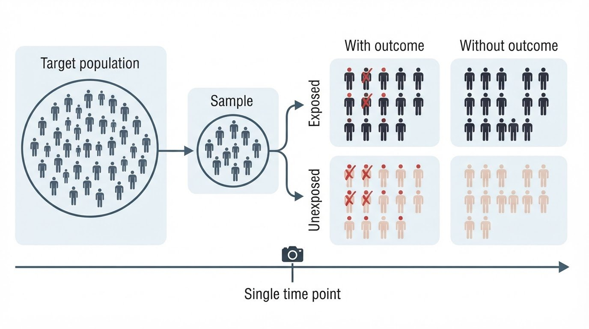 |

**English prompt**

```text
Create a study design diagram of 【a cross-sectional study】, read from left to right:
1. On the left, a large circle of many small people icons for the target population; an arrow leads to a smaller circle of people icons for the sample.
2. Along the bottom, a horizontal time arrow with one vertical line marking a single moment and a small camera icon on it, showing that everything is measured at the same time.
3. On the right, four groups of people icons in two rows and two columns: rows are exposed (dark icons) and unexposed (light icons); columns are with the outcome (a red mark) and without it.
Write each label only once in the whole figure.
If a component appears in more than one place or panel, write its label only at its first appearance; every other copy has no text. No label may appear twice anywhere in the figure. Spell every label exactly as given and add no titles.
Labels, each used once, no other text: 【Target population, Sample, Single time point, Exposed, Unexposed, With outcome, Without outcome】.

Style: journal-style schematic diagram. Clean flat vector graphics on a white background. Modules are rounded rectangles or simple icons with their short names inside; light pastel panels group related layers. Only 3-4 muted colors, each with one fixed meaning. Thin, uniform arrows show the flow of data, energy, material or influence; dashed arrows for indirect or feedback links. Sans-serif English labels only, each label appears exactly once, spelled exactly as given. No 3D rendering, no shadows, no glow, no cyberpunk or tech-background decoration, no photorealism.
```

<details><summary>Chinese prompt</summary>

```text
画一张【横断面研究】的设计图，从左往右读：
1. 左侧一个大圆，里面是许多小人形图标，代表目标人群；一条箭头指向一个较小的圆，代表样本。
2. 底部一条横向时间箭头，上面一条竖线标出单一时间点，竖线上有一个小相机图标，表示所有指标在同一时间测量。
3. 右侧四组人形图标，排成两行两列：行是暴露（深色图标）和未暴露（浅色图标）；列是有结局（红色标记）和无结局。
整张图里每个标签只写一次。
如果同一组件在多处或多个面板出现，只在第一次出现时写标签，其余副本不写字。整张图里任何标签都不能出现两次。每个标签拼写与给定完全一致，不加标题。
标签（每个只出现一次，不加其他文字）：【Target population, Sample, Single time point, Exposed, Unexposed, With outcome, Without outcome】。

风格：期刊式示意框图。白色背景上干净的扁平矢量图形。模块画成圆角矩形或简洁图标，名称写在里面；用浅色面板把相关的层归在一起。只用 3–4 种低饱和度颜色，每种颜色含义固定。细而粗细一致的箭头表示数据、能量、物质或影响的流向，间接或反馈关系用虚线箭头。图中文字只用英文无衬线字体，每个标签只出现一次，拼写与给定完全一致。不要 3D 渲染、阴影、发光、赛博朋克或科技感背景装饰，不要照片质感。
```

</details>

Model: Nano Banana 2 Lite (gemini-3.1-flash-lite-image, 1K) · Generated 6 times in total; shown are the outputs that passed review

[↑ Back to top](#top)

<sub><a href="https://yila.ai/?utm_source=github&utm_medium=readme&utm_campaign=sci-figure-prompts&utm_content=cross-sectional-design">Try in Yila →</a></sub>

---

<a id="no-7"></a>

### No. 7: Generic data processing pipeline

by [@Yila-AI](https://github.com/Yila-AI)

Technique: **one panel per step, step names only** · Style: flat workflow · Aspect ratio: 16:9

| English prompt | Chinese prompt |
|---|---|
| 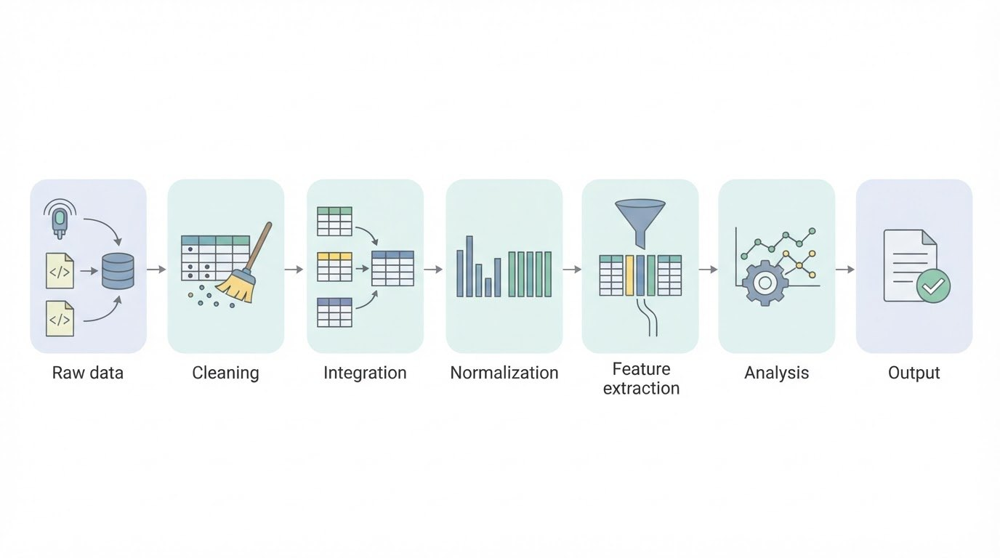 | 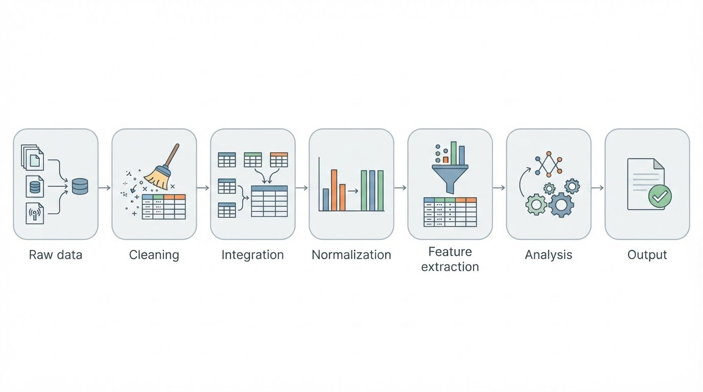 |

**English prompt**

```text
Create a workflow figure for 【a data processing pipeline】, 7 steps from left to right:
1. 【Raw data: files, a sensor and a database flowing in】
2. 【Cleaning: a broom sweeping stray dots out of a table】
3. 【Integration: several small tables merging into one】
4. 【Normalization: uneven bars becoming the same height, drawn as icons only】
5. 【Feature extraction: a funnel pulling a few key columns from a table】
6. 【Analysis: a small model with gears】
7. 【Output: a document with a check mark】
Do not write the numbered sentences in the figure.
Step names, each used once, no other text: 【Raw data, Cleaning, Integration, Normalization, Feature extraction, Analysis, Output】.

Style: journal-style experimental workflow figure. Clean flat vector icons on a white background, one light pastel rounded panel per step, thin gray arrows between panels. Only 3-4 muted colors. Each panel shows one simple scene with no text inside it; the only text in the whole figure is the step names given. Sans-serif English, each step name appears exactly once, spelled exactly as given. No legends, no captions, no extra labels, no 3D rendering, no shadows, no decorative background.
```

<details><summary>Chinese prompt</summary>

```text
画一张【数据处理】的流程图，从左往右七步：
1. 【原始数据：文件、传感器和数据库汇入】
2. 【清洗：扫帚把表格里的杂点扫掉】
3. 【整合：几张小表合并成一张】
4. 【标准化：高低不齐的条变成一样高（只画图标）】
5. 【特征提取：漏斗从表格中筛出几列关键数据】
6. 【分析：一个带齿轮的小模型】
7. 【输出：一份带对勾的文档】
不要把编号句子写进图里。
步骤名（每个只出现一次，不加其他文字）：【Raw data, Cleaning, Integration, Normalization, Feature extraction, Analysis, Output】。

风格：期刊式实验流程图。白色背景上干净的扁平矢量图标，每一步一个浅色圆角面板，面板之间用细灰色箭头连接。只用 3–4 种低饱和度颜色。每个面板里只画一个简洁的小场景，面板内不写任何文字；整张图唯一的文字就是给定的步骤名。用英文无衬线字体，每个步骤名只出现一次，拼写与给定完全一致。不要图例、不要说明文字、不要额外标签、不要 3D 渲染、阴影或装饰性背景。
```

</details>

Model: Nano Banana 2 Lite (gemini-3.1-flash-lite-image, 1K) · Generated 2 times in total; shown are the outputs that passed review

[↑ Back to top](#top)

<sub><a href="https://yila.ai/?utm_source=github&utm_medium=readme&utm_campaign=sci-figure-prompts&utm_content=data-processing-pipeline">Try in Yila →</a></sub>

---

<a id="no-8"></a>

### No. 8: Delphi method workflow

by [@Yila-AI](https://github.com/Yila-AI)

Technique: **one panel per step, step names only** · Style: flat workflow · Aspect ratio: 16:9

| Chinese prompt |
|---|
| 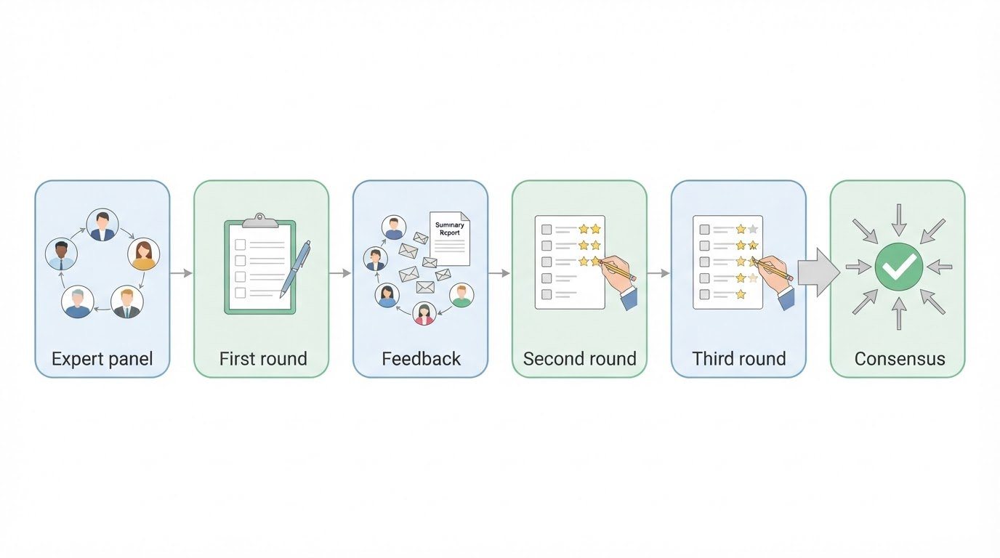 |

**English prompt**

```text
Create a workflow figure for 【a Delphi consensus study】, 6 steps from left to right:
1. 【Expert panel: a circle of expert icons, each kept apart from the others】
2. 【First round: an open questionnaire on a clipboard】
3. 【Feedback: an anonymous summary sheet sent back to every expert】
4. 【Second round: experts rating items with star icons】
5. 【Third round: experts re-rating after seeing the group summary】
6. 【Consensus: many arrows converging on one check mark】
Do not write the numbered sentences in the figure.
Step names, each used once, no other text: 【Expert panel, First round, Feedback, Second round, Third round, Consensus】.

Style: journal-style experimental workflow figure. Clean flat vector icons on a white background, one light pastel rounded panel per step, thin gray arrows between panels. Only 3-4 muted colors. Each panel shows one simple scene with no text inside it; the only text in the whole figure is the step names given. Sans-serif English, each step name appears exactly once, spelled exactly as given. No legends, no captions, no extra labels, no 3D rendering, no shadows, no decorative background.
```

<details><summary>Chinese prompt</summary>

```text
画一张【德尔菲专家共识研究】的流程图，从左往右六步：
1. 【专家小组：一圈彼此分开的专家图标】
2. 【第一轮：写字板上的开放式问卷】
3. 【反馈：一份匿名汇总表发回给每位专家】
4. 【第二轮：专家用星形图标给条目打分】
5. 【第三轮：专家看过汇总后重新打分】
6. 【达成共识：许多箭头汇向一个对勾】
不要把编号句子写进图里。
步骤名（每个只出现一次，不加其他文字）：【Expert panel, First round, Feedback, Second round, Third round, Consensus】。

风格：期刊式实验流程图。白色背景上干净的扁平矢量图标，每一步一个浅色圆角面板，面板之间用细灰色箭头连接。只用 3–4 种低饱和度颜色。每个面板里只画一个简洁的小场景，面板内不写任何文字；整张图唯一的文字就是给定的步骤名。用英文无衬线字体，每个步骤名只出现一次，拼写与给定完全一致。不要图例、不要说明文字、不要额外标签、不要 3D 渲染、阴影或装饰性背景。
```

</details>

Model: Nano Banana 2 Lite (gemini-3.1-flash-lite-image, 1K) · Generated 2 times in total; shown are the outputs that passed review

[↑ Back to top](#top)

<sub><a href="https://yila.ai/?utm_source=github&utm_medium=readme&utm_campaign=sci-figure-prompts&utm_content=delphi-method">Try in Yila →</a></sub>

---

<a id="no-9"></a>

### No. 9: Drug development pipeline

by [@Yila-AI](https://github.com/Yila-AI)

Technique: **a funnel that narrows stage by stage** · Style: schematic diagram · Aspect ratio: 16:9

| English prompt | Chinese prompt |
|---|---|
|  |  |

**English prompt**

```text
Create a drug development pipeline for 【a small-molecule drug】: a horizontal funnel that narrows from left to right, divided into six stages, each with one icon:
【target identification (a protein), screening (a well plate), lead optimization (a molecule with a wrench), preclinical studies (a mouse), clinical trials (a patient), approval (a stamp)】.
Write each label only once in the whole figure.
Labels, each used once, no other text: 【Target identification, Screening, Lead optimization, Preclinical, Clinical trials, Approval】.

Style: journal-style schematic diagram. Clean flat vector graphics on a white background. Modules are rounded rectangles or simple icons with their short names inside; light pastel panels group related layers. Only 3-4 muted colors, each with one fixed meaning. Thin, uniform arrows show the flow of data, energy, material or influence; dashed arrows for indirect or feedback links. Sans-serif English labels only, each label appears exactly once, spelled exactly as given. No 3D rendering, no shadows, no glow, no cyberpunk or tech-background decoration, no photorealism.
```

<details><summary>Chinese prompt</summary>

```text
画一张【小分子药物】的研发管线图：一个从左往右逐渐收窄的横向漏斗，分成六段，每段一个图标：
【靶点发现（蛋白质）、筛选（孔板）、先导优化（带扳手的分子）、临床前研究（小鼠）、临床试验（病人）、审批（印章）】。
整张图里每个标签只写一次。
标签（每个只出现一次，不加其他文字）：【Target identification, Screening, Lead optimization, Preclinical, Clinical trials, Approval】。

风格：期刊式示意框图。白色背景上干净的扁平矢量图形。模块画成圆角矩形或简洁图标，名称写在里面；用浅色面板把相关的层归在一起。只用 3–4 种低饱和度颜色，每种颜色含义固定。细而粗细一致的箭头表示数据、能量、物质或影响的流向，间接或反馈关系用虚线箭头。图中文字只用英文无衬线字体，每个标签只出现一次，拼写与给定完全一致。不要 3D 渲染、阴影、发光、赛博朋克或科技感背景装饰，不要照片质感。
```

</details>

Model: Nano Banana 2 Lite (gemini-3.1-flash-lite-image, 1K) · Generated 4 times in total; shown are the outputs that passed review

[↑ Back to top](#top)

<sub><a href="https://yila.ai/?utm_source=github&utm_medium=readme&utm_campaign=sci-figure-prompts&utm_content=drug-development-pipeline">Try in Yila →</a></sub>

---

<a id="no-10"></a>

### No. 10: Evidence chain: in vitro, in vivo, clinical

by [@Yila-AI](https://github.com/Yila-AI)

Technique: **three lines of evidence converging on one conclusion** · Style: schematic diagram · Aspect ratio: 16:9

| English prompt | Chinese prompt |
|---|---|
|  |  |

**English prompt**

```text
Create an evidence-chain figure for 【a mechanism study】, read from left to right. Draw each relationship exactly as listed and nothing more:
1. 【Three stacked panels on the left, each with one icon: in vitro (a culture dish), in vivo (a mouse), clinical samples (a test tube with a patient icon).】
2. 【Each panel points with an arrow to one box on the right for the conclusion.】
Do not write the numbered sentences in the figure.
Labels, each used once, no other text: 【In vitro, In vivo, Clinical samples, Conclusion】.

Style: journal-style schematic diagram. Clean flat vector graphics on a white background. Modules are rounded rectangles or simple icons with their short names inside; light pastel panels group related layers. Only 3-4 muted colors, each with one fixed meaning. Thin, uniform arrows show the flow of data, energy, material or influence; dashed arrows for indirect or feedback links. Sans-serif English labels only, each label appears exactly once, spelled exactly as given. No 3D rendering, no shadows, no glow, no cyberpunk or tech-background decoration, no photorealism.
```

<details><summary>Chinese prompt</summary>

```text
画一张【机制研究】的证据链图，从左往右读。严格按下面列出的关系画，不多画：
1. 【左侧上下排列三个面板，各配一个图标：体外（培养皿）、体内（小鼠）、临床样本（试管加病人图标）。】
2. 【每个面板都用箭头指向右侧一个代表结论的框。】
不要把编号句子写进图里。
标签（每个只出现一次，不加其他文字）：【In vitro, In vivo, Clinical samples, Conclusion】。

风格：期刊式示意框图。白色背景上干净的扁平矢量图形。模块画成圆角矩形或简洁图标，名称写在里面；用浅色面板把相关的层归在一起。只用 3–4 种低饱和度颜色，每种颜色含义固定。细而粗细一致的箭头表示数据、能量、物质或影响的流向，间接或反馈关系用虚线箭头。图中文字只用英文无衬线字体，每个标签只出现一次，拼写与给定完全一致。不要 3D 渲染、阴影、发光、赛博朋克或科技感背景装饰，不要照片质感。
```

</details>

Model: Nano Banana 2 Lite (gemini-3.1-flash-lite-image, 1K) · Generated 2 times in total; shown are the outputs that passed review

[↑ Back to top](#top)

<sub><a href="https://yila.ai/?utm_source=github&utm_medium=readme&utm_campaign=sci-figure-prompts&utm_content=evidence-chain">Try in Yila →</a></sub>

---

<a id="no-11"></a>

### No. 11: 2×2 factorial design

by [@Yila-AI](https://github.com/Yila-AI)

Technique: **two factors crossed into four cells** · Style: schematic diagram · Aspect ratio: 1:1

| Chinese prompt |
|---|
| 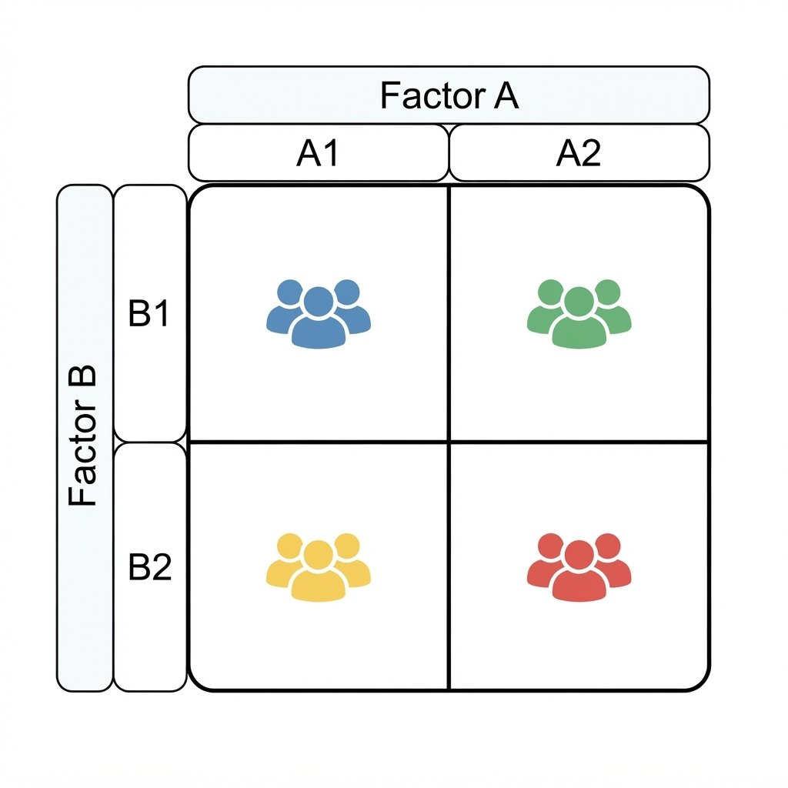 |

**English prompt**

```text
Create a diagram of 【a 2×2 factorial experimental design】: a square grid of four cells. Along the top, two column headers for the two levels of Factor A; along the left side, two row headers for the two levels of Factor B. Each of the four cells contains a small group-of-people icon in a different light color, with no text inside the cells.
Write each label only once in the whole figure.
Labels, each used once, no other text: 【Factor A, Factor B, A1, A2, B1, B2】.

Style: journal-style schematic diagram. Clean flat vector graphics on a white background. Modules are rounded rectangles or simple icons with their short names inside; light pastel panels group related layers. Only 3-4 muted colors, each with one fixed meaning. Thin, uniform arrows show the flow of data, energy, material or influence; dashed arrows for indirect or feedback links. Sans-serif English labels only, each label appears exactly once, spelled exactly as given. No 3D rendering, no shadows, no glow, no cyberpunk or tech-background decoration, no photorealism.
```

<details><summary>Chinese prompt</summary>

```text
画一张【2×2 析因实验设计】示意图：一个由四个格子组成的方形网格。上方是因素 A 两个水平的列标题，左侧是因素 B 两个水平的行标题。四个格子里各放一个小人群图标，颜色各不相同，格子内不写字。
整张图里每个标签只写一次。
标签（每个只出现一次，不加其他文字）：【Factor A, Factor B, A1, A2, B1, B2】。

风格：期刊式示意框图。白色背景上干净的扁平矢量图形。模块画成圆角矩形或简洁图标，名称写在里面；用浅色面板把相关的层归在一起。只用 3–4 种低饱和度颜色，每种颜色含义固定。细而粗细一致的箭头表示数据、能量、物质或影响的流向，间接或反馈关系用虚线箭头。图中文字只用英文无衬线字体，每个标签只出现一次，拼写与给定完全一致。不要 3D 渲染、阴影、发光、赛博朋克或科技感背景装饰，不要照片质感。
```

</details>

Model: Nano Banana 2 Lite (gemini-3.1-flash-lite-image, 1K) · Generated 4 times in total; shown are the outputs that passed review

[↑ Back to top](#top)

<sub><a href="https://yila.ai/?utm_source=github&utm_medium=readme&utm_campaign=sci-figure-prompts&utm_content=factorial-design-2x2">Try in Yila →</a></sub>

---

<a id="no-12"></a>

### No. 12: Focus group study workflow

by [@Yila-AI](https://github.com/Yila-AI)

Technique: **one panel per step, step names only** · Style: flat workflow · Aspect ratio: 16:9

| English prompt | Chinese prompt |
|---|---|
| 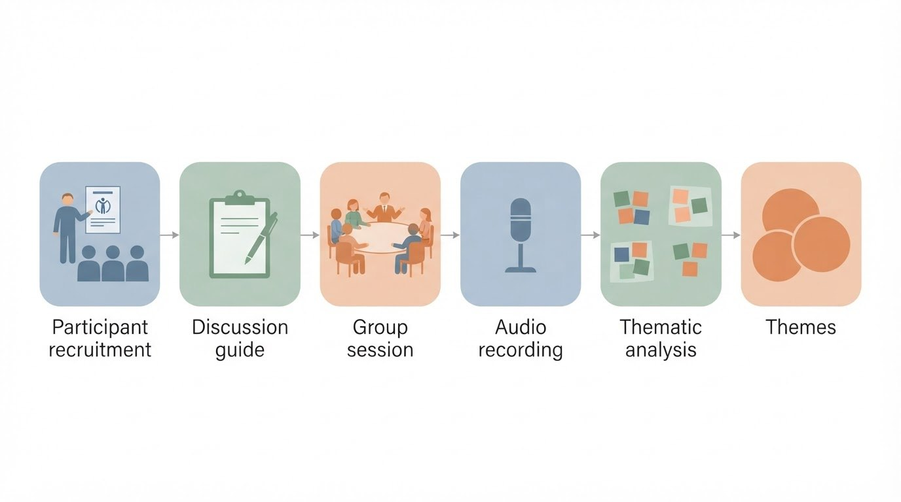 | 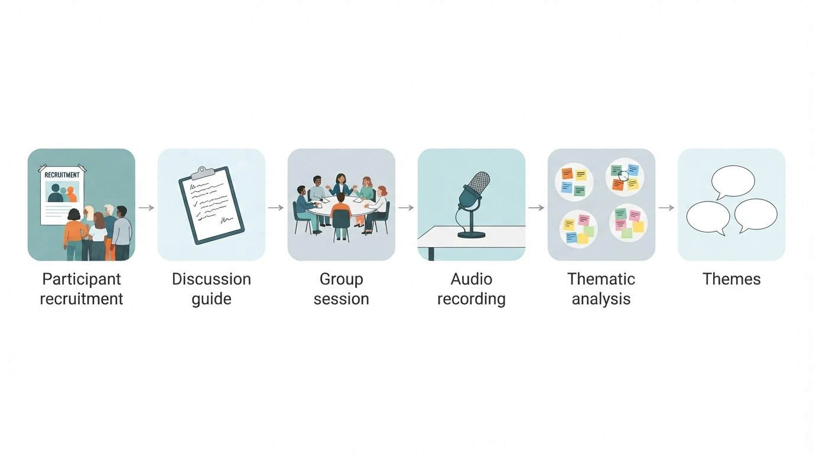 |

**English prompt**

```text
Create a workflow figure for 【a focus group study】, 6 steps from left to right:
1. 【Participant recruitment: a poster and a few people】
2. 【Discussion guide: a clipboard with a few lines】
3. 【Group session: six people around a table with a moderator】
4. 【Audio recording: a microphone】
5. 【Thematic analysis: colored sticky notes grouped into clusters】
6. 【Themes: three labeled-looking bubbles without text】
Do not write the numbered sentences in the figure.
Step names, each used once, no other text: 【Participant recruitment, Discussion guide, Group session, Audio recording, Thematic analysis, Themes】.

Style: journal-style experimental workflow figure. Clean flat vector icons on a white background, one light pastel rounded panel per step, thin gray arrows between panels. Only 3-4 muted colors. Each panel shows one simple scene with no text inside it; the only text in the whole figure is the step names given. Sans-serif English, each step name appears exactly once, spelled exactly as given. No legends, no captions, no extra labels, no 3D rendering, no shadows, no decorative background.
```

<details><summary>Chinese prompt</summary>

```text
画一张【焦点小组研究】的流程图，从左往右六步：
1. 【招募参与者：一张海报和几个人】
2. 【访谈提纲：写着几行字的写字板】
3. 【小组讨论：六人围坐一桌，一位主持人】
4. 【录音：一个麦克风】
5. 【主题分析：彩色便签归成几簇】
6. 【主题：三个气泡（气泡里不写字）】
不要把编号句子写进图里。
步骤名（每个只出现一次，不加其他文字）：【Participant recruitment, Discussion guide, Group session, Audio recording, Thematic analysis, Themes】。

风格：期刊式实验流程图。白色背景上干净的扁平矢量图标，每一步一个浅色圆角面板，面板之间用细灰色箭头连接。只用 3–4 种低饱和度颜色。每个面板里只画一个简洁的小场景，面板内不写任何文字；整张图唯一的文字就是给定的步骤名。用英文无衬线字体，每个步骤名只出现一次，拼写与给定完全一致。不要图例、不要说明文字、不要额外标签、不要 3D 渲染、阴影或装饰性背景。
```

</details>

Model: Nano Banana 2 Lite (gemini-3.1-flash-lite-image, 1K) · Generated 4 times in total; shown are the outputs that passed review

[↑ Back to top](#top)

<sub><a href="https://yila.ai/?utm_source=github&utm_medium=readme&utm_campaign=sci-figure-prompts&utm_content=focus-group-study">Try in Yila →</a></sub>

---

<a id="no-13"></a>

### No. 13: Grant proposal: research content map

by [@Yila-AI](https://github.com/Yila-AI)

Technique: **one scientific question over three research contents** · Style: schematic diagram · Aspect ratio: 4:3

| English prompt | Chinese prompt |
|---|---|
|  |  |

**English prompt**

```text
Create a research content map for 【a grant proposal】, read from top to bottom:
1. At the top, one wide dark-outlined box for the scientific question.
2. Below it, three side-by-side rounded boxes for the three research contents, each with one small icon: 【a molecule icon, a cell icon, a mouse icon】.
3. Thin arrows run from Content 1 to Content 2 to Content 3, showing that each builds on the previous one.
4. All three boxes point down to one box for the expected outcome.
Labels, each used once, no other text: 【Scientific question, Content 1, Content 2, Content 3, Expected outcome】.

Style: journal-style schematic diagram. Clean flat vector graphics on a white background. Modules are rounded rectangles or simple icons with their short names inside; light pastel panels group related layers. Only 3-4 muted colors, each with one fixed meaning. Thin, uniform arrows show the flow of data, energy, material or influence; dashed arrows for indirect or feedback links. Sans-serif English labels only, each label appears exactly once, spelled exactly as given. No 3D rendering, no shadows, no glow, no cyberpunk or tech-background decoration, no photorealism.
```

<details><summary>Chinese prompt</summary>

```text
画一张【基金申请书】的研究内容关系图，从上往下读：
1. 顶部一个宽的深色描边框，代表科学问题。
2. 下面三个并排的圆角框，代表三项研究内容，每个框里一个小图标：【分子图标、细胞图标、小鼠图标】。
3. 细箭头从内容 1 指向内容 2 再指向内容 3，表示层层递进。
4. 三个框都向下指向一个代表预期成果的框。
标签（每个只出现一次，不加其他文字）：【Scientific question, Content 1, Content 2, Content 3, Expected outcome】。

风格：期刊式示意框图。白色背景上干净的扁平矢量图形。模块画成圆角矩形或简洁图标，名称写在里面；用浅色面板把相关的层归在一起。只用 3–4 种低饱和度颜色，每种颜色含义固定。细而粗细一致的箭头表示数据、能量、物质或影响的流向，间接或反馈关系用虚线箭头。图中文字只用英文无衬线字体，每个标签只出现一次，拼写与给定完全一致。不要 3D 渲染、阴影、发光、赛博朋克或科技感背景装饰，不要照片质感。
```

</details>

Model: Nano Banana 2 Lite (gemini-3.1-flash-lite-image, 1K) · Generated 2 times in total; shown are the outputs that passed review

[↑ Back to top](#top)

<sub><a href="https://yila.ai/?utm_source=github&utm_medium=readme&utm_campaign=sci-figure-prompts&utm_content=grant-content-map">Try in Yila →</a></sub>

---

<a id="no-14"></a>

### No. 14: Grant proposal logic loop

by [@Yila-AI](https://github.com/Yila-AI)

Technique: **five stages closed into a loop** · Style: schematic diagram · Aspect ratio: 1:1

| English prompt | Chinese prompt |
|---|---|
|  |  |

**English prompt**

```text
Create a circular logic diagram for 【a grant proposal】: five rounded boxes evenly spaced around a circle, connected clockwise by thin curved arrows, each box with one small icon:
1. 【Scientific question (a question mark)】
2. 【Hypothesis (a lightbulb)】
3. 【Objectives (a target)】
4. 【Research content (a clipboard)】
5. 【Expected results (a trophy)】
A dashed arrow runs from the last box back to the first. The center of the circle stays empty.
Labels, each used once, no other text: 【Scientific question, Hypothesis, Objectives, Research content, Expected results】.

Style: journal-style schematic diagram. Clean flat vector graphics on a white background. Modules are rounded rectangles or simple icons with their short names inside; light pastel panels group related layers. Only 3-4 muted colors, each with one fixed meaning. Thin, uniform arrows show the flow of data, energy, material or influence; dashed arrows for indirect or feedback links. Sans-serif English labels only, each label appears exactly once, spelled exactly as given. No 3D rendering, no shadows, no glow, no cyberpunk or tech-background decoration, no photorealism.
```

<details><summary>Chinese prompt</summary>

```text
画一张【基金申请书】的环形逻辑图：五个圆角框均匀分布在一个圆周上，用细弧形箭头顺时针连接，每个框一个小图标：
1. 【科学问题（问号）】
2. 【研究假说（灯泡）】
3. 【研究目标（靶心）】
4. 【研究内容（写字板）】
5. 【预期成果（奖杯）】
一条虚线箭头从最后一个框回到第一个框。圆心留空。
标签（每个只出现一次，不加其他文字）：【Scientific question, Hypothesis, Objectives, Research content, Expected results】。

风格：期刊式示意框图。白色背景上干净的扁平矢量图形。模块画成圆角矩形或简洁图标，名称写在里面；用浅色面板把相关的层归在一起。只用 3–4 种低饱和度颜色，每种颜色含义固定。细而粗细一致的箭头表示数据、能量、物质或影响的流向，间接或反馈关系用虚线箭头。图中文字只用英文无衬线字体，每个标签只出现一次，拼写与给定完全一致。不要 3D 渲染、阴影、发光、赛博朋克或科技感背景装饰，不要照片质感。
```

</details>

Model: Nano Banana 2 Lite (gemini-3.1-flash-lite-image, 1K) · Generated 3 times in total; shown are the outputs that passed review

[↑ Back to top](#top)

<sub><a href="https://yila.ai/?utm_source=github&utm_medium=readme&utm_campaign=sci-figure-prompts&utm_content=grant-logic-loop">Try in Yila →</a></sub>

---

<a id="no-15"></a>

### No. 15: Hypothesis mechanism overview

by [@Yila-AI](https://github.com/Yila-AI)

Technique: **stimulus, target, pathway, phenotype, plus intervention** · Style: flat vector schematic · Aspect ratio: 16:9

| English prompt | Chinese prompt |
|---|---|
|  |  |

**English prompt**

```text
Create a hypothesis mechanism figure for 【how a high-fat diet drives liver inflammation】, read from left to right inside one large light panel. Draw each relationship exactly as listed and nothing more:
1. 【A high-fat diet icon (a burger)】 activates 【Gene X】 (solid arrow).
2. 【Gene X】 activates 【NF-κB】 (solid arrow).
3. 【NF-κB】 leads to 【Inflammation】, shown as a small inflamed liver (solid arrow).
4. 【Drug Y】, a small pill, inhibits 【Gene X】 with a red T-bar line.
Draw no membranes or extra shapes on the capsules.
Labels, each used once, no other text: 【High-fat diet, Gene X, NF-κB, Inflammation, Drug Y】.

Style: journal-style scientific schematic. Clean flat vector illustration on a white background, light pastel rounded panels to separate regions. Only 3-4 muted colors, each with one fixed meaning; red only for inhibition or emphasis. Thin, uniform line weight. Proteins as rounded colored capsules with their names inside; membranes as lipid bilayers; activation as solid arrows, inhibition as T-bar lines, indirect effects as dashed arrows. Sans-serif English labels only, each label appears exactly once, spelled exactly as given. No 3D rendering, no shadows, no glow, no decorative background, no photorealism.
```

<details><summary>Chinese prompt</summary>

```text
画一张【高脂饮食如何导致肝脏炎症】的假说机制图，在一个大的浅色面板里从左往右读。严格按下面列出的关系画，不多画：
1. 【高脂饮食图标（汉堡）】激活【Gene X】（实线箭头）。
2. 【Gene X】激活【NF-κB】（实线箭头）。
3. 【NF-κB】导致【炎症】，画成一个发炎的小肝脏（实线箭头）。
4. 【Drug Y】画成一颗小药片，用红色 T 形线抑制【Gene X】。
不画细胞膜，胶囊上不加其他形状。
标签（每个只出现一次，不加其他文字）：【High-fat diet, Gene X, NF-κB, Inflammation, Drug Y】。

风格：期刊式科研示意图。白色背景上的干净扁平矢量插画，用浅色圆角面板区分区域。只用 3–4 种低饱和度颜色，每种颜色含义固定，红色只用于抑制或强调。线条细且粗细一致。蛋白画成彩色圆角胶囊，名称写在胶囊里；细胞膜画成磷脂双分子层；激活用实线箭头，抑制用 T 形线，间接作用用虚线箭头。图中文字只用英文无衬线字体，每个标签只出现一次，拼写与给定完全一致。不要 3D 渲染、阴影、发光、装饰性背景或照片质感。
```

</details>

Model: Nano Banana 2 Lite (gemini-3.1-flash-lite-image, 1K) · Generated 5 times in total; shown are the outputs that passed review

[↑ Back to top](#top)

<sub><a href="https://yila.ai/?utm_source=github&utm_medium=readme&utm_campaign=sci-figure-prompts&utm_content=hypothesis-mechanism">Try in Yila →</a></sub>

---

<a id="no-16"></a>

### No. 16: Lab research program overview

by [@Yila-AI](https://github.com/Yila-AI)

Technique: **one core question in the center, directions around it** · Style: schematic diagram · Aspect ratio: 1:1

| English prompt |
|---|
| 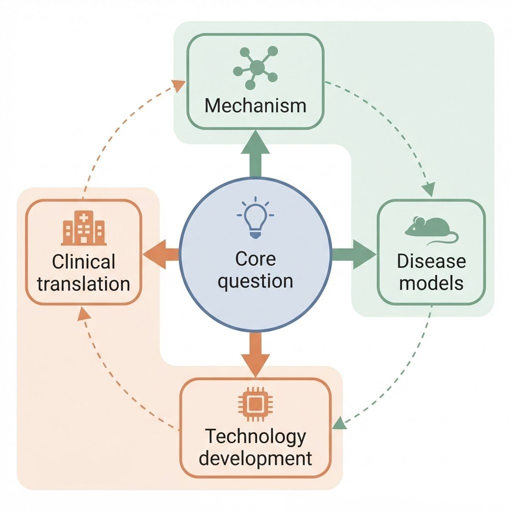 |

> The Chinese-prompt output did not pass review, so it is not shown.

**English prompt**

```text
Create a research program overview for 【a lab studying tumor immunity】: one large circle in the center for the core question, with a small lightbulb icon. Around it, four rounded boxes evenly spaced, each linked to the center by a thick arrow and each with one icon:
【mechanism (a molecule), disease models (a mouse), technology development (a microchip), clinical translation (a hospital)】.
Thin dashed arrows link each box to its two neighbors, forming an outer ring that shows the directions feed each other.
Write each label only once in the whole figure.
Labels, each used once, no other text: 【Core question, Mechanism, Disease models, Technology development, Clinical translation】.

Style: journal-style schematic diagram. Clean flat vector graphics on a white background. Modules are rounded rectangles or simple icons with their short names inside; light pastel panels group related layers. Only 3-4 muted colors, each with one fixed meaning. Thin, uniform arrows show the flow of data, energy, material or influence; dashed arrows for indirect or feedback links. Sans-serif English labels only, each label appears exactly once, spelled exactly as given. No 3D rendering, no shadows, no glow, no cyberpunk or tech-background decoration, no photorealism.
```

<details><summary>Chinese prompt</summary>

```text
画一张【肿瘤免疫课题组】的研究方向总览图：中央一个大圆代表核心问题，配一个小灯泡图标。四周均匀排列四个圆角框，每个框用粗箭头连到中心，各配一个图标：
【机制（分子）、疾病模型（小鼠）、技术开发（芯片）、临床转化（医院）】。
细虚线箭头把每个框和左右相邻的两个框连起来，形成外圈，表示各方向互相支撑。
整张图里每个标签只写一次。
标签（每个只出现一次，不加其他文字）：【Core question, Mechanism, Disease models, Technology development, Clinical translation】。

风格：期刊式示意框图。白色背景上干净的扁平矢量图形。模块画成圆角矩形或简洁图标，名称写在里面；用浅色面板把相关的层归在一起。只用 3–4 种低饱和度颜色，每种颜色含义固定。细而粗细一致的箭头表示数据、能量、物质或影响的流向，间接或反馈关系用虚线箭头。图中文字只用英文无衬线字体，每个标签只出现一次，拼写与给定完全一致。不要 3D 渲染、阴影、发光、赛博朋克或科技感背景装饰，不要照片质感。
```

</details>

Model: Nano Banana 2 Lite (gemini-3.1-flash-lite-image, 1K) · Generated 2 times in total; shown are the outputs that passed review

[↑ Back to top](#top)

<sub><a href="https://yila.ai/?utm_source=github&utm_medium=readme&utm_campaign=sci-figure-prompts&utm_content=lab-research-program">Try in Yila →</a></sub>

---

<a id="no-17"></a>

### No. 17: Literature search strategy workflow

by [@Yila-AI](https://github.com/Yila-AI)

Technique: **one panel per step, step names only** · Style: flat workflow · Aspect ratio: 16:9

| English prompt | Chinese prompt |
|---|---|
| 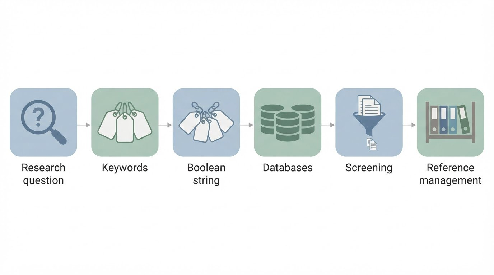 | 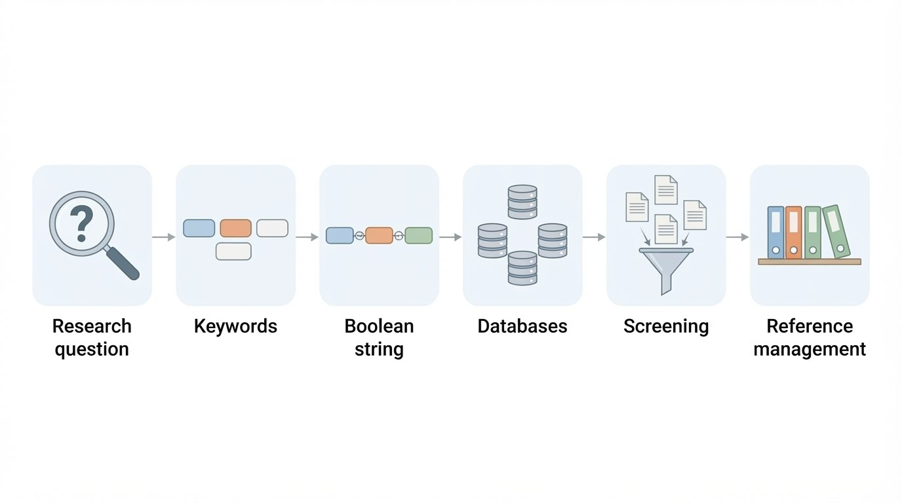 |

**English prompt**

```text
Create a workflow figure for 【a literature search】, 6 steps from left to right:
1. 【Research question: a magnifier over a question mark】
2. 【Keywords: three blank rounded tags】
3. 【Boolean string: blank tags joined by small link symbols】
4. 【Databases: three stacked database icons】
5. 【Screening: papers passing through a funnel】
6. 【Reference management: a bookshelf with colored folders】
Do not write the numbered sentences in the figure.
Every icon is a pure picture with no words, letters or chemical structures inside it.
Step names, each used once, no other text: 【Research question, Keywords, Boolean string, Databases, Screening, Reference management】.

Style: journal-style experimental workflow figure. Clean flat vector icons on a white background, one light pastel rounded panel per step, thin gray arrows between panels. Only 3-4 muted colors. Each panel shows one simple scene with no text inside it; the only text in the whole figure is the step names given. Sans-serif English, each step name appears exactly once, spelled exactly as given. No legends, no captions, no extra labels, no 3D rendering, no shadows, no decorative background.
```

<details><summary>Chinese prompt</summary>

```text
画一张【文献检索】的流程图，从左往右六步：
1. 【研究问题：放大镜对着问号】
2. 【关键词：三个空白圆角标签】
3. 【布尔检索式：空白标签用小连接符串起来】
4. 【数据库：三个叠放的数据库图标】
5. 【筛选：论文穿过漏斗】
6. 【文献管理：放着彩色文件夹的书架】
不要把编号句子写进图里。
所有图标都是纯图形，里面不写任何单词、字母，也不画化学结构式。
步骤名（每个只出现一次，不加其他文字）：【Research question, Keywords, Boolean string, Databases, Screening, Reference management】。

风格：期刊式实验流程图。白色背景上干净的扁平矢量图标，每一步一个浅色圆角面板，面板之间用细灰色箭头连接。只用 3–4 种低饱和度颜色。每个面板里只画一个简洁的小场景，面板内不写任何文字；整张图唯一的文字就是给定的步骤名。用英文无衬线字体，每个步骤名只出现一次，拼写与给定完全一致。不要图例、不要说明文字、不要额外标签、不要 3D 渲染、阴影或装饰性背景。
```

</details>

Model: Nano Banana 2 Lite (gemini-3.1-flash-lite-image, 1K) · Generated 8 times in total; shown are the outputs that passed review

[↑ Back to top](#top)

<sub><a href="https://yila.ai/?utm_source=github&utm_medium=readme&utm_campaign=sci-figure-prompts&utm_content=literature-search-strategy">Try in Yila →</a></sub>

---

<a id="no-18"></a>

### No. 18: Method comparison: conventional versus proposed

by [@Yila-AI](https://github.com/Yila-AI)

Technique: **two rows compared** · Style: schematic diagram · Aspect ratio: 16:9

| English prompt | Chinese prompt |
|---|---|
|  |  |

**English prompt**

```text
Create a comparison figure of 【a conventional method versus a proposed method】: two horizontal rows in two light colors.
1. Top row, gray: 【four small steps in a long chain with an hourglass icon and a hand icon, ending in a blurry result】.
2. Bottom row, blue: 【two steps with a lightning icon and a robot-arm icon, ending in a sharp result】.
Each row has its name on the far left and a short tag at its result on the right.
Write each label only once in the whole figure.
Labels, each used once, no other text: 【Conventional method, Proposed method, Manual, slow, Automated, fast, Low resolution, High resolution】.

Style: journal-style schematic diagram. Clean flat vector graphics on a white background. Modules are rounded rectangles or simple icons with their short names inside; light pastel panels group related layers. Only 3-4 muted colors, each with one fixed meaning. Thin, uniform arrows show the flow of data, energy, material or influence; dashed arrows for indirect or feedback links. Sans-serif English labels only, each label appears exactly once, spelled exactly as given. No 3D rendering, no shadows, no glow, no cyberpunk or tech-background decoration, no photorealism.
```

<details><summary>Chinese prompt</summary>

```text
画一张【传统方法与新方法】的对比图：上下两行，两种浅色。
1. 上排，灰色：【四个小步骤连成一条长链，配沙漏图标和手的图标，结尾是一个模糊的结果】。
2. 下排，蓝色：【两个步骤，配闪电图标和机械臂图标，结尾是一个清晰的结果】。
每行最左侧写行名，右侧结果处写一个短标签。
整张图里每个标签只写一次。
标签（每个只出现一次，不加其他文字）：【Conventional method, Proposed method, Manual, slow, Automated, fast, Low resolution, High resolution】。

风格：期刊式示意框图。白色背景上干净的扁平矢量图形。模块画成圆角矩形或简洁图标，名称写在里面；用浅色面板把相关的层归在一起。只用 3–4 种低饱和度颜色，每种颜色含义固定。细而粗细一致的箭头表示数据、能量、物质或影响的流向，间接或反馈关系用虚线箭头。图中文字只用英文无衬线字体，每个标签只出现一次，拼写与给定完全一致。不要 3D 渲染、阴影、发光、赛博朋克或科技感背景装饰，不要照片质感。
```

</details>

Model: Nano Banana 2 Lite (gemini-3.1-flash-lite-image, 1K) · Generated 4 times in total; shown are the outputs that passed review

[↑ Back to top](#top)

<sub><a href="https://yila.ai/?utm_source=github&utm_medium=readme&utm_campaign=sci-figure-prompts&utm_content=method-comparison">Try in Yila →</a></sub>

---

<a id="no-19"></a>

### No. 19: Multi-omics integration framework

by [@Yila-AI](https://github.com/Yila-AI)

Technique: **four omics layers feeding one integration step** · Style: schematic diagram · Aspect ratio: 16:9

| English prompt | Chinese prompt |
|---|---|
|  |  |

**English prompt**

```text
Create a multi-omics integration framework for 【a disease study】, read from left to right:
1. On the left, four stacked horizontal layers, each a light pastel band with one icon: 【Genomics (a DNA helix), Transcriptomics (an RNA strand), Proteomics (a protein), Metabolomics (a small molecule)】.
2. Thin arrows from all four layers converge into one central box for integration.
3. Integration points to a box for key pathways, which points to a final box for validation.
Labels, each used once, no other text: 【Genomics, Transcriptomics, Proteomics, Metabolomics, Integration, Key pathways, Validation】.

Style: journal-style schematic diagram. Clean flat vector graphics on a white background. Modules are rounded rectangles or simple icons with their short names inside; light pastel panels group related layers. Only 3-4 muted colors, each with one fixed meaning. Thin, uniform arrows show the flow of data, energy, material or influence; dashed arrows for indirect or feedback links. Sans-serif English labels only, each label appears exactly once, spelled exactly as given. No 3D rendering, no shadows, no glow, no cyberpunk or tech-background decoration, no photorealism.
```

<details><summary>Chinese prompt</summary>

```text
画一张【疾病研究】的多组学整合分析框架图，从左往右读：
1. 左侧四条上下叠放的横向浅色色带，每条一个图标：【基因组（DNA 双螺旋）、转录组（RNA 链）、蛋白组（蛋白质）、代谢组（小分子）】。
2. 四条色带的细箭头汇合到中间一个代表整合的框。
3. 整合框指向代表关键通路的框，再指向最后代表验证的框。
标签（每个只出现一次，不加其他文字）：【Genomics, Transcriptomics, Proteomics, Metabolomics, Integration, Key pathways, Validation】。

风格：期刊式示意框图。白色背景上干净的扁平矢量图形。模块画成圆角矩形或简洁图标，名称写在里面；用浅色面板把相关的层归在一起。只用 3–4 种低饱和度颜色，每种颜色含义固定。细而粗细一致的箭头表示数据、能量、物质或影响的流向，间接或反馈关系用虚线箭头。图中文字只用英文无衬线字体，每个标签只出现一次，拼写与给定完全一致。不要 3D 渲染、阴影、发光、赛博朋克或科技感背景装饰，不要照片质感。
```

</details>

Model: Nano Banana 2 Lite (gemini-3.1-flash-lite-image, 1K) · Generated 2 times in total; shown are the outputs that passed review

[↑ Back to top](#top)

<sub><a href="https://yila.ai/?utm_source=github&utm_medium=readme&utm_campaign=sci-figure-prompts&utm_content=multi-omics-integration">Try in Yila →</a></sub>

---

<a id="no-20"></a>

### No. 20: Technical roadmap: three parallel work packages

by [@Yila-AI](https://github.com/Yila-AI)

Technique: **three parallel lanes that converge** · Style: schematic diagram · Aspect ratio: 3:4

| English prompt | Chinese prompt |
|---|---|
|  |  |

**English prompt**

```text
Create a vertical technical roadmap for 【a research project】, read from top to bottom:
1. At the top, one box for the research goal.
2. Below it, three parallel vertical lanes in three light pastel colors, each lane with two small stacked boxes and one icon: 【data lane with a database icon, model lane with a network icon, experiment lane with a flask icon】.
3. The three lanes converge with arrows into one box for integration.
4. Integration points down to a final box for the outcome.
Labels, each used once, no other text: 【Research goal, Data, Model, Experiment, Integration, Outcome】.

Style: journal-style schematic diagram. Clean flat vector graphics on a white background. Modules are rounded rectangles or simple icons with their short names inside; light pastel panels group related layers. Only 3-4 muted colors, each with one fixed meaning. Thin, uniform arrows show the flow of data, energy, material or influence; dashed arrows for indirect or feedback links. Sans-serif English labels only, each label appears exactly once, spelled exactly as given. No 3D rendering, no shadows, no glow, no cyberpunk or tech-background decoration, no photorealism.
```

<details><summary>Chinese prompt</summary>

```text
画一张【课题研究】的竖向技术路线图，从上往下读：
1. 顶部一个框，代表研究目标。
2. 下面三条并行的竖向泳道，三种浅色，每条泳道有两个上下排列的小框和一个图标：【数据泳道配数据库图标，模型泳道配网络图标，实验泳道配烧瓶图标】。
3. 三条泳道用箭头汇合到一个代表整合的框。
4. 整合框向下指向最后一个代表成果的框。
标签（每个只出现一次，不加其他文字）：【Research goal, Data, Model, Experiment, Integration, Outcome】。

风格：期刊式示意框图。白色背景上干净的扁平矢量图形。模块画成圆角矩形或简洁图标，名称写在里面；用浅色面板把相关的层归在一起。只用 3–4 种低饱和度颜色，每种颜色含义固定。细而粗细一致的箭头表示数据、能量、物质或影响的流向，间接或反馈关系用虚线箭头。图中文字只用英文无衬线字体，每个标签只出现一次，拼写与给定完全一致。不要 3D 渲染、阴影、发光、赛博朋克或科技感背景装饰，不要照片质感。
```

</details>

Model: Nano Banana 2 Lite (gemini-3.1-flash-lite-image, 1K) · Generated 3 times in total; shown are the outputs that passed review

[↑ Back to top](#top)

<sub><a href="https://yila.ai/?utm_source=github&utm_medium=readme&utm_campaign=sci-figure-prompts&utm_content=parallel-roadmap">Try in Yila →</a></sub>

---

<a id="no-21"></a>

### No. 21: Pretest–posttest control group design

by [@Yila-AI](https://github.com/Yila-AI)

Technique: **a grid whose column headers name the stages** · Style: schematic diagram · Aspect ratio: 16:9

| English prompt | Chinese prompt |
|---|---|
| 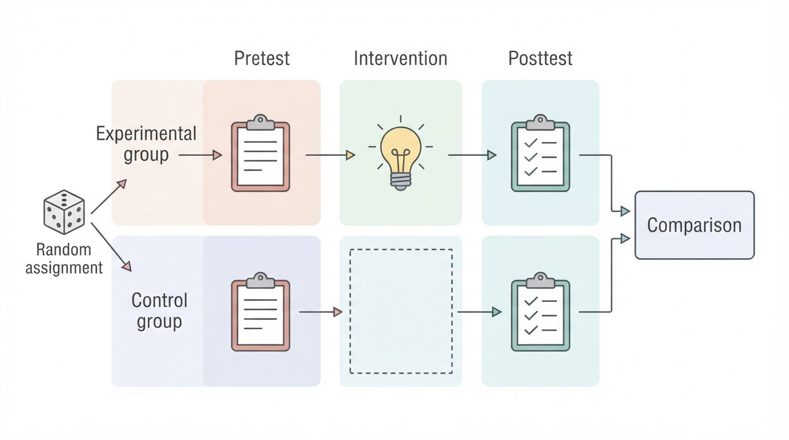 | 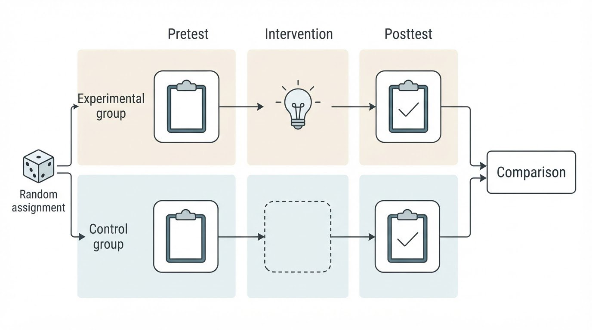 |

**English prompt**

```text
Create a research design diagram of 【a pretest–posttest control group design】 as a table-like grid with three columns and two rows.
1. Column headers across the top, written once each: 【Pretest, Intervention, Posttest】.
2. Row headers on the left, written once each: 【Experimental group, Control group】; a dice icon labeled Random assignment sits to the left of both rows with two arrows into them.
3. Top row cells: a clipboard icon, a lightbulb icon, a clipboard-with-check icon, joined by arrows.
4. Bottom row cells: a clipboard icon, an empty dashed box, a clipboard-with-check icon, joined by arrows.
5. Both Posttest cells point to one box on the right labeled Comparison.
The cells themselves contain icons only, no text. Write each label exactly once.
Labels, each used once, no other text: 【Random assignment, Experimental group, Control group, Pretest, Intervention, Posttest, Comparison】.

Style: journal-style schematic diagram. Clean flat vector graphics on a white background. Modules are rounded rectangles or simple icons with their short names inside; light pastel panels group related layers. Only 3-4 muted colors, each with one fixed meaning. Thin, uniform arrows show the flow of data, energy, material or influence; dashed arrows for indirect or feedback links. Sans-serif English labels only, each label appears exactly once, spelled exactly as given. No 3D rendering, no shadows, no glow, no cyberpunk or tech-background decoration, no photorealism.
```

<details><summary>Chinese prompt</summary>

```text
画一张【前后测对照组设计】的研究设计图，做成三列两行的表格式网格。
1. 顶部列标题各写一次：【Pretest, Intervention, Posttest】。
2. 左侧行标题各写一次：【Experimental group, Control group】；两行左边放一个标注 Random assignment 的骰子图标，用两条箭头指向两行。
3. 上行格子：写字板图标、灯泡图标、带对勾的写字板图标，用箭头连接。
4. 下行格子：写字板图标、空的虚线框、带对勾的写字板图标，用箭头连接。
5. 两个 Posttest 格子都指向右侧一个标注 Comparison 的框。
格子里只放图标，不写字。每个标签只写一次。
标签（每个只出现一次，不加其他文字）：【Random assignment, Experimental group, Control group, Pretest, Intervention, Posttest, Comparison】。

风格：期刊式示意框图。白色背景上干净的扁平矢量图形。模块画成圆角矩形或简洁图标，名称写在里面；用浅色面板把相关的层归在一起。只用 3–4 种低饱和度颜色，每种颜色含义固定。细而粗细一致的箭头表示数据、能量、物质或影响的流向，间接或反馈关系用虚线箭头。图中文字只用英文无衬线字体，每个标签只出现一次，拼写与给定完全一致。不要 3D 渲染、阴影、发光、赛博朋克或科技感背景装饰，不要照片质感。
```

</details>

Model: Nano Banana 2 Lite (gemini-3.1-flash-lite-image, 1K) · Generated 8 times in total; shown are the outputs that passed review

[↑ Back to top](#top)

<sub><a href="https://yila.ai/?utm_source=github&utm_medium=readme&utm_campaign=sci-figure-prompts&utm_content=pretest-posttest-design">Try in Yila →</a></sub>

---

<a id="no-22"></a>

### No. 22: Qualitative study: interviews and three-level coding

by [@Yila-AI](https://github.com/Yila-AI)

Technique: **one panel per step, step names only** · Style: flat workflow · Aspect ratio: 16:9

| English prompt | Chinese prompt |
|---|---|
|  |  |

**English prompt**

```text
Create a workflow figure for 【a qualitative interview study】, 6 steps from left to right:
1. 【Interviews: two people talking】
2. 【Transcription: a document with lines of text】
3. 【Open coding: many small colored tags】
4. 【Axial coding: tags grouped into a few clusters】
5. 【Selective coding: clusters linked to one core node】
6. 【Theory: a lightbulb over a small model】
Do not write the numbered sentences in the figure.
Step names, each used once, no other text: 【Interviews, Transcription, Open coding, Axial coding, Selective coding, Theory】.

Style: journal-style experimental workflow figure. Clean flat vector icons on a white background, one light pastel rounded panel per step, thin gray arrows between panels. Only 3-4 muted colors. Each panel shows one simple scene with no text inside it; the only text in the whole figure is the step names given. Sans-serif English, each step name appears exactly once, spelled exactly as given. No legends, no captions, no extra labels, no 3D rendering, no shadows, no decorative background.
```

<details><summary>Chinese prompt</summary>

```text
画一张【质性访谈研究】的流程图，从左往右六步：
1. 【访谈：两个人在交谈】
2. 【转录：一份写满行的文档】
3. 【开放式编码：许多彩色小标签】
4. 【主轴编码：标签归成几簇】
5. 【选择式编码：几簇连到一个核心节点】
6. 【理论：灯泡和一个小模型】
不要把编号句子写进图里。
步骤名（每个只出现一次，不加其他文字）：【Interviews, Transcription, Open coding, Axial coding, Selective coding, Theory】。

风格：期刊式实验流程图。白色背景上干净的扁平矢量图标，每一步一个浅色圆角面板，面板之间用细灰色箭头连接。只用 3–4 种低饱和度颜色。每个面板里只画一个简洁的小场景，面板内不写任何文字；整张图唯一的文字就是给定的步骤名。用英文无衬线字体，每个步骤名只出现一次，拼写与给定完全一致。不要图例、不要说明文字、不要额外标签、不要 3D 渲染、阴影或装饰性背景。
```

</details>

Model: Nano Banana 2 Lite (gemini-3.1-flash-lite-image, 1K) · Generated 2 times in total; shown are the outputs that passed review

[↑ Back to top](#top)

<sub><a href="https://yila.ai/?utm_source=github&utm_medium=readme&utm_campaign=sci-figure-prompts&utm_content=qualitative-coding">Try in Yila →</a></sub>

---

<a id="no-23"></a>

### No. 23: Questionnaire study workflow

by [@Yila-AI](https://github.com/Yila-AI)

Technique: **one panel per step, step names only** · Style: flat workflow · Aspect ratio: 16:9

| English prompt | Chinese prompt |
|---|---|
|  |  |

**English prompt**

```text
Create a workflow figure for 【a questionnaire study】, 6 steps from left to right:
1. 【Questionnaire design: a clipboard with check boxes】
2. 【Pilot test: a few people answering】
3. 【Distribution: a paper plane and a phone】
4. 【Data cleaning: a broom over a table】
5. 【Reliability and validity: a target with a check mark】
6. 【Analysis: a magnifier over a table】
Do not write the numbered sentences in the figure.
Step names, each used once, no other text: 【Questionnaire design, Pilot test, Distribution, Data cleaning, Reliability and validity, Analysis】.

Style: journal-style experimental workflow figure. Clean flat vector icons on a white background, one light pastel rounded panel per step, thin gray arrows between panels. Only 3-4 muted colors. Each panel shows one simple scene with no text inside it; the only text in the whole figure is the step names given. Sans-serif English, each step name appears exactly once, spelled exactly as given. No legends, no captions, no extra labels, no 3D rendering, no shadows, no decorative background.
```

<details><summary>Chinese prompt</summary>

```text
画一张【问卷研究】的流程图，从左往右六步：
1. 【问卷设计：带复选框的写字板】
2. 【预调查：几个人在作答】
3. 【发放：纸飞机和手机】
4. 【数据清洗：扫帚扫过表格】
5. 【信效度检验：带对勾的靶心】
6. 【分析：放大镜对着表格】
不要把编号句子写进图里。
步骤名（每个只出现一次，不加其他文字）：【Questionnaire design, Pilot test, Distribution, Data cleaning, Reliability and validity, Analysis】。

风格：期刊式实验流程图。白色背景上干净的扁平矢量图标，每一步一个浅色圆角面板，面板之间用细灰色箭头连接。只用 3–4 种低饱和度颜色。每个面板里只画一个简洁的小场景，面板内不写任何文字；整张图唯一的文字就是给定的步骤名。用英文无衬线字体，每个步骤名只出现一次，拼写与给定完全一致。不要图例、不要说明文字、不要额外标签、不要 3D 渲染、阴影或装饰性背景。
```

</details>

Model: Nano Banana 2 Lite (gemini-3.1-flash-lite-image, 1K) · Generated 2 times in total; shown are the outputs that passed review

[↑ Back to top](#top)

<sub><a href="https://yila.ai/?utm_source=github&utm_medium=readme&utm_campaign=sci-figure-prompts&utm_content=questionnaire-workflow">Try in Yila →</a></sub>

---

<a id="no-24"></a>

### No. 24: Randomized controlled trial design

by [@Yila-AI](https://github.com/Yila-AI)

Technique: **randomized into two parallel arms** · Style: schematic diagram · Aspect ratio: 16:9

| English prompt | Chinese prompt |
|---|---|
|  |  |

**English prompt**

```text
Create a study design diagram of 【a two-arm randomized controlled trial】, read from left to right. Draw each relationship exactly as listed and nothing more:
1. 【Eligible participants (a group of people icons) → randomization (a dice icon).】
2. 【Randomization splits into two parallel arms: intervention (a pill icon) on top, control (a placebo icon) below.】
3. 【Each arm runs through a follow-up period (a calendar icon).】
4. 【Both arms end in one box for outcome assessment.】
Do not write the numbered sentences in the figure.
Labels, each used once, no other text: 【Eligible participants, Randomization, Intervention, Control, Follow-up, Outcome assessment】.

Style: journal-style schematic diagram. Clean flat vector graphics on a white background. Modules are rounded rectangles or simple icons with their short names inside; light pastel panels group related layers. Only 3-4 muted colors, each with one fixed meaning. Thin, uniform arrows show the flow of data, energy, material or influence; dashed arrows for indirect or feedback links. Sans-serif English labels only, each label appears exactly once, spelled exactly as given. No 3D rendering, no shadows, no glow, no cyberpunk or tech-background decoration, no photorealism.
```

<details><summary>Chinese prompt</summary>

```text
画一张【双臂随机对照试验】的研究设计图，从左往右读。严格按下面列出的关系画，不多画：
1. 【符合条件的受试者（一组人形图标）→ 随机化（骰子图标）。】
2. 【随机化分成两条并行的臂：上面是干预组（药片图标），下面是对照组（安慰剂图标）。】
3. 【每条臂经过随访期（日历图标）。】
4. 【两条臂都汇入一个结局评估框。】
不要把编号句子写进图里。
标签（每个只出现一次，不加其他文字）：【Eligible participants, Randomization, Intervention, Control, Follow-up, Outcome assessment】。

风格：期刊式示意框图。白色背景上干净的扁平矢量图形。模块画成圆角矩形或简洁图标，名称写在里面；用浅色面板把相关的层归在一起。只用 3–4 种低饱和度颜色，每种颜色含义固定。细而粗细一致的箭头表示数据、能量、物质或影响的流向，间接或反馈关系用虚线箭头。图中文字只用英文无衬线字体，每个标签只出现一次，拼写与给定完全一致。不要 3D 渲染、阴影、发光、赛博朋克或科技感背景装饰，不要照片质感。
```

</details>

Model: Nano Banana 2 Lite (gemini-3.1-flash-lite-image, 1K) · Generated 4 times in total; shown are the outputs that passed review

[↑ Back to top](#top)

<sub><a href="https://yila.ai/?utm_source=github&utm_medium=readme&utm_campaign=sci-figure-prompts&utm_content=rct-design">Try in Yila →</a></sub>

---

<a id="no-25"></a>

### No. 25: Study design overview (paper Figure 1)

by [@Yila-AI](https://github.com/Yila-AI)

Technique: **three panels: subjects, methods, findings** · Style: schematic diagram · Aspect ratio: 16:9

| English prompt | Chinese prompt |
|---|---|
|  |  |

**English prompt**

```text
Create a study design overview figure for 【a study on immunotherapy response in lung cancer】, three light pastel panels read from left to right, connected by thin arrows:
1. Left panel: 【a group of patient icons and a tissue sample tube】.
2. Middle panel: 【three method icons side by side: sequencing, imaging and a computer model】.
3. Right panel: 【a validation icon (a mouse) leading to a lightbulb for the key finding】.
Labels, each used once, no other text: 【Patients, Samples, Sequencing, Imaging, Modeling, Validation, Key finding】.

Style: journal-style schematic diagram. Clean flat vector graphics on a white background. Modules are rounded rectangles or simple icons with their short names inside; light pastel panels group related layers. Only 3-4 muted colors, each with one fixed meaning. Thin, uniform arrows show the flow of data, energy, material or influence; dashed arrows for indirect or feedback links. Sans-serif English labels only, each label appears exactly once, spelled exactly as given. No 3D rendering, no shadows, no glow, no cyberpunk or tech-background decoration, no photorealism.
```

<details><summary>Chinese prompt</summary>

```text
画一张【肺癌免疫治疗应答研究】的研究设计总览图，三个浅色面板从左往右读，用细箭头连接：
1. 左面板：【一组病人图标和一支组织样本管】。
2. 中面板：【三个并排的方法图标：测序、影像、计算模型】。
3. 右面板：【一个验证图标（小鼠）通向代表关键发现的灯泡】。
标签（每个只出现一次，不加其他文字）：【Patients, Samples, Sequencing, Imaging, Modeling, Validation, Key finding】。

风格：期刊式示意框图。白色背景上干净的扁平矢量图形。模块画成圆角矩形或简洁图标，名称写在里面；用浅色面板把相关的层归在一起。只用 3–4 种低饱和度颜色，每种颜色含义固定。细而粗细一致的箭头表示数据、能量、物质或影响的流向，间接或反馈关系用虚线箭头。图中文字只用英文无衬线字体，每个标签只出现一次，拼写与给定完全一致。不要 3D 渲染、阴影、发光、赛博朋克或科技感背景装饰，不要照片质感。
```

</details>

Model: Nano Banana 2 Lite (gemini-3.1-flash-lite-image, 1K) · Generated 3 times in total; shown are the outputs that passed review

[↑ Back to top](#top)

<sub><a href="https://yila.ai/?utm_source=github&utm_medium=readme&utm_campaign=sci-figure-prompts&utm_content=study-overview">Try in Yila →</a></sub>

---

<a id="no-26"></a>

### No. 26: Systematic review and meta-analysis workflow

by [@Yila-AI](https://github.com/Yila-AI)

Technique: **six steps, no study counts** · Style: flat workflow · Aspect ratio: 16:9

| English prompt | Chinese prompt |
|---|---|
|  |  |

**English prompt**

```text
Create a workflow figure for 【a systematic review and meta-analysis】, six steps from left to right:
1. 【Research question: a magnifier over four small boxes for population, intervention, comparison and outcome】
2. 【Database search: three stacked database icons】
3. 【Screening: a stack of papers passing through a funnel】
4. 【Data extraction: a paper with a table icon】
5. 【Risk of bias: a shield with a check mark】
6. 【Synthesis: several small blocks merging into one】
Step names, each used once, no other text: 【Research question, Search, Screening, Data extraction, Risk of bias, Synthesis】.

Style: journal-style experimental workflow figure. Clean flat vector icons on a white background, one light pastel rounded panel per step, thin gray arrows between panels. Only 3-4 muted colors. Each panel shows one simple scene with no text inside it; the only text in the whole figure is the step names given. Sans-serif English, each step name appears exactly once, spelled exactly as given. No legends, no captions, no extra labels, no 3D rendering, no shadows, no decorative background.
```

<details><summary>Chinese prompt</summary>

```text
画一张【系统综述与 meta 分析】的流程图，从左往右六步：
1. 【研究问题：放大镜下有四个小方块，代表人群、干预、对照、结局】
2. 【数据库检索：三个叠放的数据库图标】
3. 【筛选：一叠论文穿过漏斗】
4. 【数据提取：一篇论文配表格图标】
5. 【偏倚风险评估：带对勾的盾牌】
6. 【证据合成：几个小方块汇成一个】
步骤名（每个只出现一次，不加其他文字）：【Research question, Search, Screening, Data extraction, Risk of bias, Synthesis】。

风格：期刊式实验流程图。白色背景上干净的扁平矢量图标，每一步一个浅色圆角面板，面板之间用细灰色箭头连接。只用 3–4 种低饱和度颜色。每个面板里只画一个简洁的小场景，面板内不写任何文字；整张图唯一的文字就是给定的步骤名。用英文无衬线字体，每个步骤名只出现一次，拼写与给定完全一致。不要图例、不要说明文字、不要额外标签、不要 3D 渲染、阴影或装饰性背景。
```

</details>

Model: Nano Banana 2 Lite (gemini-3.1-flash-lite-image, 1K) · Generated 2 times in total; shown are the outputs that passed review

[↑ Back to top](#top)

<sub><a href="https://yila.ai/?utm_source=github&utm_medium=readme&utm_campaign=sci-figure-prompts&utm_content=systematic-review-workflow">Try in Yila →</a></sub>

---

<a id="no-27"></a>

### No. 27: Three-layer framework: objectives, content, methods

by [@Yila-AI](https://github.com/Yila-AI)

Technique: **three stacked layers, each supporting the one above** · Style: schematic diagram · Aspect ratio: 4:3

| English prompt | Chinese prompt |
|---|---|
| 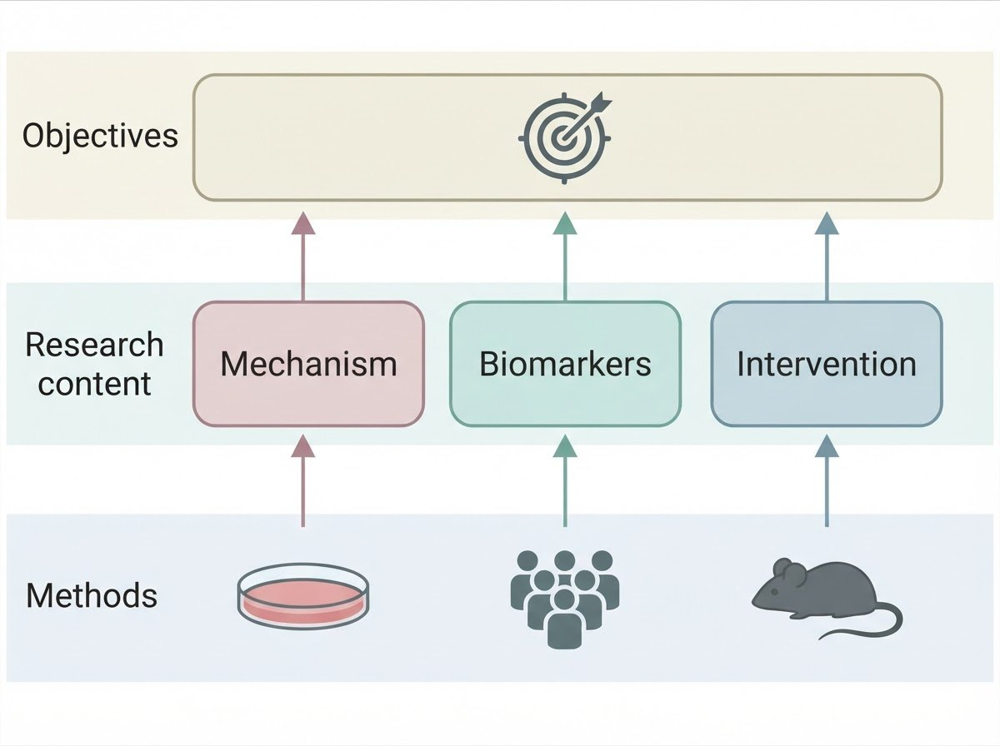 | 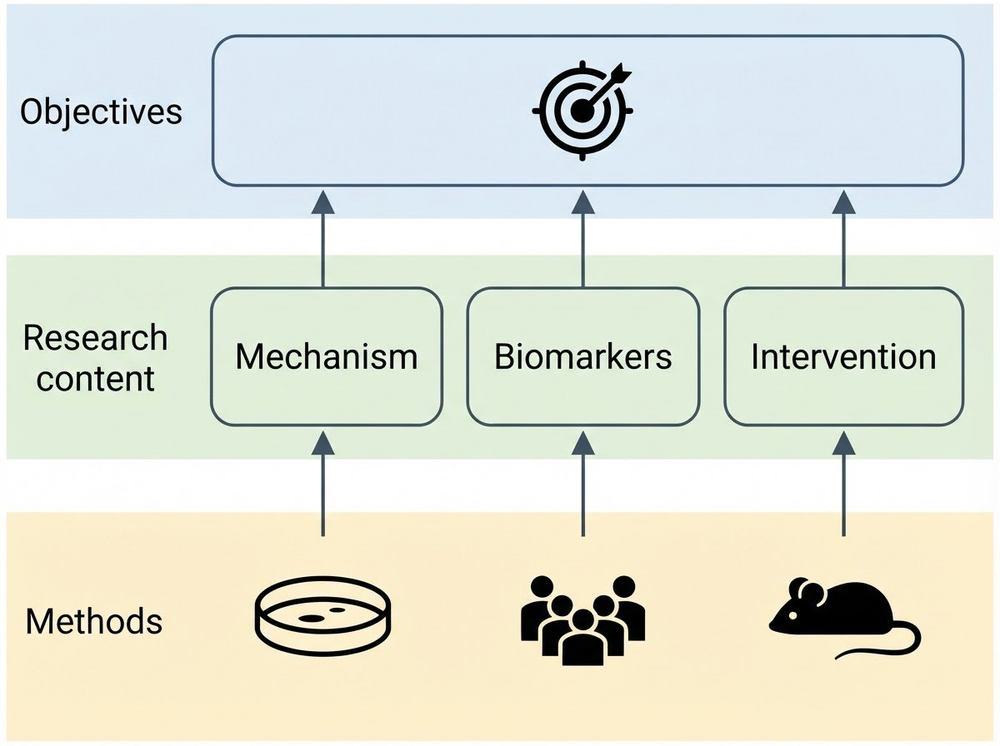 |

**English prompt**

```text
Create a research framework for 【a study on early diagnosis of liver cancer】 as three horizontal layers stacked from top to bottom, each a light colored band with its layer name at the far left:
1. Top band: one wide box with a target icon for the overall objective.
2. Middle band: three side-by-side boxes for the research contents: 【mechanism, biomarkers, intervention】.
3. Bottom band: three method icons, one under each content box: 【a culture dish, a group of patient icons, a mouse】, drawn without text.
Upward arrows run from each method icon to the content box above it, and from each content box to the objective.
Write each label only once in the whole figure.
Labels, each used once, no other text: 【Objectives, Research content, Methods, Mechanism, Biomarkers, Intervention】.

Style: journal-style schematic diagram. Clean flat vector graphics on a white background. Modules are rounded rectangles or simple icons with their short names inside; light pastel panels group related layers. Only 3-4 muted colors, each with one fixed meaning. Thin, uniform arrows show the flow of data, energy, material or influence; dashed arrows for indirect or feedback links. Sans-serif English labels only, each label appears exactly once, spelled exactly as given. No 3D rendering, no shadows, no glow, no cyberpunk or tech-background decoration, no photorealism.
```

<details><summary>Chinese prompt</summary>

```text
画一张【肝癌早期诊断研究】的研究框架图，上中下三层横向色带，每层最左侧写层名：
1. 上层：一个宽框，配靶心图标，代表总目标。
2. 中层：三个并排的框，代表研究内容：【机制、生物标志物、干预】。
3. 下层：三个方法图标，分别位于三个内容框正下方：【培养皿、一组病人图标、小鼠】，不加文字。
向上的箭头从每个方法图标指向上方的内容框，再从每个内容框指向总目标。
整张图里每个标签只写一次。
标签（每个只出现一次，不加其他文字）：【Objectives, Research content, Methods, Mechanism, Biomarkers, Intervention】。

风格：期刊式示意框图。白色背景上干净的扁平矢量图形。模块画成圆角矩形或简洁图标，名称写在里面；用浅色面板把相关的层归在一起。只用 3–4 种低饱和度颜色，每种颜色含义固定。细而粗细一致的箭头表示数据、能量、物质或影响的流向，间接或反馈关系用虚线箭头。图中文字只用英文无衬线字体，每个标签只出现一次，拼写与给定完全一致。不要 3D 渲染、阴影、发光、赛博朋克或科技感背景装饰，不要照片质感。
```

</details>

Model: Nano Banana 2 Lite (gemini-3.1-flash-lite-image, 1K) · Generated 2 times in total; shown are the outputs that passed review

[↑ Back to top](#top)

<sub><a href="https://yila.ai/?utm_source=github&utm_medium=readme&utm_campaign=sci-figure-prompts&utm_content=three-layer-framework">Try in Yila →</a></sub>

---

<a id="no-28"></a>

### No. 28: Vertical graphical abstract

by [@Yila-AI](https://github.com/Yila-AI)

Technique: **top to bottom: problem, intervention, outcome** · Style: soft semi-realistic illustration · Aspect ratio: 3:4

| English prompt | Chinese prompt |
|---|---|
|  |  |

**English prompt**

```text
Create a vertical graphical abstract about 【a hydrogel that delivers stem cells to repair heart tissue after a heart attack】, told from top to bottom in three stages:
1. Top: 【a heart with a damaged, pale region of muscle】.
2. Middle: 【a soft hydrogel patch loaded with stem cells being placed on the damaged region】.
3. Bottom: 【the same heart with the region restored to healthy red muscle and new small blood vessels】.
Thin downward arrows connect the stages.
Labels, each used once, no other text: 【Myocardial infarction, Stem cell hydrogel, Cardiac repair】.

Style: journal graphical-abstract illustration. Soft semi-realistic medical illustration with gentle volume and subtle hand-painted texture, on a clean white background. Muted, harmonious palette with one accent color. Clear left-to-right narrative, generous white space. Sans-serif English labels only, each label appears exactly once, spelled exactly as given. No cartoon style, no glossy CGI, no dark background, no stock-photo look.
```

<details><summary>Chinese prompt</summary>

```text
画一张关于【心梗后用水凝胶递送干细胞修复心肌】的竖版图文摘要，从上往下分三段：
1. 上：【一颗心脏，部分心肌受损发白】。
2. 中：【一片载有干细胞的柔软水凝胶贴片贴到受损区域】。
3. 下：【同一颗心脏，受损区域恢复成健康的红色心肌，并长出新的小血管】。
各段之间用向下的细箭头连接。
标签（每个只出现一次，不加其他文字）：【Myocardial infarction, Stem cell hydrogel, Cardiac repair】。

风格：期刊图形摘要插画。柔和的半写实医学插画，带轻微体积感和细腻的手绘质感，白色干净背景。配色低饱和、协调，只用一个强调色。从左到右叙事清晰，留白充足。图中文字只用英文无衬线字体，每个标签只出现一次，拼写与给定完全一致。不要卡通风格、不要光滑的 CG 渲染、不要深色背景、不要图库照片感。
```

</details>

Model: Nano Banana 2 Lite (gemini-3.1-flash-lite-image, 1K) · Generated 2 times in total; shown are the outputs that passed review

[↑ Back to top](#top)

<sub><a href="https://yila.ai/?utm_source=github&utm_medium=readme&utm_campaign=sci-figure-prompts&utm_content=vertical-graphical-abstract">Try in Yila →</a></sub>

---

<a id="graphical-abstract"></a>

## Graphical Abstract

<a id="no-29"></a>

### No. 29: Antibody–drug conjugate (ADC) mechanism

by [@Yila-AI](https://github.com/Yila-AI)

Technique: **bind, internalize, release, kill** · Style: soft semi-realistic illustration · Aspect ratio: 16:9

| English prompt |
|---|
| 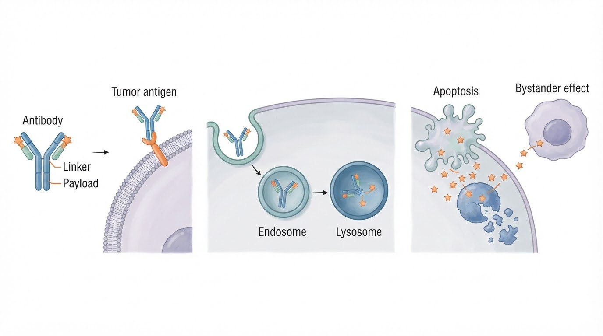 |

> The Chinese-prompt output did not pass review, so it is not shown.

**English prompt**

```text
Create a graphical abstract of 【how an antibody–drug conjugate kills a cancer cell】, read from left to right:
1. Left: 【a Y-shaped antibody carrying small star-shaped payloads on short linkers】.
2. 【The antibody binds a tumor antigen on the cancer cell surface and is taken in by endocytosis into an endosome.】
3. 【The endosome fuses with a lysosome, where the linker is cut and the payload stars are released.】
4. 【The released payload damages the cell, which shrinks and breaks apart (apoptosis); a few stars drift into a neighboring cancer cell (bystander effect).】
Label each component only where it first appears; repeated copies keep the same shape and color without text.
Write each label only once in the whole figure.
Labels, each used once, no other text: 【Antibody, Linker, Payload, Tumor antigen, Endosome, Lysosome, Apoptosis, Bystander effect】.

Style: journal graphical-abstract illustration. Soft semi-realistic medical illustration with gentle volume and subtle hand-painted texture, on a clean white background. Muted, harmonious palette with one accent color. Clear left-to-right narrative, generous white space. Sans-serif English labels only, each label appears exactly once, spelled exactly as given. No cartoon style, no glossy CGI, no dark background, no stock-photo look.
```

<details><summary>Chinese prompt</summary>

```text
画一张【抗体偶联药物杀伤癌细胞】的图文摘要，从左往右读：
1. 左：【一个 Y 形抗体，通过短连接子带着几个星形小载荷】。
2. 【抗体结合癌细胞表面的肿瘤抗原，经内吞进入内体。】
3. 【内体与溶酶体融合，连接子在溶酶体内被切断，星形载荷被释放。】
4. 【释放出的载荷破坏细胞，细胞皱缩碎裂（凋亡）；几颗星飘进相邻的癌细胞（旁观者效应）。】
每个组件只在第一次出现的地方标注；重复出现的副本保持同样的形状和颜色，不加文字。
整张图里每个标签只写一次。
标签（每个只出现一次，不加其他文字）：【Antibody, Linker, Payload, Tumor antigen, Endosome, Lysosome, Apoptosis, Bystander effect】。

风格：期刊图形摘要插画。柔和的半写实医学插画，带轻微体积感和细腻的手绘质感，白色干净背景。配色低饱和、协调，只用一个强调色。从左到右叙事清晰，留白充足。图中文字只用英文无衬线字体，每个标签只出现一次，拼写与给定完全一致。不要卡通风格、不要光滑的 CG 渲染、不要深色背景、不要图库照片感。
```

</details>

Model: Nano Banana 2 Lite (gemini-3.1-flash-lite-image, 1K) · Generated 2 times in total; shown are the outputs that passed review

[↑ Back to top](#top)

<sub><a href="https://yila.ai/?utm_source=github&utm_medium=readme&utm_campaign=sci-figure-prompts&utm_content=antibody-drug-conjugate">Try in Yila →</a></sub>

---

<a id="no-30"></a>

### No. 30: CAR-T cells against a solid tumor

by [@Yila-AI](https://github.com/Yila-AI)

Technique: **staged sequence + magnified inset** · Style: soft semi-realistic illustration · Aspect ratio: 16:9

| English prompt | Chinese prompt |
|---|---|
|  |  |

**English prompt**

```text
Create a graphical abstract about 【CAR-T cell therapy against a solid tumor】, told from left to right in three stages.
Left: 【a patient's T cells engineered to carry a chimeric antigen receptor on their surface】.
Center: 【CAR-T cells leave a blood vessel and push into dense tumor tissue】.
Right: 【a CAR-T cell attacks a tumor cell, which breaks apart】. A circular magnified inset shows 【the receptor on the CAR-T cell binding an antigen on the tumor cell】.
Labels, each used once, no other text: 【CAR-T cell, Tumor antigen, Infiltration, Tumor killing】.

Style: journal graphical-abstract illustration. Soft semi-realistic medical illustration with gentle volume and subtle hand-painted texture, on a clean white background. Muted, harmonious palette with one accent color. Clear left-to-right narrative, generous white space. Sans-serif English labels only, each label appears exactly once, spelled exactly as given. No cartoon style, no glossy CGI, no dark background, no stock-photo look.
```

<details><summary>Chinese prompt</summary>

```text
画一张关于【CAR-T 细胞治疗实体瘤】的图形摘要，从左到右分三段讲述。
左：【患者的 T 细胞经过改造，表面带上嵌合抗原受体】。
中：【CAR-T 细胞从血管中穿出，进入致密的肿瘤组织】。
右：【一个 CAR-T 细胞攻击肿瘤细胞，肿瘤细胞破裂】。用一个圆形放大框展示【CAR-T 细胞上的受体结合肿瘤细胞上的抗原】。
标签（每个只出现一次，不加其他文字）：【CAR-T cell, Tumor antigen, Infiltration, Tumor killing】。

风格：期刊图形摘要插画。柔和的半写实医学插画，带轻微体积感和细腻的手绘质感，白色干净背景。配色低饱和、协调，只用一个强调色。从左到右叙事清晰，留白充足。图中文字只用英文无衬线字体，每个标签只出现一次，拼写与给定完全一致。不要卡通风格、不要光滑的 CG 渲染、不要深色背景、不要图库照片感。
```

</details>

Model: Nano Banana 2 Lite (gemini-3.1-flash-lite-image, 1K) · Generated 2 times in total; shown are the outputs that passed review

[↑ Back to top](#top)

<sub><a href="https://yila.ai/?utm_source=github&utm_medium=readme&utm_campaign=sci-figure-prompts&utm_content=car-t-solid-tumor">Try in Yila →</a></sub>

---

<a id="no-31"></a>

### No. 31: CRISPR-Cas9 gene editing

by [@Yila-AI](https://github.com/Yila-AI)

Technique: **recognition and cutting, then two repair routes** · Style: scientific illustration · Aspect ratio: 16:9

| English prompt | Chinese prompt |
|---|---|
|  |  |

**English prompt**

```text
Create a scientific illustration of 【CRISPR-Cas9 genome editing】, read from left to right:
1. 【Cas9 protein carrying a guide RNA binds the target DNA next to a short PAM sequence.】
2. 【Cas9 cuts both DNA strands.】
3. The broken DNA splits into two repair routes: 【top, NHEJ joins the ends with a small insertion or deletion; bottom, HDR copies a donor template for a precise edit】.
Write each label only once in the whole figure.
Labels, each used once, no other text: 【Cas9, sgRNA, Target DNA, PAM, Double-strand break, NHEJ, HDR, Donor template】.

Style: journal-style scientific illustration. Clean semi-realistic vector illustration with gentle shading, using cross-sections or cutaways where they explain the structure, on a white background. Muted, harmonious palette with one accent color for the key process. Thin directional arrows for flows. Generous white space and a clear reading direction. Sans-serif English labels only, each label appears exactly once, spelled exactly as given. No cartoon style, no glossy CGI, no dark background, no stock-photo look, no decorative background.
```

<details><summary>Chinese prompt</summary>

```text
画一张【CRISPR-Cas9 基因编辑】的科学插画，从左往右读：
1. 【携带向导 RNA 的 Cas9 蛋白结合到短 PAM 序列旁边的靶 DNA 上。】
2. 【Cas9 切断 DNA 双链。】
3. 断开的 DNA 分成两条修复路径：【上方 NHEJ 连接断端，留下小的插入或缺失；下方 HDR 以供体模板为参照，实现精确编辑】。
整张图里每个标签只写一次。
标签（每个只出现一次，不加其他文字）：【Cas9, sgRNA, Target DNA, PAM, Double-strand break, NHEJ, HDR, Donor template】。

风格：期刊式科学插画。干净的半写实矢量插画，带柔和的明暗；需要说明结构时使用剖面或剖切视图，白色背景。配色低饱和、协调，只用一个强调色突出关键过程。用细的方向箭头表示流动。留白充足，阅读方向清晰。图中文字只用英文无衬线字体，每个标签只出现一次，拼写与给定完全一致。不要卡通风格、不要光滑的 CG 渲染、不要深色背景、不要图库照片感、不要装饰性背景。
```

</details>

Model: Nano Banana 2 Lite (gemini-3.1-flash-lite-image, 1K) · Generated 4 times in total; shown are the outputs that passed review

[↑ Back to top](#top)

<sub><a href="https://yila.ai/?utm_source=github&utm_medium=readme&utm_campaign=sci-figure-prompts&utm_content=crispr-cas9">Try in Yila →</a></sub>

---

<a id="no-32"></a>

### No. 32: Drug mechanism of action

by [@Yila-AI](https://github.com/Yila-AI)

Technique: **binding, blocked signaling, cell outcome** · Style: soft semi-realistic illustration · Aspect ratio: 16:9

| English prompt | Chinese prompt |
|---|---|
|  |  |

**English prompt**

```text
Create a graphical abstract of 【how a small-molecule kinase inhibitor works】, read from left to right:
1. Left: 【the drug molecule entering a tumor cell】.
2. Middle: 【a magnified inset showing the drug sitting in the binding pocket of the target kinase, blocking its substrate】.
3. Right: 【downstream signaling arrows fading out, and the tumor cell shrinking】.
Write each label only once in the whole figure.
Labels, each used once, no other text: 【Drug, Target kinase, Substrate, Downstream signaling, Tumor cell death】.

Style: journal graphical-abstract illustration. Soft semi-realistic medical illustration with gentle volume and subtle hand-painted texture, on a clean white background. Muted, harmonious palette with one accent color. Clear left-to-right narrative, generous white space. Sans-serif English labels only, each label appears exactly once, spelled exactly as given. No cartoon style, no glossy CGI, no dark background, no stock-photo look.
```

<details><summary>Chinese prompt</summary>

```text
画一张关于【小分子激酶抑制剂如何起效】的图文摘要，从左往右读：
1. 左：【药物分子进入一个肿瘤细胞】。
2. 中：【一个圆形放大插图，药物嵌在靶点激酶的结合口袋里，挡住了底物】。
3. 右：【下游信号箭头逐渐变淡，肿瘤细胞萎缩】。
整张图里每个标签只写一次。
标签（每个只出现一次，不加其他文字）：【Drug, Target kinase, Substrate, Downstream signaling, Tumor cell death】。

风格：期刊图形摘要插画。柔和的半写实医学插画，带轻微体积感和细腻的手绘质感，白色干净背景。配色低饱和、协调，只用一个强调色。从左到右叙事清晰，留白充足。图中文字只用英文无衬线字体，每个标签只出现一次，拼写与给定完全一致。不要卡通风格、不要光滑的 CG 渲染、不要深色背景、不要图库照片感。
```

</details>

Model: Nano Banana 2 Lite (gemini-3.1-flash-lite-image, 1K) · Generated 5 times in total; shown are the outputs that passed review

[↑ Back to top](#top)

<sub><a href="https://yila.ai/?utm_source=github&utm_medium=readme&utm_campaign=sci-figure-prompts&utm_content=drug-mechanism">Try in Yila →</a></sub>

---

<a id="no-33"></a>

### No. 33: Epithelial–mesenchymal transition (EMT)

by [@Yila-AI](https://github.com/Yila-AI)

Technique: **cell shape changes gradually from left to right** · Style: soft semi-realistic illustration · Aspect ratio: 16:9

| English prompt | Chinese prompt |
|---|---|
|  |  |

**English prompt**

```text
Create a graphical abstract of 【epithelial–mesenchymal transition】, read from left to right:
1. Left: 【tightly packed cube-shaped epithelial cells on a basement membrane, joined by E-cadherin】.
2. A 【TGF-β】 signal arrow above the middle.
3. Middle: 【cells loosening and starting to stretch】.
4. Right: 【spindle-shaped mesenchymal cells with vimentin fibers and N-cadherin, one cell crossing the basement membrane】.
Labels, each used once, no other text: 【Epithelial cells, TGF-β, Mesenchymal cells, E-cadherin, N-cadherin, Vimentin, Invasion】.

Style: journal graphical-abstract illustration. Soft semi-realistic medical illustration with gentle volume and subtle hand-painted texture, on a clean white background. Muted, harmonious palette with one accent color. Clear left-to-right narrative, generous white space. Sans-serif English labels only, each label appears exactly once, spelled exactly as given. No cartoon style, no glossy CGI, no dark background, no stock-photo look.
```

<details><summary>Chinese prompt</summary>

```text
画一张【上皮间质转化】的图文摘要，从左往右读：
1. 左：【紧密排列在基底膜上的立方形上皮细胞，靠 E-cadherin 连接】。
2. 中间上方一个【TGF-β】信号箭头。
3. 中：【细胞变松散，开始拉长】。
4. 右：【梭形的间质细胞，带 vimentin 纤维和 N-cadherin，其中一个细胞穿过基底膜】。
标签（每个只出现一次，不加其他文字）：【Epithelial cells, TGF-β, Mesenchymal cells, E-cadherin, N-cadherin, Vimentin, Invasion】。

风格：期刊图形摘要插画。柔和的半写实医学插画，带轻微体积感和细腻的手绘质感，白色干净背景。配色低饱和、协调，只用一个强调色。从左到右叙事清晰，留白充足。图中文字只用英文无衬线字体，每个标签只出现一次，拼写与给定完全一致。不要卡通风格、不要光滑的 CG 渲染、不要深色背景、不要图库照片感。
```

</details>

Model: Nano Banana 2 Lite (gemini-3.1-flash-lite-image, 1K) · Generated 2 times in total; shown are the outputs that passed review

[↑ Back to top](#top)

<sub><a href="https://yila.ai/?utm_source=github&utm_medium=readme&utm_campaign=sci-figure-prompts&utm_content=emt">Try in Yila →</a></sub>

---

<a id="no-34"></a>

### No. 34: Exercise improves muscle insulin resistance

by [@Yila-AI](https://github.com/Yila-AI)

Technique: **multi-scale magnified insets** · Style: soft semi-realistic illustration · Aspect ratio: 16:9

| English prompt | Chinese prompt | Chinese prompt |
|---|---|---|
|  |  |  |

**English prompt**

```text
Create a graphical abstract about 【how exercise improves insulin resistance in skeletal muscle】, told from left to right.
Left: 【a person running】.
Center: 【the thigh muscle】, with a circular magnified inset of 【one muscle cell: small vesicles carrying GLUT4 transporters move to the cell membrane and insert into it】.
Right: 【glucose molecules entering the muscle cell through GLUT4, and a lower blood glucose level】.
Labels, each used once, no other text: 【Exercise, Skeletal muscle, GLUT4, Glucose uptake】.

Style: journal graphical-abstract illustration. Soft semi-realistic medical illustration with gentle volume and subtle hand-painted texture, on a clean white background. Muted, harmonious palette with one accent color. Clear left-to-right narrative, generous white space. Sans-serif English labels only, each label appears exactly once, spelled exactly as given. No cartoon style, no glossy CGI, no dark background, no stock-photo look.
```

<details><summary>Chinese prompt</summary>

```text
画一张关于【运动如何改善骨骼肌胰岛素抵抗】的图形摘要，从左到右讲述。
左：【一个正在跑步的人】。
中：【大腿肌肉】，用一个圆形放大框放大【一个肌细胞：携带 GLUT4 转运体的小囊泡移向细胞膜并嵌入膜中】。
右：【葡萄糖分子通过 GLUT4 进入肌细胞，血糖水平下降】。
标签（每个只出现一次，不加其他文字）：【Exercise, Skeletal muscle, GLUT4, Glucose uptake】。

风格：期刊图形摘要插画。柔和的半写实医学插画，带轻微体积感和细腻的手绘质感，白色干净背景。配色低饱和、协调，只用一个强调色。从左到右叙事清晰，留白充足。图中文字只用英文无衬线字体，每个标签只出现一次，拼写与给定完全一致。不要卡通风格、不要光滑的 CG 渲染、不要深色背景、不要图库照片感。
```

</details>

Model: Nano Banana 2 Lite (gemini-3.1-flash-lite-image, 1K) · Generated 4 times in total; shown are the outputs that passed review

[↑ Back to top](#top)

<sub><a href="https://yila.ai/?utm_source=github&utm_medium=readme&utm_campaign=sci-figure-prompts&utm_content=exercise-glut4">Try in Yila →</a></sub>

---

<a id="no-35"></a>

### No. 35: Tumor exosomes prepare a pre-metastatic niche

by [@Yila-AI](https://github.com/Yila-AI)

Technique: **multi-scale magnified insets** · Style: soft semi-realistic illustration · Aspect ratio: 16:9

| English prompt | Chinese prompt |
|---|---|
|  |  |

**English prompt**

```text
Create a graphical abstract about 【tumor exosomes preparing the lung for metastasis】, told from left to right.
Left: 【a primary tumor releasing many tiny exosomes】.
Center: 【the exosomes travel through a blood vessel】.
Right: 【a lung where resident cells take up the exosomes and form a pre-metastatic niche that welcomes arriving tumor cells】. A circular magnified inset shows 【one exosome with surface proteins and RNA cargo inside】.
Labels, each used once, no other text: 【Primary tumor, Exosomes, Lung, Pre-metastatic niche】.

Style: journal graphical-abstract illustration. Soft semi-realistic medical illustration with gentle volume and subtle hand-painted texture, on a clean white background. Muted, harmonious palette with one accent color. Clear left-to-right narrative, generous white space. Sans-serif English labels only, each label appears exactly once, spelled exactly as given. No cartoon style, no glossy CGI, no dark background, no stock-photo look.
```

<details><summary>Chinese prompt</summary>

```text
画一张关于【肿瘤外泌体为肺转移做准备】的图形摘要，从左到右讲述。
左：【原发肿瘤释放出大量微小的外泌体】。
中：【外泌体随血管运行】。
右：【肺部的驻留细胞摄取外泌体，形成前转移微环境，迎接随后到达的肿瘤细胞】。用一个圆形放大框展示【一个外泌体，表面有蛋白，内部装着 RNA】。
标签（每个只出现一次，不加其他文字）：【Primary tumor, Exosomes, Lung, Pre-metastatic niche】。

风格：期刊图形摘要插画。柔和的半写实医学插画，带轻微体积感和细腻的手绘质感，白色干净背景。配色低饱和、协调，只用一个强调色。从左到右叙事清晰，留白充足。图中文字只用英文无衬线字体，每个标签只出现一次，拼写与给定完全一致。不要卡通风格、不要光滑的 CG 渲染、不要深色背景、不要图库照片感。
```

</details>

Model: Nano Banana 2 Lite (gemini-3.1-flash-lite-image, 1K) · Generated 4 times in total; shown are the outputs that passed review

[↑ Back to top](#top)

<sub><a href="https://yila.ai/?utm_source=github&utm_medium=readme&utm_campaign=sci-figure-prompts&utm_content=exosome-premetastatic-niche">Try in Yila →</a></sub>

---

<a id="no-36"></a>

### No. 36: Gut–brain axis in depression

by [@Yila-AI](https://github.com/Yila-AI)

Technique: **two magnified insets** · Style: soft semi-realistic illustration · Aspect ratio: 16:9

| English prompt | Chinese prompt |
|---|---|
|  |  |

**English prompt**

```text
Create a graphical abstract about 【the gut–brain axis in depression】.
Left: 【a human upper-body silhouette with the gut and the brain highlighted】.
Two circular magnified insets: one on 【the gut, showing imbalanced bacteria and a damaged intestinal lining】, one on 【the brain, showing activated microglia】.
Between the insets, 【three paths link gut and brain: a nerve fiber, a blood vessel carrying inflammatory molecules, and immune cells】.
Right: 【a person with a low mood】.
Labels, each used once, no other text: 【Dysbiosis, Vagus nerve, Inflammation, Microglia, Depression】.

Style: journal graphical-abstract illustration. Soft semi-realistic medical illustration with gentle volume and subtle hand-painted texture, on a clean white background. Muted, harmonious palette with one accent color. Clear left-to-right narrative, generous white space. Sans-serif English labels only, each label appears exactly once, spelled exactly as given. No cartoon style, no glossy CGI, no dark background, no stock-photo look.
```

<details><summary>Chinese prompt</summary>

```text
画一张关于【肠–脑轴与抑郁】的图形摘要。
左：【人体上半身轮廓，突出显示肠道和大脑】。
两个圆形放大框：一个放大【肠道，显示失衡的菌群和受损的肠黏膜】，一个放大【大脑，显示被激活的小胶质细胞】。
两个放大框之间，【三条通路连接肠道和大脑：一条神经纤维、一条运送炎症分子的血管、一群免疫细胞】。
右：【一个情绪低落的人】。
标签（每个只出现一次，不加其他文字）：【Dysbiosis, Vagus nerve, Inflammation, Microglia, Depression】。

风格：期刊图形摘要插画。柔和的半写实医学插画，带轻微体积感和细腻的手绘质感，白色干净背景。配色低饱和、协调，只用一个强调色。从左到右叙事清晰，留白充足。图中文字只用英文无衬线字体，每个标签只出现一次，拼写与给定完全一致。不要卡通风格、不要光滑的 CG 渲染、不要深色背景、不要图库照片感。
```

</details>

Model: Nano Banana 2 Lite (gemini-3.1-flash-lite-image, 1K) · Generated 4 times in total; shown are the outputs that passed review

[↑ Back to top](#top)

<sub><a href="https://yila.ai/?utm_source=github&utm_medium=readme&utm_campaign=sci-figure-prompts&utm_content=gut-brain-axis">Try in Yila →</a></sub>

---

<a id="no-37"></a>

### No. 37: Gut microbiota, short-chain fatty acids and host metabolism

by [@Yila-AI](https://github.com/Yila-AI)

Technique: **gut lumen, epithelium, then the whole body** · Style: soft semi-realistic illustration · Aspect ratio: 16:9

| English prompt | Chinese prompt |
|---|---|
| 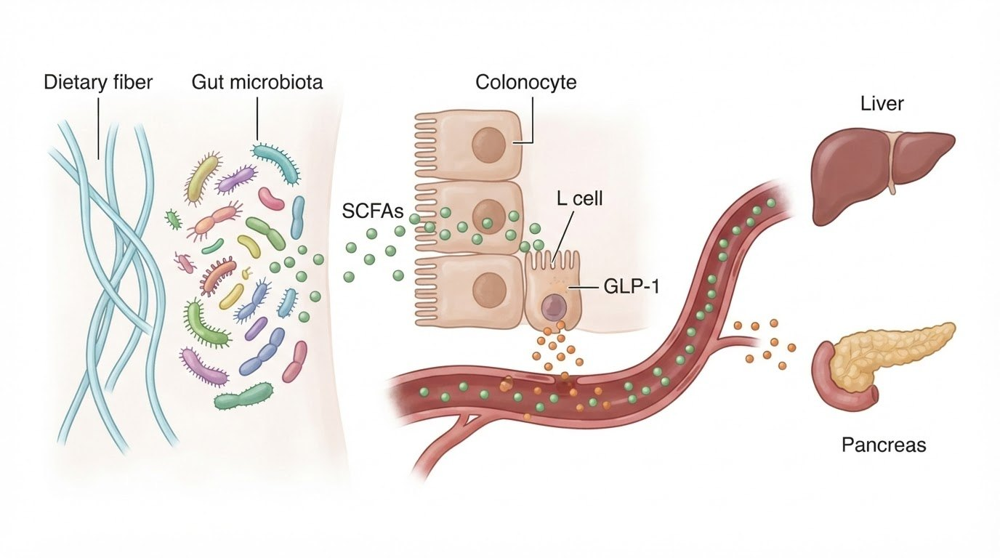 | 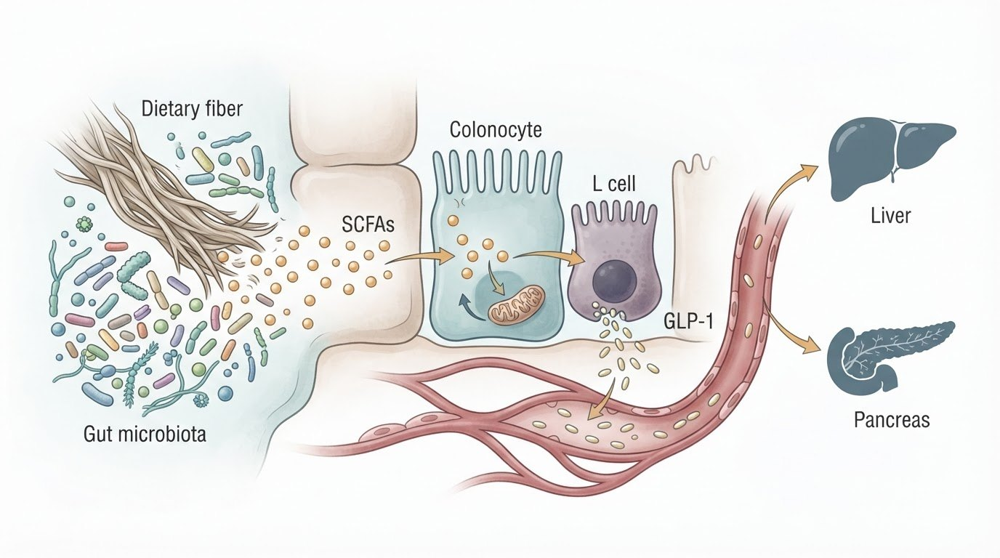 |

**English prompt**

```text
Create a graphical abstract of 【how gut microbiota shape host metabolism through short-chain fatty acids】, read from left to right:
1. Left, the colon lumen: 【dietary fiber strands eaten by colorful gut bacteria, which release SCFAs as small spheres】.
2. Middle, the epithelial lining: 【colonocytes taking up SCFAs as fuel; one L cell sensing SCFAs and releasing GLP-1 into a blood vessel below】.
3. Right: 【the blood vessel carrying SCFAs and GLP-1 to two organ icons: the liver and the pancreas】.
Write each label only once in the whole figure.
If a component appears in more than one place or panel, write its label only at its first appearance; every other copy has no text. No label may appear twice anywhere in the figure. Spell every label exactly as given and add no titles.
Labels, each used once, no other text: 【Dietary fiber, Gut microbiota, SCFAs, Colonocyte, L cell, GLP-1, Liver, Pancreas】.

Style: journal graphical-abstract illustration. Soft semi-realistic medical illustration with gentle volume and subtle hand-painted texture, on a clean white background. Muted, harmonious palette with one accent color. Clear left-to-right narrative, generous white space. Sans-serif English labels only, each label appears exactly once, spelled exactly as given. No cartoon style, no glossy CGI, no dark background, no stock-photo look.
```

<details><summary>Chinese prompt</summary>

```text
画一张【肠道菌群经短链脂肪酸影响宿主代谢】的图文摘要，从左往右读：
1. 左，结肠肠腔：【膳食纤维被彩色肠道细菌分解，细菌释放出小球状的 SCFAs】。
2. 中，上皮层：【结肠细胞把 SCFAs 当作能量吸收；一个 L 细胞感受 SCFAs，向下方血管释放 GLP-1】。
3. 右：【血管把 SCFAs 和 GLP-1 带到两个器官图标：肝脏和胰腺】。
整张图里每个标签只写一次。
如果同一组件在多处或多个面板出现，只在第一次出现时写标签，其余副本不写字。整张图里任何标签都不能出现两次。每个标签拼写与给定完全一致，不加标题。
标签（每个只出现一次，不加其他文字）：【Dietary fiber, Gut microbiota, SCFAs, Colonocyte, L cell, GLP-1, Liver, Pancreas】。

风格：期刊图形摘要插画。柔和的半写实医学插画，带轻微体积感和细腻的手绘质感，白色干净背景。配色低饱和、协调，只用一个强调色。从左到右叙事清晰，留白充足。图中文字只用英文无衬线字体，每个标签只出现一次，拼写与给定完全一致。不要卡通风格、不要光滑的 CG 渲染、不要深色背景、不要图库照片感。
```

</details>

Model: Nano Banana 2 Lite (gemini-3.1-flash-lite-image, 1K) · Generated 6 times in total; shown are the outputs that passed review

[↑ Back to top](#top)

<sub><a href="https://yila.ai/?utm_source=github&utm_medium=readme&utm_campaign=sci-figure-prompts&utm_content=gut-microbiota-scfa">Try in Yila →</a></sub>

---

<a id="no-38"></a>

### No. 38: Hydrogel-assisted wound healing

by [@Yila-AI](https://github.com/Yila-AI)

Technique: **side-by-side panels + magnified inset** · Style: soft semi-realistic illustration · Aspect ratio: 16:9

| English prompt | Chinese prompt |
|---|---|
|  |  |

**English prompt**

```text
Create a side-by-side graphical abstract comparing 【an untreated skin wound and a wound treated with an injectable hydrogel】, separated by a thin dashed vertical line. Both sides show 【the same cross-section of skin with an open wound】.
Left: 【untreated: an open wound with bacteria and redness, healing slowly】.
Right: 【treated: a translucent hydrogel fills the wound and releases small drug particles; new blood vessels and collagen grow and the wound is almost closed】. A circular magnified inset shows 【the hydrogel's cross-linked polymer network holding the drug particles】.
Labels, each used once, no other text: 【Untreated, Hydrogel, Angiogenesis, Wound closure】.

Style: journal graphical-abstract illustration. Soft semi-realistic medical illustration with gentle volume and subtle hand-painted texture, on a clean white background. Muted, harmonious palette with one accent color. Clear left-to-right narrative, generous white space. Sans-serif English labels only, each label appears exactly once, spelled exactly as given. No cartoon style, no glossy CGI, no dark background, no stock-photo look.
```

<details><summary>Chinese prompt</summary>

```text
画一张左右对比的图形摘要，比较【未处理的皮肤创面和用可注射水凝胶处理的创面】，中间用一条细虚线分开。两侧都是【同一个带开放创面的皮肤剖面】。
左：【未处理：创面敞开，有细菌和红肿，愈合缓慢】。
右：【处理后：半透明水凝胶填满创面并释放小药物颗粒；新生血管和胶原长出，创面几乎闭合】。用一个圆形放大框展示【水凝胶的交联高分子网络包裹着药物颗粒】。
标签（每个只出现一次，不加其他文字）：【Untreated, Hydrogel, Angiogenesis, Wound closure】。

风格：期刊图形摘要插画。柔和的半写实医学插画，带轻微体积感和细腻的手绘质感，白色干净背景。配色低饱和、协调，只用一个强调色。从左到右叙事清晰，留白充足。图中文字只用英文无衬线字体，每个标签只出现一次，拼写与给定完全一致。不要卡通风格、不要光滑的 CG 渲染、不要深色背景、不要图库照片感。
```

</details>

Model: Nano Banana 2 Lite (gemini-3.1-flash-lite-image, 1K) · Generated 2 times in total; shown are the outputs that passed review

[↑ Back to top](#top)

<sub><a href="https://yila.ai/?utm_source=github&utm_medium=readme&utm_campaign=sci-figure-prompts&utm_content=hydrogel-wound">Try in Yila →</a></sub>

---

<a id="no-39"></a>

### No. 39: Resolution of inflammation

by [@Yila-AI](https://github.com/Yila-AI)

Technique: **a time axis from onset to resolution** · Style: soft semi-realistic illustration · Aspect ratio: 16:9

| Chinese prompt |
|---|
| 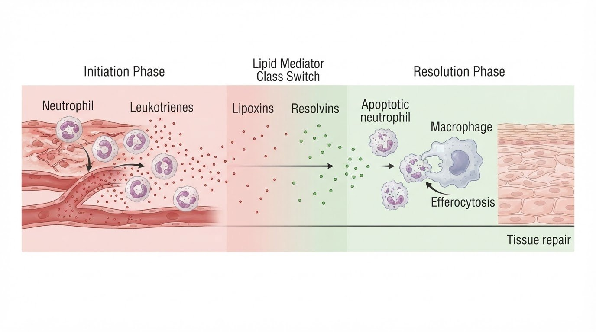 |

**English prompt**

```text
Create a graphical abstract of 【the resolution of inflammation】 along a horizontal time axis, the left half shaded light red for onset and the right half light green for resolution:
1. Left: 【neutrophils rushing into injured tissue, with leukotrienes as small red dots】.
2. Middle: 【a switch in lipid mediators, the red dots giving way to lipoxins and resolvins as small green dots】.
3. Right: 【an apoptotic neutrophil being engulfed by a macrophage (efferocytosis), and the tissue returning to a neat, repaired layer】.
Write each label only once in the whole figure.
Labels, each used once, no other text: 【Neutrophil, Leukotrienes, Lipoxins, Resolvins, Apoptotic neutrophil, Macrophage, Efferocytosis, Tissue repair】.

Style: journal graphical-abstract illustration. Soft semi-realistic medical illustration with gentle volume and subtle hand-painted texture, on a clean white background. Muted, harmonious palette with one accent color. Clear left-to-right narrative, generous white space. Sans-serif English labels only, each label appears exactly once, spelled exactly as given. No cartoon style, no glossy CGI, no dark background, no stock-photo look.
```

<details><summary>Chinese prompt</summary>

```text
画一张【炎症消退】的图文摘要，沿一条横向时间轴展开，左半边浅红色代表启动期，右半边浅绿色代表消退期：
1. 左：【中性粒细胞涌入受损组织，白三烯画成红色小点】。
2. 中：【脂质介质发生转换，红点让位于脂氧素和消退素，画成绿色小点】。
3. 右：【凋亡的中性粒细胞被巨噬细胞吞噬（胞葬作用），组织恢复成整齐修复的一层】。
整张图里每个标签只写一次。
标签（每个只出现一次，不加其他文字）：【Neutrophil, Leukotrienes, Lipoxins, Resolvins, Apoptotic neutrophil, Macrophage, Efferocytosis, Tissue repair】。

风格：期刊图形摘要插画。柔和的半写实医学插画，带轻微体积感和细腻的手绘质感，白色干净背景。配色低饱和、协调，只用一个强调色。从左到右叙事清晰，留白充足。图中文字只用英文无衬线字体，每个标签只出现一次，拼写与给定完全一致。不要卡通风格、不要光滑的 CG 渲染、不要深色背景、不要图库照片感。
```

</details>

Model: Nano Banana 2 Lite (gemini-3.1-flash-lite-image, 1K) · Generated 2 times in total; shown are the outputs that passed review

[↑ Back to top](#top)

<sub><a href="https://yila.ai/?utm_source=github&utm_medium=readme&utm_campaign=sci-figure-prompts&utm_content=inflammation-resolution">Try in Yila →</a></sub>

---

<a id="no-40"></a>

### No. 40: Macrophage M1/M2 polarization

by [@Yila-AI](https://github.com/Yila-AI)

Technique: **unpolarized cell in the middle, two fates on either side** · Style: soft semi-realistic illustration · Aspect ratio: 16:9

| English prompt | Chinese prompt |
|---|---|
|  |  |

**English prompt**

```text
Create a graphical abstract of 【macrophage polarization】: one unpolarized macrophage in the center, with two outcomes on either side:
1. Left arrow: 【LPS + IFN-γ】 turns it into 【an M1 macrophage releasing inflammatory signals, shown in warm red tones】.
2. Right arrow: 【IL-4 + IL-13】 turns it into 【an M2 macrophage helping repair tissue, shown in cool green tones】.
Labels, each used once, no other text: 【M0, M1, M2, LPS + IFN-γ, IL-4 + IL-13, Pro-inflammatory, Tissue repair】.

Style: journal graphical-abstract illustration. Soft semi-realistic medical illustration with gentle volume and subtle hand-painted texture, on a clean white background. Muted, harmonious palette with one accent color. Clear left-to-right narrative, generous white space. Sans-serif English labels only, each label appears exactly once, spelled exactly as given. No cartoon style, no glossy CGI, no dark background, no stock-photo look.
```

<details><summary>Chinese prompt</summary>

```text
画一张【巨噬细胞极化】的图文摘要：中央一个未极化的巨噬细胞，左右两侧是两种结局：
1. 向左的箭头：【LPS + IFN-γ】使它变成【释放炎症信号的 M1 巨噬细胞，用暖红色调】。
2. 向右的箭头：【IL-4 + IL-13】使它变成【帮助组织修复的 M2 巨噬细胞，用冷绿色调】。
标签（每个只出现一次，不加其他文字）：【M0, M1, M2, LPS + IFN-γ, IL-4 + IL-13, Pro-inflammatory, Tissue repair】。

风格：期刊图形摘要插画。柔和的半写实医学插画，带轻微体积感和细腻的手绘质感，白色干净背景。配色低饱和、协调，只用一个强调色。从左到右叙事清晰，留白充足。图中文字只用英文无衬线字体，每个标签只出现一次，拼写与给定完全一致。不要卡通风格、不要光滑的 CG 渲染、不要深色背景、不要图库照片感。
```

</details>

Model: Nano Banana 2 Lite (gemini-3.1-flash-lite-image, 1K) · Generated 2 times in total; shown are the outputs that passed review

[↑ Back to top](#top)

<sub><a href="https://yila.ai/?utm_source=github&utm_medium=readme&utm_campaign=sci-figure-prompts&utm_content=macrophage-polarization">Try in Yila →</a></sub>

---

<a id="no-41"></a>

### No. 41: Microglia and neuroinflammation

by [@Yila-AI](https://github.com/Yila-AI)

Technique: **resting to activated, then neuronal damage** · Style: soft semi-realistic illustration · Aspect ratio: 16:9

| Chinese prompt |
|---|
| 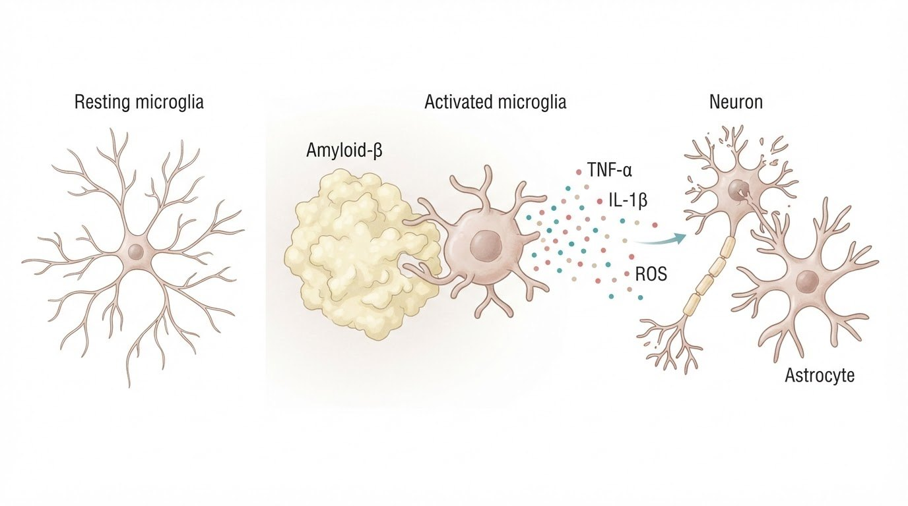 |

**English prompt**

```text
Create a graphical abstract of 【microglia driving neuroinflammation】, read from left to right:
1. Left: 【a resting microglia with many long, thin branches】.
2. Middle: 【amyloid-β plaques appear, and the microglia turns into an activated microglia: rounded, with short thick processes】.
3. Right: 【the activated microglia releases TNF-α, IL-1β and ROS as colored dots toward a neuron with damaged, broken dendrites; a nearby astrocyte also becomes reactive】.
Write each label only once in the whole figure.
Labels, each used once, no other text: 【Resting microglia, Activated microglia, Amyloid-β, TNF-α, IL-1β, ROS, Neuron, Astrocyte】.

Style: journal graphical-abstract illustration. Soft semi-realistic medical illustration with gentle volume and subtle hand-painted texture, on a clean white background. Muted, harmonious palette with one accent color. Clear left-to-right narrative, generous white space. Sans-serif English labels only, each label appears exactly once, spelled exactly as given. No cartoon style, no glossy CGI, no dark background, no stock-photo look.
```

<details><summary>Chinese prompt</summary>

```text
画一张【小胶质细胞驱动神经炎症】的图文摘要，从左往右读：
1. 左：【一个静息态小胶质细胞，有许多细长分支】。
2. 中：【出现 β-淀粉样蛋白斑块，小胶质细胞转为激活态：胞体变圆，突起短而粗】。
3. 右：【激活的小胶质细胞释放 TNF-α、IL-1β 和 ROS（彩色小点），指向一个树突受损断裂的神经元；旁边一个星形胶质细胞也被激活】。
整张图里每个标签只写一次。
标签（每个只出现一次，不加其他文字）：【Resting microglia, Activated microglia, Amyloid-β, TNF-α, IL-1β, ROS, Neuron, Astrocyte】。

风格：期刊图形摘要插画。柔和的半写实医学插画，带轻微体积感和细腻的手绘质感，白色干净背景。配色低饱和、协调，只用一个强调色。从左到右叙事清晰，留白充足。图中文字只用英文无衬线字体，每个标签只出现一次，拼写与给定完全一致。不要卡通风格、不要光滑的 CG 渲染、不要深色背景、不要图库照片感。
```

</details>

Model: Nano Banana 2 Lite (gemini-3.1-flash-lite-image, 1K) · Generated 2 times in total; shown are the outputs that passed review

[↑ Back to top](#top)

<sub><a href="https://yila.ai/?utm_source=github&utm_medium=readme&utm_campaign=sci-figure-prompts&utm_content=microglia-neuroinflammation">Try in Yila →</a></sub>

---

<a id="no-42"></a>

### No. 42: Mitochondrial dysfunction

by [@Yila-AI](https://github.com/Yila-AI)

Technique: **healthy and damaged side by side** · Style: soft semi-realistic illustration · Aspect ratio: 16:9

| English prompt | Chinese prompt |
|---|---|
|  |  |

**English prompt**

```text
Create a graphical abstract of 【mitochondrial dysfunction】: two mitochondria side by side.
1. Left, healthy: 【neat folded cristae, steady ATP output shown as small yellow spheres】.
2. Right, dysfunctional: 【swollen with broken cristae, few ATP spheres, red ROS particles leaking out, and mtDNA strands escaping into the cytosol】.
A thin arrow points from left to right.
Write each label only once in the whole figure.
Labels, each used once, no other text: 【Healthy, Dysfunctional, ATP, ROS, mtDNA】.

Style: journal graphical-abstract illustration. Soft semi-realistic medical illustration with gentle volume and subtle hand-painted texture, on a clean white background. Muted, harmonious palette with one accent color. Clear left-to-right narrative, generous white space. Sans-serif English labels only, each label appears exactly once, spelled exactly as given. No cartoon style, no glossy CGI, no dark background, no stock-photo look.
```

<details><summary>Chinese prompt</summary>

```text
画一张【线粒体功能障碍】的图文摘要：左右两个线粒体对照。
1. 左，健康：【嵴折叠整齐，稳定产出 ATP，画成黄色小球】。
2. 右，功能障碍：【肿胀、嵴断裂，ATP 小球很少，红色 ROS 颗粒外漏，mtDNA 链逸出到胞质】。
中间一条细箭头从左指向右。
整张图里每个标签只写一次。
标签（每个只出现一次，不加其他文字）：【Healthy, Dysfunctional, ATP, ROS, mtDNA】。

风格：期刊图形摘要插画。柔和的半写实医学插画，带轻微体积感和细腻的手绘质感，白色干净背景。配色低饱和、协调，只用一个强调色。从左到右叙事清晰，留白充足。图中文字只用英文无衬线字体，每个标签只出现一次，拼写与给定完全一致。不要卡通风格、不要光滑的 CG 渲染、不要深色背景、不要图库照片感。
```

</details>

Model: Nano Banana 2 Lite (gemini-3.1-flash-lite-image, 1K) · Generated 2 times in total; shown are the outputs that passed review

[↑ Back to top](#top)

<sub><a href="https://yila.ai/?utm_source=github&utm_medium=readme&utm_campaign=sci-figure-prompts&utm_content=mitochondrial-dysfunction">Try in Yila →</a></sub>

---

<a id="no-43"></a>

### No. 43: mRNA vaccine immune response

by [@Yila-AI](https://github.com/Yila-AI)

Technique: **multi-scale magnified insets** · Style: soft semi-realistic illustration · Aspect ratio: 16:9

| English prompt | Chinese prompt |
|---|---|
|  |  |

**English prompt**

```text
Create a graphical abstract about 【how an mRNA vaccine trains the immune system】, told from left to right in three stages.
Left: 【a lipid nanoparticle carrying mRNA, injected into the upper-arm muscle】.
Center: 【a muscle cell takes up the particle and makes the viral spike protein】. A circular magnified inset zooms in on 【ribosomes reading the mRNA and spike proteins appearing on the cell surface】.
Right: 【B cells releasing Y-shaped antibodies and a T cell attacking an infected cell】.
Labels, each used once, no other text: 【mRNA, Spike protein, Antibodies, T cell】.

Style: journal graphical-abstract illustration. Soft semi-realistic medical illustration with gentle volume and subtle hand-painted texture, on a clean white background. Muted, harmonious palette with one accent color. Clear left-to-right narrative, generous white space. Sans-serif English labels only, each label appears exactly once, spelled exactly as given. No cartoon style, no glossy CGI, no dark background, no stock-photo look.
```

<details><summary>Chinese prompt</summary>

```text
画一张关于【mRNA 疫苗如何训练免疫系统】的图形摘要，从左到右分三段讲述。
左：【携带 mRNA 的脂质纳米颗粒，注射进上臂肌肉】。
中：【肌肉细胞摄取颗粒，制造病毒的刺突蛋白】。用一个圆形放大框放大【核糖体读取 mRNA，刺突蛋白出现在细胞表面】。
右：【B 细胞释放 Y 形抗体，一个 T 细胞攻击被感染的细胞】。
标签（每个只出现一次，不加其他文字）：【mRNA, Spike protein, Antibodies, T cell】。

风格：期刊图形摘要插画。柔和的半写实医学插画，带轻微体积感和细腻的手绘质感，白色干净背景。配色低饱和、协调，只用一个强调色。从左到右叙事清晰，留白充足。图中文字只用英文无衬线字体，每个标签只出现一次，拼写与给定完全一致。不要卡通风格、不要光滑的 CG 渲染、不要深色背景、不要图库照片感。
```

</details>

Model: Nano Banana 2 Lite (gemini-3.1-flash-lite-image, 1K) · Generated 2 times in total; shown are the outputs that passed review

[↑ Back to top](#top)

<sub><a href="https://yila.ai/?utm_source=github&utm_medium=readme&utm_campaign=sci-figure-prompts&utm_content=mrna-vaccine">Try in Yila →</a></sub>

---

<a id="no-44"></a>

### No. 44: Tumor-targeted nanoparticle drug delivery

by [@Yila-AI](https://github.com/Yila-AI)

Technique: **multi-scale magnified insets** · Style: soft semi-realistic illustration · Aspect ratio: 16:9

| English prompt | Chinese prompt |
|---|---|
|  |  |

**English prompt**

```text
Create a graphical abstract about 【tumor-targeted nanoparticle drug delivery】, told from left to right in three stages.
Left: 【one lipid nanoparticle with targeting ligands on its surface, a quarter cut away to show the drug inside】.
Center: 【nanoparticles leave a leaky blood vessel and enter the tumor tissue】. A circular magnified inset zooms in on 【one tumor cell: the nanoparticle binds a surface receptor, is taken up by endocytosis and releases the drug inside the cell】.
Right: 【a smaller tumor with dying tumor cells】.
Labels, each used once, no other text: 【Nanoparticle, Leaky vessel, Drug release, Tumor regression】.

Style: journal graphical-abstract illustration. Soft semi-realistic medical illustration with gentle volume and subtle hand-painted texture, on a clean white background. Muted, harmonious palette with one accent color. Clear left-to-right narrative, generous white space. Sans-serif English labels only, each label appears exactly once, spelled exactly as given. No cartoon style, no glossy CGI, no dark background, no stock-photo look.
```

<details><summary>Chinese prompt</summary>

```text
画一张关于【肿瘤靶向纳米颗粒药物递送】的图形摘要，从左到右分三段讲述。
左：【一个表面带靶向配体的脂质纳米颗粒，切开四分之一，露出里面包裹的药物】。
中：【纳米颗粒从有渗漏的血管中穿出，进入肿瘤组织】。用一个圆形放大框放大【一个肿瘤细胞：纳米颗粒结合细胞表面受体，经内吞进入细胞，在细胞内释放药物】。
右：【体积缩小的肿瘤，肿瘤细胞正在死亡】。
标签（每个只出现一次，不加其他文字）：【Nanoparticle, Leaky vessel, Drug release, Tumor regression】。

风格：期刊图形摘要插画。柔和的半写实医学插画，带轻微体积感和细腻的手绘质感，白色干净背景。配色低饱和、协调，只用一个强调色。从左到右叙事清晰，留白充足。图中文字只用英文无衬线字体，每个标签只出现一次，拼写与给定完全一致。不要卡通风格、不要光滑的 CG 渲染、不要深色背景、不要图库照片感。
```

</details>

Model: Nano Banana 2 Lite (gemini-3.1-flash-lite-image, 1K) · Generated 2 times in total; shown are the outputs that passed review

[↑ Back to top](#top)

<sub><a href="https://yila.ai/?utm_source=github&utm_medium=readme&utm_campaign=sci-figure-prompts&utm_content=nanoparticle-tumor-delivery">Try in Yila →</a></sub>

---

<a id="no-45"></a>

### No. 45: Oxidative stress and ROS damage

by [@Yila-AI](https://github.com/Yila-AI)

Technique: **source, damage and defense in three parts** · Style: soft semi-realistic illustration · Aspect ratio: 16:9

| English prompt | Chinese prompt |
|---|---|
|  |  |

**English prompt**

```text
Create a graphical abstract of 【oxidative stress】, read from left to right. Draw each relationship exactly as listed and nothing more:
1. 【A mitochondrion on the left releases small red ROS particles.】
2. 【Three solid arrows lead from the ROS to three damaged targets on the right: a lipid membrane, a protein and a DNA strand.】
3. 【Above the ROS, three antioxidants drawn as simple rounded capsules with their names inside block the ROS with red T-bars.】
No chemical structures.
Labels, each used once, no other text: 【Mitochondrion, ROS, Lipid damage, Protein damage, DNA damage, SOD, Catalase, GSH】.

Style: journal graphical-abstract illustration. Soft semi-realistic medical illustration with gentle volume and subtle hand-painted texture, on a clean white background. Muted, harmonious palette with one accent color. Clear left-to-right narrative, generous white space. Sans-serif English labels only, each label appears exactly once, spelled exactly as given. No cartoon style, no glossy CGI, no dark background, no stock-photo look.
```

<details><summary>Chinese prompt</summary>

```text
画一张【氧化应激】的图文摘要，从左往右读。严格按下面列出的关系画，不多画：
1. 【左侧一个线粒体释放红色的 ROS 小颗粒。】
2. 【三条实线箭头从 ROS 指向右侧三个受损目标：脂质膜、蛋白质、DNA 链。】
3. 【ROS 上方三种抗氧化物，画成名字写在里面的简单圆角胶囊，用红色 T 形线挡住 ROS。】
不画化学结构式。
标签（每个只出现一次，不加其他文字）：【Mitochondrion, ROS, Lipid damage, Protein damage, DNA damage, SOD, Catalase, GSH】。

风格：期刊图形摘要插画。柔和的半写实医学插画，带轻微体积感和细腻的手绘质感，白色干净背景。配色低饱和、协调，只用一个强调色。从左到右叙事清晰，留白充足。图中文字只用英文无衬线字体，每个标签只出现一次，拼写与给定完全一致。不要卡通风格、不要光滑的 CG 渲染、不要深色背景、不要图库照片感。
```

</details>

Model: Nano Banana 2 Lite (gemini-3.1-flash-lite-image, 1K) · Generated 4 times in total; shown are the outputs that passed review

[↑ Back to top](#top)

<sub><a href="https://yila.ai/?utm_source=github&utm_medium=readme&utm_campaign=sci-figure-prompts&utm_content=oxidative-stress">Try in Yila →</a></sub>

---

<a id="no-46"></a>

### No. 46: Cellular senescence and SASP

by [@Yila-AI](https://github.com/Yila-AI)

Technique: **triggers, senescent cell, effects on neighbors** · Style: soft semi-realistic illustration · Aspect ratio: 16:9

| Chinese prompt |
|---|
|  |

**English prompt**

```text
Create a graphical abstract of 【cellular senescence】, read from left to right:
1. Left: 【two triggers as small icons: a broken DNA strand and shortened chromosome ends】.
2. Middle: 【an enlarged, flattened senescent cell with p16 and p21 marks in its nucleus】.
3. Right: 【the cell releasing small colored particles (the SASP) toward neighboring cells, which turn inflamed】.
Write each label only once in the whole figure.
Labels, each used once, no other text: 【DNA damage, Telomere shortening, Senescent cell, p16, p21, SASP, Inflammation】.

Style: journal graphical-abstract illustration. Soft semi-realistic medical illustration with gentle volume and subtle hand-painted texture, on a clean white background. Muted, harmonious palette with one accent color. Clear left-to-right narrative, generous white space. Sans-serif English labels only, each label appears exactly once, spelled exactly as given. No cartoon style, no glossy CGI, no dark background, no stock-photo look.
```

<details><summary>Chinese prompt</summary>

```text
画一张【细胞衰老】的图文摘要，从左往右读：
1. 左：【两个诱因小图标：断裂的 DNA 链和变短的染色体末端】。
2. 中：【一个变大变扁的衰老细胞，细胞核里标有 p16 和 p21】。
3. 右：【细胞向邻近细胞释放彩色小颗粒（SASP），邻近细胞出现炎症】。
整张图里每个标签只写一次。
标签（每个只出现一次，不加其他文字）：【DNA damage, Telomere shortening, Senescent cell, p16, p21, SASP, Inflammation】。

风格：期刊图形摘要插画。柔和的半写实医学插画，带轻微体积感和细腻的手绘质感，白色干净背景。配色低饱和、协调，只用一个强调色。从左到右叙事清晰，留白充足。图中文字只用英文无衬线字体，每个标签只出现一次，拼写与给定完全一致。不要卡通风格、不要光滑的 CG 渲染、不要深色背景、不要图库照片感。
```

</details>

Model: Nano Banana 2 Lite (gemini-3.1-flash-lite-image, 1K) · Generated 4 times in total; shown are the outputs that passed review

[↑ Back to top](#top)

<sub><a href="https://yila.ai/?utm_source=github&utm_medium=readme&utm_campaign=sci-figure-prompts&utm_content=senescence-sasp">Try in Yila →</a></sub>

---

<a id="no-47"></a>

### No. 47: Stem cell differentiation and tissue repair

by [@Yila-AI](https://github.com/Yila-AI)

Technique: **two repair routes: differentiation and paracrine signals** · Style: soft semi-realistic illustration · Aspect ratio: 16:9

| English prompt |
|---|
| 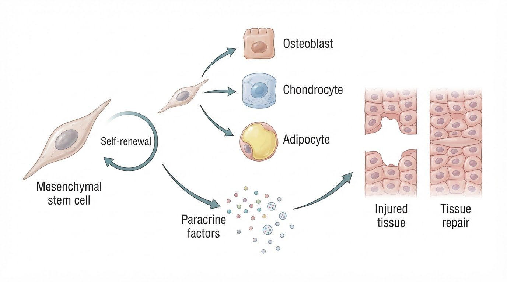 |

> The Chinese-prompt output did not pass review, so it is not shown.

**English prompt**

```text
Create a graphical abstract of 【mesenchymal stem cells in tissue repair】, read from left to right:
1. Left: 【a mesenchymal stem cell with a circular arrow beside it for self-renewal】.
2. Upper path: 【the stem cell differentiates into three cell types: an osteoblast, a chondrocyte and an adipocyte with a large fat droplet】.
3. Lower path: 【the stem cell releases paracrine factors as small colored dots and vesicles】.
4. Right: 【both paths lead to an injured tissue with a gap that closes into repaired tissue】.
Write each label only once in the whole figure.
Labels, each used once, no other text: 【Mesenchymal stem cell, Self-renewal, Osteoblast, Chondrocyte, Adipocyte, Paracrine factors, Injured tissue, Tissue repair】.

Style: journal graphical-abstract illustration. Soft semi-realistic medical illustration with gentle volume and subtle hand-painted texture, on a clean white background. Muted, harmonious palette with one accent color. Clear left-to-right narrative, generous white space. Sans-serif English labels only, each label appears exactly once, spelled exactly as given. No cartoon style, no glossy CGI, no dark background, no stock-photo look.
```

<details><summary>Chinese prompt</summary>

```text
画一张【间充质干细胞参与组织修复】的图文摘要，从左往右读：
1. 左：【一个间充质干细胞，旁边一个环形箭头表示自我更新】。
2. 上方路径：【干细胞分化为三种细胞：成骨细胞、软骨细胞和带大脂滴的脂肪细胞】。
3. 下方路径：【干细胞释放旁分泌因子，画成彩色小点和小囊泡】。
4. 右：【两条路径都指向一处有缺口的受损组织，缺口愈合为修复后的组织】。
整张图里每个标签只写一次。
标签（每个只出现一次，不加其他文字）：【Mesenchymal stem cell, Self-renewal, Osteoblast, Chondrocyte, Adipocyte, Paracrine factors, Injured tissue, Tissue repair】。

风格：期刊图形摘要插画。柔和的半写实医学插画，带轻微体积感和细腻的手绘质感，白色干净背景。配色低饱和、协调，只用一个强调色。从左到右叙事清晰，留白充足。图中文字只用英文无衬线字体，每个标签只出现一次，拼写与给定完全一致。不要卡通风格、不要光滑的 CG 渲染、不要深色背景、不要图库照片感。
```

</details>

Model: Nano Banana 2 Lite (gemini-3.1-flash-lite-image, 1K) · Generated 2 times in total; shown are the outputs that passed review

[↑ Back to top](#top)

<sub><a href="https://yila.ai/?utm_source=github&utm_medium=readme&utm_campaign=sci-figure-prompts&utm_content=stem-cell-tissue-repair">Try in Yila →</a></sub>

---

<a id="no-48"></a>

### No. 48: T cell activation and the immune synapse

by [@Yila-AI](https://github.com/Yila-AI)

Technique: **contact zone close-up plus the activation outcome** · Style: soft semi-realistic illustration · Aspect ratio: 16:9

| Chinese prompt |
|---|
| 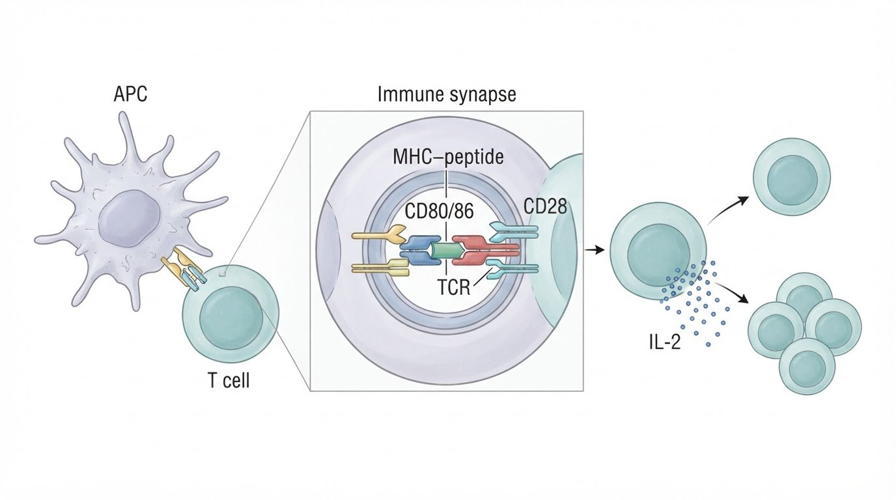 |

**English prompt**

```text
Create a graphical abstract of 【T cell activation】, read from left to right:
1. Left: 【an antigen-presenting cell (APC) with branching arms touching a round T cell】.
2. Middle: a magnified view of the contact zone, the immune synapse, shown as a bullseye ring: 【MHC carrying a small peptide binds the TCR in the center; CD80/86 binds CD28 nearby as the second signal】.
3. Right: 【the T cell releasing IL-2 as small dots and dividing into a small group of identical T cells】.
Write each label only once in the whole figure.
Labels, each used once, no other text: 【APC, T cell, Immune synapse, MHC–peptide, TCR, CD80/86, CD28, IL-2】.

Style: journal graphical-abstract illustration. Soft semi-realistic medical illustration with gentle volume and subtle hand-painted texture, on a clean white background. Muted, harmonious palette with one accent color. Clear left-to-right narrative, generous white space. Sans-serif English labels only, each label appears exactly once, spelled exactly as given. No cartoon style, no glossy CGI, no dark background, no stock-photo look.
```

<details><summary>Chinese prompt</summary>

```text
画一张【T 细胞活化】的图文摘要，从左往右读：
1. 左：【一个带分支突起的抗原提呈细胞（APC）贴着一个圆形 T 细胞】。
2. 中：接触区的放大图，即免疫突触，画成靶心样的环：【中央是携带小肽段的 MHC 结合 TCR；旁边 CD80/86 结合 CD28，作为第二信号】。
3. 右：【T 细胞释放 IL-2 小点，并分裂成一小群相同的 T 细胞】。
整张图里每个标签只写一次。
标签（每个只出现一次，不加其他文字）：【APC, T cell, Immune synapse, MHC–peptide, TCR, CD80/86, CD28, IL-2】。

风格：期刊图形摘要插画。柔和的半写实医学插画，带轻微体积感和细腻的手绘质感，白色干净背景。配色低饱和、协调，只用一个强调色。从左到右叙事清晰，留白充足。图中文字只用英文无衬线字体，每个标签只出现一次，拼写与给定完全一致。不要卡通风格、不要光滑的 CG 渲染、不要深色背景、不要图库照片感。
```

</details>

Model: Nano Banana 2 Lite (gemini-3.1-flash-lite-image, 1K) · Generated 2 times in total; shown are the outputs that passed review

[↑ Back to top](#top)

<sub><a href="https://yila.ai/?utm_source=github&utm_medium=readme&utm_campaign=sci-figure-prompts&utm_content=t-cell-immune-synapse">Try in Yila →</a></sub>

---

<a id="no-49"></a>

### No. 49: Tumor microenvironment

by [@Yila-AI](https://github.com/Yila-AI)

Technique: **tumor in the center, surrounding cells around it** · Style: scientific illustration · Aspect ratio: 4:3

| English prompt | Chinese prompt |
|---|---|
|  |  |

**English prompt**

```text
Create a scientific illustration of 【the tumor microenvironment】: a cluster of tumor cells in the center, and around it exactly one of each of the following, each drawn once and labeled once: 【a spindle-shaped cancer-associated fibroblast, a tumor-associated macrophage, a regulatory T cell, a CD8+ T cell held back at the edge, a blood vessel, and a mesh of extracellular matrix fibers】. No arrows.
Labels, each used once, no other text: 【Tumor cells, CAF, TAM, Treg, CD8+ T cell, Blood vessel, ECM】.

Style: journal-style scientific illustration. Clean semi-realistic vector illustration with gentle shading, using cross-sections or cutaways where they explain the structure, on a white background. Muted, harmonious palette with one accent color for the key process. Thin directional arrows for flows. Generous white space and a clear reading direction. Sans-serif English labels only, each label appears exactly once, spelled exactly as given. No cartoon style, no glossy CGI, no dark background, no stock-photo look, no decorative background.
```

<details><summary>Chinese prompt</summary>

```text
画一张【肿瘤微环境】的科学插画：中央是一团肿瘤细胞，周围下面每种只画一个、只标一次：【一个梭形的癌相关成纤维细胞、一个肿瘤相关巨噬细胞、一个调节性 T 细胞、一个被挡在边缘的 CD8+ T 细胞、一条血管、一片细胞外基质纤维网】。不画箭头。
标签（每个只出现一次，不加其他文字）：【Tumor cells, CAF, TAM, Treg, CD8+ T cell, Blood vessel, ECM】。

风格：期刊式科学插画。干净的半写实矢量插画，带柔和的明暗；需要说明结构时使用剖面或剖切视图，白色背景。配色低饱和、协调，只用一个强调色突出关键过程。用细的方向箭头表示流动。留白充足，阅读方向清晰。图中文字只用英文无衬线字体，每个标签只出现一次，拼写与给定完全一致。不要卡通风格、不要光滑的 CG 渲染、不要深色背景、不要图库照片感、不要装饰性背景。
```

</details>

Model: Nano Banana 2 Lite (gemini-3.1-flash-lite-image, 1K) · Generated 4 times in total; shown are the outputs that passed review

[↑ Back to top](#top)

<sub><a href="https://yila.ai/?utm_source=github&utm_medium=readme&utm_campaign=sci-figure-prompts&utm_content=tumor-microenvironment">Try in Yila →</a></sub>

---

<a id="no-50"></a>

### No. 50: Viral entry and replication cycle

by [@Yila-AI](https://github.com/Yila-AI)

Technique: **seven stages around one cell** · Style: soft semi-realistic illustration · Aspect ratio: 1:1

| English prompt | Chinese prompt |
|---|---|
| 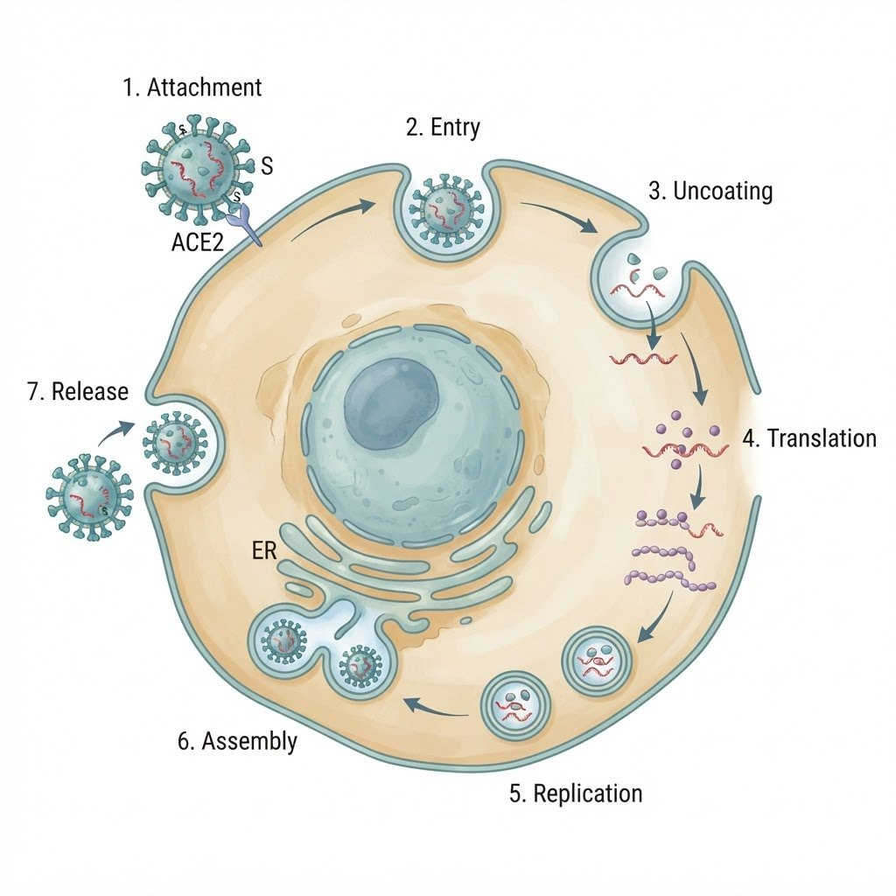 | 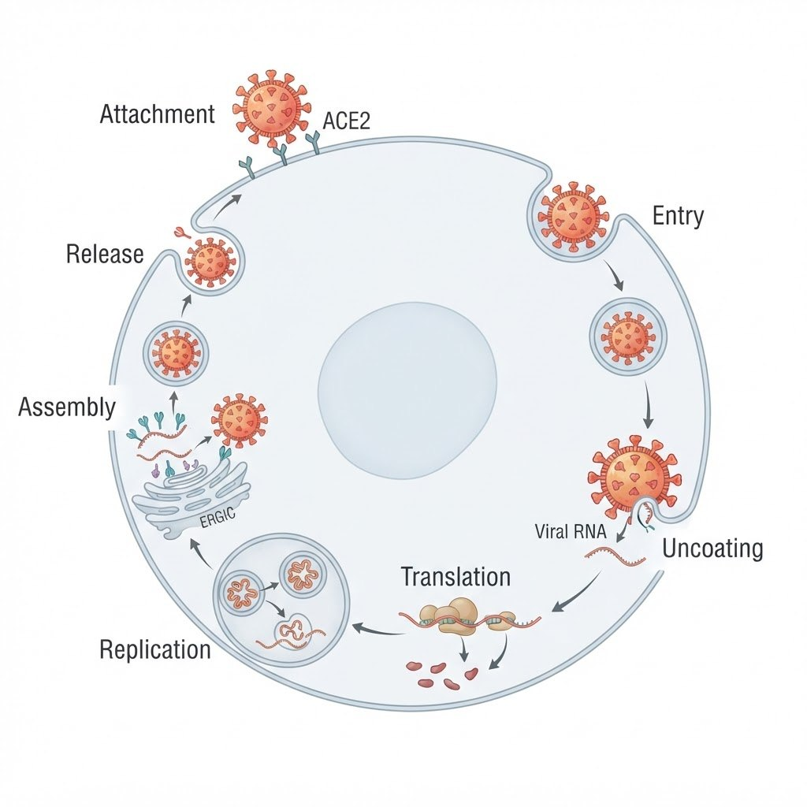 |

**English prompt**

```text
Create a graphical abstract of 【the replication cycle of a coronavirus】 as a clockwise cycle around one large host cell, each stage a small scene:
1. 【Attachment: the virus spike binds ACE2 on the cell membrane.】
2. 【Entry: the virus is taken into the cell.】
3. 【Uncoating: the viral RNA is released into the cytoplasm.】
4. 【Translation: ribosomes make viral proteins from the RNA.】
5. 【Replication: the viral RNA is copied in small membrane vesicles.】
6. 【Assembly: new virus particles form from RNA and proteins.】
7. 【Release: new particles leave the cell by exocytosis.】
Label each component only where it first appears; repeated copies keep the same shape and color without text.
Write each label only once in the whole figure.
If a component appears in more than one place or panel, write its label only at its first appearance; every other copy has no text. No label may appear twice anywhere in the figure. Spell every label exactly as given and add no titles.
Labels, each used once, no other text: 【ACE2, Attachment, Entry, Uncoating, Translation, Replication, Assembly, Release】.

Style: journal graphical-abstract illustration. Soft semi-realistic medical illustration with gentle volume and subtle hand-painted texture, on a clean white background. Muted, harmonious palette with one accent color. Clear left-to-right narrative, generous white space. Sans-serif English labels only, each label appears exactly once, spelled exactly as given. No cartoon style, no glossy CGI, no dark background, no stock-photo look.
```

<details><summary>Chinese prompt</summary>

```text
画一张【冠状病毒复制周期】的图文摘要，围绕一个大宿主细胞画成顺时针循环，每个阶段一个小场景：
1. 【吸附：病毒刺突结合细胞膜上的 ACE2。】
2. 【进入：病毒被带入细胞。】
3. 【脱壳：病毒 RNA 释放到胞质。】
4. 【翻译：核糖体以 RNA 为模板合成病毒蛋白。】
5. 【复制：病毒 RNA 在小膜泡里被复制。】
6. 【组装：RNA 和蛋白组装成新的病毒颗粒。】
7. 【释放：新颗粒经胞吐离开细胞。】
每个组件只在第一次出现的地方标注；重复出现的副本保持同样的形状和颜色，不加文字。
整张图里每个标签只写一次。
如果同一组件在多处或多个面板出现，只在第一次出现时写标签，其余副本不写字。整张图里任何标签都不能出现两次。每个标签拼写与给定完全一致，不加标题。
标签（每个只出现一次，不加其他文字）：【ACE2, Attachment, Entry, Uncoating, Translation, Replication, Assembly, Release】。

风格：期刊图形摘要插画。柔和的半写实医学插画，带轻微体积感和细腻的手绘质感，白色干净背景。配色低饱和、协调，只用一个强调色。从左到右叙事清晰，留白充足。图中文字只用英文无衬线字体，每个标签只出现一次，拼写与给定完全一致。不要卡通风格、不要光滑的 CG 渲染、不要深色背景、不要图库照片感。
```

</details>

Model: Nano Banana 2 Lite (gemini-3.1-flash-lite-image, 1K) · Generated 6 times in total; shown are the outputs that passed review

[↑ Back to top](#top)

<sub><a href="https://yila.ai/?utm_source=github&utm_medium=readme&utm_campaign=sci-figure-prompts&utm_content=viral-replication-cycle">Try in Yila →</a></sub>

---

<a id="signaling-pathway"></a>

## Signaling Pathway

<a id="no-51"></a>

### No. 51: AMPK energy sensing

by [@Yila-AI](https://github.com/Yila-AI)

Technique: **activated and inhibited targets in two columns** · Style: flat vector schematic · Aspect ratio: 16:9

| Chinese prompt |
|---|
| 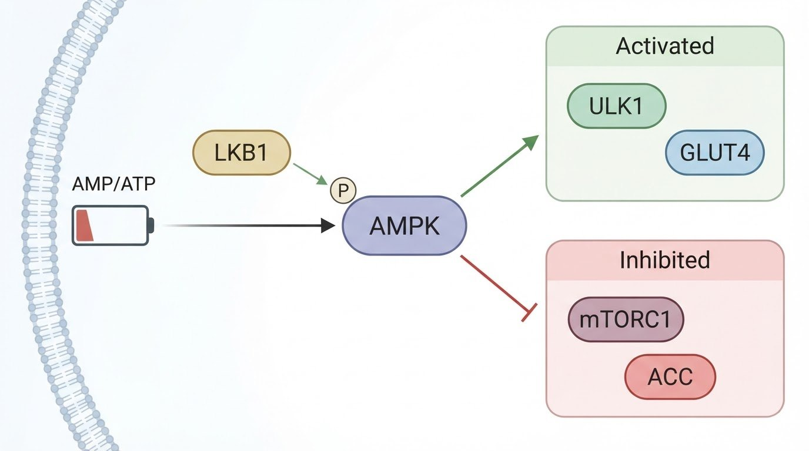 |

**English prompt**

```text
Create a signaling schematic of 【AMPK energy sensing】 in one cell, read from left to right.
1. On the left, a low-battery icon for a rising AMP/ATP ratio, and LKB1 adding a small 'P' circle to AMPK; both point with arrows to AMPK in the middle.
2. On the right, two columns. The upper column, in a light green panel titled Activated, holds 【ULK1 and GLUT4】; a green arrow runs from AMPK to this panel.
3. The lower column, in a light red panel titled Inhibited, holds 【mTORC1 and ACC】; a single red arrow runs from AMPK to this panel.
Draw no other lines between the proteins.
Write each label only once in the whole figure.
Labels, each used once, no other text: 【AMP/ATP, LKB1, AMPK, Activated, Inhibited, ULK1, GLUT4, mTORC1, ACC】.

Style: journal-style scientific schematic. Clean flat vector illustration on a white background, light pastel rounded panels to separate regions. Only 3-4 muted colors, each with one fixed meaning; red only for inhibition or emphasis. Thin, uniform line weight. Proteins as rounded colored capsules with their names inside; membranes as lipid bilayers; activation as solid arrows, inhibition as T-bar lines, indirect effects as dashed arrows. Sans-serif English labels only, each label appears exactly once, spelled exactly as given. No 3D rendering, no shadows, no glow, no decorative background, no photorealism.
```

<details><summary>Chinese prompt</summary>

```text
画一张【AMPK 能量感应】的信号示意图，在一个细胞内，从左往右读。
1. 左侧一个低电量图标代表 AMP/ATP 比值升高，LKB1 给 AMPK 加上一个带 P 的小圆点；两者都用箭头指向中央的 AMPK。
2. 右侧上下两栏。上栏是标题为 Activated 的浅绿色面板，里面放【ULK1 和 GLUT4】；一条绿色箭头从 AMPK 指向这个面板。
3. 下栏是标题为 Inhibited 的浅红色面板，里面放【mTORC1 和 ACC】；一条红色箭头从 AMPK 指向这个面板。
蛋白之间不画其他连线。
整张图里每个标签只写一次。
标签（每个只出现一次，不加其他文字）：【AMP/ATP, LKB1, AMPK, Activated, Inhibited, ULK1, GLUT4, mTORC1, ACC】。

风格：期刊式科研示意图。白色背景上的干净扁平矢量插画，用浅色圆角面板区分区域。只用 3–4 种低饱和度颜色，每种颜色含义固定，红色只用于抑制或强调。线条细且粗细一致。蛋白画成彩色圆角胶囊，名称写在胶囊里；细胞膜画成磷脂双分子层；激活用实线箭头，抑制用 T 形线，间接作用用虚线箭头。图中文字只用英文无衬线字体，每个标签只出现一次，拼写与给定完全一致。不要 3D 渲染、阴影、发光、装饰性背景或照片质感。
```

</details>

Model: Nano Banana 2 Lite (gemini-3.1-flash-lite-image, 1K) · Generated 8 times in total; shown are the outputs that passed review

[↑ Back to top](#top)

<sub><a href="https://yila.ai/?utm_source=github&utm_medium=readme&utm_campaign=sci-figure-prompts&utm_content=ampk-energy-sensing">Try in Yila →</a></sub>

---

<a id="no-52"></a>

### No. 52: Autophagy

by [@Yila-AI](https://github.com/Yila-AI)

Technique: **regulation on top, vesicle stages below** · Style: flat vector schematic · Aspect ratio: 16:9

| English prompt | Chinese prompt |
|---|---|
|  |  |

**English prompt**

```text
Create a schematic of 【autophagy】 in one cell. Top row: regulation. Bottom row: the vesicle stages from left to right. Draw each relationship exactly as listed and nothing more:
1. 【mTORC1 inhibits ULK1 (red T-bar).】
2. 【AMPK activates ULK1.】
3. 【ULK1 activates Beclin-1, which starts a cup-shaped membrane.】
4. 【The membrane, marked with LC3-II dots, closes around a damaged mitochondrion to form an autophagosome.】
5. 【The autophagosome fuses with a lysosome to form an autolysosome, where the contents are broken down.】
Labels, each used once, no other text: 【mTORC1, AMPK, ULK1, Beclin-1, LC3-II, Autophagosome, Lysosome, Autolysosome】.

Style: journal-style scientific schematic. Clean flat vector illustration on a white background, light pastel rounded panels to separate regions. Only 3-4 muted colors, each with one fixed meaning; red only for inhibition or emphasis. Thin, uniform line weight. Proteins as rounded colored capsules with their names inside; membranes as lipid bilayers; activation as solid arrows, inhibition as T-bar lines, indirect effects as dashed arrows. Sans-serif English labels only, each label appears exactly once, spelled exactly as given. No 3D rendering, no shadows, no glow, no decorative background, no photorealism.
```

<details><summary>Chinese prompt</summary>

```text
画一张【自噬】示意图，在一个细胞内。上排是调控，下排从左往右是膜泡的演变。严格按下面列出的关系画，不多画：
1. 【mTORC1 抑制 ULK1（红色 T 形线）。】
2. 【AMPK 激活 ULK1。】
3. 【ULK1 激活 Beclin-1，启动一个杯状膜。】
4. 【带 LC3-II 小点的膜包住一个受损线粒体，闭合成自噬体。】
5. 【自噬体与溶酶体融合成自噬溶酶体，内容物被降解。】
标签（每个只出现一次，不加其他文字）：【mTORC1, AMPK, ULK1, Beclin-1, LC3-II, Autophagosome, Lysosome, Autolysosome】。

风格：期刊式科研示意图。白色背景上的干净扁平矢量插画，用浅色圆角面板区分区域。只用 3–4 种低饱和度颜色，每种颜色含义固定，红色只用于抑制或强调。线条细且粗细一致。蛋白画成彩色圆角胶囊，名称写在胶囊里；细胞膜画成磷脂双分子层；激活用实线箭头，抑制用 T 形线，间接作用用虚线箭头。图中文字只用英文无衬线字体，每个标签只出现一次，拼写与给定完全一致。不要 3D 渲染、阴影、发光、装饰性背景或照片质感。
```

</details>

Model: Nano Banana 2 Lite (gemini-3.1-flash-lite-image, 1K) · Generated 2 times in total; shown are the outputs that passed review

[↑ Back to top](#top)

<sub><a href="https://yila.ai/?utm_source=github&utm_medium=readme&utm_campaign=sci-figure-prompts&utm_content=autophagy">Try in Yila →</a></sub>

---

<a id="no-53"></a>

### No. 53: cGAS–STING innate immune pathway

by [@Yila-AI](https://github.com/Yila-AI)

Technique: **numbered relationships + membrane–cytosol–nucleus layout** · Style: flat vector schematic · Aspect ratio: 4:3

| English prompt | Chinese prompt |
|---|---|
|  |  |

**English prompt**

```text
Create a signaling pathway schematic of 【cGAS–STING DNA sensing】 inside one cell, read from top to bottom. Draw each relationship exactly as listed and nothing more:
1. 【Double-stranded DNA in the cytoplasm binds cGAS.】
2. 【cGAS produces cGAMP, a small molecule.】
3. 【cGAMP activates STING, which sits on an ER membrane.】
4. 【STING recruits TBK1.】
5. 【TBK1 phosphorylates IRF3 (small 'P' circle).】
6. 【IRF3 moves into the nucleus at the bottom and turns on Type I IFN genes.】
All arrows are solid activation arrows.
Labels, each used once, no other text: 【DNA, cGAS, cGAMP, STING, TBK1, IRF3, Type I IFN】.

Style: journal-style scientific schematic. Clean flat vector illustration on a white background, light pastel rounded panels to separate regions. Only 3-4 muted colors, each with one fixed meaning; red only for inhibition or emphasis. Thin, uniform line weight. Proteins as rounded colored capsules with their names inside; membranes as lipid bilayers; activation as solid arrows, inhibition as T-bar lines, indirect effects as dashed arrows. Sans-serif English labels only, each label appears exactly once, spelled exactly as given. No 3D rendering, no shadows, no glow, no decorative background, no photorealism.
```

<details><summary>Chinese prompt</summary>

```text
画一张【cGAS–STING 识别 DNA】的信号通路示意图，在一个细胞内从上往下读。严格按下面列出的关系画，不多画：
1. 【细胞质中的双链 DNA 结合 cGAS。】
2. 【cGAS 生成小分子 cGAMP。】
3. 【cGAMP 激活位于内质网膜上的 STING。】
4. 【STING 招募 TBK1。】
5. 【TBK1 磷酸化 IRF3（带 P 的小圆点）。】
6. 【IRF3 进入底部的细胞核，开启 I 型干扰素基因。】
所有箭头都是实线激活箭头。
标签（每个只出现一次，不加其他文字）：【DNA, cGAS, cGAMP, STING, TBK1, IRF3, Type I IFN】。

风格：期刊式科研示意图。白色背景上的干净扁平矢量插画，用浅色圆角面板区分区域。只用 3–4 种低饱和度颜色，每种颜色含义固定，红色只用于抑制或强调。线条细且粗细一致。蛋白画成彩色圆角胶囊，名称写在胶囊里；细胞膜画成磷脂双分子层；激活用实线箭头，抑制用 T 形线，间接作用用虚线箭头。图中文字只用英文无衬线字体，每个标签只出现一次，拼写与给定完全一致。不要 3D 渲染、阴影、发光、装饰性背景或照片质感。
```

</details>

Model: Nano Banana 2 Lite (gemini-3.1-flash-lite-image, 1K) · Generated 2 times in total; shown are the outputs that passed review

[↑ Back to top](#top)

<sub><a href="https://yila.ai/?utm_source=github&utm_medium=readme&utm_campaign=sci-figure-prompts&utm_content=cgas-sting">Try in Yila →</a></sub>

---

<a id="no-54"></a>

### No. 54: Extrinsic (death receptor) apoptosis

by [@Yila-AI](https://github.com/Yila-AI)

Technique: **death receptor to executioner caspase** · Style: flat vector schematic · Aspect ratio: 4:3

| English prompt | Chinese prompt |
|---|---|
|  |  |

**English prompt**

```text
Create a signaling pathway schematic of 【extrinsic apoptosis】 inside one cell, death receptor in the membrane at the top, read from top to bottom. Draw each relationship exactly as listed and nothing more:
1. 【FasL binds the Fas receptor in the membrane.】
2. 【Fas recruits FADD.】
3. 【FADD recruits and activates caspase-8.】
4. 【Caspase-8 activates caspase-3.】
5. 【Caspase-3 leads to apoptosis (a shrinking cell with fragmented nucleus).】
6. 【Caspase-8 also cuts Bid into tBid, which points with a dashed arrow to a small mitochondrion at the side.】
Use red T-bars only where listed; every other arrow is a solid activation arrow. Do not write the numbered sentences in the figure.
Labels, each used once, no other text: 【FasL, Fas, FADD, Caspase-8, Caspase-3, tBid, Apoptosis】.

Style: journal-style scientific schematic. Clean flat vector illustration on a white background, light pastel rounded panels to separate regions. Only 3-4 muted colors, each with one fixed meaning; red only for inhibition or emphasis. Thin, uniform line weight. Proteins as rounded colored capsules with their names inside; membranes as lipid bilayers; activation as solid arrows, inhibition as T-bar lines, indirect effects as dashed arrows. Sans-serif English labels only, each label appears exactly once, spelled exactly as given. No 3D rendering, no shadows, no glow, no decorative background, no photorealism.
```

<details><summary>Chinese prompt</summary>

```text
画一张【外源性凋亡】的信号通路示意图，在一个细胞内，死亡受体在顶部细胞膜上，从上往下读。严格按下面列出的关系画，不多画：
1. 【FasL 结合膜上的 Fas 受体。】
2. 【Fas 招募 FADD。】
3. 【FADD 招募并激活 caspase-8。】
4. 【caspase-8 激活 caspase-3。】
5. 【caspase-3 导致凋亡（细胞皱缩、细胞核碎裂）。】
6. 【caspase-8 还把 Bid 切成 tBid，tBid 用虚线箭头指向侧边一个小线粒体。】
只在列出的地方用红色 T 形线，其他箭头都是实线激活箭头。不要把编号句子写进图里。
标签（每个只出现一次，不加其他文字）：【FasL, Fas, FADD, Caspase-8, Caspase-3, tBid, Apoptosis】。

风格：期刊式科研示意图。白色背景上的干净扁平矢量插画，用浅色圆角面板区分区域。只用 3–4 种低饱和度颜色，每种颜色含义固定，红色只用于抑制或强调。线条细且粗细一致。蛋白画成彩色圆角胶囊，名称写在胶囊里；细胞膜画成磷脂双分子层；激活用实线箭头，抑制用 T 形线，间接作用用虚线箭头。图中文字只用英文无衬线字体，每个标签只出现一次，拼写与给定完全一致。不要 3D 渲染、阴影、发光、装饰性背景或照片质感。
```

</details>

Model: Nano Banana 2 Lite (gemini-3.1-flash-lite-image, 1K) · Generated 4 times in total; shown are the outputs that passed review

[↑ Back to top](#top)

<sub><a href="https://yila.ai/?utm_source=github&utm_medium=readme&utm_campaign=sci-figure-prompts&utm_content=extrinsic-apoptosis">Try in Yila →</a></sub>

---

<a id="no-55"></a>

### No. 55: Ferroptosis

by [@Yila-AI](https://github.com/Yila-AI)

Technique: **membrane and cytosol, GPX4 axis versus iron axis** · Style: flat vector schematic · Aspect ratio: 4:3

| English prompt | Chinese prompt |
|---|---|
|  |  |

**English prompt**

```text
Create a signaling pathway schematic of 【ferroptosis】 in one cell, plasma membrane across the top, read from top to bottom. Draw each relationship exactly as listed and nothing more:
1. 【Cystine enters the cell through System xc- in the membrane.】
2. 【Cystine is used to make GSH.】
3. 【GSH supports GPX4.】
4. 【GPX4 inhibits lipid peroxidation (red T-bar).】
5. 【Fe2+ drives lipid peroxidation (solid arrow).】
6. 【ACSL4 supplies membrane lipids for peroxidation (solid arrow).】
7. 【Lipid peroxidation leads to ferroptosis (a ruptured membrane).】
Labels, each used once, no other text: 【System xc-, Cystine, GSH, GPX4, Fe2+, ACSL4, Lipid peroxidation, Ferroptosis】.

Style: journal-style scientific schematic. Clean flat vector illustration on a white background, light pastel rounded panels to separate regions. Only 3-4 muted colors, each with one fixed meaning; red only for inhibition or emphasis. Thin, uniform line weight. Proteins as rounded colored capsules with their names inside; membranes as lipid bilayers; activation as solid arrows, inhibition as T-bar lines, indirect effects as dashed arrows. Sans-serif English labels only, each label appears exactly once, spelled exactly as given. No 3D rendering, no shadows, no glow, no decorative background, no photorealism.
```

<details><summary>Chinese prompt</summary>

```text
画一张【铁死亡】的信号通路示意图，在一个细胞内，细胞膜横在顶部，从上往下读。严格按下面列出的关系画，不多画：
1. 【胱氨酸经膜上的 System xc- 进入细胞。】
2. 【胱氨酸用于合成 GSH。】
3. 【GSH 支持 GPX4。】
4. 【GPX4 抑制脂质过氧化（红色 T 形线）。】
5. 【Fe2+ 推动脂质过氧化（实线箭头）。】
6. 【ACSL4 为过氧化提供膜脂（实线箭头）。】
7. 【脂质过氧化导致铁死亡（细胞膜破裂）。】
标签（每个只出现一次，不加其他文字）：【System xc-, Cystine, GSH, GPX4, Fe2+, ACSL4, Lipid peroxidation, Ferroptosis】。

风格：期刊式科研示意图。白色背景上的干净扁平矢量插画，用浅色圆角面板区分区域。只用 3–4 种低饱和度颜色，每种颜色含义固定，红色只用于抑制或强调。线条细且粗细一致。蛋白画成彩色圆角胶囊，名称写在胶囊里；细胞膜画成磷脂双分子层；激活用实线箭头，抑制用 T 形线，间接作用用虚线箭头。图中文字只用英文无衬线字体，每个标签只出现一次，拼写与给定完全一致。不要 3D 渲染、阴影、发光、装饰性背景或照片质感。
```

</details>

Model: Nano Banana 2 Lite (gemini-3.1-flash-lite-image, 1K) · Generated 3 times in total; shown are the outputs that passed review

[↑ Back to top](#top)

<sub><a href="https://yila.ai/?utm_source=github&utm_medium=readme&utm_campaign=sci-figure-prompts&utm_content=ferroptosis">Try in Yila →</a></sub>

---

<a id="no-56"></a>

### No. 56: HIF-1α response: normoxia versus hypoxia

by [@Yila-AI](https://github.com/Yila-AI)

Technique: **two cells side by side** · Style: flat vector schematic · Aspect ratio: 16:9

| English prompt | Chinese prompt |
|---|---|
|  |  |

**English prompt**

```text
Create a side-by-side schematic of 【HIF-1α regulation】: two cells, left panel normoxia and right panel hypoxia. Draw each relationship exactly as listed and nothing more:
1. 【Left cell: PHD adds hydroxyl groups (small 'OH' circles) to HIF-1α.】
2. 【Left cell: VHL binds HIF-1α and sends it to the proteasome.】
3. 【Right cell: PHD is inactive (grayed out), so HIF-1α builds up.】
4. 【Right cell: HIF-1α enters the nucleus, pairs with HIF-1β and turns on VEGF.】
There are no T-bars in this figure; all arrows are solid. In the left cell an arrow carries HIF-1α into the proteasome. Do not write the numbered sentences in the figure.
Labels, each used once, no other text: 【Normoxia, Hypoxia, PHD, HIF-1α, VHL, Proteasome, HIF-1β, VEGF】.

Style: journal-style scientific schematic. Clean flat vector illustration on a white background, light pastel rounded panels to separate regions. Only 3-4 muted colors, each with one fixed meaning; red only for inhibition or emphasis. Thin, uniform line weight. Proteins as rounded colored capsules with their names inside; membranes as lipid bilayers; activation as solid arrows, inhibition as T-bar lines, indirect effects as dashed arrows. Sans-serif English labels only, each label appears exactly once, spelled exactly as given. No 3D rendering, no shadows, no glow, no decorative background, no photorealism.
```

<details><summary>Chinese prompt</summary>

```text
画一张【HIF-1α 调控】的左右对照示意图：两个细胞，左边常氧，右边缺氧。严格按下面列出的关系画，不多画：
1. 【左侧细胞：PHD 给 HIF-1α 加上羟基（带 OH 的小圆点）。】
2. 【左侧细胞：VHL 结合 HIF-1α，把它送到蛋白酶体。】
3. 【右侧细胞：PHD 失活（画成灰色），HIF-1α 积累。】
4. 【右侧细胞：HIF-1α 进入细胞核，与 HIF-1β 结合，开启 VEGF。】
图中没有 T 形线，所有箭头都是实线。左侧细胞里一条箭头把 HIF-1α 送进蛋白酶体。不要把编号句子写进图里。
标签（每个只出现一次，不加其他文字）：【Normoxia, Hypoxia, PHD, HIF-1α, VHL, Proteasome, HIF-1β, VEGF】。

风格：期刊式科研示意图。白色背景上的干净扁平矢量插画，用浅色圆角面板区分区域。只用 3–4 种低饱和度颜色，每种颜色含义固定，红色只用于抑制或强调。线条细且粗细一致。蛋白画成彩色圆角胶囊，名称写在胶囊里；细胞膜画成磷脂双分子层；激活用实线箭头，抑制用 T 形线，间接作用用虚线箭头。图中文字只用英文无衬线字体，每个标签只出现一次，拼写与给定完全一致。不要 3D 渲染、阴影、发光、装饰性背景或照片质感。
```

</details>

Model: Nano Banana 2 Lite (gemini-3.1-flash-lite-image, 1K) · Generated 6 times in total; shown are the outputs that passed review

[↑ Back to top](#top)

<sub><a href="https://yila.ai/?utm_source=github&utm_medium=readme&utm_campaign=sci-figure-prompts&utm_content=hif1a-hypoxia">Try in Yila →</a></sub>

---

<a id="no-57"></a>

### No. 57: Hippo/YAP signaling pathway

by [@Yila-AI](https://github.com/Yila-AI)

Technique: **kinase cascade keeping YAP in the cytoplasm** · Style: flat vector schematic · Aspect ratio: 4:3

| Chinese prompt |
|---|
| 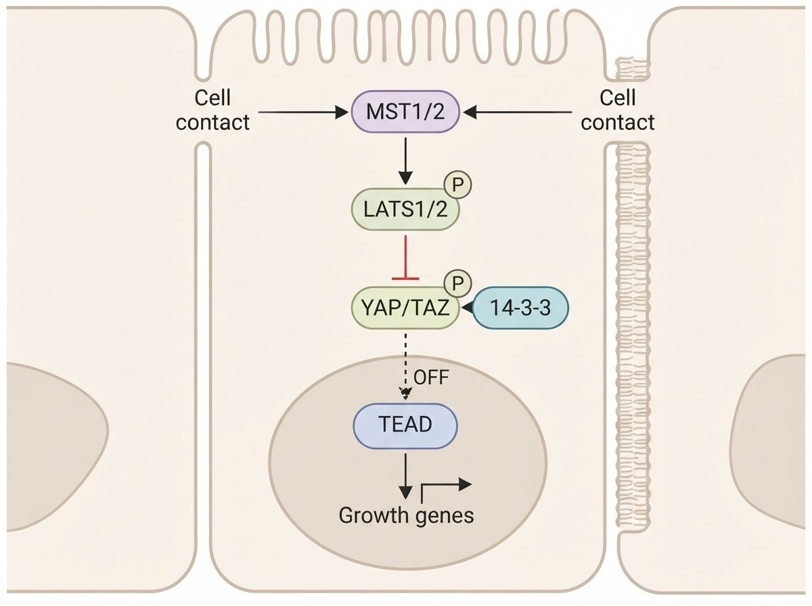 |

**English prompt**

```text
Create a signaling pathway schematic of 【Hippo/YAP signaling】 in one epithelial cell touching its neighbors on both sides, read from top to bottom. Draw each relationship exactly as listed and nothing more:
1. 【Cell–cell contact at the sides of the cell activates MST1/2.】
2. 【MST1/2 phosphorylates LATS1/2 (small 'P' circle).】
3. 【LATS1/2 inhibits YAP/TAZ by phosphorylating it (red T-bar, with a small 'P' circle on YAP/TAZ).】
4. 【14-3-3 binds phosphorylated YAP/TAZ and keeps it in the cytoplasm.】
5. 【When the pathway is off, YAP/TAZ enters the nucleus (dashed arrow) and binds TEAD.】
6. 【YAP/TAZ and TEAD together turn on growth genes.】
Draw YAP/TAZ only once, in the cytoplasm; the dashed arrow shows where it goes when the pathway is off.
Use red T-bars only where listed; each T-bar starts at the inhibitor and its flat end touches the inhibited target. Every other arrow is a solid activation arrow. Do not write the numbered sentences in the figure. Write each label only once in the whole figure.
Labels, each used once, no other text: 【Cell contact, MST1/2, LATS1/2, YAP/TAZ, 14-3-3, TEAD, Growth genes】.

Style: journal-style scientific schematic. Clean flat vector illustration on a white background, light pastel rounded panels to separate regions. Only 3-4 muted colors, each with one fixed meaning; red only for inhibition or emphasis. Thin, uniform line weight. Proteins as rounded colored capsules with their names inside; membranes as lipid bilayers; activation as solid arrows, inhibition as T-bar lines, indirect effects as dashed arrows. Sans-serif English labels only, each label appears exactly once, spelled exactly as given. No 3D rendering, no shadows, no glow, no decorative background, no photorealism.
```

<details><summary>Chinese prompt</summary>

```text
画一张【Hippo/YAP 信号】的通路示意图，画一个上皮细胞，左右两侧紧贴相邻细胞，从上往下读。严格按下面列出的关系画，不多画：
1. 【细胞两侧的细胞间接触激活 MST1/2。】
2. 【MST1/2 磷酸化 LATS1/2（带 P 的小圆点）。】
3. 【LATS1/2 通过磷酸化抑制 YAP/TAZ（红色 T 形线，YAP/TAZ 上带一个 P 小圆点）。】
4. 【14-3-3 结合磷酸化的 YAP/TAZ，把它留在胞质。】
5. 【通路关闭时，YAP/TAZ 进入细胞核（虚线箭头），结合 TEAD。】
6. 【YAP/TAZ 与 TEAD 一起开启生长相关基因。】
YAP/TAZ 只画一次，画在胞质里；虚线箭头表示通路关闭时它的去向。
只在列出的地方用红色 T 形线：从抑制者出发，平头端碰到被抑制的对象。其他箭头都是实线激活箭头。不要把编号句子写进图里。整张图里每个标签只写一次。
标签（每个只出现一次，不加其他文字）：【Cell contact, MST1/2, LATS1/2, YAP/TAZ, 14-3-3, TEAD, Growth genes】。

风格：期刊式科研示意图。白色背景上的干净扁平矢量插画，用浅色圆角面板区分区域。只用 3–4 种低饱和度颜色，每种颜色含义固定，红色只用于抑制或强调。线条细且粗细一致。蛋白画成彩色圆角胶囊，名称写在胶囊里；细胞膜画成磷脂双分子层；激活用实线箭头，抑制用 T 形线，间接作用用虚线箭头。图中文字只用英文无衬线字体，每个标签只出现一次，拼写与给定完全一致。不要 3D 渲染、阴影、发光、装饰性背景或照片质感。
```

</details>

Model: Nano Banana 2 Lite (gemini-3.1-flash-lite-image, 1K) · Generated 2 times in total; shown are the outputs that passed review

[↑ Back to top](#top)

<sub><a href="https://yila.ai/?utm_source=github&utm_medium=readme&utm_campaign=sci-figure-prompts&utm_content=hippo-yap">Try in Yila →</a></sub>

---

<a id="no-58"></a>

### No. 58: Insulin signaling and GLUT4 translocation

by [@Yila-AI](https://github.com/Yila-AI)

Technique: **receptor cascade plus vesicle translocation** · Style: flat vector schematic · Aspect ratio: 4:3

| English prompt |
|---|
|  |

> The Chinese-prompt output did not pass review, so it is not shown.

**English prompt**

```text
Create a signaling pathway schematic of 【insulin signaling in a muscle cell】, read from top to bottom. Draw each relationship exactly as listed and nothing more:
1. 【Insulin binds the insulin receptor in the membrane at the top.】
2. 【The receptor phosphorylates IRS-1 (small 'P' circle).】
3. 【IRS-1 activates PI3K.】
4. 【PI3K activates AKT.】
5. 【AKT sends vesicles carrying GLUT4 up to the membrane.】
6. 【GLUT4 in the membrane lets glucose into the cell.】
Draw only one plasma membrane, across the top. GLUT4 appears once, in a vesicle moving up to the membrane, and glucose appears once, entering through it. Use red T-bars only where listed; every other arrow is a solid activation arrow. Do not write the numbered sentences in the figure.
Labels, each used once, no other text: 【Insulin, Insulin receptor, IRS-1, PI3K, AKT, GLUT4, Glucose】.

Style: journal-style scientific schematic. Clean flat vector illustration on a white background, light pastel rounded panels to separate regions. Only 3-4 muted colors, each with one fixed meaning; red only for inhibition or emphasis. Thin, uniform line weight. Proteins as rounded colored capsules with their names inside; membranes as lipid bilayers; activation as solid arrows, inhibition as T-bar lines, indirect effects as dashed arrows. Sans-serif English labels only, each label appears exactly once, spelled exactly as given. No 3D rendering, no shadows, no glow, no decorative background, no photorealism.
```

<details><summary>Chinese prompt</summary>

```text
画一张【肌细胞中的胰岛素信号】通路示意图，从上往下读。严格按下面列出的关系画，不多画：
1. 【胰岛素结合顶部细胞膜上的胰岛素受体。】
2. 【受体磷酸化 IRS-1（带 P 的小圆点）。】
3. 【IRS-1 激活 PI3K。】
4. 【PI3K 激活 AKT。】
5. 【AKT 让携带 GLUT4 的囊泡移向细胞膜。】
6. 【膜上的 GLUT4 让葡萄糖进入细胞。】
只画一层细胞膜，横在顶部。GLUT4 只出现一次，在移向细胞膜的囊泡里；葡萄糖只出现一次，经它进入细胞。只在列出的地方用红色 T 形线，其他箭头都是实线激活箭头。不要把编号句子写进图里。
标签（每个只出现一次，不加其他文字）：【Insulin, Insulin receptor, IRS-1, PI3K, AKT, GLUT4, Glucose】。

风格：期刊式科研示意图。白色背景上的干净扁平矢量插画，用浅色圆角面板区分区域。只用 3–4 种低饱和度颜色，每种颜色含义固定，红色只用于抑制或强调。线条细且粗细一致。蛋白画成彩色圆角胶囊，名称写在胶囊里；细胞膜画成磷脂双分子层；激活用实线箭头，抑制用 T 形线，间接作用用虚线箭头。图中文字只用英文无衬线字体，每个标签只出现一次，拼写与给定完全一致。不要 3D 渲染、阴影、发光、装饰性背景或照片质感。
```

</details>

Model: Nano Banana 2 Lite (gemini-3.1-flash-lite-image, 1K) · Generated 6 times in total; shown are the outputs that passed review

[↑ Back to top](#top)

<sub><a href="https://yila.ai/?utm_source=github&utm_medium=readme&utm_campaign=sci-figure-prompts&utm_content=insulin-signaling">Try in Yila →</a></sub>

---

<a id="no-59"></a>

### No. 59: Intrinsic (mitochondrial) apoptosis

by [@Yila-AI](https://github.com/Yila-AI)

Technique: **mitochondrion in the center, numbered relationships** · Style: flat vector schematic · Aspect ratio: 4:3

| English prompt |
|---|
|  |

> The Chinese-prompt output did not pass review, so it is not shown.

**English prompt**

```text
Create a signaling pathway schematic of 【intrinsic apoptosis】 inside one cell, with one large mitochondrion in the center, read from top to bottom. Draw each relationship exactly as listed and nothing more:
1. 【Cellular stress activates BAX/BAK on the outer mitochondrial membrane.】
2. 【BCL-2 inhibits BAX/BAK (red T-bar).】
3. 【BAX/BAK releases cytochrome c from the mitochondrion.】
4. 【Cytochrome c binds APAF1 to form the apoptosome.】
5. 【The apoptosome activates caspase-9.】
6. 【Caspase-9 activates caspase-3, which leads to apoptosis (a shrinking cell with fragmented nucleus).】
BAX/BAK sits on the outer membrane of the mitochondrion itself, never on the cell membrane.
Labels, each used once, no other text: 【Cellular stress, BCL-2, BAX/BAK, Cytochrome c, APAF1, Caspase-9, Caspase-3, Apoptosis】.

Style: journal-style scientific schematic. Clean flat vector illustration on a white background, light pastel rounded panels to separate regions. Only 3-4 muted colors, each with one fixed meaning; red only for inhibition or emphasis. Thin, uniform line weight. Proteins as rounded colored capsules with their names inside; membranes as lipid bilayers; activation as solid arrows, inhibition as T-bar lines, indirect effects as dashed arrows. Sans-serif English labels only, each label appears exactly once, spelled exactly as given. No 3D rendering, no shadows, no glow, no decorative background, no photorealism.
```

<details><summary>Chinese prompt</summary>

```text
画一张【内源性凋亡】的信号通路示意图，在一个细胞内，中央画一个大线粒体，从上往下读。严格按下面列出的关系画，不多画：
1. 【细胞应激激活线粒体外膜上的 BAX/BAK。】
2. 【BCL-2 抑制 BAX/BAK（红色 T 形线）。】
3. 【BAX/BAK 使线粒体释放细胞色素 c。】
4. 【细胞色素 c 与 APAF1 结合，形成凋亡体。】
5. 【凋亡体激活 caspase-9。】
6. 【caspase-9 激活 caspase-3，导致凋亡（细胞皱缩、细胞核碎裂）。】
BAX/BAK 画在线粒体自身的外膜上，不要画在细胞膜上。
标签（每个只出现一次，不加其他文字）：【Cellular stress, BCL-2, BAX/BAK, Cytochrome c, APAF1, Caspase-9, Caspase-3, Apoptosis】。

风格：期刊式科研示意图。白色背景上的干净扁平矢量插画，用浅色圆角面板区分区域。只用 3–4 种低饱和度颜色，每种颜色含义固定，红色只用于抑制或强调。线条细且粗细一致。蛋白画成彩色圆角胶囊，名称写在胶囊里；细胞膜画成磷脂双分子层；激活用实线箭头，抑制用 T 形线，间接作用用虚线箭头。图中文字只用英文无衬线字体，每个标签只出现一次，拼写与给定完全一致。不要 3D 渲染、阴影、发光、装饰性背景或照片质感。
```

</details>

Model: Nano Banana 2 Lite (gemini-3.1-flash-lite-image, 1K) · Generated 5 times in total; shown are the outputs that passed review

[↑ Back to top](#top)

<sub><a href="https://yila.ai/?utm_source=github&utm_medium=readme&utm_campaign=sci-figure-prompts&utm_content=intrinsic-apoptosis">Try in Yila →</a></sub>

---

<a id="no-60"></a>

### No. 60: JAK/STAT pathway

by [@Yila-AI](https://github.com/Yila-AI)

Technique: **receptor, dimerization and nuclear entry, with negative feedback** · Style: flat vector schematic · Aspect ratio: 4:3

| English prompt |
|---|
|  |

> The Chinese-prompt output did not pass review, so it is not shown.

**English prompt**

```text
Create a signaling pathway schematic of 【IL-6 JAK/STAT3 signaling】 inside one cell, read from top to bottom. Draw each relationship exactly as listed and nothing more:
1. 【IL-6 binds its receptor in the membrane at the top.】
2. 【The receptor activates JAK, attached to its inner tail.】
3. 【JAK phosphorylates STAT3 (small 'P' circle).】
4. 【Two phosphorylated STAT3 join as a dimer.】
5. 【The dimer enters the nucleus and turns on target genes.】
6. 【SOCS3 inhibits JAK (red T-bar).】
Use red T-bars only where listed; every other arrow is a solid activation arrow. Do not write the numbered sentences in the figure.
Labels, each used once, no other text: 【IL-6, Receptor, JAK, STAT3, STAT3 dimer, SOCS3, Target genes】.

Style: journal-style scientific schematic. Clean flat vector illustration on a white background, light pastel rounded panels to separate regions. Only 3-4 muted colors, each with one fixed meaning; red only for inhibition or emphasis. Thin, uniform line weight. Proteins as rounded colored capsules with their names inside; membranes as lipid bilayers; activation as solid arrows, inhibition as T-bar lines, indirect effects as dashed arrows. Sans-serif English labels only, each label appears exactly once, spelled exactly as given. No 3D rendering, no shadows, no glow, no decorative background, no photorealism.
```

<details><summary>Chinese prompt</summary>

```text
画一张【IL-6 JAK/STAT3 信号】的通路示意图，在一个细胞内，从上往下读。严格按下面列出的关系画，不多画：
1. 【IL-6 结合顶部细胞膜上的受体。】
2. 【受体激活结合在其胞内尾部的 JAK。】
3. 【JAK 磷酸化 STAT3（带 P 的小圆点）。】
4. 【两个磷酸化的 STAT3 结合成二聚体。】
5. 【二聚体进入细胞核，开启靶基因。】
6. 【SOCS3 抑制 JAK（红色 T 形线）。】
只在列出的地方用红色 T 形线，其他箭头都是实线激活箭头。不要把编号句子写进图里。
标签（每个只出现一次，不加其他文字）：【IL-6, Receptor, JAK, STAT3, STAT3 dimer, SOCS3, Target genes】。

风格：期刊式科研示意图。白色背景上的干净扁平矢量插画，用浅色圆角面板区分区域。只用 3–4 种低饱和度颜色，每种颜色含义固定，红色只用于抑制或强调。线条细且粗细一致。蛋白画成彩色圆角胶囊，名称写在胶囊里；细胞膜画成磷脂双分子层；激活用实线箭头，抑制用 T 形线，间接作用用虚线箭头。图中文字只用英文无衬线字体，每个标签只出现一次，拼写与给定完全一致。不要 3D 渲染、阴影、发光、装饰性背景或照片质感。
```

</details>

Model: Nano Banana 2 Lite (gemini-3.1-flash-lite-image, 1K) · Generated 4 times in total; shown are the outputs that passed review

[↑ Back to top](#top)

<sub><a href="https://yila.ai/?utm_source=github&utm_medium=readme&utm_campaign=sci-figure-prompts&utm_content=jak-stat">Try in Yila →</a></sub>

---

<a id="no-61"></a>

### No. 61: Keap1/Nrf2 antioxidant pathway

by [@Yila-AI](https://github.com/Yila-AI)

Technique: **release in the cytosol, activation in the nucleus** · Style: flat vector schematic · Aspect ratio: 4:3

| English prompt | Chinese prompt |
|---|---|
|  |  |

**English prompt**

```text
Create a signaling pathway schematic of 【the Keap1/Nrf2 antioxidant response】 in one cell, read from top to bottom. Draw each relationship exactly as listed and nothing more:
1. 【Without stress, Keap1 holds Nrf2 and sends it to the proteasome for degradation.】
2. 【ROS modify Keap1, which releases Nrf2.】
3. 【Nrf2 enters the nucleus and binds the ARE.】
4. 【Nrf2 turns on antioxidant genes HO-1 and NQO1.】
There are no T-bars in this figure; all arrows are solid. An arrow carries the Keap1–Nrf2 pair into the proteasome, and Nrf2 alone, without Keap1, enters the nucleus. Do not write the numbered sentences in the figure.
Labels, each used once, no other text: 【ROS, Keap1, Nrf2, Proteasome, ARE, HO-1, NQO1】.

Style: journal-style scientific schematic. Clean flat vector illustration on a white background, light pastel rounded panels to separate regions. Only 3-4 muted colors, each with one fixed meaning; red only for inhibition or emphasis. Thin, uniform line weight. Proteins as rounded colored capsules with their names inside; membranes as lipid bilayers; activation as solid arrows, inhibition as T-bar lines, indirect effects as dashed arrows. Sans-serif English labels only, each label appears exactly once, spelled exactly as given. No 3D rendering, no shadows, no glow, no decorative background, no photorealism.
```

<details><summary>Chinese prompt</summary>

```text
画一张【Keap1/Nrf2 抗氧化应答】的信号通路示意图，在一个细胞内，从上往下读。严格按下面列出的关系画，不多画：
1. 【无应激时，Keap1 抓住 Nrf2，把它送到蛋白酶体降解。】
2. 【ROS 修饰 Keap1，使其释放 Nrf2。】
3. 【Nrf2 进入细胞核，结合 ARE。】
4. 【Nrf2 开启抗氧化基因 HO-1 和 NQO1。】
图中没有 T 形线，所有箭头都是实线。一条箭头把 Keap1–Nrf2 送进蛋白酶体；只有 Nrf2（不带 Keap1）进入细胞核。不要把编号句子写进图里。
标签（每个只出现一次，不加其他文字）：【ROS, Keap1, Nrf2, Proteasome, ARE, HO-1, NQO1】。

风格：期刊式科研示意图。白色背景上的干净扁平矢量插画，用浅色圆角面板区分区域。只用 3–4 种低饱和度颜色，每种颜色含义固定，红色只用于抑制或强调。线条细且粗细一致。蛋白画成彩色圆角胶囊，名称写在胶囊里；细胞膜画成磷脂双分子层；激活用实线箭头，抑制用 T 形线，间接作用用虚线箭头。图中文字只用英文无衬线字体，每个标签只出现一次，拼写与给定完全一致。不要 3D 渲染、阴影、发光、装饰性背景或照片质感。
```

</details>

Model: Nano Banana 2 Lite (gemini-3.1-flash-lite-image, 1K) · Generated 6 times in total; shown are the outputs that passed review

[↑ Back to top](#top)

<sub><a href="https://yila.ai/?utm_source=github&utm_medium=readme&utm_campaign=sci-figure-prompts&utm_content=keap1-nrf2">Try in Yila →</a></sub>

---

<a id="no-62"></a>

### No. 62: MAPK/ERK pathway

by [@Yila-AI](https://github.com/Yila-AI)

Technique: **linear cascade from receptor to nucleus** · Style: flat vector schematic · Aspect ratio: 4:3

| English prompt |
|---|
|  |

> The Chinese-prompt output did not pass review, so it is not shown.

**English prompt**

```text
Create a signaling pathway schematic of 【MAPK/ERK signaling】 inside one cell, receptor in the membrane at the top, read from top to bottom. Draw each relationship exactly as listed and nothing more:
1. 【EGF binds EGFR in the membrane.】
2. 【EGFR activates Ras.】
3. 【Ras activates Raf.】
4. 【Raf phosphorylates MEK (small 'P' circle).】
5. 【MEK phosphorylates ERK (small 'P' circle).】
6. 【ERK moves into the nucleus at the bottom and turns on proliferation genes.】
Use red T-bars only where listed; every other arrow is a solid activation arrow. Do not write the numbered sentences in the figure.
Labels, each used once, no other text: 【EGF, EGFR, Ras, Raf, MEK, ERK, Proliferation genes】.

Style: journal-style scientific schematic. Clean flat vector illustration on a white background, light pastel rounded panels to separate regions. Only 3-4 muted colors, each with one fixed meaning; red only for inhibition or emphasis. Thin, uniform line weight. Proteins as rounded colored capsules with their names inside; membranes as lipid bilayers; activation as solid arrows, inhibition as T-bar lines, indirect effects as dashed arrows. Sans-serif English labels only, each label appears exactly once, spelled exactly as given. No 3D rendering, no shadows, no glow, no decorative background, no photorealism.
```

<details><summary>Chinese prompt</summary>

```text
画一张【MAPK/ERK 信号】的通路示意图，在一个细胞内，受体在顶部细胞膜上，从上往下读。严格按下面列出的关系画，不多画：
1. 【EGF 结合膜上的 EGFR。】
2. 【EGFR 激活 Ras。】
3. 【Ras 激活 Raf。】
4. 【Raf 磷酸化 MEK（带 P 的小圆点）。】
5. 【MEK 磷酸化 ERK（带 P 的小圆点）。】
6. 【ERK 进入底部的细胞核，开启增殖基因。】
只在列出的地方用红色 T 形线，其他箭头都是实线激活箭头。不要把编号句子写进图里。
标签（每个只出现一次，不加其他文字）：【EGF, EGFR, Ras, Raf, MEK, ERK, Proliferation genes】。

风格：期刊式科研示意图。白色背景上的干净扁平矢量插画，用浅色圆角面板区分区域。只用 3–4 种低饱和度颜色，每种颜色含义固定，红色只用于抑制或强调。线条细且粗细一致。蛋白画成彩色圆角胶囊，名称写在胶囊里；细胞膜画成磷脂双分子层；激活用实线箭头，抑制用 T 形线，间接作用用虚线箭头。图中文字只用英文无衬线字体，每个标签只出现一次，拼写与给定完全一致。不要 3D 渲染、阴影、发光、装饰性背景或照片质感。
```

</details>

Model: Nano Banana 2 Lite (gemini-3.1-flash-lite-image, 1K) · Generated 4 times in total; shown are the outputs that passed review

[↑ Back to top](#top)

<sub><a href="https://yila.ai/?utm_source=github&utm_medium=readme&utm_campaign=sci-figure-prompts&utm_content=mapk-erk">Try in Yila →</a></sub>

---

<a id="no-63"></a>

### No. 63: Canonical NF-κB pathway

by [@Yila-AI](https://github.com/Yila-AI)

Technique: **membrane, cytosol and nucleus layers** · Style: flat vector schematic · Aspect ratio: 4:3

| English prompt | Chinese prompt |
|---|---|
|  |  |

**English prompt**

```text
Create a signaling pathway schematic of 【canonical NF-κB signaling】 inside one cell, read from top to bottom. Draw each relationship exactly as listed and nothing more:
1. 【TNF-α binds TNFR1 in the membrane at the top.】
2. 【TNFR1 activates the IKK complex (solid arrow).】
3. 【IKK phosphorylates IκBα, which is bound to p65/p50 (small 'P' circle on IκBα).】
4. 【IκBα enters the proteasome on the side and is shown as small broken fragments there.】
5. 【The freed p65/p50 moves down into the nucleus (solid arrow) and turns on inflammatory genes.】
No arrow points from p65/p50 to the proteasome. All arrows are solid activation arrows; there are no T-bars in this figure.
Labels, each used once, no other text: 【TNF-α, TNFR1, IKK, IκBα, Proteasome, p65/p50, Inflammatory genes】.

Style: journal-style scientific schematic. Clean flat vector illustration on a white background, light pastel rounded panels to separate regions. Only 3-4 muted colors, each with one fixed meaning; red only for inhibition or emphasis. Thin, uniform line weight. Proteins as rounded colored capsules with their names inside; membranes as lipid bilayers; activation as solid arrows, inhibition as T-bar lines, indirect effects as dashed arrows. Sans-serif English labels only, each label appears exactly once, spelled exactly as given. No 3D rendering, no shadows, no glow, no decorative background, no photorealism.
```

<details><summary>Chinese prompt</summary>

```text
画一张【经典 NF-κB 信号】的通路示意图，在一个细胞内，从上往下读。严格按下面列出的关系画，不多画：
1. 【TNF-α 结合顶部细胞膜上的 TNFR1。】
2. 【TNFR1 激活 IKK 复合物（实线箭头）。】
3. 【IKK 磷酸化与 p65/p50 结合在一起的 IκBα（IκBα 上一个带 P 的小圆点）。】
4. 【IκBα 进入侧边的蛋白酶体，在那里画成几块碎片。】
5. 【被释放的 p65/p50 向下进入细胞核（实线箭头），开启炎症基因。】
p65/p50 不指向蛋白酶体。所有箭头都是实线激活箭头，图中没有 T 形线。
标签（每个只出现一次，不加其他文字）：【TNF-α, TNFR1, IKK, IκBα, Proteasome, p65/p50, Inflammatory genes】。

风格：期刊式科研示意图。白色背景上的干净扁平矢量插画，用浅色圆角面板区分区域。只用 3–4 种低饱和度颜色，每种颜色含义固定，红色只用于抑制或强调。线条细且粗细一致。蛋白画成彩色圆角胶囊，名称写在胶囊里；细胞膜画成磷脂双分子层；激活用实线箭头，抑制用 T 形线，间接作用用虚线箭头。图中文字只用英文无衬线字体，每个标签只出现一次，拼写与给定完全一致。不要 3D 渲染、阴影、发光、装饰性背景或照片质感。
```

</details>

Model: Nano Banana 2 Lite (gemini-3.1-flash-lite-image, 1K) · Generated 6 times in total; shown are the outputs that passed review

[↑ Back to top](#top)

<sub><a href="https://yila.ai/?utm_source=github&utm_medium=readme&utm_campaign=sci-figure-prompts&utm_content=nf-kb">Try in Yila →</a></sub>

---

<a id="no-64"></a>

### No. 64: NLRP3 inflammasome: two-signal activation

by [@Yila-AI](https://github.com/Yila-AI)

Technique: **signal 1 and signal 2 as two routes** · Style: flat vector schematic · Aspect ratio: 16:9

| English prompt | Chinese prompt |
|---|---|
|  |  |

**English prompt**

```text
Create a signaling pathway schematic of 【NLRP3 inflammasome activation in a macrophage】: one cell, plasma membrane across the top, read from left to right. Draw each relationship exactly as listed and nothing more:
1. 【Signal 1, on the left: LPS binds TLR4 in the membrane; TLR4 activates NF-κB, which raises NLRP3 and pro-IL-1β.】
2. 【Signal 2, in the middle: K+ leaves the cell through the membrane, and this activates NLRP3.】
3. 【NLRP3, ASC and caspase-1 assemble into one ring-shaped inflammasome.】
4. 【On the right, caspase-1 cuts pro-IL-1β into IL-1β, which is released through the membrane.】
The arrow between pro-IL-1β and IL-1β points toward IL-1β. All arrows are solid activation arrows; there are no T-bars in this figure.
Labels, each used once, no other text: 【LPS, TLR4, NF-κB, K+ efflux, NLRP3, ASC, Caspase-1, IL-1β】.

Style: journal-style scientific schematic. Clean flat vector illustration on a white background, light pastel rounded panels to separate regions. Only 3-4 muted colors, each with one fixed meaning; red only for inhibition or emphasis. Thin, uniform line weight. Proteins as rounded colored capsules with their names inside; membranes as lipid bilayers; activation as solid arrows, inhibition as T-bar lines, indirect effects as dashed arrows. Sans-serif English labels only, each label appears exactly once, spelled exactly as given. No 3D rendering, no shadows, no glow, no decorative background, no photorealism.
```

<details><summary>Chinese prompt</summary>

```text
画一张【巨噬细胞中 NLRP3 炎症小体激活】的信号通路示意图：一个细胞，细胞膜横在顶部，从左往右读。严格按下面列出的关系画，不多画：
1. 【左侧信号 1：LPS 结合膜上的 TLR4；TLR4 激活 NF-κB，上调 NLRP3 和 pro-IL-1β。】
2. 【中间信号 2：K+ 经细胞膜流出，激活 NLRP3。】
3. 【NLRP3、ASC 和 caspase-1 组装成一个环形的炎症小体。】
4. 【右侧：caspase-1 把 pro-IL-1β 切成 IL-1β，经细胞膜释放。】
pro-IL-1β 与 IL-1β 之间的箭头指向 IL-1β。所有箭头都是实线激活箭头，图中没有 T 形线。
标签（每个只出现一次，不加其他文字）：【LPS, TLR4, NF-κB, K+ efflux, NLRP3, ASC, Caspase-1, IL-1β】。

风格：期刊式科研示意图。白色背景上的干净扁平矢量插画，用浅色圆角面板区分区域。只用 3–4 种低饱和度颜色，每种颜色含义固定，红色只用于抑制或强调。线条细且粗细一致。蛋白画成彩色圆角胶囊，名称写在胶囊里；细胞膜画成磷脂双分子层；激活用实线箭头，抑制用 T 形线，间接作用用虚线箭头。图中文字只用英文无衬线字体，每个标签只出现一次，拼写与给定完全一致。不要 3D 渲染、阴影、发光、装饰性背景或照片质感。
```

</details>

Model: Nano Banana 2 Lite (gemini-3.1-flash-lite-image, 1K) · Generated 6 times in total; shown are the outputs that passed review

[↑ Back to top](#top)

<sub><a href="https://yila.ai/?utm_source=github&utm_medium=readme&utm_campaign=sci-figure-prompts&utm_content=nlrp3-inflammasome">Try in Yila →</a></sub>

---

<a id="no-65"></a>

### No. 65: p53 and the DNA damage response

by [@Yila-AI](https://github.com/Yila-AI)

Technique: **central node with three outcomes** · Style: flat vector schematic · Aspect ratio: 4:3

| English prompt | Chinese prompt |
|---|---|
|  |  |

**English prompt**

```text
Create a signaling pathway schematic of 【the p53 DNA damage response】 in one cell, read from top to bottom. Draw each relationship exactly as listed and nothing more:
1. 【DNA damage (a broken DNA strand) activates ATM.】
2. 【ATM phosphorylates p53 (small 'P' circle).】
3. 【MDM2 inhibits p53 (red T-bar).】
4. 【p53 turns on p21, leading to cell-cycle arrest.】
5. 【p53 turns on BAX, leading to apoptosis.】
Use red T-bars only where listed; every other arrow is a solid activation arrow. Do not write the numbered sentences in the figure.
Labels, each used once, no other text: 【DNA damage, ATM, p53, MDM2, p21, BAX, Cell-cycle arrest, Apoptosis】.

Style: journal-style scientific schematic. Clean flat vector illustration on a white background, light pastel rounded panels to separate regions. Only 3-4 muted colors, each with one fixed meaning; red only for inhibition or emphasis. Thin, uniform line weight. Proteins as rounded colored capsules with their names inside; membranes as lipid bilayers; activation as solid arrows, inhibition as T-bar lines, indirect effects as dashed arrows. Sans-serif English labels only, each label appears exactly once, spelled exactly as given. No 3D rendering, no shadows, no glow, no decorative background, no photorealism.
```

<details><summary>Chinese prompt</summary>

```text
画一张【p53 DNA 损伤应答】的信号通路示意图，在一个细胞内，从上往下读。严格按下面列出的关系画，不多画：
1. 【DNA 损伤（断裂的 DNA 链）激活 ATM。】
2. 【ATM 磷酸化 p53（带 P 的小圆点）。】
3. 【MDM2 抑制 p53（红色 T 形线）。】
4. 【p53 开启 p21，导致细胞周期停滞。】
5. 【p53 开启 BAX，导致凋亡。】
只在列出的地方用红色 T 形线，其他箭头都是实线激活箭头。不要把编号句子写进图里。
标签（每个只出现一次，不加其他文字）：【DNA damage, ATM, p53, MDM2, p21, BAX, Cell-cycle arrest, Apoptosis】。

风格：期刊式科研示意图。白色背景上的干净扁平矢量插画，用浅色圆角面板区分区域。只用 3–4 种低饱和度颜色，每种颜色含义固定，红色只用于抑制或强调。线条细且粗细一致。蛋白画成彩色圆角胶囊，名称写在胶囊里；细胞膜画成磷脂双分子层；激活用实线箭头，抑制用 T 形线，间接作用用虚线箭头。图中文字只用英文无衬线字体，每个标签只出现一次，拼写与给定完全一致。不要 3D 渲染、阴影、发光、装饰性背景或照片质感。
```

</details>

Model: Nano Banana 2 Lite (gemini-3.1-flash-lite-image, 1K) · Generated 4 times in total; shown are the outputs that passed review

[↑ Back to top](#top)

<sub><a href="https://yila.ai/?utm_source=github&utm_medium=readme&utm_campaign=sci-figure-prompts&utm_content=p53-dna-damage">Try in Yila →</a></sub>

---

<a id="no-66"></a>

### No. 66: PD-1/PD-L1 immune checkpoint and its blockade

by [@Yila-AI](https://github.com/Yila-AI)

Technique: **numbered relationships + side-by-side panels** · Style: flat vector schematic · Aspect ratio: 16:9

| English prompt |
|---|
|  |

> The Chinese-prompt output did not pass review, so it is not shown.

**English prompt**

```text
Create a two-panel schematic of 【the PD-1/PD-L1 immune checkpoint before and after antibody blockade】, separated by a thin dashed vertical line. In both panels 【a T cell is on the left and a tumor cell is on the right】, and only their contact zone is drawn. Draw each relationship exactly as listed and nothing more:
Left panel:
1. 【TCR on the T cell touches MHC-I on the tumor cell.】
2. 【PD-1 on the T cell is directly joined to PD-L1 on the tumor cell.】
3. 【A red T-bar goes from PD-1 into the T cell: the T cell is switched off.】
Right panel:
1. 【TCR on the T cell touches MHC-I on the tumor cell.】
2. 【A Y-shaped antibody is attached to PD-1 only; a clear gap separates PD-1 from PD-L1.】
3. 【A solid arrow goes from the T cell to the tumor cell, which is breaking apart.】
Labels, each used once, no other text: 【T cell, Tumor cell, PD-1, PD-L1, Anti-PD-1, Tumor killing】.

Style: journal-style scientific schematic. Clean flat vector illustration on a white background, light pastel rounded panels to separate regions. Only 3-4 muted colors, each with one fixed meaning; red only for inhibition or emphasis. Thin, uniform line weight. Proteins as rounded colored capsules with their names inside; membranes as lipid bilayers; activation as solid arrows, inhibition as T-bar lines, indirect effects as dashed arrows. Sans-serif English labels only, each label appears exactly once, spelled exactly as given. No 3D rendering, no shadows, no glow, no decorative background, no photorealism.
```

<details><summary>Chinese prompt</summary>

```text
画一张左右两栏示意图，展示【抗体阻断前后的 PD-1/PD-L1 免疫检查点】，两栏之间用一条细虚线分开。两栏里都是【左边一个 T 细胞，右边一个肿瘤细胞】，只画两者接触的区域。严格按下面列出的关系画，不多画：
左栏：
1. 【T 细胞上的 TCR 接触肿瘤细胞上的 MHC-I。】
2. 【T 细胞上的 PD-1 与肿瘤细胞上的 PD-L1 直接相连。】
3. 【一条红色 T 形线从 PD-1 伸进 T 细胞：T 细胞被关闭。】
右栏：
1. 【T 细胞上的 TCR 接触肿瘤细胞上的 MHC-I。】
2. 【一个 Y 形抗体只结合在 PD-1 上；PD-1 与 PD-L1 之间留出明显的空隙。】
3. 【一条实线箭头从 T 细胞指向正在破裂的肿瘤细胞。】
标签（每个只出现一次，不加其他文字）：【T cell, Tumor cell, PD-1, PD-L1, Anti-PD-1, Tumor killing】。

风格：期刊式科研示意图。白色背景上的干净扁平矢量插画，用浅色圆角面板区分区域。只用 3–4 种低饱和度颜色，每种颜色含义固定，红色只用于抑制或强调。线条细且粗细一致。蛋白画成彩色圆角胶囊，名称写在胶囊里；细胞膜画成磷脂双分子层；激活用实线箭头，抑制用 T 形线，间接作用用虚线箭头。图中文字只用英文无衬线字体，每个标签只出现一次，拼写与给定完全一致。不要 3D 渲染、阴影、发光、装饰性背景或照片质感。
```

</details>

Model: Nano Banana 2 Lite (gemini-3.1-flash-lite-image, 1K) · Generated 8 times in total; shown are the outputs that passed review

[↑ Back to top](#top)

<sub><a href="https://yila.ai/?utm_source=github&utm_medium=readme&utm_campaign=sci-figure-prompts&utm_content=pd1-pdl1-checkpoint">Try in Yila →</a></sub>

---

<a id="no-67"></a>

### No. 67: PI3K/AKT/mTOR pathway

by [@Yila-AI](https://github.com/Yila-AI)

Technique: **numbered relationships, red T-bars for inhibition** · Style: flat vector schematic · Aspect ratio: 4:3

| English prompt | Chinese prompt |
|---|---|
|  |  |

**English prompt**

```text
Create a signaling pathway schematic of 【PI3K/AKT/mTOR signaling】 inside one cell, receptor in the membrane at the top, read from top to bottom. Draw each relationship exactly as listed and nothing more:
1. 【A growth factor binds the RTK in the membrane.】
2. 【The RTK activates PI3K.】
3. 【PI3K produces PIP3 at the membrane.】
4. 【PTEN inhibits PIP3 (red T-bar).】
5. 【PIP3 activates AKT.】
6. 【AKT inhibits TSC1/2 (red T-bar).】
7. 【TSC1/2 inhibits mTORC1 (red T-bar).】
8. 【mTORC1 drives cell growth.】
Labels, each used once, no other text: 【Growth factor, RTK, PI3K, PIP3, PTEN, AKT, TSC1/2, mTORC1, Cell growth】.

Style: journal-style scientific schematic. Clean flat vector illustration on a white background, light pastel rounded panels to separate regions. Only 3-4 muted colors, each with one fixed meaning; red only for inhibition or emphasis. Thin, uniform line weight. Proteins as rounded colored capsules with their names inside; membranes as lipid bilayers; activation as solid arrows, inhibition as T-bar lines, indirect effects as dashed arrows. Sans-serif English labels only, each label appears exactly once, spelled exactly as given. No 3D rendering, no shadows, no glow, no decorative background, no photorealism.
```

<details><summary>Chinese prompt</summary>

```text
画一张【PI3K/AKT/mTOR 信号】的通路示意图，在一个细胞内，受体在顶部细胞膜上，从上往下读。严格按下面列出的关系画，不多画：
1. 【生长因子结合膜上的 RTK。】
2. 【RTK 激活 PI3K。】
3. 【PI3K 在膜上生成 PIP3。】
4. 【PTEN 抑制 PIP3（红色 T 形线）。】
5. 【PIP3 激活 AKT。】
6. 【AKT 抑制 TSC1/2（红色 T 形线）。】
7. 【TSC1/2 抑制 mTORC1（红色 T 形线）。】
8. 【mTORC1 促进细胞生长。】
标签（每个只出现一次，不加其他文字）：【Growth factor, RTK, PI3K, PIP3, PTEN, AKT, TSC1/2, mTORC1, Cell growth】。

风格：期刊式科研示意图。白色背景上的干净扁平矢量插画，用浅色圆角面板区分区域。只用 3–4 种低饱和度颜色，每种颜色含义固定，红色只用于抑制或强调。线条细且粗细一致。蛋白画成彩色圆角胶囊，名称写在胶囊里；细胞膜画成磷脂双分子层；激活用实线箭头，抑制用 T 形线，间接作用用虚线箭头。图中文字只用英文无衬线字体，每个标签只出现一次，拼写与给定完全一致。不要 3D 渲染、阴影、发光、装饰性背景或照片质感。
```

</details>

Model: Nano Banana 2 Lite (gemini-3.1-flash-lite-image, 1K) · Generated 3 times in total; shown are the outputs that passed review

[↑ Back to top](#top)

<sub><a href="https://yila.ai/?utm_source=github&utm_medium=readme&utm_campaign=sci-figure-prompts&utm_content=pi3k-akt-mtor">Try in Yila →</a></sub>

---

<a id="no-68"></a>

### No. 68: Pyroptosis via gasdermin D pores

by [@Yila-AI](https://github.com/Yila-AI)

Technique: **pore formation and cytokine release in one view** · Style: flat vector schematic · Aspect ratio: 4:3

| English prompt | Chinese prompt |
|---|---|
|  |  |

**English prompt**

```text
Create a signaling pathway schematic of 【canonical pyroptosis】 in one cell, plasma membrane along the right side, read from left to right. Draw each relationship exactly as listed and nothing more:
1. 【The inflammasome activates caspase-1.】
2. 【Caspase-1 cleaves GSDMD.】
3. 【The GSDMD-N fragment inserts into the membrane and forms pores.】
4. 【Caspase-1 matures IL-1β and IL-18.】
5. 【IL-1β and IL-18 are released through the pores.】
6. 【The cell swells and bursts (pyroptosis).】
All arrows are solid activation arrows; there are no T-bars. Do not write the numbered sentences in the figure.
Labels, each used once, no other text: 【Inflammasome, Caspase-1, GSDMD, GSDMD-N pore, IL-1β, IL-18, Pyroptosis】.

Style: journal-style scientific schematic. Clean flat vector illustration on a white background, light pastel rounded panels to separate regions. Only 3-4 muted colors, each with one fixed meaning; red only for inhibition or emphasis. Thin, uniform line weight. Proteins as rounded colored capsules with their names inside; membranes as lipid bilayers; activation as solid arrows, inhibition as T-bar lines, indirect effects as dashed arrows. Sans-serif English labels only, each label appears exactly once, spelled exactly as given. No 3D rendering, no shadows, no glow, no decorative background, no photorealism.
```

<details><summary>Chinese prompt</summary>

```text
画一张【经典细胞焦亡】的信号通路示意图，在一个细胞内，细胞膜在右侧，从左往右读。严格按下面列出的关系画，不多画：
1. 【炎症小体激活 caspase-1。】
2. 【caspase-1 剪切 GSDMD。】
3. 【GSDMD-N 片段插入细胞膜形成孔道。】
4. 【caspase-1 使 IL-1β 和 IL-18 成熟。】
5. 【IL-1β 和 IL-18 经孔道释放到细胞外。】
6. 【细胞肿胀破裂（焦亡）。】
所有箭头都是实线激活箭头，图中没有 T 形线。不要把编号句子写进图里。
标签（每个只出现一次，不加其他文字）：【Inflammasome, Caspase-1, GSDMD, GSDMD-N pore, IL-1β, IL-18, Pyroptosis】。

风格：期刊式科研示意图。白色背景上的干净扁平矢量插画，用浅色圆角面板区分区域。只用 3–4 种低饱和度颜色，每种颜色含义固定，红色只用于抑制或强调。线条细且粗细一致。蛋白画成彩色圆角胶囊，名称写在胶囊里；细胞膜画成磷脂双分子层；激活用实线箭头，抑制用 T 形线，间接作用用虚线箭头。图中文字只用英文无衬线字体，每个标签只出现一次，拼写与给定完全一致。不要 3D 渲染、阴影、发光、装饰性背景或照片质感。
```

</details>

Model: Nano Banana 2 Lite (gemini-3.1-flash-lite-image, 1K) · Generated 5 times in total; shown are the outputs that passed review

[↑ Back to top](#top)

<sub><a href="https://yila.ai/?utm_source=github&utm_medium=readme&utm_campaign=sci-figure-prompts&utm_content=pyroptosis">Try in Yila →</a></sub>

---

<a id="no-69"></a>

### No. 69: TGF-β/SMAD pro-fibrotic pathway

by [@Yila-AI](https://github.com/Yila-AI)

Technique: **numbered relationships + activation/inhibition line styles** · Style: flat vector schematic · Aspect ratio: 4:3

| English prompt | Chinese prompt |
|---|---|
|  |  |

**English prompt**

```text
Create a signaling pathway schematic of 【TGF-β/SMAD signaling in fibrosis】 inside one cell, read from top to bottom. Draw each relationship exactly as listed and nothing more:
1. 【TGF-β binds a receptor pair in the cell membrane at the top: TβRII and TβRI.】
2. 【TβRI phosphorylates SMAD2/3 (small 'P' circle).】
3. 【SMAD2/3 joins SMAD4 to form a complex.】
4. 【The complex moves into the nucleus at the bottom and turns on collagen genes.】
5. 【SMAD7 inhibits TβRI (red T-bar).】
Labels, each used once, no other text: 【TGF-β, TβRII, TβRI, SMAD2/3, SMAD4, SMAD7, Collagen genes】.

Style: journal-style scientific schematic. Clean flat vector illustration on a white background, light pastel rounded panels to separate regions. Only 3-4 muted colors, each with one fixed meaning; red only for inhibition or emphasis. Thin, uniform line weight. Proteins as rounded colored capsules with their names inside; membranes as lipid bilayers; activation as solid arrows, inhibition as T-bar lines, indirect effects as dashed arrows. Sans-serif English labels only, each label appears exactly once, spelled exactly as given. No 3D rendering, no shadows, no glow, no decorative background, no photorealism.
```

<details><summary>Chinese prompt</summary>

```text
画一张【纤维化中的 TGF-β/SMAD 信号】通路示意图，在一个细胞内从上往下读。严格按下面列出的关系画，不多画：
1. 【TGF-β 结合顶部细胞膜上的一对受体：TβRII 和 TβRI。】
2. 【TβRI 磷酸化 SMAD2/3（带 P 的小圆点）。】
3. 【SMAD2/3 与 SMAD4 结合成复合物。】
4. 【复合物进入底部的细胞核，开启胶原基因。】
5. 【SMAD7 抑制 TβRI（红色 T 形线）。】
标签（每个只出现一次，不加其他文字）：【TGF-β, TβRII, TβRI, SMAD2/3, SMAD4, SMAD7, Collagen genes】。

风格：期刊式科研示意图。白色背景上的干净扁平矢量插画，用浅色圆角面板区分区域。只用 3–4 种低饱和度颜色，每种颜色含义固定，红色只用于抑制或强调。线条细且粗细一致。蛋白画成彩色圆角胶囊，名称写在胶囊里；细胞膜画成磷脂双分子层；激活用实线箭头，抑制用 T 形线，间接作用用虚线箭头。图中文字只用英文无衬线字体，每个标签只出现一次，拼写与给定完全一致。不要 3D 渲染、阴影、发光、装饰性背景或照片质感。
```

</details>

Model: Nano Banana 2 Lite (gemini-3.1-flash-lite-image, 1K) · Generated 2 times in total; shown are the outputs that passed review

[↑ Back to top](#top)

<sub><a href="https://yila.ai/?utm_source=github&utm_medium=readme&utm_campaign=sci-figure-prompts&utm_content=tgfb-smad">Try in Yila →</a></sub>

---

<a id="no-70"></a>

### No. 70: TLR4 signaling (MyD88 branch to NF-κB)

by [@Yila-AI](https://github.com/Yila-AI)

Technique: **membrane receptor to nuclear transcription** · Style: flat vector schematic · Aspect ratio: 4:3

| English prompt |
|---|
| 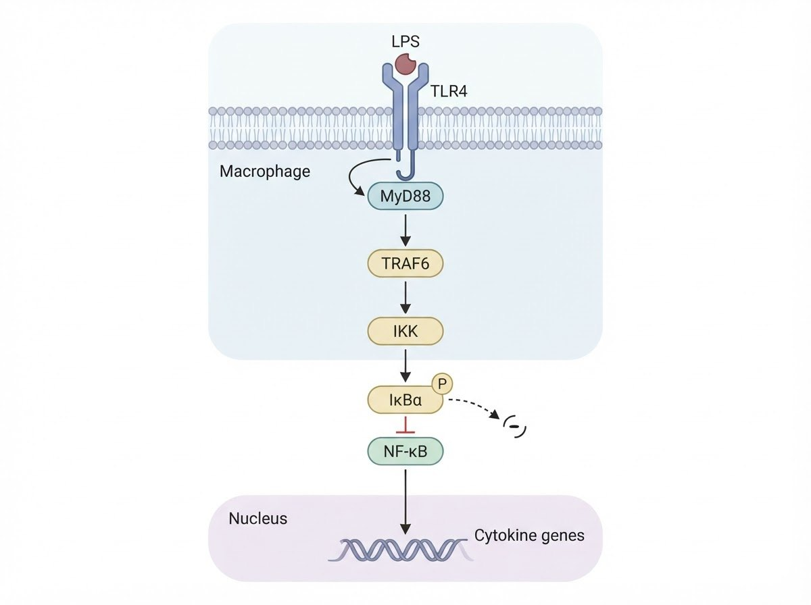 |

> The Chinese-prompt output did not pass review, so it is not shown.

**English prompt**

```text
Create a signaling pathway schematic of 【TLR4 signaling through MyD88】 in one macrophage, TLR4 in the cell membrane at the top, read from top to bottom. Draw each relationship exactly as listed and nothing more:
1. 【LPS binds TLR4 in the cell membrane.】
2. 【TLR4 recruits MyD88 to its inner tail.】
3. 【MyD88 activates TRAF6.】
4. 【TRAF6 activates IKK.】
5. 【IκBα inhibits NF-κB by holding it in the cytoplasm (red T-bar).】
6. 【IKK phosphorylates IκBα (small 'P' circle), which is then degraded, freeing NF-κB.】
7. 【NF-κB enters the nucleus and turns on cytokine genes.】
Draw NF-κB only once, next to IκBα, with an arrow into the nucleus.
Use red T-bars only where listed; each T-bar starts at the inhibitor and its flat end touches the inhibited target. Every other arrow is a solid activation arrow. Do not write the numbered sentences in the figure. Write each label only once in the whole figure.
If a component appears in more than one place or panel, write its label only at its first appearance; every other copy has no text. No label may appear twice anywhere in the figure. Spell every label exactly as given and add no titles.
Labels, each used once, no other text: 【LPS, TLR4, MyD88, TRAF6, IKK, IκBα, NF-κB, Cytokine genes】.

Style: journal-style scientific schematic. Clean flat vector illustration on a white background, light pastel rounded panels to separate regions. Only 3-4 muted colors, each with one fixed meaning; red only for inhibition or emphasis. Thin, uniform line weight. Proteins as rounded colored capsules with their names inside; membranes as lipid bilayers; activation as solid arrows, inhibition as T-bar lines, indirect effects as dashed arrows. Sans-serif English labels only, each label appears exactly once, spelled exactly as given. No 3D rendering, no shadows, no glow, no decorative background, no photorealism.
```

<details><summary>Chinese prompt</summary>

```text
画一张【经 MyD88 的 TLR4 信号】通路示意图，在一个巨噬细胞内，TLR4 在顶部细胞膜上，从上往下读。严格按下面列出的关系画，不多画：
1. 【LPS 结合细胞膜上的 TLR4。】
2. 【TLR4 把 MyD88 招募到其胞内尾部。】
3. 【MyD88 激活 TRAF6。】
4. 【TRAF6 激活 IKK。】
5. 【IκBα 把 NF-κB 扣在胞质里，从而抑制它（红色 T 形线）。】
6. 【IKK 磷酸化 IκBα（带 P 的小圆点），IκBα 随后被降解，释放 NF-κB。】
7. 【NF-κB 进入细胞核，开启细胞因子基因。】
NF-κB 只画一次，放在 IκBα 旁边，用一条箭头指向细胞核。
只在列出的地方用红色 T 形线：从抑制者出发，平头端碰到被抑制的对象。其他箭头都是实线激活箭头。不要把编号句子写进图里。整张图里每个标签只写一次。
如果同一组件在多处或多个面板出现，只在第一次出现时写标签，其余副本不写字。整张图里任何标签都不能出现两次。每个标签拼写与给定完全一致，不加标题。
标签（每个只出现一次，不加其他文字）：【LPS, TLR4, MyD88, TRAF6, IKK, IκBα, NF-κB, Cytokine genes】。

风格：期刊式科研示意图。白色背景上的干净扁平矢量插画，用浅色圆角面板区分区域。只用 3–4 种低饱和度颜色，每种颜色含义固定，红色只用于抑制或强调。线条细且粗细一致。蛋白画成彩色圆角胶囊，名称写在胶囊里；细胞膜画成磷脂双分子层；激活用实线箭头，抑制用 T 形线，间接作用用虚线箭头。图中文字只用英文无衬线字体，每个标签只出现一次，拼写与给定完全一致。不要 3D 渲染、阴影、发光、装饰性背景或照片质感。
```

</details>

Model: Nano Banana 2 Lite (gemini-3.1-flash-lite-image, 1K) · Generated 6 times in total; shown are the outputs that passed review

[↑ Back to top](#top)

<sub><a href="https://yila.ai/?utm_source=github&utm_medium=readme&utm_campaign=sci-figure-prompts&utm_content=tlr4-myd88-nfkb">Try in Yila →</a></sub>

---

<a id="no-71"></a>

### No. 71: VEGF/VEGFR2 signaling in an endothelial cell

by [@Yila-AI](https://github.com/Yila-AI)

Technique: **one receptor, two branches** · Style: flat vector schematic · Aspect ratio: 4:3

| Chinese prompt |
|---|
| 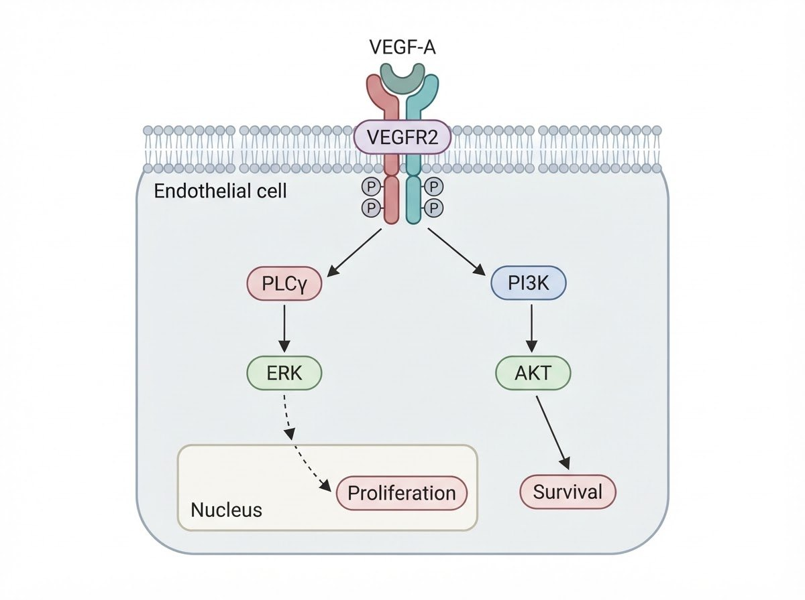 |

**English prompt**

```text
Create a signaling pathway schematic of 【VEGF signaling】 in one endothelial cell lining a blood vessel, VEGFR2 in the cell membrane at the top, read from top to bottom in two branches. Draw each relationship exactly as listed and nothing more:
1. 【VEGF-A binds VEGFR2 in the cell membrane.】
2. 【VEGFR2 forms a pair, and its inner tails gain small 'P' circles.】
3. 【Left branch: VEGFR2 activates PLCγ, and PLCγ activates ERK.】
4. 【ERK enters the nucleus and drives proliferation.】
5. 【Right branch: VEGFR2 activates PI3K, and PI3K activates AKT.】
6. 【AKT promotes cell survival.】
There are no T-bars in this figure. Do not write the numbered sentences in the figure. Write each label only once in the whole figure.
Labels, each used once, no other text: 【VEGF-A, VEGFR2, PLCγ, ERK, PI3K, AKT, Proliferation, Survival】.

Style: journal-style scientific schematic. Clean flat vector illustration on a white background, light pastel rounded panels to separate regions. Only 3-4 muted colors, each with one fixed meaning; red only for inhibition or emphasis. Thin, uniform line weight. Proteins as rounded colored capsules with their names inside; membranes as lipid bilayers; activation as solid arrows, inhibition as T-bar lines, indirect effects as dashed arrows. Sans-serif English labels only, each label appears exactly once, spelled exactly as given. No 3D rendering, no shadows, no glow, no decorative background, no photorealism.
```

<details><summary>Chinese prompt</summary>

```text
画一张【VEGF 信号】的通路示意图，在一个衬于血管内壁的内皮细胞内，VEGFR2 在顶部细胞膜上，从上往下分两条分支。严格按下面列出的关系画，不多画：
1. 【VEGF-A 结合细胞膜上的 VEGFR2。】
2. 【VEGFR2 成对聚合，胞内尾部出现带 P 的小圆点。】
3. 【左分支：VEGFR2 激活 PLCγ，PLCγ 激活 ERK。】
4. 【ERK 进入细胞核，推动增殖。】
5. 【右分支：VEGFR2 激活 PI3K，PI3K 激活 AKT。】
6. 【AKT 促进细胞存活。】
图中没有 T 形线。不要把编号句子写进图里。整张图里每个标签只写一次。
标签（每个只出现一次，不加其他文字）：【VEGF-A, VEGFR2, PLCγ, ERK, PI3K, AKT, Proliferation, Survival】。

风格：期刊式科研示意图。白色背景上的干净扁平矢量插画，用浅色圆角面板区分区域。只用 3–4 种低饱和度颜色，每种颜色含义固定，红色只用于抑制或强调。线条细且粗细一致。蛋白画成彩色圆角胶囊，名称写在胶囊里；细胞膜画成磷脂双分子层；激活用实线箭头，抑制用 T 形线，间接作用用虚线箭头。图中文字只用英文无衬线字体，每个标签只出现一次，拼写与给定完全一致。不要 3D 渲染、阴影、发光、装饰性背景或照片质感。
```

</details>

Model: Nano Banana 2 Lite (gemini-3.1-flash-lite-image, 1K) · Generated 2 times in total; shown are the outputs that passed review

[↑ Back to top](#top)

<sub><a href="https://yila.ai/?utm_source=github&utm_medium=readme&utm_campaign=sci-figure-prompts&utm_content=vegf-vegfr2">Try in Yila →</a></sub>

---

<a id="no-72"></a>

### No. 72: Wnt/β-catenin pathway: OFF versus ON

by [@Yila-AI](https://github.com/Yila-AI)

Technique: **two cells side by side** · Style: flat vector schematic · Aspect ratio: 16:9

| English prompt | Chinese prompt |
|---|---|
|  |  |

**English prompt**

```text
Create a side-by-side schematic of 【Wnt/β-catenin signaling】: two cells, left panel OFF and right panel ON. Draw each relationship exactly as listed and nothing more:
1. 【Left cell: the destruction complex marks β-catenin for degradation; no β-catenin reaches the nucleus.】
2. 【Right cell: Wnt binds Frizzled and LRP5/6 in the membrane.】
3. 【Right cell: the receptors activate Dishevelled.】
4. 【Right cell: Dishevelled inhibits the destruction complex (red T-bar).】
5. 【Right cell: β-catenin builds up, enters the nucleus and binds TCF/LEF to turn on target genes.】
In the Wnt OFF cell the target genes stay off, with no arrow at the genes. In the Wnt ON cell, no arrow points from the destruction complex to β-catenin.
Labels, each used once, no other text: 【Wnt OFF, Wnt ON, Wnt, Frizzled, LRP5/6, Dishevelled, Destruction complex, β-catenin, TCF/LEF】.

Style: journal-style scientific schematic. Clean flat vector illustration on a white background, light pastel rounded panels to separate regions. Only 3-4 muted colors, each with one fixed meaning; red only for inhibition or emphasis. Thin, uniform line weight. Proteins as rounded colored capsules with their names inside; membranes as lipid bilayers; activation as solid arrows, inhibition as T-bar lines, indirect effects as dashed arrows. Sans-serif English labels only, each label appears exactly once, spelled exactly as given. No 3D rendering, no shadows, no glow, no decorative background, no photorealism.
```

<details><summary>Chinese prompt</summary>

```text
画一张【Wnt/β-catenin 信号】的左右对照示意图：两个细胞，左边是关闭状态，右边是开启状态。严格按下面列出的关系画，不多画：
1. 【左侧细胞：降解复合物标记 β-catenin 使其降解，没有 β-catenin 进入细胞核。】
2. 【右侧细胞：Wnt 结合膜上的 Frizzled 和 LRP5/6。】
3. 【右侧细胞：受体激活 Dishevelled。】
4. 【右侧细胞：Dishevelled 抑制降解复合物（红色 T 形线）。】
5. 【右侧细胞：β-catenin 积累，进入细胞核，与 TCF/LEF 结合开启靶基因。】
关闭态细胞里靶基因保持关闭，基因处不画箭头。开启态细胞里，降解复合物不指向 β-catenin。
标签（每个只出现一次，不加其他文字）：【Wnt OFF, Wnt ON, Wnt, Frizzled, LRP5/6, Dishevelled, Destruction complex, β-catenin, TCF/LEF】。

风格：期刊式科研示意图。白色背景上的干净扁平矢量插画，用浅色圆角面板区分区域。只用 3–4 种低饱和度颜色，每种颜色含义固定，红色只用于抑制或强调。线条细且粗细一致。蛋白画成彩色圆角胶囊，名称写在胶囊里；细胞膜画成磷脂双分子层；激活用实线箭头，抑制用 T 形线，间接作用用虚线箭头。图中文字只用英文无衬线字体，每个标签只出现一次，拼写与给定完全一致。不要 3D 渲染、阴影、发光、装饰性背景或照片质感。
```

</details>

Model: Nano Banana 2 Lite (gemini-3.1-flash-lite-image, 1K) · Generated 5 times in total; shown are the outputs that passed review

[↑ Back to top](#top)

<sub><a href="https://yila.ai/?utm_source=github&utm_medium=readme&utm_campaign=sci-figure-prompts&utm_content=wnt-beta-catenin">Try in Yila →</a></sub>

---

<a id="medical-illustration"></a>

## Medical Illustration

<a id="no-73"></a>

### No. 73: Acute kidney injury: tubular damage

by [@Yila-AI](https://github.com/Yila-AI)

Technique: **one tubule segment, normal on the left, injured on the right** · Style: scientific illustration · Aspect ratio: 16:9

| Chinese prompt |
|---|
| 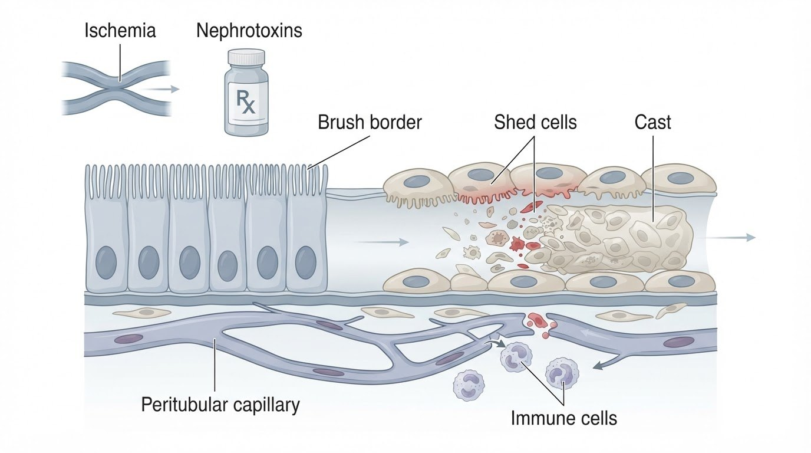 |

**English prompt**

```text
Create a longitudinal cross-section illustration of 【a proximal tubule in acute kidney injury】, read from left to right:
1. Above the tubule, two trigger icons: 【a blood vessel with a narrowing for ischemia, and a pill bottle for nephrotoxins】.
2. Left part of the tubule: 【tall, healthy epithelial cells with an intact brush border facing the lumen】.
3. Right part: 【swollen, flattened cells that have lost their brush border; some dead cells detach into the lumen (shed cells) and clump into a cast that blocks the tubule】.
4. Below the tubule: 【a peritubular capillary with immune cells leaving it and entering the tissue】.
Write each label only once in the whole figure.
Labels, each used once, no other text: 【Ischemia, Nephrotoxins, Brush border, Shed cells, Cast, Peritubular capillary, Immune cells】.

Style: journal-style scientific illustration. Clean semi-realistic vector illustration with gentle shading, using cross-sections or cutaways where they explain the structure, on a white background. Muted, harmonious palette with one accent color for the key process. Thin directional arrows for flows. Generous white space and a clear reading direction. Sans-serif English labels only, each label appears exactly once, spelled exactly as given. No cartoon style, no glossy CGI, no dark background, no stock-photo look, no decorative background.
```

<details><summary>Chinese prompt</summary>

```text
画一张【急性肾损伤时近端肾小管】的纵切面插画，从左往右读：
1. 肾小管上方两个诱因图标：【一根变窄的血管代表缺血，一个药瓶代表肾毒性物质】。
2. 肾小管左段：【高柱状的健康上皮细胞，朝向管腔的刷状缘完整】。
3. 右段：【细胞肿胀变扁、刷状缘消失；部分死亡细胞脱落到管腔（脱落细胞），聚成管型堵住肾小管】。
4. 肾小管下方：【一根管周毛细血管，免疫细胞从中渗出，进入组织】。
整张图里每个标签只写一次。
标签（每个只出现一次，不加其他文字）：【Ischemia, Nephrotoxins, Brush border, Shed cells, Cast, Peritubular capillary, Immune cells】。

风格：期刊式科学插画。干净的半写实矢量插画，带柔和的明暗；需要说明结构时使用剖面或剖切视图，白色背景。配色低饱和、协调，只用一个强调色突出关键过程。用细的方向箭头表示流动。留白充足，阅读方向清晰。图中文字只用英文无衬线字体，每个标签只出现一次，拼写与给定完全一致。不要卡通风格、不要光滑的 CG 渲染、不要深色背景、不要图库照片感、不要装饰性背景。
```

</details>

Model: Nano Banana 2 Lite (gemini-3.1-flash-lite-image, 1K) · Generated 2 times in total; shown are the outputs that passed review

[↑ Back to top](#top)

<sub><a href="https://yila.ai/?utm_source=github&utm_medium=readme&utm_campaign=sci-figure-prompts&utm_content=acute-kidney-injury-tubule">Try in Yila →</a></sub>

---

<a id="no-74"></a>

### No. 74: Alveolar gas exchange

by [@Yila-AI](https://github.com/Yila-AI)

Technique: **overview plus a circular inset** · Style: scientific illustration · Aspect ratio: 16:9

| English prompt |
|---|
|  |

> The Chinese-prompt output did not pass review, so it is not shown.

**English prompt**

```text
Create a scientific illustration of 【gas exchange in the lung】: on the left, a bronchiole ending in a cluster of alveoli wrapped in capillaries. On the right, a circular magnified inset of one alveolus and one capillary: O2 diffuses from the alveolus into the red blood cells, and CO2 diffuses from the blood into the alveolus. Thin type I cells line the wall; one rounded type II cell sits in a corner.
Write each label only once in the whole figure.
Labels, each used once, no other text: 【Bronchiole, Alveolus, Capillary, O2, CO2, Type I cell, Type II cell】.

Style: journal-style scientific illustration. Clean semi-realistic vector illustration with gentle shading, using cross-sections or cutaways where they explain the structure, on a white background. Muted, harmonious palette with one accent color for the key process. Thin directional arrows for flows. Generous white space and a clear reading direction. Sans-serif English labels only, each label appears exactly once, spelled exactly as given. No cartoon style, no glossy CGI, no dark background, no stock-photo look, no decorative background.
```

<details><summary>Chinese prompt</summary>

```text
画一张【肺内气体交换】的科学插画：左侧一根细支气管末端连着一簇被毛细血管包绕的肺泡。右侧一个圆形放大插图，显示一个肺泡和一根毛细血管：O2 从肺泡扩散进红细胞，CO2 从血液扩散进肺泡。肺泡壁由扁平的 I 型细胞构成，角落里有一个圆形的 II 型细胞。
整张图里每个标签只写一次。
标签（每个只出现一次，不加其他文字）：【Bronchiole, Alveolus, Capillary, O2, CO2, Type I cell, Type II cell】。

风格：期刊式科学插画。干净的半写实矢量插画，带柔和的明暗；需要说明结构时使用剖面或剖切视图，白色背景。配色低饱和、协调，只用一个强调色突出关键过程。用细的方向箭头表示流动。留白充足，阅读方向清晰。图中文字只用英文无衬线字体，每个标签只出现一次，拼写与给定完全一致。不要卡通风格、不要光滑的 CG 渲染、不要深色背景、不要图库照片感、不要装饰性背景。
```

</details>

Model: Nano Banana 2 Lite (gemini-3.1-flash-lite-image, 1K) · Generated 4 times in total; shown are the outputs that passed review

[↑ Back to top](#top)

<sub><a href="https://yila.ai/?utm_source=github&utm_medium=readme&utm_campaign=sci-figure-prompts&utm_content=alveolar-gas-exchange">Try in Yila →</a></sub>

---

<a id="no-75"></a>

### No. 75: Healthy versus Alzheimer's brain

by [@Yila-AI](https://github.com/Yila-AI)

Technique: **side-by-side panels + magnified inset** · Style: soft semi-realistic illustration · Aspect ratio: 4:3

| English prompt | Chinese prompt |
|---|---|
|  |  |

**English prompt**

```text
Create a side-by-side medical illustration comparing 【a healthy brain and an Alzheimer's disease brain】, separated by a thin dashed vertical line.
Left: 【a full-sized healthy brain; a circular magnified inset shows healthy neurons with intact connections】.
Right: 【a shrunken brain with wider grooves; a circular magnified inset shows amyloid plaques between neurons and twisted tangles inside a neuron】.
Labels, each used once, no other text: 【Healthy brain, Alzheimer's brain, Amyloid plaque, Tau tangles】.

Style: journal graphical-abstract illustration. Soft semi-realistic medical illustration with gentle volume and subtle hand-painted texture, on a clean white background. Muted, harmonious palette with one accent color. Clear left-to-right narrative, generous white space. Sans-serif English labels only, each label appears exactly once, spelled exactly as given. No cartoon style, no glossy CGI, no dark background, no stock-photo look.
```

<details><summary>Chinese prompt</summary>

```text
画一张左右并排的医学插图，比较【健康大脑和阿尔茨海默病大脑】，中间用一条细虚线分开。
左：【大小正常的健康大脑；一个圆形放大框展示连接完整的健康神经元】。
右：【萎缩、沟回变宽的大脑；一个圆形放大框展示神经元之间的淀粉样斑块和神经元内扭曲的缠结】。
标签（每个只出现一次，不加其他文字）：【Healthy brain, Alzheimer's brain, Amyloid plaque, Tau tangles】。

风格：期刊图形摘要插画。柔和的半写实医学插画，带轻微体积感和细腻的手绘质感，白色干净背景。配色低饱和、协调，只用一个强调色。从左到右叙事清晰，留白充足。图中文字只用英文无衬线字体，每个标签只出现一次，拼写与给定完全一致。不要卡通风格、不要光滑的 CG 渲染、不要深色背景、不要图库照片感。
```

</details>

Model: Nano Banana 2 Lite (gemini-3.1-flash-lite-image, 1K) · Generated 2 times in total; shown are the outputs that passed review

[↑ Back to top](#top)

<sub><a href="https://yila.ai/?utm_source=github&utm_medium=readme&utm_campaign=sci-figure-prompts&utm_content=alzheimers-brain">Try in Yila →</a></sub>

---

<a id="no-76"></a>

### No. 76: Atherosclerotic plaque formation

by [@Yila-AI](https://github.com/Yila-AI)

Technique: **cross-section + staged sequence** · Style: soft semi-realistic illustration · Aspect ratio: 16:9

| English prompt |
|---|
|  |

> The Chinese-prompt output did not pass review, so it is not shown.

**English prompt**

```text
Create a medical illustration of 【one artery cut open lengthwise】, showing disease progression from left to right in three stages along the same vessel.
Stage 1 (left): 【a healthy wall with smooth endothelium】.
Stage 2 (center): 【LDL particles enter the vessel wall and monocytes turn into lipid-filled foam cells】.
Stage 3 (right): 【a mature plaque with a yellow lipid core under a fibrous cap, and a clearly narrowed lumen】.
One circular magnified inset shows 【a single foam cell full of lipid droplets】.
Labels, each used once, no other text: 【LDL, Foam cell, Lipid core, Fibrous cap, Narrowed lumen】.

Style: journal graphical-abstract illustration. Soft semi-realistic medical illustration with gentle volume and subtle hand-painted texture, on a clean white background. Muted, harmonious palette with one accent color. Clear left-to-right narrative, generous white space. Sans-serif English labels only, each label appears exactly once, spelled exactly as given. No cartoon style, no glossy CGI, no dark background, no stock-photo look.
```

<details><summary>Chinese prompt</summary>

```text
画一张医学插图，主体是【一段被纵向剖开的动脉】，沿同一段结构从左到右分三个阶段展示病变进展。
阶段 1（左）：【健康的血管壁，内皮光滑】。
阶段 2（中）：【LDL 颗粒进入血管壁，单核细胞变成充满脂质的泡沫细胞】。
阶段 3（右）：【成熟斑块：黄色的脂质核心上覆盖纤维帽，管腔明显变窄】。
用一个圆形放大框展示【一个充满脂滴的泡沫细胞】。
标签（每个只出现一次，不加其他文字）：【LDL, Foam cell, Lipid core, Fibrous cap, Narrowed lumen】。

风格：期刊图形摘要插画。柔和的半写实医学插画，带轻微体积感和细腻的手绘质感，白色干净背景。配色低饱和、协调，只用一个强调色。从左到右叙事清晰，留白充足。图中文字只用英文无衬线字体，每个标签只出现一次，拼写与给定完全一致。不要卡通风格、不要光滑的 CG 渲染、不要深色背景、不要图库照片感。
```

</details>

Model: Nano Banana 2 Lite (gemini-3.1-flash-lite-image, 1K) · Generated 6 times in total; shown are the outputs that passed review

[↑ Back to top](#top)

<sub><a href="https://yila.ai/?utm_source=github&utm_medium=readme&utm_campaign=sci-figure-prompts&utm_content=atherosclerosis-plaque">Try in Yila →</a></sub>

---

<a id="no-77"></a>

### No. 77: Bone remodeling: formation and resorption

by [@Yila-AI](https://github.com/Yila-AI)

Technique: **bone-surface cross-section with signaling molecules** · Style: scientific illustration · Aspect ratio: 16:9

| English prompt |
|---|
|  |

> The Chinese-prompt output did not pass review, so it is not shown.

**English prompt**

```text
Create a cross-section illustration of 【bone remodeling】 along a bone surface, read from left to right: 【a large multinucleated osteoclast digging a resorption pit; osteoblasts laying down new bone matrix; one osteocyte embedded in the bone below】. Above them, RANKL on an osteoblast binds RANK on an osteoclast precursor, and OPG blocks RANKL with a red T-bar whose flat end touches RANKL. The cell receiving RANKL is an osteoclast precursor.
Write each label only once in the whole figure.
Labels, each used once, no other text: 【Osteoclast, Osteoblast, Osteocyte, RANKL, RANK, OPG, Bone resorption, Bone formation】.

Style: journal-style scientific illustration. Clean semi-realistic vector illustration with gentle shading, using cross-sections or cutaways where they explain the structure, on a white background. Muted, harmonious palette with one accent color for the key process. Thin directional arrows for flows. Generous white space and a clear reading direction. Sans-serif English labels only, each label appears exactly once, spelled exactly as given. No cartoon style, no glossy CGI, no dark background, no stock-photo look, no decorative background.
```

<details><summary>Chinese prompt</summary>

```text
画一张【骨重塑】的截面插画，沿着骨表面从左往右：【一个多核的大破骨细胞在挖吸收陷窝；成骨细胞在铺新的骨基质；下方骨质里嵌着一个骨细胞】。上方，成骨细胞上的 RANKL 结合破骨前体细胞上的 RANK，OPG 用红色 T 形线挡住 RANKL，平头端碰到 RANKL。接受 RANKL 的是破骨前体细胞。
整张图里每个标签只写一次。
标签（每个只出现一次，不加其他文字）：【Osteoclast, Osteoblast, Osteocyte, RANKL, RANK, OPG, Bone resorption, Bone formation】。

风格：期刊式科学插画。干净的半写实矢量插画，带柔和的明暗；需要说明结构时使用剖面或剖切视图，白色背景。配色低饱和、协调，只用一个强调色突出关键过程。用细的方向箭头表示流动。留白充足，阅读方向清晰。图中文字只用英文无衬线字体，每个标签只出现一次，拼写与给定完全一致。不要卡通风格、不要光滑的 CG 渲染、不要深色背景、不要图库照片感、不要装饰性背景。
```

</details>

Model: Nano Banana 2 Lite (gemini-3.1-flash-lite-image, 1K) · Generated 6 times in total; shown are the outputs that passed review

[↑ Back to top](#top)

<sub><a href="https://yila.ai/?utm_source=github&utm_medium=readme&utm_campaign=sci-figure-prompts&utm_content=bone-remodeling">Try in Yila →</a></sub>

---

<a id="no-78"></a>

### No. 78: Coronary artery stenosis

by [@Yila-AI](https://github.com/Yila-AI)

Technique: **whole heart plus a vessel cross-section inset** · Style: scientific illustration · Aspect ratio: 16:9

| English prompt |
|---|
| 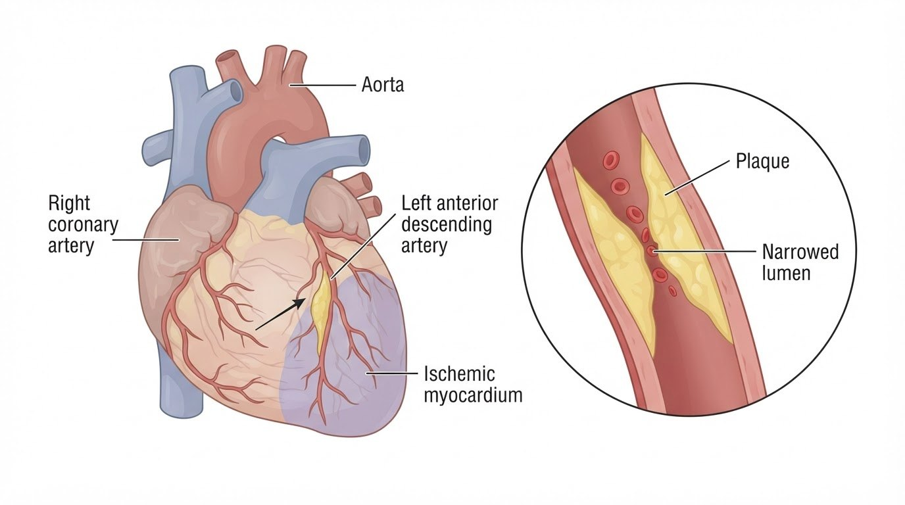 |

> The Chinese-prompt output did not pass review, so it is not shown.

**English prompt**

```text
Create a scientific illustration of 【coronary artery stenosis】: on the left, the front of the heart with the aorta at the top and the coronary arteries running over its surface. A plaque narrows the left anterior descending artery partway down, and the heart muscle below the narrowing is shaded pale purple as ischemic myocardium. On the right, a circular magnified inset shows a cross-section of the narrowed artery: a yellow plaque filling most of the wall, leaving a small narrowed lumen with a few red blood cells.
Write each label only once in the whole figure.
Labels, each used once, no other text: 【Aorta, Right coronary artery, Left anterior descending artery, Plaque, Narrowed lumen, Ischemic myocardium】.

Style: journal-style scientific illustration. Clean semi-realistic vector illustration with gentle shading, using cross-sections or cutaways where they explain the structure, on a white background. Muted, harmonious palette with one accent color for the key process. Thin directional arrows for flows. Generous white space and a clear reading direction. Sans-serif English labels only, each label appears exactly once, spelled exactly as given. No cartoon style, no glossy CGI, no dark background, no stock-photo look, no decorative background.
```

<details><summary>Chinese prompt</summary>

```text
画一张【冠状动脉狭窄】的科学插画：左侧是心脏正面，主动脉在顶部，冠状动脉沿心脏表面走行。左前降支中段被斑块堵窄，狭窄处以下的心肌画成浅紫色，代表缺血心肌。右侧一个圆形放大插图，显示狭窄动脉的横截面：黄色斑块占据大部分管壁，只剩一个狭小的管腔，里面有几个红细胞。
整张图里每个标签只写一次。
标签（每个只出现一次，不加其他文字）：【Aorta, Right coronary artery, Left anterior descending artery, Plaque, Narrowed lumen, Ischemic myocardium】。

风格：期刊式科学插画。干净的半写实矢量插画，带柔和的明暗；需要说明结构时使用剖面或剖切视图，白色背景。配色低饱和、协调，只用一个强调色突出关键过程。用细的方向箭头表示流动。留白充足，阅读方向清晰。图中文字只用英文无衬线字体，每个标签只出现一次，拼写与给定完全一致。不要卡通风格、不要光滑的 CG 渲染、不要深色背景、不要图库照片感、不要装饰性背景。
```

</details>

Model: Nano Banana 2 Lite (gemini-3.1-flash-lite-image, 1K) · Generated 2 times in total; shown are the outputs that passed review

[↑ Back to top](#top)

<sub><a href="https://yila.ai/?utm_source=github&utm_medium=readme&utm_campaign=sci-figure-prompts&utm_content=coronary-stenosis">Try in Yila →</a></sub>

---

<a id="no-79"></a>

### No. 79: Four stages of fracture healing

by [@Yila-AI](https://github.com/Yila-AI)

Technique: **staged sequence** · Style: soft semi-realistic illustration · Aspect ratio: 16:9

| English prompt | Chinese prompt |
|---|---|
|  |  |

**English prompt**

```text
Create a medical illustration of 【bone fracture healing】 in four stages from left to right, each showing the same long bone cut lengthwise at the break.
1: 【a blood clot fills the gap between the broken ends】.
2: 【soft cartilage bridges the gap】.
3: 【the cartilage turns into new, spongy bone】.
4: 【the bone is reshaped to its original form】.
Labels, each used once, no other text: 【Hematoma, Soft callus, Hard callus, Remodeling】.

Style: journal graphical-abstract illustration. Soft semi-realistic medical illustration with gentle volume and subtle hand-painted texture, on a clean white background. Muted, harmonious palette with one accent color. Clear left-to-right narrative, generous white space. Sans-serif English labels only, each label appears exactly once, spelled exactly as given. No cartoon style, no glossy CGI, no dark background, no stock-photo look.
```

<details><summary>Chinese prompt</summary>

```text
画一张【骨折愈合】的医学插图，从左到右分四个阶段，每个阶段都是同一根长骨在骨折处的纵剖面。
1：【血凝块填满两个断端之间的空隙】。
2：【柔软的软骨连接起断端】。
3：【软骨转变为新的海绵状骨】。
4：【骨骼被重塑回原来的形状】。
标签（每个只出现一次，不加其他文字）：【Hematoma, Soft callus, Hard callus, Remodeling】。

风格：期刊图形摘要插画。柔和的半写实医学插画，带轻微体积感和细腻的手绘质感，白色干净背景。配色低饱和、协调，只用一个强调色。从左到右叙事清晰，留白充足。图中文字只用英文无衬线字体，每个标签只出现一次，拼写与给定完全一致。不要卡通风格、不要光滑的 CG 渲染、不要深色背景、不要图库照片感。
```

</details>

Model: Nano Banana 2 Lite (gemini-3.1-flash-lite-image, 1K) · Generated 2 times in total; shown are the outputs that passed review

[↑ Back to top](#top)

<sub><a href="https://yila.ai/?utm_source=github&utm_medium=readme&utm_campaign=sci-figure-prompts&utm_content=fracture-healing">Try in Yila →</a></sub>

---

<a id="no-80"></a>

### No. 80: Three layers of the glomerular filtration barrier

by [@Yila-AI](https://github.com/Yila-AI)

Technique: **layered cross-section** · Style: soft semi-realistic illustration · Aspect ratio: 4:3

| English prompt | Chinese prompt |
|---|---|
|  |  |

**English prompt**

```text
Create a cross-section medical illustration of 【the glomerular filtration barrier】, with three layers stacked from the blood side at the top to the urine side at the bottom:
【1. an endothelium with small round pores; 2. a thick basement membrane; 3. podocyte foot processes with narrow slits between them】.
Arrows show 【only water and small molecules passing down through all three layers】. 【Large albumin proteins sit above the endothelium with a red X; no arrow starts from albumin】.
Labels, each used once, no other text: 【Endothelium, Basement membrane, Podocyte, Albumin】.

Style: journal graphical-abstract illustration. Soft semi-realistic medical illustration with gentle volume and subtle hand-painted texture, on a clean white background. Muted, harmonious palette with one accent color. Clear left-to-right narrative, generous white space. Sans-serif English labels only, each label appears exactly once, spelled exactly as given. No cartoon style, no glossy CGI, no dark background, no stock-photo look.
```

<details><summary>Chinese prompt</summary>

```text
画一张【肾小球滤过屏障】的剖面医学插图，三层从上方的血液侧叠到下方的尿液侧：
【1. 带小圆孔的内皮；2. 厚的基底膜；3. 足细胞的足突，足突之间是狭窄的裂隙】。
箭头只表示【水和小分子向下穿过三层】。【大的白蛋白停在内皮上方，旁边一个红色叉号；不要从白蛋白画出任何箭头】。
标签（每个只出现一次，不加其他文字）：【Endothelium, Basement membrane, Podocyte, Albumin】。

风格：期刊图形摘要插画。柔和的半写实医学插画，带轻微体积感和细腻的手绘质感，白色干净背景。配色低饱和、协调，只用一个强调色。从左到右叙事清晰，留白充足。图中文字只用英文无衬线字体，每个标签只出现一次，拼写与给定完全一致。不要卡通风格、不要光滑的 CG 渲染、不要深色背景、不要图库照片感。
```

</details>

Model: Nano Banana 2 Lite (gemini-3.1-flash-lite-image, 1K) · Generated 5 times in total; shown are the outputs that passed review

[↑ Back to top](#top)

<sub><a href="https://yila.ai/?utm_source=github&utm_medium=readme&utm_campaign=sci-figure-prompts&utm_content=glomerular-barrier">Try in Yila →</a></sub>

---

<a id="no-81"></a>

### No. 81: Heart anatomy and blood flow

by [@Yila-AI](https://github.com/Yila-AI)

Technique: **four-chamber cross-section with two-color flow** · Style: scientific illustration · Aspect ratio: 4:3

| English prompt | Chinese prompt |
|---|---|
|  |  |

**English prompt**

```text
Create a cross-section illustration of 【the human heart】 showing four chambers. Blue arrows show deoxygenated blood flowing from the vena cava into the right atrium, then the right ventricle, then out through the pulmonary artery. Red arrows show oxygenated blood flowing from the pulmonary veins into the left atrium, then the left ventricle, then out through the aorta.
Write each label only once in the whole figure.
Labels, each used once, no other text: 【Right atrium, Right ventricle, Left atrium, Left ventricle, Aorta, Pulmonary artery, Vena cava, Pulmonary veins】.

Style: journal-style scientific illustration. Clean semi-realistic vector illustration with gentle shading, using cross-sections or cutaways where they explain the structure, on a white background. Muted, harmonious palette with one accent color for the key process. Thin directional arrows for flows. Generous white space and a clear reading direction. Sans-serif English labels only, each label appears exactly once, spelled exactly as given. No cartoon style, no glossy CGI, no dark background, no stock-photo look, no decorative background.
```

<details><summary>Chinese prompt</summary>

```text
画一张【人体心脏】的截面插画，显示四个腔室。蓝色箭头表示缺氧血从腔静脉进入右心房，再进入右心室，经肺动脉流出。红色箭头表示富氧血从肺静脉进入左心房，再进入左心室，经主动脉流出。
整张图里每个标签只写一次。
标签（每个只出现一次，不加其他文字）：【Right atrium, Right ventricle, Left atrium, Left ventricle, Aorta, Pulmonary artery, Vena cava, Pulmonary veins】。

风格：期刊式科学插画。干净的半写实矢量插画，带柔和的明暗；需要说明结构时使用剖面或剖切视图，白色背景。配色低饱和、协调，只用一个强调色突出关键过程。用细的方向箭头表示流动。留白充足，阅读方向清晰。图中文字只用英文无衬线字体，每个标签只出现一次，拼写与给定完全一致。不要卡通风格、不要光滑的 CG 渲染、不要深色背景、不要图库照片感、不要装饰性背景。
```

</details>

Model: Nano Banana 2 Lite (gemini-3.1-flash-lite-image, 1K) · Generated 4 times in total; shown are the outputs that passed review

[↑ Back to top](#top)

<sub><a href="https://yila.ai/?utm_source=github&utm_medium=readme&utm_campaign=sci-figure-prompts&utm_content=heart-blood-flow">Try in Yila →</a></sub>

---

<a id="no-82"></a>

### No. 82: Inflammatory bowel disease: healthy versus inflamed colon

by [@Yila-AI](https://github.com/Yila-AI)

Technique: **two mucosa sections side by side** · Style: scientific illustration · Aspect ratio: 16:9

| English prompt | Chinese prompt |
|---|---|
| 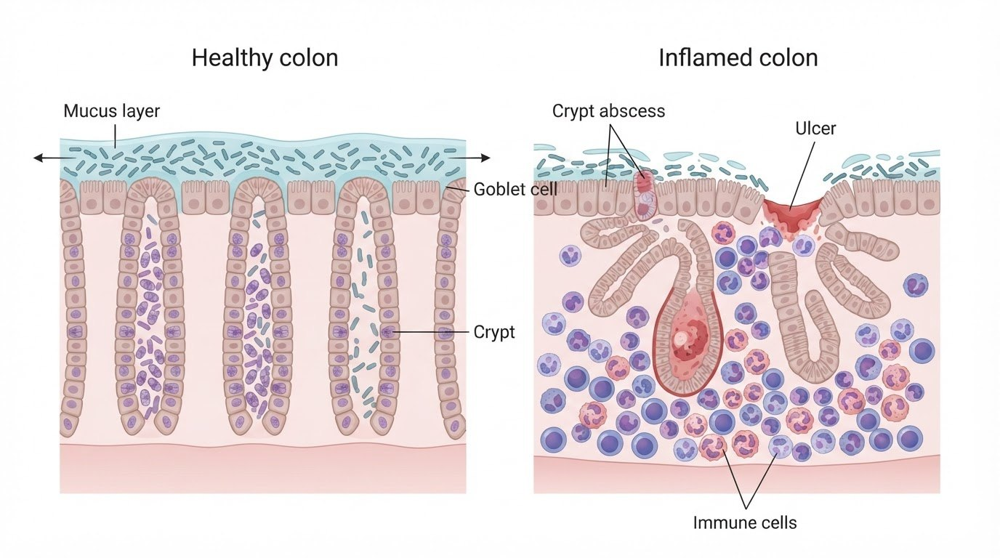 | 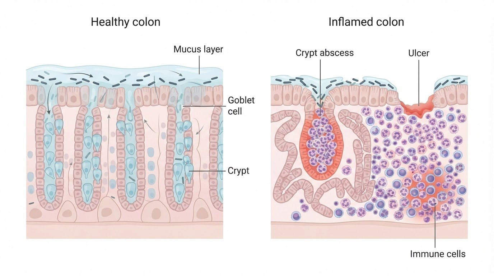 |

**English prompt**

```text
Create a side-by-side cross-section illustration of 【the colon mucosa in ulcerative colitis】:
1. Left, healthy colon: 【regular, evenly spaced crypts full of goblet cells, a thick mucus layer on the surface keeping gut bacteria away from the epithelium】.
2. Right, inflamed colon: 【a thin, broken mucus layer with bacteria touching the epithelium, fewer goblet cells, distorted crypts, one crypt filled with neutrophils (crypt abscess), an ulcer where the surface is lost, and many immune cells crowding the tissue below】.
Each structure is labeled in only one of the two panels.
Write each label only once in the whole figure.
Labels, each used once, no other text: 【Healthy colon, Inflamed colon, Mucus layer, Goblet cell, Crypt, Crypt abscess, Ulcer, Immune cells】.

Style: journal-style scientific illustration. Clean semi-realistic vector illustration with gentle shading, using cross-sections or cutaways where they explain the structure, on a white background. Muted, harmonious palette with one accent color for the key process. Thin directional arrows for flows. Generous white space and a clear reading direction. Sans-serif English labels only, each label appears exactly once, spelled exactly as given. No cartoon style, no glossy CGI, no dark background, no stock-photo look, no decorative background.
```

<details><summary>Chinese prompt</summary>

```text
画一张【溃疡性结肠炎结肠黏膜】的左右对照截面插画：
1. 左，健康结肠：【隐窝规则、间距均匀，充满杯状细胞；表面一层厚黏液，把肠道细菌隔离在上皮之外】。
2. 右，发炎结肠：【黏液层变薄破损，细菌接触上皮；杯状细胞减少，隐窝变形；一个隐窝里塞满中性粒细胞（隐窝脓肿）；一处表面缺失形成溃疡；下方组织里挤满免疫细胞】。
每个结构只在其中一个面板里标注。
整张图里每个标签只写一次。
标签（每个只出现一次，不加其他文字）：【Healthy colon, Inflamed colon, Mucus layer, Goblet cell, Crypt, Crypt abscess, Ulcer, Immune cells】。

风格：期刊式科学插画。干净的半写实矢量插画，带柔和的明暗；需要说明结构时使用剖面或剖切视图，白色背景。配色低饱和、协调，只用一个强调色突出关键过程。用细的方向箭头表示流动。留白充足，阅读方向清晰。图中文字只用英文无衬线字体，每个标签只出现一次，拼写与给定完全一致。不要卡通风格、不要光滑的 CG 渲染、不要深色背景、不要图库照片感、不要装饰性背景。
```

</details>

Model: Nano Banana 2 Lite (gemini-3.1-flash-lite-image, 1K) · Generated 2 times in total; shown are the outputs that passed review

[↑ Back to top](#top)

<sub><a href="https://yila.ai/?utm_source=github&utm_medium=readme&utm_campaign=sci-figure-prompts&utm_content=ibd-colon">Try in Yila →</a></sub>

---

<a id="no-83"></a>

### No. 83: Intestinal barrier: healthy versus leaky

by [@Yila-AI](https://github.com/Yila-AI)

Technique: **side-by-side cross-sections** · Style: scientific illustration · Aspect ratio: 16:9

| English prompt | Chinese prompt |
|---|---|
|  |  |

**English prompt**

```text
Create a side-by-side cross-section of 【the intestinal lining】:
1. Left half, healthy: 【a thick mucus layer, a single row of epithelial cells sealed by tight junctions, and gut bacteria staying in the lumen】.
2. Right half, leaky: 【a thin mucus layer, gaps between epithelial cells, bacteria and LPS crossing into the tissue below, where immune cells gather】.
Labels, each used once, no other text: 【Healthy, Leaky gut, Mucus layer, Tight junction, Epithelium, Microbiota, LPS, Immune cells】.

Style: journal-style scientific illustration. Clean semi-realistic vector illustration with gentle shading, using cross-sections or cutaways where they explain the structure, on a white background. Muted, harmonious palette with one accent color for the key process. Thin directional arrows for flows. Generous white space and a clear reading direction. Sans-serif English labels only, each label appears exactly once, spelled exactly as given. No cartoon style, no glossy CGI, no dark background, no stock-photo look, no decorative background.
```

<details><summary>Chinese prompt</summary>

```text
画一张【肠道黏膜】的左右对照截面图：
1. 左半边，健康：【厚的黏液层，一排上皮细胞由紧密连接封住，肠道细菌留在肠腔里】。
2. 右半边，受损：【黏液层变薄，上皮细胞之间出现缝隙，细菌和 LPS 穿过进入下方组织，免疫细胞在那里聚集】。
标签（每个只出现一次，不加其他文字）：【Healthy, Leaky gut, Mucus layer, Tight junction, Epithelium, Microbiota, LPS, Immune cells】。

风格：期刊式科学插画。干净的半写实矢量插画，带柔和的明暗；需要说明结构时使用剖面或剖切视图，白色背景。配色低饱和、协调，只用一个强调色突出关键过程。用细的方向箭头表示流动。留白充足，阅读方向清晰。图中文字只用英文无衬线字体，每个标签只出现一次，拼写与给定完全一致。不要卡通风格、不要光滑的 CG 渲染、不要深色背景、不要图库照片感、不要装饰性背景。
```

</details>

Model: Nano Banana 2 Lite (gemini-3.1-flash-lite-image, 1K) · Generated 2 times in total; shown are the outputs that passed review

[↑ Back to top](#top)

<sub><a href="https://yila.ai/?utm_source=github&utm_medium=readme&utm_campaign=sci-figure-prompts&utm_content=intestinal-barrier">Try in Yila →</a></sub>

---

<a id="no-84"></a>

### No. 84: Healthy versus fibrotic liver

by [@Yila-AI](https://github.com/Yila-AI)

Technique: **side-by-side panels + multi-scale magnified insets** · Style: soft semi-realistic illustration · Aspect ratio: 16:9

| English prompt | Chinese prompt |
|---|---|
|  |  |

**English prompt**

```text
Create a side-by-side medical illustration comparing 【a healthy liver and a fibrotic liver】, separated by a thin dashed vertical line.
Left: 【a smooth, reddish-brown healthy liver; a circular magnified inset shows orderly hepatocytes and a quiet, star-shaped stellate cell storing small lipid droplets】.
Right: 【a shrunken liver with a bumpy, scarred surface; a circular magnified inset shows the stellate cell turned into an elongated activated cell, surrounded by thick collagen fibers between damaged hepatocytes】.
Labels, each used once, no other text: 【Healthy liver, Fibrotic liver, Hepatocyte, Stellate cell, Collagen】.

Style: journal graphical-abstract illustration. Soft semi-realistic medical illustration with gentle volume and subtle hand-painted texture, on a clean white background. Muted, harmonious palette with one accent color. Clear left-to-right narrative, generous white space. Sans-serif English labels only, each label appears exactly once, spelled exactly as given. No cartoon style, no glossy CGI, no dark background, no stock-photo look.
```

<details><summary>Chinese prompt</summary>

```text
画一张左右并排的医学插图，比较【健康肝脏和纤维化肝脏】，中间用一条细虚线分开。
左：【表面光滑、红褐色的健康肝脏；一个圆形放大框展示排列整齐的肝细胞，以及一个处于静止状态、储存小脂滴的星形肝星状细胞】。
右：【体积缩小、表面凹凸不平带瘢痕的肝脏；一个圆形放大框展示星状细胞变成拉长的激活细胞，受损肝细胞之间被粗大的胶原纤维包围】。
标签（每个只出现一次，不加其他文字）：【Healthy liver, Fibrotic liver, Hepatocyte, Stellate cell, Collagen】。

风格：期刊图形摘要插画。柔和的半写实医学插画，带轻微体积感和细腻的手绘质感，白色干净背景。配色低饱和、协调，只用一个强调色。从左到右叙事清晰，留白充足。图中文字只用英文无衬线字体，每个标签只出现一次，拼写与给定完全一致。不要卡通风格、不要光滑的 CG 渲染、不要深色背景、不要图库照片感。
```

</details>

Model: Nano Banana 2 Lite (gemini-3.1-flash-lite-image, 1K) · Generated 4 times in total; shown are the outputs that passed review

[↑ Back to top](#top)

<sub><a href="https://yila.ai/?utm_source=github&utm_medium=readme&utm_campaign=sci-figure-prompts&utm_content=liver-fibrosis">Try in Yila →</a></sub>

---

<a id="no-85"></a>

### No. 85: Nephron structure and filtrate flow

by [@Yila-AI](https://github.com/Yila-AI)

Technique: **structure + flow arrows** · Style: soft semi-realistic illustration · Aspect ratio: 3:4

| English prompt | Chinese prompt |
|---|---|
|  |  |

**English prompt**

```text
Create a vertical medical illustration of 【one nephron of the kidney】 with the flow shown by arrows.
Top: 【the glomerulus, a ball of capillaries inside Bowman's capsule】.
Then 【the proximal tubule, the U-shaped loop of Henle going down and back up, and the distal tubule】, ending in 【the collecting duct】 at the bottom.
Arrows follow 【the filtrate from the glomerulus to the collecting duct】. A small outline in the corner shows 【where the nephron sits in the kidney】.
Labels, each used once, no other text: 【Glomerulus, Proximal tubule, Loop of Henle, Distal tubule, Collecting duct】.

Style: journal graphical-abstract illustration. Soft semi-realistic medical illustration with gentle volume and subtle hand-painted texture, on a clean white background. Muted, harmonious palette with one accent color. Clear left-to-right narrative, generous white space. Sans-serif English labels only, each label appears exactly once, spelled exactly as given. No cartoon style, no glossy CGI, no dark background, no stock-photo look.
```

<details><summary>Chinese prompt</summary>

```text
画一张竖版医学插图，主体是【肾脏的一个肾单位】，用箭头表示流向。
顶部：【肾小球，包在鲍曼囊里的一团毛细血管】。
往下是【近曲小管、先下行再上行的 U 形髓袢、远曲小管】，最底部接【集合管】。
箭头沿着【滤液从肾小球流到集合管】。角落里一个小轮廓图显示【肾单位在肾脏中的位置】。
标签（每个只出现一次，不加其他文字）：【Glomerulus, Proximal tubule, Loop of Henle, Distal tubule, Collecting duct】。

风格：期刊图形摘要插画。柔和的半写实医学插画，带轻微体积感和细腻的手绘质感，白色干净背景。配色低饱和、协调，只用一个强调色。从左到右叙事清晰，留白充足。图中文字只用英文无衬线字体，每个标签只出现一次，拼写与给定完全一致。不要卡通风格、不要光滑的 CG 渲染、不要深色背景、不要图库照片感。
```

</details>

Model: Nano Banana 2 Lite (gemini-3.1-flash-lite-image, 1K) · Generated 2 times in total; shown are the outputs that passed review

[↑ Back to top](#top)

<sub><a href="https://yila.ai/?utm_source=github&utm_medium=readme&utm_campaign=sci-figure-prompts&utm_content=nephron">Try in Yila →</a></sub>

---

<a id="no-86"></a>

### No. 86: Neuron and synaptic transmission

by [@Yila-AI](https://github.com/Yila-AI)

Technique: **whole neuron plus a synapse close-up** · Style: scientific illustration · Aspect ratio: 16:9

| Chinese prompt |
|---|
| 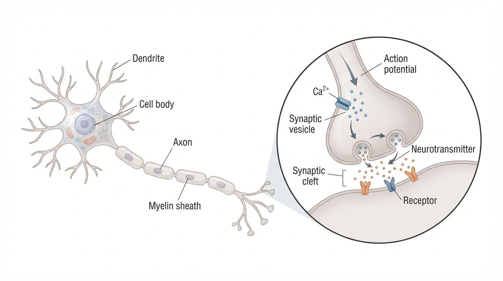 |

**English prompt**

```text
Create a scientific illustration of 【a neuron and synaptic transmission】:
1. Left: 【a whole neuron with branching dendrites, a cell body with a nucleus, and a long axon wrapped in segments of myelin sheath, ending in an axon terminal】.
2. Right, a circular magnified inset of the synapse: 【an electrical signal arrives at the axon terminal; Ca2+ flows in as small dots; synaptic vesicles fuse with the membrane and release neurotransmitter into the synaptic cleft; the neurotransmitter binds receptors on the membrane of the next neuron】.
Write each label only once in the whole figure.
Labels, each used once, no other text: 【Dendrite, Cell body, Axon, Myelin sheath, Synaptic vesicle, Neurotransmitter, Synaptic cleft, Receptor】.

Style: journal-style scientific illustration. Clean semi-realistic vector illustration with gentle shading, using cross-sections or cutaways where they explain the structure, on a white background. Muted, harmonious palette with one accent color for the key process. Thin directional arrows for flows. Generous white space and a clear reading direction. Sans-serif English labels only, each label appears exactly once, spelled exactly as given. No cartoon style, no glossy CGI, no dark background, no stock-photo look, no decorative background.
```

<details><summary>Chinese prompt</summary>

```text
画一张【神经元与突触传递】的科学插画：
1. 左：【一个完整的神经元，有分支状树突、带细胞核的胞体，以及一根被分段髓鞘包裹的长轴突，末端是轴突终末】。
2. 右，一个圆形突触放大插图：【电信号到达轴突终末；Ca2+ 以小点形式流入；突触囊泡与膜融合，把神经递质释放到突触间隙；神经递质结合下一个神经元膜上的受体】。
整张图里每个标签只写一次。
标签（每个只出现一次，不加其他文字）：【Dendrite, Cell body, Axon, Myelin sheath, Synaptic vesicle, Neurotransmitter, Synaptic cleft, Receptor】。

风格：期刊式科学插画。干净的半写实矢量插画，带柔和的明暗；需要说明结构时使用剖面或剖切视图，白色背景。配色低饱和、协调，只用一个强调色突出关键过程。用细的方向箭头表示流动。留白充足，阅读方向清晰。图中文字只用英文无衬线字体，每个标签只出现一次，拼写与给定完全一致。不要卡通风格、不要光滑的 CG 渲染、不要深色背景、不要图库照片感、不要装饰性背景。
```

</details>

Model: Nano Banana 2 Lite (gemini-3.1-flash-lite-image, 1K) · Generated 2 times in total; shown are the outputs that passed review

[↑ Back to top](#top)

<sub><a href="https://yila.ai/?utm_source=github&utm_medium=readme&utm_campaign=sci-figure-prompts&utm_content=neuron-synapse">Try in Yila →</a></sub>

---

<a id="no-87"></a>

### No. 87: Osteoarthritis: healthy versus diseased joint

by [@Yila-AI](https://github.com/Yila-AI)

Technique: **two knee joints side by side** · Style: scientific illustration · Aspect ratio: 16:9

| English prompt | Chinese prompt |
|---|---|
| 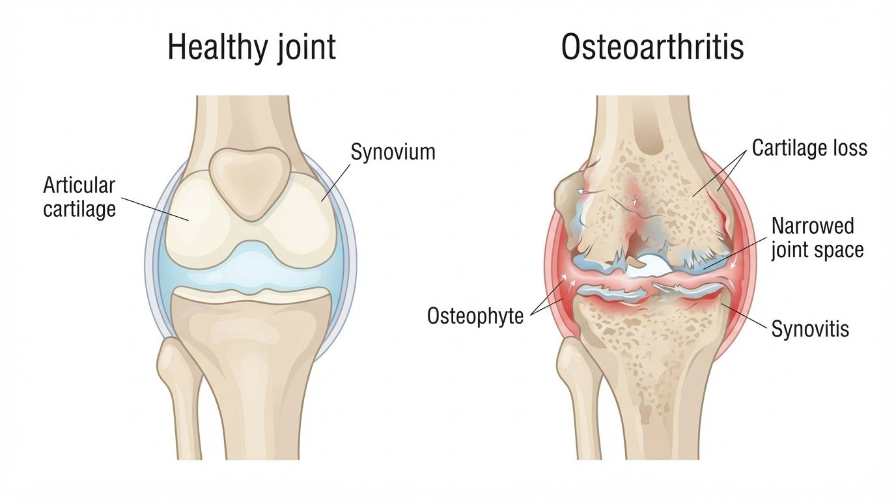 | 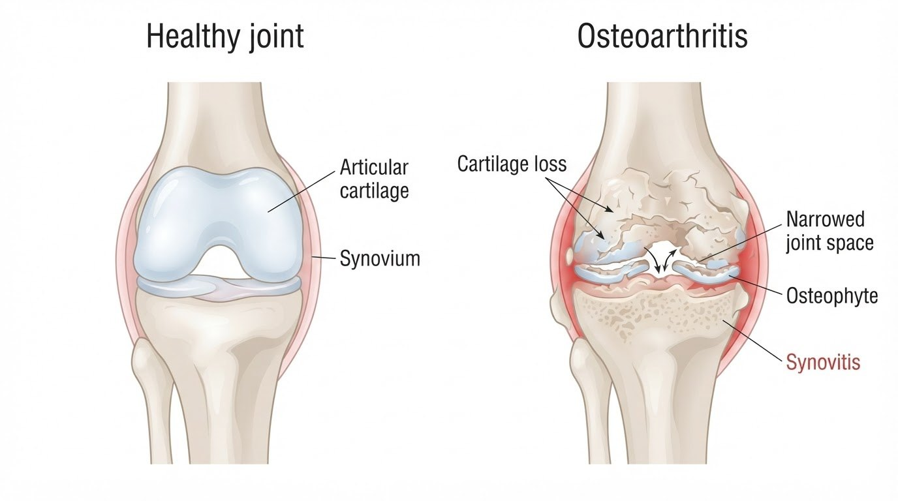 |

**English prompt**

```text
Create a side-by-side cross-section illustration of 【the knee joint in osteoarthritis】:
1. Left, a healthy joint: 【smooth, thick articular cartilage covering both bone ends, a wide joint space, and a thin, calm synovium lining the joint capsule】.
2. Right, an osteoarthritic joint: 【thin, worn cartilage with exposed bone (cartilage loss), a narrowed joint space, bony spurs at the joint edges (osteophytes), denser bone under the cartilage, and a thickened, red, inflamed synovium (synovitis)】.
Each structure is labeled in only one of the two panels.
Write each label only once in the whole figure.
Labels, each used once, no other text: 【Healthy joint, Osteoarthritis, Articular cartilage, Synovium, Cartilage loss, Narrowed joint space, Osteophyte, Synovitis】.

Style: journal-style scientific illustration. Clean semi-realistic vector illustration with gentle shading, using cross-sections or cutaways where they explain the structure, on a white background. Muted, harmonious palette with one accent color for the key process. Thin directional arrows for flows. Generous white space and a clear reading direction. Sans-serif English labels only, each label appears exactly once, spelled exactly as given. No cartoon style, no glossy CGI, no dark background, no stock-photo look, no decorative background.
```

<details><summary>Chinese prompt</summary>

```text
画一张【骨关节炎膝关节】的左右对照截面插画：
1. 左，健康关节：【两端骨面覆盖光滑厚实的关节软骨，关节间隙宽，关节囊内衬一层薄而平静的滑膜】。
2. 右，骨关节炎关节：【软骨变薄磨损、骨面外露（软骨缺失），关节间隙变窄，关节边缘长出骨刺（骨赘），软骨下骨变致密，滑膜增厚、发红发炎（滑膜炎）】。
每个结构只在其中一个面板里标注。
整张图里每个标签只写一次。
标签（每个只出现一次，不加其他文字）：【Healthy joint, Osteoarthritis, Articular cartilage, Synovium, Cartilage loss, Narrowed joint space, Osteophyte, Synovitis】。

风格：期刊式科学插画。干净的半写实矢量插画，带柔和的明暗；需要说明结构时使用剖面或剖切视图，白色背景。配色低饱和、协调，只用一个强调色突出关键过程。用细的方向箭头表示流动。留白充足，阅读方向清晰。图中文字只用英文无衬线字体，每个标签只出现一次，拼写与给定完全一致。不要卡通风格、不要光滑的 CG 渲染、不要深色背景、不要图库照片感、不要装饰性背景。
```

</details>

Model: Nano Banana 2 Lite (gemini-3.1-flash-lite-image, 1K) · Generated 2 times in total; shown are the outputs that passed review

[↑ Back to top](#top)

<sub><a href="https://yila.ai/?utm_source=github&utm_medium=readme&utm_campaign=sci-figure-prompts&utm_content=osteoarthritis-joint">Try in Yila →</a></sub>

---

<a id="no-88"></a>

### No. 88: Placenta structure

by [@Yila-AI](https://github.com/Yila-AI)

Technique: **placenta cross-section plus a villus close-up** · Style: scientific illustration · Aspect ratio: 16:9

| English prompt | Chinese prompt |
|---|---|
| 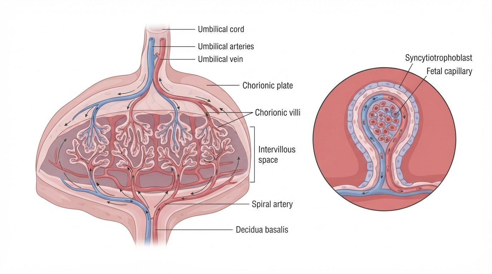 | 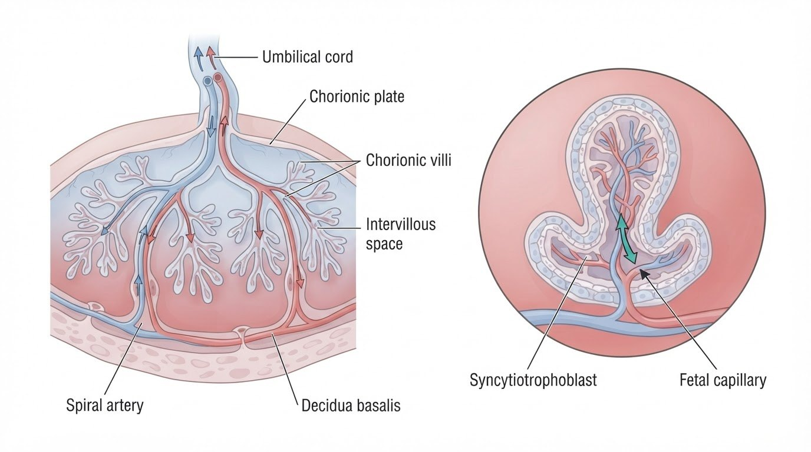 |

**English prompt**

```text
Create a scientific illustration of 【the human placenta】:
1. Left, a cross-section: 【the umbilical cord rises from the chorionic plate at the top; tree-like chorionic villi hang down into the intervillous space, which fills with maternal blood from spiral arteries in the decidua basalis at the bottom】. Draw the umbilical arteries blue (carrying deoxygenated blood from the fetus) and the umbilical vein red.
2. Right, a circular magnified inset of one villus: 【an outer syncytiotrophoblast layer bathed in maternal blood, with fetal capillaries inside】.
Write each label only once in the whole figure.
If a component appears in more than one place or panel, write its label only at its first appearance; every other copy has no text. No label may appear twice anywhere in the figure. Spell every label exactly as given and add no titles.
Labels, each used once, no other text: 【Umbilical cord, Chorionic plate, Chorionic villi, Intervillous space, Spiral artery, Decidua basalis, Syncytiotrophoblast, Fetal capillary】.

Style: journal-style scientific illustration. Clean semi-realistic vector illustration with gentle shading, using cross-sections or cutaways where they explain the structure, on a white background. Muted, harmonious palette with one accent color for the key process. Thin directional arrows for flows. Generous white space and a clear reading direction. Sans-serif English labels only, each label appears exactly once, spelled exactly as given. No cartoon style, no glossy CGI, no dark background, no stock-photo look, no decorative background.
```

<details><summary>Chinese prompt</summary>

```text
画一张【人类胎盘】的科学插画：
1. 左，截面图：【脐带从顶部的绒毛膜板伸出；树枝状的绒毛向下垂入绒毛间隙，间隙里充满来自底部底蜕膜中螺旋动脉的母体血液】。脐动脉画成蓝色（把缺氧血从胎儿运出），脐静脉画成红色。
2. 右，一个绒毛的圆形放大插图：【外层是浸在母体血液中的合体滋养层，内部是胎儿毛细血管】。
整张图里每个标签只写一次。
如果同一组件在多处或多个面板出现，只在第一次出现时写标签，其余副本不写字。整张图里任何标签都不能出现两次。每个标签拼写与给定完全一致，不加标题。
标签（每个只出现一次，不加其他文字）：【Umbilical cord, Chorionic plate, Chorionic villi, Intervillous space, Spiral artery, Decidua basalis, Syncytiotrophoblast, Fetal capillary】。

风格：期刊式科学插画。干净的半写实矢量插画，带柔和的明暗；需要说明结构时使用剖面或剖切视图，白色背景。配色低饱和、协调，只用一个强调色突出关键过程。用细的方向箭头表示流动。留白充足，阅读方向清晰。图中文字只用英文无衬线字体，每个标签只出现一次，拼写与给定完全一致。不要卡通风格、不要光滑的 CG 渲染、不要深色背景、不要图库照片感、不要装饰性背景。
```

</details>

Model: Nano Banana 2 Lite (gemini-3.1-flash-lite-image, 1K) · Generated 6 times in total; shown are the outputs that passed review

[↑ Back to top](#top)

<sub><a href="https://yila.ai/?utm_source=github&utm_medium=readme&utm_campaign=sci-figure-prompts&utm_content=placenta-structure">Try in Yila →</a></sub>

---

<a id="no-89"></a>

### No. 89: Layers of the retina

by [@Yila-AI](https://github.com/Yila-AI)

Technique: **vertical section, light and signal in opposite directions** · Style: scientific illustration · Aspect ratio: 3:4

| English prompt |
|---|
| 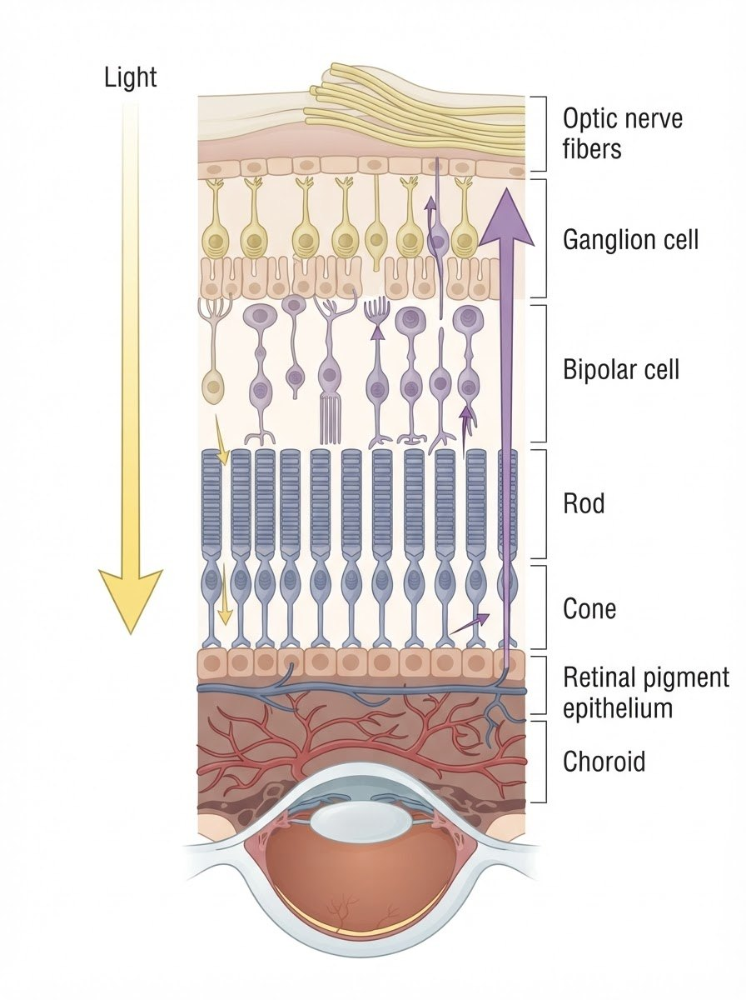 |

> The Chinese-prompt output did not pass review, so it is not shown.

**English prompt**

```text
Create a vertical cross-section illustration of 【the retina】, with the inner side (facing the vitreous) at the top and the back of the eye at the bottom. From top to bottom: optic nerve fibers, ganglion cells, bipolar cells, then rods and cones, then the retinal pigment epithelium and the choroid with blood vessels. A yellow arrow on the left points down to show light passing through the layers; a purple arrow on the right points up to show the signal traveling from rods and cones to bipolar cells to ganglion cells.
Write each label only once in the whole figure.
Labels, each used once, no other text: 【Light, Optic nerve fibers, Ganglion cell, Bipolar cell, Rod, Cone, Retinal pigment epithelium, Choroid】.

Style: journal-style scientific illustration. Clean semi-realistic vector illustration with gentle shading, using cross-sections or cutaways where they explain the structure, on a white background. Muted, harmonious palette with one accent color for the key process. Thin directional arrows for flows. Generous white space and a clear reading direction. Sans-serif English labels only, each label appears exactly once, spelled exactly as given. No cartoon style, no glossy CGI, no dark background, no stock-photo look, no decorative background.
```

<details><summary>Chinese prompt</summary>

```text
画一张【视网膜】的竖向截面插画，上方是朝向玻璃体的内侧，下方是眼球后壁。从上到下依次是：视神经纤维、神经节细胞、双极细胞，然后是视杆细胞和视锥细胞，再往下是视网膜色素上皮和带血管的脉络膜。左侧一条黄色箭头向下，表示光穿过各层；右侧一条紫色箭头向上，表示信号从视杆、视锥细胞传到双极细胞，再传到神经节细胞。
整张图里每个标签只写一次。
标签（每个只出现一次，不加其他文字）：【Light, Optic nerve fibers, Ganglion cell, Bipolar cell, Rod, Cone, Retinal pigment epithelium, Choroid】。

风格：期刊式科学插画。干净的半写实矢量插画，带柔和的明暗；需要说明结构时使用剖面或剖切视图，白色背景。配色低饱和、协调，只用一个强调色突出关键过程。用细的方向箭头表示流动。留白充足，阅读方向清晰。图中文字只用英文无衬线字体，每个标签只出现一次，拼写与给定完全一致。不要卡通风格、不要光滑的 CG 渲染、不要深色背景、不要图库照片感、不要装饰性背景。
```

</details>

Model: Nano Banana 2 Lite (gemini-3.1-flash-lite-image, 1K) · Generated 2 times in total; shown are the outputs that passed review

[↑ Back to top](#top)

<sub><a href="https://yila.ai/?utm_source=github&utm_medium=readme&utm_campaign=sci-figure-prompts&utm_content=retina-layers">Try in Yila →</a></sub>

---

<a id="no-90"></a>

### No. 90: Layers of the skin

by [@Yila-AI](https://github.com/Yila-AI)

Technique: **a 3D block cross-section** · Style: scientific illustration · Aspect ratio: 4:3

| English prompt |
|---|
| 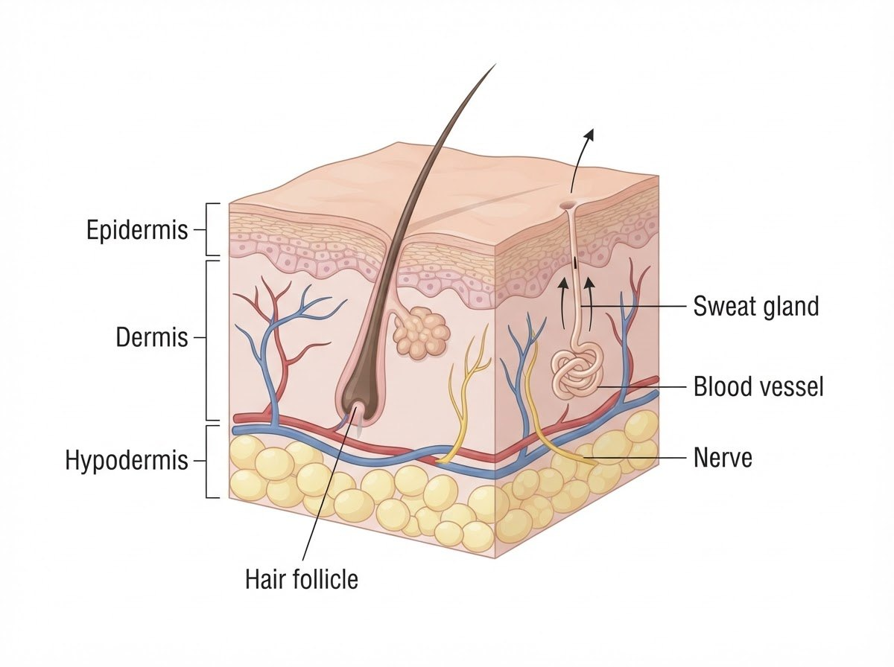 |

> The Chinese-prompt output did not pass review, so it is not shown.

**English prompt**

```text
Create a cross-section illustration of 【human skin】 as a 3D block, with three layers from top to bottom: a thin epidermis, a thicker dermis, and a hypodermis of rounded fat cells. One hair grows from a hair follicle in the dermis, with a sebaceous gland beside it. A coiled sweat gland sits deep in the dermis with its duct opening at the surface. Red and blue blood vessels and one yellow nerve run through the dermis.
Write each label only once in the whole figure.
Labels, each used once, no other text: 【Epidermis, Dermis, Hypodermis, Hair follicle, Sebaceous gland, Sweat gland, Blood vessel, Nerve】.

Style: journal-style scientific illustration. Clean semi-realistic vector illustration with gentle shading, using cross-sections or cutaways where they explain the structure, on a white background. Muted, harmonious palette with one accent color for the key process. Thin directional arrows for flows. Generous white space and a clear reading direction. Sans-serif English labels only, each label appears exactly once, spelled exactly as given. No cartoon style, no glossy CGI, no dark background, no stock-photo look, no decorative background.
```

<details><summary>Chinese prompt</summary>

```text
画一张【人体皮肤】的立体块状截面插画，从上到下三层：薄的表皮、较厚的真皮、由圆形脂肪细胞组成的皮下组织。一根毛发从真皮中的毛囊长出，旁边有一个皮脂腺。真皮深处有一个盘绕的汗腺，导管开口于皮肤表面。红色和蓝色血管以及一根黄色神经穿过真皮。
整张图里每个标签只写一次。
标签（每个只出现一次，不加其他文字）：【Epidermis, Dermis, Hypodermis, Hair follicle, Sebaceous gland, Sweat gland, Blood vessel, Nerve】。

风格：期刊式科学插画。干净的半写实矢量插画，带柔和的明暗；需要说明结构时使用剖面或剖切视图，白色背景。配色低饱和、协调，只用一个强调色突出关键过程。用细的方向箭头表示流动。留白充足，阅读方向清晰。图中文字只用英文无衬线字体，每个标签只出现一次，拼写与给定完全一致。不要卡通风格、不要光滑的 CG 渲染、不要深色背景、不要图库照片感、不要装饰性背景。
```

</details>

Model: Nano Banana 2 Lite (gemini-3.1-flash-lite-image, 1K) · Generated 2 times in total; shown are the outputs that passed review

[↑ Back to top](#top)

<sub><a href="https://yila.ai/?utm_source=github&utm_medium=readme&utm_campaign=sci-figure-prompts&utm_content=skin-layers">Try in Yila →</a></sub>

---

<a id="no-91"></a>

### No. 91: Tumor angiogenesis

by [@Yila-AI](https://github.com/Yila-AI)

Technique: **normal-versus-abnormal comparison + magnified inset** · Style: soft semi-realistic illustration · Aspect ratio: 4:3

| English prompt | Chinese prompt |
|---|---|
|  |  |

**English prompt**

```text
Create a medical illustration of 【tumor angiogenesis】.
Left: 【a small tumor mass releasing VEGF signals (small dots) toward a nearby straight, normal blood vessel】.
Right: 【new vessels sprout from that vessel and grow into the tumor; compared with the normal vessel they are twisted, uneven and leaky】.
A circular magnified inset shows 【an endothelial tip cell leading one new sprout】.
Labels, each used once, no other text: 【Tumor, VEGF, Normal vessel, Abnormal vessels】.

Style: journal graphical-abstract illustration. Soft semi-realistic medical illustration with gentle volume and subtle hand-painted texture, on a clean white background. Muted, harmonious palette with one accent color. Clear left-to-right narrative, generous white space. Sans-serif English labels only, each label appears exactly once, spelled exactly as given. No cartoon style, no glossy CGI, no dark background, no stock-photo look.
```

<details><summary>Chinese prompt</summary>

```text
画一张【肿瘤血管生成】的医学插图。
左：【一个小肿瘤团块向旁边一条笔直的正常血管释放 VEGF 信号（小圆点）】。
右：【新血管从这条血管长出并伸进肿瘤；与正常血管相比，新血管扭曲、粗细不均、有渗漏】。
用一个圆形放大框展示【一个内皮尖端细胞引领新芽生长】。
标签（每个只出现一次，不加其他文字）：【Tumor, VEGF, Normal vessel, Abnormal vessels】。

风格：期刊图形摘要插画。柔和的半写实医学插画，带轻微体积感和细腻的手绘质感，白色干净背景。配色低饱和、协调，只用一个强调色。从左到右叙事清晰，留白充足。图中文字只用英文无衬线字体，每个标签只出现一次，拼写与给定完全一致。不要卡通风格、不要光滑的 CG 渲染、不要深色背景、不要图库照片感。
```

</details>

Model: Nano Banana 2 Lite (gemini-3.1-flash-lite-image, 1K) · Generated 4 times in total; shown are the outputs that passed review

[↑ Back to top](#top)

<sub><a href="https://yila.ai/?utm_source=github&utm_medium=readme&utm_campaign=sci-figure-prompts&utm_content=tumor-angiogenesis">Try in Yila →</a></sub>

---

<a id="no-92"></a>

### No. 92: Four stages of skin wound healing

by [@Yila-AI](https://github.com/Yila-AI)

Technique: **staged sequence** · Style: soft semi-realistic illustration · Aspect ratio: 16:9

| English prompt | Chinese prompt |
|---|---|
|  |  |

**English prompt**

```text
Create a medical illustration of 【skin wound healing】 in four stages from left to right, each shown as the same cross-section of skin.
1: 【a blood clot plugs the wound】.
2: 【immune cells clear debris and bacteria】.
3: 【new tissue, small blood vessels and collagen fill the wound】.
4: 【the surface is closed, with a faint scar】.
Labels, each used once, no other text: 【Hemostasis, Inflammation, Proliferation, Remodeling】.

Style: journal graphical-abstract illustration. Soft semi-realistic medical illustration with gentle volume and subtle hand-painted texture, on a clean white background. Muted, harmonious palette with one accent color. Clear left-to-right narrative, generous white space. Sans-serif English labels only, each label appears exactly once, spelled exactly as given. No cartoon style, no glossy CGI, no dark background, no stock-photo look.
```

<details><summary>Chinese prompt</summary>

```text
画一张【皮肤创面愈合】的医学插图，从左到右分四个阶段，每个阶段都是同一个皮肤剖面。
1：【血凝块堵住创口】。
2：【免疫细胞清除碎屑和细菌】。
3：【新组织、小血管和胶原填满创面】。
4：【表面闭合，留下浅浅的瘢痕】。
标签（每个只出现一次，不加其他文字）：【Hemostasis, Inflammation, Proliferation, Remodeling】。

风格：期刊图形摘要插画。柔和的半写实医学插画，带轻微体积感和细腻的手绘质感，白色干净背景。配色低饱和、协调，只用一个强调色。从左到右叙事清晰，留白充足。图中文字只用英文无衬线字体，每个标签只出现一次，拼写与给定完全一致。不要卡通风格、不要光滑的 CG 渲染、不要深色背景、不要图库照片感。
```

</details>

Model: Nano Banana 2 Lite (gemini-3.1-flash-lite-image, 1K) · Generated 2 times in total; shown are the outputs that passed review

[↑ Back to top](#top)

<sub><a href="https://yila.ai/?utm_source=github&utm_medium=readme&utm_campaign=sci-figure-prompts&utm_content=wound-healing-stages">Try in Yila →</a></sub>

---

<a id="experimental-workflow"></a>

## Experimental Workflow

<a id="no-93"></a>

### No. 93: 16S rRNA microbiome sequencing workflow

by [@Yila-AI](https://github.com/Yila-AI)

Technique: **one panel per step, step names only** · Style: flat workflow · Aspect ratio: 16:9

| English prompt | Chinese prompt |
|---|---|
|  |  |

**English prompt**

```text
Create a workflow figure for 【16S rRNA microbiome sequencing】, 6 steps from left to right:
1. 【Sample collection: a stool sample tube】
2. 【DNA extraction: a DNA strand in a tube】
3. 【16S amplification: a highlighted gene segment being copied】
4. 【Sequencing: a sequencer machine】
5. 【ASV clustering: colored dots grouping together】
6. 【Diversity analysis: bacteria of different shapes in groups】
Step names, each used once, no other text: 【Sample collection, DNA extraction, 16S amplification, Sequencing, ASV clustering, Diversity analysis】.

Style: journal-style experimental workflow figure. Clean flat vector icons on a white background, one light pastel rounded panel per step, thin gray arrows between panels. Only 3-4 muted colors. Each panel shows one simple scene with no text inside it; the only text in the whole figure is the step names given. Sans-serif English, each step name appears exactly once, spelled exactly as given. No legends, no captions, no extra labels, no 3D rendering, no shadows, no decorative background.
```

<details><summary>Chinese prompt</summary>

```text
画一张【16S rRNA 菌群测序】的流程图，从左往右六步：
1. 【样本采集：一管粪便样本】
2. 【DNA 提取：试管里一条 DNA 链】
3. 【16S 扩增：高亮的基因片段被复制】
4. 【测序：一台测序仪】
5. 【ASV 聚类：彩色小点聚成几团】
6. 【多样性分析：不同形状的细菌分组】
步骤名（每个只出现一次，不加其他文字）：【Sample collection, DNA extraction, 16S amplification, Sequencing, ASV clustering, Diversity analysis】。

风格：期刊式实验流程图。白色背景上干净的扁平矢量图标，每一步一个浅色圆角面板，面板之间用细灰色箭头连接。只用 3–4 种低饱和度颜色。每个面板里只画一个简洁的小场景，面板内不写任何文字；整张图唯一的文字就是给定的步骤名。用英文无衬线字体，每个步骤名只出现一次，拼写与给定完全一致。不要图例、不要说明文字、不要额外标签、不要 3D 渲染、阴影或装饰性背景。
```

</details>

Model: Nano Banana 2 Lite (gemini-3.1-flash-lite-image, 1K) · Generated 2 times in total; shown are the outputs that passed review

[↑ Back to top](#top)

<sub><a href="https://yila.ai/?utm_source=github&utm_medium=readme&utm_campaign=sci-figure-prompts&utm_content=16s-microbiome">Try in Yila →</a></sub>

---

<a id="no-94"></a>

### No. 94: ATAC-seq workflow

by [@Yila-AI](https://github.com/Yila-AI)

Technique: **one panel per step, step names only** · Style: flat workflow · Aspect ratio: 16:9

| English prompt | Chinese prompt |
|---|---|
| 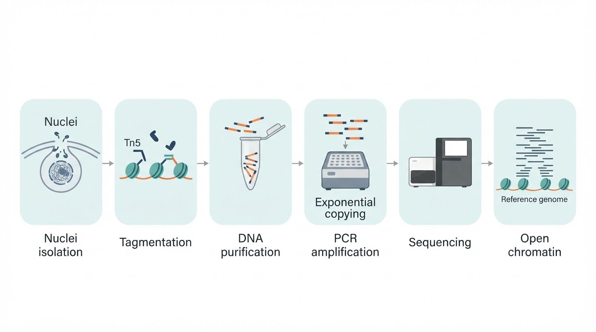 | 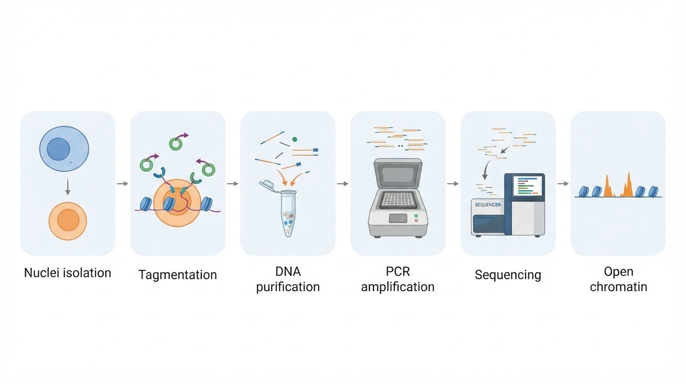 |

**English prompt**

```text
Create a workflow figure for 【an ATAC-seq experiment】, 6 steps from left to right:
1. 【Nuclei isolation: nuclei released from cells】
2. 【Tagmentation: Tn5 cutting DNA between nucleosomes and adding adapters in open regions】
3. 【DNA purification: tagged fragments collected in a tube】
4. 【PCR amplification: fragments copied in a thermal cycler】
5. 【Sequencing: a sequencer】
6. 【Open chromatin: reads stacking up in the gaps between nucleosomes】
Do not write the numbered sentences in the figure.
Step names, each used once, no other text: 【Nuclei isolation, Tagmentation, DNA purification, PCR amplification, Sequencing, Open chromatin】.

Style: journal-style experimental workflow figure. Clean flat vector icons on a white background, one light pastel rounded panel per step, thin gray arrows between panels. Only 3-4 muted colors. Each panel shows one simple scene with no text inside it; the only text in the whole figure is the step names given. Sans-serif English, each step name appears exactly once, spelled exactly as given. No legends, no captions, no extra labels, no 3D rendering, no shadows, no decorative background.
```

<details><summary>Chinese prompt</summary>

```text
画一张【ATAC-seq 实验】的流程图，从左往右六步：
1. 【细胞核分离：从细胞中释放细胞核】
2. 【片段化标记：Tn5 在开放区域的核小体之间切开 DNA 并加上接头】
3. 【DNA 纯化：把带标记的片段收集到试管里】
4. 【PCR 扩增：在 PCR 仪中扩增片段】
5. 【测序：一台测序仪】
6. 【开放染色质：读段堆叠在核小体之间的空隙处】
不要把编号句子写进图里。
步骤名（每个只出现一次，不加其他文字）：【Nuclei isolation, Tagmentation, DNA purification, PCR amplification, Sequencing, Open chromatin】。

风格：期刊式实验流程图。白色背景上干净的扁平矢量图标，每一步一个浅色圆角面板，面板之间用细灰色箭头连接。只用 3–4 种低饱和度颜色。每个面板里只画一个简洁的小场景，面板内不写任何文字；整张图唯一的文字就是给定的步骤名。用英文无衬线字体，每个步骤名只出现一次，拼写与给定完全一致。不要图例、不要说明文字、不要额外标签、不要 3D 渲染、阴影或装饰性背景。
```

</details>

Model: Nano Banana 2 Lite (gemini-3.1-flash-lite-image, 1K) · Generated 2 times in total; shown are the outputs that passed review

[↑ Back to top](#top)

<sub><a href="https://yila.ai/?utm_source=github&utm_medium=readme&utm_campaign=sci-figure-prompts&utm_content=atac-seq">Try in Yila →</a></sub>

---

<a id="no-95"></a>

### No. 95: Clinical biobank and multi-omics profiling workflow

by [@Yila-AI](https://github.com/Yila-AI)

Technique: **one panel per step, step names only** · Style: flat workflow · Aspect ratio: 16:9

| English prompt |
|---|
| 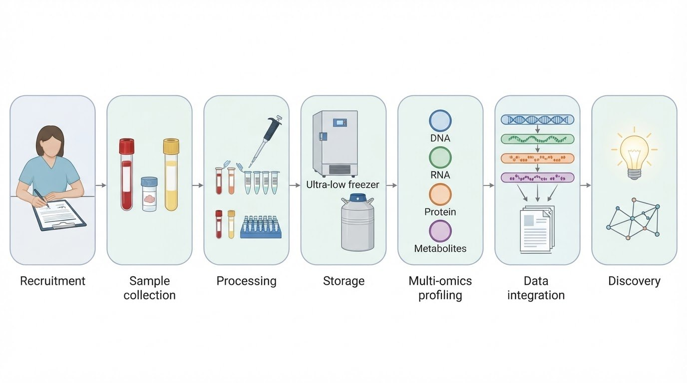 |

> The Chinese-prompt output did not pass review, so it is not shown.

**English prompt**

```text
Create a workflow figure for 【a clinical biobank with multi-omics profiling】, 7 steps from left to right:
1. 【Recruitment: a patient signing a consent form】
2. 【Sample collection: blood, tissue and urine tubes】
3. 【Processing: tubes split into small barcoded aliquots】
4. 【Storage: an ultra-low freezer and a liquid nitrogen tank】
5. 【Multi-omics profiling: four icons for DNA, RNA, protein and metabolites】
6. 【Data integration: omics layers linked to a clinical record】
7. 【Discovery: a lightbulb over a small network】
Do not write the numbered sentences in the figure.
If a component appears in more than one place or panel, write its label only at its first appearance; every other copy has no text. No label may appear twice anywhere in the figure. Spell every label exactly as given and add no titles. Draw every molecule as a simple colored circle, with no chemical structures or letters.
Step names, each used once, no other text: 【Recruitment, Sample collection, Processing, Storage, Multi-omics profiling, Data integration, Discovery】.

Style: journal-style experimental workflow figure. Clean flat vector icons on a white background, one light pastel rounded panel per step, thin gray arrows between panels. Only 3-4 muted colors. Each panel shows one simple scene with no text inside it; the only text in the whole figure is the step names given. Sans-serif English, each step name appears exactly once, spelled exactly as given. No legends, no captions, no extra labels, no 3D rendering, no shadows, no decorative background.
```

<details><summary>Chinese prompt</summary>

```text
画一张【临床生物样本库与多组学分析】的流程图，从左往右七步：
1. 【招募：病人签署知情同意书】
2. 【样本采集：血液、组织和尿液管】
3. 【处理：样本分装成带条码的小管】
4. 【储存：超低温冰箱和液氮罐】
5. 【多组学检测：DNA、RNA、蛋白质和代谢物四个图标】
6. 【数据整合：各组学层与临床病历相连】
7. 【发现：小网络上方一个灯泡】
不要把编号句子写进图里。
如果同一组件在多处或多个面板出现，只在第一次出现时写标签，其余副本不写字。整张图里任何标签都不能出现两次。每个标签拼写与给定完全一致，不加标题。所有分子都画成简单的彩色圆点，不画化学结构、不写字母。
步骤名（每个只出现一次，不加其他文字）：【Recruitment, Sample collection, Processing, Storage, Multi-omics profiling, Data integration, Discovery】。

风格：期刊式实验流程图。白色背景上干净的扁平矢量图标，每一步一个浅色圆角面板，面板之间用细灰色箭头连接。只用 3–4 种低饱和度颜色。每个面板里只画一个简洁的小场景，面板内不写任何文字；整张图唯一的文字就是给定的步骤名。用英文无衬线字体，每个步骤名只出现一次，拼写与给定完全一致。不要图例、不要说明文字、不要额外标签、不要 3D 渲染、阴影或装饰性背景。
```

</details>

Model: Nano Banana 2 Lite (gemini-3.1-flash-lite-image, 1K) · Generated 6 times in total; shown are the outputs that passed review

[↑ Back to top](#top)

<sub><a href="https://yila.ai/?utm_source=github&utm_medium=readme&utm_campaign=sci-figure-prompts&utm_content=biobank-multiomics">Try in Yila →</a></sub>

---

<a id="no-96"></a>

### No. 96: Biomarker discovery and validation workflow

by [@Yila-AI](https://github.com/Yila-AI)

Technique: **one panel per step, step names only** · Style: flat workflow · Aspect ratio: 16:9

| English prompt | Chinese prompt |
|---|---|
|  |  |

**English prompt**

```text
Create a workflow figure for 【biomarker discovery and validation】, 6 steps from left to right:
1. 【Discovery cohort: a group of patient icons】
2. 【Candidate biomarkers: a few molecules with tags】
3. 【Model training: a small network】
4. 【Internal validation: a circular arrow】
5. 【External validation: a second hospital】
6. 【Clinical use: a doctor holding a test kit】
Do not write the numbered sentences in the figure.
Step names, each used once, no other text: 【Discovery cohort, Candidate biomarkers, Model training, Internal validation, External validation, Clinical use】.

Style: journal-style experimental workflow figure. Clean flat vector icons on a white background, one light pastel rounded panel per step, thin gray arrows between panels. Only 3-4 muted colors. Each panel shows one simple scene with no text inside it; the only text in the whole figure is the step names given. Sans-serif English, each step name appears exactly once, spelled exactly as given. No legends, no captions, no extra labels, no 3D rendering, no shadows, no decorative background.
```

<details><summary>Chinese prompt</summary>

```text
画一张【生物标志物发现与验证】的流程图，从左往右六步：
1. 【发现队列：一组病人图标】
2. 【候选标志物：几个带标签的分子】
3. 【模型训练：一个小网络】
4. 【内部验证：一个循环箭头】
5. 【外部验证：另一家医院】
6. 【临床应用：手持检测试剂盒的医生】
不要把编号句子写进图里。
步骤名（每个只出现一次，不加其他文字）：【Discovery cohort, Candidate biomarkers, Model training, Internal validation, External validation, Clinical use】。

风格：期刊式实验流程图。白色背景上干净的扁平矢量图标，每一步一个浅色圆角面板，面板之间用细灰色箭头连接。只用 3–4 种低饱和度颜色。每个面板里只画一个简洁的小场景，面板内不写任何文字；整张图唯一的文字就是给定的步骤名。用英文无衬线字体，每个步骤名只出现一次，拼写与给定完全一致。不要图例、不要说明文字、不要额外标签、不要 3D 渲染、阴影或装饰性背景。
```

</details>

Model: Nano Banana 2 Lite (gemini-3.1-flash-lite-image, 1K) · Generated 2 times in total; shown are the outputs that passed review

[↑ Back to top](#top)

<sub><a href="https://yila.ai/?utm_source=github&utm_medium=readme&utm_campaign=sci-figure-prompts&utm_content=biomarker-validation">Try in Yila →</a></sub>

---

<a id="no-97"></a>

### No. 97: Bulk RNA-seq workflow

by [@Yila-AI](https://github.com/Yila-AI)

Technique: **one panel per step, step names only** · Style: flat workflow · Aspect ratio: 16:9

| English prompt | Chinese prompt |
|---|---|
|  |  |

**English prompt**

```text
Create a workflow figure for 【bulk RNA sequencing】, 6 steps from left to right:
1. 【Sampling: a tissue piece in a tube】
2. 【RNA extraction: an RNA strand in a tube】
3. 【Library preparation: short fragments with adapter caps】
4. 【Sequencing: a sequencer machine】
5. 【Alignment: short reads lining up on a long genome line】
6. 【Differential expression: one gene icon up, one down】
Step names, each used once, no other text: 【Sampling, RNA extraction, Library preparation, Sequencing, Alignment, Differential expression】.

Style: journal-style experimental workflow figure. Clean flat vector icons on a white background, one light pastel rounded panel per step, thin gray arrows between panels. Only 3-4 muted colors. Each panel shows one simple scene with no text inside it; the only text in the whole figure is the step names given. Sans-serif English, each step name appears exactly once, spelled exactly as given. No legends, no captions, no extra labels, no 3D rendering, no shadows, no decorative background.
```

<details><summary>Chinese prompt</summary>

```text
画一张【bulk RNA 测序】的流程图，从左往右六步：
1. 【取样：试管里的一块组织】
2. 【RNA 提取：试管里一条 RNA 链】
3. 【建库：两端带接头的短片段】
4. 【测序：一台测序仪】
5. 【比对：短读段排列到一条长基因组线上】
6. 【差异表达：一个基因上调、一个下调】
步骤名（每个只出现一次，不加其他文字）：【Sampling, RNA extraction, Library preparation, Sequencing, Alignment, Differential expression】。

风格：期刊式实验流程图。白色背景上干净的扁平矢量图标，每一步一个浅色圆角面板，面板之间用细灰色箭头连接。只用 3–4 种低饱和度颜色。每个面板里只画一个简洁的小场景，面板内不写任何文字；整张图唯一的文字就是给定的步骤名。用英文无衬线字体，每个步骤名只出现一次，拼写与给定完全一致。不要图例、不要说明文字、不要额外标签、不要 3D 渲染、阴影或装饰性背景。
```

</details>

Model: Nano Banana 2 Lite (gemini-3.1-flash-lite-image, 1K) · Generated 2 times in total; shown are the outputs that passed review

[↑ Back to top](#top)

<sub><a href="https://yila.ai/?utm_source=github&utm_medium=readme&utm_campaign=sci-figure-prompts&utm_content=bulk-rna-seq">Try in Yila →</a></sub>

---

<a id="no-98"></a>

### No. 98: CCK-8 cell viability assay workflow

by [@Yila-AI](https://github.com/Yila-AI)

Technique: **one panel per step, step names only** · Style: flat workflow · Aspect ratio: 16:9

| Chinese prompt |
|---|
| 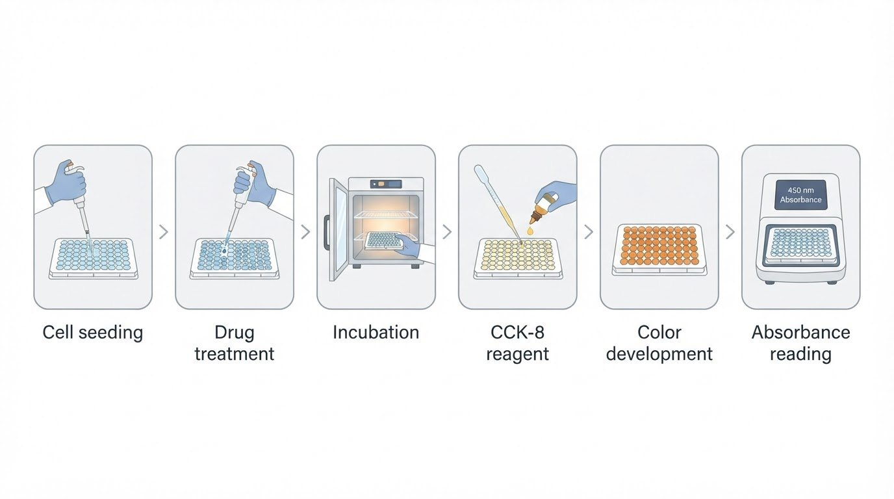 |

**English prompt**

```text
Create a workflow figure for 【a CCK-8 cell viability assay】, 6 steps from left to right:
1. 【Cell seeding: cells in a 96-well plate】
2. 【Drug treatment: a pipette adding drops to the wells】
3. 【Incubation: the plate in an incubator】
4. 【CCK-8 reagent: a dropper adding yellow reagent to the wells】
5. 【Color development: wells turning orange】
6. 【Absorbance reading: a plate reader】
Do not write the numbered sentences in the figure.
Step names, each used once, no other text: 【Cell seeding, Drug treatment, Incubation, CCK-8 reagent, Color development, Absorbance reading】.

Style: journal-style experimental workflow figure. Clean flat vector icons on a white background, one light pastel rounded panel per step, thin gray arrows between panels. Only 3-4 muted colors. Each panel shows one simple scene with no text inside it; the only text in the whole figure is the step names given. Sans-serif English, each step name appears exactly once, spelled exactly as given. No legends, no captions, no extra labels, no 3D rendering, no shadows, no decorative background.
```

<details><summary>Chinese prompt</summary>

```text
画一张【CCK-8 细胞活力检测】的流程图，从左往右六步：
1. 【铺板：96 孔板里的细胞】
2. 【加药处理：移液枪往孔里加液滴】
3. 【孵育：孔板放进培养箱】
4. 【加 CCK-8：滴管往孔里加黄色试剂】
5. 【显色：孔变成橙色】
6. 【读吸光度：一台酶标仪】
不要把编号句子写进图里。
步骤名（每个只出现一次，不加其他文字）：【Cell seeding, Drug treatment, Incubation, CCK-8 reagent, Color development, Absorbance reading】。

风格：期刊式实验流程图。白色背景上干净的扁平矢量图标，每一步一个浅色圆角面板，面板之间用细灰色箭头连接。只用 3–4 种低饱和度颜色。每个面板里只画一个简洁的小场景，面板内不写任何文字；整张图唯一的文字就是给定的步骤名。用英文无衬线字体，每个步骤名只出现一次，拼写与给定完全一致。不要图例、不要说明文字、不要额外标签、不要 3D 渲染、阴影或装饰性背景。
```

</details>

Model: Nano Banana 2 Lite (gemini-3.1-flash-lite-image, 1K) · Generated 4 times in total; shown are the outputs that passed review

[↑ Back to top](#top)

<sub><a href="https://yila.ai/?utm_source=github&utm_medium=readme&utm_campaign=sci-figure-prompts&utm_content=cck8-viability-assay">Try in Yila →</a></sub>

---

<a id="no-99"></a>

### No. 99: Cell culture and transfection workflow

by [@Yila-AI](https://github.com/Yila-AI)

Technique: **one panel per step, step names only** · Style: flat workflow · Aspect ratio: 16:9

| English prompt | Chinese prompt |
|---|---|
|  |  |

**English prompt**

```text
Create a workflow figure for 【cell culture and transfection】, 6 steps from left to right:
1. 【Cell seeding: a culture dish with cells】
2. 【Complex formation: plasmid or siRNA mixed with transfection reagent in a tube】
3. 【Transfection: drops added to the dish】
4. 【Incubation: the dish in an incubator】
5. 【Verification: cells glowing green under a microscope】
6. 【Downstream assays: a well plate and a gel】
Do not write the numbered sentences in the figure.
Step names, each used once, no other text: 【Cell seeding, Complex formation, Transfection, Incubation, Verification, Downstream assays】.

Style: journal-style experimental workflow figure. Clean flat vector icons on a white background, one light pastel rounded panel per step, thin gray arrows between panels. Only 3-4 muted colors. Each panel shows one simple scene with no text inside it; the only text in the whole figure is the step names given. Sans-serif English, each step name appears exactly once, spelled exactly as given. No legends, no captions, no extra labels, no 3D rendering, no shadows, no decorative background.
```

<details><summary>Chinese prompt</summary>

```text
画一张【细胞培养与转染】的流程图，从左往右六步：
1. 【铺板：培养皿里的细胞】
2. 【复合物形成：试管里质粒或 siRNA 与转染试剂混合】
3. 【转染：把液滴加到培养皿里】
4. 【孵育：培养皿放进培养箱】
5. 【效果验证：显微镜下细胞发绿光】
6. 【下游实验：孔板和凝胶】
不要把编号句子写进图里。
步骤名（每个只出现一次，不加其他文字）：【Cell seeding, Complex formation, Transfection, Incubation, Verification, Downstream assays】。

风格：期刊式实验流程图。白色背景上干净的扁平矢量图标，每一步一个浅色圆角面板，面板之间用细灰色箭头连接。只用 3–4 种低饱和度颜色。每个面板里只画一个简洁的小场景，面板内不写任何文字；整张图唯一的文字就是给定的步骤名。用英文无衬线字体，每个步骤名只出现一次，拼写与给定完全一致。不要图例、不要说明文字、不要额外标签、不要 3D 渲染、阴影或装饰性背景。
```

</details>

Model: Nano Banana 2 Lite (gemini-3.1-flash-lite-image, 1K) · Generated 4 times in total; shown are the outputs that passed review

[↑ Back to top](#top)

<sub><a href="https://yila.ai/?utm_source=github&utm_medium=readme&utm_campaign=sci-figure-prompts&utm_content=cell-transfection">Try in Yila →</a></sub>

---

<a id="no-100"></a>

### No. 100: ChIP-seq workflow

by [@Yila-AI](https://github.com/Yila-AI)

Technique: **one panel per step, step names only** · Style: flat workflow · Aspect ratio: 16:9

| Chinese prompt |
|---|
| 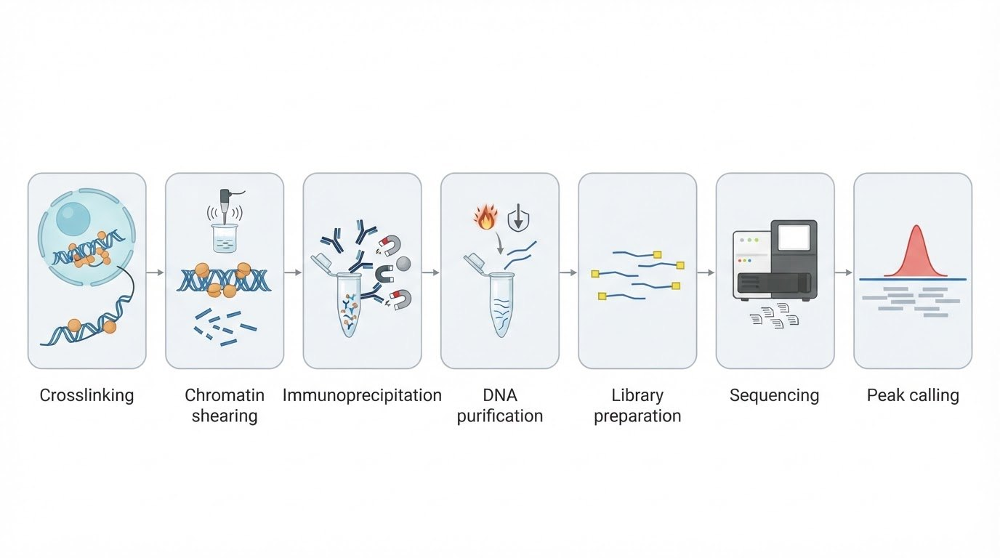 |

**English prompt**

```text
Create a workflow figure for 【a ChIP-seq experiment】, 7 steps from left to right:
1. 【Crosslinking: proteins fixed onto DNA in cells】
2. 【Chromatin shearing: DNA cut into short pieces by sonication】
3. 【Immunoprecipitation: an antibody pulling down one protein with its DNA on beads】
4. 【DNA purification: the crosslinks reversed and free DNA collected in a tube】
5. 【Library preparation: short DNA pieces with adapters at both ends】
6. 【Sequencing: a sequencer】
7. 【Peak calling: short reads stacking up at one spot on a DNA line】
Do not write the numbered sentences in the figure.
Step names, each used once, no other text: 【Crosslinking, Chromatin shearing, Immunoprecipitation, DNA purification, Library preparation, Sequencing, Peak calling】.

Style: journal-style experimental workflow figure. Clean flat vector icons on a white background, one light pastel rounded panel per step, thin gray arrows between panels. Only 3-4 muted colors. Each panel shows one simple scene with no text inside it; the only text in the whole figure is the step names given. Sans-serif English, each step name appears exactly once, spelled exactly as given. No legends, no captions, no extra labels, no 3D rendering, no shadows, no decorative background.
```

<details><summary>Chinese prompt</summary>

```text
画一张【ChIP-seq 实验】的流程图，从左往右七步：
1. 【交联：把细胞中的蛋白质固定在 DNA 上】
2. 【染色质打断：超声把 DNA 切成短片段】
3. 【免疫沉淀：抗体借助磁珠拉下一种蛋白及其结合的 DNA】
4. 【DNA 纯化：解交联，把游离 DNA 收集到试管里】
5. 【建库：两端带接头的短 DNA 片段】
6. 【测序：一台测序仪】
7. 【峰识别：短读段在 DNA 线上的一处堆叠起来】
不要把编号句子写进图里。
步骤名（每个只出现一次，不加其他文字）：【Crosslinking, Chromatin shearing, Immunoprecipitation, DNA purification, Library preparation, Sequencing, Peak calling】。

风格：期刊式实验流程图。白色背景上干净的扁平矢量图标，每一步一个浅色圆角面板，面板之间用细灰色箭头连接。只用 3–4 种低饱和度颜色。每个面板里只画一个简洁的小场景，面板内不写任何文字；整张图唯一的文字就是给定的步骤名。用英文无衬线字体，每个步骤名只出现一次，拼写与给定完全一致。不要图例、不要说明文字、不要额外标签、不要 3D 渲染、阴影或装饰性背景。
```

</details>

Model: Nano Banana 2 Lite (gemini-3.1-flash-lite-image, 1K) · Generated 2 times in total; shown are the outputs that passed review

[↑ Back to top](#top)

<sub><a href="https://yila.ai/?utm_source=github&utm_medium=readme&utm_campaign=sci-figure-prompts&utm_content=chip-seq">Try in Yila →</a></sub>

---

<a id="no-101"></a>

### No. 101: Clinical trial enrollment and follow-up

by [@Yila-AI](https://github.com/Yila-AI)

Technique: **vertical flowchart** · Style: flat vector schematic · Aspect ratio: 3:4

| English prompt | Chinese prompt |
|---|---|
|  |  |

**English prompt**

```text
Create a clean vertical flowchart of 【a randomized clinical trial】, read from top to bottom. Each box is a light pastel rounded rectangle with a small group-of-people icon; thin arrows connect the boxes.
【Screened at the top → an Excluded box branching to the right side → Randomized → splits into two parallel arms, Intervention and Control → each arm goes to Follow-up → both arms meet at Analysis at the bottom】.
Labels, each used once, no other text: 【Screened, Excluded, Randomized, Intervention, Control, Follow-up, Analysis】.

Style: journal-style scientific schematic. Clean flat vector illustration on a white background, light pastel rounded panels to separate regions. Only 3-4 muted colors, each with one fixed meaning; red only for inhibition or emphasis. Thin, uniform line weight. Proteins as rounded colored capsules with their names inside; membranes as lipid bilayers; activation as solid arrows, inhibition as T-bar lines, indirect effects as dashed arrows. Sans-serif English labels only, each label appears exactly once, spelled exactly as given. No 3D rendering, no shadows, no glow, no decorative background, no photorealism.
```

<details><summary>Chinese prompt</summary>

```text
画一张干净的竖向流程图，展示【一项随机对照临床试验】，从上往下读。每个框是一个浅色圆角矩形，里面有一个小人群图标，框之间用细箭头连接。
【顶部是 Screened → 向右分出一个 Excluded 框 → Randomized → 分成并列的两组 Intervention 和 Control → 每组各自进入 Follow-up → 两组在底部汇合到 Analysis】。
标签（每个只出现一次，不加其他文字）：【Screened, Excluded, Randomized, Intervention, Control, Follow-up, Analysis】。

风格：期刊式科研示意图。白色背景上的干净扁平矢量插画，用浅色圆角面板区分区域。只用 3–4 种低饱和度颜色，每种颜色含义固定，红色只用于抑制或强调。线条细且粗细一致。蛋白画成彩色圆角胶囊，名称写在胶囊里；细胞膜画成磷脂双分子层；激活用实线箭头，抑制用 T 形线，间接作用用虚线箭头。图中文字只用英文无衬线字体，每个标签只出现一次，拼写与给定完全一致。不要 3D 渲染、阴影、发光、装饰性背景或照片质感。
```

</details>

Model: Nano Banana 2 Lite (gemini-3.1-flash-lite-image, 1K) · Generated 2 times in total; shown are the outputs that passed review

[↑ Back to top](#top)

<sub><a href="https://yila.ai/?utm_source=github&utm_medium=readme&utm_campaign=sci-figure-prompts&utm_content=clinical-cohort">Try in Yila →</a></sub>

---

<a id="no-102"></a>

### No. 102: Co-immunoprecipitation (Co-IP) and pull-down workflow

by [@Yila-AI](https://github.com/Yila-AI)

Technique: **one panel per step, step names only** · Style: flat workflow · Aspect ratio: 16:9

| English prompt |
|---|
| 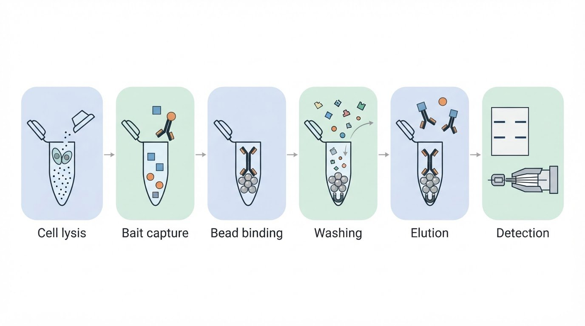 |

> The Chinese-prompt output did not pass review, so it is not shown.

**English prompt**

```text
Create a workflow figure for 【a Co-IP or pull-down experiment】, 6 steps from left to right:
1. 【Cell lysis: cells broken open in a tube, proteins released】
2. 【Bait capture: an antibody (or a tag on the bait protein) binding the bait with its partner attached】
3. 【Bead binding: beads grabbing the antibody–protein complex】
4. 【Washing: unbound proteins rinsed away】
5. 【Elution: the bait and its partner released from the beads】
6. 【Detection: a western blot membrane and a mass spectrometer】
Do not write the numbered sentences in the figure.
Step names, each used once, no other text: 【Cell lysis, Bait capture, Bead binding, Washing, Elution, Detection】.

Style: journal-style experimental workflow figure. Clean flat vector icons on a white background, one light pastel rounded panel per step, thin gray arrows between panels. Only 3-4 muted colors. Each panel shows one simple scene with no text inside it; the only text in the whole figure is the step names given. Sans-serif English, each step name appears exactly once, spelled exactly as given. No legends, no captions, no extra labels, no 3D rendering, no shadows, no decorative background.
```

<details><summary>Chinese prompt</summary>

```text
画一张【Co-IP 或 pull-down 实验】的流程图，从左往右六步：
1. 【细胞裂解：试管中细胞破碎，释放蛋白】
2. 【诱饵捕获：抗体（或诱饵蛋白上的标签）结合诱饵蛋白及与之相连的伙伴蛋白】
3. 【磁珠结合：磁珠抓住抗体—蛋白复合物】
4. 【洗涤：洗掉未结合的蛋白】
5. 【洗脱：把诱饵蛋白和伙伴蛋白从磁珠上释放下来】
6. 【检测：Western blot 膜和质谱仪】
不要把编号句子写进图里。
步骤名（每个只出现一次，不加其他文字）：【Cell lysis, Bait capture, Bead binding, Washing, Elution, Detection】。

风格：期刊式实验流程图。白色背景上干净的扁平矢量图标，每一步一个浅色圆角面板，面板之间用细灰色箭头连接。只用 3–4 种低饱和度颜色。每个面板里只画一个简洁的小场景，面板内不写任何文字；整张图唯一的文字就是给定的步骤名。用英文无衬线字体，每个步骤名只出现一次，拼写与给定完全一致。不要图例、不要说明文字、不要额外标签、不要 3D 渲染、阴影或装饰性背景。
```

</details>

Model: Nano Banana 2 Lite (gemini-3.1-flash-lite-image, 1K) · Generated 2 times in total; shown are the outputs that passed review

[↑ Back to top](#top)

<sub><a href="https://yila.ai/?utm_source=github&utm_medium=readme&utm_campaign=sci-figure-prompts&utm_content=co-ip-pulldown">Try in Yila →</a></sub>

---

<a id="no-103"></a>

### No. 103: Colony formation assay workflow

by [@Yila-AI](https://github.com/Yila-AI)

Technique: **one panel per step, step names only** · Style: flat workflow · Aspect ratio: 16:9

| English prompt |
|---|
| 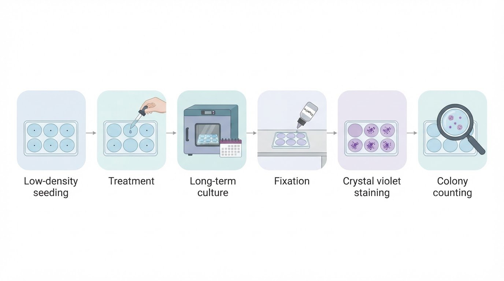 |

> The Chinese-prompt output did not pass review, so it is not shown.

**English prompt**

```text
Create a workflow figure for 【a colony formation assay】, 6 steps from left to right:
1. 【Low-density seeding: a few single cells in a 6-well plate】
2. 【Treatment: a dropper adding drug】
3. 【Long-term culture: the plate in an incubator with a calendar icon】
4. 【Fixation: a bottle of fixative】
5. 【Crystal violet staining: purple dots appearing in the wells】
6. 【Colony counting: a magnifier over purple colonies】
Do not write the numbered sentences in the figure.
Step names, each used once, no other text: 【Low-density seeding, Treatment, Long-term culture, Fixation, Crystal violet staining, Colony counting】.

Style: journal-style experimental workflow figure. Clean flat vector icons on a white background, one light pastel rounded panel per step, thin gray arrows between panels. Only 3-4 muted colors. Each panel shows one simple scene with no text inside it; the only text in the whole figure is the step names given. Sans-serif English, each step name appears exactly once, spelled exactly as given. No legends, no captions, no extra labels, no 3D rendering, no shadows, no decorative background.
```

<details><summary>Chinese prompt</summary>

```text
画一张【克隆形成实验】的流程图，从左往右六步：
1. 【低密度铺板：6 孔板里稀疏的单个细胞】
2. 【处理：滴管加药】
3. 【长期培养：培养箱配日历图标】
4. 【固定：一瓶固定液】
5. 【结晶紫染色：孔里出现紫色圆点】
6. 【克隆计数：放大镜对着紫色克隆】
不要把编号句子写进图里。
步骤名（每个只出现一次，不加其他文字）：【Low-density seeding, Treatment, Long-term culture, Fixation, Crystal violet staining, Colony counting】。

风格：期刊式实验流程图。白色背景上干净的扁平矢量图标，每一步一个浅色圆角面板，面板之间用细灰色箭头连接。只用 3–4 种低饱和度颜色。每个面板里只画一个简洁的小场景，面板内不写任何文字；整张图唯一的文字就是给定的步骤名。用英文无衬线字体，每个步骤名只出现一次，拼写与给定完全一致。不要图例、不要说明文字、不要额外标签、不要 3D 渲染、阴影或装饰性背景。
```

</details>

Model: Nano Banana 2 Lite (gemini-3.1-flash-lite-image, 1K) · Generated 4 times in total; shown are the outputs that passed review

[↑ Back to top](#top)

<sub><a href="https://yila.ai/?utm_source=github&utm_medium=readme&utm_campaign=sci-figure-prompts&utm_content=colony-formation-assay">Try in Yila →</a></sub>

---

<a id="no-104"></a>

### No. 104: CRISPR knockout cell line workflow

by [@Yila-AI](https://github.com/Yila-AI)

Technique: **one panel per step, step names only** · Style: flat workflow · Aspect ratio: 16:9

| English prompt | Chinese prompt |
|---|---|
| 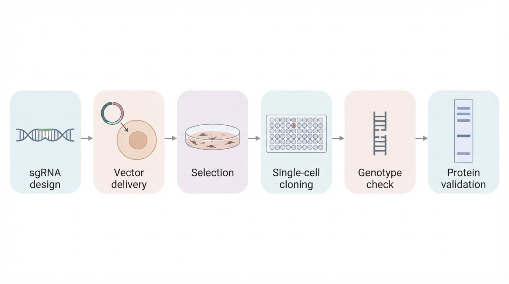 | 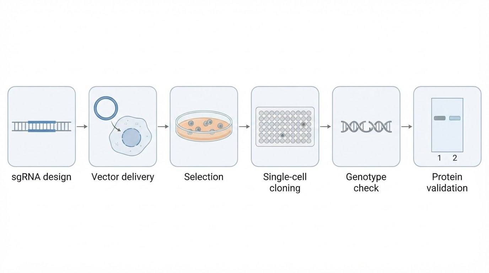 |

**English prompt**

```text
Create a workflow figure for 【building a CRISPR knockout cell line】, 6 steps from left to right:
1. 【sgRNA design: a DNA strand with a highlighted target site】
2. 【Vector delivery: a plasmid entering a cell】
3. 【Selection: a dish where only some cells survive】
4. 【Single-cell cloning: a 96-well plate with one cell per well】
5. 【Genotype check: a short DNA strand with a gap】
6. 【Protein validation: a gel with a missing band】
Do not write the numbered sentences in the figure.
Step names, each used once, no other text: 【sgRNA design, Vector delivery, Selection, Single-cell cloning, Genotype check, Protein validation】.

Style: journal-style experimental workflow figure. Clean flat vector icons on a white background, one light pastel rounded panel per step, thin gray arrows between panels. Only 3-4 muted colors. Each panel shows one simple scene with no text inside it; the only text in the whole figure is the step names given. Sans-serif English, each step name appears exactly once, spelled exactly as given. No legends, no captions, no extra labels, no 3D rendering, no shadows, no decorative background.
```

<details><summary>Chinese prompt</summary>

```text
画一张【构建 CRISPR 敲除细胞系】的流程图，从左往右六步：
1. 【sgRNA 设计：DNA 链上高亮一个靶位点】
2. 【载体递送：质粒进入细胞】
3. 【筛选：培养皿里只有部分细胞存活】
4. 【单克隆挑选：96 孔板每孔一个细胞】
5. 【基因型验证：带缺口的短 DNA 链】
6. 【蛋白验证：缺一条带的凝胶】
不要把编号句子写进图里。
步骤名（每个只出现一次，不加其他文字）：【sgRNA design, Vector delivery, Selection, Single-cell cloning, Genotype check, Protein validation】。

风格：期刊式实验流程图。白色背景上干净的扁平矢量图标，每一步一个浅色圆角面板，面板之间用细灰色箭头连接。只用 3–4 种低饱和度颜色。每个面板里只画一个简洁的小场景，面板内不写任何文字；整张图唯一的文字就是给定的步骤名。用英文无衬线字体，每个步骤名只出现一次，拼写与给定完全一致。不要图例、不要说明文字、不要额外标签、不要 3D 渲染、阴影或装饰性背景。
```

</details>

Model: Nano Banana 2 Lite (gemini-3.1-flash-lite-image, 1K) · Generated 4 times in total; shown are the outputs that passed review

[↑ Back to top](#top)

<sub><a href="https://yila.ai/?utm_source=github&utm_medium=readme&utm_campaign=sci-figure-prompts&utm_content=crispr-knockout-cell-line">Try in Yila →</a></sub>

---

<a id="no-105"></a>

### No. 105: Pooled CRISPR screen workflow

by [@Yila-AI](https://github.com/Yila-AI)

Technique: **one pastel rounded panel per step** · Style: flat workflow · Aspect ratio: 16:9

| English prompt | Chinese prompt |
|---|---|
|  |  |

**English prompt**

```text
Create an experimental workflow figure for 【a pooled CRISPR knockout screen】, in five steps from left to right. Each step is one light pastel rounded panel with its number and name at the top and one simple icon-style scene inside; thin arrows connect the panels.
Step 1: 【a tube of virus particles carrying many different guide RNAs】.
Step 2: 【a dish of cells, each cell receiving one guide RNA】.
Step 3: 【the cells treated with a drug; some die and some survive】.
Step 4: 【a sequencing instrument reading the guide RNAs of surviving cells】.
Step 5: 【a short ranked list of genes with the top ones highlighted】.
Labels, each used once, no other text: 【1 Library, 2 Transduction, 3 Selection, 4 Sequencing, 5 Hit genes】.

Style: journal-style experimental workflow figure. Clean flat vector icons on a white background, one light pastel rounded panel per step, thin gray arrows between panels. Only 3-4 muted colors. Each panel shows one simple scene with no text inside it; the only text in the whole figure is the step names given. Sans-serif English, each step name appears exactly once, spelled exactly as given. No legends, no captions, no extra labels, no 3D rendering, no shadows, no decorative background.
```

<details><summary>Chinese prompt</summary>

```text
画一张【混合 CRISPR 敲除筛选】的实验流程图，从左到右分五步。每一步是一个浅色圆角面板，顶部写编号和步骤名，面板里是一个简洁的图标化小场景，面板之间用细箭头连接。
第 1 步：【一管携带多种不同向导 RNA 的病毒颗粒】。
第 2 步：【一皿细胞，每个细胞接收一种向导 RNA】。
第 3 步：【细胞经药物处理，一部分死亡，一部分存活】。
第 4 步：【测序仪读取存活细胞中的向导 RNA】。
第 5 步：【一个简短的基因排名列表，排在最前的几个被标亮】。
标签（每个只出现一次，不加其他文字）：【1 Library, 2 Transduction, 3 Selection, 4 Sequencing, 5 Hit genes】。

风格：期刊式实验流程图。白色背景上干净的扁平矢量图标，每一步一个浅色圆角面板，面板之间用细灰色箭头连接。只用 3–4 种低饱和度颜色。每个面板里只画一个简洁的小场景，面板内不写任何文字；整张图唯一的文字就是给定的步骤名。用英文无衬线字体，每个步骤名只出现一次，拼写与给定完全一致。不要图例、不要说明文字、不要额外标签、不要 3D 渲染、阴影或装饰性背景。
```

</details>

Model: Nano Banana 2 Lite (gemini-3.1-flash-lite-image, 1K) · Generated 6 times in total; shown are the outputs that passed review

[↑ Back to top](#top)

<sub><a href="https://yila.ai/?utm_source=github&utm_medium=readme&utm_campaign=sci-figure-prompts&utm_content=crispr-pooled-screen">Try in Yila →</a></sub>

---

<a id="no-106"></a>

### No. 106: Molecular docking and dynamics workflow

by [@Yila-AI](https://github.com/Yila-AI)

Technique: **one panel per step, step names only** · Style: flat workflow · Aspect ratio: 16:9

| English prompt | Chinese prompt |
|---|---|
|  |  |

**English prompt**

```text
Create a workflow figure for 【a molecular docking and molecular dynamics study】, 6 steps from left to right:
1. 【Protein preparation: a ribbon protein structure】
2. 【Ligand preparation: a small molecule】
3. 【Docking: the molecule fitting into a pocket】
4. 【Binding pose: a close-up of the molecule in the pocket】
5. 【Molecular dynamics: the complex surrounded by water molecules】
6. 【Binding stability: a check mark over the complex】
Step names, each used once, no other text: 【Protein preparation, Ligand preparation, Docking, Binding pose, Molecular dynamics, Binding stability】.

Style: journal-style experimental workflow figure. Clean flat vector icons on a white background, one light pastel rounded panel per step, thin gray arrows between panels. Only 3-4 muted colors. Each panel shows one simple scene with no text inside it; the only text in the whole figure is the step names given. Sans-serif English, each step name appears exactly once, spelled exactly as given. No legends, no captions, no extra labels, no 3D rendering, no shadows, no decorative background.
```

<details><summary>Chinese prompt</summary>

```text
画一张【分子对接与分子动力学研究】的流程图，从左往右六步：
1. 【蛋白准备：带状蛋白结构】
2. 【配体准备：一个小分子】
3. 【分子对接：小分子嵌入口袋】
4. 【结合构象：小分子在口袋里的特写】
5. 【分子动力学：复合物周围包着水分子】
6. 【结合稳定性：复合物上方一个对勾】
步骤名（每个只出现一次，不加其他文字）：【Protein preparation, Ligand preparation, Docking, Binding pose, Molecular dynamics, Binding stability】。

风格：期刊式实验流程图。白色背景上干净的扁平矢量图标，每一步一个浅色圆角面板，面板之间用细灰色箭头连接。只用 3–4 种低饱和度颜色。每个面板里只画一个简洁的小场景，面板内不写任何文字；整张图唯一的文字就是给定的步骤名。用英文无衬线字体，每个步骤名只出现一次，拼写与给定完全一致。不要图例、不要说明文字、不要额外标签、不要 3D 渲染、阴影或装饰性背景。
```

</details>

Model: Nano Banana 2 Lite (gemini-3.1-flash-lite-image, 1K) · Generated 2 times in total; shown are the outputs that passed review

[↑ Back to top](#top)

<sub><a href="https://yila.ai/?utm_source=github&utm_medium=readme&utm_campaign=sci-figure-prompts&utm_content=docking-md">Try in Yila →</a></sub>

---

<a id="no-107"></a>

### No. 107: Dual-luciferase reporter assay workflow

by [@Yila-AI](https://github.com/Yila-AI)

Technique: **one panel per step, step names only** · Style: flat workflow · Aspect ratio: 16:9

| English prompt |
|---|
| 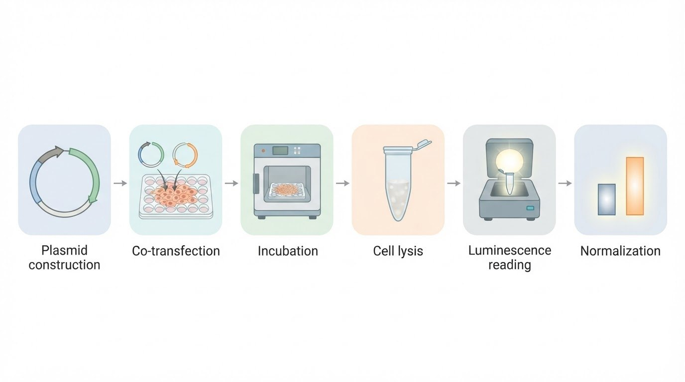 |

> The Chinese-prompt output did not pass review, so it is not shown.

**English prompt**

```text
Create a workflow figure for 【a dual-luciferase reporter assay】, 6 steps from left to right:
1. 【Plasmid construction: a circular plasmid with a promoter segment】
2. 【Co-transfection: two plasmids entering cells in a well】
3. 【Incubation: the plate in an incubator】
4. 【Cell lysis: a tube of lysed cells】
5. 【Luminescence reading: a luminometer with a glowing tube】
6. 【Normalization: two glowing bars side by side】
Do not write the numbered sentences in the figure.
Step names, each used once, no other text: 【Plasmid construction, Co-transfection, Incubation, Cell lysis, Luminescence reading, Normalization】.

Style: journal-style experimental workflow figure. Clean flat vector icons on a white background, one light pastel rounded panel per step, thin gray arrows between panels. Only 3-4 muted colors. Each panel shows one simple scene with no text inside it; the only text in the whole figure is the step names given. Sans-serif English, each step name appears exactly once, spelled exactly as given. No legends, no captions, no extra labels, no 3D rendering, no shadows, no decorative background.
```

<details><summary>Chinese prompt</summary>

```text
画一张【双荧光素酶报告基因实验】的流程图，从左往右六步：
1. 【质粒构建：带启动子片段的环形质粒】
2. 【共转染：两种质粒进入孔里的细胞】
3. 【孵育：孔板放进培养箱】
4. 【细胞裂解：一管裂解后的细胞】
5. 【化学发光检测：发光管配发光检测仪】
6. 【标准化：并排的两根发光条】
不要把编号句子写进图里。
步骤名（每个只出现一次，不加其他文字）：【Plasmid construction, Co-transfection, Incubation, Cell lysis, Luminescence reading, Normalization】。

风格：期刊式实验流程图。白色背景上干净的扁平矢量图标，每一步一个浅色圆角面板，面板之间用细灰色箭头连接。只用 3–4 种低饱和度颜色。每个面板里只画一个简洁的小场景，面板内不写任何文字；整张图唯一的文字就是给定的步骤名。用英文无衬线字体，每个步骤名只出现一次，拼写与给定完全一致。不要图例、不要说明文字、不要额外标签、不要 3D 渲染、阴影或装饰性背景。
```

</details>

Model: Nano Banana 2 Lite (gemini-3.1-flash-lite-image, 1K) · Generated 4 times in total; shown are the outputs that passed review

[↑ Back to top](#top)

<sub><a href="https://yila.ai/?utm_source=github&utm_medium=readme&utm_campaign=sci-figure-prompts&utm_content=dual-luciferase-reporter">Try in Yila →</a></sub>

---

<a id="no-108"></a>

### No. 108: EdU cell proliferation assay workflow

by [@Yila-AI](https://github.com/Yila-AI)

Technique: **one panel per step, step names only** · Style: flat workflow · Aspect ratio: 16:9

| English prompt | Chinese prompt |
|---|---|
| 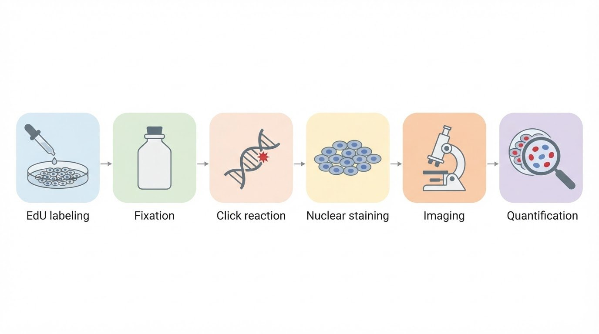 | 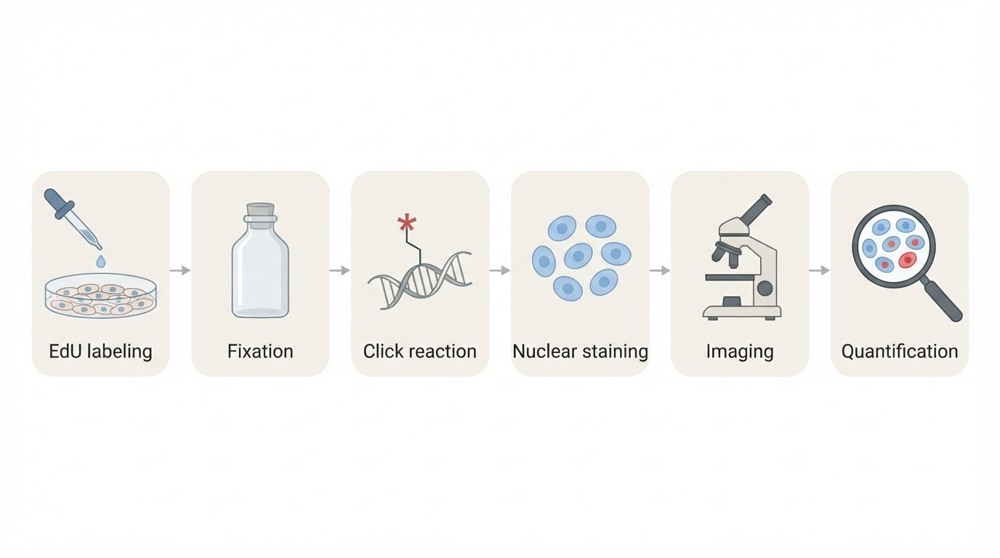 |

**English prompt**

```text
Create a workflow figure for 【an EdU cell proliferation assay】, 6 steps from left to right:
1. 【EdU labeling: a dropper adding EdU to cultured cells】
2. 【Fixation: a plain unlabeled bottle】
3. 【Click reaction: a small red star snapping onto a DNA strand】
4. 【Nuclear staining: blue dye on all nuclei】
5. 【Imaging: a fluorescence microscope】
6. 【Quantification: a magnifier over red and blue nuclei】
Do not write the numbered sentences in the figure.
Every icon is a pure picture with no words, letters or chemical structures inside it.
Step names, each used once, no other text: 【EdU labeling, Fixation, Click reaction, Nuclear staining, Imaging, Quantification】.

Style: journal-style experimental workflow figure. Clean flat vector icons on a white background, one light pastel rounded panel per step, thin gray arrows between panels. Only 3-4 muted colors. Each panel shows one simple scene with no text inside it; the only text in the whole figure is the step names given. Sans-serif English, each step name appears exactly once, spelled exactly as given. No legends, no captions, no extra labels, no 3D rendering, no shadows, no decorative background.
```

<details><summary>Chinese prompt</summary>

```text
画一张【EdU 细胞增殖检测】的流程图，从左往右六步：
1. 【EdU 标记：滴管往培养的细胞里加 EdU】
2. 【固定：一个没有标签的瓶子】
3. 【点击反应：一颗红色小星星连接到一条 DNA 链上】
4. 【核染色：蓝色染料染所有细胞核】
5. 【成像：一台荧光显微镜】
6. 【定量：放大镜对着红色和蓝色细胞核】
不要把编号句子写进图里。
所有图标都是纯图形，里面不写任何单词、字母，也不画化学结构式。
步骤名（每个只出现一次，不加其他文字）：【EdU labeling, Fixation, Click reaction, Nuclear staining, Imaging, Quantification】。

风格：期刊式实验流程图。白色背景上干净的扁平矢量图标，每一步一个浅色圆角面板，面板之间用细灰色箭头连接。只用 3–4 种低饱和度颜色。每个面板里只画一个简洁的小场景，面板内不写任何文字；整张图唯一的文字就是给定的步骤名。用英文无衬线字体，每个步骤名只出现一次，拼写与给定完全一致。不要图例、不要说明文字、不要额外标签、不要 3D 渲染、阴影或装饰性背景。
```

</details>

Model: Nano Banana 2 Lite (gemini-3.1-flash-lite-image, 1K) · Generated 8 times in total; shown are the outputs that passed review

[↑ Back to top](#top)

<sub><a href="https://yila.ai/?utm_source=github&utm_medium=readme&utm_campaign=sci-figure-prompts&utm_content=edu-proliferation-assay">Try in Yila →</a></sub>

---

<a id="no-109"></a>

### No. 109: Sandwich ELISA workflow

by [@Yila-AI](https://github.com/Yila-AI)

Technique: **one panel per step, step names only** · Style: flat workflow · Aspect ratio: 16:9

| English prompt | Chinese prompt |
|---|---|
|  |  |

**English prompt**

```text
Create a workflow figure for 【a sandwich ELISA】, 6 steps from left to right:
1. 【Capture antibody: Y-shaped antibodies on the bottom of a well】
2. 【Blocking: the well filled with buffer】
3. 【Sample: target proteins binding the antibodies】
4. 【Detection antibody: a second antibody with an enzyme tag on top】
5. 【Substrate: the well turning blue】
6. 【Plate reading: a plate reader】
Do not write the numbered sentences in the figure.
Step names, each used once, no other text: 【Capture antibody, Blocking, Sample, Detection antibody, Substrate, Plate reading】.

Style: journal-style experimental workflow figure. Clean flat vector icons on a white background, one light pastel rounded panel per step, thin gray arrows between panels. Only 3-4 muted colors. Each panel shows one simple scene with no text inside it; the only text in the whole figure is the step names given. Sans-serif English, each step name appears exactly once, spelled exactly as given. No legends, no captions, no extra labels, no 3D rendering, no shadows, no decorative background.
```

<details><summary>Chinese prompt</summary>

```text
画一张【夹心 ELISA 实验】的流程图，从左往右六步：
1. 【捕获抗体：孔底的 Y 形抗体】
2. 【封闭：孔里装满缓冲液】
3. 【加样：靶蛋白结合到抗体上】
4. 【检测抗体：上方再结合一个带酶标的抗体】
5. 【底物显色：孔变成蓝色】
6. 【读板：一台酶标仪】
不要把编号句子写进图里。
步骤名（每个只出现一次，不加其他文字）：【Capture antibody, Blocking, Sample, Detection antibody, Substrate, Plate reading】。

风格：期刊式实验流程图。白色背景上干净的扁平矢量图标，每一步一个浅色圆角面板，面板之间用细灰色箭头连接。只用 3–4 种低饱和度颜色。每个面板里只画一个简洁的小场景，面板内不写任何文字；整张图唯一的文字就是给定的步骤名。用英文无衬线字体，每个步骤名只出现一次，拼写与给定完全一致。不要图例、不要说明文字、不要额外标签、不要 3D 渲染、阴影或装饰性背景。
```

</details>

Model: Nano Banana 2 Lite (gemini-3.1-flash-lite-image, 1K) · Generated 2 times in total; shown are the outputs that passed review

[↑ Back to top](#top)

<sub><a href="https://yila.ai/?utm_source=github&utm_medium=readme&utm_campaign=sci-figure-prompts&utm_content=elisa">Try in Yila →</a></sub>

---

<a id="no-110"></a>

### No. 110: Flow cytometry workflow

by [@Yila-AI](https://github.com/Yila-AI)

Technique: **one panel per step, step names only** · Style: flat workflow · Aspect ratio: 16:9

| English prompt | Chinese prompt |
|---|---|
|  |  |

**English prompt**

```text
Create a workflow figure for 【flow cytometry】, 5 steps from left to right:
1. 【Single-cell suspension: a tube of separated cells】
2. 【Antibody staining: cells with colored antibodies attached】
3. 【Acquisition: cells passing a laser one by one】
4. 【Gating: a funnel selecting one group of cells】
5. 【Population analysis: cells sorted into colored groups】
Step names, each used once, no other text: 【Single-cell suspension, Antibody staining, Acquisition, Gating, Population analysis】.

Style: journal-style experimental workflow figure. Clean flat vector icons on a white background, one light pastel rounded panel per step, thin gray arrows between panels. Only 3-4 muted colors. Each panel shows one simple scene with no text inside it; the only text in the whole figure is the step names given. Sans-serif English, each step name appears exactly once, spelled exactly as given. No legends, no captions, no extra labels, no 3D rendering, no shadows, no decorative background.
```

<details><summary>Chinese prompt</summary>

```text
画一张【流式细胞术实验】的流程图，从左往右五步：
1. 【单细胞悬液：一管分散的细胞】
2. 【抗体染色：细胞上结合了彩色抗体】
3. 【上机检测：细胞逐个通过激光】
4. 【设门：一个漏斗选出一群细胞】
5. 【亚群分析：细胞按颜色分成几群】
步骤名（每个只出现一次，不加其他文字）：【Single-cell suspension, Antibody staining, Acquisition, Gating, Population analysis】。

风格：期刊式实验流程图。白色背景上干净的扁平矢量图标，每一步一个浅色圆角面板，面板之间用细灰色箭头连接。只用 3–4 种低饱和度颜色。每个面板里只画一个简洁的小场景，面板内不写任何文字；整张图唯一的文字就是给定的步骤名。用英文无衬线字体，每个步骤名只出现一次，拼写与给定完全一致。不要图例、不要说明文字、不要额外标签、不要 3D 渲染、阴影或装饰性背景。
```

</details>

Model: Nano Banana 2 Lite (gemini-3.1-flash-lite-image, 1K) · Generated 2 times in total; shown are the outputs that passed review

[↑ Back to top](#top)

<sub><a href="https://yila.ai/?utm_source=github&utm_medium=readme&utm_campaign=sci-figure-prompts&utm_content=flow-cytometry">Try in Yila →</a></sub>

---

<a id="no-111"></a>

### No. 111: Genome-wide association study (GWAS) workflow

by [@Yila-AI](https://github.com/Yila-AI)

Technique: **one panel per step, step names only** · Style: flat workflow · Aspect ratio: 16:9

| English prompt |
|---|
|  |

> The Chinese-prompt output did not pass review, so it is not shown.

**English prompt**

```text
Create a workflow figure for 【a genome-wide association study】, 7 steps from left to right:
1. 【Cohort: a group of cases and a group of controls】
2. 【DNA collection: a blood tube and a saliva tube】
3. 【Genotyping: a SNP chip with a grid of colored dots】
4. 【Quality control: a filter removing a few faulty samples】
5. 【Association testing: a balance comparing variants between cases and controls】
6. 【Risk locus: one highlighted spot on a chromosome】
7. 【Replication: a second, independent cohort】
Do not write the numbered sentences in the figure.
Step names, each used once, no other text: 【Cohort, DNA collection, Genotyping, Quality control, Association testing, Risk locus, Replication】.

Style: journal-style experimental workflow figure. Clean flat vector icons on a white background, one light pastel rounded panel per step, thin gray arrows between panels. Only 3-4 muted colors. Each panel shows one simple scene with no text inside it; the only text in the whole figure is the step names given. Sans-serif English, each step name appears exactly once, spelled exactly as given. No legends, no captions, no extra labels, no 3D rendering, no shadows, no decorative background.
```

<details><summary>Chinese prompt</summary>

```text
画一张【全基因组关联研究】的流程图，从左往右七步：
1. 【队列：一组病例和一组对照】
2. 【DNA 采集：血液管和唾液管】
3. 【基因分型：带彩色点阵的 SNP 芯片】
4. 【质量控制：过滤器去掉几个有问题的样本】
5. 【关联分析：天平比较病例和对照中的变异】
6. 【风险位点：染色体上一个高亮的位置】
7. 【重复验证：另一个独立队列】
不要把编号句子写进图里。
步骤名（每个只出现一次，不加其他文字）：【Cohort, DNA collection, Genotyping, Quality control, Association testing, Risk locus, Replication】。

风格：期刊式实验流程图。白色背景上干净的扁平矢量图标，每一步一个浅色圆角面板，面板之间用细灰色箭头连接。只用 3–4 种低饱和度颜色。每个面板里只画一个简洁的小场景，面板内不写任何文字；整张图唯一的文字就是给定的步骤名。用英文无衬线字体，每个步骤名只出现一次，拼写与给定完全一致。不要图例、不要说明文字、不要额外标签、不要 3D 渲染、阴影或装饰性背景。
```

</details>

Model: Nano Banana 2 Lite (gemini-3.1-flash-lite-image, 1K) · Generated 2 times in total; shown are the outputs that passed review

[↑ Back to top](#top)

<sub><a href="https://yila.ai/?utm_source=github&utm_medium=readme&utm_campaign=sci-figure-prompts&utm_content=gwas-workflow">Try in Yila →</a></sub>

---

<a id="no-112"></a>

### No. 112: H&E staining histology workflow

by [@Yila-AI](https://github.com/Yila-AI)

Technique: **one panel per step, step names only** · Style: flat workflow · Aspect ratio: 16:9

| English prompt |
|---|
|  |

> The Chinese-prompt output did not pass review, so it is not shown.

**English prompt**

```text
Create a workflow figure for 【routine H&E histology】, 7 steps from left to right:
1. 【Tissue collection: a small tissue piece in a cassette】
2. 【Fixation: the cassette in a jar of formalin】
3. 【Paraffin embedding: the tissue set in a wax block】
4. 【Sectioning: a microtome cutting a thin ribbon of slices】
5. 【Mounting: a slice floated onto a glass slide】
6. 【Staining: nuclei turning purple and cytoplasm pink】
7. 【Microscopy: a microscope over the slide】
Do not write the numbered sentences in the figure.
Step names, each used once, no other text: 【Tissue collection, Fixation, Paraffin embedding, Sectioning, Mounting, Staining, Microscopy】.

Style: journal-style experimental workflow figure. Clean flat vector icons on a white background, one light pastel rounded panel per step, thin gray arrows between panels. Only 3-4 muted colors. Each panel shows one simple scene with no text inside it; the only text in the whole figure is the step names given. Sans-serif English, each step name appears exactly once, spelled exactly as given. No legends, no captions, no extra labels, no 3D rendering, no shadows, no decorative background.
```

<details><summary>Chinese prompt</summary>

```text
画一张【常规 H&E 组织学检查】的流程图，从左往右七步：
1. 【取材：包埋盒里的一小块组织】
2. 【固定：包埋盒放进福尔马林瓶】
3. 【石蜡包埋：组织封进蜡块】
4. 【切片：切片机切出一条薄片带】
5. 【贴片：切片漂到载玻片上】
6. 【染色：细胞核染成紫色，胞质染成粉色】
7. 【镜检：显微镜对着载玻片】
不要把编号句子写进图里。
步骤名（每个只出现一次，不加其他文字）：【Tissue collection, Fixation, Paraffin embedding, Sectioning, Mounting, Staining, Microscopy】。

风格：期刊式实验流程图。白色背景上干净的扁平矢量图标，每一步一个浅色圆角面板，面板之间用细灰色箭头连接。只用 3–4 种低饱和度颜色。每个面板里只画一个简洁的小场景，面板内不写任何文字；整张图唯一的文字就是给定的步骤名。用英文无衬线字体，每个步骤名只出现一次，拼写与给定完全一致。不要图例、不要说明文字、不要额外标签、不要 3D 渲染、阴影或装饰性背景。
```

</details>

Model: Nano Banana 2 Lite (gemini-3.1-flash-lite-image, 1K) · Generated 2 times in total; shown are the outputs that passed review

[↑ Back to top](#top)

<sub><a href="https://yila.ai/?utm_source=github&utm_medium=readme&utm_campaign=sci-figure-prompts&utm_content=he-staining">Try in Yila →</a></sub>

---

<a id="no-113"></a>

### No. 113: Immunohistochemistry (IHC) workflow

by [@Yila-AI](https://github.com/Yila-AI)

Technique: **one panel per step, step names only** · Style: flat workflow · Aspect ratio: 16:9

| English prompt | Chinese prompt |
|---|---|
|  |  |

**English prompt**

```text
Create a workflow figure for 【immunohistochemistry】, 6 steps from left to right:
1. 【Fixation: a tissue piece in a formalin jar】
2. 【Sectioning: a microtome cutting thin slices】
3. 【Antigen retrieval: a slide in a hot buffer bath】
4. 【Antibody staining: Y-shaped antibodies on the tissue】
5. 【DAB development: brown staining appearing on the slide】
6. 【Microscopy: a microscope over the slide】
Step names, each used once, no other text: 【Fixation, Sectioning, Antigen retrieval, Antibody staining, DAB development, Microscopy】.

Style: journal-style experimental workflow figure. Clean flat vector icons on a white background, one light pastel rounded panel per step, thin gray arrows between panels. Only 3-4 muted colors. Each panel shows one simple scene with no text inside it; the only text in the whole figure is the step names given. Sans-serif English, each step name appears exactly once, spelled exactly as given. No legends, no captions, no extra labels, no 3D rendering, no shadows, no decorative background.
```

<details><summary>Chinese prompt</summary>

```text
画一张【免疫组化实验】的流程图，从左往右六步：
1. 【固定：福尔马林瓶里的组织块】
2. 【切片：切片机切出薄片】
3. 【抗原修复：玻片泡在热的缓冲液里】
4. 【抗体染色：Y 形抗体结合在组织上】
5. 【DAB 显色：玻片上出现棕色染色】
6. 【镜检：显微镜对着玻片】
步骤名（每个只出现一次，不加其他文字）：【Fixation, Sectioning, Antigen retrieval, Antibody staining, DAB development, Microscopy】。

风格：期刊式实验流程图。白色背景上干净的扁平矢量图标，每一步一个浅色圆角面板，面板之间用细灰色箭头连接。只用 3–4 种低饱和度颜色。每个面板里只画一个简洁的小场景，面板内不写任何文字；整张图唯一的文字就是给定的步骤名。用英文无衬线字体，每个步骤名只出现一次，拼写与给定完全一致。不要图例、不要说明文字、不要额外标签、不要 3D 渲染、阴影或装饰性背景。
```

</details>

Model: Nano Banana 2 Lite (gemini-3.1-flash-lite-image, 1K) · Generated 2 times in total; shown are the outputs that passed review

[↑ Back to top](#top)

<sub><a href="https://yila.ai/?utm_source=github&utm_medium=readme&utm_campaign=sci-figure-prompts&utm_content=ihc-staining">Try in Yila →</a></sub>

---

<a id="no-114"></a>

### No. 114: Immunofluorescence staining workflow

by [@Yila-AI](https://github.com/Yila-AI)

Technique: **one panel per step, step names only** · Style: flat workflow · Aspect ratio: 16:9

| English prompt | Chinese prompt |
|---|---|
|  |  |

**English prompt**

```text
Create a workflow figure for 【immunofluorescence staining】, 6 steps from left to right:
1. 【Fixation: cells on a coverslip with a fixative drop】
2. 【Permeabilization: small holes in the cell membrane】
3. 【Blocking: the coverslip in a buffer dish】
4. 【Primary antibody: Y-shaped antibodies binding a target】
5. 【Secondary antibody: glowing antibodies binding the first ones】
6. 【Imaging: a confocal microscope】
Step names, each used once, no other text: 【Fixation, Permeabilization, Blocking, Primary antibody, Secondary antibody, Imaging】.

Style: journal-style experimental workflow figure. Clean flat vector icons on a white background, one light pastel rounded panel per step, thin gray arrows between panels. Only 3-4 muted colors. Each panel shows one simple scene with no text inside it; the only text in the whole figure is the step names given. Sans-serif English, each step name appears exactly once, spelled exactly as given. No legends, no captions, no extra labels, no 3D rendering, no shadows, no decorative background.
```

<details><summary>Chinese prompt</summary>

```text
画一张【免疫荧光染色】的流程图，从左往右六步：
1. 【固定：盖玻片上的细胞滴上固定液】
2. 【通透：细胞膜上出现小孔】
3. 【封闭：盖玻片泡在缓冲液皿里】
4. 【一抗：Y 形抗体结合靶蛋白】
5. 【荧光二抗：发光的抗体结合一抗】
6. 【成像：一台共聚焦显微镜】
步骤名（每个只出现一次，不加其他文字）：【Fixation, Permeabilization, Blocking, Primary antibody, Secondary antibody, Imaging】。

风格：期刊式实验流程图。白色背景上干净的扁平矢量图标，每一步一个浅色圆角面板，面板之间用细灰色箭头连接。只用 3–4 种低饱和度颜色。每个面板里只画一个简洁的小场景，面板内不写任何文字；整张图唯一的文字就是给定的步骤名。用英文无衬线字体，每个步骤名只出现一次，拼写与给定完全一致。不要图例、不要说明文字、不要额外标签、不要 3D 渲染、阴影或装饰性背景。
```

</details>

Model: Nano Banana 2 Lite (gemini-3.1-flash-lite-image, 1K) · Generated 2 times in total; shown are the outputs that passed review

[↑ Back to top](#top)

<sub><a href="https://yila.ai/?utm_source=github&utm_medium=readme&utm_campaign=sci-figure-prompts&utm_content=immunofluorescence">Try in Yila →</a></sub>

---

<a id="no-115"></a>

### No. 115: Mendelian randomization design

by [@Yila-AI](https://github.com/Yila-AI)

Technique: **three-node causal diagram with the three assumptions** · Style: schematic diagram · Aspect ratio: 16:9

| English prompt | Chinese prompt |
|---|---|
|  |  |

**English prompt**

```text
Create a causal diagram for 【a Mendelian randomization study】, read from left to right. Draw each relationship exactly as listed and nothing more:
1. 【Genetic variants (a DNA icon) → Exposure (solid arrow), marked Relevance.】
2. 【Exposure → Outcome (solid arrow).】
3. 【Confounders, in a gray box above, point with dashed arrows to Exposure and to Outcome; a crossed-out dashed line from Confounders to Genetic variants is marked Independence.】
4. 【A crossed-out arrow from Genetic variants directly to Outcome is marked Exclusion restriction.】
Write each label only once; no icons or extra words inside the boxes.
Labels, each used once, no other text: 【Genetic variants, Exposure, Outcome, Confounders, Relevance, Independence, Exclusion restriction】.

Style: journal-style schematic diagram. Clean flat vector graphics on a white background. Modules are rounded rectangles or simple icons with their short names inside; light pastel panels group related layers. Only 3-4 muted colors, each with one fixed meaning. Thin, uniform arrows show the flow of data, energy, material or influence; dashed arrows for indirect or feedback links. Sans-serif English labels only, each label appears exactly once, spelled exactly as given. No 3D rendering, no shadows, no glow, no cyberpunk or tech-background decoration, no photorealism.
```

<details><summary>Chinese prompt</summary>

```text
画一张【孟德尔随机化研究】的因果示意图，从左往右读。严格按下面列出的关系画，不多画：
1. 【遗传变异（DNA 图标）→ 暴露（实线箭头），标注 Relevance。】
2. 【暴露 → 结局（实线箭头）。】
3. 【混杂因素放在上方灰色框里，用虚线箭头分别指向暴露和结局；混杂因素到遗传变异之间画一条被划掉的虚线，标注 Independence。】
4. 【遗传变异直接指向结局的箭头被划掉，标注 Exclusion restriction。】
每个标签只写一次，框里不加图标或其他文字。
标签（每个只出现一次，不加其他文字）：【Genetic variants, Exposure, Outcome, Confounders, Relevance, Independence, Exclusion restriction】。

风格：期刊式示意框图。白色背景上干净的扁平矢量图形。模块画成圆角矩形或简洁图标，名称写在里面；用浅色面板把相关的层归在一起。只用 3–4 种低饱和度颜色，每种颜色含义固定。细而粗细一致的箭头表示数据、能量、物质或影响的流向，间接或反馈关系用虚线箭头。图中文字只用英文无衬线字体，每个标签只出现一次，拼写与给定完全一致。不要 3D 渲染、阴影、发光、赛博朋克或科技感背景装饰，不要照片质感。
```

</details>

Model: Nano Banana 2 Lite (gemini-3.1-flash-lite-image, 1K) · Generated 5 times in total; shown are the outputs that passed review

[↑ Back to top](#top)

<sub><a href="https://yila.ai/?utm_source=github&utm_medium=readme&utm_campaign=sci-figure-prompts&utm_content=mendelian-randomization">Try in Yila →</a></sub>

---

<a id="no-116"></a>

### No. 116: Metabolomics workflow

by [@Yila-AI](https://github.com/Yila-AI)

Technique: **one panel per step, step names only** · Style: flat workflow · Aspect ratio: 16:9

| English prompt | Chinese prompt |
|---|---|
|  |  |

**English prompt**

```text
Create a workflow figure for 【an untargeted metabolomics study】, 6 steps from left to right:
1. 【Sample collection: a blood tube and a tissue piece】
2. 【Metabolite extraction: a tube with solvent】
3. 【LC-MS analysis: a mass spectrometer】
4. 【Peak detection: a magnifier over a peak icon】
5. 【Metabolite identification: a molecule with a tag】
6. 【Pathway analysis: a small metabolic network】
Do not write the numbered sentences in the figure.
Step names, each used once, no other text: 【Sample collection, Extraction, LC-MS analysis, Peak detection, Identification, Pathway analysis】.

Style: journal-style experimental workflow figure. Clean flat vector icons on a white background, one light pastel rounded panel per step, thin gray arrows between panels. Only 3-4 muted colors. Each panel shows one simple scene with no text inside it; the only text in the whole figure is the step names given. Sans-serif English, each step name appears exactly once, spelled exactly as given. No legends, no captions, no extra labels, no 3D rendering, no shadows, no decorative background.
```

<details><summary>Chinese prompt</summary>

```text
画一张【非靶向代谢组学研究】的流程图，从左往右六步：
1. 【样本采集：血液管和组织块】
2. 【代谢物提取：装溶剂的试管】
3. 【LC-MS 分析：一台质谱仪】
4. 【峰检测：放大镜对着峰图标】
5. 【代谢物鉴定：带标签的分子】
6. 【通路分析：一个小代谢网络】
不要把编号句子写进图里。
步骤名（每个只出现一次，不加其他文字）：【Sample collection, Extraction, LC-MS analysis, Peak detection, Identification, Pathway analysis】。

风格：期刊式实验流程图。白色背景上干净的扁平矢量图标，每一步一个浅色圆角面板，面板之间用细灰色箭头连接。只用 3–4 种低饱和度颜色。每个面板里只画一个简洁的小场景，面板内不写任何文字；整张图唯一的文字就是给定的步骤名。用英文无衬线字体，每个步骤名只出现一次，拼写与给定完全一致。不要图例、不要说明文字、不要额外标签、不要 3D 渲染、阴影或装饰性背景。
```

</details>

Model: Nano Banana 2 Lite (gemini-3.1-flash-lite-image, 1K) · Generated 2 times in total; shown are the outputs that passed review

[↑ Back to top](#top)

<sub><a href="https://yila.ai/?utm_source=github&utm_medium=readme&utm_campaign=sci-figure-prompts&utm_content=metabolomics">Try in Yila →</a></sub>

---

<a id="no-117"></a>

### No. 117: Molecular cloning workflow

by [@Yila-AI](https://github.com/Yila-AI)

Technique: **one panel per step, step names only** · Style: flat workflow · Aspect ratio: 16:9

| English prompt | Chinese prompt |
|---|---|
|  |  |

**English prompt**

```text
Create a workflow figure for 【molecular cloning of a gene into a plasmid】, 6 steps from left to right:
1. 【PCR amplification: a short DNA segment being copied】
2. 【Restriction digestion: scissors cutting a circular plasmid open】
3. 【Ligation: the insert joined into the open plasmid】
4. 【Transformation: plasmids entering bacteria】
5. 【Colony selection: bacterial colonies on an agar plate】
6. 【Sequencing verification: a check mark over a DNA strand】
Do not write the numbered sentences in the figure.
Step names, each used once, no other text: 【PCR amplification, Restriction digestion, Ligation, Transformation, Colony selection, Sequencing verification】.

Style: journal-style experimental workflow figure. Clean flat vector icons on a white background, one light pastel rounded panel per step, thin gray arrows between panels. Only 3-4 muted colors. Each panel shows one simple scene with no text inside it; the only text in the whole figure is the step names given. Sans-serif English, each step name appears exactly once, spelled exactly as given. No legends, no captions, no extra labels, no 3D rendering, no shadows, no decorative background.
```

<details><summary>Chinese prompt</summary>

```text
画一张【把目的基因克隆进质粒】的流程图，从左往右六步：
1. 【PCR 扩增：一段短 DNA 被复制】
2. 【酶切：剪刀把环形质粒剪开】
3. 【连接：插入片段接入打开的质粒】
4. 【转化：质粒进入细菌】
5. 【挑菌：琼脂平板上的细菌菌落】
6. 【测序验证：DNA 链上方一个对勾】
不要把编号句子写进图里。
步骤名（每个只出现一次，不加其他文字）：【PCR amplification, Restriction digestion, Ligation, Transformation, Colony selection, Sequencing verification】。

风格：期刊式实验流程图。白色背景上干净的扁平矢量图标，每一步一个浅色圆角面板，面板之间用细灰色箭头连接。只用 3–4 种低饱和度颜色。每个面板里只画一个简洁的小场景，面板内不写任何文字；整张图唯一的文字就是给定的步骤名。用英文无衬线字体，每个步骤名只出现一次，拼写与给定完全一致。不要图例、不要说明文字、不要额外标签、不要 3D 渲染、阴影或装饰性背景。
```

</details>

Model: Nano Banana 2 Lite (gemini-3.1-flash-lite-image, 1K) · Generated 4 times in total; shown are the outputs that passed review

[↑ Back to top](#top)

<sub><a href="https://yila.ai/?utm_source=github&utm_medium=readme&utm_campaign=sci-figure-prompts&utm_content=molecular-cloning">Try in Yila →</a></sub>

---

<a id="no-118"></a>

### No. 118: Mouse disease model: grouping, dosing and sampling

by [@Yila-AI](https://github.com/Yila-AI)

Technique: **one pastel rounded panel per step + icon-style scene** · Style: flat workflow · Aspect ratio: 16:9

| English prompt | Chinese prompt |
|---|---|
|  |  |

**English prompt**

```text
Create an experimental workflow figure for 【a mouse tumor treatment study】, in five steps from left to right. Each step is one light pastel rounded panel with its number and name at the top and one simple icon-style scene inside; thin arrows connect the panels.
Step 1: 【mice randomly split into a control group and a treatment group】.
Step 2: 【a tumor growing under the skin on the flank of a mouse】.
Step 3: 【a syringe giving an intraperitoneal injection】.
Step 4: 【a mouse on a small scale next to a caliper measuring the tumor】.
Step 5: 【collected tumor, blood tube and organ samples in labeled tubes】.
Labels, each used once, no other text: 【1 Grouping, 2 Model, 3 Dosing, 4 Monitoring, 5 Sampling】.

Style: journal-style experimental workflow figure. Clean flat vector icons on a white background, one light pastel rounded panel per step, thin gray arrows between panels. Only 3-4 muted colors. Each panel shows one simple scene with no text inside it; the only text in the whole figure is the step names given. Sans-serif English, each step name appears exactly once, spelled exactly as given. No legends, no captions, no extra labels, no 3D rendering, no shadows, no decorative background.
```

<details><summary>Chinese prompt</summary>

```text
画一张【小鼠肿瘤治疗实验】的实验流程图，从左到右分五步。每一步是一个浅色圆角面板，顶部写编号和步骤名，面板里是一个简洁的图标化小场景，面板之间用细箭头连接。
第 1 步：【小鼠被随机分成对照组和治疗组】。
第 2 步：【小鼠侧腹皮下长出一个肿瘤】。
第 3 步：【注射器进行腹腔注射】。
第 4 步：【小鼠站在小秤上称重，旁边一把卡尺测量肿瘤】。
第 5 步：【收集到的肿瘤、血液管和器官样本，放在贴好标签的管子里】。
标签（每个只出现一次，不加其他文字）：【1 Grouping, 2 Model, 3 Dosing, 4 Monitoring, 5 Sampling】。

风格：期刊式实验流程图。白色背景上干净的扁平矢量图标，每一步一个浅色圆角面板，面板之间用细灰色箭头连接。只用 3–4 种低饱和度颜色。每个面板里只画一个简洁的小场景，面板内不写任何文字；整张图唯一的文字就是给定的步骤名。用英文无衬线字体，每个步骤名只出现一次，拼写与给定完全一致。不要图例、不要说明文字、不要额外标签、不要 3D 渲染、阴影或装饰性背景。
```

</details>

Model: Nano Banana 2 Lite (gemini-3.1-flash-lite-image, 1K) · Generated 2 times in total; shown are the outputs that passed review

[↑ Back to top](#top)

<sub><a href="https://yila.ai/?utm_source=github&utm_medium=readme&utm_campaign=sci-figure-prompts&utm_content=mouse-model-dosing">Try in Yila →</a></sub>

---

<a id="no-119"></a>

### No. 119: Network pharmacology workflow

by [@Yila-AI](https://github.com/Yila-AI)

Technique: **one panel per step, step names only** · Style: flat workflow · Aspect ratio: 16:9

| English prompt | Chinese prompt |
|---|---|
|  |  |

**English prompt**

```text
Create a workflow figure for 【a network pharmacology study】, 7 steps from left to right:
1. 【Compound targets: a herb icon next to a database icon】
2. 【Disease targets: a disease icon next to a database icon】
3. 【Common targets: two overlapping circles】
4. 【PPI network: a small network of connected dots】
5. 【Enrichment: a few short horizontal bars】
6. 【Molecular docking: a small molecule fitting into a protein】
7. 【Validation: a flask and a mouse】
Step names, each used once, no other text: 【Compound targets, Disease targets, Common targets, PPI network, Enrichment, Docking, Validation】.

Style: journal-style experimental workflow figure. Clean flat vector icons on a white background, one light pastel rounded panel per step, thin gray arrows between panels. Only 3-4 muted colors. Each panel shows one simple scene with no text inside it; the only text in the whole figure is the step names given. Sans-serif English, each step name appears exactly once, spelled exactly as given. No legends, no captions, no extra labels, no 3D rendering, no shadows, no decorative background.
```

<details><summary>Chinese prompt</summary>

```text
画一张【网络药理学研究】的流程图，从左往右七步：
1. 【药物靶点：草药图标加数据库图标】
2. 【疾病靶点：疾病图标加数据库图标】
3. 【共同靶点：两个相交的圆】
4. 【PPI 网络：一个由连线圆点组成的小网络】
5. 【富集分析：几根短的横条】
6. 【分子对接：小分子嵌入蛋白质】
7. 【实验验证：烧瓶和小鼠】
步骤名（每个只出现一次，不加其他文字）：【Compound targets, Disease targets, Common targets, PPI network, Enrichment, Docking, Validation】。

风格：期刊式实验流程图。白色背景上干净的扁平矢量图标，每一步一个浅色圆角面板，面板之间用细灰色箭头连接。只用 3–4 种低饱和度颜色。每个面板里只画一个简洁的小场景，面板内不写任何文字；整张图唯一的文字就是给定的步骤名。用英文无衬线字体，每个步骤名只出现一次，拼写与给定完全一致。不要图例、不要说明文字、不要额外标签、不要 3D 渲染、阴影或装饰性背景。
```

</details>

Model: Nano Banana 2 Lite (gemini-3.1-flash-lite-image, 1K) · Generated 2 times in total; shown are the outputs that passed review

[↑ Back to top](#top)

<sub><a href="https://yila.ai/?utm_source=github&utm_medium=readme&utm_campaign=sci-figure-prompts&utm_content=network-pharmacology">Try in Yila →</a></sub>

---

<a id="no-120"></a>

### No. 120: Organ-on-a-chip workflow

by [@Yila-AI](https://github.com/Yila-AI)

Technique: **one panel per step, step names only** · Style: flat workflow · Aspect ratio: 16:9

| English prompt | Chinese prompt |
|---|---|
|  |  |

**English prompt**

```text
Create a workflow figure for 【an organ-on-a-chip study】, 6 steps from left to right:
1. 【Chip fabrication: a clear chip with two parallel channels】
2. 【Cell seeding: epithelial cells in the top channel and endothelial cells in the bottom, separated by a porous membrane】
3. 【Perfusion: a pump pushing medium through both channels】
4. 【Mechanical cues: the side chambers stretching the membrane in a breathing motion】
5. 【Drug exposure: a dropper adding a drug to the flow】
6. 【Readouts: a microscope over the chip and a tube collecting outflow】
Do not write the numbered sentences in the figure.
Step names, each used once, no other text: 【Chip fabrication, Cell seeding, Perfusion, Mechanical cues, Drug exposure, Readouts】.

Style: journal-style experimental workflow figure. Clean flat vector icons on a white background, one light pastel rounded panel per step, thin gray arrows between panels. Only 3-4 muted colors. Each panel shows one simple scene with no text inside it; the only text in the whole figure is the step names given. Sans-serif English, each step name appears exactly once, spelled exactly as given. No legends, no captions, no extra labels, no 3D rendering, no shadows, no decorative background.
```

<details><summary>Chinese prompt</summary>

```text
画一张【器官芯片研究】的流程图，从左往右六步：
1. 【芯片制作：一块带两条平行通道的透明芯片】
2. 【细胞接种：上通道种上皮细胞，下通道种内皮细胞，中间隔一层多孔膜】
3. 【灌流：泵推动培养基流过两条通道】
4. 【力学刺激：两侧腔室像呼吸一样拉伸膜】
5. 【药物暴露：滴管往液流里加药】
6. 【检测：显微镜观察芯片，试管收集流出液】
不要把编号句子写进图里。
步骤名（每个只出现一次，不加其他文字）：【Chip fabrication, Cell seeding, Perfusion, Mechanical cues, Drug exposure, Readouts】。

风格：期刊式实验流程图。白色背景上干净的扁平矢量图标，每一步一个浅色圆角面板，面板之间用细灰色箭头连接。只用 3–4 种低饱和度颜色。每个面板里只画一个简洁的小场景，面板内不写任何文字；整张图唯一的文字就是给定的步骤名。用英文无衬线字体，每个步骤名只出现一次，拼写与给定完全一致。不要图例、不要说明文字、不要额外标签、不要 3D 渲染、阴影或装饰性背景。
```

</details>

Model: Nano Banana 2 Lite (gemini-3.1-flash-lite-image, 1K) · Generated 2 times in total; shown are the outputs that passed review

[↑ Back to top](#top)

<sub><a href="https://yila.ai/?utm_source=github&utm_medium=readme&utm_campaign=sci-figure-prompts&utm_content=organ-on-a-chip">Try in Yila →</a></sub>

---

<a id="no-121"></a>

### No. 121: Organoid culture and drug screening

by [@Yila-AI](https://github.com/Yila-AI)

Technique: **one pastel rounded panel per step** · Style: flat workflow · Aspect ratio: 16:9

| English prompt | Chinese prompt |
|---|---|
|  |  |

**English prompt**

```text
Create an experimental workflow figure for 【patient-derived organoid drug screening】, in five steps from left to right. Each step is one light pastel rounded panel with its number and name at the top and one simple icon-style scene inside; thin arrows connect the panels.
Step 1: 【a small tumor biopsy taken from a patient】.
Step 2: 【round organoids growing in a gel dome in a dish】.
Step 3: 【organoids placed into a multi-well plate, each well receiving a different drug】.
Step 4: 【a plate reader measuring cell viability】.
Step 5: 【a few highlighted wells marking the most effective drugs】.
Labels, each used once, no other text: 【1 Biopsy, 2 Culture, 3 Drug screen, 4 Readout, 5 Hits】.

Style: journal-style experimental workflow figure. Clean flat vector icons on a white background, one light pastel rounded panel per step, thin gray arrows between panels. Only 3-4 muted colors. Each panel shows one simple scene with no text inside it; the only text in the whole figure is the step names given. Sans-serif English, each step name appears exactly once, spelled exactly as given. No legends, no captions, no extra labels, no 3D rendering, no shadows, no decorative background.
```

<details><summary>Chinese prompt</summary>

```text
画一张【患者来源类器官药物筛选】的实验流程图，从左到右分五步。每一步是一个浅色圆角面板，顶部写编号和步骤名，面板里是一个简洁的图标化小场景，面板之间用细箭头连接。
第 1 步：【从患者身上取一小块肿瘤活检】。
第 2 步：【圆形类器官在培养皿里的基质胶滴中生长】。
第 3 步：【类器官被分进多孔板，每个孔加入不同的药物】。
第 4 步：【酶标仪测量细胞活力】。
第 5 步：【几个被标亮的孔，代表效果最好的药物】。
标签（每个只出现一次，不加其他文字）：【1 Biopsy, 2 Culture, 3 Drug screen, 4 Readout, 5 Hits】。

风格：期刊式实验流程图。白色背景上干净的扁平矢量图标，每一步一个浅色圆角面板，面板之间用细灰色箭头连接。只用 3–4 种低饱和度颜色。每个面板里只画一个简洁的小场景，面板内不写任何文字；整张图唯一的文字就是给定的步骤名。用英文无衬线字体，每个步骤名只出现一次，拼写与给定完全一致。不要图例、不要说明文字、不要额外标签、不要 3D 渲染、阴影或装饰性背景。
```

</details>

Model: Nano Banana 2 Lite (gemini-3.1-flash-lite-image, 1K) · Generated 3 times in total; shown are the outputs that passed review

[↑ Back to top](#top)

<sub><a href="https://yila.ai/?utm_source=github&utm_medium=readme&utm_campaign=sci-figure-prompts&utm_content=organoid-drug-screen">Try in Yila →</a></sub>

---

<a id="no-122"></a>

### No. 122: Recombinant protein expression and purification workflow

by [@Yila-AI](https://github.com/Yila-AI)

Technique: **one panel per step, step names only** · Style: flat workflow · Aspect ratio: 16:9

| English prompt | Chinese prompt |
|---|---|
|  |  |

**English prompt**

```text
Create a workflow figure for 【recombinant protein expression and purification】, 6 steps from left to right:
1. 【Expression vector: a circular plasmid】
2. 【Bacterial culture: a flask of cloudy bacteria】
3. 【Induction: a dropper adding inducer to the flask】
4. 【Cell lysis: a tube of broken bacteria】
5. 【Affinity column: a column with beads catching the protein】
6. 【Purity check: a gel with one clean band】
Do not write the numbered sentences in the figure.
Step names, each used once, no other text: 【Expression vector, Bacterial culture, Induction, Cell lysis, Affinity column, Purity check】.

Style: journal-style experimental workflow figure. Clean flat vector icons on a white background, one light pastel rounded panel per step, thin gray arrows between panels. Only 3-4 muted colors. Each panel shows one simple scene with no text inside it; the only text in the whole figure is the step names given. Sans-serif English, each step name appears exactly once, spelled exactly as given. No legends, no captions, no extra labels, no 3D rendering, no shadows, no decorative background.
```

<details><summary>Chinese prompt</summary>

```text
画一张【重组蛋白表达与纯化】的流程图，从左往右六步：
1. 【表达载体：环形质粒】
2. 【细菌培养：一瓶浑浊的菌液】
3. 【诱导表达：滴管往瓶里加诱导剂】
4. 【细胞裂解：一管破碎的细菌】
5. 【亲和层析：柱子里的小珠子捕获蛋白】
6. 【纯度检测：只有一条干净条带的凝胶】
不要把编号句子写进图里。
步骤名（每个只出现一次，不加其他文字）：【Expression vector, Bacterial culture, Induction, Cell lysis, Affinity column, Purity check】。

风格：期刊式实验流程图。白色背景上干净的扁平矢量图标，每一步一个浅色圆角面板，面板之间用细灰色箭头连接。只用 3–4 种低饱和度颜色。每个面板里只画一个简洁的小场景，面板内不写任何文字；整张图唯一的文字就是给定的步骤名。用英文无衬线字体，每个步骤名只出现一次，拼写与给定完全一致。不要图例、不要说明文字、不要额外标签、不要 3D 渲染、阴影或装饰性背景。
```

</details>

Model: Nano Banana 2 Lite (gemini-3.1-flash-lite-image, 1K) · Generated 4 times in total; shown are the outputs that passed review

[↑ Back to top](#top)

<sub><a href="https://yila.ai/?utm_source=github&utm_medium=readme&utm_campaign=sci-figure-prompts&utm_content=protein-expression-purification">Try in Yila →</a></sub>

---

<a id="no-123"></a>

### No. 123: LC-MS/MS proteomics workflow

by [@Yila-AI](https://github.com/Yila-AI)

Technique: **one pastel rounded panel per step** · Style: flat workflow · Aspect ratio: 16:9

| English prompt | Chinese prompt |
|---|---|
|  |  |

**English prompt**

```text
Create an experimental workflow figure for 【LC-MS/MS proteomics】, in five steps from left to right. Each step is one light pastel rounded panel with its number and name at the top and one simple icon-style scene inside; thin arrows connect the panels.
Step 1: 【cells broken open in a tube, releasing proteins】.
Step 2: 【scissors cutting a protein chain into short peptides】.
Step 3: 【a thin liquid chromatography column separating peptides】.
Step 4: 【a mass spectrometer with a simple spectrum of peaks】.
Step 5: 【a short table of identified proteins with bars showing their amounts】.
Labels, each used once, no other text: 【1 Lysis, 2 Digestion, 3 LC, 4 MS/MS, 5 Quantification】.

Style: journal-style experimental workflow figure. Clean flat vector icons on a white background, one light pastel rounded panel per step, thin gray arrows between panels. Only 3-4 muted colors. Each panel shows one simple scene with no text inside it; the only text in the whole figure is the step names given. Sans-serif English, each step name appears exactly once, spelled exactly as given. No legends, no captions, no extra labels, no 3D rendering, no shadows, no decorative background.
```

<details><summary>Chinese prompt</summary>

```text
画一张【LC-MS/MS 蛋白质组学】的实验流程图，从左到右分五步。每一步是一个浅色圆角面板，顶部写编号和步骤名，面板里是一个简洁的图标化小场景，面板之间用细箭头连接。
第 1 步：【试管里的细胞被裂解，释放出蛋白】。
第 2 步：【剪刀把一条蛋白链剪成短肽段】。
第 3 步：【一根细长的液相色谱柱分离肽段】。
第 4 步：【一台质谱仪，旁边是一张简单的峰图】。
第 5 步：【一张简短的已鉴定蛋白表，用横条表示含量】。
标签（每个只出现一次，不加其他文字）：【1 Lysis, 2 Digestion, 3 LC, 4 MS/MS, 5 Quantification】。

风格：期刊式实验流程图。白色背景上干净的扁平矢量图标，每一步一个浅色圆角面板，面板之间用细灰色箭头连接。只用 3–4 种低饱和度颜色。每个面板里只画一个简洁的小场景，面板内不写任何文字；整张图唯一的文字就是给定的步骤名。用英文无衬线字体，每个步骤名只出现一次，拼写与给定完全一致。不要图例、不要说明文字、不要额外标签、不要 3D 渲染、阴影或装饰性背景。
```

</details>

Model: Nano Banana 2 Lite (gemini-3.1-flash-lite-image, 1K) · Generated 4 times in total; shown are the outputs that passed review

[↑ Back to top](#top)

<sub><a href="https://yila.ai/?utm_source=github&utm_medium=readme&utm_campaign=sci-figure-prompts&utm_content=proteomics-lcms">Try in Yila →</a></sub>

---

<a id="no-124"></a>

### No. 124: Public database mining workflow (TCGA/GEO)

by [@Yila-AI](https://github.com/Yila-AI)

Technique: **one panel per step, step names only** · Style: flat workflow · Aspect ratio: 16:9

| English prompt | Chinese prompt |
|---|---|
|  |  |

**English prompt**

```text
Create a workflow figure for 【a bioinformatics study using public databases】, 6 steps from left to right:
1. 【Data download: a cloud with a database】
2. 【Differential expression: one gene up, one gene down】
3. 【Hub genes: a network with one highlighted node】
4. 【Enrichment: a few short horizontal bars】
5. 【Immune infiltration: a few immune cells around a tissue】
6. 【Validation: a flask and a tissue slide】
Do not write the numbered sentences in the figure.
Step names, each used once, no other text: 【Data download, Differential expression, Hub genes, Enrichment, Immune infiltration, Validation】.

Style: journal-style experimental workflow figure. Clean flat vector icons on a white background, one light pastel rounded panel per step, thin gray arrows between panels. Only 3-4 muted colors. Each panel shows one simple scene with no text inside it; the only text in the whole figure is the step names given. Sans-serif English, each step name appears exactly once, spelled exactly as given. No legends, no captions, no extra labels, no 3D rendering, no shadows, no decorative background.
```

<details><summary>Chinese prompt</summary>

```text
画一张【公共数据库生物信息学研究】的流程图，从左往右六步：
1. 【数据下载：云和数据库】
2. 【差异表达：一个基因上调、一个下调】
3. 【核心基因：一个网络里高亮一个节点】
4. 【富集分析：几根短横条】
5. 【免疫浸润：组织周围几个免疫细胞】
6. 【实验验证：烧瓶和组织切片】
不要把编号句子写进图里。
步骤名（每个只出现一次，不加其他文字）：【Data download, Differential expression, Hub genes, Enrichment, Immune infiltration, Validation】。

风格：期刊式实验流程图。白色背景上干净的扁平矢量图标，每一步一个浅色圆角面板，面板之间用细灰色箭头连接。只用 3–4 种低饱和度颜色。每个面板里只画一个简洁的小场景，面板内不写任何文字；整张图唯一的文字就是给定的步骤名。用英文无衬线字体，每个步骤名只出现一次，拼写与给定完全一致。不要图例、不要说明文字、不要额外标签、不要 3D 渲染、阴影或装饰性背景。
```

</details>

Model: Nano Banana 2 Lite (gemini-3.1-flash-lite-image, 1K) · Generated 2 times in total; shown are the outputs that passed review

[↑ Back to top](#top)

<sub><a href="https://yila.ai/?utm_source=github&utm_medium=readme&utm_campaign=sci-figure-prompts&utm_content=public-database-mining">Try in Yila →</a></sub>

---

<a id="no-125"></a>

### No. 125: qPCR workflow

by [@Yila-AI](https://github.com/Yila-AI)

Technique: **one panel per step, step names only** · Style: flat workflow · Aspect ratio: 16:9

| English prompt | Chinese prompt |
|---|---|
|  |  |

**English prompt**

```text
Create a workflow figure for 【RT-qPCR】, 5 steps from left to right:
1. 【RNA extraction: a tube with a pink RNA pellet】
2. 【cDNA synthesis: an RNA strand turning into a DNA strand】
3. 【Reaction setup: a pipette over a 96-well plate】
4. 【Thermal cycling: a qPCR machine】
5. 【Relative quantification: a gene icon with up and down arrows】
Step names, each used once, no other text: 【RNA extraction, cDNA synthesis, Reaction setup, Thermal cycling, Relative quantification】.

Style: journal-style experimental workflow figure. Clean flat vector icons on a white background, one light pastel rounded panel per step, thin gray arrows between panels. Only 3-4 muted colors. Each panel shows one simple scene with no text inside it; the only text in the whole figure is the step names given. Sans-serif English, each step name appears exactly once, spelled exactly as given. No legends, no captions, no extra labels, no 3D rendering, no shadows, no decorative background.
```

<details><summary>Chinese prompt</summary>

```text
画一张【RT-qPCR 实验】的流程图，从左往右五步：
1. 【RNA 提取：试管底部粉色的 RNA 沉淀】
2. 【cDNA 合成：一条 RNA 链变成 DNA 链】
3. 【反应体系配制：移液枪对着 96 孔板】
4. 【热循环：一台 qPCR 仪】
5. 【相对定量：基因图标配上下箭头】
步骤名（每个只出现一次，不加其他文字）：【RNA extraction, cDNA synthesis, Reaction setup, Thermal cycling, Relative quantification】。

风格：期刊式实验流程图。白色背景上干净的扁平矢量图标，每一步一个浅色圆角面板，面板之间用细灰色箭头连接。只用 3–4 种低饱和度颜色。每个面板里只画一个简洁的小场景，面板内不写任何文字；整张图唯一的文字就是给定的步骤名。用英文无衬线字体，每个步骤名只出现一次，拼写与给定完全一致。不要图例、不要说明文字、不要额外标签、不要 3D 渲染、阴影或装饰性背景。
```

</details>

Model: Nano Banana 2 Lite (gemini-3.1-flash-lite-image, 1K) · Generated 2 times in total; shown are the outputs that passed review

[↑ Back to top](#top)

<sub><a href="https://yila.ai/?utm_source=github&utm_medium=readme&utm_campaign=sci-figure-prompts&utm_content=qpcr">Try in Yila →</a></sub>

---

<a id="no-126"></a>

### No. 126: Knockdown, overexpression and rescue logic

by [@Yila-AI](https://github.com/Yila-AI)

Technique: **four rows compared on one phenotype readout** · Style: schematic diagram · Aspect ratio: 16:9

| English prompt |
|---|
|  |

> The Chinese-prompt output did not pass review, so it is not shown.

**English prompt**

```text
Create a schematic of 【the loss-of-function, gain-of-function and rescue logic for Gene X】: four rows, each with a row name on the far left, one cell icon in the middle and one horizontal arrow on the right whose length shows migration. One column title above the arrows.
1. 【Control: a normal cell, a medium arrow.】
2. 【Knockdown: a cell with Gene X crossed out, a short arrow.】
3. 【Overexpression: a cell with extra Gene X, a long arrow.】
4. 【Rescue: a knocked-down cell with Gene X added back, a medium arrow.】
Write each row name only once. No text inside the cells or next to the arrows.
Labels, each used once, no other text: 【Control, Knockdown, Overexpression, Rescue, Migration】.

Style: journal-style schematic diagram. Clean flat vector graphics on a white background. Modules are rounded rectangles or simple icons with their short names inside; light pastel panels group related layers. Only 3-4 muted colors, each with one fixed meaning. Thin, uniform arrows show the flow of data, energy, material or influence; dashed arrows for indirect or feedback links. Sans-serif English labels only, each label appears exactly once, spelled exactly as given. No 3D rendering, no shadows, no glow, no cyberpunk or tech-background decoration, no photorealism.
```

<details><summary>Chinese prompt</summary>

```text
画一张【Gene X 功能缺失、功能获得与救援实验】的逻辑示意图：四行，每行最左侧写行名，中间一个细胞图标，右侧一条横向箭头，箭头长度表示迁移能力。箭头上方写一个列标题。
1. 【对照：正常细胞，中等长度箭头。】
2. 【敲低：Gene X 被划掉的细胞，短箭头。】
3. 【过表达：Gene X 增多的细胞，长箭头。】
4. 【救援：敲低后回补 Gene X 的细胞，中等长度箭头。】
每个行名只写一次。细胞里和箭头旁不写字。
标签（每个只出现一次，不加其他文字）：【Control, Knockdown, Overexpression, Rescue, Migration】。

风格：期刊式示意框图。白色背景上干净的扁平矢量图形。模块画成圆角矩形或简洁图标，名称写在里面；用浅色面板把相关的层归在一起。只用 3–4 种低饱和度颜色，每种颜色含义固定。细而粗细一致的箭头表示数据、能量、物质或影响的流向，间接或反馈关系用虚线箭头。图中文字只用英文无衬线字体，每个标签只出现一次，拼写与给定完全一致。不要 3D 渲染、阴影、发光、赛博朋克或科技感背景装饰，不要照片质感。
```

</details>

Model: Nano Banana 2 Lite (gemini-3.1-flash-lite-image, 1K) · Generated 6 times in total; shown are the outputs that passed review

[↑ Back to top](#top)

<sub><a href="https://yila.ai/?utm_source=github&utm_medium=readme&utm_campaign=sci-figure-prompts&utm_content=rescue-experiment">Try in Yila →</a></sub>

---

<a id="no-127"></a>

### No. 127: Scratch wound healing assay workflow

by [@Yila-AI](https://github.com/Yila-AI)

Technique: **one panel per step, step names only** · Style: flat workflow · Aspect ratio: 16:9

| English prompt | Chinese prompt |
|---|---|
|  |  |

**English prompt**

```text
Create a workflow figure for 【a scratch wound healing assay】, 6 steps from left to right:
1. 【Confluent monolayer: a dish fully covered with cells】
2. 【Scratch: a pipette tip drawing a straight line through the cells】
3. 【Washing: medium being replaced】
4. 【Imaging at start: a microscope view showing a wide gap】
5. 【Migration: cells moving into the gap】
6. 【Imaging later: a microscope view showing a narrow gap】
Do not write the numbered sentences in the figure.
Step names, each used once, no other text: 【Confluent monolayer, Scratch, Washing, Imaging at start, Migration, Imaging later】.

Style: journal-style experimental workflow figure. Clean flat vector icons on a white background, one light pastel rounded panel per step, thin gray arrows between panels. Only 3-4 muted colors. Each panel shows one simple scene with no text inside it; the only text in the whole figure is the step names given. Sans-serif English, each step name appears exactly once, spelled exactly as given. No legends, no captions, no extra labels, no 3D rendering, no shadows, no decorative background.
```

<details><summary>Chinese prompt</summary>

```text
画一张【细胞划痕实验】的流程图，从左往右六步：
1. 【长满单层：长满细胞的培养皿】
2. 【划痕：枪头在细胞层上划一条直线】
3. 【清洗：更换培养基】
4. 【初始拍照：显微镜下一道宽缝】
5. 【迁移：细胞向缝中移动】
6. 【后续拍照：显微镜下的缝变窄】
不要把编号句子写进图里。
步骤名（每个只出现一次，不加其他文字）：【Confluent monolayer, Scratch, Washing, Imaging at start, Migration, Imaging later】。

风格：期刊式实验流程图。白色背景上干净的扁平矢量图标，每一步一个浅色圆角面板，面板之间用细灰色箭头连接。只用 3–4 种低饱和度颜色。每个面板里只画一个简洁的小场景，面板内不写任何文字；整张图唯一的文字就是给定的步骤名。用英文无衬线字体，每个步骤名只出现一次，拼写与给定完全一致。不要图例、不要说明文字、不要额外标签、不要 3D 渲染、阴影或装饰性背景。
```

</details>

Model: Nano Banana 2 Lite (gemini-3.1-flash-lite-image, 1K) · Generated 4 times in total; shown are the outputs that passed review

[↑ Back to top](#top)

<sub><a href="https://yila.ai/?utm_source=github&utm_medium=readme&utm_campaign=sci-figure-prompts&utm_content=scratch-wound-assay">Try in Yila →</a></sub>

---

<a id="no-128"></a>

### No. 128: Single-cell RNA sequencing workflow

by [@Yila-AI](https://github.com/Yila-AI)

Technique: **one pastel rounded panel per step** · Style: flat workflow · Aspect ratio: 16:9

| English prompt | Chinese prompt | Chinese prompt |
|---|---|---|
|  |  |  |

**English prompt**

```text
Create an experimental workflow figure for 【single-cell RNA sequencing】, in five steps from left to right. Each step is one light pastel rounded panel with its number and name at the top and one simple icon-style scene inside; thin arrows connect the panels.
Step 1: 【a tissue piece breaking into single cells】.
Step 2: 【a microfluidic chip putting each cell into a droplet with a bead】.
Step 3: 【mRNA molecules tagged with colored barcodes】.
Step 4: 【a sequencing instrument】.
Step 5: 【a scatter of colored cell clusters】.
Labels, each used once, no other text: 【1 Dissociation, 2 Capture, 3 Barcoding, 4 Sequencing, 5 Clustering】.

Style: journal-style experimental workflow figure. Clean flat vector icons on a white background, one light pastel rounded panel per step, thin gray arrows between panels. Only 3-4 muted colors. Each panel shows one simple scene with no text inside it; the only text in the whole figure is the step names given. Sans-serif English, each step name appears exactly once, spelled exactly as given. No legends, no captions, no extra labels, no 3D rendering, no shadows, no decorative background.
```

<details><summary>Chinese prompt</summary>

```text
画一张【单细胞 RNA 测序】的实验流程图，从左到右分五步。每一步是一个浅色圆角面板，顶部写编号和步骤名，面板里是一个简洁的图标化小场景，面板之间用细箭头连接。
第 1 步：【一块组织被分散成单个细胞】。
第 2 步：【微流控芯片把每个细胞和一颗微珠包进一个液滴】。
第 3 步：【mRNA 分子带上彩色条形码】。
第 4 步：【一台测序仪】。
第 5 步：【几团不同颜色的细胞簇散点】。
标签（每个只出现一次，不加其他文字）：【1 Dissociation, 2 Capture, 3 Barcoding, 4 Sequencing, 5 Clustering】。

风格：期刊式实验流程图。白色背景上干净的扁平矢量图标，每一步一个浅色圆角面板，面板之间用细灰色箭头连接。只用 3–4 种低饱和度颜色。每个面板里只画一个简洁的小场景，面板内不写任何文字；整张图唯一的文字就是给定的步骤名。用英文无衬线字体，每个步骤名只出现一次，拼写与给定完全一致。不要图例、不要说明文字、不要额外标签、不要 3D 渲染、阴影或装饰性背景。
```

</details>

Model: Nano Banana 2 Lite (gemini-3.1-flash-lite-image, 1K) · Generated 7 times in total; shown are the outputs that passed review

[↑ Back to top](#top)

<sub><a href="https://yila.ai/?utm_source=github&utm_medium=readme&utm_campaign=sci-figure-prompts&utm_content=scrna-seq-workflow">Try in Yila →</a></sub>

---

<a id="no-129"></a>

### No. 129: Spatial transcriptomics workflow

by [@Yila-AI](https://github.com/Yila-AI)

Technique: **one pastel rounded panel per step** · Style: flat workflow · Aspect ratio: 16:9

| English prompt | Chinese prompt |
|---|---|
|  |  |

**English prompt**

```text
Create an experimental workflow figure for 【spatial transcriptomics】, in five steps from left to right. Each step is one light pastel rounded panel with its number and name at the top and one simple icon-style scene inside; thin arrows connect the panels.
Step 1: 【a thin tissue section placed on a glass slide printed with a grid of barcoded spots】.
Step 2: 【mRNA from the tissue moving down and sticking to the spots below】.
Step 3: 【a sequencing instrument】.
Step 4: 【the tissue image overlaid with colored spots showing gene activity】.
Step 5: 【the same tissue divided into a few colored regions】.
Labels, each used once, no other text: 【1 Sectioning, 2 Capture, 3 Sequencing, 4 Mapping, 5 Clustering】.

Style: journal-style experimental workflow figure. Clean flat vector icons on a white background, one light pastel rounded panel per step, thin gray arrows between panels. Only 3-4 muted colors. Each panel shows one simple scene with no text inside it; the only text in the whole figure is the step names given. Sans-serif English, each step name appears exactly once, spelled exactly as given. No legends, no captions, no extra labels, no 3D rendering, no shadows, no decorative background.
```

<details><summary>Chinese prompt</summary>

```text
画一张【空间转录组】的实验流程图，从左到右分五步。每一步是一个浅色圆角面板，顶部写编号和步骤名，面板里是一个简洁的图标化小场景，面板之间用细箭头连接。
第 1 步：【一片薄组织切片放在印有条形码点阵的玻片上】。
第 2 步：【组织中的 mRNA 向下移动，被下方的点捕获】。
第 3 步：【一台测序仪】。
第 4 步：【组织图像上叠加彩色点，显示基因活跃程度】。
第 5 步：【同一块组织被划分成几个不同颜色的区域】。
标签（每个只出现一次，不加其他文字）：【1 Sectioning, 2 Capture, 3 Sequencing, 4 Mapping, 5 Clustering】。

风格：期刊式实验流程图。白色背景上干净的扁平矢量图标，每一步一个浅色圆角面板，面板之间用细灰色箭头连接。只用 3–4 种低饱和度颜色。每个面板里只画一个简洁的小场景，面板内不写任何文字；整张图唯一的文字就是给定的步骤名。用英文无衬线字体，每个步骤名只出现一次，拼写与给定完全一致。不要图例、不要说明文字、不要额外标签、不要 3D 渲染、阴影或装饰性背景。
```

</details>

Model: Nano Banana 2 Lite (gemini-3.1-flash-lite-image, 1K) · Generated 4 times in total; shown are the outputs that passed review

[↑ Back to top](#top)

<sub><a href="https://yila.ai/?utm_source=github&utm_medium=readme&utm_campaign=sci-figure-prompts&utm_content=spatial-transcriptomics">Try in Yila →</a></sub>

---

<a id="no-130"></a>

### No. 130: Transwell migration and invasion assay

by [@Yila-AI](https://github.com/Yila-AI)

Technique: **one panel per step, step names only** · Style: flat workflow · Aspect ratio: 16:9

| English prompt | Chinese prompt |
|---|---|
|  |  |

**English prompt**

```text
Create a workflow figure for 【a Transwell migration and invasion assay】, 6 steps from left to right:
1. 【Chamber setup: an insert with a porous membrane sitting in a well】
2. 【Cell seeding: cells in the upper chamber】
3. 【Chemoattractant: serum-rich medium in the lower well】
4. 【Incubation: the plate in an incubator】
5. 【Staining: purple-stained cells on the underside of the membrane】
6. 【Counting: a microscope view of the membrane】
Do not write the numbered sentences in the figure.
Step names, each used once, no other text: 【Chamber setup, Cell seeding, Chemoattractant, Incubation, Staining, Counting】.

Style: journal-style experimental workflow figure. Clean flat vector icons on a white background, one light pastel rounded panel per step, thin gray arrows between panels. Only 3-4 muted colors. Each panel shows one simple scene with no text inside it; the only text in the whole figure is the step names given. Sans-serif English, each step name appears exactly once, spelled exactly as given. No legends, no captions, no extra labels, no 3D rendering, no shadows, no decorative background.
```

<details><summary>Chinese prompt</summary>

```text
画一张【Transwell 迁移侵袭实验】的流程图，从左往右六步：
1. 【小室准备：带多孔膜的小室放在孔里】
2. 【铺细胞：细胞加在上室】
3. 【趋化因子：下室加含血清的培养基】
4. 【孵育：孔板放进培养箱】
5. 【染色：膜下表面被染成紫色的细胞】
6. 【计数：显微镜下看膜】
不要把编号句子写进图里。
步骤名（每个只出现一次，不加其他文字）：【Chamber setup, Cell seeding, Chemoattractant, Incubation, Staining, Counting】。

风格：期刊式实验流程图。白色背景上干净的扁平矢量图标，每一步一个浅色圆角面板，面板之间用细灰色箭头连接。只用 3–4 种低饱和度颜色。每个面板里只画一个简洁的小场景，面板内不写任何文字；整张图唯一的文字就是给定的步骤名。用英文无衬线字体，每个步骤名只出现一次，拼写与给定完全一致。不要图例、不要说明文字、不要额外标签、不要 3D 渲染、阴影或装饰性背景。
```

</details>

Model: Nano Banana 2 Lite (gemini-3.1-flash-lite-image, 1K) · Generated 2 times in total; shown are the outputs that passed review

[↑ Back to top](#top)

<sub><a href="https://yila.ai/?utm_source=github&utm_medium=readme&utm_campaign=sci-figure-prompts&utm_content=transwell-assay">Try in Yila →</a></sub>

---

<a id="no-131"></a>

### No. 131: TUNEL apoptosis assay workflow

by [@Yila-AI](https://github.com/Yila-AI)

Technique: **one panel per step, step names only** · Style: flat workflow · Aspect ratio: 16:9

| English prompt | Chinese prompt |
|---|---|
|  |  |

**English prompt**

```text
Create a workflow figure for 【a TUNEL apoptosis assay on tissue sections】, 6 steps from left to right:
1. 【Tissue section: a thin slice on a glass slide】
2. 【Permeabilization: a drop of enzyme on the slide】
3. 【TUNEL labeling: green dye attaching to broken DNA ends】
4. 【Nuclear counterstain: blue dye on the nuclei】
5. 【Fluorescence imaging: a microscope with green and blue nuclei on screen】
6. 【Positive cell counting: a magnifier over green nuclei】
Do not write the numbered sentences in the figure.
Step names, each used once, no other text: 【Tissue section, Permeabilization, TUNEL labeling, Nuclear counterstain, Fluorescence imaging, Positive cell counting】.

Style: journal-style experimental workflow figure. Clean flat vector icons on a white background, one light pastel rounded panel per step, thin gray arrows between panels. Only 3-4 muted colors. Each panel shows one simple scene with no text inside it; the only text in the whole figure is the step names given. Sans-serif English, each step name appears exactly once, spelled exactly as given. No legends, no captions, no extra labels, no 3D rendering, no shadows, no decorative background.
```

<details><summary>Chinese prompt</summary>

```text
画一张【组织切片 TUNEL 凋亡检测】的流程图，从左往右六步：
1. 【组织切片：载玻片上的一片薄切片】
2. 【通透：玻片上滴一滴酶液】
3. 【TUNEL 标记：绿色染料结合到断裂的 DNA 末端】
4. 【核复染：蓝色染料染细胞核】
5. 【荧光成像：显微镜屏幕上绿色和蓝色细胞核】
6. 【阳性细胞计数：放大镜对着绿色细胞核】
不要把编号句子写进图里。
步骤名（每个只出现一次，不加其他文字）：【Tissue section, Permeabilization, TUNEL labeling, Nuclear counterstain, Fluorescence imaging, Positive cell counting】。

风格：期刊式实验流程图。白色背景上干净的扁平矢量图标，每一步一个浅色圆角面板，面板之间用细灰色箭头连接。只用 3–4 种低饱和度颜色。每个面板里只画一个简洁的小场景，面板内不写任何文字；整张图唯一的文字就是给定的步骤名。用英文无衬线字体，每个步骤名只出现一次，拼写与给定完全一致。不要图例、不要说明文字、不要额外标签、不要 3D 渲染、阴影或装饰性背景。
```

</details>

Model: Nano Banana 2 Lite (gemini-3.1-flash-lite-image, 1K) · Generated 4 times in total; shown are the outputs that passed review

[↑ Back to top](#top)

<sub><a href="https://yila.ai/?utm_source=github&utm_medium=readme&utm_campaign=sci-figure-prompts&utm_content=tunel-apoptosis-assay">Try in Yila →</a></sub>

---

<a id="no-132"></a>

### No. 132: Western blot workflow

by [@Yila-AI](https://github.com/Yila-AI)

Technique: **one panel per step, step names only** · Style: flat workflow · Aspect ratio: 16:9

| English prompt | Chinese prompt |
|---|---|
|  |  |

**English prompt**

```text
Create a workflow figure for 【Western blot】, 6 steps from left to right:
1. 【Protein extraction: cells in a tube with lysis buffer】
2. 【SDS-PAGE: a gel with lanes】
3. 【Transfer: a gel and membrane sandwich】
4. 【Blocking: a membrane in a tray on a shaker】
5. 【Antibody incubation: Y-shaped antibodies on the membrane】
6. 【Detection: glowing bands on the membrane】
Step names, each used once, no other text: 【Protein extraction, SDS-PAGE, Transfer, Blocking, Antibody incubation, Detection】.

Style: journal-style experimental workflow figure. Clean flat vector icons on a white background, one light pastel rounded panel per step, thin gray arrows between panels. Only 3-4 muted colors. Each panel shows one simple scene with no text inside it; the only text in the whole figure is the step names given. Sans-serif English, each step name appears exactly once, spelled exactly as given. No legends, no captions, no extra labels, no 3D rendering, no shadows, no decorative background.
```

<details><summary>Chinese prompt</summary>

```text
画一张【Western blot 实验】的流程图，从左往右六步：
1. 【蛋白提取：试管里的细胞加裂解液】
2. 【SDS-PAGE：一块带泳道的胶】
3. 【转膜：胶和膜叠成的三明治】
4. 【封闭：摇床上托盘里的膜】
5. 【抗体孵育：Y 形抗体结合在膜上】
6. 【显影：膜上发光的条带】
步骤名（每个只出现一次，不加其他文字）：【Protein extraction, SDS-PAGE, Transfer, Blocking, Antibody incubation, Detection】。

风格：期刊式实验流程图。白色背景上干净的扁平矢量图标，每一步一个浅色圆角面板，面板之间用细灰色箭头连接。只用 3–4 种低饱和度颜色。每个面板里只画一个简洁的小场景，面板内不写任何文字；整张图唯一的文字就是给定的步骤名。用英文无衬线字体，每个步骤名只出现一次，拼写与给定完全一致。不要图例、不要说明文字、不要额外标签、不要 3D 渲染、阴影或装饰性背景。
```

</details>

Model: Nano Banana 2 Lite (gemini-3.1-flash-lite-image, 1K) · Generated 2 times in total; shown are the outputs that passed review

[↑ Back to top](#top)

<sub><a href="https://yila.ai/?utm_source=github&utm_medium=readme&utm_campaign=sci-figure-prompts&utm_content=western-blot">Try in Yila →</a></sub>

---

<a id="no-133"></a>

### No. 133: Subcutaneous xenograft tumor model workflow

by [@Yila-AI](https://github.com/Yila-AI)

Technique: **one panel per step, step names only** · Style: flat workflow · Aspect ratio: 16:9

| English prompt | Chinese prompt |
|---|---|
|  |  |

**English prompt**

```text
Create a workflow figure for 【a subcutaneous xenograft tumor model in nude mice】, 6 steps from left to right:
1. 【Cell preparation: a tube of tumor cells】
2. 【Subcutaneous injection: a syringe at the flank of a mouse】
3. 【Tumor growth: a mouse with a small bump on its flank】
4. 【Grouping and treatment: mice in two cages, one receiving a syringe】
5. 【Tumor measurement: calipers on the bump】
6. 【Tumor harvest: a small tumor on a dish】
Do not write the numbered sentences in the figure.
Step names, each used once, no other text: 【Cell preparation, Subcutaneous injection, Tumor growth, Grouping and treatment, Tumor measurement, Tumor harvest】.

Style: journal-style experimental workflow figure. Clean flat vector icons on a white background, one light pastel rounded panel per step, thin gray arrows between panels. Only 3-4 muted colors. Each panel shows one simple scene with no text inside it; the only text in the whole figure is the step names given. Sans-serif English, each step name appears exactly once, spelled exactly as given. No legends, no captions, no extra labels, no 3D rendering, no shadows, no decorative background.
```

<details><summary>Chinese prompt</summary>

```text
画一张【裸鼠皮下移植瘤模型】的流程图，从左往右六步：
1. 【细胞准备：一管肿瘤细胞】
2. 【皮下注射：注射器扎在小鼠侧腹】
3. 【肿瘤生长：侧腹有小鼓包的小鼠】
4. 【分组给药：两笼小鼠，其中一笼接受注射】
5. 【测量瘤体：游标卡尺量鼓包】
6. 【取瘤：培养皿上一个小肿瘤】
不要把编号句子写进图里。
步骤名（每个只出现一次，不加其他文字）：【Cell preparation, Subcutaneous injection, Tumor growth, Grouping and treatment, Tumor measurement, Tumor harvest】。

风格：期刊式实验流程图。白色背景上干净的扁平矢量图标，每一步一个浅色圆角面板，面板之间用细灰色箭头连接。只用 3–4 种低饱和度颜色。每个面板里只画一个简洁的小场景，面板内不写任何文字；整张图唯一的文字就是给定的步骤名。用英文无衬线字体，每个步骤名只出现一次，拼写与给定完全一致。不要图例、不要说明文字、不要额外标签、不要 3D 渲染、阴影或装饰性背景。
```

</details>

Model: Nano Banana 2 Lite (gemini-3.1-flash-lite-image, 1K) · Generated 4 times in total; shown are the outputs that passed review

[↑ Back to top](#top)

<sub><a href="https://yila.ai/?utm_source=github&utm_medium=readme&utm_campaign=sci-figure-prompts&utm_content=xenograft-tumor-model">Try in Yila →</a></sub>

---

<a id="materials-energy"></a>

## Materials & Energy

<a id="no-134"></a>

### No. 134: 3D-printed tissue engineering scaffold

by [@Yila-AI](https://github.com/Yila-AI)

Technique: **printing, cell attachment, implantation** · Style: scientific illustration · Aspect ratio: 16:9

| English prompt |
|---|
|  |

> The Chinese-prompt output did not pass review, so it is not shown.

**English prompt**

```text
Create a scientific illustration of 【a 3D-printed scaffold for bone repair】, read from left to right in three panels:
1. 【A printing nozzle extruding a thin filament, building a lattice scaffold layer by layer, each layer of strands crossing the one below at a right angle.】
2. 【A circular magnified view of the scaffold: open pores between the strands, with cells attaching and spreading along the strands.】
3. 【The scaffold placed into a gap in a bone, with new tissue growing into the pores from both bone ends.】
Write each label only once in the whole figure.
If a component appears in more than one place or panel, write its label only at its first appearance; every other copy has no text. No label may appear twice anywhere in the figure. Spell every label exactly as given and add no titles.
Labels, each used once, no other text: 【Printing nozzle, Scaffold, Pores, Cells, Bone defect, New tissue】.

Style: journal-style scientific illustration. Clean semi-realistic vector illustration with gentle shading, using cross-sections or cutaways where they explain the structure, on a white background. Muted, harmonious palette with one accent color for the key process. Thin directional arrows for flows. Generous white space and a clear reading direction. Sans-serif English labels only, each label appears exactly once, spelled exactly as given. No cartoon style, no glossy CGI, no dark background, no stock-photo look, no decorative background.
```

<details><summary>Chinese prompt</summary>

```text
画一张【用于骨修复的 3D 打印支架】科学插画，从左往右三个面板：
1. 【打印喷头挤出细丝，逐层堆出网格状支架，每层的丝都与下一层呈直角交叉。】
2. 【支架的圆形放大视图：丝与丝之间是开放的孔，细胞附着在丝上并沿丝铺展。】
3. 【支架放进骨头的缺损处，新组织从两端骨头长入孔中。】
整张图里每个标签只写一次。
如果同一组件在多处或多个面板出现，只在第一次出现时写标签，其余副本不写字。整张图里任何标签都不能出现两次。每个标签拼写与给定完全一致，不加标题。
标签（每个只出现一次，不加其他文字）：【Printing nozzle, Scaffold, Pores, Cells, Bone defect, New tissue】。

风格：期刊式科学插画。干净的半写实矢量插画，带柔和的明暗；需要说明结构时使用剖面或剖切视图，白色背景。配色低饱和、协调，只用一个强调色突出关键过程。用细的方向箭头表示流动。留白充足，阅读方向清晰。图中文字只用英文无衬线字体，每个标签只出现一次，拼写与给定完全一致。不要卡通风格、不要光滑的 CG 渲染、不要深色背景、不要图库照片感、不要装饰性背景。
```

</details>

Model: Nano Banana 2 Lite (gemini-3.1-flash-lite-image, 1K) · Generated 6 times in total; shown are the outputs that passed review

[↑ Back to top](#top)

<sub><a href="https://yila.ai/?utm_source=github&utm_medium=readme&utm_campaign=sci-figure-prompts&utm_content=3d-printed-scaffold">Try in Yila →</a></sub>

---

<a id="no-135"></a>

### No. 135: Coin cell assembly workflow

by [@Yila-AI](https://github.com/Yila-AI)

Technique: **one panel per step, step names only** · Style: flat workflow · Aspect ratio: 16:9

| English prompt | Chinese prompt |
|---|---|
|  |  |

**English prompt**

```text
Create a workflow figure for 【assembling a coin cell】, 6 steps from left to right:
1. 【Slurry mixing: a beaker with a stirrer】
2. 【Electrode coating: a blade spreading slurry on foil】
3. 【Drying and punching: round discs cut from the foil】
4. 【Glovebox: hands in gloves inside a sealed box】
5. 【Stacking: discs stacked in a coin case】
6. 【Crimping: a press sealing the coin cell】
Do not write the numbered sentences in the figure.
Step names, each used once, no other text: 【Slurry mixing, Electrode coating, Drying and punching, Glovebox, Stacking, Crimping】.

Style: journal-style experimental workflow figure. Clean flat vector icons on a white background, one light pastel rounded panel per step, thin gray arrows between panels. Only 3-4 muted colors. Each panel shows one simple scene with no text inside it; the only text in the whole figure is the step names given. Sans-serif English, each step name appears exactly once, spelled exactly as given. No legends, no captions, no extra labels, no 3D rendering, no shadows, no decorative background.
```

<details><summary>Chinese prompt</summary>

```text
画一张【组装扣式电池】的流程图，从左往右六步：
1. 【浆料混合：带搅拌器的烧杯】
2. 【极片涂布：刮刀把浆料刮在箔上】
3. 【干燥冲片：从箔上冲出圆片】
4. 【手套箱：密封箱里伸进一双手套】
5. 【叠片：圆片叠放进电池壳】
6. 【封口：压机把扣式电池压紧】
不要把编号句子写进图里。
步骤名（每个只出现一次，不加其他文字）：【Slurry mixing, Electrode coating, Drying and punching, Glovebox, Stacking, Crimping】。

风格：期刊式实验流程图。白色背景上干净的扁平矢量图标，每一步一个浅色圆角面板，面板之间用细灰色箭头连接。只用 3–4 种低饱和度颜色。每个面板里只画一个简洁的小场景，面板内不写任何文字；整张图唯一的文字就是给定的步骤名。用英文无衬线字体，每个步骤名只出现一次，拼写与给定完全一致。不要图例、不要说明文字、不要额外标签、不要 3D 渲染、阴影或装饰性背景。
```

</details>

Model: Nano Banana 2 Lite (gemini-3.1-flash-lite-image, 1K) · Generated 4 times in total; shown are the outputs that passed review

[↑ Back to top](#top)

<sub><a href="https://yila.ai/?utm_source=github&utm_medium=readme&utm_campaign=sci-figure-prompts&utm_content=coin-cell-assembly">Try in Yila →</a></sub>

---

<a id="no-136"></a>

### No. 136: Electrospinning nanofiber workflow

by [@Yila-AI](https://github.com/Yila-AI)

Technique: **one panel per step, step names only** · Style: flat workflow · Aspect ratio: 16:9

| English prompt | Chinese prompt |
|---|---|
|  |  |

**English prompt**

```text
Create a workflow figure for 【making nanofibers by electrospinning】, 6 steps from left to right:
1. 【Polymer solution: a beaker of solution】
2. 【Syringe loading: a syringe filled with solution】
3. 【High voltage: a lightning bolt at the needle tip】
4. 【Fiber jet: a thin stream stretching from the needle】
5. 【Collector: a rotating drum covered in fibers】
6. 【Nanofiber mat: a close-up of a mesh of fibers】
Do not write the numbered sentences in the figure.
Step names, each used once, no other text: 【Polymer solution, Syringe loading, High voltage, Fiber jet, Collector, Nanofiber mat】.

Style: journal-style experimental workflow figure. Clean flat vector icons on a white background, one light pastel rounded panel per step, thin gray arrows between panels. Only 3-4 muted colors. Each panel shows one simple scene with no text inside it; the only text in the whole figure is the step names given. Sans-serif English, each step name appears exactly once, spelled exactly as given. No legends, no captions, no extra labels, no 3D rendering, no shadows, no decorative background.
```

<details><summary>Chinese prompt</summary>

```text
画一张【静电纺丝制备纳米纤维】的流程图，从左往右六步：
1. 【聚合物溶液：一烧杯溶液】
2. 【装针筒：装满溶液的注射器】
3. 【高压电场：针尖处一道闪电】
4. 【纤维射流：从针尖拉出的细流】
5. 【接收器：缠满纤维的旋转滚筒】
6. 【纳米纤维膜：纤维网的特写】
不要把编号句子写进图里。
步骤名（每个只出现一次，不加其他文字）：【Polymer solution, Syringe loading, High voltage, Fiber jet, Collector, Nanofiber mat】。

风格：期刊式实验流程图。白色背景上干净的扁平矢量图标，每一步一个浅色圆角面板，面板之间用细灰色箭头连接。只用 3–4 种低饱和度颜色。每个面板里只画一个简洁的小场景，面板内不写任何文字；整张图唯一的文字就是给定的步骤名。用英文无衬线字体，每个步骤名只出现一次，拼写与给定完全一致。不要图例、不要说明文字、不要额外标签、不要 3D 渲染、阴影或装饰性背景。
```

</details>

Model: Nano Banana 2 Lite (gemini-3.1-flash-lite-image, 1K) · Generated 4 times in total; shown are the outputs that passed review

[↑ Back to top](#top)

<sub><a href="https://yila.ai/?utm_source=github&utm_medium=readme&utm_campaign=sci-figure-prompts&utm_content=electrospinning-workflow">Try in Yila →</a></sub>

---

<a id="no-137"></a>

### No. 137: Flexible wearable sensor

by [@Yila-AI](https://github.com/Yila-AI)

Technique: **worn on the body plus an exploded layer view** · Style: scientific illustration · Aspect ratio: 16:9

| Chinese prompt |
|---|
|  |

**English prompt**

```text
Create a scientific illustration of 【a flexible wearable pulse sensor】:
1. Left: 【a thin, skin-like patch on a person's wrist, gently bending with the skin】.
2. Middle: 【an exploded view of the patch with four layers, from top to bottom: a clear encapsulation layer, a sensing layer made of a fine network of conductive nanowires, wavy serpentine electrodes, and a soft stretchable substrate】.
3. Right: 【a small wireless module on the edge of the patch sends signals (a wifi icon) to a smartphone whose screen shows only a heart icon】.
Write each label only once in the whole figure.
Labels, each used once, no other text: 【Encapsulation layer, Sensing layer, Serpentine electrodes, Stretchable substrate, Wireless module, Smartphone】.

Style: journal-style scientific illustration. Clean semi-realistic vector illustration with gentle shading, using cross-sections or cutaways where they explain the structure, on a white background. Muted, harmonious palette with one accent color for the key process. Thin directional arrows for flows. Generous white space and a clear reading direction. Sans-serif English labels only, each label appears exactly once, spelled exactly as given. No cartoon style, no glossy CGI, no dark background, no stock-photo look, no decorative background.
```

<details><summary>Chinese prompt</summary>

```text
画一张【柔性可穿戴脉搏传感器】的科学插画：
1. 左：【一片像皮肤一样薄的贴片贴在手腕上，随皮肤轻轻弯曲】。
2. 中：【贴片的分层爆炸图，共四层，从上到下：透明封装层、由细密导电纳米线网络构成的传感层、波浪形蛇形电极、柔软可拉伸的衬底】。
3. 右：【贴片边缘的小无线模块发出信号（wifi 图标），传到一部智能手机，手机屏幕上只显示一个心形图标】。
整张图里每个标签只写一次。
标签（每个只出现一次，不加其他文字）：【Encapsulation layer, Sensing layer, Serpentine electrodes, Stretchable substrate, Wireless module, Smartphone】。

风格：期刊式科学插画。干净的半写实矢量插画，带柔和的明暗；需要说明结构时使用剖面或剖切视图，白色背景。配色低饱和、协调，只用一个强调色突出关键过程。用细的方向箭头表示流动。留白充足，阅读方向清晰。图中文字只用英文无衬线字体，每个标签只出现一次，拼写与给定完全一致。不要卡通风格、不要光滑的 CG 渲染、不要深色背景、不要图库照片感、不要装饰性背景。
```

</details>

Model: Nano Banana 2 Lite (gemini-3.1-flash-lite-image, 1K) · Generated 2 times in total; shown are the outputs that passed review

[↑ Back to top](#top)

<sub><a href="https://yila.ai/?utm_source=github&utm_medium=readme&utm_campaign=sci-figure-prompts&utm_content=flexible-wearable-sensor">Try in Yila →</a></sub>

---

<a id="no-138"></a>

### No. 138: Green hydrogen system: from renewable power to end use

by [@Yila-AI](https://github.com/Yila-AI)

Technique: **a left-to-right system chain** · Style: schematic diagram · Aspect ratio: 16:9

| English prompt | Chinese prompt |
|---|---|
|  |  |

**English prompt**

```text
Create a system diagram of 【a green hydrogen system】, read from left to right, each unit a rounded box with one icon. Draw each relationship exactly as listed and nothing more:
1. 【Renewable power (wind turbines and solar panels) sends electricity to the electrolyzer.】
2. 【Water flows into the electrolyzer from below; oxygen leaves it as a by-product through a small upward arrow.】
3. 【The electrolyzer sends hydrogen to hydrogen storage (a compressor and a tank).】
4. 【Hydrogen storage supplies three end uses stacked on the right: transport (a fuel cell truck), industry (a factory) and power generation (a turbine feeding back to the grid).】
There are no T-bars in this figure. Do not write the numbered sentences in the figure. Write each label only once in the whole figure.
If a component appears in more than one place or panel, write its label only at its first appearance; every other copy has no text. No label may appear twice anywhere in the figure. Spell every label exactly as given and add no titles.
Labels, each used once, no other text: 【Renewable power, Water, Electrolyzer, Oxygen, Hydrogen storage, Transport, Industry, Power generation】.

Style: journal-style schematic diagram. Clean flat vector graphics on a white background. Modules are rounded rectangles or simple icons with their short names inside; light pastel panels group related layers. Only 3-4 muted colors, each with one fixed meaning. Thin, uniform arrows show the flow of data, energy, material or influence; dashed arrows for indirect or feedback links. Sans-serif English labels only, each label appears exactly once, spelled exactly as given. No 3D rendering, no shadows, no glow, no cyberpunk or tech-background decoration, no photorealism.
```

<details><summary>Chinese prompt</summary>

```text
画一张【绿氢系统】的系统图，从左往右读，每个单元是一个带图标的圆角框。严格按下面列出的关系画，不多画：
1. 【可再生电力（风机和光伏板）把电送到电解槽。】
2. 【水从下方流入电解槽；氧气作为副产物通过一个向上的小箭头离开。】
3. 【电解槽把氢气送到储氢单元（压缩机和储罐）。】
4. 【储氢单元供应右侧上下排列的三种终端用途：交通（燃料电池卡车）、工业（工厂）和发电（燃气轮机，电力回送电网）。】
图中没有 T 形线。不要把编号句子写进图里。整张图里每个标签只写一次。
如果同一组件在多处或多个面板出现，只在第一次出现时写标签，其余副本不写字。整张图里任何标签都不能出现两次。每个标签拼写与给定完全一致，不加标题。
标签（每个只出现一次，不加其他文字）：【Renewable power, Water, Electrolyzer, Oxygen, Hydrogen storage, Transport, Industry, Power generation】。

风格：期刊式示意框图。白色背景上干净的扁平矢量图形。模块画成圆角矩形或简洁图标，名称写在里面；用浅色面板把相关的层归在一起。只用 3–4 种低饱和度颜色，每种颜色含义固定。细而粗细一致的箭头表示数据、能量、物质或影响的流向，间接或反馈关系用虚线箭头。图中文字只用英文无衬线字体，每个标签只出现一次，拼写与给定完全一致。不要 3D 渲染、阴影、发光、赛博朋克或科技感背景装饰，不要照片质感。
```

</details>

Model: Nano Banana 2 Lite (gemini-3.1-flash-lite-image, 1K) · Generated 6 times in total; shown are the outputs that passed review

[↑ Back to top](#top)

<sub><a href="https://yila.ai/?utm_source=github&utm_medium=readme&utm_campaign=sci-figure-prompts&utm_content=green-hydrogen-system">Try in Yila →</a></sub>

---

<a id="no-139"></a>

### No. 139: Heterogeneous catalysis mechanism

by [@Yila-AI](https://github.com/Yila-AI)

Technique: **three surface steps: adsorption, reaction, desorption** · Style: scientific illustration · Aspect ratio: 16:9

| English prompt | Chinese prompt |
|---|---|
|  |  |

**English prompt**

```text
Create a scientific illustration of 【heterogeneous catalysis on a supported metal catalyst】: a cross-section of a support with metal nanoparticles on top, and above one nanoparticle three stages from left to right:
1. 【Separate blue A and orange B spheres approach and adsorb onto the nanoparticle surface.】
2. 【On the surface, A and B join together.】
3. 【Joined A–B product molecules leave the surface.】
Curved arrows link the stages. Write each label once.
Labels, each used once, no other text: 【Reactants, Adsorption, Surface reaction, Desorption, Products, Catalyst, Support】.

Style: journal-style scientific illustration. Clean semi-realistic vector illustration with gentle shading, using cross-sections or cutaways where they explain the structure, on a white background. Muted, harmonious palette with one accent color for the key process. Thin directional arrows for flows. Generous white space and a clear reading direction. Sans-serif English labels only, each label appears exactly once, spelled exactly as given. No cartoon style, no glossy CGI, no dark background, no stock-photo look, no decorative background.
```

<details><summary>Chinese prompt</summary>

```text
画一张【负载型金属催化剂上的多相催化】科学插画：底部是载体的截面，上面分布着金属纳米颗粒，在其中一个纳米颗粒上方从左往右三个阶段：
1. 【分开的蓝色 A 球和橙色 B 球靠近并吸附到纳米颗粒表面。】
2. 【A 和 B 在表面结合在一起。】
3. 【结合成 A–B 的产物分子离开表面。】
各阶段之间用弧形箭头连接，每个标签只写一次。
标签（每个只出现一次，不加其他文字）：【Reactants, Adsorption, Surface reaction, Desorption, Products, Catalyst, Support】。

风格：期刊式科学插画。干净的半写实矢量插画，带柔和的明暗；需要说明结构时使用剖面或剖切视图，白色背景。配色低饱和、协调，只用一个强调色突出关键过程。用细的方向箭头表示流动。留白充足，阅读方向清晰。图中文字只用英文无衬线字体，每个标签只出现一次，拼写与给定完全一致。不要卡通风格、不要光滑的 CG 渲染、不要深色背景、不要图库照片感、不要装饰性背景。
```

</details>

Model: Nano Banana 2 Lite (gemini-3.1-flash-lite-image, 1K) · Generated 6 times in total; shown are the outputs that passed review

[↑ Back to top](#top)

<sub><a href="https://yila.ai/?utm_source=github&utm_medium=readme&utm_campaign=sci-figure-prompts&utm_content=heterogeneous-catalysis">Try in Yila →</a></sub>

---

<a id="no-140"></a>

### No. 140: Hydrothermal synthesis route

by [@Yila-AI](https://github.com/Yila-AI)

Technique: **one panel per step, step names only** · Style: flat workflow · Aspect ratio: 16:9

| English prompt | Chinese prompt |
|---|---|
|  |  |

**English prompt**

```text
Create a workflow figure for 【the hydrothermal synthesis of a nanomaterial】, six steps from left to right:
1. 【Precursor solution: a beaker with a clear solution】
2. 【Mixing: a magnetic stirrer】
3. 【Hydrothermal reaction: a sealed steel autoclave in an oven】
4. 【Washing: a centrifuge tube】
5. 【Calcination: a crucible in a furnace】
6. 【Product: a cluster of nanorods】
Step names, each used once, no other text: 【Precursor solution, Mixing, Hydrothermal reaction, Washing, Calcination, Product】.

Style: journal-style experimental workflow figure. Clean flat vector icons on a white background, one light pastel rounded panel per step, thin gray arrows between panels. Only 3-4 muted colors. Each panel shows one simple scene with no text inside it; the only text in the whole figure is the step names given. Sans-serif English, each step name appears exactly once, spelled exactly as given. No legends, no captions, no extra labels, no 3D rendering, no shadows, no decorative background.
```

<details><summary>Chinese prompt</summary>

```text
画一张【水热法合成纳米材料】的流程图，从左往右六步：
1. 【前驱体溶液：一个装澄清溶液的烧杯】
2. 【混合：磁力搅拌器】
3. 【水热反应：烘箱里的密封不锈钢反应釜】
4. 【洗涤：离心管】
5. 【煅烧：马弗炉里的坩埚】
6. 【产物：一簇纳米棒】
步骤名（每个只出现一次，不加其他文字）：【Precursor solution, Mixing, Hydrothermal reaction, Washing, Calcination, Product】。

风格：期刊式实验流程图。白色背景上干净的扁平矢量图标，每一步一个浅色圆角面板，面板之间用细灰色箭头连接。只用 3–4 种低饱和度颜色。每个面板里只画一个简洁的小场景，面板内不写任何文字；整张图唯一的文字就是给定的步骤名。用英文无衬线字体，每个步骤名只出现一次，拼写与给定完全一致。不要图例、不要说明文字、不要额外标签、不要 3D 渲染、阴影或装饰性背景。
```

</details>

Model: Nano Banana 2 Lite (gemini-3.1-flash-lite-image, 1K) · Generated 2 times in total; shown are the outputs that passed review

[↑ Back to top](#top)

<sub><a href="https://yila.ai/?utm_source=github&utm_medium=readme&utm_campaign=sci-figure-prompts&utm_content=hydrothermal-synthesis">Try in Yila →</a></sub>

---

<a id="no-141"></a>

### No. 141: Lithium-ion battery charge and discharge

by [@Yila-AI](https://github.com/Yila-AI)

Technique: **cross-section + flow arrows** · Style: scientific illustration · Aspect ratio: 16:9

| English prompt | Chinese prompt |
|---|---|
|  |  |

**English prompt**

```text
Create a horizontal cross-section illustration of 【a lithium-ion battery during discharge】: 【the graphite anode on the left, a porous separator in the middle, and a layered oxide cathode on the right, all soaked in electrolyte】. Arrows show 【lithium ions moving from the anode through the separator to the cathode, while electrons flow through an external wire to a small light bulb】. A circular magnified inset shows 【lithium ions sliding out from between the graphite layers】.
Labels, each used once, no other text: 【Anode, Separator, Cathode, Li+, e-】.

Style: journal-style scientific illustration. Clean semi-realistic vector illustration with gentle shading, using cross-sections or cutaways where they explain the structure, on a white background. Muted, harmonious palette with one accent color for the key process. Thin directional arrows for flows. Generous white space and a clear reading direction. Sans-serif English labels only, each label appears exactly once, spelled exactly as given. No cartoon style, no glossy CGI, no dark background, no stock-photo look, no decorative background.
```

<details><summary>Chinese prompt</summary>

```text
画一张【放电过程中的锂离子电池】横向剖面插画：【左边是石墨负极，中间是多孔隔膜，右边是层状氧化物正极，全部浸在电解液里】。箭头表示【锂离子从负极穿过隔膜移向正极，电子则经外部导线流过一个小灯泡】。用一个圆形放大框展示【锂离子从石墨层之间滑出】。
标签（每个只出现一次，不加其他文字）：【Anode, Separator, Cathode, Li+, e-】。

风格：期刊式科学插画。干净的半写实矢量插画，带柔和的明暗；需要说明结构时使用剖面或剖切视图，白色背景。配色低饱和、协调，只用一个强调色突出关键过程。用细的方向箭头表示流动。留白充足，阅读方向清晰。图中文字只用英文无衬线字体，每个标签只出现一次，拼写与给定完全一致。不要卡通风格、不要光滑的 CG 渲染、不要深色背景、不要图库照片感、不要装饰性背景。
```

</details>

Model: Nano Banana 2 Lite (gemini-3.1-flash-lite-image, 1K) · Generated 2 times in total; shown are the outputs that passed review

[↑ Back to top](#top)

<sub><a href="https://yila.ai/?utm_source=github&utm_medium=readme&utm_campaign=sci-figure-prompts&utm_content=li-ion-battery">Try in Yila →</a></sub>

---

<a id="no-142"></a>

### No. 142: Materials characterization workflow

by [@Yila-AI](https://github.com/Yila-AI)

Technique: **one panel per step, step names only** · Style: flat workflow · Aspect ratio: 16:9

| Chinese prompt |
|---|
|  |

**English prompt**

```text
Create a workflow figure for 【characterizing a new material】, 6 steps from left to right:
1. 【Sample preparation: a powder in a dish and a pressed pellet】
2. 【XRD: an X-ray tube and a detector on an arc around a flat sample】
3. 【SEM: an electron beam scanning across a rough sample surface】
4. 【TEM: an electron beam passing through a very thin slice】
5. 【XPS: X-rays hitting a surface and small electrons flying off】
6. 【Combined analysis: puzzle pieces fitting together】
Do not write the numbered sentences in the figure.
Step names, each used once, no other text: 【Sample preparation, XRD, SEM, TEM, XPS, Combined analysis】.

Style: journal-style experimental workflow figure. Clean flat vector icons on a white background, one light pastel rounded panel per step, thin gray arrows between panels. Only 3-4 muted colors. Each panel shows one simple scene with no text inside it; the only text in the whole figure is the step names given. Sans-serif English, each step name appears exactly once, spelled exactly as given. No legends, no captions, no extra labels, no 3D rendering, no shadows, no decorative background.
```

<details><summary>Chinese prompt</summary>

```text
画一张【新材料表征】的流程图，从左往右六步：
1. 【样品制备：皿中的粉末和压好的圆片】
2. 【XRD：X 射线管和探测器沿圆弧围着平板样品】
3. 【SEM：电子束扫过粗糙的样品表面】
4. 【TEM：电子束穿过一片很薄的切片】
5. 【XPS：X 射线照到表面，小电子飞出】
6. 【综合分析：几块拼图拼在一起】
不要把编号句子写进图里。
步骤名（每个只出现一次，不加其他文字）：【Sample preparation, XRD, SEM, TEM, XPS, Combined analysis】。

风格：期刊式实验流程图。白色背景上干净的扁平矢量图标，每一步一个浅色圆角面板，面板之间用细灰色箭头连接。只用 3–4 种低饱和度颜色。每个面板里只画一个简洁的小场景，面板内不写任何文字；整张图唯一的文字就是给定的步骤名。用英文无衬线字体，每个步骤名只出现一次，拼写与给定完全一致。不要图例、不要说明文字、不要额外标签、不要 3D 渲染、阴影或装饰性背景。
```

</details>

Model: Nano Banana 2 Lite (gemini-3.1-flash-lite-image, 1K) · Generated 2 times in total; shown are the outputs that passed review

[↑ Back to top](#top)

<sub><a href="https://yila.ai/?utm_source=github&utm_medium=readme&utm_campaign=sci-figure-prompts&utm_content=materials-characterization-workflow">Try in Yila →</a></sub>

---

<a id="no-143"></a>

### No. 143: Materials research overview: preparation, characterization, performance, mechanism

by [@Yila-AI](https://github.com/Yila-AI)

Technique: **four stages in a closed loop** · Style: schematic diagram · Aspect ratio: 16:9

| English prompt | Chinese prompt |
|---|---|
|  |  |

**English prompt**

```text
Create an overview diagram of 【a materials research project】: four rounded panels arranged in a loop around one central material icon (a small faceted crystal), each panel with one icon. Draw each relationship exactly as listed and nothing more:
1. 【Preparation (a furnace and a beaker) at the top left → characterization (a microscope and a diffractometer) at the top right.】
2. 【Characterization → performance (a test rig with a gauge icon) at the bottom right.】
3. 【Performance → mechanism (a magnifier over a few atoms) at the bottom left.】
4. 【A dashed arrow from mechanism back to preparation, labeled rational design, shows that understanding guides the next round.】
There are no T-bars in this figure. Do not write the numbered sentences in the figure. Write each label only once in the whole figure.
Labels, each used once, no other text: 【Material, Preparation, Characterization, Performance, Mechanism, Rational design】.

Style: journal-style schematic diagram. Clean flat vector graphics on a white background. Modules are rounded rectangles or simple icons with their short names inside; light pastel panels group related layers. Only 3-4 muted colors, each with one fixed meaning. Thin, uniform arrows show the flow of data, energy, material or influence; dashed arrows for indirect or feedback links. Sans-serif English labels only, each label appears exactly once, spelled exactly as given. No 3D rendering, no shadows, no glow, no cyberpunk or tech-background decoration, no photorealism.
```

<details><summary>Chinese prompt</summary>

```text
画一张【材料研究课题】的总体思路图：四个圆角面板围成一个环，环中央是一个材料图标（一块小的多面晶体），每个面板一个图标。严格按下面列出的关系画，不多画：
1. 【左上的制备（加热炉和烧杯）→ 右上的表征（显微镜和衍射仪）。】
2. 【表征 → 右下的性能（带仪表图标的测试台）。】
3. 【性能 → 左下的机理（放大镜对着几个原子）。】
4. 【一条从机理回到制备的虚线箭头，标注 rational design，表示认识指导下一轮设计。】
图中没有 T 形线。不要把编号句子写进图里。整张图里每个标签只写一次。
标签（每个只出现一次，不加其他文字）：【Material, Preparation, Characterization, Performance, Mechanism, Rational design】。

风格：期刊式示意框图。白色背景上干净的扁平矢量图形。模块画成圆角矩形或简洁图标，名称写在里面；用浅色面板把相关的层归在一起。只用 3–4 种低饱和度颜色，每种颜色含义固定。细而粗细一致的箭头表示数据、能量、物质或影响的流向，间接或反馈关系用虚线箭头。图中文字只用英文无衬线字体，每个标签只出现一次，拼写与给定完全一致。不要 3D 渲染、阴影、发光、赛博朋克或科技感背景装饰，不要照片质感。
```

</details>

Model: Nano Banana 2 Lite (gemini-3.1-flash-lite-image, 1K) · Generated 2 times in total; shown are the outputs that passed review

[↑ Back to top](#top)

<sub><a href="https://yila.ai/?utm_source=github&utm_medium=readme&utm_campaign=sci-figure-prompts&utm_content=materials-research-overview">Try in Yila →</a></sub>

---

<a id="no-144"></a>

### No. 144: Metal–organic framework (MOF) structure and uses

by [@Yila-AI](https://github.com/Yila-AI)

Technique: **structure close-up plus application icons** · Style: scientific illustration · Aspect ratio: 16:9

| English prompt | Chinese prompt |
|---|---|
|  |  |

**English prompt**

```text
Create a scientific illustration of 【a metal–organic framework】: on the left, a 3D lattice of metal nodes (small colored clusters) joined by organic linkers (gray rods), with open pores; a few CO2 molecules sit inside the pores. On the right, two application icons: a gas cylinder for storage and a flask for catalysis. Draw molecules as simple shapes, with no chemical structures.
Write each label only once in the whole figure.
Labels, each used once, no other text: 【Metal node, Organic linker, Pore, CO2, Gas storage, Catalysis】.

Style: journal-style scientific illustration. Clean semi-realistic vector illustration with gentle shading, using cross-sections or cutaways where they explain the structure, on a white background. Muted, harmonious palette with one accent color for the key process. Thin directional arrows for flows. Generous white space and a clear reading direction. Sans-serif English labels only, each label appears exactly once, spelled exactly as given. No cartoon style, no glossy CGI, no dark background, no stock-photo look, no decorative background.
```

<details><summary>Chinese prompt</summary>

```text
画一张【金属有机框架】的科学插画：左侧是由金属节点（彩色小簇）和有机配体（灰色棒）连成的三维晶格，留有开放孔道，几个 CO2 分子停在孔里。右侧两个应用图标：代表储存的气瓶和代表催化的烧瓶。分子用简单形状表示，不画化学结构式。
整张图里每个标签只写一次。
标签（每个只出现一次，不加其他文字）：【Metal node, Organic linker, Pore, CO2, Gas storage, Catalysis】。

风格：期刊式科学插画。干净的半写实矢量插画，带柔和的明暗；需要说明结构时使用剖面或剖切视图，白色背景。配色低饱和、协调，只用一个强调色突出关键过程。用细的方向箭头表示流动。留白充足，阅读方向清晰。图中文字只用英文无衬线字体，每个标签只出现一次，拼写与给定完全一致。不要卡通风格、不要光滑的 CG 渲染、不要深色背景、不要图库照片感、不要装饰性背景。
```

</details>

Model: Nano Banana 2 Lite (gemini-3.1-flash-lite-image, 1K) · Generated 4 times in total; shown are the outputs that passed review

[↑ Back to top](#top)

<sub><a href="https://yila.ai/?utm_source=github&utm_medium=readme&utm_campaign=sci-figure-prompts&utm_content=mof-structure">Try in Yila →</a></sub>

---

<a id="no-145"></a>

### No. 145: Perovskite–silicon tandem solar cell

by [@Yila-AI](https://github.com/Yila-AI)

Technique: **layered cross-section + magnified inset** · Style: scientific illustration · Aspect ratio: 16:9

| English prompt | Chinese prompt |
|---|---|
|  |  |

**English prompt**

```text
Create a cross-section illustration of 【a perovskite–silicon tandem solar cell】, layers stacked from top to bottom: 【a transparent top electrode, a perovskite absorber layer, a thin recombination layer, a textured silicon bottom cell, and a metal back electrode】. Sunlight enters from the top; 【short-wavelength light is absorbed in the perovskite layer and long-wavelength light passes through to the silicon cell】. A circular magnified inset shows 【the perovskite crystal lattice】.
Labels, each used once, no other text: 【Sunlight, Transparent electrode, Perovskite, Silicon cell, Back electrode】.

Style: journal-style scientific illustration. Clean semi-realistic vector illustration with gentle shading, using cross-sections or cutaways where they explain the structure, on a white background. Muted, harmonious palette with one accent color for the key process. Thin directional arrows for flows. Generous white space and a clear reading direction. Sans-serif English labels only, each label appears exactly once, spelled exactly as given. No cartoon style, no glossy CGI, no dark background, no stock-photo look, no decorative background.
```

<details><summary>Chinese prompt</summary>

```text
画一张【钙钛矿-硅叠层太阳能电池】的剖面插画，各层从上到下叠放：【透明顶电极、钙钛矿吸收层、很薄的复合层、表面有绒面的硅底电池、金属背电极】。阳光从顶部射入；【短波长的光在钙钛矿层被吸收，长波长的光穿过去到达硅电池】。用一个圆形放大框展示【钙钛矿的晶格结构】。
标签（每个只出现一次，不加其他文字）：【Sunlight, Transparent electrode, Perovskite, Silicon cell, Back electrode】。

风格：期刊式科学插画。干净的半写实矢量插画，带柔和的明暗；需要说明结构时使用剖面或剖切视图，白色背景。配色低饱和、协调，只用一个强调色突出关键过程。用细的方向箭头表示流动。留白充足，阅读方向清晰。图中文字只用英文无衬线字体，每个标签只出现一次，拼写与给定完全一致。不要卡通风格、不要光滑的 CG 渲染、不要深色背景、不要图库照片感、不要装饰性背景。
```

</details>

Model: Nano Banana 2 Lite (gemini-3.1-flash-lite-image, 1K) · Generated 2 times in total; shown are the outputs that passed review

[↑ Back to top](#top)

<sub><a href="https://yila.ai/?utm_source=github&utm_medium=readme&utm_campaign=sci-figure-prompts&utm_content=perovskite-tandem-cell">Try in Yila →</a></sub>

---

<a id="no-146"></a>

### No. 146: Self-healing polymer

by [@Yila-AI](https://github.com/Yila-AI)

Technique: **three panels: intact, cracked, healed** · Style: soft semi-realistic illustration · Aspect ratio: 16:9

| Chinese prompt |
|---|
|  |

**English prompt**

```text
Create an illustration of 【a self-healing polymer】, read from left to right in three panels:
1. 【An intact network: wavy polymer chains cross-linked by many reversible bonds, each drawn as a pair of small matching dots.】
2. 【A crack splits the network; the reversible bonds at the crack faces are broken, leaving unpaired dots on both sides.】
3. 【After heat or light (a small icon on the arrow between panels 2 and 3), chains move across the crack and the dots pair up again; only a faint line remains where the crack was.】
Label the polymer chain and the reversible bond only in the first panel.
Write each label only once in the whole figure.
Labels, each used once, no other text: 【Intact network, Crack, Healed network, Polymer chain, Reversible bond, Heat or light】.

Style: journal graphical-abstract illustration. Soft semi-realistic medical illustration with gentle volume and subtle hand-painted texture, on a clean white background. Muted, harmonious palette with one accent color. Clear left-to-right narrative, generous white space. Sans-serif English labels only, each label appears exactly once, spelled exactly as given. No cartoon style, no glossy CGI, no dark background, no stock-photo look.
```

<details><summary>Chinese prompt</summary>

```text
画一张【自修复高分子】插图，从左往右三个面板：
1. 【完好的网络：波浪状的高分子链由许多可逆键交联，每个可逆键画成一对相配的小圆点。】
2. 【一道裂纹把网络分开；裂纹两侧的可逆键断开，两边留下不成对的小圆点。】
3. 【经过加热或光照（第二和第三面板之间箭头上的一个小图标）后，分子链跨过裂纹移动，小圆点重新配对；原来裂纹处只剩一条淡淡的线。】
高分子链和可逆键只在第一个面板标注。
整张图里每个标签只写一次。
标签（每个只出现一次，不加其他文字）：【Intact network, Crack, Healed network, Polymer chain, Reversible bond, Heat or light】。

风格：期刊图形摘要插画。柔和的半写实医学插画，带轻微体积感和细腻的手绘质感，白色干净背景。配色低饱和、协调，只用一个强调色。从左到右叙事清晰，留白充足。图中文字只用英文无衬线字体，每个标签只出现一次，拼写与给定完全一致。不要卡通风格、不要光滑的 CG 渲染、不要深色背景、不要图库照片感。
```

</details>

Model: Nano Banana 2 Lite (gemini-3.1-flash-lite-image, 1K) · Generated 2 times in total; shown are the outputs that passed review

[↑ Back to top](#top)

<sub><a href="https://yila.ai/?utm_source=github&utm_medium=readme&utm_campaign=sci-figure-prompts&utm_content=self-healing-polymer">Try in Yila →</a></sub>

---

<a id="no-147"></a>

### No. 147: Spin-coated thin film workflow

by [@Yila-AI](https://github.com/Yila-AI)

Technique: **one panel per step, step names only** · Style: flat workflow · Aspect ratio: 16:9

| English prompt | Chinese prompt |
|---|---|
|  |  |

**English prompt**

```text
Create a workflow figure for 【preparing a thin film by spin coating】, 6 steps from left to right:
1. 【Substrate cleaning: a glass slide in an ultrasonic bath】
2. 【Precursor solution: a vial of solution】
3. 【Dispensing: a pipette dropping solution onto the slide】
4. 【Spin coating: the slide spinning on a stage with curved arrows】
5. 【Annealing: the slide on a hot plate】
6. 【Thin film: a slide with a smooth colored layer】
Do not write the numbered sentences in the figure.
Step names, each used once, no other text: 【Substrate cleaning, Precursor solution, Dispensing, Spin coating, Annealing, Thin film】.

Style: journal-style experimental workflow figure. Clean flat vector icons on a white background, one light pastel rounded panel per step, thin gray arrows between panels. Only 3-4 muted colors. Each panel shows one simple scene with no text inside it; the only text in the whole figure is the step names given. Sans-serif English, each step name appears exactly once, spelled exactly as given. No legends, no captions, no extra labels, no 3D rendering, no shadows, no decorative background.
```

<details><summary>Chinese prompt</summary>

```text
画一张【旋涂法制备薄膜】的流程图，从左往右六步：
1. 【基底清洗：超声清洗槽里的玻璃片】
2. 【前驱体溶液：一小瓶溶液】
3. 【滴加：移液器把溶液滴到玻璃片上】
4. 【旋涂：玻璃片在转台上旋转，配弧形箭头】
5. 【退火：玻璃片放在加热台上】
6. 【薄膜：表面有一层均匀彩色膜的玻璃片】
不要把编号句子写进图里。
步骤名（每个只出现一次，不加其他文字）：【Substrate cleaning, Precursor solution, Dispensing, Spin coating, Annealing, Thin film】。

风格：期刊式实验流程图。白色背景上干净的扁平矢量图标，每一步一个浅色圆角面板，面板之间用细灰色箭头连接。只用 3–4 种低饱和度颜色。每个面板里只画一个简洁的小场景，面板内不写任何文字；整张图唯一的文字就是给定的步骤名。用英文无衬线字体，每个步骤名只出现一次，拼写与给定完全一致。不要图例、不要说明文字、不要额外标签、不要 3D 渲染、阴影或装饰性背景。
```

</details>

Model: Nano Banana 2 Lite (gemini-3.1-flash-lite-image, 1K) · Generated 4 times in total; shown are the outputs that passed review

[↑ Back to top](#top)

<sub><a href="https://yila.ai/?utm_source=github&utm_medium=readme&utm_campaign=sci-figure-prompts&utm_content=spin-coating-thin-film">Try in Yila →</a></sub>

---

<a id="no-148"></a>

### No. 148: 2D material van der Waals heterostructure

by [@Yila-AI](https://github.com/Yila-AI)

Technique: **exploded layers on the left, assembled stack on the right** · Style: scientific illustration · Aspect ratio: 16:9

| English prompt | Chinese prompt |
|---|---|
|  |  |

**English prompt**

```text
Create a scientific illustration of 【a van der Waals heterostructure built from 2D materials】:
1. Left: 【an exploded view of four layers floating apart, joined by dashed vertical guide lines; from top to bottom: graphene (a gray honeycomb of small balls), hBN (a honeycomb of alternating blue and pink balls), MoS2 (a three-sublayer sheet of yellow and purple balls), and a flat substrate】.
2. Right: 【the same layers pressed into one assembled stack, shown at an angle, with a small side-view inset that shows the thin gap between two layers】.
Label the layers only in the exploded view; the assembled stack gets one label for the whole.
Write each label only once in the whole figure.
Labels, each used once, no other text: 【Graphene, hBN, MoS2, Substrate, van der Waals gap, Heterostructure】.

Style: journal-style scientific illustration. Clean semi-realistic vector illustration with gentle shading, using cross-sections or cutaways where they explain the structure, on a white background. Muted, harmonious palette with one accent color for the key process. Thin directional arrows for flows. Generous white space and a clear reading direction. Sans-serif English labels only, each label appears exactly once, spelled exactly as given. No cartoon style, no glossy CGI, no dark background, no stock-photo look, no decorative background.
```

<details><summary>Chinese prompt</summary>

```text
画一张【由二维材料构建的范德华异质结】科学插画：
1. 左：【四层材料分开悬浮的爆炸图，用竖直虚线辅助线连起来；从上到下依次是：石墨烯（灰色小球组成的蜂窝）、hBN（蓝粉相间的小球组成的蜂窝）、MoS2（黄紫小球组成的三亚层薄片）和一块平整的衬底】。
2. 右：【同样几层压合成一个组装好的堆叠，斜着展示，并配一个小侧视放大框，显示两层之间的细小间隙】。
各层只在爆炸图中标注；组装好的堆叠整体只写一个标签。
整张图里每个标签只写一次。
标签（每个只出现一次，不加其他文字）：【Graphene, hBN, MoS2, Substrate, van der Waals gap, Heterostructure】。

风格：期刊式科学插画。干净的半写实矢量插画，带柔和的明暗；需要说明结构时使用剖面或剖切视图，白色背景。配色低饱和、协调，只用一个强调色突出关键过程。用细的方向箭头表示流动。留白充足，阅读方向清晰。图中文字只用英文无衬线字体，每个标签只出现一次，拼写与给定完全一致。不要卡通风格、不要光滑的 CG 渲染、不要深色背景、不要图库照片感、不要装饰性背景。
```

</details>

Model: Nano Banana 2 Lite (gemini-3.1-flash-lite-image, 1K) · Generated 2 times in total; shown are the outputs that passed review

[↑ Back to top](#top)

<sub><a href="https://yila.ai/?utm_source=github&utm_medium=readme&utm_campaign=sci-figure-prompts&utm_content=van-der-waals-heterostructure">Try in Yila →</a></sub>

---

<a id="no-149"></a>

### No. 149: Water electrolysis: HER and OER

by [@Yila-AI](https://github.com/Yila-AI)

Technique: **cell cross-section with a catalyst inset** · Style: scientific illustration · Aspect ratio: 16:9

| Chinese prompt |
|---|
|  |

**English prompt**

```text
Create a cross-section illustration of 【a water electrolyzer】: a cathode on the left and an anode on the right, separated by a membrane in the middle, both connected to a power supply above. Draw:
1. 【At the cathode, hydrogen bubbles form (HER).】
2. 【At the anode, oxygen bubbles form (OER).】
3. 【A circular magnified inset on the cathode shows water molecules splitting on the catalyst surface.】
Write each label only once in the whole figure.
Labels, each used once, no other text: 【Cathode, Anode, Membrane, HER, OER, H2, O2, Catalyst】.

Style: journal-style scientific illustration. Clean semi-realistic vector illustration with gentle shading, using cross-sections or cutaways where they explain the structure, on a white background. Muted, harmonious palette with one accent color for the key process. Thin directional arrows for flows. Generous white space and a clear reading direction. Sans-serif English labels only, each label appears exactly once, spelled exactly as given. No cartoon style, no glossy CGI, no dark background, no stock-photo look, no decorative background.
```

<details><summary>Chinese prompt</summary>

```text
画一张【电解水装置】的截面插画：左边是阴极，右边是阳极，中间用隔膜隔开，两极都连到上方的电源。画出：
1. 【阴极上冒出氢气泡（HER）。】
2. 【阳极上冒出氧气泡（OER）。】
3. 【阴极上一个圆形放大插图，显示水分子在催化剂表面分解。】
整张图里每个标签只写一次。
标签（每个只出现一次，不加其他文字）：【Cathode, Anode, Membrane, HER, OER, H2, O2, Catalyst】。

风格：期刊式科学插画。干净的半写实矢量插画，带柔和的明暗；需要说明结构时使用剖面或剖切视图，白色背景。配色低饱和、协调，只用一个强调色突出关键过程。用细的方向箭头表示流动。留白充足，阅读方向清晰。图中文字只用英文无衬线字体，每个标签只出现一次，拼写与给定完全一致。不要卡通风格、不要光滑的 CG 渲染、不要深色背景、不要图库照片感、不要装饰性背景。
```

</details>

Model: Nano Banana 2 Lite (gemini-3.1-flash-lite-image, 1K) · Generated 5 times in total; shown are the outputs that passed review

[↑ Back to top](#top)

<sub><a href="https://yila.ai/?utm_source=github&utm_medium=readme&utm_campaign=sci-figure-prompts&utm_content=water-electrolysis-her-oer">Try in Yila →</a></sub>

---

<a id="earth-environment"></a>

## Earth & Environment

<a id="no-150"></a>

### No. 150: Air quality monitoring workflow

by [@Yila-AI](https://github.com/Yila-AI)

Technique: **one panel per step, step names only** · Style: flat workflow · Aspect ratio: 16:9

| Chinese prompt |
|---|
|  |

**English prompt**

```text
Create a workflow figure for 【urban air quality monitoring】, 6 steps from left to right:
1. 【Monitoring stations: small station boxes across a city】
2. 【Sampling inlet: an air intake on a rooftop】
3. 【Sensors: a box with several sensor icons】
4. 【Data transmission: a signal arrow to a cloud】
5. 【Data processing: a server】
6. 【Public alert: a phone showing a colored air-quality badge】
Do not write the numbered sentences in the figure.
Step names, each used once, no other text: 【Monitoring stations, Sampling inlet, Sensors, Data transmission, Data processing, Public alert】.

Style: journal-style experimental workflow figure. Clean flat vector icons on a white background, one light pastel rounded panel per step, thin gray arrows between panels. Only 3-4 muted colors. Each panel shows one simple scene with no text inside it; the only text in the whole figure is the step names given. Sans-serif English, each step name appears exactly once, spelled exactly as given. No legends, no captions, no extra labels, no 3D rendering, no shadows, no decorative background.
```

<details><summary>Chinese prompt</summary>

```text
画一张【城市空气质量监测】的流程图，从左往右六步：
1. 【监测站：分布在城市里的小站点】
2. 【采样口：屋顶上的进气口】
3. 【传感器：装有几个传感器图标的仪器箱】
4. 【数据传输：信号箭头传到云端】
5. 【数据处理：一台服务器】
6. 【公众发布：手机上显示彩色空气质量徽章】
不要把编号句子写进图里。
步骤名（每个只出现一次，不加其他文字）：【Monitoring stations, Sampling inlet, Sensors, Data transmission, Data processing, Public alert】。

风格：期刊式实验流程图。白色背景上干净的扁平矢量图标，每一步一个浅色圆角面板，面板之间用细灰色箭头连接。只用 3–4 种低饱和度颜色。每个面板里只画一个简洁的小场景，面板内不写任何文字；整张图唯一的文字就是给定的步骤名。用英文无衬线字体，每个步骤名只出现一次，拼写与给定完全一致。不要图例、不要说明文字、不要额外标签、不要 3D 渲染、阴影或装饰性背景。
```

</details>

Model: Nano Banana 2 Lite (gemini-3.1-flash-lite-image, 1K) · Generated 4 times in total; shown are the outputs that passed review

[↑ Back to top](#top)

<sub><a href="https://yila.ai/?utm_source=github&utm_medium=readme&utm_campaign=sci-figure-prompts&utm_content=air-quality-monitoring">Try in Yila →</a></sub>

---

<a id="no-151"></a>

### No. 151: Carbon capture and storage (CCS)

by [@Yila-AI](https://github.com/Yila-AI)

Technique: **surface facilities over an underground rock cutaway** · Style: scientific illustration · Aspect ratio: 16:9

| English prompt | Chinese prompt |
|---|---|
|  |  |

**English prompt**

```text
Create a scientific illustration of 【carbon capture and storage】: a landscape with a cutaway of the rock layers underground, read from left to right. Draw each relationship exactly as listed and nothing more:
1. 【A power plant and a cement plant on the left send their flue gas to a capture unit, which separates out CO2.】
2. 【Capture unit → compression station.】
3. 【Compression station → a pipeline running across the land to an injection well on the right (arrows pointing from left to right along the pipe).】
4. 【The injection well carries CO2 down through the rock layers into a deep porous sandstone layer filled with salty water (arrows pointing down): saline aquifer.】
5. 【A dense, impermeable rock layer directly above the storage layer keeps the CO2 trapped: caprock.】
6. 【A monitoring well beside the injection well reaches the storage layer to check for leaks.】
There are no T-bars in this figure. Do not write the numbered sentences in the figure. Write each label only once in the whole figure.
Labels, each used once, no other text: 【CO2 capture, Compression, Pipeline transport, Injection well, Caprock, Saline aquifer, Monitoring well】.

Style: journal-style scientific illustration. Clean semi-realistic vector illustration with gentle shading, using cross-sections or cutaways where they explain the structure, on a white background. Muted, harmonious palette with one accent color for the key process. Thin directional arrows for flows. Generous white space and a clear reading direction. Sans-serif English labels only, each label appears exactly once, spelled exactly as given. No cartoon style, no glossy CGI, no dark background, no stock-photo look, no decorative background.
```

<details><summary>Chinese prompt</summary>

```text
画一张【碳捕集与封存】的科学插画：地表景观加地下岩层剖面，从左往右读。严格按下面列出的关系画，不多画：
1. 【左侧的发电厂和水泥厂把烟气送到捕集装置，分离出 CO2。】
2. 【捕集装置 → 压缩站。】
3. 【压缩站 → 一条横穿地面的管道，通到右侧的注入井（沿管道从左指向右的箭头）。】
4. 【注入井把 CO2 向下穿过岩层，送进深处充满咸水的多孔砂岩层（向下的箭头）：咸水层。】
5. 【封存层正上方一层致密、不透水的岩层把 CO2 封住：盖层。】
6. 【注入井旁一口监测井通到封存层，检查是否泄漏。】
图中没有 T 形线。不要把编号句子写进图里。整张图里每个标签只写一次。
标签（每个只出现一次，不加其他文字）：【CO2 capture, Compression, Pipeline transport, Injection well, Caprock, Saline aquifer, Monitoring well】。

风格：期刊式科学插画。干净的半写实矢量插画，带柔和的明暗；需要说明结构时使用剖面或剖切视图，白色背景。配色低饱和、协调，只用一个强调色突出关键过程。用细的方向箭头表示流动。留白充足，阅读方向清晰。图中文字只用英文无衬线字体，每个标签只出现一次，拼写与给定完全一致。不要卡通风格、不要光滑的 CG 渲染、不要深色背景、不要图库照片感、不要装饰性背景。
```

</details>

Model: Nano Banana 2 Lite (gemini-3.1-flash-lite-image, 1K) · Generated 4 times in total; shown are the outputs that passed review

[↑ Back to top](#top)

<sub><a href="https://yila.ai/?utm_source=github&utm_medium=readme&utm_campaign=sci-figure-prompts&utm_content=carbon-capture-storage">Try in Yila →</a></sub>

---

<a id="no-152"></a>

### No. 152: Global carbon cycle

by [@Yila-AI](https://github.com/Yila-AI)

Technique: **system cycle + flow arrows** · Style: scientific illustration · Aspect ratio: 4:3

| English prompt | Chinese prompt |
|---|---|
|  |  |

**English prompt**

```text
Create a landscape cross-section illustration of 【the global carbon cycle】: 【the atmosphere at the top; a forest and soil on the left; the ocean on the right; a power plant and buried fossil fuels at the bottom center】. Arrows show 【carbon dioxide taken up by trees (photosynthesis), released by plants and soil (respiration), absorbed by the ocean surface, and emitted by the power plant burning fossil fuels】. Use thicker arrows for larger flows.
Labels, each used once, no other text: 【Atmosphere, Photosynthesis, Respiration, Ocean uptake, Fossil emissions】.

Style: journal-style scientific illustration. Clean semi-realistic vector illustration with gentle shading, using cross-sections or cutaways where they explain the structure, on a white background. Muted, harmonious palette with one accent color for the key process. Thin directional arrows for flows. Generous white space and a clear reading direction. Sans-serif English labels only, each label appears exactly once, spelled exactly as given. No cartoon style, no glossy CGI, no dark background, no stock-photo look, no decorative background.
```

<details><summary>Chinese prompt</summary>

```text
画一张【全球碳循环】的地景剖面插画：【顶部是大气；左边是森林和土壤；右边是海洋；底部中间是发电厂和埋藏的化石燃料】。箭头表示【树木吸收二氧化碳（光合作用），植物和土壤释放二氧化碳（呼吸作用），海洋表面吸收二氧化碳，发电厂燃烧化石燃料排放二氧化碳】。流量越大，箭头越粗。
标签（每个只出现一次，不加其他文字）：【Atmosphere, Photosynthesis, Respiration, Ocean uptake, Fossil emissions】。

风格：期刊式科学插画。干净的半写实矢量插画，带柔和的明暗；需要说明结构时使用剖面或剖切视图，白色背景。配色低饱和、协调，只用一个强调色突出关键过程。用细的方向箭头表示流动。留白充足，阅读方向清晰。图中文字只用英文无衬线字体，每个标签只出现一次，拼写与给定完全一致。不要卡通风格、不要光滑的 CG 渲染、不要深色背景、不要图库照片感、不要装饰性背景。
```

</details>

Model: Nano Banana 2 Lite (gemini-3.1-flash-lite-image, 1K) · Generated 2 times in total; shown are the outputs that passed review

[↑ Back to top](#top)

<sub><a href="https://yila.ai/?utm_source=github&utm_medium=readme&utm_campaign=sci-figure-prompts&utm_content=carbon-cycle">Try in Yila →</a></sub>

---

<a id="no-153"></a>

### No. 153: Contaminated soil and remediation options

by [@Yila-AI](https://github.com/Yila-AI)

Technique: **polluted soil cross-section with four remediation panels** · Style: scientific illustration · Aspect ratio: 16:9

| English prompt |
|---|
|  |

> The Chinese-prompt output did not pass review, so it is not shown.

**English prompt**

```text
Create a scientific illustration of 【contaminated soil and its remediation options】. Left: 【a soil cross-section beneath an old factory site, with dark specks of heavy metals and oily brown patches of organic pollutants spreading through the soil】. Right: four small panels in two rows and two columns, each joined to the soil by one thin arrow pointing from the soil to the panel:
1. 【Soil washing: an excavator loading soil into a washing tank.】
2. 【Chemical stabilization: an amendment mixed into the soil, locking the dark specks inside soil grains.】
3. 【Bioremediation: microbes breaking down the oily patches.】
4. 【Phytoremediation: plants drawing metals up from their roots into their shoots.】
Draw icons only, with no tables or numbers.
Write each label only once in the whole figure.
Labels, each used once, no other text: 【Contaminated soil, Heavy metals, Organic pollutants, Soil washing, Chemical stabilization, Bioremediation, Phytoremediation】.

Style: journal-style scientific illustration. Clean semi-realistic vector illustration with gentle shading, using cross-sections or cutaways where they explain the structure, on a white background. Muted, harmonious palette with one accent color for the key process. Thin directional arrows for flows. Generous white space and a clear reading direction. Sans-serif English labels only, each label appears exactly once, spelled exactly as given. No cartoon style, no glossy CGI, no dark background, no stock-photo look, no decorative background.
```

<details><summary>Chinese prompt</summary>

```text
画一张【污染土壤及其修复方式】的科学插画。左侧：【旧工厂场地下方的土壤截面，土壤里散布着代表重金属的深色颗粒和代表有机污染物的油状褐色斑块】。右侧：四个小面板排成两行两列，每个面板用一条从土壤指向面板的细箭头相连：
1. 【土壤淋洗：挖掘机把土装进清洗槽。】
2. 【化学稳定化：把改良剂拌进土壤，深色颗粒被锁在土粒里。】
3. 【生物修复：微生物分解油状斑块。】
4. 【植物修复：植物把金属从根部吸收到茎叶中。】
只画图标，不画表格，不写数字。
整张图里每个标签只写一次。
标签（每个只出现一次，不加其他文字）：【Contaminated soil, Heavy metals, Organic pollutants, Soil washing, Chemical stabilization, Bioremediation, Phytoremediation】。

风格：期刊式科学插画。干净的半写实矢量插画，带柔和的明暗；需要说明结构时使用剖面或剖切视图，白色背景。配色低饱和、协调，只用一个强调色突出关键过程。用细的方向箭头表示流动。留白充足，阅读方向清晰。图中文字只用英文无衬线字体，每个标签只出现一次，拼写与给定完全一致。不要卡通风格、不要光滑的 CG 渲染、不要深色背景、不要图库照片感、不要装饰性背景。
```

</details>

Model: Nano Banana 2 Lite (gemini-3.1-flash-lite-image, 1K) · Generated 4 times in total; shown are the outputs that passed review

[↑ Back to top](#top)

<sub><a href="https://yila.ai/?utm_source=github&utm_medium=readme&utm_campaign=sci-figure-prompts&utm_content=contaminated-soil-remediation">Try in Yila →</a></sub>

---

<a id="no-154"></a>

### No. 154: Ecosystem services framework

by [@Yila-AI](https://github.com/Yila-AI)

Technique: **supporting services under three service types, leading to well-being** · Style: schematic diagram · Aspect ratio: 16:9

| English prompt |
|---|
|  |

> The Chinese-prompt output did not pass review, so it is not shown.

**English prompt**

```text
Create a framework diagram of 【ecosystem services】 following the Millennium Ecosystem Assessment, read from left to right, each box with one icon. Draw each relationship exactly as listed and nothing more:
1. 【Ecosystem (a forest, a river and a field) → supporting services (a tall vertical box with soil and nutrient-cycle icons).】
2. 【Supporting services → each of three boxes stacked from top to bottom: provisioning services (food, water and timber icons), regulating services (climate, flood-control and pollination icons) and cultural services (hiking and inspiration icons).】
3. 【Each of the three boxes → human well-being (a group of people icons) on the right.】
4. 【A dashed arrow runs along the bottom from human well-being back to the ecosystem, passing through a box for drivers of change (a factory and a bulldozer icon).】
There are no T-bars in this figure. Do not write the numbered sentences in the figure. Write each label only once in the whole figure.
Inside the service boxes use icons only, with no small words under the icons. Spell every label exactly as given.
Labels, each used once, no other text: 【Ecosystem, Supporting services, Provisioning services, Regulating services, Cultural services, Human well-being, Drivers of change】.

Style: journal-style schematic diagram. Clean flat vector graphics on a white background. Modules are rounded rectangles or simple icons with their short names inside; light pastel panels group related layers. Only 3-4 muted colors, each with one fixed meaning. Thin, uniform arrows show the flow of data, energy, material or influence; dashed arrows for indirect or feedback links. Sans-serif English labels only, each label appears exactly once, spelled exactly as given. No 3D rendering, no shadows, no glow, no cyberpunk or tech-background decoration, no photorealism.
```

<details><summary>Chinese prompt</summary>

```text
画一张【生态系统服务】框架图，参照千年生态系统评估，从左往右读，每个框配一个图标。严格按下面列出的关系画，不多画：
1. 【生态系统（森林、河流和农田）→ 支持服务（一个竖长框，配土壤和养分循环图标）。】
2. 【支持服务 → 上下排列的三个框：供给服务（食物、水和木材图标）、调节服务（气候、防洪和授粉图标）、文化服务（徒步和灵感图标）。】
3. 【三个框分别 → 右侧的人类福祉（一组人形图标）。】
4. 【一条虚线箭头沿底部从人类福祉回到生态系统，途经一个变化驱动因素框（工厂和推土机图标）。】
图中没有 T 形线。不要把编号句子写进图里。整张图里每个标签只写一次。
服务框内只用图标，图标下不写小字。每个标签拼写与给定完全一致。
标签（每个只出现一次，不加其他文字）：【Ecosystem, Supporting services, Provisioning services, Regulating services, Cultural services, Human well-being, Drivers of change】。

风格：期刊式示意框图。白色背景上干净的扁平矢量图形。模块画成圆角矩形或简洁图标，名称写在里面；用浅色面板把相关的层归在一起。只用 3–4 种低饱和度颜色，每种颜色含义固定。细而粗细一致的箭头表示数据、能量、物质或影响的流向，间接或反馈关系用虚线箭头。图中文字只用英文无衬线字体，每个标签只出现一次，拼写与给定完全一致。不要 3D 渲染、阴影、发光、赛博朋克或科技感背景装饰，不要照片质感。
```

</details>

Model: Nano Banana 2 Lite (gemini-3.1-flash-lite-image, 1K) · Generated 6 times in total; shown are the outputs that passed review

[↑ Back to top](#top)

<sub><a href="https://yila.ai/?utm_source=github&utm_medium=readme&utm_campaign=sci-figure-prompts&utm_content=ecosystem-services-framework">Try in Yila →</a></sub>

---

<a id="no-155"></a>

### No. 155: Field sampling design: transects and plots

by [@Yila-AI](https://github.com/Yila-AI)

Technique: **aerial study area plus a nested-plot inset** · Style: scientific illustration · Aspect ratio: 16:9

| English prompt | Chinese prompt |
|---|---|
|  |  |

**English prompt**

```text
Create an aerial-view illustration of 【a field sampling design for a vegetation survey】 across a study area that changes from forest on the left to grassland on the right.
1. 【Three parallel straight lines cross the area from left to right as transects, with a GPS pin at the start of each line.】
2. 【Small square plots (quadrats) sit at even spacing along each transect.】
3. A circular magnified inset on the right shows 【one large plot with nested smaller plots in one corner: a tree plot, a shrub subplot inside it and a herb subplot inside that, plus a soil corer icon】.
Write 'Transect' beside one line only, 'Quadrat' beside one square only and 'GPS point' beside one pin only.
Write each label only once in the whole figure.
Labels, each used once, no other text: 【Transect, Quadrat, GPS point, Tree plot, Shrub subplot, Herb subplot, Soil core】.

Style: journal-style scientific illustration. Clean semi-realistic vector illustration with gentle shading, using cross-sections or cutaways where they explain the structure, on a white background. Muted, harmonious palette with one accent color for the key process. Thin directional arrows for flows. Generous white space and a clear reading direction. Sans-serif English labels only, each label appears exactly once, spelled exactly as given. No cartoon style, no glossy CGI, no dark background, no stock-photo look, no decorative background.
```

<details><summary>Chinese prompt</summary>

```text
画一张【植被调查野外采样设计】的俯视插画，样区从左边的森林过渡到右边的草地。
1. 【三条平行的直线从左到右穿过样区，作为样线，每条线起点有一个 GPS 定位针。】
2. 【每条样线上等间距排着几个小方形样方。】
3. 右侧一个圆形放大插图显示【一个大样方，一角嵌套着更小的样方：乔木样方里套灌木小样方，灌木小样方里再套草本小样方，旁边一个土钻图标】。
只在一条线旁写 Transect，只在一个方块旁写 Quadrat，只在一个定位针旁写 GPS point。
整张图里每个标签只写一次。
标签（每个只出现一次，不加其他文字）：【Transect, Quadrat, GPS point, Tree plot, Shrub subplot, Herb subplot, Soil core】。

风格：期刊式科学插画。干净的半写实矢量插画，带柔和的明暗；需要说明结构时使用剖面或剖切视图，白色背景。配色低饱和、协调，只用一个强调色突出关键过程。用细的方向箭头表示流动。留白充足，阅读方向清晰。图中文字只用英文无衬线字体，每个标签只出现一次，拼写与给定完全一致。不要卡通风格、不要光滑的 CG 渲染、不要深色背景、不要图库照片感、不要装饰性背景。
```

</details>

Model: Nano Banana 2 Lite (gemini-3.1-flash-lite-image, 1K) · Generated 2 times in total; shown are the outputs that passed review

[↑ Back to top](#top)

<sub><a href="https://yila.ai/?utm_source=github&utm_medium=readme&utm_campaign=sci-figure-prompts&utm_content=field-sampling-transects-plots">Try in Yila →</a></sub>

---

<a id="no-156"></a>

### No. 156: Groundwater contamination plume

by [@Yila-AI](https://github.com/Yila-AI)

Technique: **subsurface cross-section spreading downgradient** · Style: scientific illustration · Aspect ratio: 16:9

| English prompt | Chinese prompt |
|---|---|
|  |  |

**English prompt**

```text
Create a cross-section illustration of 【a groundwater contamination plume】: the land surface at the top, an unsaturated soil zone, the water table, a sandy aquifer below it and a clay layer at the bottom, read from left to right. Draw each relationship exactly as listed and nothing more:
1. 【A leaking underground tank on the left releases contaminant that seeps straight down through the unsaturated zone to the water table (downward arrows).】
2. 【Groundwater flows from left to right through the aquifer (one large blue arrow pointing right).】
3. 【The contaminant forms a plume that stretches and widens from left to right in the direction of flow, darkest at the source and fading downstream.】
4. 【Two monitoring wells between the source and the right side reach down into the plume.】
5. 【On the right, a pumping supply well draws water from the front edge of the plume.】
6. 【A clay aquitard beneath the aquifer stops the plume from sinking deeper.】
Write 'Monitoring well' beside one of the two wells only.
There are no T-bars in this figure. Do not write the numbered sentences in the figure. Write each label only once in the whole figure.
Labels, each used once, no other text: 【Contaminant source, Unsaturated zone, Water table, Groundwater flow, Plume, Monitoring well, Supply well, Aquitard】.

Style: journal-style scientific illustration. Clean semi-realistic vector illustration with gentle shading, using cross-sections or cutaways where they explain the structure, on a white background. Muted, harmonious palette with one accent color for the key process. Thin directional arrows for flows. Generous white space and a clear reading direction. Sans-serif English labels only, each label appears exactly once, spelled exactly as given. No cartoon style, no glossy CGI, no dark background, no stock-photo look, no decorative background.
```

<details><summary>Chinese prompt</summary>

```text
画一张【地下水污染羽】的剖面插画：顶部是地面，往下依次是非饱和带、地下水位线、砂质含水层，最底部是黏土层，从左往右读。严格按下面列出的关系画，不多画：
1. 【左侧一个渗漏的地下储罐释放污染物，污染物垂直向下穿过非饱和带到达地下水位（向下的箭头）。】
2. 【地下水在含水层中从左往右流（一条指向右的蓝色大箭头）。】
3. 【污染物形成污染羽，顺着水流方向从左往右拉长、变宽，源头处颜色最深，向下游逐渐变淡。】
4. 【污染源与右侧之间的两口监测井向下伸进污染羽。】
5. 【右侧一口抽水的供水井从污染羽前缘取水。】
6. 【含水层下方的黏土隔水层阻止污染羽继续下沉。】
Monitoring well 只写在两口监测井中的一口旁边。
图中没有 T 形线。不要把编号句子写进图里。整张图里每个标签只写一次。
标签（每个只出现一次，不加其他文字）：【Contaminant source, Unsaturated zone, Water table, Groundwater flow, Plume, Monitoring well, Supply well, Aquitard】。

风格：期刊式科学插画。干净的半写实矢量插画，带柔和的明暗；需要说明结构时使用剖面或剖切视图，白色背景。配色低饱和、协调，只用一个强调色突出关键过程。用细的方向箭头表示流动。留白充足，阅读方向清晰。图中文字只用英文无衬线字体，每个标签只出现一次，拼写与给定完全一致。不要卡通风格、不要光滑的 CG 渲染、不要深色背景、不要图库照片感、不要装饰性背景。
```

</details>

Model: Nano Banana 2 Lite (gemini-3.1-flash-lite-image, 1K) · Generated 2 times in total; shown are the outputs that passed review

[↑ Back to top](#top)

<sub><a href="https://yila.ai/?utm_source=github&utm_medium=readme&utm_campaign=sci-figure-prompts&utm_content=groundwater-contamination-plume">Try in Yila →</a></sub>

---

<a id="no-157"></a>

### No. 157: Life cycle assessment (LCA) framework

by [@Yila-AI](https://github.com/Yila-AI)

Technique: **three phases tied to interpretation** · Style: schematic diagram · Aspect ratio: 16:9

| English prompt | Chinese prompt |
|---|---|
|  |  |

**English prompt**

```text
Create a framework diagram of 【life cycle assessment】: inside one large frame, three boxes stacked on the left (goal and scope, inventory analysis, impact assessment) joined by downward arrows, and one tall box on the right for interpretation, with two-way arrows linking it to each of the three boxes. Outside the frame on the right, one box for applications with an arrow from the frame.
Write each label only once in the whole figure.
Labels, each used once, no other text: 【Goal and scope, Inventory analysis, Impact assessment, Interpretation, Applications】.

Style: journal-style schematic diagram. Clean flat vector graphics on a white background. Modules are rounded rectangles or simple icons with their short names inside; light pastel panels group related layers. Only 3-4 muted colors, each with one fixed meaning. Thin, uniform arrows show the flow of data, energy, material or influence; dashed arrows for indirect or feedback links. Sans-serif English labels only, each label appears exactly once, spelled exactly as given. No 3D rendering, no shadows, no glow, no cyberpunk or tech-background decoration, no photorealism.
```

<details><summary>Chinese prompt</summary>

```text
画一张【生命周期评价】框架图：一个大框内，左侧上下排列三个框（目标与范围、清单分析、影响评价），用向下箭头连接；右侧一个高框代表解释，用双向箭头分别连到左侧三个框。大框外右侧一个应用框，从大框引一条箭头过去。
整张图里每个标签只写一次。
标签（每个只出现一次，不加其他文字）：【Goal and scope, Inventory analysis, Impact assessment, Interpretation, Applications】。

风格：期刊式示意框图。白色背景上干净的扁平矢量图形。模块画成圆角矩形或简洁图标，名称写在里面；用浅色面板把相关的层归在一起。只用 3–4 种低饱和度颜色，每种颜色含义固定。细而粗细一致的箭头表示数据、能量、物质或影响的流向，间接或反馈关系用虚线箭头。图中文字只用英文无衬线字体，每个标签只出现一次，拼写与给定完全一致。不要 3D 渲染、阴影、发光、赛博朋克或科技感背景装饰，不要照片质感。
```

</details>

Model: Nano Banana 2 Lite (gemini-3.1-flash-lite-image, 1K) · Generated 2 times in total; shown are the outputs that passed review

[↑ Back to top](#top)

<sub><a href="https://yila.ai/?utm_source=github&utm_medium=readme&utm_campaign=sci-figure-prompts&utm_content=lca-framework">Try in Yila →</a></sub>

---

<a id="no-158"></a>

### No. 158: Microplastics pathway

by [@Yila-AI](https://github.com/Yila-AI)

Technique: **path from land to the dinner table** · Style: scientific illustration · Aspect ratio: 16:9

| English prompt | Chinese prompt |
|---|---|
|  |  |

**English prompt**

```text
Create a scientific illustration of 【how microplastics move through the environment】, read from left to right across a landscape from a town to the sea. Draw each relationship exactly as listed and nothing more:
1. 【Plastic waste from the town breaks into small fragments.】
2. 【A river carries the fragments to the ocean.】
3. 【In the ocean, plankton swallow tiny particles.】
4. 【Fish eat the plankton.】
5. 【People eat the fish.】
Do not write the numbered sentences in the figure.
Labels, each used once, no other text: 【Plastic waste, River, Ocean, Microplastics, Plankton, Fish, Humans】.

Style: journal-style scientific illustration. Clean semi-realistic vector illustration with gentle shading, using cross-sections or cutaways where they explain the structure, on a white background. Muted, harmonious palette with one accent color for the key process. Thin directional arrows for flows. Generous white space and a clear reading direction. Sans-serif English labels only, each label appears exactly once, spelled exactly as given. No cartoon style, no glossy CGI, no dark background, no stock-photo look, no decorative background.
```

<details><summary>Chinese prompt</summary>

```text
画一张【微塑料在环境中的迁移】科学插画，从左往右是一幅从城镇到海洋的景观。严格按下面列出的关系画，不多画：
1. 【城镇的塑料垃圾碎裂成小碎片。】
2. 【河流把碎片带到海洋。】
3. 【海洋中浮游生物吞下微小颗粒。】
4. 【鱼吃浮游生物。】
5. 【人吃鱼。】
不要把编号句子写进图里。
标签（每个只出现一次，不加其他文字）：【Plastic waste, River, Ocean, Microplastics, Plankton, Fish, Humans】。

风格：期刊式科学插画。干净的半写实矢量插画，带柔和的明暗；需要说明结构时使用剖面或剖切视图，白色背景。配色低饱和、协调，只用一个强调色突出关键过程。用细的方向箭头表示流动。留白充足，阅读方向清晰。图中文字只用英文无衬线字体，每个标签只出现一次，拼写与给定完全一致。不要卡通风格、不要光滑的 CG 渲染、不要深色背景、不要图库照片感、不要装饰性背景。
```

</details>

Model: Nano Banana 2 Lite (gemini-3.1-flash-lite-image, 1K) · Generated 4 times in total; shown are the outputs that passed review

[↑ Back to top](#top)

<sub><a href="https://yila.ai/?utm_source=github&utm_medium=readme&utm_campaign=sci-figure-prompts&utm_content=microplastics-pathway">Try in Yila →</a></sub>

---

<a id="no-159"></a>

### No. 159: PM2.5 sources and transport

by [@Yila-AI](https://github.com/Yila-AI)

Technique: **from emission sources to a downwind city** · Style: scientific illustration · Aspect ratio: 16:9

| English prompt | Chinese prompt |
|---|---|
|  |  |

**English prompt**

```text
Create a scientific illustration of 【the sources and transport of PM2.5】 across a landscape, read from left to right: a highway, a factory and farmland on the left, a city on the right, and wind blowing from left to right. Draw each relationship exactly as listed and nothing more:
1. 【Traffic on the highway and the factory chimney emit primary PM2.5 directly into the air (small gray dots rising).】
2. 【Traffic, the factory and the farmland also release precursor gases (faint colored wisps rising).】
3. 【In the air, the precursor gases react and turn into secondary PM2.5 (the wisps becoming tiny dots).】
4. 【Wind carries the particle haze from left to right toward the city: regional transport.】
5. 【Some particles fall back to the ground or are washed out by rain: deposition.】
6. 【People in the city breathe in the particles: inhalation.】
Do not draw graphs, maps with values, or any numbers other than the 2.5 in PM2.5.
There are no T-bars in this figure. Do not write the numbered sentences in the figure. Write each label only once in the whole figure.
Labels, each used once, no other text: 【Traffic, Industry, Primary PM2.5, Precursor gases, Secondary PM2.5, Regional transport, Deposition, Inhalation】.

Style: journal-style scientific illustration. Clean semi-realistic vector illustration with gentle shading, using cross-sections or cutaways where they explain the structure, on a white background. Muted, harmonious palette with one accent color for the key process. Thin directional arrows for flows. Generous white space and a clear reading direction. Sans-serif English labels only, each label appears exactly once, spelled exactly as given. No cartoon style, no glossy CGI, no dark background, no stock-photo look, no decorative background.
```

<details><summary>Chinese prompt</summary>

```text
画一张【PM2.5 的来源与传输】科学插画，从左往右是一幅景观：左边是公路、工厂和农田，右边是城市，风从左往右吹。严格按下面列出的关系画，不多画：
1. 【公路上的车辆和工厂烟囱直接向空中排放一次 PM2.5（灰色小点上升）。】
2. 【车辆、工厂和农田还释放前体气体（淡彩色的气流上升）。】
3. 【前体气体在空气中反应，转化为二次 PM2.5（气流变成细小颗粒）。】
4. 【风把颗粒物霾从左往右带向城市：区域传输。】
5. 【一部分颗粒落回地面或被雨水冲刷：沉降。】
6. 【城市里的人吸入颗粒物：吸入。】
不画图表，不画带数值的地图，除 PM2.5 里的 2.5 外不写任何数字。
图中没有 T 形线。不要把编号句子写进图里。整张图里每个标签只写一次。
标签（每个只出现一次，不加其他文字）：【Traffic, Industry, Primary PM2.5, Precursor gases, Secondary PM2.5, Regional transport, Deposition, Inhalation】。

风格：期刊式科学插画。干净的半写实矢量插画，带柔和的明暗；需要说明结构时使用剖面或剖切视图，白色背景。配色低饱和、协调，只用一个强调色突出关键过程。用细的方向箭头表示流动。留白充足，阅读方向清晰。图中文字只用英文无衬线字体，每个标签只出现一次，拼写与给定完全一致。不要卡通风格、不要光滑的 CG 渲染、不要深色背景、不要图库照片感、不要装饰性背景。
```

</details>

Model: Nano Banana 2 Lite (gemini-3.1-flash-lite-image, 1K) · Generated 4 times in total; shown are the outputs that passed review

[↑ Back to top](#top)

<sub><a href="https://yila.ai/?utm_source=github&utm_medium=readme&utm_campaign=sci-figure-prompts&utm_content=pm25-sources-transport">Try in Yila →</a></sub>

---

<a id="no-160"></a>

### No. 160: Remote sensing processing workflow

by [@Yila-AI](https://github.com/Yila-AI)

Technique: **one panel per step, step names only** · Style: flat workflow · Aspect ratio: 16:9

| English prompt | Chinese prompt |
|---|---|
|  |  |

**English prompt**

```text
Create a workflow figure for 【a satellite remote sensing study】, 6 steps from left to right:
1. 【Image acquisition: a satellite above a patch of land】
2. 【Preprocessing: a hazy image becoming clear and snapping onto a map grid】
3. 【Feature extraction: stacked colored image bands merging into one layer】
4. 【Classification: the image turning into patches of a few flat colors for land types】
5. 【Accuracy assessment: field points with check marks over the classified map】
6. 【Mapping and analysis: a finished map with a north arrow beside a magnifier】
Do not write the numbered sentences in the figure.
Step names, each used once, no other text: 【Image acquisition, Preprocessing, Feature extraction, Classification, Accuracy assessment, Mapping and analysis】.

Style: journal-style experimental workflow figure. Clean flat vector icons on a white background, one light pastel rounded panel per step, thin gray arrows between panels. Only 3-4 muted colors. Each panel shows one simple scene with no text inside it; the only text in the whole figure is the step names given. Sans-serif English, each step name appears exactly once, spelled exactly as given. No legends, no captions, no extra labels, no 3D rendering, no shadows, no decorative background.
```

<details><summary>Chinese prompt</summary>

```text
画一张【卫星遥感研究】的流程图，从左往右六步：
1. 【影像获取：一颗卫星位于一片土地上方】
2. 【预处理：朦胧的影像变清晰，并对齐到地图网格上】
3. 【特征提取：几层彩色波段叠在一起，合成一层】
4. 【分类：影像变成几种纯色块，代表不同地类】
5. 【精度评价：分类图上几个带对勾的野外核查点】
6. 【制图与分析：一张带指北针的成图，旁边一个放大镜】
不要把编号句子写进图里。
步骤名（每个只出现一次，不加其他文字）：【Image acquisition, Preprocessing, Feature extraction, Classification, Accuracy assessment, Mapping and analysis】。

风格：期刊式实验流程图。白色背景上干净的扁平矢量图标，每一步一个浅色圆角面板，面板之间用细灰色箭头连接。只用 3–4 种低饱和度颜色。每个面板里只画一个简洁的小场景，面板内不写任何文字；整张图唯一的文字就是给定的步骤名。用英文无衬线字体，每个步骤名只出现一次，拼写与给定完全一致。不要图例、不要说明文字、不要额外标签、不要 3D 渲染、阴影或装饰性背景。
```

</details>

Model: Nano Banana 2 Lite (gemini-3.1-flash-lite-image, 1K) · Generated 2 times in total; shown are the outputs that passed review

[↑ Back to top](#top)

<sub><a href="https://yila.ai/?utm_source=github&utm_medium=readme&utm_campaign=sci-figure-prompts&utm_content=remote-sensing-workflow">Try in Yila →</a></sub>

---

<a id="no-161"></a>

### No. 161: Soil sampling and analysis workflow

by [@Yila-AI](https://github.com/Yila-AI)

Technique: **one panel per step, step names only** · Style: flat workflow · Aspect ratio: 16:9

| English prompt | Chinese prompt |
|---|---|
|  |  |

**English prompt**

```text
Create a workflow figure for 【soil sampling and analysis】, 6 steps from left to right:
1. 【Grid layout: a field divided into a grid with dots】
2. 【Coring: a soil auger pulling up a core】
3. 【Composite sample: several cores mixed in a bag】
4. 【Air drying and sieving: soil spread on a tray and a sieve】
5. 【Lab analysis: a lab bench with test tubes】
6. 【Soil map: a field colored in zones】
Do not write the numbered sentences in the figure.
Step names, each used once, no other text: 【Grid layout, Coring, Composite sample, Air drying and sieving, Lab analysis, Soil map】.

Style: journal-style experimental workflow figure. Clean flat vector icons on a white background, one light pastel rounded panel per step, thin gray arrows between panels. Only 3-4 muted colors. Each panel shows one simple scene with no text inside it; the only text in the whole figure is the step names given. Sans-serif English, each step name appears exactly once, spelled exactly as given. No legends, no captions, no extra labels, no 3D rendering, no shadows, no decorative background.
```

<details><summary>Chinese prompt</summary>

```text
画一张【土壤采样与分析】的流程图，从左往右六步：
1. 【网格布点：画了网格和圆点的田块】
2. 【取土：土钻提出一根土柱】
3. 【混合样：几根土柱混装进袋】
4. 【风干过筛：摊开的土和一个筛子】
5. 【实验室分析：放试管的实验台】
6. 【土壤分区图：分区着色的田块】
不要把编号句子写进图里。
步骤名（每个只出现一次，不加其他文字）：【Grid layout, Coring, Composite sample, Air drying and sieving, Lab analysis, Soil map】。

风格：期刊式实验流程图。白色背景上干净的扁平矢量图标，每一步一个浅色圆角面板，面板之间用细灰色箭头连接。只用 3–4 种低饱和度颜色。每个面板里只画一个简洁的小场景，面板内不写任何文字；整张图唯一的文字就是给定的步骤名。用英文无衬线字体，每个步骤名只出现一次，拼写与给定完全一致。不要图例、不要说明文字、不要额外标签、不要 3D 渲染、阴影或装饰性背景。
```

</details>

Model: Nano Banana 2 Lite (gemini-3.1-flash-lite-image, 1K) · Generated 4 times in total; shown are the outputs that passed review

[↑ Back to top](#top)

<sub><a href="https://yila.ai/?utm_source=github&utm_medium=readme&utm_campaign=sci-figure-prompts&utm_content=soil-sampling-analysis">Try in Yila →</a></sub>

---

<a id="no-162"></a>

### No. 162: Urban heat island and mitigation

by [@Yila-AI](https://github.com/Yila-AI)

Technique: **side-by-side comparison + cross-section** · Style: scientific illustration · Aspect ratio: 16:9

| English prompt | Chinese prompt |
|---|---|
|  |  |

**English prompt**

```text
Create a side-by-side cross-section illustration comparing 【a hot dense city block and a cooled city block】, separated by a thin dashed vertical line.
Left: 【tall buildings, dark asphalt and few trees; orange-red heat rising from roofs and roads】.
Right: 【the same block with green roofs, street trees, a small water body and light-colored pavement; blue arrows show cooler air and shade】.
Labels, each used once, no other text: 【Heat island, Green roof, Street trees, Water body, Cooling】.

Style: journal-style scientific illustration. Clean semi-realistic vector illustration with gentle shading, using cross-sections or cutaways where they explain the structure, on a white background. Muted, harmonious palette with one accent color for the key process. Thin directional arrows for flows. Generous white space and a clear reading direction. Sans-serif English labels only, each label appears exactly once, spelled exactly as given. No cartoon style, no glossy CGI, no dark background, no stock-photo look, no decorative background.
```

<details><summary>Chinese prompt</summary>

```text
画一张左右对比的剖面插画，比较【炎热密集的城市街区和降温后的城市街区】，中间用一条细虚线分开。
左：【高楼林立、深色沥青路面、几乎没有树；橙红色的热量从屋顶和路面升起】。
右：【同一个街区加上了屋顶绿化、行道树、一小片水体和浅色路面；蓝色箭头表示更凉的空气和树荫】。
标签（每个只出现一次，不加其他文字）：【Heat island, Green roof, Street trees, Water body, Cooling】。

风格：期刊式科学插画。干净的半写实矢量插画，带柔和的明暗；需要说明结构时使用剖面或剖切视图，白色背景。配色低饱和、协调，只用一个强调色突出关键过程。用细的方向箭头表示流动。留白充足，阅读方向清晰。图中文字只用英文无衬线字体，每个标签只出现一次，拼写与给定完全一致。不要卡通风格、不要光滑的 CG 渲染、不要深色背景、不要图库照片感、不要装饰性背景。
```

</details>

Model: Nano Banana 2 Lite (gemini-3.1-flash-lite-image, 1K) · Generated 3 times in total; shown are the outputs that passed review

[↑ Back to top](#top)

<sub><a href="https://yila.ai/?utm_source=github&utm_medium=readme&utm_campaign=sci-figure-prompts&utm_content=urban-heat-island">Try in Yila →</a></sub>

---

<a id="no-163"></a>

### No. 163: Wastewater treatment process

by [@Yila-AI](https://github.com/Yila-AI)

Technique: **main flow plus a dashed sludge-return loop** · Style: schematic diagram · Aspect ratio: 16:9

| English prompt | Chinese prompt |
|---|---|
|  |  |

**English prompt**

```text
Create a process diagram of 【a municipal wastewater treatment plant】, read from left to right. Each unit is a simple tank icon. Draw each relationship exactly as listed and nothing more:
1. 【Influent → screening → primary clarifier → aeration tank (with air bubbles) → secondary clarifier → disinfection → effluent.】
2. 【A dashed arrow returns sludge from the secondary clarifier to the aeration tank.】
Labels, each used once, no other text: 【Influent, Screening, Primary clarifier, Aeration tank, Secondary clarifier, Disinfection, Effluent, Return sludge】.

Style: journal-style schematic diagram. Clean flat vector graphics on a white background. Modules are rounded rectangles or simple icons with their short names inside; light pastel panels group related layers. Only 3-4 muted colors, each with one fixed meaning. Thin, uniform arrows show the flow of data, energy, material or influence; dashed arrows for indirect or feedback links. Sans-serif English labels only, each label appears exactly once, spelled exactly as given. No 3D rendering, no shadows, no glow, no cyberpunk or tech-background decoration, no photorealism.
```

<details><summary>Chinese prompt</summary>

```text
画一张【城市污水处理厂】的工艺流程图，从左往右读，每个单元画成一个简单的池体图标。严格按下面列出的关系画，不多画：
1. 【进水 → 格栅 → 初沉池 → 曝气池（带气泡）→ 二沉池 → 消毒 → 出水。】
2. 【一条虚线箭头把污泥从二沉池回流到曝气池。】
标签（每个只出现一次，不加其他文字）：【Influent, Screening, Primary clarifier, Aeration tank, Secondary clarifier, Disinfection, Effluent, Return sludge】。

风格：期刊式示意框图。白色背景上干净的扁平矢量图形。模块画成圆角矩形或简洁图标，名称写在里面；用浅色面板把相关的层归在一起。只用 3–4 种低饱和度颜色，每种颜色含义固定。细而粗细一致的箭头表示数据、能量、物质或影响的流向，间接或反馈关系用虚线箭头。图中文字只用英文无衬线字体，每个标签只出现一次，拼写与给定完全一致。不要 3D 渲染、阴影、发光、赛博朋克或科技感背景装饰，不要照片质感。
```

</details>

Model: Nano Banana 2 Lite (gemini-3.1-flash-lite-image, 1K) · Generated 2 times in total; shown are the outputs that passed review

[↑ Back to top](#top)

<sub><a href="https://yila.ai/?utm_source=github&utm_medium=readme&utm_campaign=sci-figure-prompts&utm_content=wastewater-treatment">Try in Yila →</a></sub>

---

<a id="no-164"></a>

### No. 164: Water cycle

by [@Yila-AI](https://github.com/Yila-AI)

Technique: **landscape cross-section with every arrow direction stated** · Style: scientific illustration · Aspect ratio: 16:9

| English prompt | Chinese prompt |
|---|---|
|  |  |

**English prompt**

```text
Create a scientific illustration of 【the water cycle】 in a landscape cross-section: the ocean on the left, a coast and green hills in the middle, snowy mountains on the right, clouds above, and soil and rock layers below the land. Draw each relationship exactly as listed and nothing more:
1. 【The sun heats the ocean; water vapor rises from the ocean surface into the air (upward arrows): evaporation.】
2. 【Trees on the hills release water vapor from their leaves into the air (upward arrows): transpiration.】
3. 【The rising vapor cools and forms clouds (condensation).】
4. 【Wind carries the clouds from over the ocean toward the mountains (an arrow pointing from left to right).】
5. 【Rain and snow fall from the clouds onto the hills and mountains (downward arrows): precipitation.】
6. 【Water flows downhill in a river from the mountains back into the ocean (an arrow pointing from right to left): surface runoff.】
7. 【Some rain soaks into the soil (downward arrows): infiltration; it then moves slowly through the rock layers toward the ocean (an underground arrow pointing from right to left): groundwater flow.】
Check every arrow before finishing: evaporation and transpiration point up, precipitation and infiltration point down, surface runoff and groundwater flow point toward the ocean.
There are no T-bars in this figure. Do not write the numbered sentences in the figure. Write each label only once in the whole figure.
Labels, each used once, no other text: 【Evaporation, Transpiration, Condensation, Precipitation, Surface runoff, Infiltration, Groundwater flow】.

Style: journal-style scientific illustration. Clean semi-realistic vector illustration with gentle shading, using cross-sections or cutaways where they explain the structure, on a white background. Muted, harmonious palette with one accent color for the key process. Thin directional arrows for flows. Generous white space and a clear reading direction. Sans-serif English labels only, each label appears exactly once, spelled exactly as given. No cartoon style, no glossy CGI, no dark background, no stock-photo look, no decorative background.
```

<details><summary>Chinese prompt</summary>

```text
画一张【水循环】的景观截面科学插画：左边是海洋，中间是海岸和绿色丘陵，右边是积雪的高山，上方是云，陆地下方是土壤和岩层。严格按下面列出的关系画，不多画：
1. 【太阳加热海洋，水汽从海面升入空中（向上的箭头）：蒸发。】
2. 【丘陵上的树木从叶片向空中释放水汽（向上的箭头）：蒸腾。】
3. 【上升的水汽冷却，形成云（凝结）。】
4. 【风把云从海洋上空吹向高山（从左指向右的箭头）。】
5. 【雨雪从云中落到丘陵和高山上（向下的箭头）：降水。】
6. 【水沿河流从高山流下，回到海洋（从右指向左的箭头）：地表径流。】
7. 【一部分雨水渗入土壤（向下的箭头）：下渗；之后在岩层中缓慢流向海洋（地下一条从右指向左的箭头）：地下水流。】
画完逐一检查箭头：蒸发和蒸腾向上，降水和下渗向下，地表径流和地下水流都指向海洋。
图中没有 T 形线。不要把编号句子写进图里。整张图里每个标签只写一次。
标签（每个只出现一次，不加其他文字）：【Evaporation, Transpiration, Condensation, Precipitation, Surface runoff, Infiltration, Groundwater flow】。

风格：期刊式科学插画。干净的半写实矢量插画，带柔和的明暗；需要说明结构时使用剖面或剖切视图，白色背景。配色低饱和、协调，只用一个强调色突出关键过程。用细的方向箭头表示流动。留白充足，阅读方向清晰。图中文字只用英文无衬线字体，每个标签只出现一次，拼写与给定完全一致。不要卡通风格、不要光滑的 CG 渲染、不要深色背景、不要图库照片感、不要装饰性背景。
```

</details>

Model: Nano Banana 2 Lite (gemini-3.1-flash-lite-image, 1K) · Generated 4 times in total; shown are the outputs that passed review

[↑ Back to top](#top)

<sub><a href="https://yila.ai/?utm_source=github&utm_medium=readme&utm_campaign=sci-figure-prompts&utm_content=water-cycle">Try in Yila →</a></sub>

---

<a id="no-165"></a>

### No. 165: Water quality sampling and testing workflow

by [@Yila-AI](https://github.com/Yila-AI)

Technique: **one panel per step, step names only** · Style: flat workflow · Aspect ratio: 16:9

| English prompt | Chinese prompt |
|---|---|
|  |  |

**English prompt**

```text
Create a workflow figure for 【water quality monitoring of a river】, 6 steps from left to right:
1. 【Site selection: a map with three pins along a river】
2. 【Sampling: a bottle lowered into the river】
3. 【On-site measurement: a handheld probe in the water】
4. 【Preservation: sample bottles in a cooler】
5. 【Lab analysis: a lab bench with a spectrometer】
6. 【Assessment: a river icon with a quality badge】
Do not write the numbered sentences in the figure.
Step names, each used once, no other text: 【Site selection, Sampling, On-site measurement, Preservation, Lab analysis, Assessment】.

Style: journal-style experimental workflow figure. Clean flat vector icons on a white background, one light pastel rounded panel per step, thin gray arrows between panels. Only 3-4 muted colors. Each panel shows one simple scene with no text inside it; the only text in the whole figure is the step names given. Sans-serif English, each step name appears exactly once, spelled exactly as given. No legends, no captions, no extra labels, no 3D rendering, no shadows, no decorative background.
```

<details><summary>Chinese prompt</summary>

```text
画一张【河流水质监测】的流程图，从左往右六步：
1. 【选点：河流沿线有三个定位钉的地图】
2. 【采样：瓶子放入河中】
3. 【现场测定：手持探头插入水中】
4. 【样品保存：放在保温箱里的样品瓶】
5. 【实验室分析：带分光光度计的实验台】
6. 【水质评价：河流图标配质量徽章】
不要把编号句子写进图里。
步骤名（每个只出现一次，不加其他文字）：【Site selection, Sampling, On-site measurement, Preservation, Lab analysis, Assessment】。

风格：期刊式实验流程图。白色背景上干净的扁平矢量图标，每一步一个浅色圆角面板，面板之间用细灰色箭头连接。只用 3–4 种低饱和度颜色。每个面板里只画一个简洁的小场景，面板内不写任何文字；整张图唯一的文字就是给定的步骤名。用英文无衬线字体，每个步骤名只出现一次，拼写与给定完全一致。不要图例、不要说明文字、不要额外标签、不要 3D 渲染、阴影或装饰性背景。
```

</details>

Model: Nano Banana 2 Lite (gemini-3.1-flash-lite-image, 1K) · Generated 4 times in total; shown are the outputs that passed review

[↑ Back to top](#top)

<sub><a href="https://yila.ai/?utm_source=github&utm_medium=readme&utm_campaign=sci-figure-prompts&utm_content=water-quality-sampling">Try in Yila →</a></sub>

---

<a id="no-166"></a>

### No. 166: Watershed nutrient runoff to a lake

by [@Yila-AI](https://github.com/Yila-AI)

Technique: **cross-section from hillslope to lake** · Style: scientific illustration · Aspect ratio: 16:9

| English prompt |
|---|
|  |

> The Chinese-prompt output did not pass review, so it is not shown.

**English prompt**

```text
Create a scientific illustration of 【nutrient runoff in a watershed】: a landscape cross-section with hills on the left sloping down to a lake on the right, a stream running between them, and soil and groundwater below. Draw each relationship exactly as listed and nothing more:
1. 【Fertilizer on cropland on the hills washes off with rain into the stream (arrows pointing downhill from the field to the stream).】
2. 【Nitrate also leaches down through the soil into groundwater, which seeps into the stream (arrows pointing down, then toward the stream): leaching.】
3. 【Manure from a livestock farm and effluent from a town's wastewater pipe also flow into the stream.】
4. 【The stream flows downhill into the lake, carrying nitrogen and phosphorus (an arrow pointing from the stream into the lake).】
5. 【In the lake, the nutrients fuel an algal bloom, a thick green layer on the surface.】
6. 【Dead algae sink and bacteria decompose them, using up oxygen near the lake bottom: hypoxia, with a few dead fish.】
7. 【A strip of trees along one stretch of the stream catches part of the runoff before it reaches the water: riparian buffer.】
There are no T-bars in this figure. Do not write the numbered sentences in the figure. Write each label only once in the whole figure.
Keep the landscape simple: no more than eight labels in total, and write each label exactly once.
Labels, each used once, no other text: 【Cropland, Livestock, Wastewater, Leaching, Nitrogen and phosphorus, Algal bloom, Hypoxia, Riparian buffer】.

Style: journal-style scientific illustration. Clean semi-realistic vector illustration with gentle shading, using cross-sections or cutaways where they explain the structure, on a white background. Muted, harmonious palette with one accent color for the key process. Thin directional arrows for flows. Generous white space and a clear reading direction. Sans-serif English labels only, each label appears exactly once, spelled exactly as given. No cartoon style, no glossy CGI, no dark background, no stock-photo look, no decorative background.
```

<details><summary>Chinese prompt</summary>

```text
画一张【流域营养盐径流】的科学插画：景观截面，左边丘陵向右倾斜到湖泊，中间有一条溪流，下方是土壤和地下水。严格按下面列出的关系画，不多画：
1. 【坡地农田上的化肥随雨水冲进溪流（从农田指向溪流的下坡箭头）。】
2. 【硝酸盐还会穿过土壤淋溶到地下水，再渗入溪流（先向下、再指向溪流的箭头）：淋溶。】
3. 【养殖场的粪污和城镇污水管的排水也流进溪流。】
4. 【溪流向下流入湖泊，带去氮和磷（从溪流指向湖泊的箭头）。】
5. 【在湖里，营养盐引发藻华，水面覆盖一层厚厚的绿色。】
6. 【死亡的藻类下沉，被细菌分解，耗尽湖底附近的氧气：缺氧，湖底有几条死鱼。】
7. 【溪流一段岸边的林带在径流入水前拦住一部分：河岸缓冲带。】
图中没有 T 形线。不要把编号句子写进图里。整张图里每个标签只写一次。
景观保持简洁：标签总数不超过八个，每个标签只写一次。
标签（每个只出现一次，不加其他文字）：【Cropland, Livestock, Wastewater, Leaching, Nitrogen and phosphorus, Algal bloom, Hypoxia, Riparian buffer】。

风格：期刊式科学插画。干净的半写实矢量插画，带柔和的明暗；需要说明结构时使用剖面或剖切视图，白色背景。配色低饱和、协调，只用一个强调色突出关键过程。用细的方向箭头表示流动。留白充足，阅读方向清晰。图中文字只用英文无衬线字体，每个标签只出现一次，拼写与给定完全一致。不要卡通风格、不要光滑的 CG 渲染、不要深色背景、不要图库照片感、不要装饰性背景。
```

</details>

Model: Nano Banana 2 Lite (gemini-3.1-flash-lite-image, 1K) · Generated 6 times in total; shown are the outputs that passed review

[↑ Back to top](#top)

<sub><a href="https://yila.ai/?utm_source=github&utm_medium=readme&utm_campaign=sci-figure-prompts&utm_content=watershed-nutrient-runoff">Try in Yila →</a></sub>

---

<a id="ai-computing"></a>

## AI & Computing

<a id="no-167"></a>

### No. 167: Cloud–edge–device computing

by [@Yila-AI](https://github.com/Yila-AI)

Technique: **three stacked tiers with two-way flow** · Style: schematic diagram · Aspect ratio: 3:4

| Chinese prompt |
|---|
|  |

**English prompt**

```text
Create a three-tier architecture diagram of 【cloud–edge–device computing】, stacked from top to bottom:
1. Top tier: 【a cloud data center (a cloud over server racks), doing model training and storage】.
2. Middle tier: 【a few edge servers next to a cell tower, doing real-time processing】.
3. Bottom tier: 【end devices: a phone, a camera and a car】.
4. 【Upward arrows on the left side carry data from devices to the edge and from the edge to the cloud.】
5. 【Downward arrows on the right side carry models and commands from the cloud to the edge and from the edge to the devices.】
Write each arrow label once, beside one of its arrows.
Write each label only once in the whole figure.
Labels, each used once, no other text: 【Cloud, Edge, Devices, Training and storage, Real-time processing, Data upload, Models and commands】.

Style: journal-style schematic diagram. Clean flat vector graphics on a white background. Modules are rounded rectangles or simple icons with their short names inside; light pastel panels group related layers. Only 3-4 muted colors, each with one fixed meaning. Thin, uniform arrows show the flow of data, energy, material or influence; dashed arrows for indirect or feedback links. Sans-serif English labels only, each label appears exactly once, spelled exactly as given. No 3D rendering, no shadows, no glow, no cyberpunk or tech-background decoration, no photorealism.
```

<details><summary>Chinese prompt</summary>

```text
画一张【云—边—端协同计算】的三层架构图，从上往下排列：
1. 顶层：【云数据中心（云朵下面一排服务器机柜），负责模型训练和存储】。
2. 中间层：【几台挨着通信基站的边缘服务器，负责实时处理】。
3. 底层：【终端设备：手机、摄像头和汽车】。
4. 【左侧向上的箭头把数据从终端送到边缘、再从边缘送到云。】
5. 【右侧向下的箭头把模型和指令从云送到边缘、再从边缘送到终端。】
每类箭头的标签只在其中一根旁边写一次。
整张图里每个标签只写一次。
标签（每个只出现一次，不加其他文字）：【Cloud, Edge, Devices, Training and storage, Real-time processing, Data upload, Models and commands】。

风格：期刊式示意框图。白色背景上干净的扁平矢量图形。模块画成圆角矩形或简洁图标，名称写在里面；用浅色面板把相关的层归在一起。只用 3–4 种低饱和度颜色，每种颜色含义固定。细而粗细一致的箭头表示数据、能量、物质或影响的流向，间接或反馈关系用虚线箭头。图中文字只用英文无衬线字体，每个标签只出现一次，拼写与给定完全一致。不要 3D 渲染、阴影、发光、赛博朋克或科技感背景装饰，不要照片质感。
```

</details>

Model: Nano Banana 2 Lite (gemini-3.1-flash-lite-image, 1K) · Generated 2 times in total; shown are the outputs that passed review

[↑ Back to top](#top)

<sub><a href="https://yila.ai/?utm_source=github&utm_medium=readme&utm_campaign=sci-figure-prompts&utm_content=cloud-edge-device">Try in Yila →</a></sub>

---

<a id="no-168"></a>

### No. 168: Convolutional neural network (CNN) architecture

by [@Yila-AI](https://github.com/Yila-AI)

Technique: **feature maps that shrink layer by layer** · Style: schematic diagram · Aspect ratio: 16:9

| English prompt | Chinese prompt |
|---|---|
|  |  |

**English prompt**

```text
Create an architecture diagram of 【a convolutional neural network】, read from left to right: an input image (a small cat photo icon) → a stack of feature maps from a convolution layer → a smaller stack after pooling → a second, smaller convolution and pooling pair drawn without labels → a column of circles for the fully connected layer → three output boxes for classes.
Write each label only once in the whole figure.
Labels, each used once, no other text: 【Input, Convolution, Pooling, Fully connected, Output】.

Style: journal-style schematic diagram. Clean flat vector graphics on a white background. Modules are rounded rectangles or simple icons with their short names inside; light pastel panels group related layers. Only 3-4 muted colors, each with one fixed meaning. Thin, uniform arrows show the flow of data, energy, material or influence; dashed arrows for indirect or feedback links. Sans-serif English labels only, each label appears exactly once, spelled exactly as given. No 3D rendering, no shadows, no glow, no cyberpunk or tech-background decoration, no photorealism.
```

<details><summary>Chinese prompt</summary>

```text
画一张【卷积神经网络】的结构图，从左往右读：输入图像（一张小猫照片图标）→ 卷积层输出的一叠特征图 → 池化后更小的一叠 → 第二组更小的卷积和池化（不标注）→ 一列圆圈代表全连接层 → 三个代表类别的输出框。
整张图里每个标签只写一次。
标签（每个只出现一次，不加其他文字）：【Input, Convolution, Pooling, Fully connected, Output】。

风格：期刊式示意框图。白色背景上干净的扁平矢量图形。模块画成圆角矩形或简洁图标，名称写在里面；用浅色面板把相关的层归在一起。只用 3–4 种低饱和度颜色，每种颜色含义固定。细而粗细一致的箭头表示数据、能量、物质或影响的流向，间接或反馈关系用虚线箭头。图中文字只用英文无衬线字体，每个标签只出现一次，拼写与给定完全一致。不要 3D 渲染、阴影、发光、赛博朋克或科技感背景装饰，不要照片质感。
```

</details>

Model: Nano Banana 2 Lite (gemini-3.1-flash-lite-image, 1K) · Generated 4 times in total; shown are the outputs that passed review

[↑ Back to top](#top)

<sub><a href="https://yila.ai/?utm_source=github&utm_medium=readme&utm_campaign=sci-figure-prompts&utm_content=cnn-architecture">Try in Yila →</a></sub>

---

<a id="no-169"></a>

### No. 169: Data annotation pipeline

by [@Yila-AI](https://github.com/Yila-AI)

Technique: **one panel per step, step names only** · Style: flat workflow · Aspect ratio: 16:9

| English prompt | Chinese prompt |
|---|---|
|  |  |

**English prompt**

```text
Create a workflow figure for 【building a labeled dataset】, 6 steps from left to right:
1. 【Raw data: a stack of images and documents】
2. 【Annotation guideline: a document with a check list】
3. 【Labeling: a person drawing a box on an image】
4. 【Quality check: two people comparing labels】
5. 【Dataset split: one block divided into three parts】
6. 【Labeled dataset: a database icon with a tag】
Do not write the numbered sentences in the figure.
Step names, each used once, no other text: 【Raw data, Annotation guideline, Labeling, Quality check, Dataset split, Labeled dataset】.

Style: journal-style experimental workflow figure. Clean flat vector icons on a white background, one light pastel rounded panel per step, thin gray arrows between panels. Only 3-4 muted colors. Each panel shows one simple scene with no text inside it; the only text in the whole figure is the step names given. Sans-serif English, each step name appears exactly once, spelled exactly as given. No legends, no captions, no extra labels, no 3D rendering, no shadows, no decorative background.
```

<details><summary>Chinese prompt</summary>

```text
画一张【构建标注数据集】的流程图，从左往右六步：
1. 【原始数据：一叠图片和文档】
2. 【标注规范：带核对清单的文档】
3. 【标注：一个人在图片上画框】
4. 【质量检查：两人对比标注结果】
5. 【数据集划分：一块分成三份】
6. 【标注数据集：带标签的数据库图标】
不要把编号句子写进图里。
步骤名（每个只出现一次，不加其他文字）：【Raw data, Annotation guideline, Labeling, Quality check, Dataset split, Labeled dataset】。

风格：期刊式实验流程图。白色背景上干净的扁平矢量图标，每一步一个浅色圆角面板，面板之间用细灰色箭头连接。只用 3–4 种低饱和度颜色。每个面板里只画一个简洁的小场景，面板内不写任何文字；整张图唯一的文字就是给定的步骤名。用英文无衬线字体，每个步骤名只出现一次，拼写与给定完全一致。不要图例、不要说明文字、不要额外标签、不要 3D 渲染、阴影或装饰性背景。
```

</details>

Model: Nano Banana 2 Lite (gemini-3.1-flash-lite-image, 1K) · Generated 4 times in total; shown are the outputs that passed review

[↑ Back to top](#top)

<sub><a href="https://yila.ai/?utm_source=github&utm_medium=readme&utm_campaign=sci-figure-prompts&utm_content=data-annotation-pipeline">Try in Yila →</a></sub>

---

<a id="no-170"></a>

### No. 170: Diffusion model: forward noising and reverse denoising

by [@Yila-AI](https://github.com/Yila-AI)

Technique: **one row of images with opposite arrows above and below** · Style: schematic diagram · Aspect ratio: 16:9

| English prompt |
|---|
|  |

> The Chinese-prompt output did not pass review, so it is not shown.

**English prompt**

```text
Create a schematic of 【a diffusion model for image generation】: one horizontal row of five small images. The leftmost is a clear picture of 【a flower】; moving right, each image has more speckled noise, and the rightmost is pure gray static.
1. Above the row, one long arrow points from left to right: the forward process adds noise step by step.
2. Below the row, one long arrow points from right to left: the reverse process removes noise step by step.
3. The lower arrow passes through one small box for the denoising network, placed under the middle of the row.
Only the leftmost and rightmost images get labels.
Write each label only once in the whole figure.
Labels, each used once, no other text: 【Clean image, Pure noise, Forward process: add noise, Reverse process: denoise, Denoising network】.

Style: journal-style schematic diagram. Clean flat vector graphics on a white background. Modules are rounded rectangles or simple icons with their short names inside; light pastel panels group related layers. Only 3-4 muted colors, each with one fixed meaning. Thin, uniform arrows show the flow of data, energy, material or influence; dashed arrows for indirect or feedback links. Sans-serif English labels only, each label appears exactly once, spelled exactly as given. No 3D rendering, no shadows, no glow, no cyberpunk or tech-background decoration, no photorealism.
```

<details><summary>Chinese prompt</summary>

```text
画一张【用于图像生成的扩散模型】示意图：一行五张小图。最左边是一张清晰的【花】的图片；越往右噪点越多，最右边是纯灰色的雪花噪声。
1. 这一行上方一条长箭头从左指向右：前向过程逐步加噪。
2. 这一行下方一条长箭头从右指向左：反向过程逐步去噪。
3. 下方箭头经过一个代表去噪网络的小框，小框放在这一行中间的正下方。
只有最左和最右两张图加标签。
整张图里每个标签只写一次。
标签（每个只出现一次，不加其他文字）：【Clean image, Pure noise, Forward process: add noise, Reverse process: denoise, Denoising network】。

风格：期刊式示意框图。白色背景上干净的扁平矢量图形。模块画成圆角矩形或简洁图标，名称写在里面；用浅色面板把相关的层归在一起。只用 3–4 种低饱和度颜色，每种颜色含义固定。细而粗细一致的箭头表示数据、能量、物质或影响的流向，间接或反馈关系用虚线箭头。图中文字只用英文无衬线字体，每个标签只出现一次，拼写与给定完全一致。不要 3D 渲染、阴影、发光、赛博朋克或科技感背景装饰，不要照片质感。
```

</details>

Model: Nano Banana 2 Lite (gemini-3.1-flash-lite-image, 1K) · Generated 2 times in total; shown are the outputs that passed review

[↑ Back to top](#top)

<sub><a href="https://yila.ai/?utm_source=github&utm_medium=readme&utm_campaign=sci-figure-prompts&utm_content=diffusion-model">Try in Yila →</a></sub>

---

<a id="no-171"></a>

### No. 171: Digital twin

by [@Yila-AI](https://github.com/Yila-AI)

Technique: **two-way link between a physical asset and its virtual model** · Style: schematic diagram · Aspect ratio: 16:9

| English prompt |
|---|
|  |

> The Chinese-prompt output did not pass review, so it is not shown.

**English prompt**

```text
Create a schematic of 【a digital twin of a factory machine】: the physical machine on the left and its digital twin, a blue wireframe 3D model of the same machine on a screen, on the right. Draw each relationship exactly as listed and nothing more:
1. 【Small sensors on the physical machine send real-time data to the digital twin along an arrow across the top.】
2. 【The digital twin runs simulation and analysis, shown as a small gear icon beside the screen, with no charts.】
3. 【The digital twin sends control commands back to the physical machine along an arrow across the bottom.】
There are no T-bars in this figure. Do not write the numbered sentences in the figure. Write each label only once in the whole figure.
Labels, each used once, no other text: 【Physical machine, Sensors, Real-time data, Digital twin, Simulation and analysis, Control commands】.

Style: journal-style schematic diagram. Clean flat vector graphics on a white background. Modules are rounded rectangles or simple icons with their short names inside; light pastel panels group related layers. Only 3-4 muted colors, each with one fixed meaning. Thin, uniform arrows show the flow of data, energy, material or influence; dashed arrows for indirect or feedback links. Sans-serif English labels only, each label appears exactly once, spelled exactly as given. No 3D rendering, no shadows, no glow, no cyberpunk or tech-background decoration, no photorealism.
```

<details><summary>Chinese prompt</summary>

```text
画一张【工厂机器的数字孪生】示意图：左侧是实体机器，右侧是它的数字孪生，即屏幕上同一台机器的蓝色线框三维模型。严格按下面列出的关系画，不多画：
1. 【实体机器上的小传感器沿顶部一条箭头把实时数据发给数字孪生。】
2. 【数字孪生进行仿真与分析，用屏幕旁一个小齿轮图标表示，不画图表。】
3. 【数字孪生沿底部一条箭头把控制指令发回实体机器。】
图中没有 T 形线。不要把编号句子写进图里。整张图里每个标签只写一次。
标签（每个只出现一次，不加其他文字）：【Physical machine, Sensors, Real-time data, Digital twin, Simulation and analysis, Control commands】。

风格：期刊式示意框图。白色背景上干净的扁平矢量图形。模块画成圆角矩形或简洁图标，名称写在里面；用浅色面板把相关的层归在一起。只用 3–4 种低饱和度颜色，每种颜色含义固定。细而粗细一致的箭头表示数据、能量、物质或影响的流向，间接或反馈关系用虚线箭头。图中文字只用英文无衬线字体，每个标签只出现一次，拼写与给定完全一致。不要 3D 渲染、阴影、发光、赛博朋克或科技感背景装饰，不要照片质感。
```

</details>

Model: Nano Banana 2 Lite (gemini-3.1-flash-lite-image, 1K) · Generated 2 times in total; shown are the outputs that passed review

[↑ Back to top](#top)

<sub><a href="https://yila.ai/?utm_source=github&utm_medium=readme&utm_campaign=sci-figure-prompts&utm_content=digital-twin">Try in Yila →</a></sub>

---

<a id="no-172"></a>

### No. 172: Federated learning

by [@Yila-AI](https://github.com/Yila-AI)

Technique: **central server with three clients** · Style: schematic diagram · Aspect ratio: 16:9

| English prompt | Chinese prompt |
|---|---|
|  |  |

**English prompt**

```text
Create a schematic of 【federated learning across three hospitals】: one server at the top holding the global model, and three hospitals in a row below, each with its own local data (a database icon) and local model. Upward arrows carry model updates from each hospital to the server; downward arrows carry the global model back. The data icons never leave the hospitals.
Write each label only once in the whole figure.
Labels, each used once, no other text: 【Server, Global model, Hospital A, Hospital B, Hospital C, Local data, Model updates】.

Style: journal-style schematic diagram. Clean flat vector graphics on a white background. Modules are rounded rectangles or simple icons with their short names inside; light pastel panels group related layers. Only 3-4 muted colors, each with one fixed meaning. Thin, uniform arrows show the flow of data, energy, material or influence; dashed arrows for indirect or feedback links. Sans-serif English labels only, each label appears exactly once, spelled exactly as given. No 3D rendering, no shadows, no glow, no cyberpunk or tech-background decoration, no photorealism.
```

<details><summary>Chinese prompt</summary>

```text
画一张【三家医院之间的联邦学习】示意图：顶部一个服务器，保存全局模型；下方一排三家医院，每家有自己的本地数据（数据库图标）和本地模型。向上的箭头把各医院的模型更新传给服务器，向下的箭头把全局模型传回。数据图标始终留在医院里。
整张图里每个标签只写一次。
标签（每个只出现一次，不加其他文字）：【Server, Global model, Hospital A, Hospital B, Hospital C, Local data, Model updates】。

风格：期刊式示意框图。白色背景上干净的扁平矢量图形。模块画成圆角矩形或简洁图标，名称写在里面；用浅色面板把相关的层归在一起。只用 3–4 种低饱和度颜色，每种颜色含义固定。细而粗细一致的箭头表示数据、能量、物质或影响的流向，间接或反馈关系用虚线箭头。图中文字只用英文无衬线字体，每个标签只出现一次，拼写与给定完全一致。不要 3D 渲染、阴影、发光、赛博朋克或科技感背景装饰，不要照片质感。
```

</details>

Model: Nano Banana 2 Lite (gemini-3.1-flash-lite-image, 1K) · Generated 2 times in total; shown are the outputs that passed review

[↑ Back to top](#top)

<sub><a href="https://yila.ai/?utm_source=github&utm_medium=readme&utm_campaign=sci-figure-prompts&utm_content=federated-learning">Try in Yila →</a></sub>

---

<a id="no-173"></a>

### No. 173: Generative adversarial network (GAN)

by [@Yila-AI](https://github.com/Yila-AI)

Technique: **generator versus discriminator** · Style: schematic diagram · Aspect ratio: 16:9

| English prompt |
|---|
|  |

> The Chinese-prompt output did not pass review, so it is not shown.

**English prompt**

```text
Create an architecture diagram of 【a generative adversarial network】, read from left to right, each network a rounded box. Draw each relationship exactly as listed and nothing more:
1. 【Random noise (a small cloud of dots) → generator.】
2. 【The generator produces a fake image.】
3. 【Real images (a small stack of photos from a database icon) and the fake image both → discriminator.】
4. 【The discriminator outputs one box: real or fake.】
5. 【Two dashed arrows run back from that output box, one to the generator and one to the discriminator, showing both are updated.】
There are no T-bars in this figure. Do not write the numbered sentences in the figure. Write each label only once in the whole figure.
Labels, each used once, no other text: 【Random noise, Generator, Fake image, Real images, Discriminator, Real or fake】.

Style: journal-style schematic diagram. Clean flat vector graphics on a white background. Modules are rounded rectangles or simple icons with their short names inside; light pastel panels group related layers. Only 3-4 muted colors, each with one fixed meaning. Thin, uniform arrows show the flow of data, energy, material or influence; dashed arrows for indirect or feedback links. Sans-serif English labels only, each label appears exactly once, spelled exactly as given. No 3D rendering, no shadows, no glow, no cyberpunk or tech-background decoration, no photorealism.
```

<details><summary>Chinese prompt</summary>

```text
画一张【生成对抗网络】的结构图，从左往右读，每个网络是一个圆角框。严格按下面列出的关系画，不多画：
1. 【随机噪声（一小团点）→ 生成器。】
2. 【生成器产出一张假图像。】
3. 【真实图像（数据库图标旁的一小叠照片）和假图像都 → 判别器。】
4. 【判别器输出一个框：真或假。】
5. 【从这个输出框引两条虚线箭头回去，一条到生成器，一条到判别器，表示两者都被更新。】
图中没有 T 形线。不要把编号句子写进图里。整张图里每个标签只写一次。
标签（每个只出现一次，不加其他文字）：【Random noise, Generator, Fake image, Real images, Discriminator, Real or fake】。

风格：期刊式示意框图。白色背景上干净的扁平矢量图形。模块画成圆角矩形或简洁图标，名称写在里面；用浅色面板把相关的层归在一起。只用 3–4 种低饱和度颜色，每种颜色含义固定。细而粗细一致的箭头表示数据、能量、物质或影响的流向，间接或反馈关系用虚线箭头。图中文字只用英文无衬线字体，每个标签只出现一次，拼写与给定完全一致。不要 3D 渲染、阴影、发光、赛博朋克或科技感背景装饰，不要照片质感。
```

</details>

Model: Nano Banana 2 Lite (gemini-3.1-flash-lite-image, 1K) · Generated 2 times in total; shown are the outputs that passed review

[↑ Back to top](#top)

<sub><a href="https://yila.ai/?utm_source=github&utm_medium=readme&utm_campaign=sci-figure-prompts&utm_content=gan-architecture">Try in Yila →</a></sub>

---

<a id="no-174"></a>

### No. 174: Graph neural network: message passing

by [@Yila-AI](https://github.com/Yila-AI)

Technique: **neighbors send, aggregate, update** · Style: schematic diagram · Aspect ratio: 16:9

| English prompt |
|---|
|  |

> The Chinese-prompt output did not pass review, so it is not shown.

**English prompt**

```text
Create a schematic of 【message passing in a graph neural network】, read from left to right in three panels:
1. Left: 【a small graph of six circular nodes joined by lines; one node is dark blue (the target node) and its three directly connected neighbors are light blue】.
2. Middle: 【the three neighbors each send a small envelope along their edge into one aggregate box (a summation sign) beside the target node】.
3. Right: 【an update box combines the aggregate with the target node's own state, and the target node comes out in a deeper color as a new node embedding】.
Label the target node only in the left panel.
Write each label only once in the whole figure.
If a component appears in more than one place or panel, write its label only at its first appearance; every other copy has no text. No label may appear twice anywhere in the figure. Spell every label exactly as given and add no titles. All message arrows point inward, from each neighbor node to the central target node.
Labels, each used once, no other text: 【Target node, Neighbors, Messages, Aggregate, Update, Node embedding】.

Style: journal-style schematic diagram. Clean flat vector graphics on a white background. Modules are rounded rectangles or simple icons with their short names inside; light pastel panels group related layers. Only 3-4 muted colors, each with one fixed meaning. Thin, uniform arrows show the flow of data, energy, material or influence; dashed arrows for indirect or feedback links. Sans-serif English labels only, each label appears exactly once, spelled exactly as given. No 3D rendering, no shadows, no glow, no cyberpunk or tech-background decoration, no photorealism.
```

<details><summary>Chinese prompt</summary>

```text
画一张【图神经网络消息传递】示意图，从左往右三个面板：
1. 左：【一个由六个圆形节点和连线组成的小图；一个节点是深蓝色（目标节点），与它直接相连的三个邻居是浅蓝色】。
2. 中：【三个邻居各沿自己的边送出一个小信封，汇入目标节点旁边的一个聚合框（求和符号）】。
3. 右：【一个更新框把聚合结果和目标节点自身的状态合在一起，目标节点以更深的颜色输出，成为新的节点嵌入】。
目标节点只在左侧面板标注。
整张图里每个标签只写一次。
如果同一组件在多处或多个面板出现，只在第一次出现时写标签，其余副本不写字。整张图里任何标签都不能出现两次。每个标签拼写与给定完全一致，不加标题。所有消息箭头都向内，从每个邻居节点指向中央目标节点。
标签（每个只出现一次，不加其他文字）：【Target node, Neighbors, Messages, Aggregate, Update, Node embedding】。

风格：期刊式示意框图。白色背景上干净的扁平矢量图形。模块画成圆角矩形或简洁图标，名称写在里面；用浅色面板把相关的层归在一起。只用 3–4 种低饱和度颜色，每种颜色含义固定。细而粗细一致的箭头表示数据、能量、物质或影响的流向，间接或反馈关系用虚线箭头。图中文字只用英文无衬线字体，每个标签只出现一次，拼写与给定完全一致。不要 3D 渲染、阴影、发光、赛博朋克或科技感背景装饰，不要照片质感。
```

</details>

Model: Nano Banana 2 Lite (gemini-3.1-flash-lite-image, 1K) · Generated 6 times in total; shown are the outputs that passed review

[↑ Back to top](#top)

<sub><a href="https://yila.ai/?utm_source=github&utm_medium=readme&utm_campaign=sci-figure-prompts&utm_content=gnn-message-passing">Try in Yila →</a></sub>

---

<a id="no-175"></a>

### No. 175: Knowledge graph construction workflow

by [@Yila-AI](https://github.com/Yila-AI)

Technique: **one panel per step, step names only** · Style: flat workflow · Aspect ratio: 16:9

| English prompt | Chinese prompt |
|---|---|
|  |  |

**English prompt**

```text
Create a workflow figure for 【building a knowledge graph】, 6 steps from left to right:
1. 【Raw data: documents and tables】
2. 【Entity extraction: words highlighted in color】
3. 【Relation extraction: two highlighted words joined by an arrow】
4. 【Knowledge fusion: duplicate nodes merging】
5. 【Knowledge graph: a network of labeled-looking nodes without text】
6. 【Applications: a search box and a chat bubble】
Do not write the numbered sentences in the figure.
Step names, each used once, no other text: 【Raw data, Entity extraction, Relation extraction, Knowledge fusion, Knowledge graph, Applications】.

Style: journal-style experimental workflow figure. Clean flat vector icons on a white background, one light pastel rounded panel per step, thin gray arrows between panels. Only 3-4 muted colors. Each panel shows one simple scene with no text inside it; the only text in the whole figure is the step names given. Sans-serif English, each step name appears exactly once, spelled exactly as given. No legends, no captions, no extra labels, no 3D rendering, no shadows, no decorative background.
```

<details><summary>Chinese prompt</summary>

```text
画一张【知识图谱构建】的流程图，从左往右六步：
1. 【原始数据：文档和表格】
2. 【实体抽取：被彩色高亮的词】
3. 【关系抽取：两个高亮词用箭头相连】
4. 【知识融合：重复节点合并】
5. 【知识图谱：一张节点网络（节点里不写字）】
6. 【应用：搜索框和对话气泡】
不要把编号句子写进图里。
步骤名（每个只出现一次，不加其他文字）：【Raw data, Entity extraction, Relation extraction, Knowledge fusion, Knowledge graph, Applications】。

风格：期刊式实验流程图。白色背景上干净的扁平矢量图标，每一步一个浅色圆角面板，面板之间用细灰色箭头连接。只用 3–4 种低饱和度颜色。每个面板里只画一个简洁的小场景，面板内不写任何文字；整张图唯一的文字就是给定的步骤名。用英文无衬线字体，每个步骤名只出现一次，拼写与给定完全一致。不要图例、不要说明文字、不要额外标签、不要 3D 渲染、阴影或装饰性背景。
```

</details>

Model: Nano Banana 2 Lite (gemini-3.1-flash-lite-image, 1K) · Generated 4 times in total; shown are the outputs that passed review

[↑ Back to top](#top)

<sub><a href="https://yila.ai/?utm_source=github&utm_medium=readme&utm_campaign=sci-figure-prompts&utm_content=knowledge-graph-construction">Try in Yila →</a></sub>

---

<a id="no-176"></a>

### No. 176: LLM agent loop

by [@Yila-AI](https://github.com/Yila-AI)

Technique: **loop structure + icons** · Style: schematic diagram · Aspect ratio: 16:9

| English prompt | Chinese prompt |
|---|---|
|  |  |

**English prompt**

```text
Create a schematic diagram of 【an LLM agent loop】. On the left, 【a user goal】 enters 【a planner box at the center】. From the planner, arrows go to 【a tools panel with three small icons: web search, code runner and database】 and to 【a memory box】. A dashed arrow returns 【the observation from the tools back to the planner】, forming a loop. When done, an arrow leads from the planner to 【the final answer on the right】.
Labels, each used once, no other text: 【Goal, Planner, Tools, Memory, Answer】.

Style: journal-style schematic diagram. Clean flat vector graphics on a white background. Modules are rounded rectangles or simple icons with their short names inside; light pastel panels group related layers. Only 3-4 muted colors, each with one fixed meaning. Thin, uniform arrows show the flow of data, energy, material or influence; dashed arrows for indirect or feedback links. Sans-serif English labels only, each label appears exactly once, spelled exactly as given. No 3D rendering, no shadows, no glow, no cyberpunk or tech-background decoration, no photorealism.
```

<details><summary>Chinese prompt</summary>

```text
画一张【大模型智能体工作循环】的示意框图。左边【用户目标】进入【中间的规划器方框】。从规划器出发，箭头分别指向【一个工具面板，里面有三个小图标：网页搜索、代码运行、数据库】和【一个记忆方框】。一条虚线箭头把【工具返回的观察结果送回规划器】，形成一个循环。任务完成后，一条箭头从规划器指向【右边的最终回答】。
标签（每个只出现一次，不加其他文字）：【Goal, Planner, Tools, Memory, Answer】。

风格：期刊式示意框图。白色背景上干净的扁平矢量图形。模块画成圆角矩形或简洁图标，名称写在里面；用浅色面板把相关的层归在一起。只用 3–4 种低饱和度颜色，每种颜色含义固定。细而粗细一致的箭头表示数据、能量、物质或影响的流向，间接或反馈关系用虚线箭头。图中文字只用英文无衬线字体，每个标签只出现一次，拼写与给定完全一致。不要 3D 渲染、阴影、发光、赛博朋克或科技感背景装饰，不要照片质感。
```

</details>

Model: Nano Banana 2 Lite (gemini-3.1-flash-lite-image, 1K) · Generated 2 times in total; shown are the outputs that passed review

[↑ Back to top](#top)

<sub><a href="https://yila.ai/?utm_source=github&utm_medium=readme&utm_campaign=sci-figure-prompts&utm_content=llm-agent-loop">Try in Yila →</a></sub>

---

<a id="no-177"></a>

### No. 177: LoRA fine-tuning of a large language model

by [@Yila-AI](https://github.com/Yila-AI)

Technique: **a low-rank side path beside frozen weights** · Style: schematic diagram · Aspect ratio: 16:9

| Chinese prompt |
|---|
|  |

**English prompt**

```text
Create a schematic of 【LoRA fine-tuning of a large language model】:
1. Far left: 【a small stack of layers for the large language model; dashed zoom lines lead from one layer to the main diagram on the right】.
2. Main diagram, read from bottom to top: 【the input x enters at the bottom and splits into two parallel paths】.
3. Left path: 【a large gray square for the pretrained weights, with a small lock icon showing they are frozen】.
4. Right path: 【a trapezoid A that narrows upward, then a trapezoid B that widens upward, both bright orange with a small flame icon showing they are trainable】.
5. 【The two paths meet at a plus circle at the top, giving the output h.】
Write each label only once in the whole figure.
Labels, each used once, no other text: 【Large language model, x, Pretrained weights (frozen), A, B, Trainable, h】.

Style: journal-style schematic diagram. Clean flat vector graphics on a white background. Modules are rounded rectangles or simple icons with their short names inside; light pastel panels group related layers. Only 3-4 muted colors, each with one fixed meaning. Thin, uniform arrows show the flow of data, energy, material or influence; dashed arrows for indirect or feedback links. Sans-serif English labels only, each label appears exactly once, spelled exactly as given. No 3D rendering, no shadows, no glow, no cyberpunk or tech-background decoration, no photorealism.
```

<details><summary>Chinese prompt</summary>

```text
画一张【大语言模型 LoRA 微调】示意图：
1. 最左侧：【一小叠层代表大语言模型；从其中一层引出虚线放大线，连到右边的主图】。
2. 主图从下往上读：【输入 x 从底部进入，分成两条并行路径】。
3. 左路：【一个大的灰色方块代表预训练权重，带一个小锁图标，表示冻结】。
4. 右路：【一个向上收窄的梯形 A，再接一个向上变宽的梯形 B，都是亮橙色，带小火焰图标，表示可训练】。
5. 【两条路径在顶部的加号圆圈处汇合，得到输出 h。】
整张图里每个标签只写一次。
标签（每个只出现一次，不加其他文字）：【Large language model, x, Pretrained weights (frozen), A, B, Trainable, h】。

风格：期刊式示意框图。白色背景上干净的扁平矢量图形。模块画成圆角矩形或简洁图标，名称写在里面；用浅色面板把相关的层归在一起。只用 3–4 种低饱和度颜色，每种颜色含义固定。细而粗细一致的箭头表示数据、能量、物质或影响的流向，间接或反馈关系用虚线箭头。图中文字只用英文无衬线字体，每个标签只出现一次，拼写与给定完全一致。不要 3D 渲染、阴影、发光、赛博朋克或科技感背景装饰，不要照片质感。
```

</details>

Model: Nano Banana 2 Lite (gemini-3.1-flash-lite-image, 1K) · Generated 2 times in total; shown are the outputs that passed review

[↑ Back to top](#top)

<sub><a href="https://yila.ai/?utm_source=github&utm_medium=readme&utm_campaign=sci-figure-prompts&utm_content=lora-fine-tuning">Try in Yila →</a></sub>

---

<a id="no-178"></a>

### No. 178: Medical imaging and digital pathology AI workflow

by [@Yila-AI](https://github.com/Yila-AI)

Technique: **one panel per step, step names only** · Style: flat workflow · Aspect ratio: 16:9

| English prompt | Chinese prompt |
|---|---|
|  |  |

**English prompt**

```text
Create a workflow figure for 【a medical imaging AI study】, 6 steps from left to right:
1. 【Image acquisition: a CT scanner and a slide scanner】
2. 【Annotation: a doctor outlining a region on a screen】
3. 【Preprocessing: image tiles in a grid】
4. 【Model training: a small neural network】
5. 【Validation: a check mark over two hospitals】
6. 【Deployment: a screen in a hospital reading room】
Do not write the numbered sentences in the figure.
Step names, each used once, no other text: 【Image acquisition, Annotation, Preprocessing, Model training, Validation, Deployment】.

Style: journal-style experimental workflow figure. Clean flat vector icons on a white background, one light pastel rounded panel per step, thin gray arrows between panels. Only 3-4 muted colors. Each panel shows one simple scene with no text inside it; the only text in the whole figure is the step names given. Sans-serif English, each step name appears exactly once, spelled exactly as given. No legends, no captions, no extra labels, no 3D rendering, no shadows, no decorative background.
```

<details><summary>Chinese prompt</summary>

```text
画一张【医学影像 AI 研究】的流程图，从左往右六步：
1. 【图像采集：CT 机和切片扫描仪】
2. 【标注：医生在屏幕上圈画区域】
3. 【预处理：切成网格的小图块】
4. 【模型训练：一个小神经网络】
5. 【验证：两家医院上方一个对勾】
6. 【部署：医院阅片室里的一块屏幕】
不要把编号句子写进图里。
步骤名（每个只出现一次，不加其他文字）：【Image acquisition, Annotation, Preprocessing, Model training, Validation, Deployment】。

风格：期刊式实验流程图。白色背景上干净的扁平矢量图标，每一步一个浅色圆角面板，面板之间用细灰色箭头连接。只用 3–4 种低饱和度颜色。每个面板里只画一个简洁的小场景，面板内不写任何文字；整张图唯一的文字就是给定的步骤名。用英文无衬线字体，每个步骤名只出现一次，拼写与给定完全一致。不要图例、不要说明文字、不要额外标签、不要 3D 渲染、阴影或装饰性背景。
```

</details>

Model: Nano Banana 2 Lite (gemini-3.1-flash-lite-image, 1K) · Generated 2 times in total; shown are the outputs that passed review

[↑ Back to top](#top)

<sub><a href="https://yila.ai/?utm_source=github&utm_medium=readme&utm_campaign=sci-figure-prompts&utm_content=medical-imaging-ai">Try in Yila →</a></sub>

---

<a id="no-179"></a>

### No. 179: Machine learning modeling pipeline

by [@Yila-AI](https://github.com/Yila-AI)

Technique: **six steps with a dashed feedback loop** · Style: flat workflow · Aspect ratio: 16:9

| English prompt | Chinese prompt |
|---|---|
|  |  |

**English prompt**

```text
Create a workflow figure for 【a machine learning project】, six steps from left to right, with one dashed arrow from the last step back to the first:
1. 【Data collection: a database icon】
2. 【Preprocessing: a broom cleaning a table】
3. 【Feature engineering: puzzle pieces】
4. 【Model training: a small neural network】
5. 【Evaluation: a target with a check mark】
6. 【Deployment: a cloud with an arrow】
Step names, each used once, no other text: 【Data collection, Preprocessing, Feature engineering, Model training, Evaluation, Deployment】.

Style: journal-style experimental workflow figure. Clean flat vector icons on a white background, one light pastel rounded panel per step, thin gray arrows between panels. Only 3-4 muted colors. Each panel shows one simple scene with no text inside it; the only text in the whole figure is the step names given. Sans-serif English, each step name appears exactly once, spelled exactly as given. No legends, no captions, no extra labels, no 3D rendering, no shadows, no decorative background.
```

<details><summary>Chinese prompt</summary>

```text
画一张【机器学习项目】的流程图，从左往右六步，最后一步用一条虚线箭头回到第一步：
1. 【数据收集：数据库图标】
2. 【数据预处理：扫帚清理表格】
3. 【特征工程：拼图块】
4. 【模型训练：一个小神经网络】
5. 【模型评估：带对勾的靶心】
6. 【部署：带箭头的云】
步骤名（每个只出现一次，不加其他文字）：【Data collection, Preprocessing, Feature engineering, Model training, Evaluation, Deployment】。

风格：期刊式实验流程图。白色背景上干净的扁平矢量图标，每一步一个浅色圆角面板，面板之间用细灰色箭头连接。只用 3–4 种低饱和度颜色。每个面板里只画一个简洁的小场景，面板内不写任何文字；整张图唯一的文字就是给定的步骤名。用英文无衬线字体，每个步骤名只出现一次，拼写与给定完全一致。不要图例、不要说明文字、不要额外标签、不要 3D 渲染、阴影或装饰性背景。
```

</details>

Model: Nano Banana 2 Lite (gemini-3.1-flash-lite-image, 1K) · Generated 2 times in total; shown are the outputs that passed review

[↑ Back to top](#top)

<sub><a href="https://yila.ai/?utm_source=github&utm_medium=readme&utm_campaign=sci-figure-prompts&utm_content=ml-pipeline">Try in Yila →</a></sub>

---

<a id="no-180"></a>

### No. 180: Model evaluation workflow

by [@Yila-AI](https://github.com/Yila-AI)

Technique: **one panel per step, step names only** · Style: flat workflow · Aspect ratio: 16:9

| English prompt | Chinese prompt |
|---|---|
|  |  |

**English prompt**

```text
Create a workflow figure for 【evaluating a machine learning model】, 6 steps from left to right:
1. 【Held-out test set: a locked database】
2. 【Prediction: a small neural network producing outputs】
3. 【Metrics: a target with a check mark】
4. 【Error analysis: a magnifier over a few wrong examples】
5. 【Robustness check: a shield】
6. 【Report: a document with a stamp】
Do not write the numbered sentences in the figure.
Step names, each used once, no other text: 【Test set, Prediction, Metrics, Error analysis, Robustness check, Report】.

Style: journal-style experimental workflow figure. Clean flat vector icons on a white background, one light pastel rounded panel per step, thin gray arrows between panels. Only 3-4 muted colors. Each panel shows one simple scene with no text inside it; the only text in the whole figure is the step names given. Sans-serif English, each step name appears exactly once, spelled exactly as given. No legends, no captions, no extra labels, no 3D rendering, no shadows, no decorative background.
```

<details><summary>Chinese prompt</summary>

```text
画一张【评估机器学习模型】的流程图，从左往右六步：
1. 【独立测试集：带锁的数据库】
2. 【预测：一个小神经网络输出结果】
3. 【评估指标：带对勾的靶心】
4. 【误差分析：放大镜对着几个错例】
5. 【鲁棒性检验：一面盾牌】
6. 【报告：盖了章的文档】
不要把编号句子写进图里。
步骤名（每个只出现一次，不加其他文字）：【Test set, Prediction, Metrics, Error analysis, Robustness check, Report】。

风格：期刊式实验流程图。白色背景上干净的扁平矢量图标，每一步一个浅色圆角面板，面板之间用细灰色箭头连接。只用 3–4 种低饱和度颜色。每个面板里只画一个简洁的小场景，面板内不写任何文字；整张图唯一的文字就是给定的步骤名。用英文无衬线字体，每个步骤名只出现一次，拼写与给定完全一致。不要图例、不要说明文字、不要额外标签、不要 3D 渲染、阴影或装饰性背景。
```

</details>

Model: Nano Banana 2 Lite (gemini-3.1-flash-lite-image, 1K) · Generated 4 times in total; shown are the outputs that passed review

[↑ Back to top](#top)

<sub><a href="https://yila.ai/?utm_source=github&utm_medium=readme&utm_campaign=sci-figure-prompts&utm_content=model-evaluation-workflow">Try in Yila →</a></sub>

---

<a id="no-181"></a>

### No. 181: Multi-agent collaboration framework

by [@Yila-AI](https://github.com/Yila-AI)

Technique: **plan, divide, review** · Style: schematic diagram · Aspect ratio: 16:9

| English prompt | Chinese prompt |
|---|---|
|  |  |

**English prompt**

```text
Create a schematic of 【a multi-agent system that completes a research task】, read from left to right, each agent a rounded box with a small robot icon. Draw each relationship exactly as listed and nothing more:
1. 【A task → a planner agent.】
2. 【The planner splits the work among three worker agents stacked vertically: searcher, coder and writer.】
3. 【All three workers read from and write to one shared memory box below them (dashed arrows).】
4. 【The three workers send their results to a reviewer agent.】
5. 【The reviewer produces the final output.】
Do not write the numbered sentences in the figure.
Labels, each used once, no other text: 【Task, Planner, Searcher, Coder, Writer, Shared memory, Reviewer, Output】.

Style: journal-style schematic diagram. Clean flat vector graphics on a white background. Modules are rounded rectangles or simple icons with their short names inside; light pastel panels group related layers. Only 3-4 muted colors, each with one fixed meaning. Thin, uniform arrows show the flow of data, energy, material or influence; dashed arrows for indirect or feedback links. Sans-serif English labels only, each label appears exactly once, spelled exactly as given. No 3D rendering, no shadows, no glow, no cyberpunk or tech-background decoration, no photorealism.
```

<details><summary>Chinese prompt</summary>

```text
画一张【完成科研任务的多智能体系统】示意图，从左往右读，每个智能体是一个带小机器人图标的圆角框。严格按下面列出的关系画，不多画：
1. 【任务 → 规划智能体。】
2. 【规划智能体把工作分给上下排列的三个执行智能体：检索、编程、写作。】
3. 【三个执行智能体都与下方一个共享记忆框双向读写（虚线箭头）。】
4. 【三个执行智能体把结果交给审核智能体。】
5. 【审核智能体给出最终输出。】
不要把编号句子写进图里。
标签（每个只出现一次，不加其他文字）：【Task, Planner, Searcher, Coder, Writer, Shared memory, Reviewer, Output】。

风格：期刊式示意框图。白色背景上干净的扁平矢量图形。模块画成圆角矩形或简洁图标，名称写在里面；用浅色面板把相关的层归在一起。只用 3–4 种低饱和度颜色，每种颜色含义固定。细而粗细一致的箭头表示数据、能量、物质或影响的流向，间接或反馈关系用虚线箭头。图中文字只用英文无衬线字体，每个标签只出现一次，拼写与给定完全一致。不要 3D 渲染、阴影、发光、赛博朋克或科技感背景装饰，不要照片质感。
```

</details>

Model: Nano Banana 2 Lite (gemini-3.1-flash-lite-image, 1K) · Generated 4 times in total; shown are the outputs that passed review

[↑ Back to top](#top)

<sub><a href="https://yila.ai/?utm_source=github&utm_medium=readme&utm_campaign=sci-figure-prompts&utm_content=multi-agent-collaboration">Try in Yila →</a></sub>

---

<a id="no-182"></a>

### No. 182: Multimodal large language model architecture

by [@Yila-AI](https://github.com/Yila-AI)

Technique: **two input branches into one model** · Style: schematic diagram · Aspect ratio: 16:9

| English prompt | Chinese prompt |
|---|---|
|  |  |

**English prompt**

```text
Create an architecture diagram of 【a multimodal large language model】, read from left to right. Draw each relationship exactly as listed and nothing more:
1. 【Top branch: an image icon → vision encoder → projector.】
2. 【Bottom branch: a text icon → tokenizer.】
3. 【Both branches join into one large LLM block.】
4. 【The LLM produces a response, shown as a speech bubble.】
Labels, each used once, no other text: 【Image, Vision encoder, Projector, Text, Tokenizer, LLM, Response】.

Style: journal-style schematic diagram. Clean flat vector graphics on a white background. Modules are rounded rectangles or simple icons with their short names inside; light pastel panels group related layers. Only 3-4 muted colors, each with one fixed meaning. Thin, uniform arrows show the flow of data, energy, material or influence; dashed arrows for indirect or feedback links. Sans-serif English labels only, each label appears exactly once, spelled exactly as given. No 3D rendering, no shadows, no glow, no cyberpunk or tech-background decoration, no photorealism.
```

<details><summary>Chinese prompt</summary>

```text
画一张【多模态大模型】的结构图，从左往右读。严格按下面列出的关系画，不多画：
1. 【上路：图片图标 → 视觉编码器 → 投影层。】
2. 【下路：文本图标 → 分词器。】
3. 【两路汇入一个大的 LLM 模块。】
4. 【LLM 生成回答，画成一个对话气泡。】
标签（每个只出现一次，不加其他文字）：【Image, Vision encoder, Projector, Text, Tokenizer, LLM, Response】。

风格：期刊式示意框图。白色背景上干净的扁平矢量图形。模块画成圆角矩形或简洁图标，名称写在里面；用浅色面板把相关的层归在一起。只用 3–4 种低饱和度颜色，每种颜色含义固定。细而粗细一致的箭头表示数据、能量、物质或影响的流向，间接或反馈关系用虚线箭头。图中文字只用英文无衬线字体，每个标签只出现一次，拼写与给定完全一致。不要 3D 渲染、阴影、发光、赛博朋克或科技感背景装饰，不要照片质感。
```

</details>

Model: Nano Banana 2 Lite (gemini-3.1-flash-lite-image, 1K) · Generated 2 times in total; shown are the outputs that passed review

[↑ Back to top](#top)

<sub><a href="https://yila.ai/?utm_source=github&utm_medium=readme&utm_campaign=sci-figure-prompts&utm_content=multimodal-llm">Try in Yila →</a></sub>

---

<a id="no-183"></a>

### No. 183: Retrieval-augmented generation (RAG) pipeline

by [@Yila-AI](https://github.com/Yila-AI)

Technique: **numbered relationships + module diagram** · Style: schematic diagram · Aspect ratio: 16:9

| English prompt |
|---|
|  |

> The Chinese-prompt output did not pass review, so it is not shown.

**English prompt**

```text
Create a schematic diagram of 【a retrieval-augmented generation (RAG) pipeline】, read from left to right. Draw each relationship exactly as listed and nothing more:
1. 【A user query is turned into a vector by an embedding model.】
2. 【The vector searches a vector database of document chunks.】
3. 【The top matching chunks are returned as retrieved documents.】
4. 【The query and the retrieved documents go into a large language model.】
5. 【The language model writes the answer.】
Above the main flow, a lighter panel shows 【documents being split into chunks and stored in the vector database】.
Labels, each used once, no other text: 【Query, Embedding, Vector DB, Retrieved docs, LLM, Answer】.

Style: journal-style schematic diagram. Clean flat vector graphics on a white background. Modules are rounded rectangles or simple icons with their short names inside; light pastel panels group related layers. Only 3-4 muted colors, each with one fixed meaning. Thin, uniform arrows show the flow of data, energy, material or influence; dashed arrows for indirect or feedback links. Sans-serif English labels only, each label appears exactly once, spelled exactly as given. No 3D rendering, no shadows, no glow, no cyberpunk or tech-background decoration, no photorealism.
```

<details><summary>Chinese prompt</summary>

```text
画一张【检索增强生成（RAG）流程】的示意框图，从左往右读。严格按下面列出的关系画，不多画：
1. 【用户的问题经嵌入模型变成向量。】
2. 【用这个向量在存放文档片段的向量数据库里检索。】
3. 【返回最匹配的几个片段，作为检索到的文档。】
4. 【问题和检索到的文档一起输入大语言模型。】
5. 【大语言模型写出回答。】
主流程上方用一个浅色面板展示【文档被切成片段并存入向量数据库】。
标签（每个只出现一次，不加其他文字）：【Query, Embedding, Vector DB, Retrieved docs, LLM, Answer】。

风格：期刊式示意框图。白色背景上干净的扁平矢量图形。模块画成圆角矩形或简洁图标，名称写在里面；用浅色面板把相关的层归在一起。只用 3–4 种低饱和度颜色，每种颜色含义固定。细而粗细一致的箭头表示数据、能量、物质或影响的流向，间接或反馈关系用虚线箭头。图中文字只用英文无衬线字体，每个标签只出现一次，拼写与给定完全一致。不要 3D 渲染、阴影、发光、赛博朋克或科技感背景装饰，不要照片质感。
```

</details>

Model: Nano Banana 2 Lite (gemini-3.1-flash-lite-image, 1K) · Generated 3 times in total; shown are the outputs that passed review

[↑ Back to top](#top)

<sub><a href="https://yila.ai/?utm_source=github&utm_medium=readme&utm_campaign=sci-figure-prompts&utm_content=rag-pipeline">Try in Yila →</a></sub>

---

<a id="no-184"></a>

### No. 184: Recommender system: retrieval, ranking and feedback

by [@Yila-AI](https://github.com/Yila-AI)

Technique: **a funnel plus a feedback loop** · Style: schematic diagram · Aspect ratio: 16:9

| English prompt | Chinese prompt |
|---|---|
|  |  |

**English prompt**

```text
Create a system diagram of 【a recommender system】, read from left to right. Draw each relationship exactly as listed and nothing more:
1. 【User behavior (small click, view and cart icons) and the item catalog (a large grid of item cards) both feed into candidate generation.】
2. 【Candidate generation is a funnel that narrows the whole catalog to a small set of candidates.】
3. 【The candidates → a ranking model (a small network) → recommendations shown on a phone screen as a few item cards.】
4. 【A dashed arrow runs from the phone back to user behavior, showing the user's new clicks as feedback.】
There are no T-bars in this figure. Do not write the numbered sentences in the figure. Write each label only once in the whole figure.
Labels, each used once, no other text: 【User behavior, Item catalog, Candidate generation, Ranking model, Recommendations, Feedback】.

Style: journal-style schematic diagram. Clean flat vector graphics on a white background. Modules are rounded rectangles or simple icons with their short names inside; light pastel panels group related layers. Only 3-4 muted colors, each with one fixed meaning. Thin, uniform arrows show the flow of data, energy, material or influence; dashed arrows for indirect or feedback links. Sans-serif English labels only, each label appears exactly once, spelled exactly as given. No 3D rendering, no shadows, no glow, no cyberpunk or tech-background decoration, no photorealism.
```

<details><summary>Chinese prompt</summary>

```text
画一张【推荐系统】系统图，从左往右读。严格按下面列出的关系画，不多画：
1. 【用户行为（小的点击、浏览、加购图标）和商品库（一大片商品卡片网格）都进入候选召回。】
2. 【候选召回画成一个漏斗，把整个商品库收窄成一小批候选。】
3. 【候选 → 排序模型（一个小网络）→ 推荐结果，显示在手机屏幕上的几张商品卡片。】
4. 【一条虚线箭头从手机回到用户行为，表示用户新的点击作为反馈。】
图中没有 T 形线。不要把编号句子写进图里。整张图里每个标签只写一次。
标签（每个只出现一次，不加其他文字）：【User behavior, Item catalog, Candidate generation, Ranking model, Recommendations, Feedback】。

风格：期刊式示意框图。白色背景上干净的扁平矢量图形。模块画成圆角矩形或简洁图标，名称写在里面；用浅色面板把相关的层归在一起。只用 3–4 种低饱和度颜色，每种颜色含义固定。细而粗细一致的箭头表示数据、能量、物质或影响的流向，间接或反馈关系用虚线箭头。图中文字只用英文无衬线字体，每个标签只出现一次，拼写与给定完全一致。不要 3D 渲染、阴影、发光、赛博朋克或科技感背景装饰，不要照片质感。
```

</details>

Model: Nano Banana 2 Lite (gemini-3.1-flash-lite-image, 1K) · Generated 2 times in total; shown are the outputs that passed review

[↑ Back to top](#top)

<sub><a href="https://yila.ai/?utm_source=github&utm_medium=readme&utm_campaign=sci-figure-prompts&utm_content=recommender-system">Try in Yila →</a></sub>

---

<a id="no-185"></a>

### No. 185: Reinforcement learning: agent–environment loop

by [@Yila-AI](https://github.com/Yila-AI)

Technique: **a closed loop between two boxes** · Style: schematic diagram · Aspect ratio: 4:3

| Chinese prompt |
|---|
|  |

**English prompt**

```text
Create a schematic of 【the reinforcement learning loop】: an agent box (a small robot icon) at the top and an environment box (a small maze) at the bottom, joined into one loop. Draw each relationship exactly as listed and nothing more:
1. 【The agent sends an action down to the environment along the right side of the loop.】
2. 【The environment sends the new state and a reward up to the agent along the left side of the loop.】
3. 【Inside the agent, a small policy box chooses the action from the state.】
4. 【A short dashed arrow from the reward to the policy shows the reward updating the policy.】
There are no T-bars in this figure. Do not write the numbered sentences in the figure. Write each label only once in the whole figure.
Labels, each used once, no other text: 【Agent, Environment, Action, State, Reward, Policy】.

Style: journal-style schematic diagram. Clean flat vector graphics on a white background. Modules are rounded rectangles or simple icons with their short names inside; light pastel panels group related layers. Only 3-4 muted colors, each with one fixed meaning. Thin, uniform arrows show the flow of data, energy, material or influence; dashed arrows for indirect or feedback links. Sans-serif English labels only, each label appears exactly once, spelled exactly as given. No 3D rendering, no shadows, no glow, no cyberpunk or tech-background decoration, no photorealism.
```

<details><summary>Chinese prompt</summary>

```text
画一张【强化学习循环】示意图：上方是智能体框（小机器人图标），下方是环境框（一个小迷宫），两者连成一个闭环。严格按下面列出的关系画，不多画：
1. 【智能体沿闭环右侧向下把动作发给环境。】
2. 【环境沿闭环左侧向上把新状态和奖励发给智能体。】
3. 【智能体内部有一个小策略框，根据状态选择动作。】
4. 【一条短虚线箭头从奖励指向策略，表示奖励用于更新策略。】
图中没有 T 形线。不要把编号句子写进图里。整张图里每个标签只写一次。
标签（每个只出现一次，不加其他文字）：【Agent, Environment, Action, State, Reward, Policy】。

风格：期刊式示意框图。白色背景上干净的扁平矢量图形。模块画成圆角矩形或简洁图标，名称写在里面；用浅色面板把相关的层归在一起。只用 3–4 种低饱和度颜色，每种颜色含义固定。细而粗细一致的箭头表示数据、能量、物质或影响的流向，间接或反馈关系用虚线箭头。图中文字只用英文无衬线字体，每个标签只出现一次，拼写与给定完全一致。不要 3D 渲染、阴影、发光、赛博朋克或科技感背景装饰，不要照片质感。
```

</details>

Model: Nano Banana 2 Lite (gemini-3.1-flash-lite-image, 1K) · Generated 2 times in total; shown are the outputs that passed review

[↑ Back to top](#top)

<sub><a href="https://yila.ai/?utm_source=github&utm_medium=readme&utm_campaign=sci-figure-prompts&utm_content=reinforcement-learning-loop">Try in Yila →</a></sub>

---

<a id="no-186"></a>

### No. 186: Transfer learning

by [@Yila-AI](https://github.com/Yila-AI)

Technique: **pretraining then fine-tuning** · Style: schematic diagram · Aspect ratio: 16:9

| Chinese prompt |
|---|
|  |

**English prompt**

```text
Create a schematic of 【transfer learning】, read from left to right, in two light panels. Draw each relationship exactly as listed and nothing more:
1. 【Left panel: a large source dataset (a big database icon) → a pretrained model (a network drawn in blue).】
2. 【A thick arrow carries the pretrained layers from the left panel into the right panel.】
3. 【Right panel: a small target dataset (a small database icon) → the same network, its early layers in blue marked frozen with a small lock, and its last layer in orange → target task (a check mark).】
There are no T-bars in this figure. Do not write the numbered sentences in the figure. Write each label only once in the whole figure.
Labels, each used once, no other text: 【Source dataset, Pretrained model, Target dataset, Frozen layers, Fine-tuned layer, Target task】.

Style: journal-style schematic diagram. Clean flat vector graphics on a white background. Modules are rounded rectangles or simple icons with their short names inside; light pastel panels group related layers. Only 3-4 muted colors, each with one fixed meaning. Thin, uniform arrows show the flow of data, energy, material or influence; dashed arrows for indirect or feedback links. Sans-serif English labels only, each label appears exactly once, spelled exactly as given. No 3D rendering, no shadows, no glow, no cyberpunk or tech-background decoration, no photorealism.
```

<details><summary>Chinese prompt</summary>

```text
画一张【迁移学习】示意图，从左往右读，两个浅色面板。严格按下面列出的关系画，不多画：
1. 【左面板：大型源数据集（大数据库图标）→ 预训练模型（画成蓝色的网络）。】
2. 【一条粗箭头把预训练层从左面板带到右面板。】
3. 【右面板：小型目标数据集（小数据库图标）→ 同一个网络，前面几层为蓝色并带小锁表示冻结，最后一层为橙色 → 目标任务（对勾）。】
图中没有 T 形线。不要把编号句子写进图里。整张图里每个标签只写一次。
标签（每个只出现一次，不加其他文字）：【Source dataset, Pretrained model, Target dataset, Frozen layers, Fine-tuned layer, Target task】。

风格：期刊式示意框图。白色背景上干净的扁平矢量图形。模块画成圆角矩形或简洁图标，名称写在里面；用浅色面板把相关的层归在一起。只用 3–4 种低饱和度颜色，每种颜色含义固定。细而粗细一致的箭头表示数据、能量、物质或影响的流向，间接或反馈关系用虚线箭头。图中文字只用英文无衬线字体，每个标签只出现一次，拼写与给定完全一致。不要 3D 渲染、阴影、发光、赛博朋克或科技感背景装饰，不要照片质感。
```

</details>

Model: Nano Banana 2 Lite (gemini-3.1-flash-lite-image, 1K) · Generated 4 times in total; shown are the outputs that passed review

[↑ Back to top](#top)

<sub><a href="https://yila.ai/?utm_source=github&utm_medium=readme&utm_campaign=sci-figure-prompts&utm_content=transfer-learning">Try in Yila →</a></sub>

---

<a id="no-187"></a>

### No. 187: Transformer architecture

by [@Yila-AI](https://github.com/Yila-AI)

Technique: **encoder and decoder side by side** · Style: schematic diagram · Aspect ratio: 4:3

| English prompt | Chinese prompt |
|---|---|
|  |  |

**English prompt**

```text
Create an architecture diagram of 【the Transformer】, read from bottom to top. Draw each relationship exactly as listed and nothing more:
1. 【Input tokens pass through input embedding plus positional encoding at the bottom left.】
2. 【They enter the encoder: one light panel stacking multi-head attention and a feed-forward layer, marked ×N.】
3. 【The decoder sits in a second panel on the right, stacking masked attention, cross-attention and a feed-forward layer, marked ×N.】
4. 【An arrow carries the encoder output into the decoder's cross-attention.】
5. 【The decoder output goes to a softmax box at the top right, giving output probabilities.】
Labels, each used once, no other text: 【Input embedding, Positional encoding, Encoder, Decoder, Multi-head attention, Masked attention, Cross-attention, Feed-forward, Softmax】.

Style: journal-style schematic diagram. Clean flat vector graphics on a white background. Modules are rounded rectangles or simple icons with their short names inside; light pastel panels group related layers. Only 3-4 muted colors, each with one fixed meaning. Thin, uniform arrows show the flow of data, energy, material or influence; dashed arrows for indirect or feedback links. Sans-serif English labels only, each label appears exactly once, spelled exactly as given. No 3D rendering, no shadows, no glow, no cyberpunk or tech-background decoration, no photorealism.
```

<details><summary>Chinese prompt</summary>

```text
画一张【Transformer】的结构图，从下往上读。严格按下面列出的关系画，不多画：
1. 【输入词元在左下角经过输入嵌入加位置编码。】
2. 【进入编码器：一个浅色面板，叠放多头注意力和前馈层，标注 ×N。】
3. 【解码器在右侧第二个面板里，叠放掩码注意力、交叉注意力和前馈层，标注 ×N。】
4. 【一条箭头把编码器输出送进解码器的交叉注意力。】
5. 【解码器输出进入右上角的 softmax 框，得到输出概率。】
标签（每个只出现一次，不加其他文字）：【Input embedding, Positional encoding, Encoder, Decoder, Multi-head attention, Masked attention, Cross-attention, Feed-forward, Softmax】。

风格：期刊式示意框图。白色背景上干净的扁平矢量图形。模块画成圆角矩形或简洁图标，名称写在里面；用浅色面板把相关的层归在一起。只用 3–4 种低饱和度颜色，每种颜色含义固定。细而粗细一致的箭头表示数据、能量、物质或影响的流向，间接或反馈关系用虚线箭头。图中文字只用英文无衬线字体，每个标签只出现一次，拼写与给定完全一致。不要 3D 渲染、阴影、发光、赛博朋克或科技感背景装饰，不要照片质感。
```

</details>

Model: Nano Banana 2 Lite (gemini-3.1-flash-lite-image, 1K) · Generated 2 times in total; shown are the outputs that passed review

[↑ Back to top](#top)

<sub><a href="https://yila.ai/?utm_source=github&utm_medium=readme&utm_campaign=sci-figure-prompts&utm_content=transformer-architecture">Try in Yila →</a></sub>

---

<a id="no-188"></a>

### No. 188: U-Net architecture

by [@Yila-AI](https://github.com/Yila-AI)

Technique: **U-shaped encoder–decoder with skip connections** · Style: schematic diagram · Aspect ratio: 16:9

| English prompt |
|---|
|  |

> The Chinese-prompt output did not pass review, so it is not shown.

**English prompt**

```text
Create an architecture diagram of 【U-Net】 shaped like a U: on the left, an encoder path of blocks getting smaller going down; at the bottom, a bottleneck block; on the right, a decoder path of blocks getting larger going up. Horizontal gray arrows (skip connections) link each encoder level to the decoder level at the same height. An input image enters at top left and a segmentation map exits at top right.
Write each label only once in the whole figure.
Labels, each used once, no other text: 【Input image, Encoder, Bottleneck, Decoder, Skip connections, Segmentation map】.

Style: journal-style schematic diagram. Clean flat vector graphics on a white background. Modules are rounded rectangles or simple icons with their short names inside; light pastel panels group related layers. Only 3-4 muted colors, each with one fixed meaning. Thin, uniform arrows show the flow of data, energy, material or influence; dashed arrows for indirect or feedback links. Sans-serif English labels only, each label appears exactly once, spelled exactly as given. No 3D rendering, no shadows, no glow, no cyberpunk or tech-background decoration, no photorealism.
```

<details><summary>Chinese prompt</summary>

```text
画一张【U-Net】结构图，整体呈 U 形：左侧编码器路径的方块向下逐渐变小；底部一个瓶颈方块；右侧解码器路径的方块向上逐渐变大。横向的灰色箭头（跳跃连接）把编码器每一层连到同高度的解码器层。输入图像从左上进入，分割图从右上输出。
整张图里每个标签只写一次。
标签（每个只出现一次，不加其他文字）：【Input image, Encoder, Bottleneck, Decoder, Skip connections, Segmentation map】。

风格：期刊式示意框图。白色背景上干净的扁平矢量图形。模块画成圆角矩形或简洁图标，名称写在里面；用浅色面板把相关的层归在一起。只用 3–4 种低饱和度颜色，每种颜色含义固定。细而粗细一致的箭头表示数据、能量、物质或影响的流向，间接或反馈关系用虚线箭头。图中文字只用英文无衬线字体，每个标签只出现一次，拼写与给定完全一致。不要 3D 渲染、阴影、发光、赛博朋克或科技感背景装饰，不要照片质感。
```

</details>

Model: Nano Banana 2 Lite (gemini-3.1-flash-lite-image, 1K) · Generated 4 times in total; shown are the outputs that passed review

[↑ Back to top](#top)

<sub><a href="https://yila.ai/?utm_source=github&utm_medium=readme&utm_campaign=sci-figure-prompts&utm_content=unet-architecture">Try in Yila →</a></sub>

---

<a id="no-189"></a>

### No. 189: Variational autoencoder (VAE)

by [@Yila-AI](https://github.com/Yila-AI)

Technique: **an hourglass of encoding, sampling and decoding** · Style: schematic diagram · Aspect ratio: 16:9

| English prompt | Chinese prompt |
|---|---|
|  |  |

**English prompt**

```text
Create an architecture diagram of 【a variational autoencoder】, read from left to right, shaped like an hourglass:
1. 【An input image (a simple shoe icon) → an encoder drawn as a trapezoid that narrows to the right.】
2. 【The encoder outputs two small boxes stacked vertically: mean and variance.】
3. 【Both feed a sampling step (a small dice icon) that draws one latent vector z, drawn as a short column of circles.】
4. 【z → a decoder drawn as a trapezoid that widens to the right → a reconstructed image (the same shoe icon, slightly blurrier).】
Write each label only once in the whole figure.
If a component appears in more than one place or panel, write its label only at its first appearance; every other copy has no text. No label may appear twice anywhere in the figure. Spell every label exactly as given and add no titles.
Labels, each used once, no other text: 【Input, Encoder, Mean, Variance, Sampling, Latent z, Decoder, Reconstruction】.

Style: journal-style schematic diagram. Clean flat vector graphics on a white background. Modules are rounded rectangles or simple icons with their short names inside; light pastel panels group related layers. Only 3-4 muted colors, each with one fixed meaning. Thin, uniform arrows show the flow of data, energy, material or influence; dashed arrows for indirect or feedback links. Sans-serif English labels only, each label appears exactly once, spelled exactly as given. No 3D rendering, no shadows, no glow, no cyberpunk or tech-background decoration, no photorealism.
```

<details><summary>Chinese prompt</summary>

```text
画一张【变分自编码器】的结构图，从左往右读，整体像沙漏：
1. 【输入图像（一个简单的鞋子图标）→ 编码器，画成向右收窄的梯形。】
2. 【编码器输出上下两个小框：均值和方差。】
3. 【两者都进入采样步骤（小骰子图标），抽出一个潜变量 z，画成一小列圆圈。】
4. 【z → 解码器，画成向右变宽的梯形 → 重建图像（同样的鞋子图标，稍微模糊一点）。】
整张图里每个标签只写一次。
如果同一组件在多处或多个面板出现，只在第一次出现时写标签，其余副本不写字。整张图里任何标签都不能出现两次。每个标签拼写与给定完全一致，不加标题。
标签（每个只出现一次，不加其他文字）：【Input, Encoder, Mean, Variance, Sampling, Latent z, Decoder, Reconstruction】。

风格：期刊式示意框图。白色背景上干净的扁平矢量图形。模块画成圆角矩形或简洁图标，名称写在里面；用浅色面板把相关的层归在一起。只用 3–4 种低饱和度颜色，每种颜色含义固定。细而粗细一致的箭头表示数据、能量、物质或影响的流向，间接或反馈关系用虚线箭头。图中文字只用英文无衬线字体，每个标签只出现一次，拼写与给定完全一致。不要 3D 渲染、阴影、发光、赛博朋克或科技感背景装饰，不要照片质感。
```

</details>

Model: Nano Banana 2 Lite (gemini-3.1-flash-lite-image, 1K) · Generated 6 times in total; shown are the outputs that passed review

[↑ Back to top](#top)

<sub><a href="https://yila.ai/?utm_source=github&utm_medium=readme&utm_campaign=sci-figure-prompts&utm_content=vae-autoencoder">Try in Yila →</a></sub>

---

<a id="no-190"></a>

### No. 190: Vision Transformer (ViT) architecture

by [@Yila-AI](https://github.com/Yila-AI)

Technique: **image patches turned into a token sequence** · Style: schematic diagram · Aspect ratio: 16:9

| English prompt |
|---|
|  |

> The Chinese-prompt output did not pass review, so it is not shown.

**English prompt**

```text
Create an architecture diagram of 【a Vision Transformer】, read from left to right:
1. 【An input image (a small landscape photo icon) cut by thin lines into a grid of square patches.】
2. 【The patches laid out in one row of small squares.】
3. 【Each square passes through one shared linear projection box and becomes a colored token bar; one extra gray token bar sits at the front of the row, and small position marks are added to every bar.】
4. 【The token row enters one tall block for the Transformer encoder, drawn with a faint shadow of stacked copies behind it; the copies have no labels.】
5. 【Only the gray front token continues to a small MLP head box, which points to one output box for the class.】
Write each label only once in the whole figure.
If a component appears in more than one place or panel, write its label only at its first appearance; every other copy has no text. No label may appear twice anywhere in the figure. Spell every label exactly as given and add no titles.
Labels, each used once, no other text: 【Input image, Patches, Linear projection, Class token, Position embedding, Transformer encoder, MLP head, Class】.

Style: journal-style schematic diagram. Clean flat vector graphics on a white background. Modules are rounded rectangles or simple icons with their short names inside; light pastel panels group related layers. Only 3-4 muted colors, each with one fixed meaning. Thin, uniform arrows show the flow of data, energy, material or influence; dashed arrows for indirect or feedback links. Sans-serif English labels only, each label appears exactly once, spelled exactly as given. No 3D rendering, no shadows, no glow, no cyberpunk or tech-background decoration, no photorealism.
```

<details><summary>Chinese prompt</summary>

```text
画一张【视觉 Transformer】的结构图，从左往右读：
1. 【一张输入图像（小风景照图标），用细线切成方形小块的网格。】
2. 【这些小块排成一行小方块。】
3. 【每个方块经过同一个线性投影框，变成一根彩色词元条；这一行最前面多一根灰色词元条，每根条上都加一个小的位置标记。】
4. 【整行词元进入一个代表 Transformer 编码器的高方块，方块后面淡淡画出几层叠放的副本，副本不标注。】
5. 【只有最前面的灰色词元继续进入一个小的 MLP 头框，再指向一个代表类别的输出框。】
整张图里每个标签只写一次。
如果同一组件在多处或多个面板出现，只在第一次出现时写标签，其余副本不写字。整张图里任何标签都不能出现两次。每个标签拼写与给定完全一致，不加标题。
标签（每个只出现一次，不加其他文字）：【Input image, Patches, Linear projection, Class token, Position embedding, Transformer encoder, MLP head, Class】。

风格：期刊式示意框图。白色背景上干净的扁平矢量图形。模块画成圆角矩形或简洁图标，名称写在里面；用浅色面板把相关的层归在一起。只用 3–4 种低饱和度颜色，每种颜色含义固定。细而粗细一致的箭头表示数据、能量、物质或影响的流向，间接或反馈关系用虚线箭头。图中文字只用英文无衬线字体，每个标签只出现一次，拼写与给定完全一致。不要 3D 渲染、阴影、发光、赛博朋克或科技感背景装饰，不要照片质感。
```

</details>

Model: Nano Banana 2 Lite (gemini-3.1-flash-lite-image, 1K) · Generated 6 times in total; shown are the outputs that passed review

[↑ Back to top](#top)

<sub><a href="https://yila.ai/?utm_source=github&utm_medium=readme&utm_campaign=sci-figure-prompts&utm_content=vision-transformer-vit">Try in Yila →</a></sub>

---

<a id="engineering-systems"></a>

## Engineering Systems

<a id="no-191"></a>

### No. 191: Autonomous driving perception to control

by [@Yila-AI](https://github.com/Yila-AI)

Technique: **three sensors feeding one pipeline** · Style: schematic diagram · Aspect ratio: 16:9

| English prompt | Chinese prompt |
|---|---|
|  |  |

**English prompt**

```text
Create a system diagram of 【an autonomous driving software stack】, read from left to right. Draw each relationship exactly as listed and nothing more:
1. 【Three sensors stacked on the left (camera, LiDAR, radar) feed into sensor fusion.】
2. 【Sensor fusion → detection (a car with a bounding box) → planning (a curved path on a road) → control (a steering wheel).】
Do not write the numbered sentences in the figure.
Labels, each used once, no other text: 【Camera, LiDAR, Radar, Sensor fusion, Detection, Planning, Control】.

Style: journal-style schematic diagram. Clean flat vector graphics on a white background. Modules are rounded rectangles or simple icons with their short names inside; light pastel panels group related layers. Only 3-4 muted colors, each with one fixed meaning. Thin, uniform arrows show the flow of data, energy, material or influence; dashed arrows for indirect or feedback links. Sans-serif English labels only, each label appears exactly once, spelled exactly as given. No 3D rendering, no shadows, no glow, no cyberpunk or tech-background decoration, no photorealism.
```

<details><summary>Chinese prompt</summary>

```text
画一张【自动驾驶软件栈】系统图，从左往右读。严格按下面列出的关系画，不多画：
1. 【左侧上下排列的三个传感器（摄像头、激光雷达、毫米波雷达）汇入传感器融合。】
2. 【传感器融合 → 目标检测（带框的汽车）→ 路径规划（路面上的弯曲路线）→ 控制（方向盘）。】
不要把编号句子写进图里。
标签（每个只出现一次，不加其他文字）：【Camera, LiDAR, Radar, Sensor fusion, Detection, Planning, Control】。

风格：期刊式示意框图。白色背景上干净的扁平矢量图形。模块画成圆角矩形或简洁图标，名称写在里面；用浅色面板把相关的层归在一起。只用 3–4 种低饱和度颜色，每种颜色含义固定。细而粗细一致的箭头表示数据、能量、物质或影响的流向，间接或反馈关系用虚线箭头。图中文字只用英文无衬线字体，每个标签只出现一次，拼写与给定完全一致。不要 3D 渲染、阴影、发光、赛博朋克或科技感背景装饰，不要照片质感。
```

</details>

Model: Nano Banana 2 Lite (gemini-3.1-flash-lite-image, 1K) · Generated 2 times in total; shown are the outputs that passed review

[↑ Back to top](#top)

<sub><a href="https://yila.ai/?utm_source=github&utm_medium=readme&utm_campaign=sci-figure-prompts&utm_content=autonomous-driving-stack">Try in Yila →</a></sub>

---

<a id="no-192"></a>

### No. 192: Bridge structural health monitoring

by [@Yila-AI](https://github.com/Yila-AI)

Technique: **sensors on the bridge, data to a monitoring center** · Style: scientific illustration · Aspect ratio: 16:9

| English prompt |
|---|
|  |

> The Chinese-prompt output did not pass review, so it is not shown.

**English prompt**

```text
Create a scientific illustration of 【structural health monitoring of a cable-stayed bridge】:
1. 【A cable-stayed bridge over a river, with small sensor icons placed along it: accelerometers on the deck, strain gauges on the girders, a GNSS antenna on top of the tower and an anemometer on the tower.】
2. 【Data travels from the sensors to a data acquisition box at the base of the tower.】
3. 【The box sends the data wirelessly to a cloud server, which sends it on to a monitoring center on the right: an engineer at a screen that shows only a 3D outline of the bridge, with no charts.】
Draw several sensors of each type but label one of each type only.
Write each label only once in the whole figure.
If a component appears in more than one place or panel, write its label only at its first appearance; every other copy has no text. No label may appear twice anywhere in the figure. Spell every label exactly as given and add no titles. Data arrows run only from the sensors to the data center, never toward the sensors.
Labels, each used once, no other text: 【Accelerometer, Strain gauge, GNSS, Anemometer, Data acquisition, Cloud server, Monitoring center】.

Style: journal-style scientific illustration. Clean semi-realistic vector illustration with gentle shading, using cross-sections or cutaways where they explain the structure, on a white background. Muted, harmonious palette with one accent color for the key process. Thin directional arrows for flows. Generous white space and a clear reading direction. Sans-serif English labels only, each label appears exactly once, spelled exactly as given. No cartoon style, no glossy CGI, no dark background, no stock-photo look, no decorative background.
```

<details><summary>Chinese prompt</summary>

```text
画一张【斜拉桥结构健康监测】的科学插画：
1. 【一座横跨河流的斜拉桥，沿桥布置小传感器图标：桥面上的加速度计、主梁上的应变计、塔顶的 GNSS 天线和塔上的风速计。】
2. 【数据从传感器传到塔底的数据采集箱。】
3. 【采集箱把数据无线发送到云服务器，再传到右侧的监测中心：一位工程师坐在屏幕前，屏幕上只显示桥的三维轮廓，不画图表。】
每类传感器可以画多个，但每类只标注一个。
整张图里每个标签只写一次。
如果同一组件在多处或多个面板出现，只在第一次出现时写标签，其余副本不写字。整张图里任何标签都不能出现两次。每个标签拼写与给定完全一致，不加标题。数据箭头只从传感器指向数据中心，不指向传感器。
标签（每个只出现一次，不加其他文字）：【Accelerometer, Strain gauge, GNSS, Anemometer, Data acquisition, Cloud server, Monitoring center】。

风格：期刊式科学插画。干净的半写实矢量插画，带柔和的明暗；需要说明结构时使用剖面或剖切视图，白色背景。配色低饱和、协调，只用一个强调色突出关键过程。用细的方向箭头表示流动。留白充足，阅读方向清晰。图中文字只用英文无衬线字体，每个标签只出现一次，拼写与给定完全一致。不要卡通风格、不要光滑的 CG 渲染、不要深色背景、不要图库照片感、不要装饰性背景。
```

</details>

Model: Nano Banana 2 Lite (gemini-3.1-flash-lite-image, 1K) · Generated 6 times in total; shown are the outputs that passed review

[↑ Back to top](#top)

<sub><a href="https://yila.ai/?utm_source=github&utm_medium=readme&utm_campaign=sci-figure-prompts&utm_content=bridge-health-monitoring">Try in Yila →</a></sub>

---

<a id="no-193"></a>

### No. 193: Electric vehicle powertrain

by [@Yila-AI](https://github.com/Yila-AI)

Technique: **energy flow inside a top-view car outline** · Style: schematic diagram · Aspect ratio: 16:9

| English prompt |
|---|
|  |

> The Chinese-prompt output did not pass review, so it is not shown.

**English prompt**

```text
Create a system diagram of 【a battery electric vehicle powertrain】 drawn inside a light top-view outline of a car, read from left to right. Draw each relationship exactly as listed and nothing more:
1. 【Charging port → on-board charger (turns AC into DC) → battery pack.】
2. 【A battery management system box sits on the battery pack and monitors it (a short dashed line).】
3. 【Battery pack → inverter (turns DC into AC) → electric motor → reduction gear → wheels.】
4. 【During braking, a dashed arrow carries energy back from the motor through the inverter into the battery pack.】
There are no T-bars in this figure. Do not write the numbered sentences in the figure. Write each label only once in the whole figure.
If a component appears in more than one place or panel, write its label only at its first appearance; every other copy has no text. No label may appear twice anywhere in the figure. Spell every label exactly as given and add no titles.
Labels, each used once, no other text: 【Charging port, On-board charger, Battery pack, BMS, Inverter, Electric motor, Reduction gear, Wheels】.

Style: journal-style schematic diagram. Clean flat vector graphics on a white background. Modules are rounded rectangles or simple icons with their short names inside; light pastel panels group related layers. Only 3-4 muted colors, each with one fixed meaning. Thin, uniform arrows show the flow of data, energy, material or influence; dashed arrows for indirect or feedback links. Sans-serif English labels only, each label appears exactly once, spelled exactly as given. No 3D rendering, no shadows, no glow, no cyberpunk or tech-background decoration, no photorealism.
```

<details><summary>Chinese prompt</summary>

```text
画一张【纯电动汽车动力系统】图，画在一个浅色的汽车俯视轮廓里，从左往右读。严格按下面列出的关系画，不多画：
1. 【充电口 → 车载充电机（把交流电转为直流电）→ 电池包。】
2. 【电池管理系统框位于电池包上，监控电池包（一条短虚线）。】
3. 【电池包 → 逆变器（把直流电转为交流电）→ 电机 → 减速器 → 车轮。】
4. 【制动时，一条虚线箭头把能量从电机经逆变器送回电池包。】
图中没有 T 形线。不要把编号句子写进图里。整张图里每个标签只写一次。
如果同一组件在多处或多个面板出现，只在第一次出现时写标签，其余副本不写字。整张图里任何标签都不能出现两次。每个标签拼写与给定完全一致，不加标题。
标签（每个只出现一次，不加其他文字）：【Charging port, On-board charger, Battery pack, BMS, Inverter, Electric motor, Reduction gear, Wheels】。

风格：期刊式示意框图。白色背景上干净的扁平矢量图形。模块画成圆角矩形或简洁图标，名称写在里面；用浅色面板把相关的层归在一起。只用 3–4 种低饱和度颜色，每种颜色含义固定。细而粗细一致的箭头表示数据、能量、物质或影响的流向，间接或反馈关系用虚线箭头。图中文字只用英文无衬线字体，每个标签只出现一次，拼写与给定完全一致。不要 3D 渲染、阴影、发光、赛博朋克或科技感背景装饰，不要照片质感。
```

</details>

Model: Nano Banana 2 Lite (gemini-3.1-flash-lite-image, 1K) · Generated 6 times in total; shown are the outputs that passed review

[↑ Back to top](#top)

<sub><a href="https://yila.ai/?utm_source=github&utm_medium=readme&utm_campaign=sci-figure-prompts&utm_content=ev-powertrain">Try in Yila →</a></sub>

---

<a id="no-194"></a>

### No. 194: Integrated energy system

by [@Yila-AI](https://github.com/Yila-AI)

Technique: **source–conversion–storage–use layers** · Style: schematic diagram · Aspect ratio: 16:9

| English prompt | Chinese prompt |
|---|---|
|  |  |

**English prompt**

```text
Create a schematic diagram of 【an integrated energy system】 in four columns from left to right: 【sources (solar panels, a wind turbine, the power grid) → conversion (an inverter and a heat pump) → storage (a battery bank and a hot-water tank) → loads (an office building and an electric vehicle)】. Orange arrows carry electricity and red arrows carry heat.
Labels, each used once, no other text: 【Solar, Wind, Battery storage, Heat pump, Building, EV】.

Style: journal-style schematic diagram. Clean flat vector graphics on a white background. Modules are rounded rectangles or simple icons with their short names inside; light pastel panels group related layers. Only 3-4 muted colors, each with one fixed meaning. Thin, uniform arrows show the flow of data, energy, material or influence; dashed arrows for indirect or feedback links. Sans-serif English labels only, each label appears exactly once, spelled exactly as given. No 3D rendering, no shadows, no glow, no cyberpunk or tech-background decoration, no photorealism.
```

<details><summary>Chinese prompt</summary>

```text
画一张【综合能源系统】示意框图，从左到右分四列：【能源（太阳能板、风机、电网）→ 转换（逆变器、热泵）→ 储能（电池组、热水罐）→ 用户（办公楼、电动汽车）】。橙色箭头表示电力，红色箭头表示热量。
标签（每个只出现一次，不加其他文字）：【Solar, Wind, Battery storage, Heat pump, Building, EV】。

风格：期刊式示意框图。白色背景上干净的扁平矢量图形。模块画成圆角矩形或简洁图标，名称写在里面；用浅色面板把相关的层归在一起。只用 3–4 种低饱和度颜色，每种颜色含义固定。细而粗细一致的箭头表示数据、能量、物质或影响的流向，间接或反馈关系用虚线箭头。图中文字只用英文无衬线字体，每个标签只出现一次，拼写与给定完全一致。不要 3D 渲染、阴影、发光、赛博朋克或科技感背景装饰，不要照片质感。
```

</details>

Model: Nano Banana 2 Lite (gemini-3.1-flash-lite-image, 1K) · Generated 2 times in total; shown are the outputs that passed review

[↑ Back to top](#top)

<sub><a href="https://yila.ai/?utm_source=github&utm_medium=readme&utm_campaign=sci-figure-prompts&utm_content=integrated-energy-system">Try in Yila →</a></sub>

---

<a id="no-195"></a>

### No. 195: IoT monitoring architecture

by [@Yila-AI](https://github.com/Yila-AI)

Technique: **layered architecture + feedback loop** · Style: schematic diagram · Aspect ratio: 16:9

| English prompt | Chinese prompt |
|---|---|
|  |  |

**English prompt**

```text
Create a layered architecture diagram of 【an IoT environmental monitoring system】, from left to right in five layers, each in its own light pastel panel: 【field sensors (temperature, humidity, water quality icons) → an edge gateway → a cloud server → an analytics model → a dashboard on a screen】. A dashed feedback arrow returns 【from the dashboard to a valve actuator next to the sensors】.
Labels, each used once, no other text: 【Sensors, Edge gateway, Cloud, Analytics, Dashboard】.

Style: journal-style schematic diagram. Clean flat vector graphics on a white background. Modules are rounded rectangles or simple icons with their short names inside; light pastel panels group related layers. Only 3-4 muted colors, each with one fixed meaning. Thin, uniform arrows show the flow of data, energy, material or influence; dashed arrows for indirect or feedback links. Sans-serif English labels only, each label appears exactly once, spelled exactly as given. No 3D rendering, no shadows, no glow, no cyberpunk or tech-background decoration, no photorealism.
```

<details><summary>Chinese prompt</summary>

```text
画一张【物联网环境监测系统】的分层架构图，从左到右分五层，每层一个浅色面板：【现场传感器（温度、湿度、水质图标）→ 边缘网关 → 云服务器 → 分析模型 → 屏幕上的监控看板】。一条虚线反馈箭头【从看板回到传感器旁边的阀门执行器】。
标签（每个只出现一次，不加其他文字）：【Sensors, Edge gateway, Cloud, Analytics, Dashboard】。

风格：期刊式示意框图。白色背景上干净的扁平矢量图形。模块画成圆角矩形或简洁图标，名称写在里面；用浅色面板把相关的层归在一起。只用 3–4 种低饱和度颜色，每种颜色含义固定。细而粗细一致的箭头表示数据、能量、物质或影响的流向，间接或反馈关系用虚线箭头。图中文字只用英文无衬线字体，每个标签只出现一次，拼写与给定完全一致。不要 3D 渲染、阴影、发光、赛博朋克或科技感背景装饰，不要照片质感。
```

</details>

Model: Nano Banana 2 Lite (gemini-3.1-flash-lite-image, 1K) · Generated 2 times in total; shown are the outputs that passed review

[↑ Back to top](#top)

<sub><a href="https://yila.ai/?utm_source=github&utm_medium=readme&utm_campaign=sci-figure-prompts&utm_content=iot-monitoring">Try in Yila →</a></sub>

---

<a id="no-196"></a>

### No. 196: Microgrid

by [@Yila-AI](https://github.com/Yila-AI)

Technique: **one bus linking sources, storage and loads** · Style: schematic diagram · Aspect ratio: 16:9

| English prompt | Chinese prompt |
|---|---|
|  |  |

**English prompt**

```text
Create a system diagram of 【a microgrid】: one horizontal power bus in the middle. Above it, solar panels and a wind turbine feed in. Below it, a battery (two-way arrow) and a backup generator connect. On the right, houses draw power. A controller box is linked to every unit by dashed control lines. On the far left, a switch connects the bus to the main grid.
Write each label only once in the whole figure.
Labels, each used once, no other text: 【Solar PV, Wind turbine, Battery, Generator, Loads, Controller, Main grid】.

Style: journal-style schematic diagram. Clean flat vector graphics on a white background. Modules are rounded rectangles or simple icons with their short names inside; light pastel panels group related layers. Only 3-4 muted colors, each with one fixed meaning. Thin, uniform arrows show the flow of data, energy, material or influence; dashed arrows for indirect or feedback links. Sans-serif English labels only, each label appears exactly once, spelled exactly as given. No 3D rendering, no shadows, no glow, no cyberpunk or tech-background decoration, no photorealism.
```

<details><summary>Chinese prompt</summary>

```text
画一张【微电网】系统图：中间一条横向的电力母线。上方接入光伏板和风力发电机。下方接入电池（双向箭头）和备用发电机。右侧房屋用电。一个控制器框用虚线控制线连到每个单元。最左侧一个开关把母线连到主电网。
整张图里每个标签只写一次。
标签（每个只出现一次，不加其他文字）：【Solar PV, Wind turbine, Battery, Generator, Loads, Controller, Main grid】。

风格：期刊式示意框图。白色背景上干净的扁平矢量图形。模块画成圆角矩形或简洁图标，名称写在里面；用浅色面板把相关的层归在一起。只用 3–4 种低饱和度颜色，每种颜色含义固定。细而粗细一致的箭头表示数据、能量、物质或影响的流向，间接或反馈关系用虚线箭头。图中文字只用英文无衬线字体，每个标签只出现一次，拼写与给定完全一致。不要 3D 渲染、阴影、发光、赛博朋克或科技感背景装饰，不要照片质感。
```

</details>

Model: Nano Banana 2 Lite (gemini-3.1-flash-lite-image, 1K) · Generated 2 times in total; shown are the outputs that passed review

[↑ Back to top](#top)

<sub><a href="https://yila.ai/?utm_source=github&utm_medium=readme&utm_campaign=sci-figure-prompts&utm_content=microgrid">Try in Yila →</a></sub>

---

<a id="no-197"></a>

### No. 197: PID closed-loop control

by [@Yila-AI](https://github.com/Yila-AI)

Technique: **forward path plus feedback loop** · Style: schematic diagram · Aspect ratio: 16:9

| English prompt | Chinese prompt |
|---|---|
|  |  |

**English prompt**

```text
Create a block diagram of 【a PID closed-loop control system】, read from left to right. Draw each relationship exactly as listed and nothing more:
1. 【Setpoint enters a summing junction (a circle with + and −).】
2. 【The summing junction outputs the error to the controller.】
3. 【Inside the controller, three parallel blocks P, I and D, whose outputs are added.】
4. 【Controller → actuator → plant → output.】
5. 【The output is measured by a sensor, and a feedback arrow returns to the minus sign of the summing junction.】
Labels, each used once, no other text: 【Setpoint, Error, P, I, D, Actuator, Plant, Output, Sensor】.

Style: journal-style schematic diagram. Clean flat vector graphics on a white background. Modules are rounded rectangles or simple icons with their short names inside; light pastel panels group related layers. Only 3-4 muted colors, each with one fixed meaning. Thin, uniform arrows show the flow of data, energy, material or influence; dashed arrows for indirect or feedback links. Sans-serif English labels only, each label appears exactly once, spelled exactly as given. No 3D rendering, no shadows, no glow, no cyberpunk or tech-background decoration, no photorealism.
```

<details><summary>Chinese prompt</summary>

```text
画一张【PID 闭环控制系统】的方框图，从左往右读。严格按下面列出的关系画，不多画：
1. 【设定值进入求和点（带 + 和 − 的圆圈）。】
2. 【求和点把误差输出给控制器。】
3. 【控制器里是 P、I、D 三个并联的方块，输出相加。】
4. 【控制器 → 执行器 → 被控对象 → 输出。】
5. 【输出经传感器测量，反馈箭头回到求和点的减号。】
标签（每个只出现一次，不加其他文字）：【Setpoint, Error, P, I, D, Actuator, Plant, Output, Sensor】。

风格：期刊式示意框图。白色背景上干净的扁平矢量图形。模块画成圆角矩形或简洁图标，名称写在里面；用浅色面板把相关的层归在一起。只用 3–4 种低饱和度颜色，每种颜色含义固定。细而粗细一致的箭头表示数据、能量、物质或影响的流向，间接或反馈关系用虚线箭头。图中文字只用英文无衬线字体，每个标签只出现一次，拼写与给定完全一致。不要 3D 渲染、阴影、发光、赛博朋克或科技感背景装饰，不要照片质感。
```

</details>

Model: Nano Banana 2 Lite (gemini-3.1-flash-lite-image, 1K) · Generated 3 times in total; shown are the outputs that passed review

[↑ Back to top](#top)

<sub><a href="https://yila.ai/?utm_source=github&utm_medium=readme&utm_campaign=sci-figure-prompts&utm_content=pid-control-loop">Try in Yila →</a></sub>

---

<a id="no-198"></a>

### No. 198: Robotic arm system

by [@Yila-AI](https://github.com/Yila-AI)

Technique: **a closed loop of vision, controller and joints** · Style: scientific illustration · Aspect ratio: 16:9

| English prompt |
|---|
|  |

> The Chinese-prompt output did not pass review, so it is not shown.

**English prompt**

```text
Create an illustration of 【an industrial robotic arm system picking parts】:
1. 【A six-joint robotic arm mounted on a base, with a gripper as its end effector reaching toward parts on a table.】
2. 【A camera on a stand above the table looks down at the parts.】
3. 【A controller cabinet beside the arm.】
4. 【The camera sends images to the controller (arrow); the controller sends joint commands to the motors in the arm (arrow); encoders in the joints send their positions back to the controller as feedback (dashed arrow).】
Label only one joint.
Write each label only once in the whole figure.
If a component appears in more than one place or panel, write its label only at its first appearance; every other copy has no text. No label may appear twice anywhere in the figure. Spell every label exactly as given and add no titles. Feedback arrows run from the camera and the encoder to the controller, never toward the joints.
Labels, each used once, no other text: 【Base, Joint, End effector, Camera, Controller, Joint commands, Feedback】.

Style: journal-style scientific illustration. Clean semi-realistic vector illustration with gentle shading, using cross-sections or cutaways where they explain the structure, on a white background. Muted, harmonious palette with one accent color for the key process. Thin directional arrows for flows. Generous white space and a clear reading direction. Sans-serif English labels only, each label appears exactly once, spelled exactly as given. No cartoon style, no glossy CGI, no dark background, no stock-photo look, no decorative background.
```

<details><summary>Chinese prompt</summary>

```text
画一张【拾取零件的工业机械臂系统】插图：
1. 【一台六关节机械臂装在底座上，末端执行器是一个夹爪，正伸向桌上的零件。】
2. 【桌子上方支架上的摄像头向下拍摄零件。】
3. 【机械臂旁边一个控制柜。】
4. 【摄像头把图像发给控制器（箭头）；控制器向机械臂中的电机发送关节指令（箭头）；关节里的编码器把位置反馈回控制器（虚线箭头）。】
只标注一个关节。
整张图里每个标签只写一次。
如果同一组件在多处或多个面板出现，只在第一次出现时写标签，其余副本不写字。整张图里任何标签都不能出现两次。每个标签拼写与给定完全一致，不加标题。反馈箭头从相机和编码器指向控制器，不指向关节。
标签（每个只出现一次，不加其他文字）：【Base, Joint, End effector, Camera, Controller, Joint commands, Feedback】。

风格：期刊式科学插画。干净的半写实矢量插画，带柔和的明暗；需要说明结构时使用剖面或剖切视图，白色背景。配色低饱和、协调，只用一个强调色突出关键过程。用细的方向箭头表示流动。留白充足，阅读方向清晰。图中文字只用英文无衬线字体，每个标签只出现一次，拼写与给定完全一致。不要卡通风格、不要光滑的 CG 渲染、不要深色背景、不要图库照片感、不要装饰性背景。
```

</details>

Model: Nano Banana 2 Lite (gemini-3.1-flash-lite-image, 1K) · Generated 6 times in total; shown are the outputs that passed review

[↑ Back to top](#top)

<sub><a href="https://yila.ai/?utm_source=github&utm_medium=readme&utm_campaign=sci-figure-prompts&utm_content=robotic-arm-system">Try in Yila →</a></sub>

---

<a id="no-199"></a>

### No. 199: Smart grid

by [@Yila-AI](https://github.com/Yila-AI)

Technique: **a power layer and a data layer** · Style: schematic diagram · Aspect ratio: 16:9

| English prompt |
|---|
|  |

> The Chinese-prompt output did not pass review, so it is not shown.

**English prompt**

```text
Create a system diagram of 【a smart grid】, read from left to right: power flows along solid lines and data along dashed lines. Draw each relationship exactly as listed and nothing more:
1. 【A power plant and renewables (a wind farm and a solar farm) on the left send power along high-voltage transmission lines to a substation.】
2. 【The substation distributes power to the right side: homes with smart meters, EV charging stations and energy storage.】
3. 【Rooftop solar on the homes and the energy storage can send power back into the network (two-way solid arrows).】
4. 【A control center at the top is linked to every part by two-way dashed lines: meter data goes up, control signals come down.】
There are no T-bars in this figure. Do not write the numbered sentences in the figure. Write each label only once in the whole figure.
Labels, each used once, no other text: 【Power plant, Renewables, Transmission, Substation, Smart meters, EV charging, Energy storage, Control center】.

Style: journal-style schematic diagram. Clean flat vector graphics on a white background. Modules are rounded rectangles or simple icons with their short names inside; light pastel panels group related layers. Only 3-4 muted colors, each with one fixed meaning. Thin, uniform arrows show the flow of data, energy, material or influence; dashed arrows for indirect or feedback links. Sans-serif English labels only, each label appears exactly once, spelled exactly as given. No 3D rendering, no shadows, no glow, no cyberpunk or tech-background decoration, no photorealism.
```

<details><summary>Chinese prompt</summary>

```text
画一张【智能电网】系统图，从左往右读：电力沿实线流动，数据沿虚线流动。严格按下面列出的关系画，不多画：
1. 【左侧的发电厂和可再生能源（风电场和光伏电站）通过高压输电线把电送到变电站。】
2. 【变电站把电分配到右侧：装有智能电表的住宅、电动汽车充电站和储能。】
3. 【住宅屋顶光伏和储能可以把电送回电网（双向实线箭头）。】
4. 【顶部的控制中心用双向虚线连到每个部分：电表数据向上传，控制信号向下发。】
图中没有 T 形线。不要把编号句子写进图里。整张图里每个标签只写一次。
标签（每个只出现一次，不加其他文字）：【Power plant, Renewables, Transmission, Substation, Smart meters, EV charging, Energy storage, Control center】。

风格：期刊式示意框图。白色背景上干净的扁平矢量图形。模块画成圆角矩形或简洁图标，名称写在里面；用浅色面板把相关的层归在一起。只用 3–4 种低饱和度颜色，每种颜色含义固定。细而粗细一致的箭头表示数据、能量、物质或影响的流向，间接或反馈关系用虚线箭头。图中文字只用英文无衬线字体，每个标签只出现一次，拼写与给定完全一致。不要 3D 渲染、阴影、发光、赛博朋克或科技感背景装饰，不要照片质感。
```

</details>

Model: Nano Banana 2 Lite (gemini-3.1-flash-lite-image, 1K) · Generated 2 times in total; shown are the outputs that passed review

[↑ Back to top](#top)

<sub><a href="https://yila.ai/?utm_source=github&utm_medium=readme&utm_campaign=sci-figure-prompts&utm_content=smart-grid">Try in Yila →</a></sub>

---

<a id="no-200"></a>

### No. 200: Wind turbine nacelle cutaway

by [@Yila-AI](https://github.com/Yila-AI)

Technique: **the whole turbine plus a nacelle cutaway** · Style: scientific illustration · Aspect ratio: 16:9

| Chinese prompt |
|---|
|  |

**English prompt**

```text
Create a cutaway illustration of 【a horizontal-axis wind turbine】:
1. Left: 【the whole turbine standing in a green field: a tall tower, the nacelle on top and three blades】.
2. Right: 【an enlarged cutaway of the nacelle; from front to back: the hub holding the blades, the slow main shaft, the gearbox, a fast shaft and the generator】. Rotation passes from the hub through the main shaft and gearbox to the generator.
3. 【A yaw drive under the nacelle turns it to face the wind; an anemometer sits on the roof at the back.】
Label only one blade.
Write each label only once in the whole figure.
Labels, each used once, no other text: 【Blade, Tower, Hub, Main shaft, Gearbox, Generator, Yaw drive, Anemometer】.

Style: journal-style scientific illustration. Clean semi-realistic vector illustration with gentle shading, using cross-sections or cutaways where they explain the structure, on a white background. Muted, harmonious palette with one accent color for the key process. Thin directional arrows for flows. Generous white space and a clear reading direction. Sans-serif English labels only, each label appears exactly once, spelled exactly as given. No cartoon style, no glossy CGI, no dark background, no stock-photo look, no decorative background.
```

<details><summary>Chinese prompt</summary>

```text
画一张【水平轴风力发电机】的剖面插画：
1. 左：【整台风机立在绿色田野上：高塔筒、顶部的机舱和三片叶片】。
2. 右：【机舱的放大剖面；从前往后依次是：固定叶片的轮毂、低速主轴、齿轮箱、高速轴和发电机】。转动从轮毂经主轴和齿轮箱传到发电机。
3. 【机舱下方的偏航驱动让机舱转向迎风；机舱顶部后方装着风速计。】
只标注一片叶片。
整张图里每个标签只写一次。
标签（每个只出现一次，不加其他文字）：【Blade, Tower, Hub, Main shaft, Gearbox, Generator, Yaw drive, Anemometer】。

风格：期刊式科学插画。干净的半写实矢量插画，带柔和的明暗；需要说明结构时使用剖面或剖切视图，白色背景。配色低饱和、协调，只用一个强调色突出关键过程。用细的方向箭头表示流动。留白充足，阅读方向清晰。图中文字只用英文无衬线字体，每个标签只出现一次，拼写与给定完全一致。不要卡通风格、不要光滑的 CG 渲染、不要深色背景、不要图库照片感、不要装饰性背景。
```

</details>

Model: Nano Banana 2 Lite (gemini-3.1-flash-lite-image, 1K) · Generated 2 times in total; shown are the outputs that passed review

[↑ Back to top](#top)

<sub><a href="https://yila.ai/?utm_source=github&utm_medium=readme&utm_campaign=sci-figure-prompts&utm_content=wind-turbine-nacelle">Try in Yila →</a></sub>

---

<a id="no-201"></a>

### No. 201: Wireless sensor network

by [@Yila-AI](https://github.com/Yila-AI)

Technique: **clustered multi-hop to a sink** · Style: schematic diagram · Aspect ratio: 16:9

| Chinese prompt |
|---|
|  |

**English prompt**

```text
Create a schematic of 【a wireless sensor network monitoring a forest】:
1. 【A light green field on the left scattered with many small sensor nodes (small circles with antennas), grouped into three clusters.】
2. 【Inside each cluster, nodes send data to one larger cluster head along short dotted wireless links.】
3. 【The cluster heads relay data hop by hop toward a sink node at the edge of the field.】
4. 【The sink node sends data through the internet (a globe icon) to a cloud server and on to a user with a laptop on the right.】
Label only one sensor node and one cluster head.
Write each label only once in the whole figure.
If a component appears in more than one place or panel, write its label only at its first appearance; every other copy has no text. No label may appear twice anywhere in the figure. Spell every label exactly as given and add no titles.
Labels, each used once, no other text: 【Sensor node, Cluster head, Multi-hop link, Sink node, Internet, Cloud server, User】.

Style: journal-style schematic diagram. Clean flat vector graphics on a white background. Modules are rounded rectangles or simple icons with their short names inside; light pastel panels group related layers. Only 3-4 muted colors, each with one fixed meaning. Thin, uniform arrows show the flow of data, energy, material or influence; dashed arrows for indirect or feedback links. Sans-serif English labels only, each label appears exactly once, spelled exactly as given. No 3D rendering, no shadows, no glow, no cyberpunk or tech-background decoration, no photorealism.
```

<details><summary>Chinese prompt</summary>

```text
画一张【监测森林的无线传感器网络】示意图：
1. 【左侧一片浅绿色区域，散布许多小传感器节点（带天线的小圆），分成三簇。】
2. 【每簇内，节点沿短的点状无线链路把数据发给一个较大的簇头。】
3. 【各簇头逐跳把数据转发到区域边缘的汇聚节点。】
4. 【汇聚节点通过互联网（地球图标）把数据发到云服务器，再传给右侧拿笔记本电脑的用户。】
传感器节点和簇头各只标注一个。
整张图里每个标签只写一次。
如果同一组件在多处或多个面板出现，只在第一次出现时写标签，其余副本不写字。整张图里任何标签都不能出现两次。每个标签拼写与给定完全一致，不加标题。
标签（每个只出现一次，不加其他文字）：【Sensor node, Cluster head, Multi-hop link, Sink node, Internet, Cloud server, User】。

风格：期刊式示意框图。白色背景上干净的扁平矢量图形。模块画成圆角矩形或简洁图标，名称写在里面；用浅色面板把相关的层归在一起。只用 3–4 种低饱和度颜色，每种颜色含义固定。细而粗细一致的箭头表示数据、能量、物质或影响的流向，间接或反馈关系用虚线箭头。图中文字只用英文无衬线字体，每个标签只出现一次，拼写与给定完全一致。不要 3D 渲染、阴影、发光、赛博朋克或科技感背景装饰，不要照片质感。
```

</details>

Model: Nano Banana 2 Lite (gemini-3.1-flash-lite-image, 1K) · Generated 6 times in total; shown are the outputs that passed review

[↑ Back to top](#top)

<sub><a href="https://yila.ai/?utm_source=github&utm_medium=readme&utm_campaign=sci-figure-prompts&utm_content=wireless-sensor-network">Try in Yila →</a></sub>

---

<a id="chemistry-instruments"></a>

## Chemistry & Instruments

<a id="no-202"></a>

### No. 202: Continuous flow chemistry setup

by [@Yila-AI](https://github.com/Yila-AI)

Technique: **pumps, mixer, coil reactor, in-line analysis** · Style: scientific illustration · Aspect ratio: 16:9

| English prompt |
|---|
|  |

> The Chinese-prompt output did not pass review, so it is not shown.

**English prompt**

```text
Create a scientific illustration of 【a continuous flow chemistry setup】, read from left to right, with liquid moving through thin tubing in that direction:
1. 【Two syringe pumps stacked on the left, one holding reagent A (blue) and one holding reagent B (yellow).】
2. 【The two streams meet at a small T-shaped mixer and become green.】
3. 【The mixed stream flows through a coiled tube reactor sitting in a heating block.】
4. 【It then passes a back-pressure regulator and an in-line analysis cell (a small detector box clipped onto the tube).】
5. 【The product drips into a collection flask on the right.】
Use one label for both pumps.
Write each label only once in the whole figure.
Labels, each used once, no other text: 【Syringe pumps, Reagent A, Reagent B, Mixer, Coil reactor, Back-pressure regulator, In-line analysis, Product】.

Style: journal-style scientific illustration. Clean semi-realistic vector illustration with gentle shading, using cross-sections or cutaways where they explain the structure, on a white background. Muted, harmonious palette with one accent color for the key process. Thin directional arrows for flows. Generous white space and a clear reading direction. Sans-serif English labels only, each label appears exactly once, spelled exactly as given. No cartoon style, no glossy CGI, no dark background, no stock-photo look, no decorative background.
```

<details><summary>Chinese prompt</summary>

```text
画一张【连续流化学装置】的科学插画，从左往右读，液体沿细管朝这个方向流动：
1. 【左侧上下两台注射泵，一台装试剂 A（蓝色），一台装试剂 B（黄色）。】
2. 【两股液流在一个小 T 形混合器处汇合，变成绿色。】
3. 【混合液流过放在加热模块里的盘管反应器。】
4. 【随后经过背压阀和在线检测池（一个夹在管路上的小检测器盒）。】
5. 【产物滴入右侧的收集烧瓶。】
两台泵共用一个标签。
整张图里每个标签只写一次。
标签（每个只出现一次，不加其他文字）：【Syringe pumps, Reagent A, Reagent B, Mixer, Coil reactor, Back-pressure regulator, In-line analysis, Product】。

风格：期刊式科学插画。干净的半写实矢量插画，带柔和的明暗；需要说明结构时使用剖面或剖切视图，白色背景。配色低饱和、协调，只用一个强调色突出关键过程。用细的方向箭头表示流动。留白充足，阅读方向清晰。图中文字只用英文无衬线字体，每个标签只出现一次，拼写与给定完全一致。不要卡通风格、不要光滑的 CG 渲染、不要深色背景、不要图库照片感、不要装饰性背景。
```

</details>

Model: Nano Banana 2 Lite (gemini-3.1-flash-lite-image, 1K) · Generated 2 times in total; shown are the outputs that passed review

[↑ Back to top](#top)

<sub><a href="https://yila.ai/?utm_source=github&utm_medium=readme&utm_campaign=sci-figure-prompts&utm_content=continuous-flow-chemistry">Try in Yila →</a></sub>

---

<a id="no-203"></a>

### No. 203: Cross-coupling catalytic cycle (Suzuki)

by [@Yila-AI](https://github.com/Yila-AI)

Technique: **three-step circular cycle** · Style: schematic diagram · Aspect ratio: 1:1

| English prompt |
|---|
|  |

> The Chinese-prompt output did not pass review, so it is not shown.

**English prompt**

```text
Create a catalytic cycle diagram of 【a palladium-catalyzed Suzuki cross-coupling】: Pd(0) at the top of a circle, with three steps placed clockwise around it. Draw molecules as short text formulas only, with no chemical structures. Draw each relationship exactly as listed and nothing more:
1. 【Oxidative addition: Ar–X enters the cycle and Pd(0) becomes Ar–Pd–X.】
2. 【Transmetalation: Ar'–B(OH)2 enters and the complex becomes Ar–Pd–Ar'.】
3. 【Reductive elimination: the product Ar–Ar' leaves and Pd(0) returns to the top.】
Do not write the numbered sentences in the figure.
Labels, each used once, no other text: 【Pd(0), Oxidative addition, Transmetalation, Reductive elimination, Ar–X, Ar'–B(OH)2, Ar–Ar'】.

Style: journal-style schematic diagram. Clean flat vector graphics on a white background. Modules are rounded rectangles or simple icons with their short names inside; light pastel panels group related layers. Only 3-4 muted colors, each with one fixed meaning. Thin, uniform arrows show the flow of data, energy, material or influence; dashed arrows for indirect or feedback links. Sans-serif English labels only, each label appears exactly once, spelled exactly as given. No 3D rendering, no shadows, no glow, no cyberpunk or tech-background decoration, no photorealism.
```

<details><summary>Chinese prompt</summary>

```text
画一张【钯催化 Suzuki 交叉偶联】的催化循环图：Pd(0) 位于圆环顶部，三个步骤顺时针排在圆环上。分子只写简短的化学式，不画化学结构式。严格按下面列出的关系画，不多画：
1. 【氧化加成：Ar–X 进入循环，Pd(0) 变为 Ar–Pd–X。】
2. 【转金属化：Ar'–B(OH)2 进入，配合物变为 Ar–Pd–Ar'。】
3. 【还原消除：产物 Ar–Ar' 离开，Pd(0) 回到顶部。】
不要把编号句子写进图里。
标签（每个只出现一次，不加其他文字）：【Pd(0), Oxidative addition, Transmetalation, Reductive elimination, Ar–X, Ar'–B(OH)2, Ar–Ar'】。

风格：期刊式示意框图。白色背景上干净的扁平矢量图形。模块画成圆角矩形或简洁图标，名称写在里面；用浅色面板把相关的层归在一起。只用 3–4 种低饱和度颜色，每种颜色含义固定。细而粗细一致的箭头表示数据、能量、物质或影响的流向，间接或反馈关系用虚线箭头。图中文字只用英文无衬线字体，每个标签只出现一次，拼写与给定完全一致。不要 3D 渲染、阴影、发光、赛博朋克或科技感背景装饰，不要照片质感。
```

</details>

Model: Nano Banana 2 Lite (gemini-3.1-flash-lite-image, 1K) · Generated 4 times in total; shown are the outputs that passed review

[↑ Back to top](#top)

<sub><a href="https://yila.ai/?utm_source=github&utm_medium=readme&utm_campaign=sci-figure-prompts&utm_content=cross-coupling-cycle">Try in Yila →</a></sub>

---

<a id="no-204"></a>

### No. 204: Enzyme catalysis and induced fit

by [@Yila-AI](https://github.com/Yila-AI)

Technique: **three panels: binding, fitting, release** · Style: soft semi-realistic illustration · Aspect ratio: 16:9

| English prompt | Chinese prompt |
|---|---|
|  |  |

**English prompt**

```text
Create an illustration of 【enzyme catalysis by induced fit】, read from left to right in three panels:
1. 【A large soft-shaped enzyme with an open cleft (the active site), and a small substrate shape approaching that does not yet match the cleft exactly.】
2. 【The substrate sits in the active site and the enzyme closes around it, changing shape to grip it tightly, forming the enzyme–substrate complex.】
3. 【The substrate has split into two product pieces that drift away, and the enzyme is open again.】
An arrow labeled induced fit joins panel 1 to panel 2. A thin curved arrow under the panels runs from the last enzyme back to the first, showing the enzyme is reused. Label the enzyme and active site only in the first panel.
Write each label only once in the whole figure.
Labels, each used once, no other text: 【Enzyme, Active site, Substrate, Induced fit, Enzyme–substrate complex, Products】.

Style: journal graphical-abstract illustration. Soft semi-realistic medical illustration with gentle volume and subtle hand-painted texture, on a clean white background. Muted, harmonious palette with one accent color. Clear left-to-right narrative, generous white space. Sans-serif English labels only, each label appears exactly once, spelled exactly as given. No cartoon style, no glossy CGI, no dark background, no stock-photo look.
```

<details><summary>Chinese prompt</summary>

```text
画一张【诱导契合模式下的酶催化】插图，从左往右三个面板：
1. 【一个形状柔和的大酶分子，带一个张开的凹槽（活性位点），一个小的底物形状正在靠近，与凹槽还不完全吻合。】
2. 【底物进入活性位点，酶围绕它合拢、改变形状把它紧紧握住，形成酶-底物复合物。】
3. 【底物裂成两块产物漂走，酶重新张开。】
第一和第二面板之间用一条标有 induced fit 的箭头相连。面板下方一条细弧形箭头从最后一个酶回到第一个酶，表示酶可重复使用。酶和活性位点只在第一个面板标注。
整张图里每个标签只写一次。
标签（每个只出现一次，不加其他文字）：【Enzyme, Active site, Substrate, Induced fit, Enzyme–substrate complex, Products】。

风格：期刊图形摘要插画。柔和的半写实医学插画，带轻微体积感和细腻的手绘质感，白色干净背景。配色低饱和、协调，只用一个强调色。从左到右叙事清晰，留白充足。图中文字只用英文无衬线字体，每个标签只出现一次，拼写与给定完全一致。不要卡通风格、不要光滑的 CG 渲染、不要深色背景、不要图库照片感。
```

</details>

Model: Nano Banana 2 Lite (gemini-3.1-flash-lite-image, 1K) · Generated 2 times in total; shown are the outputs that passed review

[↑ Back to top](#top)

<sub><a href="https://yila.ai/?utm_source=github&utm_medium=readme&utm_campaign=sci-figure-prompts&utm_content=enzyme-induced-fit">Try in Yila →</a></sub>

---

<a id="no-205"></a>

### No. 205: Fluorescent probe sensing mechanism

by [@Yila-AI](https://github.com/Yila-AI)

Technique: **off, recognition, on in three stages** · Style: scientific illustration · Aspect ratio: 16:9

| English prompt | Chinese prompt |
|---|---|
|  |  |

**English prompt**

```text
Create a scientific illustration of 【a turn-on fluorescent probe】, read from left to right. Draw molecules as simple geometric shapes, with no chemical structures:
1. 【The probe: a gray hexagon (the fluorophore) joined to a small triangle (the recognition group), with no glow.】
2. 【A small round analyte molecule reacts with the triangle, which breaks off.】
3. 【The free hexagon now glows bright green.】
4. 【A small cell glowing green under a microscope objective.】
Labels, each used once, no other text: 【Probe, Recognition group, Analyte, Fluorescence OFF, Fluorescence ON, Cell imaging】.

Style: journal-style scientific illustration. Clean semi-realistic vector illustration with gentle shading, using cross-sections or cutaways where they explain the structure, on a white background. Muted, harmonious palette with one accent color for the key process. Thin directional arrows for flows. Generous white space and a clear reading direction. Sans-serif English labels only, each label appears exactly once, spelled exactly as given. No cartoon style, no glossy CGI, no dark background, no stock-photo look, no decorative background.
```

<details><summary>Chinese prompt</summary>

```text
画一张【开启型荧光探针】的科学插画，从左往右读。分子用简单的几何形状表示，不画化学结构式：
1. 【探针：一个灰色六边形（荧光团）连着一个小三角形（识别基团），不发光。】
2. 【一个圆形的小分析物分子与三角形反应，三角形脱落。】
3. 【游离的六边形发出明亮的绿光。】
4. 【显微镜物镜下一个发绿光的小细胞。】
标签（每个只出现一次，不加其他文字）：【Probe, Recognition group, Analyte, Fluorescence OFF, Fluorescence ON, Cell imaging】。

风格：期刊式科学插画。干净的半写实矢量插画，带柔和的明暗；需要说明结构时使用剖面或剖切视图，白色背景。配色低饱和、协调，只用一个强调色突出关键过程。用细的方向箭头表示流动。留白充足，阅读方向清晰。图中文字只用英文无衬线字体，每个标签只出现一次，拼写与给定完全一致。不要卡通风格、不要光滑的 CG 渲染、不要深色背景、不要图库照片感、不要装饰性背景。
```

</details>

Model: Nano Banana 2 Lite (gemini-3.1-flash-lite-image, 1K) · Generated 4 times in total; shown are the outputs that passed review

[↑ Back to top](#top)

<sub><a href="https://yila.ai/?utm_source=github&utm_medium=readme&utm_campaign=sci-figure-prompts&utm_content=fluorescent-probe">Try in Yila →</a></sub>

---

<a id="no-206"></a>

### No. 206: HPLC system

by [@Yila-AI](https://github.com/Yila-AI)

Technique: **flow path + magnified detail** · Style: scientific illustration · Aspect ratio: 16:9

| English prompt | Chinese prompt |
|---|---|
|  |  |

**English prompt**

```text
Create an instrument illustration of 【a high-performance liquid chromatography (HPLC) system】, from left to right connected by thin tubing: 【solvent bottles, a pump, an autosampler injector, a column, a UV detector, and a computer showing a chromatogram with a few peaks】. A circular magnified inset on the column shows 【molecules of different colors separating as they pass through packed beads】.
Labels, each used once, no other text: 【Solvents, Pump, Injector, Column, Detector】.

Style: journal-style scientific illustration. Clean semi-realistic vector illustration with gentle shading, using cross-sections or cutaways where they explain the structure, on a white background. Muted, harmonious palette with one accent color for the key process. Thin directional arrows for flows. Generous white space and a clear reading direction. Sans-serif English labels only, each label appears exactly once, spelled exactly as given. No cartoon style, no glossy CGI, no dark background, no stock-photo look, no decorative background.
```

<details><summary>Chinese prompt</summary>

```text
画一张【高效液相色谱（HPLC）系统】的仪器插画，从左到右用细管路连接：【溶剂瓶、泵、自动进样器、色谱柱、紫外检测器、一台显示几个色谱峰的电脑】。在色谱柱上加一个圆形放大框，展示【不同颜色的分子在穿过填料颗粒时逐渐分开】。
标签（每个只出现一次，不加其他文字）：【Solvents, Pump, Injector, Column, Detector】。

风格：期刊式科学插画。干净的半写实矢量插画，带柔和的明暗；需要说明结构时使用剖面或剖切视图，白色背景。配色低饱和、协调，只用一个强调色突出关键过程。用细的方向箭头表示流动。留白充足，阅读方向清晰。图中文字只用英文无衬线字体，每个标签只出现一次，拼写与给定完全一致。不要卡通风格、不要光滑的 CG 渲染、不要深色背景、不要图库照片感、不要装饰性背景。
```

</details>

Model: Nano Banana 2 Lite (gemini-3.1-flash-lite-image, 1K) · Generated 3 times in total; shown are the outputs that passed review

[↑ Back to top](#top)

<sub><a href="https://yila.ai/?utm_source=github&utm_medium=readme&utm_campaign=sci-figure-prompts&utm_content=hplc-system">Try in Yila →</a></sub>

---

<a id="no-207"></a>

### No. 207: Triple quadrupole mass spectrometer

by [@Yila-AI](https://github.com/Yila-AI)

Technique: **technical cutaway + path arrows** · Style: scientific illustration · Aspect ratio: 16:9

| Chinese prompt |
|---|
|  |

**English prompt**

```text
Create a technical cutaway illustration of 【a triple quadrupole mass spectrometer】, from left to right: 【an electrospray ion source spraying a fine plume, a first quadrupole of four parallel rods, a collision cell where ions break into fragments, a second quadrupole, and a detector】. A thin colored line traces 【the ion path from the source to the detector】; shading shows 【vacuum increasing from left to right】.
Labels, each used once, no other text: 【Ion source, Q1, Collision cell, Q3, Detector】.

Style: journal-style scientific illustration. Clean semi-realistic vector illustration with gentle shading, using cross-sections or cutaways where they explain the structure, on a white background. Muted, harmonious palette with one accent color for the key process. Thin directional arrows for flows. Generous white space and a clear reading direction. Sans-serif English labels only, each label appears exactly once, spelled exactly as given. No cartoon style, no glossy CGI, no dark background, no stock-photo look, no decorative background.
```

<details><summary>Chinese prompt</summary>

```text
画一张【三重四极杆质谱仪】的技术剖切插画，从左到右：【喷出细雾的电喷雾离子源、由四根平行杆组成的第一个四极杆、离子在其中碎裂的碰撞池、第二个四极杆、检测器】。一条细的彩色线描出【离子从离子源到检测器的路径】；用明暗表示【真空度从左到右逐渐升高】。
标签（每个只出现一次，不加其他文字）：【Ion source, Q1, Collision cell, Q3, Detector】。

风格：期刊式科学插画。干净的半写实矢量插画，带柔和的明暗；需要说明结构时使用剖面或剖切视图，白色背景。配色低饱和、协调，只用一个强调色突出关键过程。用细的方向箭头表示流动。留白充足，阅读方向清晰。图中文字只用英文无衬线字体，每个标签只出现一次，拼写与给定完全一致。不要卡通风格、不要光滑的 CG 渲染、不要深色背景、不要图库照片感、不要装饰性背景。
```

</details>

Model: Nano Banana 2 Lite (gemini-3.1-flash-lite-image, 1K) · Generated 3 times in total; shown are the outputs that passed review

[↑ Back to top](#top)

<sub><a href="https://yila.ai/?utm_source=github&utm_medium=readme&utm_campaign=sci-figure-prompts&utm_content=mass-spectrometer">Try in Yila →</a></sub>

---

<a id="no-208"></a>

### No. 208: NMR principle

by [@Yila-AI](https://github.com/Yila-AI)

Technique: **principle sketch plus an instrument cutaway** · Style: scientific illustration · Aspect ratio: 16:9

| English prompt | Chinese prompt |
|---|---|
|  |  |

**English prompt**

```text
Create a scientific illustration of 【the principle of NMR spectroscopy】 in two parts, with no spectrum and no numbers:
1. Left: 【a strong external magnetic field B0 shown as a vertical arrow; one atomic nucleus drawn as a spinning sphere with a small magnetic-moment arrow, which tips away from B0 after a radio-frequency pulse (a wavy arrow) and then precesses around B0 along a cone-shaped path】.
2. Right: 【a cutaway of the instrument: a large cylindrical superconducting magnet, a narrow sample tube lowered into its center, and an RF coil wrapped around the tube; a wire leads from the coil to a receiver box, because the same coil picks up the signal from the precessing nuclei】.
Write each label only once in the whole figure.
If a component appears in more than one place or panel, write its label only at its first appearance; every other copy has no text. No label may appear twice anywhere in the figure. Spell every label exactly as given and add no titles.
Labels, each used once, no other text: 【B0, Nuclear spin, RF pulse, Precession, Superconducting magnet, Sample tube, RF coil, Receiver】.

Style: journal-style scientific illustration. Clean semi-realistic vector illustration with gentle shading, using cross-sections or cutaways where they explain the structure, on a white background. Muted, harmonious palette with one accent color for the key process. Thin directional arrows for flows. Generous white space and a clear reading direction. Sans-serif English labels only, each label appears exactly once, spelled exactly as given. No cartoon style, no glossy CGI, no dark background, no stock-photo look, no decorative background.
```

<details><summary>Chinese prompt</summary>

```text
画一张【核磁共振波谱原理】的科学插画，分两部分，不画谱图，不写数字：
1. 左：【一个强外磁场 B0，用竖直箭头表示；一个原子核画成自旋的小球，带一个小磁矩箭头；射频脉冲（波浪箭头）作用后，磁矩偏离 B0，然后沿圆锥形路径绕 B0 进动】。
2. 右：【仪器剖面：一个大的圆柱形超导磁体，一根细样品管插入磁体中心，射频线圈绕在样品管外；一根导线从线圈连到接收器框，因为同一个线圈会接收进动核产生的信号】。
整张图里每个标签只写一次。
如果同一组件在多处或多个面板出现，只在第一次出现时写标签，其余副本不写字。整张图里任何标签都不能出现两次。每个标签拼写与给定完全一致，不加标题。
标签（每个只出现一次，不加其他文字）：【B0, Nuclear spin, RF pulse, Precession, Superconducting magnet, Sample tube, RF coil, Receiver】。

风格：期刊式科学插画。干净的半写实矢量插画，带柔和的明暗；需要说明结构时使用剖面或剖切视图，白色背景。配色低饱和、协调，只用一个强调色突出关键过程。用细的方向箭头表示流动。留白充足，阅读方向清晰。图中文字只用英文无衬线字体，每个标签只出现一次，拼写与给定完全一致。不要卡通风格、不要光滑的 CG 渲染、不要深色背景、不要图库照片感、不要装饰性背景。
```

</details>

Model: Nano Banana 2 Lite (gemini-3.1-flash-lite-image, 1K) · Generated 6 times in total; shown are the outputs that passed review

[↑ Back to top](#top)

<sub><a href="https://yila.ai/?utm_source=github&utm_medium=readme&utm_campaign=sci-figure-prompts&utm_content=nmr-principle">Try in Yila →</a></sub>

---

<a id="no-209"></a>

### No. 209: Three-electrode electrochemical cell

by [@Yila-AI](https://github.com/Yila-AI)

Technique: **setup cross-section with wiring** · Style: scientific illustration · Aspect ratio: 4:3

| English prompt |
|---|
|  |

> The Chinese-prompt output did not pass review, so it is not shown.

**English prompt**

```text
Create a scientific illustration of 【a three-electrode electrochemical cell】: a glass beaker of electrolyte with three electrodes dipping in: a flat working electrode in the middle, a reference electrode with a glass body on the left, and a coiled platinum wire counter electrode on the right. Three wires run up to a potentiostat box above.
Write each label only once in the whole figure.
Labels, each used once, no other text: 【Potentiostat, Working electrode, Reference electrode, Counter electrode, Electrolyte】.

Style: journal-style scientific illustration. Clean semi-realistic vector illustration with gentle shading, using cross-sections or cutaways where they explain the structure, on a white background. Muted, harmonious palette with one accent color for the key process. Thin directional arrows for flows. Generous white space and a clear reading direction. Sans-serif English labels only, each label appears exactly once, spelled exactly as given. No cartoon style, no glossy CGI, no dark background, no stock-photo look, no decorative background.
```

<details><summary>Chinese prompt</summary>

```text
画一张【三电极电化学池】的科学插画：一个装电解液的玻璃烧杯，三根电极插在里面：中间是平板工作电极，左边是玻璃外壳的参比电极，右边是盘绕的铂丝对电极。三根导线向上连到上方的电化学工作站。
整张图里每个标签只写一次。
标签（每个只出现一次，不加其他文字）：【Potentiostat, Working electrode, Reference electrode, Counter electrode, Electrolyte】。

风格：期刊式科学插画。干净的半写实矢量插画，带柔和的明暗；需要说明结构时使用剖面或剖切视图，白色背景。配色低饱和、协调，只用一个强调色突出关键过程。用细的方向箭头表示流动。留白充足，阅读方向清晰。图中文字只用英文无衬线字体，每个标签只出现一次，拼写与给定完全一致。不要卡通风格、不要光滑的 CG 渲染、不要深色背景、不要图库照片感、不要装饰性背景。
```

</details>

Model: Nano Banana 2 Lite (gemini-3.1-flash-lite-image, 1K) · Generated 4 times in total; shown are the outputs that passed review

[↑ Back to top](#top)

<sub><a href="https://yila.ai/?utm_source=github&utm_medium=readme&utm_campaign=sci-figure-prompts&utm_content=three-electrode-cell">Try in Yila →</a></sub>

---

<a id="no-210"></a>

### No. 210: UV-Vis spectrophotometer principle

by [@Yila-AI](https://github.com/Yila-AI)

Technique: **a left-to-right light path** · Style: scientific illustration · Aspect ratio: 16:9

| English prompt | Chinese prompt |
|---|---|
|  |  |

**English prompt**

```text
Create a scientific illustration of 【the light path in a UV-Vis spectrophotometer】, read from left to right, with no spectrum and no numbers:
1. 【A lamp emits a beam of white light.】
2. 【A diffraction grating spreads the light into a rainbow fan.】
3. 【A narrow slit lets only one color through.】
4. 【That single-color beam passes through a cuvette of colored sample solution; the beam is thick before the cuvette and visibly thinner after it, because the solution absorbs part of the light.】
5. 【The weaker beam reaches a detector.】
Mark the beam entering the cuvette I0 and the beam leaving it I.
Write each label only once in the whole figure.
If a component appears in more than one place or panel, write its label only at its first appearance; every other copy has no text. No label may appear twice anywhere in the figure. Spell every label exactly as given and add no titles.
Labels, each used once, no other text: 【Light source, Grating, Slit, Cuvette, Detector, I0, I】.

Style: journal-style scientific illustration. Clean semi-realistic vector illustration with gentle shading, using cross-sections or cutaways where they explain the structure, on a white background. Muted, harmonious palette with one accent color for the key process. Thin directional arrows for flows. Generous white space and a clear reading direction. Sans-serif English labels only, each label appears exactly once, spelled exactly as given. No cartoon style, no glossy CGI, no dark background, no stock-photo look, no decorative background.
```

<details><summary>Chinese prompt</summary>

```text
画一张【紫外-可见分光光度计光路】的科学插画，从左往右读，不画光谱，不写数字：
1. 【灯发出一束白光。】
2. 【衍射光栅把光展开成彩虹色的扇形。】
3. 【一条窄缝只让一种颜色的光通过。】
4. 【这束单色光穿过装有彩色样品溶液的比色皿；光束在比色皿前较粗、穿过后明显变细，因为溶液吸收了部分光。】
5. 【变弱的光束到达检测器。】
进入比色皿的光束标 I0，离开的光束标 I。
整张图里每个标签只写一次。
如果同一组件在多处或多个面板出现，只在第一次出现时写标签，其余副本不写字。整张图里任何标签都不能出现两次。每个标签拼写与给定完全一致，不加标题。
标签（每个只出现一次，不加其他文字）：【Light source, Grating, Slit, Cuvette, Detector, I0, I】。

风格：期刊式科学插画。干净的半写实矢量插画，带柔和的明暗；需要说明结构时使用剖面或剖切视图，白色背景。配色低饱和、协调，只用一个强调色突出关键过程。用细的方向箭头表示流动。留白充足，阅读方向清晰。图中文字只用英文无衬线字体，每个标签只出现一次，拼写与给定完全一致。不要卡通风格、不要光滑的 CG 渲染、不要深色背景、不要图库照片感、不要装饰性背景。
```

</details>

Model: Nano Banana 2 Lite (gemini-3.1-flash-lite-image, 1K) · Generated 6 times in total; shown are the outputs that passed review

[↑ Back to top](#top)

<sub><a href="https://yila.ai/?utm_source=github&utm_medium=readme&utm_campaign=sci-figure-prompts&utm_content=uv-vis-spectroscopy">Try in Yila →</a></sub>

---

<a id="plant-agriculture"></a>

## Plant & Agriculture

<a id="no-211"></a>

### No. 211: C3 versus C4 photosynthesis

by [@Yila-AI](https://github.com/Yila-AI)

Technique: **two leaf cross-sections side by side** · Style: scientific illustration · Aspect ratio: 16:9

| English prompt |
|---|
|  |

> The Chinese-prompt output did not pass review, so it is not shown.

**English prompt**

```text
Create a side-by-side scientific illustration comparing 【C3 and C4 photosynthesis】 in leaf cross-sections. In both panels, draw Rubisco as the same small green enzyme shape and the Calvin cycle as a small circular arrow without text.
1. Left panel, C3 plant: 【loosely packed mesophyll cells; CO2 enters through a stoma and goes straight to Rubisco and the Calvin cycle in a mesophyll chloroplast; an O2 molecule also binds Rubisco, shown as a side arrow for photorespiration】.
2. Right panel, C4 plant: 【Kranz anatomy, a ring of mesophyll cells around a ring of bundle sheath cells around a vein. In a mesophyll cell, PEP carboxylase fixes CO2 into malate; malate → a bundle sheath cell, where it releases CO2 to Rubisco and the Calvin cycle; a return arrow goes back to the mesophyll cell】.
Write 'Rubisco' and 'Photorespiration' only in the left panel, and 'Mesophyll cell' and 'Bundle sheath cell' only in the right panel.
Write each label only once in the whole figure.
Labels, each used once, no other text: 【C3 plant, C4 plant, Rubisco, Photorespiration, PEP carboxylase, Malate, Mesophyll cell, Bundle sheath cell】.

Style: journal-style scientific illustration. Clean semi-realistic vector illustration with gentle shading, using cross-sections or cutaways where they explain the structure, on a white background. Muted, harmonious palette with one accent color for the key process. Thin directional arrows for flows. Generous white space and a clear reading direction. Sans-serif English labels only, each label appears exactly once, spelled exactly as given. No cartoon style, no glossy CGI, no dark background, no stock-photo look, no decorative background.
```

<details><summary>Chinese prompt</summary>

```text
画一张左右对照的科学插画，用叶片截面比较【C3 与 C4 光合作用】。两个面板里，Rubisco 都画成同样的绿色小酶形状，卡尔文循环都画成一个不写字的小环形箭头。
1. 左面板，C3 植物：【叶肉细胞排列疏松；CO2 经气孔进入，直接到达叶肉细胞叶绿体中的 Rubisco 和卡尔文循环；一个 O2 分子也结合到 Rubisco 上，用一条侧向箭头表示光呼吸】。
2. 右面板，C4 植物：【花环结构，一圈叶肉细胞包着一圈维管束鞘细胞，中间是叶脉。叶肉细胞中，PEP 羧化酶把 CO2 固定成苹果酸；苹果酸 → 维管束鞘细胞，在那里释放 CO2 给 Rubisco 和卡尔文循环；一条回程箭头返回叶肉细胞】。
Rubisco 和 Photorespiration 只写在左面板，Mesophyll cell 和 Bundle sheath cell 只写在右面板。
整张图里每个标签只写一次。
标签（每个只出现一次，不加其他文字）：【C3 plant, C4 plant, Rubisco, Photorespiration, PEP carboxylase, Malate, Mesophyll cell, Bundle sheath cell】。

风格：期刊式科学插画。干净的半写实矢量插画，带柔和的明暗；需要说明结构时使用剖面或剖切视图，白色背景。配色低饱和、协调，只用一个强调色突出关键过程。用细的方向箭头表示流动。留白充足，阅读方向清晰。图中文字只用英文无衬线字体，每个标签只出现一次，拼写与给定完全一致。不要卡通风格、不要光滑的 CG 渲染、不要深色背景、不要图库照片感、不要装饰性背景。
```

</details>

Model: Nano Banana 2 Lite (gemini-3.1-flash-lite-image, 1K) · Generated 4 times in total; shown are the outputs that passed review

[↑ Back to top](#top)

<sub><a href="https://yila.ai/?utm_source=github&utm_medium=readme&utm_campaign=sci-figure-prompts&utm_content=c3-vs-c4-photosynthesis">Try in Yila →</a></sub>

---

<a id="no-212"></a>

### No. 212: CRISPR gene-edited crop breeding workflow

by [@Yila-AI](https://github.com/Yila-AI)

Technique: **one panel per step, step names only** · Style: flat workflow · Aspect ratio: 16:9

| Chinese prompt |
|---|
|  |

**English prompt**

```text
Create a workflow figure for 【breeding a gene-edited crop with CRISPR】, 8 steps from left to right:
1. 【Target gene: a highlighted gene on a DNA strand next to a crop plant】
2. 【Guide RNA design: a short RNA strand lining up with the DNA】
3. 【Vector construction: a circular plasmid carrying Cas9 and the guide RNA】
4. 【Transformation: Agrobacterium delivering the plasmid into plant tissue in a dish】
5. 【Regeneration: small shoots growing from callus in a dish】
6. 【Genotyping: a DNA sequence with a small edited gap marked】
7. 【Transgene-free selection: several offspring seedlings with the Cas9-free one circled】
8. 【Field evaluation: rows of edited plants growing in a field】
Do not write the numbered sentences in the figure.
Step names, each used once, no other text: 【Target gene, Guide RNA design, Vector construction, Transformation, Regeneration, Genotyping, Transgene-free selection, Field evaluation】.

Style: journal-style experimental workflow figure. Clean flat vector icons on a white background, one light pastel rounded panel per step, thin gray arrows between panels. Only 3-4 muted colors. Each panel shows one simple scene with no text inside it; the only text in the whole figure is the step names given. Sans-serif English, each step name appears exactly once, spelled exactly as given. No legends, no captions, no extra labels, no 3D rendering, no shadows, no decorative background.
```

<details><summary>Chinese prompt</summary>

```text
画一张【用 CRISPR 培育基因编辑作物】的流程图，从左往右八步：
1. 【目标基因：作物旁一条 DNA 链，其中一段基因被高亮】
2. 【向导 RNA 设计：一段短 RNA 与 DNA 对齐】
3. 【载体构建：携带 Cas9 和向导 RNA 的环状质粒】
4. 【遗传转化：农杆菌把质粒送入培养皿中的植物组织】
5. 【再生：培养皿中的愈伤组织长出小芽】
6. 【基因型鉴定：一段 DNA 序列，标出编辑造成的小缺口】
7. 【去除转基因：几株后代幼苗，圈出不含 Cas9 的那株】
8. 【田间评价：田里一行行编辑后的植株】
不要把编号句子写进图里。
步骤名（每个只出现一次，不加其他文字）：【Target gene, Guide RNA design, Vector construction, Transformation, Regeneration, Genotyping, Transgene-free selection, Field evaluation】。

风格：期刊式实验流程图。白色背景上干净的扁平矢量图标，每一步一个浅色圆角面板，面板之间用细灰色箭头连接。只用 3–4 种低饱和度颜色。每个面板里只画一个简洁的小场景，面板内不写任何文字；整张图唯一的文字就是给定的步骤名。用英文无衬线字体，每个步骤名只出现一次，拼写与给定完全一致。不要图例、不要说明文字、不要额外标签、不要 3D 渲染、阴影或装饰性背景。
```

</details>

Model: Nano Banana 2 Lite (gemini-3.1-flash-lite-image, 1K) · Generated 4 times in total; shown are the outputs that passed review

[↑ Back to top](#top)

<sub><a href="https://yila.ai/?utm_source=github&utm_medium=readme&utm_campaign=sci-figure-prompts&utm_content=crispr-crop-breeding">Try in Yila →</a></sub>

---

<a id="no-213"></a>

### No. 213: Drought stress and ABA signaling

by [@Yila-AI](https://github.com/Yila-AI)

Technique: **from roots to leaves to guard cells** · Style: flat vector schematic · Aspect ratio: 16:9

| Chinese prompt |
|---|
|  |

**English prompt**

```text
Create a schematic of 【ABA signaling under drought】: a small plant on the left and a magnified guard cell pair on the right. Draw each relationship exactly as listed and nothing more:
1. 【Drought at the roots raises ABA, which travels up to the leaves.】
2. 【ABA binds the PYR/PYL receptor.】
3. 【PYR/PYL inhibits PP2C (red T-bar).】
4. 【PP2C inhibits SnRK2 (red T-bar).】
5. 【SnRK2 acts on the guard cells, and the stomatal pore closes.】
Write Drought and ABA once each, and do not add titles. Use red T-bars only where listed; every other arrow is a solid activation arrow. Do not write the numbered sentences in the figure.
Labels, each used once, no other text: 【Drought, ABA, PYR/PYL, PP2C, SnRK2, Guard cell, Stomatal closure】.

Style: journal-style scientific schematic. Clean flat vector illustration on a white background, light pastel rounded panels to separate regions. Only 3-4 muted colors, each with one fixed meaning; red only for inhibition or emphasis. Thin, uniform line weight. Proteins as rounded colored capsules with their names inside; membranes as lipid bilayers; activation as solid arrows, inhibition as T-bar lines, indirect effects as dashed arrows. Sans-serif English labels only, each label appears exactly once, spelled exactly as given. No 3D rendering, no shadows, no glow, no decorative background, no photorealism.
```

<details><summary>Chinese prompt</summary>

```text
画一张【干旱下的 ABA 信号】示意图：左侧一株小植物，右侧一对放大的保卫细胞。严格按下面列出的关系画，不多画：
1. 【根部干旱使 ABA 升高，ABA 向上运到叶片。】
2. 【ABA 结合 PYR/PYL 受体。】
3. 【PYR/PYL 抑制 PP2C（红色 T 形线）。】
4. 【PP2C 抑制 SnRK2（红色 T 形线）。】
5. 【SnRK2 作用于保卫细胞，气孔关闭。】
Drought 和 ABA 各只写一次，不加标题。只在列出的地方用红色 T 形线，其他箭头都是实线激活箭头。不要把编号句子写进图里。
标签（每个只出现一次，不加其他文字）：【Drought, ABA, PYR/PYL, PP2C, SnRK2, Guard cell, Stomatal closure】。

风格：期刊式科研示意图。白色背景上的干净扁平矢量插画，用浅色圆角面板区分区域。只用 3–4 种低饱和度颜色，每种颜色含义固定，红色只用于抑制或强调。线条细且粗细一致。蛋白画成彩色圆角胶囊，名称写在胶囊里；细胞膜画成磷脂双分子层；激活用实线箭头，抑制用 T 形线，间接作用用虚线箭头。图中文字只用英文无衬线字体，每个标签只出现一次，拼写与给定完全一致。不要 3D 渲染、阴影、发光、装饰性背景或照片质感。
```

</details>

Model: Nano Banana 2 Lite (gemini-3.1-flash-lite-image, 1K) · Generated 6 times in total; shown are the outputs that passed review

[↑ Back to top](#top)

<sub><a href="https://yila.ai/?utm_source=github&utm_medium=readme&utm_campaign=sci-figure-prompts&utm_content=drought-aba">Try in Yila →</a></sub>

---

<a id="no-214"></a>

### No. 214: Field trial layout: randomized complete block design

by [@Yila-AI](https://github.com/Yila-AI)

Technique: **top-down grid, colors stand for treatments** · Style: schematic diagram · Aspect ratio: 16:9

| English prompt | Chinese prompt |
|---|---|
|  |  |

**English prompt**

```text
Create a top-down layout of 【a field trial in a randomized complete block design】: a rectangular field divided into three horizontal blocks, each block split into four plots of crop rows. In each block, the four plots are filled with four different light colors in a different order. No two blocks use the same order of colors. A thin buffer strip surrounds the field. A small legend on the right maps the four colors to the treatments.
Labels, each used once, no other text: 【Block 1, Block 2, Block 3, T1, T2, T3, T4, Buffer zone】.

Style: journal-style schematic diagram. Clean flat vector graphics on a white background. Modules are rounded rectangles or simple icons with their short names inside; light pastel panels group related layers. Only 3-4 muted colors, each with one fixed meaning. Thin, uniform arrows show the flow of data, energy, material or influence; dashed arrows for indirect or feedback links. Sans-serif English labels only, each label appears exactly once, spelled exactly as given. No 3D rendering, no shadows, no glow, no cyberpunk or tech-background decoration, no photorealism.
```

<details><summary>Chinese prompt</summary>

```text
画一张【随机完全区组设计田间试验】的俯视布局图：一块长方形田地分成上下三个区组，每个区组分成四个种着作物行的小区。每个区组里四个小区用四种浅色填充，顺序各不相同。任意两个区组的颜色顺序都不相同。田地四周有一圈窄的保护行。右侧一个小图例，把四种颜色对应到四个处理。
标签（每个只出现一次，不加其他文字）：【Block 1, Block 2, Block 3, T1, T2, T3, T4, Buffer zone】。

风格：期刊式示意框图。白色背景上干净的扁平矢量图形。模块画成圆角矩形或简洁图标，名称写在里面；用浅色面板把相关的层归在一起。只用 3–4 种低饱和度颜色，每种颜色含义固定。细而粗细一致的箭头表示数据、能量、物质或影响的流向，间接或反馈关系用虚线箭头。图中文字只用英文无衬线字体，每个标签只出现一次，拼写与给定完全一致。不要 3D 渲染、阴影、发光、赛博朋克或科技感背景装饰，不要照片质感。
```

</details>

Model: Nano Banana 2 Lite (gemini-3.1-flash-lite-image, 1K) · Generated 5 times in total; shown are the outputs that passed review

[↑ Back to top](#top)

<sub><a href="https://yila.ai/?utm_source=github&utm_medium=readme&utm_campaign=sci-figure-prompts&utm_content=field-trial-rcbd">Try in Yila →</a></sub>

---

<a id="no-215"></a>

### No. 215: Leaf structure and photosynthesis

by [@Yila-AI](https://github.com/Yila-AI)

Technique: **multi-scale magnified insets** · Style: scientific illustration · Aspect ratio: 4:3

| English prompt |
|---|
|  |

> The Chinese-prompt output did not pass review, so it is not shown.

**English prompt**

```text
Create a scientific illustration of 【photosynthesis in a leaf】. Left: 【a green leaf on a stem in sunlight】. Center: a circular magnified inset shows 【a leaf cross-section with upper epidermis, palisade cells full of chloroplasts, spongy cells with air spaces, and an open stoma on the underside】. Right: a second inset zooms into 【one chloroplast with stacked thylakoids】. Arrows show 【carbon dioxide entering and oxygen leaving through the stoma, and sunlight reaching the chloroplasts】.
Labels, each used once, no other text: 【Light, Chloroplast, Stoma, CO2, O2】.

Style: journal-style scientific illustration. Clean semi-realistic vector illustration with gentle shading, using cross-sections or cutaways where they explain the structure, on a white background. Muted, harmonious palette with one accent color for the key process. Thin directional arrows for flows. Generous white space and a clear reading direction. Sans-serif English labels only, each label appears exactly once, spelled exactly as given. No cartoon style, no glossy CGI, no dark background, no stock-photo look, no decorative background.
```

<details><summary>Chinese prompt</summary>

```text
画一张【叶片光合作用】的科学插画。左：【阳光下枝条上的一片绿叶】。中：一个圆形放大框展示【叶片横切面：上表皮、充满叶绿体的栅栏组织、有气腔的海绵组织，以及叶背面一个张开的气孔】。右：第二个放大框继续放大【一个叶绿体，里面是叠起来的类囊体】。箭头表示【二氧化碳从气孔进入、氧气从气孔离开，阳光照到叶绿体】。
标签（每个只出现一次，不加其他文字）：【Light, Chloroplast, Stoma, CO2, O2】。

风格：期刊式科学插画。干净的半写实矢量插画，带柔和的明暗；需要说明结构时使用剖面或剖切视图，白色背景。配色低饱和、协调，只用一个强调色突出关键过程。用细的方向箭头表示流动。留白充足，阅读方向清晰。图中文字只用英文无衬线字体，每个标签只出现一次，拼写与给定完全一致。不要卡通风格、不要光滑的 CG 渲染、不要深色背景、不要图库照片感、不要装饰性背景。
```

</details>

Model: Nano Banana 2 Lite (gemini-3.1-flash-lite-image, 1K) · Generated 3 times in total; shown are the outputs that passed review

[↑ Back to top](#top)

<sub><a href="https://yila.ai/?utm_source=github&utm_medium=readme&utm_campaign=sci-figure-prompts&utm_content=leaf-photosynthesis">Try in Yila →</a></sub>

---

<a id="no-216"></a>

### No. 216: Plant hormone crosstalk: auxin, cytokinin, ABA and GA

by [@Yila-AI](https://github.com/Yila-AI)

Technique: **two panels, five relationships** · Style: flat vector schematic · Aspect ratio: 16:9

| English prompt |
|---|
|  |

> The Chinese-prompt output did not pass review, so it is not shown.

**English prompt**

```text
Create a flat schematic of 【plant hormone crosstalk】 in two panels: on the left, a shoot with its tip and one lateral bud; on the right, a seed in soil. Draw each relationship exactly as listed and nothing more:
1. 【Auxin, made in the shoot tip, inhibits lateral bud outgrowth (red T-bar).】
2. 【Cytokinin, coming up from the roots, promotes lateral bud outgrowth.】
3. 【GA promotes seed germination.】
4. 【ABA inhibits seed germination (red T-bar).】
5. 【ABA inhibits GA (red T-bar).】
Use red T-bars only where listed; each T-bar starts at the inhibitor and its flat end touches the inhibited target. Every other arrow is a solid activation arrow. Do not write the numbered sentences in the figure. Write each label only once in the whole figure.
Labels, each used once, no other text: 【Auxin, Cytokinin, Lateral bud outgrowth, GA, ABA, Seed germination】.

Style: journal-style scientific schematic. Clean flat vector illustration on a white background, light pastel rounded panels to separate regions. Only 3-4 muted colors, each with one fixed meaning; red only for inhibition or emphasis. Thin, uniform line weight. Proteins as rounded colored capsules with their names inside; membranes as lipid bilayers; activation as solid arrows, inhibition as T-bar lines, indirect effects as dashed arrows. Sans-serif English labels only, each label appears exactly once, spelled exactly as given. No 3D rendering, no shadows, no glow, no decorative background, no photorealism.
```

<details><summary>Chinese prompt</summary>

```text
画一张【植物激素互作】的平面示意图，分两个面板：左边是一段带顶芽和一个侧芽的枝条，右边是土里的一粒种子。严格按下面列出的关系画，不多画：
1. 【顶芽合成的生长素抑制侧芽生长（红色 T 形线）。】
2. 【从根部向上运来的细胞分裂素促进侧芽生长。】
3. 【GA 促进种子萌发。】
4. 【ABA 抑制种子萌发（红色 T 形线）。】
5. 【ABA 抑制 GA（红色 T 形线）。】
只在列出的地方用红色 T 形线：从抑制者出发，平头端碰到被抑制的对象。其他箭头都是实线激活箭头。不要把编号句子写进图里。整张图里每个标签只写一次。
标签（每个只出现一次，不加其他文字）：【Auxin, Cytokinin, Lateral bud outgrowth, GA, ABA, Seed germination】。

风格：期刊式科研示意图。白色背景上的干净扁平矢量插画，用浅色圆角面板区分区域。只用 3–4 种低饱和度颜色，每种颜色含义固定，红色只用于抑制或强调。线条细且粗细一致。蛋白画成彩色圆角胶囊，名称写在胶囊里；细胞膜画成磷脂双分子层；激活用实线箭头，抑制用 T 形线，间接作用用虚线箭头。图中文字只用英文无衬线字体，每个标签只出现一次，拼写与给定完全一致。不要 3D 渲染、阴影、发光、装饰性背景或照片质感。
```

</details>

Model: Nano Banana 2 Lite (gemini-3.1-flash-lite-image, 1K) · Generated 4 times in total; shown are the outputs that passed review

[↑ Back to top](#top)

<sub><a href="https://yila.ai/?utm_source=github&utm_medium=readme&utm_campaign=sci-figure-prompts&utm_content=plant-hormone-crosstalk">Try in Yila →</a></sub>

---

<a id="no-217"></a>

### No. 217: Plant immunity: PTI and ETI

by [@Yila-AI](https://github.com/Yila-AI)

Technique: **surface recognition and inner recognition** · Style: flat vector schematic · Aspect ratio: 16:9

| English prompt |
|---|
|  |

> The Chinese-prompt output did not pass review, so it is not shown.

**English prompt**

```text
Create a schematic of 【the two layers of plant immunity】 at one plant cell, with a bacterium on the left outside the cell wall. Draw each relationship exactly as listed and nothing more:
1. 【The bacterium's PAMP is recognized by the PRR receptor on the cell surface, triggering PTI.】
2. 【The bacterium injects effectors into the cell; effectors inhibit PTI (red T-bar).】
3. 【An NLR receptor inside the cell recognizes the effector, triggering ETI.】
4. 【ETI leads to a hypersensitive response (a small patch of dead cells).】
The effector's red T-bar has its flat end touching PTI. There is no arrow from PTI to NLR. Use red T-bars only where listed; every other arrow is a solid activation arrow. Do not write the numbered sentences in the figure.
Labels, each used once, no other text: 【PAMP, PRR, PTI, Effector, NLR, ETI, Hypersensitive response】.

Style: journal-style scientific schematic. Clean flat vector illustration on a white background, light pastel rounded panels to separate regions. Only 3-4 muted colors, each with one fixed meaning; red only for inhibition or emphasis. Thin, uniform line weight. Proteins as rounded colored capsules with their names inside; membranes as lipid bilayers; activation as solid arrows, inhibition as T-bar lines, indirect effects as dashed arrows. Sans-serif English labels only, each label appears exactly once, spelled exactly as given. No 3D rendering, no shadows, no glow, no decorative background, no photorealism.
```

<details><summary>Chinese prompt</summary>

```text
画一张【植物免疫的两层防线】示意图，以一个植物细胞为中心，细胞壁外左侧有一个细菌。严格按下面列出的关系画，不多画：
1. 【细菌的 PAMP 被细胞表面的 PRR 受体识别，触发 PTI。】
2. 【细菌向细胞内注入效应子，效应子抑制 PTI（红色 T 形线）。】
3. 【细胞内的 NLR 受体识别效应子，触发 ETI。】
4. 【ETI 导致过敏性坏死反应（一小片死亡细胞）。】
效应子的红色 T 形线平头端碰到 PTI。PTI 与 NLR 之间没有箭头。只在列出的地方用红色 T 形线，其他箭头都是实线激活箭头。不要把编号句子写进图里。
标签（每个只出现一次，不加其他文字）：【PAMP, PRR, PTI, Effector, NLR, ETI, Hypersensitive response】。

风格：期刊式科研示意图。白色背景上的干净扁平矢量插画，用浅色圆角面板区分区域。只用 3–4 种低饱和度颜色，每种颜色含义固定，红色只用于抑制或强调。线条细且粗细一致。蛋白画成彩色圆角胶囊，名称写在胶囊里；细胞膜画成磷脂双分子层；激活用实线箭头，抑制用 T 形线，间接作用用虚线箭头。图中文字只用英文无衬线字体，每个标签只出现一次，拼写与给定完全一致。不要 3D 渲染、阴影、发光、装饰性背景或照片质感。
```

</details>

Model: Nano Banana 2 Lite (gemini-3.1-flash-lite-image, 1K) · Generated 6 times in total; shown are the outputs that passed review

[↑ Back to top](#top)

<sub><a href="https://yila.ai/?utm_source=github&utm_medium=readme&utm_campaign=sci-figure-prompts&utm_content=plant-immunity-pti-eti">Try in Yila →</a></sub>

---

<a id="no-218"></a>

### No. 218: Plant tissue culture workflow

by [@Yila-AI](https://github.com/Yila-AI)

Technique: **one panel per step, step names only** · Style: flat workflow · Aspect ratio: 16:9

| English prompt | Chinese prompt |
|---|---|
|  |  |

**English prompt**

```text
Create a workflow figure for 【plant tissue culture】, 6 steps from left to right:
1. 【Explant: a small leaf piece cut from a plant】
2. 【Sterilization: the piece in a beaker of disinfectant】
3. 【Callus induction: a pale lump on medium in a jar】
4. 【Shoot regeneration: small shoots growing from the lump】
5. 【Rooting: a shoot with roots in a tube】
6. 【Acclimatization: a small plant in a pot】
Do not write the numbered sentences in the figure.
Step names, each used once, no other text: 【Explant, Sterilization, Callus induction, Shoot regeneration, Rooting, Acclimatization】.

Style: journal-style experimental workflow figure. Clean flat vector icons on a white background, one light pastel rounded panel per step, thin gray arrows between panels. Only 3-4 muted colors. Each panel shows one simple scene with no text inside it; the only text in the whole figure is the step names given. Sans-serif English, each step name appears exactly once, spelled exactly as given. No legends, no captions, no extra labels, no 3D rendering, no shadows, no decorative background.
```

<details><summary>Chinese prompt</summary>

```text
画一张【植物组织培养】的流程图，从左往右六步：
1. 【外植体：从植株上切下的小叶片】
2. 【消毒：叶片放在消毒液烧杯里】
3. 【愈伤诱导：培养瓶中培养基上的浅色团块】
4. 【不定芽再生：团块上长出小芽】
5. 【生根：试管里带根的小苗】
6. 【炼苗移栽：花盆里的小植株】
不要把编号句子写进图里。
步骤名（每个只出现一次，不加其他文字）：【Explant, Sterilization, Callus induction, Shoot regeneration, Rooting, Acclimatization】。

风格：期刊式实验流程图。白色背景上干净的扁平矢量图标，每一步一个浅色圆角面板，面板之间用细灰色箭头连接。只用 3–4 种低饱和度颜色。每个面板里只画一个简洁的小场景，面板内不写任何文字；整张图唯一的文字就是给定的步骤名。用英文无衬线字体，每个步骤名只出现一次，拼写与给定完全一致。不要图例、不要说明文字、不要额外标签、不要 3D 渲染、阴影或装饰性背景。
```

</details>

Model: Nano Banana 2 Lite (gemini-3.1-flash-lite-image, 1K) · Generated 4 times in total; shown are the outputs that passed review

[↑ Back to top](#top)

<sub><a href="https://yila.ai/?utm_source=github&utm_medium=readme&utm_campaign=sci-figure-prompts&utm_content=plant-tissue-culture">Try in Yila →</a></sub>

---

<a id="no-219"></a>

### No. 219: Precision agriculture with drones

by [@Yila-AI](https://github.com/Yila-AI)

Technique: **scan, analyze, then spray only where needed** · Style: scientific illustration · Aspect ratio: 16:9

| English prompt | Chinese prompt |
|---|---|
|  |  |

**English prompt**

```text
Create a scientific illustration of 【precision agriculture with drones】 over a crop field, read from left to right. Draw each relationship exactly as listed and nothing more:
1. 【A survey drone flies over the field and scans it with a multispectral camera (a pale scan cone pointing down at the crops).】
2. 【Soil sensors in the field send data wirelessly up to a cloud icon.】
3. 【Survey drone → cloud analysis (a wireless arrow from the drone to the cloud).】
4. 【Cloud analysis → a crop health map on a farmer's tablet, with green, yellow and red zones and no numbers.】
5. 【Crop health map → a spraying drone that sprays only over the yellow and red zones of the field.】
There are no T-bars in this figure. Do not write the numbered sentences in the figure. Write each label only once in the whole figure.
Labels, each used once, no other text: 【Survey drone, Multispectral imaging, Soil sensors, Cloud analysis, Crop health map, Variable-rate spraying】.

Style: journal-style scientific illustration. Clean semi-realistic vector illustration with gentle shading, using cross-sections or cutaways where they explain the structure, on a white background. Muted, harmonious palette with one accent color for the key process. Thin directional arrows for flows. Generous white space and a clear reading direction. Sans-serif English labels only, each label appears exactly once, spelled exactly as given. No cartoon style, no glossy CGI, no dark background, no stock-photo look, no decorative background.
```

<details><summary>Chinese prompt</summary>

```text
画一张【无人机精准农业】的科学插画，背景是一片农田，从左往右读。严格按下面列出的关系画，不多画：
1. 【一架巡检无人机飞过农田，用多光谱相机扫描（一个指向作物的浅色扫描锥）。】
2. 【田里的土壤传感器把数据无线发送到一个云图标。】
3. 【巡检无人机 → 云端分析（从无人机指向云的无线箭头）。】
4. 【云端分析 → 农户平板上的作物长势图，分成绿、黄、红三种区域，不写数字。】
5. 【作物长势图 → 一架植保无人机，只在田里黄色和红色区域上方喷洒。】
图中没有 T 形线。不要把编号句子写进图里。整张图里每个标签只写一次。
标签（每个只出现一次，不加其他文字）：【Survey drone, Multispectral imaging, Soil sensors, Cloud analysis, Crop health map, Variable-rate spraying】。

风格：期刊式科学插画。干净的半写实矢量插画，带柔和的明暗；需要说明结构时使用剖面或剖切视图，白色背景。配色低饱和、协调，只用一个强调色突出关键过程。用细的方向箭头表示流动。留白充足，阅读方向清晰。图中文字只用英文无衬线字体，每个标签只出现一次，拼写与给定完全一致。不要卡通风格、不要光滑的 CG 渲染、不要深色背景、不要图库照片感、不要装饰性背景。
```

</details>

Model: Nano Banana 2 Lite (gemini-3.1-flash-lite-image, 1K) · Generated 4 times in total; shown are the outputs that passed review

[↑ Back to top](#top)

<sub><a href="https://yila.ai/?utm_source=github&utm_medium=readme&utm_campaign=sci-figure-prompts&utm_content=precision-agriculture-drones">Try in Yila →</a></sub>

---

<a id="no-220"></a>

### No. 220: Root nodule nitrogen fixation

by [@Yila-AI](https://github.com/Yila-AI)

Technique: **whole plant plus two magnified insets** · Style: scientific illustration · Aspect ratio: 16:9

| English prompt | Chinese prompt |
|---|---|
|  |  |

**English prompt**

```text
Create a scientific illustration of 【nitrogen fixation in legume root nodules】: on the left, a small legume plant with round nodules on its roots in soil; to the right, two circular magnified insets. Draw each relationship exactly as listed and nothing more:
1. 【The root and the rhizobia in the soil exchange chemical signals (small dots moving both ways between them).】
2. 【In the first inset, a root hair curls around rhizobia, and an infection thread carries them inward into the root.】
3. 【Root cells around the infection divide and form a nodule; inside, the rhizobia change into bacteroids.】
4. 【In the second inset, a nodule cell full of bacteroids: N2 from the soil air enters, and the bacteroids convert it into NH3, which passes to the plant.】
5. 【The plant sends sugars to the bacteroids (an arrow from the root into the nodule cell).】
Color the inside of the nodules pink. Write 'Nodule' beside one nodule only.
There are no T-bars in this figure. Do not write the numbered sentences in the figure. Write each label only once in the whole figure.
Labels, each used once, no other text: 【Rhizobia, Root hair, Infection thread, Nodule, Bacteroid, N2, NH3, Sugars】.

Style: journal-style scientific illustration. Clean semi-realistic vector illustration with gentle shading, using cross-sections or cutaways where they explain the structure, on a white background. Muted, harmonious palette with one accent color for the key process. Thin directional arrows for flows. Generous white space and a clear reading direction. Sans-serif English labels only, each label appears exactly once, spelled exactly as given. No cartoon style, no glossy CGI, no dark background, no stock-photo look, no decorative background.
```

<details><summary>Chinese prompt</summary>

```text
画一张【豆科植物根瘤固氮】的科学插画：左侧一株小豆科植物，土里的根上长着圆形根瘤；右侧两个圆形放大插图。严格按下面列出的关系画，不多画：
1. 【根与土壤中的根瘤菌互相交换化学信号（两者之间双向移动的小点）。】
2. 【第一个放大图中，根毛卷曲包住根瘤菌，侵染线把它们带进根内。】
3. 【侵染处周围的根细胞分裂形成根瘤；根瘤里的根瘤菌转变为类菌体。】
4. 【第二个放大图中，一个充满类菌体的根瘤细胞：土壤空气中的 N2 进入，类菌体把它转化为 NH3，交给植物。】
5. 【植物把糖输送给类菌体（从根指向根瘤细胞的箭头）。】
根瘤内部涂成粉红色。Nodule 只写在一个根瘤旁边。
图中没有 T 形线。不要把编号句子写进图里。整张图里每个标签只写一次。
标签（每个只出现一次，不加其他文字）：【Rhizobia, Root hair, Infection thread, Nodule, Bacteroid, N2, NH3, Sugars】。

风格：期刊式科学插画。干净的半写实矢量插画，带柔和的明暗；需要说明结构时使用剖面或剖切视图，白色背景。配色低饱和、协调，只用一个强调色突出关键过程。用细的方向箭头表示流动。留白充足，阅读方向清晰。图中文字只用英文无衬线字体，每个标签只出现一次，拼写与给定完全一致。不要卡通风格、不要光滑的 CG 渲染、不要深色背景、不要图库照片感、不要装饰性背景。
```

</details>

Model: Nano Banana 2 Lite (gemini-3.1-flash-lite-image, 1K) · Generated 4 times in total; shown are the outputs that passed review

[↑ Back to top](#top)

<sub><a href="https://yila.ai/?utm_source=github&utm_medium=readme&utm_campaign=sci-figure-prompts&utm_content=root-nodule-nitrogen-fixation">Try in Yila →</a></sub>

---

<a id="no-221"></a>

### No. 221: Roots and the rhizosphere

by [@Yila-AI](https://github.com/Yila-AI)

Technique: **cross-section + magnified inset** · Style: scientific illustration · Aspect ratio: 16:9

| English prompt |
|---|
|  |

> The Chinese-prompt output did not pass review, so it is not shown.

**English prompt**

```text
Create a soil cross-section illustration of 【a crop plant's roots and rhizosphere】: 【the plant above ground and its branching roots in brown soil below】. A circular magnified inset zooms into 【one root tip with fine root hairs, fungal threads wrapping around it, and small bacteria nearby】. Arrows show 【water and nutrients moving from the soil into the root, and sugars moving from the root to the fungi and bacteria】.
Labels, each used once, no other text: 【Root hair, Mycorrhiza, Bacteria, Nutrients】.

Style: journal-style scientific illustration. Clean semi-realistic vector illustration with gentle shading, using cross-sections or cutaways where they explain the structure, on a white background. Muted, harmonious palette with one accent color for the key process. Thin directional arrows for flows. Generous white space and a clear reading direction. Sans-serif English labels only, each label appears exactly once, spelled exactly as given. No cartoon style, no glossy CGI, no dark background, no stock-photo look, no decorative background.
```

<details><summary>Chinese prompt</summary>

```text
画一张【作物根系与根际】的土壤剖面插画：【地面上是植株，下方棕色土壤里是分叉的根系】。用一个圆形放大框放大【一个根尖：细细的根毛、缠绕在根上的真菌菌丝，旁边有一些小细菌】。箭头表示【水和养分从土壤进入根，糖分从根流向真菌和细菌】。
标签（每个只出现一次，不加其他文字）：【Root hair, Mycorrhiza, Bacteria, Nutrients】。

风格：期刊式科学插画。干净的半写实矢量插画，带柔和的明暗；需要说明结构时使用剖面或剖切视图，白色背景。配色低饱和、协调，只用一个强调色突出关键过程。用细的方向箭头表示流动。留白充足，阅读方向清晰。图中文字只用英文无衬线字体，每个标签只出现一次，拼写与给定完全一致。不要卡通风格、不要光滑的 CG 渲染、不要深色背景、不要图库照片感、不要装饰性背景。
```

</details>

Model: Nano Banana 2 Lite (gemini-3.1-flash-lite-image, 1K) · Generated 4 times in total; shown are the outputs that passed review

[↑ Back to top](#top)

<sub><a href="https://yila.ai/?utm_source=github&utm_medium=readme&utm_campaign=sci-figure-prompts&utm_content=root-rhizosphere">Try in Yila →</a></sub>

---

<a id="no-222"></a>

### No. 222: Seed germination stages

by [@Yila-AI](https://github.com/Yila-AI)

Technique: **six stages along one soil cross-section** · Style: scientific illustration · Aspect ratio: 16:9

| English prompt | Chinese prompt |
|---|---|
|  |  |

**English prompt**

```text
Create a scientific illustration of 【the germination of a bean seed】 as six stages from left to right along one soil cross-section, with the soil surface as a horizontal line:
1. 【A dry, dormant seed in the soil.】
2. 【The seed swollen after taking up water, with small blue water arrows pointing into it.】
3. 【The radicle breaking through the seed coat and growing downward.】
4. 【The hypocotyl elongating as a hook that pushes up toward the soil surface, with root hairs on the young root.】
5. 【The hook straightened above the soil, lifting the two cotyledons into the light.】
6. 【A seedling with its first true leaves open above the cotyledons and a branched root below.】
Each stage has one label below it.
Write each label only once in the whole figure.
Labels, each used once, no other text: 【Dry seed, Imbibition, Radicle emergence, Hypocotyl hook, Cotyledon emergence, Seedling】.

Style: journal-style scientific illustration. Clean semi-realistic vector illustration with gentle shading, using cross-sections or cutaways where they explain the structure, on a white background. Muted, harmonious palette with one accent color for the key process. Thin directional arrows for flows. Generous white space and a clear reading direction. Sans-serif English labels only, each label appears exactly once, spelled exactly as given. No cartoon style, no glossy CGI, no dark background, no stock-photo look, no decorative background.
```

<details><summary>Chinese prompt</summary>

```text
画一张【菜豆种子萌发】的科学插画：沿同一个土壤截面从左往右排六个阶段，土壤表面是一条水平线：
1. 【土里一粒干燥、休眠的种子。】
2. 【吸水后膨胀的种子，几支蓝色小水滴箭头指向种子。】
3. 【胚根突破种皮，向下生长。】
4. 【下胚轴伸长，弯成钩状向土面顶出，幼根上长出根毛。】
5. 【弯钩在土面上方伸直，把两片子叶托到光下。】
6. 【一株幼苗，子叶上方展开第一对真叶，下方是分枝的根。】
每个阶段下方写一个标签。
整张图里每个标签只写一次。
标签（每个只出现一次，不加其他文字）：【Dry seed, Imbibition, Radicle emergence, Hypocotyl hook, Cotyledon emergence, Seedling】。

风格：期刊式科学插画。干净的半写实矢量插画，带柔和的明暗；需要说明结构时使用剖面或剖切视图，白色背景。配色低饱和、协调，只用一个强调色突出关键过程。用细的方向箭头表示流动。留白充足，阅读方向清晰。图中文字只用英文无衬线字体，每个标签只出现一次，拼写与给定完全一致。不要卡通风格、不要光滑的 CG 渲染、不要深色背景、不要图库照片感、不要装饰性背景。
```

</details>

Model: Nano Banana 2 Lite (gemini-3.1-flash-lite-image, 1K) · Generated 2 times in total; shown are the outputs that passed review

[↑ Back to top](#top)

<sub><a href="https://yila.ai/?utm_source=github&utm_medium=readme&utm_campaign=sci-figure-prompts&utm_content=seed-germination-stages">Try in Yila →</a></sub>

---

<a id="social-science"></a>

## Social Science

<a id="no-223"></a>

### No. 223: ADDIE instructional design model

by [@Yila-AI](https://github.com/Yila-AI)

Technique: **four phases in a circle, evaluation in the center** · Style: schematic diagram · Aspect ratio: 1:1

| English prompt | Chinese prompt |
|---|---|
|  |  |

**English prompt**

```text
Create a model diagram of 【the ADDIE instructional design model】 as a clean circle of boxes, each box with one icon. Draw each relationship exactly as listed and nothing more:
1. 【Four phase boxes sit clockwise on a circle: analysis at the top (a magnifier), design at the right (a pencil and a blueprint), development at the bottom (a laptop and a toolbox), implementation at the left (a classroom).】
2. 【Clockwise arrows: analysis → design → development → implementation → analysis.】
3. 【Evaluation (a checklist) sits in the center and is joined to each of the four phases by a two-way dashed arrow.】
There are no T-bars in this figure. Do not write the numbered sentences in the figure. Write each label only once in the whole figure.
Labels, each used once, no other text: 【Analysis, Design, Development, Implementation, Evaluation】.

Style: journal-style schematic diagram. Clean flat vector graphics on a white background. Modules are rounded rectangles or simple icons with their short names inside; light pastel panels group related layers. Only 3-4 muted colors, each with one fixed meaning. Thin, uniform arrows show the flow of data, energy, material or influence; dashed arrows for indirect or feedback links. Sans-serif English labels only, each label appears exactly once, spelled exactly as given. No 3D rendering, no shadows, no glow, no cyberpunk or tech-background decoration, no photorealism.
```

<details><summary>Chinese prompt</summary>

```text
画一张【ADDIE 教学设计模型】图，用一圈干净的方框组成环，每个框配一个图标。严格按下面列出的关系画，不多画：
1. 【四个阶段框顺时针排在圆环上：顶部是分析（放大镜），右侧是设计（铅笔和蓝图），底部是开发（笔记本电脑和工具箱），左侧是实施（教室）。】
2. 【顺时针箭头：分析 → 设计 → 开发 → 实施 → 分析。】
3. 【评价（清单图标）位于中央，用双向虚线箭头分别连到四个阶段。】
图中没有 T 形线。不要把编号句子写进图里。整张图里每个标签只写一次。
标签（每个只出现一次，不加其他文字）：【Analysis, Design, Development, Implementation, Evaluation】。

风格：期刊式示意框图。白色背景上干净的扁平矢量图形。模块画成圆角矩形或简洁图标，名称写在里面；用浅色面板把相关的层归在一起。只用 3–4 种低饱和度颜色，每种颜色含义固定。细而粗细一致的箭头表示数据、能量、物质或影响的流向，间接或反馈关系用虚线箭头。图中文字只用英文无衬线字体，每个标签只出现一次，拼写与给定完全一致。不要 3D 渲染、阴影、发光、赛博朋克或科技感背景装饰，不要照片质感。
```

</details>

Model: Nano Banana 2 Lite (gemini-3.1-flash-lite-image, 1K) · Generated 2 times in total; shown are the outputs that passed review

[↑ Back to top](#top)

<sub><a href="https://yila.ai/?utm_source=github&utm_medium=readme&utm_campaign=sci-figure-prompts&utm_content=addie-model">Try in Yila →</a></sub>

---

<a id="no-224"></a>

### No. 224: AI-enabled education framework

by [@Yila-AI](https://github.com/Yila-AI)

Technique: **data, AI capability and user layers with ethics alongside** · Style: schematic diagram · Aspect ratio: 16:9

| English prompt |
|---|
|  |

> The Chinese-prompt output did not pass review, so it is not shown.

**English prompt**

```text
Create a layered framework diagram of 【AI-enabled education】, with icons and short labels only:
1. Bottom layer: 【learning data (a database fed by assignment, quiz and click icons)】.
2. Middle layer, four boxes side by side: 【learner modeling (a person with a gauge icon), adaptive recommendation (a path splitting toward a star), automated feedback (a comment bubble with a check mark), AI tutor (a chat bubble with a robot)】.
3. Top layer: 【students and teachers (two people icons)】.
4. A tall bar along the right side spanning all three layers: 【ethics and privacy (a shield with a lock)】.
Arrows: learning data → middle layer → students and teachers. A dashed arrow runs down the left side from students and teachers back to learning data, showing that new interactions become new data.
Write each label only once in the whole figure.
Labels, each used once, no other text: 【Learning data, Learner modeling, Adaptive recommendation, Automated feedback, AI tutor, Students and teachers, Ethics and privacy】.

Style: journal-style schematic diagram. Clean flat vector graphics on a white background. Modules are rounded rectangles or simple icons with their short names inside; light pastel panels group related layers. Only 3-4 muted colors, each with one fixed meaning. Thin, uniform arrows show the flow of data, energy, material or influence; dashed arrows for indirect or feedback links. Sans-serif English labels only, each label appears exactly once, spelled exactly as given. No 3D rendering, no shadows, no glow, no cyberpunk or tech-background decoration, no photorealism.
```

<details><summary>Chinese prompt</summary>

```text
画一张【AI 赋能教育】的分层框架图，只用图标和简短标签：
1. 底层：【学习数据（一个数据库，作业、测验和点击图标汇入其中）】。
2. 中间层，四个并排的框：【学习者建模（人形加仪表盘图标）、自适应推荐（一条分岔通向星标的路径）、自动反馈（带对勾的评论气泡）、AI 导师（带机器人的对话气泡）】。
3. 顶层：【学生和教师（两个人形图标）】。
4. 右侧一条贯穿三层的竖长条：【伦理与隐私（带锁的盾牌）】。
箭头：学习数据 → 中间层 → 学生和教师。一条虚线箭头沿左侧从学生和教师回到学习数据，表示新的互动又变成新的数据。
整张图里每个标签只写一次。
标签（每个只出现一次，不加其他文字）：【Learning data, Learner modeling, Adaptive recommendation, Automated feedback, AI tutor, Students and teachers, Ethics and privacy】。

风格：期刊式示意框图。白色背景上干净的扁平矢量图形。模块画成圆角矩形或简洁图标，名称写在里面；用浅色面板把相关的层归在一起。只用 3–4 种低饱和度颜色，每种颜色含义固定。细而粗细一致的箭头表示数据、能量、物质或影响的流向，间接或反馈关系用虚线箭头。图中文字只用英文无衬线字体，每个标签只出现一次，拼写与给定完全一致。不要 3D 渲染、阴影、发光、赛博朋克或科技感背景装饰，不要照片质感。
```

</details>

Model: Nano Banana 2 Lite (gemini-3.1-flash-lite-image, 1K) · Generated 4 times in total; shown are the outputs that passed review

[↑ Back to top](#top)

<sub><a href="https://yila.ai/?utm_source=github&utm_medium=readme&utm_campaign=sci-figure-prompts&utm_content=ai-enabled-education-framework">Try in Yila →</a></sub>

---

<a id="no-225"></a>

### No. 225: Bronfenbrenner's ecological systems theory

by [@Yila-AI](https://github.com/Yila-AI)

Technique: **concentric rings plus an outer time arrow** · Style: schematic diagram · Aspect ratio: 1:1

| English prompt |
|---|
|  |

> The Chinese-prompt output did not pass review, so it is not shown.

**English prompt**

```text
Create a diagram of 【Bronfenbrenner's ecological systems theory】 as four concentric rings around a child, each ring a different soft color, plus a time arrow outside them. Each system name is written once, inside its own ring.
1. Center: 【a child】.
2. Microsystem, the first ring: 【family, school, peers and neighborhood icons around the child】.
3. Mesosystem, the second ring: 【thin two-way lines linking the microsystem settings, such as home and school】.
4. Exosystem, the third ring: 【a parent's workplace, local services and mass media icons】.
5. Macrosystem, the outermost ring: 【culture, values and laws, shown as a flag, a book and a balance-scale icon】.
6. Chronosystem: 【one curved arrow running clockwise around the outside of all rings, showing change over time】.
Write each label only once in the whole figure.
Labels, each used once, no other text: 【Individual, Microsystem, Mesosystem, Exosystem, Macrosystem, Chronosystem】.

Style: journal-style schematic diagram. Clean flat vector graphics on a white background. Modules are rounded rectangles or simple icons with their short names inside; light pastel panels group related layers. Only 3-4 muted colors, each with one fixed meaning. Thin, uniform arrows show the flow of data, energy, material or influence; dashed arrows for indirect or feedback links. Sans-serif English labels only, each label appears exactly once, spelled exactly as given. No 3D rendering, no shadows, no glow, no cyberpunk or tech-background decoration, no photorealism.
```

<details><summary>Chinese prompt</summary>

```text
画一张【布朗芬布伦纳生态系统理论】图：围绕一个儿童画四个同心圆环，每环一种柔和的颜色，最外面再加一条时间箭头。每个系统名只在它自己的环里写一次。
1. 中心：【一个儿童】。
2. 微观系统，第一环：【儿童周围的家庭、学校、同伴和邻里图标】。
3. 中间系统，第二环：【连接各微观系统场景（如家庭与学校）的细双向线】。
4. 外层系统，第三环：【父母的工作单位、社区服务和大众媒体图标】。
5. 宏观系统，最外环：【文化、价值观和法律，用旗帜、书本和天平图标表示】。
6. 时间系统：【一条沿所有圆环外侧顺时针绕行的弧形箭头，表示随时间的变化】。
整张图里每个标签只写一次。
标签（每个只出现一次，不加其他文字）：【Individual, Microsystem, Mesosystem, Exosystem, Macrosystem, Chronosystem】。

风格：期刊式示意框图。白色背景上干净的扁平矢量图形。模块画成圆角矩形或简洁图标，名称写在里面；用浅色面板把相关的层归在一起。只用 3–4 种低饱和度颜色，每种颜色含义固定。细而粗细一致的箭头表示数据、能量、物质或影响的流向，间接或反馈关系用虚线箭头。图中文字只用英文无衬线字体，每个标签只出现一次，拼写与给定完全一致。不要 3D 渲染、阴影、发光、赛博朋克或科技感背景装饰，不要照片质感。
```

</details>

Model: Nano Banana 2 Lite (gemini-3.1-flash-lite-image, 1K) · Generated 4 times in total; shown are the outputs that passed review

[↑ Back to top](#top)

<sub><a href="https://yila.ai/?utm_source=github&utm_medium=readme&utm_campaign=sci-figure-prompts&utm_content=bronfenbrenner-ecological-systems">Try in Yila →</a></sub>

---

<a id="no-226"></a>

### No. 226: Difference-in-differences policy evaluation design

by [@Yila-AI](https://github.com/Yila-AI)

Technique: **two groups by before and after** · Style: schematic diagram · Aspect ratio: 16:9

| English prompt | Chinese prompt |
|---|---|
|  |  |

**English prompt**

```text
Create a conceptual study design diagram of 【a difference-in-differences evaluation of a policy】, with no axes, no plotted lines, no values and no numbers.
1. A grid of two rows and two columns: rows for 【the treatment group (people icons in a region that adopts the policy) and the control group (people icons in a similar region that does not)】, columns for before and after.
2. A vertical dashed line between the two columns, with a small stamp icon on the treatment row only, marks when the policy starts.
3. In each row, one arrow points from the before cell to the after cell, showing that group's change over time.
4. On the right, both row arrows feed into one box with a minus sign: the treatment group's change minus the control group's change.
5. Below the grid, a small panel shows two parallel dashed arrows side by side, for the assumption that both groups would have changed alike without the policy.
Write each label only once in the whole figure.
Labels, each used once, no other text: 【Treatment group, Control group, Before, After, Policy, Difference-in-differences, Parallel trends assumption】.

Style: journal-style schematic diagram. Clean flat vector graphics on a white background. Modules are rounded rectangles or simple icons with their short names inside; light pastel panels group related layers. Only 3-4 muted colors, each with one fixed meaning. Thin, uniform arrows show the flow of data, energy, material or influence; dashed arrows for indirect or feedback links. Sans-serif English labels only, each label appears exactly once, spelled exactly as given. No 3D rendering, no shadows, no glow, no cyberpunk or tech-background decoration, no photorealism.
```

<details><summary>Chinese prompt</summary>

```text
画一张【政策双重差分评估】的概念性研究设计图，不画坐标轴、不画数据折线、不写数值和数字。
1. 一个两行两列的网格：两行分别是【处理组（实施该政策地区的人形图标）和对照组（未实施政策的相似地区的人形图标）】，两列分别是政策前和政策后。
2. 两列之间一条竖直虚线，只在处理组那一行上放一个小印章图标，表示政策开始的时间。
3. 每一行都有一条从政策前格子指向政策后格子的箭头，表示该组随时间的变化。
4. 右侧，两行的箭头汇入一个带减号的框：处理组的变化减去对照组的变化。
5. 网格下方一个小面板，画两条并排的平行虚线箭头，表示没有政策时两组会同样变化的假设。
整张图里每个标签只写一次。
标签（每个只出现一次，不加其他文字）：【Treatment group, Control group, Before, After, Policy, Difference-in-differences, Parallel trends assumption】。

风格：期刊式示意框图。白色背景上干净的扁平矢量图形。模块画成圆角矩形或简洁图标，名称写在里面；用浅色面板把相关的层归在一起。只用 3–4 种低饱和度颜色，每种颜色含义固定。细而粗细一致的箭头表示数据、能量、物质或影响的流向，间接或反馈关系用虚线箭头。图中文字只用英文无衬线字体，每个标签只出现一次，拼写与给定完全一致。不要 3D 渲染、阴影、发光、赛博朋克或科技感背景装饰，不要照片质感。
```

</details>

Model: Nano Banana 2 Lite (gemini-3.1-flash-lite-image, 1K) · Generated 2 times in total; shown are the outputs that passed review

[↑ Back to top](#top)

<sub><a href="https://yila.ai/?utm_source=github&utm_medium=readme&utm_campaign=sci-figure-prompts&utm_content=difference-in-differences-design">Try in Yila →</a></sub>

---

<a id="no-227"></a>

### No. 227: FAIR research data lifecycle

by [@Yila-AI](https://github.com/Yila-AI)

Technique: **lifecycle ring with four FAIR tiles in the center** · Style: schematic diagram · Aspect ratio: 1:1

| English prompt | Chinese prompt |
|---|---|
|  |  |

**English prompt**

```text
Create a diagram of 【the research data lifecycle under the FAIR principles】: four stage boxes on a clean circle, read clockwise, and four FAIR tiles in the center.
1. Clockwise arrows around the circle: plan (a checklist) at the top → collect (a clipboard and a sensor) at the right → analyze (a magnifier over a table) at the bottom → preserve and share (a repository building) at the left → back to plan.
2. In the center, four tiles in a square, each with one icon: 【findable (a magnifier over an ID tag), accessible (an open door to a repository), interoperable (puzzle pieces fitting together), reusable (circular arrows over a license document)】.
3. One dashed arrow from the center tiles to preserve and share.
Write each label only once in the whole figure.
Labels, each used once, no other text: 【Plan, Collect, Analyze, Preserve and share, Findable, Accessible, Interoperable, Reusable】.

Style: journal-style schematic diagram. Clean flat vector graphics on a white background. Modules are rounded rectangles or simple icons with their short names inside; light pastel panels group related layers. Only 3-4 muted colors, each with one fixed meaning. Thin, uniform arrows show the flow of data, energy, material or influence; dashed arrows for indirect or feedback links. Sans-serif English labels only, each label appears exactly once, spelled exactly as given. No 3D rendering, no shadows, no glow, no cyberpunk or tech-background decoration, no photorealism.
```

<details><summary>Chinese prompt</summary>

```text
画一张【FAIR 原则下的科研数据生命周期】图：外圈四个阶段框排成一个干净的圆环，顺时针读；中央四块 FAIR 方块。
1. 圆环上的顺时针箭头：顶部计划（清单）→ 右侧采集（写字板和传感器）→ 底部分析（放大镜对着表格）→ 左侧保存与共享（数据仓储建筑）→ 回到计划。
2. 中央四块方块拼成正方形，每块一个图标：【可发现（放大镜对着 ID 标签）、可访问（通向数据仓储的敞开的门）、可互操作（相互拼合的拼图块）、可重用（许可文件上方的循环箭头）】。
3. 一条虚线箭头从中央方块指向保存与共享。
整张图里每个标签只写一次。
标签（每个只出现一次，不加其他文字）：【Plan, Collect, Analyze, Preserve and share, Findable, Accessible, Interoperable, Reusable】。

风格：期刊式示意框图。白色背景上干净的扁平矢量图形。模块画成圆角矩形或简洁图标，名称写在里面；用浅色面板把相关的层归在一起。只用 3–4 种低饱和度颜色，每种颜色含义固定。细而粗细一致的箭头表示数据、能量、物质或影响的流向，间接或反馈关系用虚线箭头。图中文字只用英文无衬线字体，每个标签只出现一次，拼写与给定完全一致。不要 3D 渲染、阴影、发光、赛博朋克或科技感背景装饰，不要照片质感。
```

</details>

Model: Nano Banana 2 Lite (gemini-3.1-flash-lite-image, 1K) · Generated 2 times in total; shown are the outputs that passed review

[↑ Back to top](#top)

<sub><a href="https://yila.ai/?utm_source=github&utm_medium=readme&utm_campaign=sci-figure-prompts&utm_content=fair-data-lifecycle">Try in Yila →</a></sub>

---

<a id="no-228"></a>

### No. 228: Flipped classroom model

by [@Yila-AI](https://github.com/Yila-AI)

Technique: **before, during and after class in three panels** · Style: schematic diagram · Aspect ratio: 16:9

| English prompt |
|---|
|  |

> The Chinese-prompt output did not pass review, so it is not shown.

**English prompt**

```text
Create a model diagram of 【a flipped classroom】 as three large panels from left to right, each with simple icons:
1. Before class: 【a student at home watching a short video lecture on a laptop, then taking a short online quiz】.
2. In class: 【small groups of students solving problems together while the teacher moves between tables coaching】.
3. After class: 【a student writing a reflection and extending the work in a small project】.
Arrows: before class → in class → after class. One dashed arrow goes from the online quiz to the teacher in the middle panel, showing that quiz results shape the class activities.
Write each label only once in the whole figure.
Labels, each used once, no other text: 【Before class, In class, After class, Video lecture, Online quiz, Group work, Teacher coaching, Reflection】.

Style: journal-style schematic diagram. Clean flat vector graphics on a white background. Modules are rounded rectangles or simple icons with their short names inside; light pastel panels group related layers. Only 3-4 muted colors, each with one fixed meaning. Thin, uniform arrows show the flow of data, energy, material or influence; dashed arrows for indirect or feedback links. Sans-serif English labels only, each label appears exactly once, spelled exactly as given. No 3D rendering, no shadows, no glow, no cyberpunk or tech-background decoration, no photorealism.
```

<details><summary>Chinese prompt</summary>

```text
画一张【翻转课堂】模型图，从左往右三个大面板，每个面板配简单图标：
1. 课前：【学生在家用笔记本电脑看简短的视频讲解，然后做一个简短的在线测验】。
2. 课中：【学生分成小组一起解决问题，教师在各桌之间走动指导】。
3. 课后：【学生写反思，并在一个小项目中延伸学习】。
箭头：课前 → 课中 → 课后。一条虚线箭头从在线测验指向中间面板里的教师，表示测验结果决定课堂活动。
整张图里每个标签只写一次。
标签（每个只出现一次，不加其他文字）：【Before class, In class, After class, Video lecture, Online quiz, Group work, Teacher coaching, Reflection】。

风格：期刊式示意框图。白色背景上干净的扁平矢量图形。模块画成圆角矩形或简洁图标，名称写在里面；用浅色面板把相关的层归在一起。只用 3–4 种低饱和度颜色，每种颜色含义固定。细而粗细一致的箭头表示数据、能量、物质或影响的流向，间接或反馈关系用虚线箭头。图中文字只用英文无衬线字体，每个标签只出现一次，拼写与给定完全一致。不要 3D 渲染、阴影、发光、赛博朋克或科技感背景装饰，不要照片质感。
```

</details>

Model: Nano Banana 2 Lite (gemini-3.1-flash-lite-image, 1K) · Generated 4 times in total; shown are the outputs that passed review

[↑ Back to top](#top)

<sub><a href="https://yila.ai/?utm_source=github&utm_medium=readme&utm_campaign=sci-figure-prompts&utm_content=flipped-classroom-model">Try in Yila →</a></sub>

---

<a id="no-229"></a>

### No. 229: Learning analytics workflow

by [@Yila-AI](https://github.com/Yila-AI)

Technique: **one panel per step, step names only** · Style: flat workflow · Aspect ratio: 16:9

| English prompt | Chinese prompt |
|---|---|
|  |  |

**English prompt**

```text
Create a workflow figure for 【learning analytics in a course】, 6 steps from left to right:
1. 【Data collection: a learning platform logging clicks, submissions and forum posts】
2. 【Data preparation: a broom sweeping a messy table into a tidy one】
3. 【Analysis: a small network model over student icons】
4. 【Dashboard: a screen with abstract colored bars and no numbers】
5. 【Intervention: a teacher sending a supportive message to one student】
6. 【Impact evaluation: a circular arrow back toward the student icons】
Do not write the numbered sentences in the figure.
Step names, each used once, no other text: 【Data collection, Data preparation, Analysis, Dashboard, Intervention, Impact evaluation】.

Style: journal-style experimental workflow figure. Clean flat vector icons on a white background, one light pastel rounded panel per step, thin gray arrows between panels. Only 3-4 muted colors. Each panel shows one simple scene with no text inside it; the only text in the whole figure is the step names given. Sans-serif English, each step name appears exactly once, spelled exactly as given. No legends, no captions, no extra labels, no 3D rendering, no shadows, no decorative background.
```

<details><summary>Chinese prompt</summary>

```text
画一张【课程中的学习分析】的流程图，从左往右六步：
1. 【数据采集：学习平台记录点击、提交和论坛发帖】
2. 【数据准备：扫帚把杂乱的表格整理整齐】
3. 【分析建模：学生图标上方一个小网络模型】
4. 【仪表盘：屏幕上几根抽象的彩色条，不写数字】
5. 【干预：教师给一名学生发送鼓励消息】
6. 【效果评估：一个回到学生图标的循环箭头】
不要把编号句子写进图里。
步骤名（每个只出现一次，不加其他文字）：【Data collection, Data preparation, Analysis, Dashboard, Intervention, Impact evaluation】。

风格：期刊式实验流程图。白色背景上干净的扁平矢量图标，每一步一个浅色圆角面板，面板之间用细灰色箭头连接。只用 3–4 种低饱和度颜色。每个面板里只画一个简洁的小场景，面板内不写任何文字；整张图唯一的文字就是给定的步骤名。用英文无衬线字体，每个步骤名只出现一次，拼写与给定完全一致。不要图例、不要说明文字、不要额外标签、不要 3D 渲染、阴影或装饰性背景。
```

</details>

Model: Nano Banana 2 Lite (gemini-3.1-flash-lite-image, 1K) · Generated 2 times in total; shown are the outputs that passed review

[↑ Back to top](#top)

<sub><a href="https://yila.ai/?utm_source=github&utm_medium=readme&utm_campaign=sci-figure-prompts&utm_content=learning-analytics-workflow">Try in Yila →</a></sub>

---

<a id="no-230"></a>

### No. 230: Logic model: inputs, activities, outputs, outcomes

by [@Yila-AI](https://github.com/Yila-AI)

Technique: **left-to-right results chain with assumptions and external factors below** · Style: schematic diagram · Aspect ratio: 16:9

| English prompt | Chinese prompt |
|---|---|
|  |  |

**English prompt**

```text
Create a logic model of 【a community health program】, read from left to right, each stage a rounded box with one icon. Draw each relationship exactly as listed and nothing more:
1. 【Inputs (staff, funding and partner icons) → activities (a workshop and a home-visit icon).】
2. 【Activities → outputs (handouts and a group of attendees).】
3. 【Outputs → short-term outcomes (a lightbulb for new knowledge) → medium-term outcomes (a person changing habits) → long-term impact (a healthy community).】
4. 【A long bar along the bottom, under the whole chain, holds two boxes: assumptions on the left and external factors on the right.】
There are no T-bars in this figure. Do not write the numbered sentences in the figure. Write each label only once in the whole figure.
Labels, each used once, no other text: 【Inputs, Activities, Outputs, Short-term outcomes, Medium-term outcomes, Long-term impact, Assumptions, External factors】.

Style: journal-style schematic diagram. Clean flat vector graphics on a white background. Modules are rounded rectangles or simple icons with their short names inside; light pastel panels group related layers. Only 3-4 muted colors, each with one fixed meaning. Thin, uniform arrows show the flow of data, energy, material or influence; dashed arrows for indirect or feedback links. Sans-serif English labels only, each label appears exactly once, spelled exactly as given. No 3D rendering, no shadows, no glow, no cyberpunk or tech-background decoration, no photorealism.
```

<details><summary>Chinese prompt</summary>

```text
画一张【社区健康项目】的逻辑模型，从左往右读，每个阶段是一个带图标的圆角框。严格按下面列出的关系画，不多画：
1. 【投入（人员、资金和合作方图标）→ 活动（培训讲座和入户访视图标）。】
2. 【活动 → 产出（宣传资料和一群参与者）。】
3. 【产出 → 短期成果（代表新知识的灯泡）→ 中期成果（一个改变习惯的人）→ 长期影响（一个健康的社区）。】
4. 【整条链下方一条长横条，里面两个框：左边是假设，右边是外部因素。】
图中没有 T 形线。不要把编号句子写进图里。整张图里每个标签只写一次。
标签（每个只出现一次，不加其他文字）：【Inputs, Activities, Outputs, Short-term outcomes, Medium-term outcomes, Long-term impact, Assumptions, External factors】。

风格：期刊式示意框图。白色背景上干净的扁平矢量图形。模块画成圆角矩形或简洁图标，名称写在里面；用浅色面板把相关的层归在一起。只用 3–4 种低饱和度颜色，每种颜色含义固定。细而粗细一致的箭头表示数据、能量、物质或影响的流向，间接或反馈关系用虚线箭头。图中文字只用英文无衬线字体，每个标签只出现一次，拼写与给定完全一致。不要 3D 渲染、阴影、发光、赛博朋克或科技感背景装饰，不要照片质感。
```

</details>

Model: Nano Banana 2 Lite (gemini-3.1-flash-lite-image, 1K) · Generated 2 times in total; shown are the outputs that passed review

[↑ Back to top](#top)

<sub><a href="https://yila.ai/?utm_source=github&utm_medium=readme&utm_campaign=sci-figure-prompts&utm_content=logic-model">Try in Yila →</a></sub>

---

<a id="no-231"></a>

### No. 231: Explanatory sequential mixed-methods design

by [@Yila-AI](https://github.com/Yila-AI)

Technique: **quantitative first, qualitative second, connected in the middle** · Style: schematic diagram · Aspect ratio: 16:9

| English prompt | Chinese prompt |
|---|---|
|  |  |

**English prompt**

```text
Create a research design diagram of 【an explanatory sequential mixed-methods study】, read from left to right. Draw each relationship exactly as listed and nothing more:
1. 【Quantitative data collection (a survey icon) → quantitative analysis (a chart icon), in a blue panel.】
2. 【An arrow to a connecting step: selecting participants for follow-up.】
3. 【Qualitative data collection (an interview icon) → qualitative analysis (a speech-bubble icon), in a green panel.】
4. 【Both panels point into a final box for integration and interpretation.】
Labels, each used once, no other text: 【QUAN data, QUAN analysis, Participant selection, QUAL data, QUAL analysis, Integration】.

Style: journal-style schematic diagram. Clean flat vector graphics on a white background. Modules are rounded rectangles or simple icons with their short names inside; light pastel panels group related layers. Only 3-4 muted colors, each with one fixed meaning. Thin, uniform arrows show the flow of data, energy, material or influence; dashed arrows for indirect or feedback links. Sans-serif English labels only, each label appears exactly once, spelled exactly as given. No 3D rendering, no shadows, no glow, no cyberpunk or tech-background decoration, no photorealism.
```

<details><summary>Chinese prompt</summary>

```text
画一张【解释性顺序混合研究】的研究设计图，从左往右读。严格按下面列出的关系画，不多画：
1. 【定量数据收集（问卷图标）→ 定量分析（图表图标），放在蓝色面板里。】
2. 【箭头指向衔接步骤：挑选参与者做后续访谈。】
3. 【定性数据收集（访谈图标）→ 定性分析（对话气泡图标），放在绿色面板里。】
4. 【两个面板都指向最后一个代表整合与解释的框。】
标签（每个只出现一次，不加其他文字）：【QUAN data, QUAN analysis, Participant selection, QUAL data, QUAL analysis, Integration】。

风格：期刊式示意框图。白色背景上干净的扁平矢量图形。模块画成圆角矩形或简洁图标，名称写在里面；用浅色面板把相关的层归在一起。只用 3–4 种低饱和度颜色，每种颜色含义固定。细而粗细一致的箭头表示数据、能量、物质或影响的流向，间接或反馈关系用虚线箭头。图中文字只用英文无衬线字体，每个标签只出现一次，拼写与给定完全一致。不要 3D 渲染、阴影、发光、赛博朋克或科技感背景装饰，不要照片质感。
```

</details>

Model: Nano Banana 2 Lite (gemini-3.1-flash-lite-image, 1K) · Generated 2 times in total; shown are the outputs that passed review

[↑ Back to top](#top)

<sub><a href="https://yila.ai/?utm_source=github&utm_medium=readme&utm_campaign=sci-figure-prompts&utm_content=mixed-methods-explanatory">Try in Yila →</a></sub>

---

<a id="no-232"></a>

### No. 232: Open science research lifecycle

by [@Yila-AI](https://github.com/Yila-AI)

Technique: **eight boxes in a clockwise circle** · Style: schematic diagram · Aspect ratio: 1:1

| English prompt | Chinese prompt |
|---|---|
|  |  |

**English prompt**

```text
Create a lifecycle diagram of 【open science】 as a clean circle of eight boxes, each with one icon, read clockwise from the top. Draw each relationship exactly as listed and nothing more:
1. 【Clockwise arrows: preregistration (a time-stamped plan) → data collection (a clipboard) → open code (a code window) → preprint (a document with a globe).】
2. 【Preprint → open peer review (two reviewers with speech bubbles) → open access (an unlocked journal) → data sharing (a database with a share icon) → replication (two matching flasks).】
3. 【Replication → preregistration, closing the circle.】
There are no T-bars in this figure. Do not write the numbered sentences in the figure. Write each label only once in the whole figure.
Labels, each used once, no other text: 【Preregistration, Data collection, Open code, Preprint, Open peer review, Open access, Data sharing, Replication】.

Style: journal-style schematic diagram. Clean flat vector graphics on a white background. Modules are rounded rectangles or simple icons with their short names inside; light pastel panels group related layers. Only 3-4 muted colors, each with one fixed meaning. Thin, uniform arrows show the flow of data, energy, material or influence; dashed arrows for indirect or feedback links. Sans-serif English labels only, each label appears exactly once, spelled exactly as given. No 3D rendering, no shadows, no glow, no cyberpunk or tech-background decoration, no photorealism.
```

<details><summary>Chinese prompt</summary>

```text
画一张【开放科学】生命周期图，八个方框排成一个干净的圆环，每个框配一个图标，从顶部开始顺时针读。严格按下面列出的关系画，不多画：
1. 【顺时针箭头：预注册（带时间戳的计划书）→ 数据收集（写字板）→ 开放代码（代码窗口）→ 预印本（带地球图标的文档）。】
2. 【预印本 → 开放同行评审（两个带对话气泡的审稿人）→ 开放获取（解锁的期刊）→ 数据共享（带分享图标的数据库）→ 重复验证（两个一样的烧瓶）。】
3. 【重复验证 → 预注册，形成闭环。】
图中没有 T 形线。不要把编号句子写进图里。整张图里每个标签只写一次。
标签（每个只出现一次，不加其他文字）：【Preregistration, Data collection, Open code, Preprint, Open peer review, Open access, Data sharing, Replication】。

风格：期刊式示意框图。白色背景上干净的扁平矢量图形。模块画成圆角矩形或简洁图标，名称写在里面；用浅色面板把相关的层归在一起。只用 3–4 种低饱和度颜色，每种颜色含义固定。细而粗细一致的箭头表示数据、能量、物质或影响的流向，间接或反馈关系用虚线箭头。图中文字只用英文无衬线字体，每个标签只出现一次，拼写与给定完全一致。不要 3D 渲染、阴影、发光、赛博朋克或科技感背景装饰，不要照片质感。
```

</details>

Model: Nano Banana 2 Lite (gemini-3.1-flash-lite-image, 1K) · Generated 4 times in total; shown are the outputs that passed review

[↑ Back to top](#top)

<sub><a href="https://yila.ai/?utm_source=github&utm_medium=readme&utm_campaign=sci-figure-prompts&utm_content=open-science-lifecycle">Try in Yila →</a></sub>

---

<a id="no-233"></a>

### No. 233: Research framework with mediator and moderator

by [@Yila-AI](https://github.com/Yila-AI)

Technique: **numbered relationships + block diagram** · Style: schematic diagram · Aspect ratio: 16:9

| English prompt |
|---|
|  |

> The Chinese-prompt output did not pass review, so it is not shown.

**English prompt**

```text
Create a conceptual research framework diagram, read from left to right. Draw each relationship exactly as listed and nothing more:
1. 【Social media use → Social comparison (solid arrow).】
2. 【Social comparison → Well-being (solid arrow).】
3. 【Social media use → Well-being (a direct solid arrow below the other two).】
4. 【Self-esteem points with a dashed arrow onto the middle of arrow 2.】
5. 【A gray box at the bottom lists control variables.】
Each variable is a rounded rectangle.
Labels, each used once, no other text: 【Social media use, Social comparison, Well-being, Self-esteem, Control variables】.

Style: journal-style schematic diagram. Clean flat vector graphics on a white background. Modules are rounded rectangles or simple icons with their short names inside; light pastel panels group related layers. Only 3-4 muted colors, each with one fixed meaning. Thin, uniform arrows show the flow of data, energy, material or influence; dashed arrows for indirect or feedback links. Sans-serif English labels only, each label appears exactly once, spelled exactly as given. No 3D rendering, no shadows, no glow, no cyberpunk or tech-background decoration, no photorealism.
```

<details><summary>Chinese prompt</summary>

```text
画一张概念研究框架图，从左往右读。严格按下面列出的关系画，不多画：
1. 【社交媒体使用 → 社会比较（实线箭头）。】
2. 【社会比较 → 幸福感（实线箭头）。】
3. 【社交媒体使用 → 幸福感（在前两条下方，一条直接的实线箭头）。】
4. 【自尊用一条虚线箭头指向第 2 条箭头的中间。】
5. 【底部一个灰色方框列出控制变量。】
每个变量画成一个圆角矩形。
标签（每个只出现一次，不加其他文字）：【Social media use, Social comparison, Well-being, Self-esteem, Control variables】。

风格：期刊式示意框图。白色背景上干净的扁平矢量图形。模块画成圆角矩形或简洁图标，名称写在里面；用浅色面板把相关的层归在一起。只用 3–4 种低饱和度颜色，每种颜色含义固定。细而粗细一致的箭头表示数据、能量、物质或影响的流向，间接或反馈关系用虚线箭头。图中文字只用英文无衬线字体，每个标签只出现一次，拼写与给定完全一致。不要 3D 渲染、阴影、发光、赛博朋克或科技感背景装饰，不要照片质感。
```

</details>

Model: Nano Banana 2 Lite (gemini-3.1-flash-lite-image, 1K) · Generated 3 times in total; shown are the outputs that passed review

[↑ Back to top](#top)

<sub><a href="https://yila.ai/?utm_source=github&utm_medium=readme&utm_campaign=sci-figure-prompts&utm_content=research-framework">Try in Yila →</a></sub>

---

<a id="no-234"></a>

### No. 234: Scale development and validation workflow

by [@Yila-AI](https://github.com/Yila-AI)

Technique: **one panel per step, step names only** · Style: flat workflow · Aspect ratio: 16:9

| English prompt | Chinese prompt |
|---|---|
|  |  |

**English prompt**

```text
Create a workflow figure for 【scale development and validation】, 7 steps from left to right:
1. 【Item generation: a lightbulb over a list of draft items】
2. 【Expert review: a panel of experts checking the items】
3. 【Pilot testing: a few people filling in the questionnaire】
4. 【Exploratory factor analysis: scattered items grouping into a few clusters】
5. 【Confirmatory factor analysis: ovals for factors with arrows to item boxes】
6. 【Reliability: a tight cluster of darts on a target】
7. 【Validity: darts hitting the center of a target】
Do not write the numbered sentences in the figure.
Step names, each used once, no other text: 【Item generation, Expert review, Pilot testing, Exploratory factor analysis, Confirmatory factor analysis, Reliability, Validity】.

Style: journal-style experimental workflow figure. Clean flat vector icons on a white background, one light pastel rounded panel per step, thin gray arrows between panels. Only 3-4 muted colors. Each panel shows one simple scene with no text inside it; the only text in the whole figure is the step names given. Sans-serif English, each step name appears exactly once, spelled exactly as given. No legends, no captions, no extra labels, no 3D rendering, no shadows, no decorative background.
```

<details><summary>Chinese prompt</summary>

```text
画一张【量表编制与验证】的流程图，从左往右七步：
1. 【条目生成：一张草拟条目清单上方的灯泡】
2. 【专家评审：几位专家在审阅条目】
3. 【预测试：几个人在填写问卷】
4. 【探索性因子分析：零散的条目聚成几簇】
5. 【验证性因子分析：代表因子的椭圆用箭头指向条目方框】
6. 【信度检验：飞镖紧密集中在靶上一处】
7. 【效度检验：飞镖正中靶心】
不要把编号句子写进图里。
步骤名（每个只出现一次，不加其他文字）：【Item generation, Expert review, Pilot testing, Exploratory factor analysis, Confirmatory factor analysis, Reliability, Validity】。

风格：期刊式实验流程图。白色背景上干净的扁平矢量图标，每一步一个浅色圆角面板，面板之间用细灰色箭头连接。只用 3–4 种低饱和度颜色。每个面板里只画一个简洁的小场景，面板内不写任何文字；整张图唯一的文字就是给定的步骤名。用英文无衬线字体，每个步骤名只出现一次，拼写与给定完全一致。不要图例、不要说明文字、不要额外标签、不要 3D 渲染、阴影或装饰性背景。
```

</details>

Model: Nano Banana 2 Lite (gemini-3.1-flash-lite-image, 1K) · Generated 4 times in total; shown are the outputs that passed review

[↑ Back to top](#top)

<sub><a href="https://yila.ai/?utm_source=github&utm_medium=readme&utm_campaign=sci-figure-prompts&utm_content=scale-development-validation">Try in Yila →</a></sub>

---

<a id="no-235"></a>

### No. 235: Stakeholder map (power–interest grid)

by [@Yila-AI](https://github.com/Yila-AI)

Technique: **four-quadrant grid with icons for each group** · Style: schematic diagram · Aspect ratio: 1:1

| Chinese prompt |
|---|
|  |

**English prompt**

```text
Create a stakeholder map of 【a public health program】 as a power–interest grid: a square divided into four quadrants. The vertical axis is power, increasing upward, and the horizontal axis is interest, increasing to the right, with arrowheads only and no numbers or scale.
1. Top right, manage closely: 【a government health agency and funders (a building and a money-bag icon)】.
2. Top left, keep satisfied: 【regulators and media (a gavel and a camera icon)】.
3. Bottom right, keep informed: 【patients and community groups (people icons)】.
4. Bottom left, monitor: 【the general public (a crowd icon)】.
Each quadrant has its strategy name written once in its corner; the stakeholders are icons without names.
Write each label only once in the whole figure.
Labels, each used once, no other text: 【Power, Interest, Manage closely, Keep satisfied, Keep informed, Monitor】.

Style: journal-style schematic diagram. Clean flat vector graphics on a white background. Modules are rounded rectangles or simple icons with their short names inside; light pastel panels group related layers. Only 3-4 muted colors, each with one fixed meaning. Thin, uniform arrows show the flow of data, energy, material or influence; dashed arrows for indirect or feedback links. Sans-serif English labels only, each label appears exactly once, spelled exactly as given. No 3D rendering, no shadows, no glow, no cyberpunk or tech-background decoration, no photorealism.
```

<details><summary>Chinese prompt</summary>

```text
画一张【公共卫生项目】的利益相关者地图，用权力—利益矩阵表示：一个正方形分成四个象限。纵轴是权力，向上增大；横轴是利益，向右增大；坐标轴只画箭头，不写数字或刻度。
1. 右上，重点管理：【政府卫生部门和资助方（建筑和钱袋图标）】。
2. 左上，保持满意：【监管机构和媒体（法槌和摄像机图标）】。
3. 右下，及时告知：【患者和社区团体（人形图标）】。
4. 左下，持续关注：【普通公众（人群图标）】。
每个象限的角上写一次策略名；利益相关者只画图标，不写名字。
整张图里每个标签只写一次。
标签（每个只出现一次，不加其他文字）：【Power, Interest, Manage closely, Keep satisfied, Keep informed, Monitor】。

风格：期刊式示意框图。白色背景上干净的扁平矢量图形。模块画成圆角矩形或简洁图标，名称写在里面；用浅色面板把相关的层归在一起。只用 3–4 种低饱和度颜色，每种颜色含义固定。细而粗细一致的箭头表示数据、能量、物质或影响的流向，间接或反馈关系用虚线箭头。图中文字只用英文无衬线字体，每个标签只出现一次，拼写与给定完全一致。不要 3D 渲染、阴影、发光、赛博朋克或科技感背景装饰，不要照片质感。
```

</details>

Model: Nano Banana 2 Lite (gemini-3.1-flash-lite-image, 1K) · Generated 4 times in total; shown are the outputs that passed review

[↑ Back to top](#top)

<sub><a href="https://yila.ai/?utm_source=github&utm_medium=readme&utm_campaign=sci-figure-prompts&utm_content=stakeholder-power-interest-map">Try in Yila →</a></sub>

---

<a id="no-236"></a>

### No. 236: Technology acceptance model (TAM)

by [@Yila-AI](https://github.com/Yila-AI)

Technique: **variable boxes with solid paths** · Style: schematic diagram · Aspect ratio: 16:9

| English prompt | Chinese prompt |
|---|---|
|  |  |

**English prompt**

```text
Create a conceptual model diagram of 【the technology acceptance model】, read from left to right, each variable a rounded rectangle. Draw each relationship exactly as listed and nothing more:
1. 【External variables → perceived usefulness and → perceived ease of use.】
2. 【Perceived ease of use → perceived usefulness.】
3. 【Both perceptions → attitude → behavioral intention → actual use.】
4. 【Perceived usefulness → behavioral intention.】
Do not write the numbered sentences in the figure.
Labels, each used once, no other text: 【External variables, Perceived usefulness, Perceived ease of use, Attitude, Behavioral intention, Actual use】.

Style: journal-style schematic diagram. Clean flat vector graphics on a white background. Modules are rounded rectangles or simple icons with their short names inside; light pastel panels group related layers. Only 3-4 muted colors, each with one fixed meaning. Thin, uniform arrows show the flow of data, energy, material or influence; dashed arrows for indirect or feedback links. Sans-serif English labels only, each label appears exactly once, spelled exactly as given. No 3D rendering, no shadows, no glow, no cyberpunk or tech-background decoration, no photorealism.
```

<details><summary>Chinese prompt</summary>

```text
画一张【技术接受模型】概念图，从左往右读，每个变量画成一个圆角矩形。严格按下面列出的关系画，不多画：
1. 【外部变量 → 感知有用性，并 → 感知易用性。】
2. 【感知易用性 → 感知有用性。】
3. 【两个感知 → 态度 → 行为意向 → 实际使用。】
4. 【感知有用性 → 行为意向。】
不要把编号句子写进图里。
标签（每个只出现一次，不加其他文字）：【External variables, Perceived usefulness, Perceived ease of use, Attitude, Behavioral intention, Actual use】。

风格：期刊式示意框图。白色背景上干净的扁平矢量图形。模块画成圆角矩形或简洁图标，名称写在里面；用浅色面板把相关的层归在一起。只用 3–4 种低饱和度颜色，每种颜色含义固定。细而粗细一致的箭头表示数据、能量、物质或影响的流向，间接或反馈关系用虚线箭头。图中文字只用英文无衬线字体，每个标签只出现一次，拼写与给定完全一致。不要 3D 渲染、阴影、发光、赛博朋克或科技感背景装饰，不要照片质感。
```

</details>

Model: Nano Banana 2 Lite (gemini-3.1-flash-lite-image, 1K) · Generated 2 times in total; shown are the outputs that passed review

[↑ Back to top](#top)

<sub><a href="https://yila.ai/?utm_source=github&utm_medium=readme&utm_campaign=sci-figure-prompts&utm_content=tam-model">Try in Yila →</a></sub>

---

<a id="no-237"></a>

### No. 237: Research technical roadmap

by [@Yila-AI](https://github.com/Yila-AI)

Technique: **vertical technology roadmap** · Style: schematic diagram · Aspect ratio: 3:4

| English prompt | Chinese prompt |
|---|---|
|  |  |

**English prompt**

```text
Create a vertical technical roadmap for 【a research project】, read from top to bottom, each stage a light pastel rounded panel with a small icon, connected by thin arrows: 【Research question (a question-mark icon) → Data collection, split into three side-by-side boxes for survey, interviews and archives → Analysis (a chart icon) → Findings (a lightbulb icon) → Policy implications (a document icon)】.
Labels, each used once, no other text: 【Research question, Data collection, Analysis, Findings, Implications】.

Style: journal-style schematic diagram. Clean flat vector graphics on a white background. Modules are rounded rectangles or simple icons with their short names inside; light pastel panels group related layers. Only 3-4 muted colors, each with one fixed meaning. Thin, uniform arrows show the flow of data, energy, material or influence; dashed arrows for indirect or feedback links. Sans-serif English labels only, each label appears exactly once, spelled exactly as given. No 3D rendering, no shadows, no glow, no cyberpunk or tech-background decoration, no photorealism.
```

<details><summary>Chinese prompt</summary>

```text
画一张【课题研究】的竖向技术路线图，从上往下读，每个阶段是一个带小图标的浅色圆角面板，用细箭头连接：【研究问题（问号图标）→ 数据收集，分成并排的三个小框：问卷、访谈、档案 → 分析（图表图标）→ 研究发现（灯泡图标）→ 政策启示（文件图标）】。
标签（每个只出现一次，不加其他文字）：【Research question, Data collection, Analysis, Findings, Implications】。

风格：期刊式示意框图。白色背景上干净的扁平矢量图形。模块画成圆角矩形或简洁图标，名称写在里面；用浅色面板把相关的层归在一起。只用 3–4 种低饱和度颜色，每种颜色含义固定。细而粗细一致的箭头表示数据、能量、物质或影响的流向，间接或反馈关系用虚线箭头。图中文字只用英文无衬线字体，每个标签只出现一次，拼写与给定完全一致。不要 3D 渲染、阴影、发光、赛博朋克或科技感背景装饰，不要照片质感。
```

</details>

Model: Nano Banana 2 Lite (gemini-3.1-flash-lite-image, 1K) · Generated 3 times in total; shown are the outputs that passed review

[↑ Back to top](#top)

<sub><a href="https://yila.ai/?utm_source=github&utm_medium=readme&utm_campaign=sci-figure-prompts&utm_content=technical-roadmap">Try in Yila →</a></sub>

---

<a id="no-238"></a>

### No. 238: Theory of planned behavior (TPB)

by [@Yila-AI](https://github.com/Yila-AI)

Technique: **three antecedents converging on intention** · Style: schematic diagram · Aspect ratio: 16:9

| English prompt | Chinese prompt |
|---|---|
|  |  |

**English prompt**

```text
Create a conceptual model diagram of 【the theory of planned behavior】, read from left to right, each variable a rounded rectangle. Draw each relationship exactly as listed and nothing more:
1. 【Attitude, subjective norm and perceived behavioral control, stacked on the left, each → intention.】
2. 【Intention → behavior.】
3. 【Perceived behavioral control → behavior (a curved solid arrow along the bottom).】
Do not write the numbered sentences in the figure.
Labels, each used once, no other text: 【Attitude, Subjective norm, Perceived behavioral control, Intention, Behavior】.

Style: journal-style schematic diagram. Clean flat vector graphics on a white background. Modules are rounded rectangles or simple icons with their short names inside; light pastel panels group related layers. Only 3-4 muted colors, each with one fixed meaning. Thin, uniform arrows show the flow of data, energy, material or influence; dashed arrows for indirect or feedback links. Sans-serif English labels only, each label appears exactly once, spelled exactly as given. No 3D rendering, no shadows, no glow, no cyberpunk or tech-background decoration, no photorealism.
```

<details><summary>Chinese prompt</summary>

```text
画一张【计划行为理论】概念图，从左往右读，每个变量画成一个圆角矩形。严格按下面列出的关系画，不多画：
1. 【左侧上下排列的态度、主观规范和知觉行为控制，分别 → 行为意向。】
2. 【行为意向 → 行为。】
3. 【知觉行为控制 → 行为（沿底部的一条弧形实线箭头）。】
不要把编号句子写进图里。
标签（每个只出现一次，不加其他文字）：【Attitude, Subjective norm, Perceived behavioral control, Intention, Behavior】。

风格：期刊式示意框图。白色背景上干净的扁平矢量图形。模块画成圆角矩形或简洁图标，名称写在里面；用浅色面板把相关的层归在一起。只用 3–4 种低饱和度颜色，每种颜色含义固定。细而粗细一致的箭头表示数据、能量、物质或影响的流向，间接或反馈关系用虚线箭头。图中文字只用英文无衬线字体，每个标签只出现一次，拼写与给定完全一致。不要 3D 渲染、阴影、发光、赛博朋克或科技感背景装饰，不要照片质感。
```

</details>

Model: Nano Banana 2 Lite (gemini-3.1-flash-lite-image, 1K) · Generated 2 times in total; shown are the outputs that passed review

[↑ Back to top](#top)

<sub><a href="https://yila.ai/?utm_source=github&utm_medium=readme&utm_campaign=sci-figure-prompts&utm_content=theory-of-planned-behavior">Try in Yila →</a></sub>

---

<a id="no-239"></a>

### No. 239: Unified theory of acceptance and use of technology (UTAUT)

by [@Yila-AI](https://github.com/Yila-AI)

Technique: **four antecedents plus moderators** · Style: schematic diagram · Aspect ratio: 16:9

| English prompt | Chinese prompt |
|---|---|
|  |  |

**English prompt**

```text
Create a conceptual model diagram of 【UTAUT】, read from left to right, each variable a rounded rectangle. Draw each relationship exactly as listed and nothing more:
1. 【Performance expectancy, effort expectancy and social influence each → behavioral intention.】
2. 【Behavioral intention → use behavior.】
3. 【Facilitating conditions → use behavior.】
4. 【A row of four small gray moderator boxes along the bottom (gender, age, experience, voluntariness) points with dashed arrows to the middle of the paths.】
Do not write the numbered sentences in the figure.
Labels, each used once, no other text: 【Performance expectancy, Effort expectancy, Social influence, Facilitating conditions, Behavioral intention, Use behavior, Gender, Age, Experience, Voluntariness】.

Style: journal-style schematic diagram. Clean flat vector graphics on a white background. Modules are rounded rectangles or simple icons with their short names inside; light pastel panels group related layers. Only 3-4 muted colors, each with one fixed meaning. Thin, uniform arrows show the flow of data, energy, material or influence; dashed arrows for indirect or feedback links. Sans-serif English labels only, each label appears exactly once, spelled exactly as given. No 3D rendering, no shadows, no glow, no cyberpunk or tech-background decoration, no photorealism.
```

<details><summary>Chinese prompt</summary>

```text
画一张【UTAUT】概念图，从左往右读，每个变量画成一个圆角矩形。严格按下面列出的关系画，不多画：
1. 【绩效期望、努力期望和社会影响分别 → 行为意向。】
2. 【行为意向 → 使用行为。】
3. 【便利条件 → 使用行为。】
4. 【底部一排四个灰色小调节变量框（性别、年龄、经验、自愿性），用虚线箭头指向路径中间。】
不要把编号句子写进图里。
标签（每个只出现一次，不加其他文字）：【Performance expectancy, Effort expectancy, Social influence, Facilitating conditions, Behavioral intention, Use behavior, Gender, Age, Experience, Voluntariness】。

风格：期刊式示意框图。白色背景上干净的扁平矢量图形。模块画成圆角矩形或简洁图标，名称写在里面；用浅色面板把相关的层归在一起。只用 3–4 种低饱和度颜色，每种颜色含义固定。细而粗细一致的箭头表示数据、能量、物质或影响的流向，间接或反馈关系用虚线箭头。图中文字只用英文无衬线字体，每个标签只出现一次，拼写与给定完全一致。不要 3D 渲染、阴影、发光、赛博朋克或科技感背景装饰，不要照片质感。
```

</details>

Model: Nano Banana 2 Lite (gemini-3.1-flash-lite-image, 1K) · Generated 2 times in total; shown are the outputs that passed review

[↑ Back to top](#top)

<sub><a href="https://yila.ai/?utm_source=github&utm_medium=readme&utm_campaign=sci-figure-prompts&utm_content=utaut-model">Try in Yila →</a></sub>

---

## Contributing

Submit a prompt and its output through a pull request or an issue; accepted entries are credited. See [CONTRIBUTING.md](CONTRIBUTING.md), or open a [new prompt](https://github.com/Yila-AI/awesome-scientific-figure-prompts/issues/new?template=new-prompt.yml) or a [scientific error](https://github.com/Yila-AI/awesome-scientific-figure-prompts/issues/new?template=scientific-error.yml).

## License

Prompts are released under [CC BY 4.0](https://creativecommons.org/licenses/by/4.0/). Example images are AI-generated and carry the model's SynthID watermark.

---

Made by [Yila-AI](https://yila.ai/?utm_source=github&utm_medium=readme_footer&utm_campaign=sci-figure-prompts).

To adjust labels, arrows, or layout after the draft, edit the figure in [FigPad](https://figpad.ai/?utm_source=github&utm_medium=readme&utm_campaign=sci-figure-prompts).
