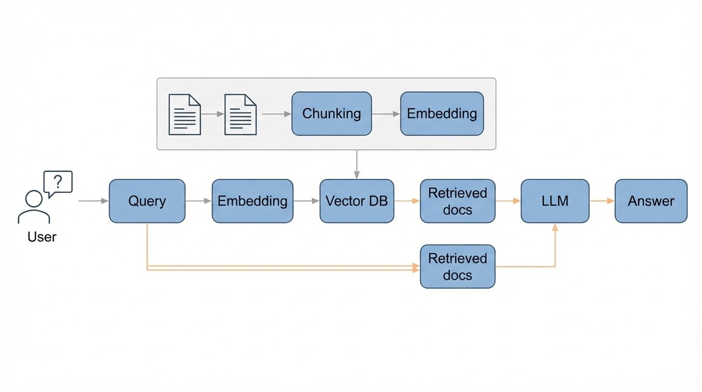

# Awesome Scientific Figure Prompts

[](https://creativecommons.org/licenses/by/4.0/)


[中文](README.md) | [English](README_en.md)

**可以直接改成自己课题的科研绘图提示词模板，覆盖生物医学、材料能源、环境、AI、工程、化学、农学和社科。** 每条提示词都配有真实出图，【】里的内容换成你的研究对象，其余部分照抄即可。


## 统计

| 模板 | 示例图 | 模型 | 更新 |
|---|---|---|---|
| 39 | 73 | Nano Banana 2 Lite (gemini-3.1-flash-lite-image, 1K) | 2026-10-28 |

## 怎么用

1. 找到和你的图类型最接近的模板，复制提示词。
2. 把【】里的内容换成你的研究主题、结构和步骤，然后删掉【】。保留风格段落不动。
3. 粘贴到支持图像生成的模型里（例如 Gemini、ChatGPT）。图里的文字保持英文短标签，出错率最低。
4. 不想自己拆模块，也可以把论文摘要交给 [YILA](https://yila.ai/?utm_source=github&utm_medium=referral&utm_campaign=sci-figure-prompts)，让它按这些模板帮你写提示词并出图。
5. 出图后请自己核对箭头方向、结构位置和标签拼写。这些是示意图初稿，用于论文前请按你的课题修改。

## 目录

- **图形摘要**：[No. 1 CAR-T 细胞攻克实体瘤](#no-1)、[No. 2 运动改善骨骼肌胰岛素抵抗](#no-2)、[No. 3 肿瘤外泌体建立肺前转移微环境](#no-3)、[No. 4 肠–脑轴与抑郁](#no-4)、[No. 5 水凝胶促进创面愈合](#no-5)、[No. 6 mRNA 疫苗诱导免疫应答](#no-6)、[No. 7 纳米颗粒靶向递送抗肿瘤药物](#no-7)
- **信号通路**：[No. 8 cGAS–STING 先天免疫通路](#no-8)、[No. 9 PD-1/PD-L1 免疫检查点与阻断](#no-9)、[No. 10 TGF-β/SMAD 促纤维化通路](#no-10)
- **医学插图**：[No. 11 健康大脑与阿尔茨海默病大脑](#no-11)、[No. 12 动脉粥样硬化斑块形成](#no-12)、[No. 13 骨折愈合四阶段](#no-13)、[No. 14 肾小球滤过屏障三层结构](#no-14)、[No. 15 健康肝脏与肝纤维化对比](#no-15)、[No. 16 肾单位结构与滤液流向](#no-16)、[No. 17 肿瘤血管生成](#no-17)、[No. 18 皮肤创面愈合四阶段](#no-18)
- **实验流程**：[No. 19 临床试验筛选、分组与随访](#no-19)、[No. 20 混合 CRISPR 筛选流程](#no-20)、[No. 21 小鼠疾病模型：分组、给药与取材](#no-21)、[No. 22 类器官培养与药物筛选](#no-22)、[No. 23 LC-MS/MS 蛋白质组学流程](#no-23)、[No. 24 单细胞 RNA 测序流程](#no-24)、[No. 25 空间转录组流程](#no-25)
- **材料与能源**：[No. 26 锂离子电池充放电](#no-26)、[No. 27 钙钛矿-硅叠层太阳能电池](#no-27)
- **环境与地球**：[No. 28 全球碳循环](#no-28)、[No. 29 城市热岛与缓解措施](#no-29)
- **AI 与计算机**：[No. 30 大模型智能体工作循环](#no-30)、[No. 31 检索增强生成（RAG）流程](#no-31)
- **工程系统**：[No. 32 综合能源系统](#no-32)、[No. 33 物联网监测系统架构](#no-33)
- **化学与仪器**：[No. 34 高效液相色谱系统](#no-34)、[No. 35 三重四极杆质谱仪](#no-35)
- **农学与植物**：[No. 36 叶片结构与光合作用](#no-36)、[No. 37 根系与根际微生物](#no-37)
- **人文社科**：[No. 38 研究框架图（中介与调节）](#no-38)、[No. 39 课题技术路线图](#no-39)

## 图形摘要

<a id="no-1"></a>

### No. 1：CAR-T 细胞攻克实体瘤

写法技巧：**阶段式进程 + 放大圆圈**　·　风格：柔和半写实插图　·　比例：16:9

| 英文提示词出图 | 中文提示词出图 |
|---|---|
|  |  |

**中文提示词**

```text
画一张关于【CAR-T 细胞治疗实体瘤】的图形摘要，从左到右分三段讲述。
左：【患者的 T 细胞经过改造，表面带上嵌合抗原受体】。
中：【CAR-T 细胞从血管中穿出，进入致密的肿瘤组织】。
右：【一个 CAR-T 细胞攻击肿瘤细胞，肿瘤细胞破裂】。用一个圆形放大框展示【CAR-T 细胞上的受体结合肿瘤细胞上的抗原】。
标签（每个只出现一次，不加其他文字）：【CAR-T cell, Tumor antigen, Infiltration, Tumor killing】。

风格：期刊图形摘要插画。柔和的半写实医学插画，带轻微体积感和细腻的手绘质感，白色干净背景。配色低饱和、协调，只用一个强调色。从左到右叙事清晰，留白充足。图中文字只用英文无衬线字体，每个标签只出现一次，拼写与给定完全一致。不要卡通风格、不要光滑的 CG 渲染、不要深色背景、不要图库照片感。
```

<details><summary>English prompt</summary>

```text
Create a graphical abstract about 【CAR-T cell therapy against a solid tumor】, told from left to right in three stages.
Left: 【a patient's T cells engineered to carry a chimeric antigen receptor on their surface】.
Center: 【CAR-T cells leave a blood vessel and push into dense tumor tissue】.
Right: 【a CAR-T cell attacks a tumor cell, which breaks apart】. A circular magnified inset shows 【the receptor on the CAR-T cell binding an antigen on the tumor cell】.
Labels, each used once, no other text: 【CAR-T cell, Tumor antigen, Infiltration, Tumor killing】.

Style: journal graphical-abstract illustration. Soft semi-realistic medical illustration with gentle volume and subtle hand-painted texture, on a clean white background. Muted, harmonious palette with one accent color. Clear left-to-right narrative, generous white space. Sans-serif English labels only, each label appears exactly once, spelled exactly as given. No cartoon style, no glossy CGI, no dark background, no stock-photo look.
```

</details>

模型：Nano Banana 2 Lite (gemini-3.1-flash-lite-image, 1K)　·　这条提示词共生成 2 次，展示的是核对通过的结果

---

<a id="no-2"></a>

### No. 2：运动改善骨骼肌胰岛素抵抗

写法技巧：**多尺度放大圆圈**　·　风格：柔和半写实插图　·　比例：16:9

| 英文提示词出图 | 中文提示词出图 | 中文提示词出图 |
|---|---|---|
|  |  |  |

**中文提示词**

```text
画一张关于【运动如何改善骨骼肌胰岛素抵抗】的图形摘要，从左到右讲述。
左：【一个正在跑步的人】。
中：【大腿肌肉】，用一个圆形放大框放大【一个肌细胞：携带 GLUT4 转运体的小囊泡移向细胞膜并嵌入膜中】。
右：【葡萄糖分子通过 GLUT4 进入肌细胞，血糖水平下降】。
标签（每个只出现一次，不加其他文字）：【Exercise, Skeletal muscle, GLUT4, Glucose uptake】。

风格：期刊图形摘要插画。柔和的半写实医学插画，带轻微体积感和细腻的手绘质感，白色干净背景。配色低饱和、协调，只用一个强调色。从左到右叙事清晰，留白充足。图中文字只用英文无衬线字体，每个标签只出现一次，拼写与给定完全一致。不要卡通风格、不要光滑的 CG 渲染、不要深色背景、不要图库照片感。
```

<details><summary>English prompt</summary>

```text
Create a graphical abstract about 【how exercise improves insulin resistance in skeletal muscle】, told from left to right.
Left: 【a person running】.
Center: 【the thigh muscle】, with a circular magnified inset of 【one muscle cell: small vesicles carrying GLUT4 transporters move to the cell membrane and insert into it】.
Right: 【glucose molecules entering the muscle cell through GLUT4, and a lower blood glucose level】.
Labels, each used once, no other text: 【Exercise, Skeletal muscle, GLUT4, Glucose uptake】.

Style: journal graphical-abstract illustration. Soft semi-realistic medical illustration with gentle volume and subtle hand-painted texture, on a clean white background. Muted, harmonious palette with one accent color. Clear left-to-right narrative, generous white space. Sans-serif English labels only, each label appears exactly once, spelled exactly as given. No cartoon style, no glossy CGI, no dark background, no stock-photo look.
```

</details>

模型：Nano Banana 2 Lite (gemini-3.1-flash-lite-image, 1K)　·　这条提示词共生成 4 次，展示的是核对通过的结果

---

<a id="no-3"></a>

### No. 3：肿瘤外泌体建立肺前转移微环境

写法技巧：**多尺度放大圆圈**　·　风格：柔和半写实插图　·　比例：16:9

| 英文提示词出图 | 中文提示词出图 |
|---|---|
|  |  |

**中文提示词**

```text
画一张关于【肿瘤外泌体为肺转移做准备】的图形摘要，从左到右讲述。
左：【原发肿瘤释放出大量微小的外泌体】。
中：【外泌体随血管运行】。
右：【肺部的驻留细胞摄取外泌体，形成前转移微环境，迎接随后到达的肿瘤细胞】。用一个圆形放大框展示【一个外泌体，表面有蛋白，内部装着 RNA】。
标签（每个只出现一次，不加其他文字）：【Primary tumor, Exosomes, Lung, Pre-metastatic niche】。

风格：期刊图形摘要插画。柔和的半写实医学插画，带轻微体积感和细腻的手绘质感，白色干净背景。配色低饱和、协调，只用一个强调色。从左到右叙事清晰，留白充足。图中文字只用英文无衬线字体，每个标签只出现一次，拼写与给定完全一致。不要卡通风格、不要光滑的 CG 渲染、不要深色背景、不要图库照片感。
```

<details><summary>English prompt</summary>

```text
Create a graphical abstract about 【tumor exosomes preparing the lung for metastasis】, told from left to right.
Left: 【a primary tumor releasing many tiny exosomes】.
Center: 【the exosomes travel through a blood vessel】.
Right: 【a lung where resident cells take up the exosomes and form a pre-metastatic niche that welcomes arriving tumor cells】. A circular magnified inset shows 【one exosome with surface proteins and RNA cargo inside】.
Labels, each used once, no other text: 【Primary tumor, Exosomes, Lung, Pre-metastatic niche】.

Style: journal graphical-abstract illustration. Soft semi-realistic medical illustration with gentle volume and subtle hand-painted texture, on a clean white background. Muted, harmonious palette with one accent color. Clear left-to-right narrative, generous white space. Sans-serif English labels only, each label appears exactly once, spelled exactly as given. No cartoon style, no glossy CGI, no dark background, no stock-photo look.
```

</details>

模型：Nano Banana 2 Lite (gemini-3.1-flash-lite-image, 1K)　·　这条提示词共生成 4 次，展示的是核对通过的结果

---

<a id="no-4"></a>

### No. 4：肠–脑轴与抑郁

写法技巧：**双放大圆圈**　·　风格：柔和半写实插图　·　比例：16:9

| 英文提示词出图 | 中文提示词出图 |
|---|---|
|  |  |

**中文提示词**

```text
画一张关于【肠–脑轴与抑郁】的图形摘要。
左：【人体上半身轮廓，突出显示肠道和大脑】。
两个圆形放大框：一个放大【肠道，显示失衡的菌群和受损的肠黏膜】，一个放大【大脑，显示被激活的小胶质细胞】。
两个放大框之间，【三条通路连接肠道和大脑：一条神经纤维、一条运送炎症分子的血管、一群免疫细胞】。
右：【一个情绪低落的人】。
标签（每个只出现一次，不加其他文字）：【Dysbiosis, Vagus nerve, Inflammation, Microglia, Depression】。

风格：期刊图形摘要插画。柔和的半写实医学插画，带轻微体积感和细腻的手绘质感，白色干净背景。配色低饱和、协调，只用一个强调色。从左到右叙事清晰，留白充足。图中文字只用英文无衬线字体，每个标签只出现一次，拼写与给定完全一致。不要卡通风格、不要光滑的 CG 渲染、不要深色背景、不要图库照片感。
```

<details><summary>English prompt</summary>

```text
Create a graphical abstract about 【the gut–brain axis in depression】.
Left: 【a human upper-body silhouette with the gut and the brain highlighted】.
Two circular magnified insets: one on 【the gut, showing imbalanced bacteria and a damaged intestinal lining】, one on 【the brain, showing activated microglia】.
Between the insets, 【three paths link gut and brain: a nerve fiber, a blood vessel carrying inflammatory molecules, and immune cells】.
Right: 【a person with a low mood】.
Labels, each used once, no other text: 【Dysbiosis, Vagus nerve, Inflammation, Microglia, Depression】.

Style: journal graphical-abstract illustration. Soft semi-realistic medical illustration with gentle volume and subtle hand-painted texture, on a clean white background. Muted, harmonious palette with one accent color. Clear left-to-right narrative, generous white space. Sans-serif English labels only, each label appears exactly once, spelled exactly as given. No cartoon style, no glossy CGI, no dark background, no stock-photo look.
```

</details>

模型：Nano Banana 2 Lite (gemini-3.1-flash-lite-image, 1K)　·　这条提示词共生成 4 次，展示的是核对通过的结果

---

<a id="no-5"></a>

### No. 5：水凝胶促进创面愈合

写法技巧：**左右对比分屏 + 放大圆圈**　·　风格：柔和半写实插图　·　比例：16:9

| 英文提示词出图 | 中文提示词出图 |
|---|---|
|  |  |

**中文提示词**

```text
画一张左右对比的图形摘要，比较【未处理的皮肤创面和用可注射水凝胶处理的创面】，中间用一条细虚线分开。两侧都是【同一个带开放创面的皮肤剖面】。
左：【未处理：创面敞开，有细菌和红肿，愈合缓慢】。
右：【处理后：半透明水凝胶填满创面并释放小药物颗粒；新生血管和胶原长出，创面几乎闭合】。用一个圆形放大框展示【水凝胶的交联高分子网络包裹着药物颗粒】。
标签（每个只出现一次，不加其他文字）：【Untreated, Hydrogel, Angiogenesis, Wound closure】。

风格：期刊图形摘要插画。柔和的半写实医学插画，带轻微体积感和细腻的手绘质感，白色干净背景。配色低饱和、协调，只用一个强调色。从左到右叙事清晰，留白充足。图中文字只用英文无衬线字体，每个标签只出现一次，拼写与给定完全一致。不要卡通风格、不要光滑的 CG 渲染、不要深色背景、不要图库照片感。
```

<details><summary>English prompt</summary>

```text
Create a side-by-side graphical abstract comparing 【an untreated skin wound and a wound treated with an injectable hydrogel】, separated by a thin dashed vertical line. Both sides show 【the same cross-section of skin with an open wound】.
Left: 【untreated: an open wound with bacteria and redness, healing slowly】.
Right: 【treated: a translucent hydrogel fills the wound and releases small drug particles; new blood vessels and collagen grow and the wound is almost closed】. A circular magnified inset shows 【the hydrogel's cross-linked polymer network holding the drug particles】.
Labels, each used once, no other text: 【Untreated, Hydrogel, Angiogenesis, Wound closure】.

Style: journal graphical-abstract illustration. Soft semi-realistic medical illustration with gentle volume and subtle hand-painted texture, on a clean white background. Muted, harmonious palette with one accent color. Clear left-to-right narrative, generous white space. Sans-serif English labels only, each label appears exactly once, spelled exactly as given. No cartoon style, no glossy CGI, no dark background, no stock-photo look.
```

</details>

模型：Nano Banana 2 Lite (gemini-3.1-flash-lite-image, 1K)　·　这条提示词共生成 2 次，展示的是核对通过的结果

---

<a id="no-6"></a>

### No. 6：mRNA 疫苗诱导免疫应答

写法技巧：**多尺度放大圆圈**　·　风格：柔和半写实插图　·　比例：16:9

| 英文提示词出图 | 中文提示词出图 |
|---|---|
|  |  |

**中文提示词**

```text
画一张关于【mRNA 疫苗如何训练免疫系统】的图形摘要，从左到右分三段讲述。
左：【携带 mRNA 的脂质纳米颗粒，注射进上臂肌肉】。
中：【肌肉细胞摄取颗粒，制造病毒的刺突蛋白】。用一个圆形放大框放大【核糖体读取 mRNA，刺突蛋白出现在细胞表面】。
右：【B 细胞释放 Y 形抗体，一个 T 细胞攻击被感染的细胞】。
标签（每个只出现一次，不加其他文字）：【mRNA, Spike protein, Antibodies, T cell】。

风格：期刊图形摘要插画。柔和的半写实医学插画，带轻微体积感和细腻的手绘质感，白色干净背景。配色低饱和、协调，只用一个强调色。从左到右叙事清晰，留白充足。图中文字只用英文无衬线字体，每个标签只出现一次，拼写与给定完全一致。不要卡通风格、不要光滑的 CG 渲染、不要深色背景、不要图库照片感。
```

<details><summary>English prompt</summary>

```text
Create a graphical abstract about 【how an mRNA vaccine trains the immune system】, told from left to right in three stages.
Left: 【a lipid nanoparticle carrying mRNA, injected into the upper-arm muscle】.
Center: 【a muscle cell takes up the particle and makes the viral spike protein】. A circular magnified inset zooms in on 【ribosomes reading the mRNA and spike proteins appearing on the cell surface】.
Right: 【B cells releasing Y-shaped antibodies and a T cell attacking an infected cell】.
Labels, each used once, no other text: 【mRNA, Spike protein, Antibodies, T cell】.

Style: journal graphical-abstract illustration. Soft semi-realistic medical illustration with gentle volume and subtle hand-painted texture, on a clean white background. Muted, harmonious palette with one accent color. Clear left-to-right narrative, generous white space. Sans-serif English labels only, each label appears exactly once, spelled exactly as given. No cartoon style, no glossy CGI, no dark background, no stock-photo look.
```

</details>

模型：Nano Banana 2 Lite (gemini-3.1-flash-lite-image, 1K)　·　这条提示词共生成 2 次，展示的是核对通过的结果

---

<a id="no-7"></a>

### No. 7：纳米颗粒靶向递送抗肿瘤药物

写法技巧：**多尺度放大圆圈**　·　风格：柔和半写实插图　·　比例：16:9

| 英文提示词出图 | 中文提示词出图 |
|---|---|
|  |  |

**中文提示词**

```text
画一张关于【肿瘤靶向纳米颗粒药物递送】的图形摘要，从左到右分三段讲述。
左：【一个表面带靶向配体的脂质纳米颗粒，切开四分之一，露出里面包裹的药物】。
中：【纳米颗粒从有渗漏的血管中穿出，进入肿瘤组织】。用一个圆形放大框放大【一个肿瘤细胞：纳米颗粒结合细胞表面受体，经内吞进入细胞，在细胞内释放药物】。
右：【体积缩小的肿瘤，肿瘤细胞正在死亡】。
标签（每个只出现一次，不加其他文字）：【Nanoparticle, Leaky vessel, Drug release, Tumor regression】。

风格：期刊图形摘要插画。柔和的半写实医学插画，带轻微体积感和细腻的手绘质感，白色干净背景。配色低饱和、协调，只用一个强调色。从左到右叙事清晰，留白充足。图中文字只用英文无衬线字体，每个标签只出现一次，拼写与给定完全一致。不要卡通风格、不要光滑的 CG 渲染、不要深色背景、不要图库照片感。
```

<details><summary>English prompt</summary>

```text
Create a graphical abstract about 【tumor-targeted nanoparticle drug delivery】, told from left to right in three stages.
Left: 【one lipid nanoparticle with targeting ligands on its surface, a quarter cut away to show the drug inside】.
Center: 【nanoparticles leave a leaky blood vessel and enter the tumor tissue】. A circular magnified inset zooms in on 【one tumor cell: the nanoparticle binds a surface receptor, is taken up by endocytosis and releases the drug inside the cell】.
Right: 【a smaller tumor with dying tumor cells】.
Labels, each used once, no other text: 【Nanoparticle, Leaky vessel, Drug release, Tumor regression】.

Style: journal graphical-abstract illustration. Soft semi-realistic medical illustration with gentle volume and subtle hand-painted texture, on a clean white background. Muted, harmonious palette with one accent color. Clear left-to-right narrative, generous white space. Sans-serif English labels only, each label appears exactly once, spelled exactly as given. No cartoon style, no glossy CGI, no dark background, no stock-photo look.
```

</details>

模型：Nano Banana 2 Lite (gemini-3.1-flash-lite-image, 1K)　·　这条提示词共生成 2 次，展示的是核对通过的结果

---

## 信号通路

<a id="no-8"></a>

### No. 8：cGAS–STING 先天免疫通路

写法技巧：**逐条关系 + 膜–胞质–核布局**　·　风格：期刊式扁平矢量　·　比例：4:3

| 英文提示词出图 | 中文提示词出图 |
|---|---|
|  |  |

**中文提示词**

```text
画一张【cGAS–STING 识别 DNA】的信号通路示意图，在一个细胞内从上往下读。严格按下面列出的关系画，不多画：
1. 【细胞质中的双链 DNA 结合 cGAS。】
2. 【cGAS 生成小分子 cGAMP。】
3. 【cGAMP 激活位于内质网膜上的 STING。】
4. 【STING 招募 TBK1。】
5. 【TBK1 磷酸化 IRF3（带 P 的小圆点）。】
6. 【IRF3 进入底部的细胞核，开启 I 型干扰素基因。】
所有箭头都是实线激活箭头。
标签（每个只出现一次，不加其他文字）：【DNA, cGAS, cGAMP, STING, TBK1, IRF3, Type I IFN】。

风格：期刊式科研示意图。白色背景上的干净扁平矢量插画，用浅色圆角面板区分区域。只用 3–4 种低饱和度颜色，每种颜色含义固定，红色只用于抑制或强调。线条细且粗细一致。蛋白画成彩色圆角胶囊，名称写在胶囊里；细胞膜画成磷脂双分子层；激活用实线箭头，抑制用 T 形线，间接作用用虚线箭头。图中文字只用英文无衬线字体，每个标签只出现一次，拼写与给定完全一致。不要 3D 渲染、阴影、发光、装饰性背景或照片质感。
```

<details><summary>English prompt</summary>

```text
Create a signaling pathway schematic of 【cGAS–STING DNA sensing】 inside one cell, read from top to bottom. Draw each relationship exactly as listed and nothing more:
1. 【Double-stranded DNA in the cytoplasm binds cGAS.】
2. 【cGAS produces cGAMP, a small molecule.】
3. 【cGAMP activates STING, which sits on an ER membrane.】
4. 【STING recruits TBK1.】
5. 【TBK1 phosphorylates IRF3 (small 'P' circle).】
6. 【IRF3 moves into the nucleus at the bottom and turns on Type I IFN genes.】
All arrows are solid activation arrows.
Labels, each used once, no other text: 【DNA, cGAS, cGAMP, STING, TBK1, IRF3, Type I IFN】.

Style: journal-style scientific schematic. Clean flat vector illustration on a white background, light pastel rounded panels to separate regions. Only 3-4 muted colors, each with one fixed meaning; red only for inhibition or emphasis. Thin, uniform line weight. Proteins as rounded colored capsules with their names inside; membranes as lipid bilayers; activation as solid arrows, inhibition as T-bar lines, indirect effects as dashed arrows. Sans-serif English labels only, each label appears exactly once, spelled exactly as given. No 3D rendering, no shadows, no glow, no decorative background, no photorealism.
```

</details>

模型：Nano Banana 2 Lite (gemini-3.1-flash-lite-image, 1K)　·　这条提示词共生成 2 次，展示的是核对通过的结果

---

<a id="no-9"></a>

### No. 9：PD-1/PD-L1 免疫检查点与阻断

写法技巧：**逐条关系 + 左右对比分屏**　·　风格：期刊式扁平矢量　·　比例：16:9

| 英文提示词出图 |
|---|
|  |

**中文提示词**

```text
画一张左右两栏示意图，展示【抗体阻断前后的 PD-1/PD-L1 免疫检查点】，两栏之间用一条细虚线分开。两栏里都是【左边一个 T 细胞，右边一个肿瘤细胞】，只画两者接触的区域。严格按下面列出的关系画，不多画：
左栏：
1. 【T 细胞上的 TCR 接触肿瘤细胞上的 MHC-I。】
2. 【T 细胞上的 PD-1 与肿瘤细胞上的 PD-L1 直接相连。】
3. 【一条红色 T 形线从 PD-1 伸进 T 细胞：T 细胞被关闭。】
右栏：
1. 【T 细胞上的 TCR 接触肿瘤细胞上的 MHC-I。】
2. 【一个 Y 形抗体只结合在 PD-1 上；PD-1 与 PD-L1 之间留出明显的空隙。】
3. 【一条实线箭头从 T 细胞指向正在破裂的肿瘤细胞。】
标签（每个只出现一次，不加其他文字）：【T cell, Tumor cell, PD-1, PD-L1, Anti-PD-1, Tumor killing】。

风格：期刊式科研示意图。白色背景上的干净扁平矢量插画，用浅色圆角面板区分区域。只用 3–4 种低饱和度颜色，每种颜色含义固定，红色只用于抑制或强调。线条细且粗细一致。蛋白画成彩色圆角胶囊，名称写在胶囊里；细胞膜画成磷脂双分子层；激活用实线箭头，抑制用 T 形线，间接作用用虚线箭头。图中文字只用英文无衬线字体，每个标签只出现一次，拼写与给定完全一致。不要 3D 渲染、阴影、发光、装饰性背景或照片质感。
```

<details><summary>English prompt</summary>

```text
Create a two-panel schematic of 【the PD-1/PD-L1 immune checkpoint before and after antibody blockade】, separated by a thin dashed vertical line. In both panels 【a T cell is on the left and a tumor cell is on the right】, and only their contact zone is drawn. Draw each relationship exactly as listed and nothing more:
Left panel:
1. 【TCR on the T cell touches MHC-I on the tumor cell.】
2. 【PD-1 on the T cell is directly joined to PD-L1 on the tumor cell.】
3. 【A red T-bar goes from PD-1 into the T cell: the T cell is switched off.】
Right panel:
1. 【TCR on the T cell touches MHC-I on the tumor cell.】
2. 【A Y-shaped antibody is attached to PD-1 only; a clear gap separates PD-1 from PD-L1.】
3. 【A solid arrow goes from the T cell to the tumor cell, which is breaking apart.】
Labels, each used once, no other text: 【T cell, Tumor cell, PD-1, PD-L1, Anti-PD-1, Tumor killing】.

Style: journal-style scientific schematic. Clean flat vector illustration on a white background, light pastel rounded panels to separate regions. Only 3-4 muted colors, each with one fixed meaning; red only for inhibition or emphasis. Thin, uniform line weight. Proteins as rounded colored capsules with their names inside; membranes as lipid bilayers; activation as solid arrows, inhibition as T-bar lines, indirect effects as dashed arrows. Sans-serif English labels only, each label appears exactly once, spelled exactly as given. No 3D rendering, no shadows, no glow, no decorative background, no photorealism.
```

</details>

模型：Nano Banana 2 Lite (gemini-3.1-flash-lite-image, 1K)　·　这条提示词共生成 8 次，展示的是核对通过的结果

---

<a id="no-10"></a>

### No. 10：TGF-β/SMAD 促纤维化通路

写法技巧：**逐条关系 + 激活/抑制线型**　·　风格：期刊式扁平矢量　·　比例：4:3

| 英文提示词出图 | 中文提示词出图 |
|---|---|
|  |  |

**中文提示词**

```text
画一张【纤维化中的 TGF-β/SMAD 信号】通路示意图，在一个细胞内从上往下读。严格按下面列出的关系画，不多画：
1. 【TGF-β 结合顶部细胞膜上的一对受体：TβRII 和 TβRI。】
2. 【TβRI 磷酸化 SMAD2/3（带 P 的小圆点）。】
3. 【SMAD2/3 与 SMAD4 结合成复合物。】
4. 【复合物进入底部的细胞核，开启胶原基因。】
5. 【SMAD7 抑制 TβRI（红色 T 形线）。】
标签（每个只出现一次，不加其他文字）：【TGF-β, TβRII, TβRI, SMAD2/3, SMAD4, SMAD7, Collagen genes】。

风格：期刊式科研示意图。白色背景上的干净扁平矢量插画，用浅色圆角面板区分区域。只用 3–4 种低饱和度颜色，每种颜色含义固定，红色只用于抑制或强调。线条细且粗细一致。蛋白画成彩色圆角胶囊，名称写在胶囊里；细胞膜画成磷脂双分子层；激活用实线箭头，抑制用 T 形线，间接作用用虚线箭头。图中文字只用英文无衬线字体，每个标签只出现一次，拼写与给定完全一致。不要 3D 渲染、阴影、发光、装饰性背景或照片质感。
```

<details><summary>English prompt</summary>

```text
Create a signaling pathway schematic of 【TGF-β/SMAD signaling in fibrosis】 inside one cell, read from top to bottom. Draw each relationship exactly as listed and nothing more:
1. 【TGF-β binds a receptor pair in the cell membrane at the top: TβRII and TβRI.】
2. 【TβRI phosphorylates SMAD2/3 (small 'P' circle).】
3. 【SMAD2/3 joins SMAD4 to form a complex.】
4. 【The complex moves into the nucleus at the bottom and turns on collagen genes.】
5. 【SMAD7 inhibits TβRI (red T-bar).】
Labels, each used once, no other text: 【TGF-β, TβRII, TβRI, SMAD2/3, SMAD4, SMAD7, Collagen genes】.

Style: journal-style scientific schematic. Clean flat vector illustration on a white background, light pastel rounded panels to separate regions. Only 3-4 muted colors, each with one fixed meaning; red only for inhibition or emphasis. Thin, uniform line weight. Proteins as rounded colored capsules with their names inside; membranes as lipid bilayers; activation as solid arrows, inhibition as T-bar lines, indirect effects as dashed arrows. Sans-serif English labels only, each label appears exactly once, spelled exactly as given. No 3D rendering, no shadows, no glow, no decorative background, no photorealism.
```

</details>

模型：Nano Banana 2 Lite (gemini-3.1-flash-lite-image, 1K)　·　这条提示词共生成 2 次，展示的是核对通过的结果

---

## 医学插图

<a id="no-11"></a>

### No. 11：健康大脑与阿尔茨海默病大脑

写法技巧：**左右对比分屏 + 放大圆圈**　·　风格：柔和半写实插图　·　比例：4:3

| 英文提示词出图 | 中文提示词出图 |
|---|---|
|  |  |

**中文提示词**

```text
画一张左右并排的医学插图，比较【健康大脑和阿尔茨海默病大脑】，中间用一条细虚线分开。
左：【大小正常的健康大脑；一个圆形放大框展示连接完整的健康神经元】。
右：【萎缩、沟回变宽的大脑；一个圆形放大框展示神经元之间的淀粉样斑块和神经元内扭曲的缠结】。
标签（每个只出现一次，不加其他文字）：【Healthy brain, Alzheimer's brain, Amyloid plaque, Tau tangles】。

风格：期刊图形摘要插画。柔和的半写实医学插画，带轻微体积感和细腻的手绘质感，白色干净背景。配色低饱和、协调，只用一个强调色。从左到右叙事清晰，留白充足。图中文字只用英文无衬线字体，每个标签只出现一次，拼写与给定完全一致。不要卡通风格、不要光滑的 CG 渲染、不要深色背景、不要图库照片感。
```

<details><summary>English prompt</summary>

```text
Create a side-by-side medical illustration comparing 【a healthy brain and an Alzheimer's disease brain】, separated by a thin dashed vertical line.
Left: 【a full-sized healthy brain; a circular magnified inset shows healthy neurons with intact connections】.
Right: 【a shrunken brain with wider grooves; a circular magnified inset shows amyloid plaques between neurons and twisted tangles inside a neuron】.
Labels, each used once, no other text: 【Healthy brain, Alzheimer's brain, Amyloid plaque, Tau tangles】.

Style: journal graphical-abstract illustration. Soft semi-realistic medical illustration with gentle volume and subtle hand-painted texture, on a clean white background. Muted, harmonious palette with one accent color. Clear left-to-right narrative, generous white space. Sans-serif English labels only, each label appears exactly once, spelled exactly as given. No cartoon style, no glossy CGI, no dark background, no stock-photo look.
```

</details>

模型：Nano Banana 2 Lite (gemini-3.1-flash-lite-image, 1K)　·　这条提示词共生成 2 次，展示的是核对通过的结果

---

<a id="no-12"></a>

### No. 12：动脉粥样硬化斑块形成

写法技巧：**剖面 + 阶段式进程**　·　风格：柔和半写实插图　·　比例：16:9

| 英文提示词出图 |
|---|
|  |

**中文提示词**

```text
画一张医学插图，主体是【一段被纵向剖开的动脉】，沿同一段结构从左到右分三个阶段展示病变进展。
阶段 1（左）：【健康的血管壁，内皮光滑】。
阶段 2（中）：【LDL 颗粒进入血管壁，单核细胞变成充满脂质的泡沫细胞】。
阶段 3（右）：【成熟斑块：黄色的脂质核心上覆盖纤维帽，管腔明显变窄】。
用一个圆形放大框展示【一个充满脂滴的泡沫细胞】。
标签（每个只出现一次，不加其他文字）：【LDL, Foam cell, Lipid core, Fibrous cap, Narrowed lumen】。

风格：期刊图形摘要插画。柔和的半写实医学插画，带轻微体积感和细腻的手绘质感，白色干净背景。配色低饱和、协调，只用一个强调色。从左到右叙事清晰，留白充足。图中文字只用英文无衬线字体，每个标签只出现一次，拼写与给定完全一致。不要卡通风格、不要光滑的 CG 渲染、不要深色背景、不要图库照片感。
```

<details><summary>English prompt</summary>

```text
Create a medical illustration of 【one artery cut open lengthwise】, showing disease progression from left to right in three stages along the same vessel.
Stage 1 (left): 【a healthy wall with smooth endothelium】.
Stage 2 (center): 【LDL particles enter the vessel wall and monocytes turn into lipid-filled foam cells】.
Stage 3 (right): 【a mature plaque with a yellow lipid core under a fibrous cap, and a clearly narrowed lumen】.
One circular magnified inset shows 【a single foam cell full of lipid droplets】.
Labels, each used once, no other text: 【LDL, Foam cell, Lipid core, Fibrous cap, Narrowed lumen】.

Style: journal graphical-abstract illustration. Soft semi-realistic medical illustration with gentle volume and subtle hand-painted texture, on a clean white background. Muted, harmonious palette with one accent color. Clear left-to-right narrative, generous white space. Sans-serif English labels only, each label appears exactly once, spelled exactly as given. No cartoon style, no glossy CGI, no dark background, no stock-photo look.
```

</details>

模型：Nano Banana 2 Lite (gemini-3.1-flash-lite-image, 1K)　·　这条提示词共生成 6 次，展示的是核对通过的结果

---

<a id="no-13"></a>

### No. 13：骨折愈合四阶段

写法技巧：**阶段式进程**　·　风格：柔和半写实插图　·　比例：16:9

| 英文提示词出图 | 中文提示词出图 |
|---|---|
|  |  |

**中文提示词**

```text
画一张【骨折愈合】的医学插图，从左到右分四个阶段，每个阶段都是同一根长骨在骨折处的纵剖面。
1：【血凝块填满两个断端之间的空隙】。
2：【柔软的软骨连接起断端】。
3：【软骨转变为新的海绵状骨】。
4：【骨骼被重塑回原来的形状】。
标签（每个只出现一次，不加其他文字）：【Hematoma, Soft callus, Hard callus, Remodeling】。

风格：期刊图形摘要插画。柔和的半写实医学插画，带轻微体积感和细腻的手绘质感，白色干净背景。配色低饱和、协调，只用一个强调色。从左到右叙事清晰，留白充足。图中文字只用英文无衬线字体，每个标签只出现一次，拼写与给定完全一致。不要卡通风格、不要光滑的 CG 渲染、不要深色背景、不要图库照片感。
```

<details><summary>English prompt</summary>

```text
Create a medical illustration of 【bone fracture healing】 in four stages from left to right, each showing the same long bone cut lengthwise at the break.
1: 【a blood clot fills the gap between the broken ends】.
2: 【soft cartilage bridges the gap】.
3: 【the cartilage turns into new, spongy bone】.
4: 【the bone is reshaped to its original form】.
Labels, each used once, no other text: 【Hematoma, Soft callus, Hard callus, Remodeling】.

Style: journal graphical-abstract illustration. Soft semi-realistic medical illustration with gentle volume and subtle hand-painted texture, on a clean white background. Muted, harmonious palette with one accent color. Clear left-to-right narrative, generous white space. Sans-serif English labels only, each label appears exactly once, spelled exactly as given. No cartoon style, no glossy CGI, no dark background, no stock-photo look.
```

</details>

模型：Nano Banana 2 Lite (gemini-3.1-flash-lite-image, 1K)　·　这条提示词共生成 2 次，展示的是核对通过的结果

---

<a id="no-14"></a>

### No. 14：肾小球滤过屏障三层结构

写法技巧：**剖面分层**　·　风格：柔和半写实插图　·　比例：4:3

| 英文提示词出图 | 中文提示词出图 |
|---|---|
|  |  |

**中文提示词**

```text
画一张【肾小球滤过屏障】的剖面医学插图，三层从上方的血液侧叠到下方的尿液侧：
【1. 带小圆孔的内皮；2. 厚的基底膜；3. 足细胞的足突，足突之间是狭窄的裂隙】。
箭头只表示【水和小分子向下穿过三层】。【大的白蛋白停在内皮上方，旁边一个红色叉号；不要从白蛋白画出任何箭头】。
标签（每个只出现一次，不加其他文字）：【Endothelium, Basement membrane, Podocyte, Albumin】。

风格：期刊图形摘要插画。柔和的半写实医学插画，带轻微体积感和细腻的手绘质感，白色干净背景。配色低饱和、协调，只用一个强调色。从左到右叙事清晰，留白充足。图中文字只用英文无衬线字体，每个标签只出现一次，拼写与给定完全一致。不要卡通风格、不要光滑的 CG 渲染、不要深色背景、不要图库照片感。
```

<details><summary>English prompt</summary>

```text
Create a cross-section medical illustration of 【the glomerular filtration barrier】, with three layers stacked from the blood side at the top to the urine side at the bottom:
【1. an endothelium with small round pores; 2. a thick basement membrane; 3. podocyte foot processes with narrow slits between them】.
Arrows show 【only water and small molecules passing down through all three layers】. 【Large albumin proteins sit above the endothelium with a red X; no arrow starts from albumin】.
Labels, each used once, no other text: 【Endothelium, Basement membrane, Podocyte, Albumin】.

Style: journal graphical-abstract illustration. Soft semi-realistic medical illustration with gentle volume and subtle hand-painted texture, on a clean white background. Muted, harmonious palette with one accent color. Clear left-to-right narrative, generous white space. Sans-serif English labels only, each label appears exactly once, spelled exactly as given. No cartoon style, no glossy CGI, no dark background, no stock-photo look.
```

</details>

模型：Nano Banana 2 Lite (gemini-3.1-flash-lite-image, 1K)　·　这条提示词共生成 5 次，展示的是核对通过的结果

---

<a id="no-15"></a>

### No. 15：健康肝脏与肝纤维化对比

写法技巧：**左右对比分屏 + 多尺度放大圆圈**　·　风格：柔和半写实插图　·　比例：16:9

| 英文提示词出图 | 中文提示词出图 |
|---|---|
|  |  |

**中文提示词**

```text
画一张左右并排的医学插图，比较【健康肝脏和纤维化肝脏】，中间用一条细虚线分开。
左：【表面光滑、红褐色的健康肝脏；一个圆形放大框展示排列整齐的肝细胞，以及一个处于静止状态、储存小脂滴的星形肝星状细胞】。
右：【体积缩小、表面凹凸不平带瘢痕的肝脏；一个圆形放大框展示星状细胞变成拉长的激活细胞，受损肝细胞之间被粗大的胶原纤维包围】。
标签（每个只出现一次，不加其他文字）：【Healthy liver, Fibrotic liver, Hepatocyte, Stellate cell, Collagen】。

风格：期刊图形摘要插画。柔和的半写实医学插画，带轻微体积感和细腻的手绘质感，白色干净背景。配色低饱和、协调，只用一个强调色。从左到右叙事清晰，留白充足。图中文字只用英文无衬线字体，每个标签只出现一次，拼写与给定完全一致。不要卡通风格、不要光滑的 CG 渲染、不要深色背景、不要图库照片感。
```

<details><summary>English prompt</summary>

```text
Create a side-by-side medical illustration comparing 【a healthy liver and a fibrotic liver】, separated by a thin dashed vertical line.
Left: 【a smooth, reddish-brown healthy liver; a circular magnified inset shows orderly hepatocytes and a quiet, star-shaped stellate cell storing small lipid droplets】.
Right: 【a shrunken liver with a bumpy, scarred surface; a circular magnified inset shows the stellate cell turned into an elongated activated cell, surrounded by thick collagen fibers between damaged hepatocytes】.
Labels, each used once, no other text: 【Healthy liver, Fibrotic liver, Hepatocyte, Stellate cell, Collagen】.

Style: journal graphical-abstract illustration. Soft semi-realistic medical illustration with gentle volume and subtle hand-painted texture, on a clean white background. Muted, harmonious palette with one accent color. Clear left-to-right narrative, generous white space. Sans-serif English labels only, each label appears exactly once, spelled exactly as given. No cartoon style, no glossy CGI, no dark background, no stock-photo look.
```

</details>

模型：Nano Banana 2 Lite (gemini-3.1-flash-lite-image, 1K)　·　这条提示词共生成 4 次，展示的是核对通过的结果

---

<a id="no-16"></a>

### No. 16：肾单位结构与滤液流向

写法技巧：**结构 + 流向箭头**　·　风格：柔和半写实插图　·　比例：3:4

| 英文提示词出图 | 中文提示词出图 |
|---|---|
|  |  |

**中文提示词**

```text
画一张竖版医学插图，主体是【肾脏的一个肾单位】，用箭头表示流向。
顶部：【肾小球，包在鲍曼囊里的一团毛细血管】。
往下是【近曲小管、先下行再上行的 U 形髓袢、远曲小管】，最底部接【集合管】。
箭头沿着【滤液从肾小球流到集合管】。角落里一个小轮廓图显示【肾单位在肾脏中的位置】。
标签（每个只出现一次，不加其他文字）：【Glomerulus, Proximal tubule, Loop of Henle, Distal tubule, Collecting duct】。

风格：期刊图形摘要插画。柔和的半写实医学插画，带轻微体积感和细腻的手绘质感，白色干净背景。配色低饱和、协调，只用一个强调色。从左到右叙事清晰，留白充足。图中文字只用英文无衬线字体，每个标签只出现一次，拼写与给定完全一致。不要卡通风格、不要光滑的 CG 渲染、不要深色背景、不要图库照片感。
```

<details><summary>English prompt</summary>

```text
Create a vertical medical illustration of 【one nephron of the kidney】 with the flow shown by arrows.
Top: 【the glomerulus, a ball of capillaries inside Bowman's capsule】.
Then 【the proximal tubule, the U-shaped loop of Henle going down and back up, and the distal tubule】, ending in 【the collecting duct】 at the bottom.
Arrows follow 【the filtrate from the glomerulus to the collecting duct】. A small outline in the corner shows 【where the nephron sits in the kidney】.
Labels, each used once, no other text: 【Glomerulus, Proximal tubule, Loop of Henle, Distal tubule, Collecting duct】.

Style: journal graphical-abstract illustration. Soft semi-realistic medical illustration with gentle volume and subtle hand-painted texture, on a clean white background. Muted, harmonious palette with one accent color. Clear left-to-right narrative, generous white space. Sans-serif English labels only, each label appears exactly once, spelled exactly as given. No cartoon style, no glossy CGI, no dark background, no stock-photo look.
```

</details>

模型：Nano Banana 2 Lite (gemini-3.1-flash-lite-image, 1K)　·　这条提示词共生成 2 次，展示的是核对通过的结果

---

<a id="no-17"></a>

### No. 17：肿瘤血管生成

写法技巧：**正常与异常对照 + 放大圆圈**　·　风格：柔和半写实插图　·　比例：4:3

| 英文提示词出图 | 中文提示词出图 |
|---|---|
|  |  |

**中文提示词**

```text
画一张【肿瘤血管生成】的医学插图。
左：【一个小肿瘤团块向旁边一条笔直的正常血管释放 VEGF 信号（小圆点）】。
右：【新血管从这条血管长出并伸进肿瘤；与正常血管相比，新血管扭曲、粗细不均、有渗漏】。
用一个圆形放大框展示【一个内皮尖端细胞引领新芽生长】。
标签（每个只出现一次，不加其他文字）：【Tumor, VEGF, Normal vessel, Abnormal vessels】。

风格：期刊图形摘要插画。柔和的半写实医学插画，带轻微体积感和细腻的手绘质感，白色干净背景。配色低饱和、协调，只用一个强调色。从左到右叙事清晰，留白充足。图中文字只用英文无衬线字体，每个标签只出现一次，拼写与给定完全一致。不要卡通风格、不要光滑的 CG 渲染、不要深色背景、不要图库照片感。
```

<details><summary>English prompt</summary>

```text
Create a medical illustration of 【tumor angiogenesis】.
Left: 【a small tumor mass releasing VEGF signals (small dots) toward a nearby straight, normal blood vessel】.
Right: 【new vessels sprout from that vessel and grow into the tumor; compared with the normal vessel they are twisted, uneven and leaky】.
A circular magnified inset shows 【an endothelial tip cell leading one new sprout】.
Labels, each used once, no other text: 【Tumor, VEGF, Normal vessel, Abnormal vessels】.

Style: journal graphical-abstract illustration. Soft semi-realistic medical illustration with gentle volume and subtle hand-painted texture, on a clean white background. Muted, harmonious palette with one accent color. Clear left-to-right narrative, generous white space. Sans-serif English labels only, each label appears exactly once, spelled exactly as given. No cartoon style, no glossy CGI, no dark background, no stock-photo look.
```

</details>

模型：Nano Banana 2 Lite (gemini-3.1-flash-lite-image, 1K)　·　这条提示词共生成 4 次，展示的是核对通过的结果

---

<a id="no-18"></a>

### No. 18：皮肤创面愈合四阶段

写法技巧：**阶段式进程**　·　风格：柔和半写实插图　·　比例：16:9

| 英文提示词出图 | 中文提示词出图 |
|---|---|
|  |  |

**中文提示词**

```text
画一张【皮肤创面愈合】的医学插图，从左到右分四个阶段，每个阶段都是同一个皮肤剖面。
1：【血凝块堵住创口】。
2：【免疫细胞清除碎屑和细菌】。
3：【新组织、小血管和胶原填满创面】。
4：【表面闭合，留下浅浅的瘢痕】。
标签（每个只出现一次，不加其他文字）：【Hemostasis, Inflammation, Proliferation, Remodeling】。

风格：期刊图形摘要插画。柔和的半写实医学插画，带轻微体积感和细腻的手绘质感，白色干净背景。配色低饱和、协调，只用一个强调色。从左到右叙事清晰，留白充足。图中文字只用英文无衬线字体，每个标签只出现一次，拼写与给定完全一致。不要卡通风格、不要光滑的 CG 渲染、不要深色背景、不要图库照片感。
```

<details><summary>English prompt</summary>

```text
Create a medical illustration of 【skin wound healing】 in four stages from left to right, each shown as the same cross-section of skin.
1: 【a blood clot plugs the wound】.
2: 【immune cells clear debris and bacteria】.
3: 【new tissue, small blood vessels and collagen fill the wound】.
4: 【the surface is closed, with a faint scar】.
Labels, each used once, no other text: 【Hemostasis, Inflammation, Proliferation, Remodeling】.

Style: journal graphical-abstract illustration. Soft semi-realistic medical illustration with gentle volume and subtle hand-painted texture, on a clean white background. Muted, harmonious palette with one accent color. Clear left-to-right narrative, generous white space. Sans-serif English labels only, each label appears exactly once, spelled exactly as given. No cartoon style, no glossy CGI, no dark background, no stock-photo look.
```

</details>

模型：Nano Banana 2 Lite (gemini-3.1-flash-lite-image, 1K)　·　这条提示词共生成 2 次，展示的是核对通过的结果

---

## 实验流程

<a id="no-19"></a>

### No. 19：临床试验筛选、分组与随访

写法技巧：**竖向流程框图**　·　风格：期刊式扁平矢量　·　比例：3:4

| 英文提示词出图 | 中文提示词出图 |
|---|---|
|  |  |

**中文提示词**

```text
画一张干净的竖向流程图，展示【一项随机对照临床试验】，从上往下读。每个框是一个浅色圆角矩形，里面有一个小人群图标，框之间用细箭头连接。
【顶部是 Screened → 向右分出一个 Excluded 框 → Randomized → 分成并列的两组 Intervention 和 Control → 每组各自进入 Follow-up → 两组在底部汇合到 Analysis】。
标签（每个只出现一次，不加其他文字）：【Screened, Excluded, Randomized, Intervention, Control, Follow-up, Analysis】。

风格：期刊式科研示意图。白色背景上的干净扁平矢量插画，用浅色圆角面板区分区域。只用 3–4 种低饱和度颜色，每种颜色含义固定，红色只用于抑制或强调。线条细且粗细一致。蛋白画成彩色圆角胶囊，名称写在胶囊里；细胞膜画成磷脂双分子层；激活用实线箭头，抑制用 T 形线，间接作用用虚线箭头。图中文字只用英文无衬线字体，每个标签只出现一次，拼写与给定完全一致。不要 3D 渲染、阴影、发光、装饰性背景或照片质感。
```

<details><summary>English prompt</summary>

```text
Create a clean vertical flowchart of 【a randomized clinical trial】, read from top to bottom. Each box is a light pastel rounded rectangle with a small group-of-people icon; thin arrows connect the boxes.
【Screened at the top → an Excluded box branching to the right side → Randomized → splits into two parallel arms, Intervention and Control → each arm goes to Follow-up → both arms meet at Analysis at the bottom】.
Labels, each used once, no other text: 【Screened, Excluded, Randomized, Intervention, Control, Follow-up, Analysis】.

Style: journal-style scientific schematic. Clean flat vector illustration on a white background, light pastel rounded panels to separate regions. Only 3-4 muted colors, each with one fixed meaning; red only for inhibition or emphasis. Thin, uniform line weight. Proteins as rounded colored capsules with their names inside; membranes as lipid bilayers; activation as solid arrows, inhibition as T-bar lines, indirect effects as dashed arrows. Sans-serif English labels only, each label appears exactly once, spelled exactly as given. No 3D rendering, no shadows, no glow, no decorative background, no photorealism.
```

</details>

模型：Nano Banana 2 Lite (gemini-3.1-flash-lite-image, 1K)　·　这条提示词共生成 2 次，展示的是核对通过的结果

---

<a id="no-20"></a>

### No. 20：混合 CRISPR 筛选流程

写法技巧：**浅色圆角面板分步**　·　风格：扁平流程图　·　比例：16:9

| 英文提示词出图 | 中文提示词出图 |
|---|---|
|  |  |

**中文提示词**

```text
画一张【混合 CRISPR 敲除筛选】的实验流程图，从左到右分五步。每一步是一个浅色圆角面板，顶部写编号和步骤名，面板里是一个简洁的图标化小场景，面板之间用细箭头连接。
第 1 步：【一管携带多种不同向导 RNA 的病毒颗粒】。
第 2 步：【一皿细胞，每个细胞接收一种向导 RNA】。
第 3 步：【细胞经药物处理，一部分死亡，一部分存活】。
第 4 步：【测序仪读取存活细胞中的向导 RNA】。
第 5 步：【一个简短的基因排名列表，排在最前的几个被标亮】。
标签（每个只出现一次，不加其他文字）：【1 Library, 2 Transduction, 3 Selection, 4 Sequencing, 5 Hit genes】。

风格：期刊式实验流程图。白色背景上干净的扁平矢量图标，每一步一个浅色圆角面板，面板之间用细灰色箭头连接。只用 3–4 种低饱和度颜色。每个面板里只画一个简洁的小场景，面板内不写任何文字；整张图唯一的文字就是给定的步骤名。用英文无衬线字体，每个步骤名只出现一次，拼写与给定完全一致。不要图例、不要说明文字、不要额外标签、不要 3D 渲染、阴影或装饰性背景。
```

<details><summary>English prompt</summary>

```text
Create an experimental workflow figure for 【a pooled CRISPR knockout screen】, in five steps from left to right. Each step is one light pastel rounded panel with its number and name at the top and one simple icon-style scene inside; thin arrows connect the panels.
Step 1: 【a tube of virus particles carrying many different guide RNAs】.
Step 2: 【a dish of cells, each cell receiving one guide RNA】.
Step 3: 【the cells treated with a drug; some die and some survive】.
Step 4: 【a sequencing instrument reading the guide RNAs of surviving cells】.
Step 5: 【a short ranked list of genes with the top ones highlighted】.
Labels, each used once, no other text: 【1 Library, 2 Transduction, 3 Selection, 4 Sequencing, 5 Hit genes】.

Style: journal-style experimental workflow figure. Clean flat vector icons on a white background, one light pastel rounded panel per step, thin gray arrows between panels. Only 3-4 muted colors. Each panel shows one simple scene with no text inside it; the only text in the whole figure is the step names given. Sans-serif English, each step name appears exactly once, spelled exactly as given. No legends, no captions, no extra labels, no 3D rendering, no shadows, no decorative background.
```

</details>

模型：Nano Banana 2 Lite (gemini-3.1-flash-lite-image, 1K)　·　这条提示词共生成 6 次，展示的是核对通过的结果

---

<a id="no-21"></a>

### No. 21：小鼠疾病模型：分组、给药与取材

写法技巧：**浅色圆角面板分步 + 图标化小场景**　·　风格：扁平流程图　·　比例：16:9

| 英文提示词出图 | 中文提示词出图 |
|---|---|
|  |  |

**中文提示词**

```text
画一张【小鼠肿瘤治疗实验】的实验流程图，从左到右分五步。每一步是一个浅色圆角面板，顶部写编号和步骤名，面板里是一个简洁的图标化小场景，面板之间用细箭头连接。
第 1 步：【小鼠被随机分成对照组和治疗组】。
第 2 步：【小鼠侧腹皮下长出一个肿瘤】。
第 3 步：【注射器进行腹腔注射】。
第 4 步：【小鼠站在小秤上称重，旁边一把卡尺测量肿瘤】。
第 5 步：【收集到的肿瘤、血液管和器官样本，放在贴好标签的管子里】。
标签（每个只出现一次，不加其他文字）：【1 Grouping, 2 Model, 3 Dosing, 4 Monitoring, 5 Sampling】。

风格：期刊式实验流程图。白色背景上干净的扁平矢量图标，每一步一个浅色圆角面板，面板之间用细灰色箭头连接。只用 3–4 种低饱和度颜色。每个面板里只画一个简洁的小场景，面板内不写任何文字；整张图唯一的文字就是给定的步骤名。用英文无衬线字体，每个步骤名只出现一次，拼写与给定完全一致。不要图例、不要说明文字、不要额外标签、不要 3D 渲染、阴影或装饰性背景。
```

<details><summary>English prompt</summary>

```text
Create an experimental workflow figure for 【a mouse tumor treatment study】, in five steps from left to right. Each step is one light pastel rounded panel with its number and name at the top and one simple icon-style scene inside; thin arrows connect the panels.
Step 1: 【mice randomly split into a control group and a treatment group】.
Step 2: 【a tumor growing under the skin on the flank of a mouse】.
Step 3: 【a syringe giving an intraperitoneal injection】.
Step 4: 【a mouse on a small scale next to a caliper measuring the tumor】.
Step 5: 【collected tumor, blood tube and organ samples in labeled tubes】.
Labels, each used once, no other text: 【1 Grouping, 2 Model, 3 Dosing, 4 Monitoring, 5 Sampling】.

Style: journal-style experimental workflow figure. Clean flat vector icons on a white background, one light pastel rounded panel per step, thin gray arrows between panels. Only 3-4 muted colors. Each panel shows one simple scene with no text inside it; the only text in the whole figure is the step names given. Sans-serif English, each step name appears exactly once, spelled exactly as given. No legends, no captions, no extra labels, no 3D rendering, no shadows, no decorative background.
```

</details>

模型：Nano Banana 2 Lite (gemini-3.1-flash-lite-image, 1K)　·　这条提示词共生成 2 次，展示的是核对通过的结果

---

<a id="no-22"></a>

### No. 22：类器官培养与药物筛选

写法技巧：**浅色圆角面板分步**　·　风格：扁平流程图　·　比例：16:9

| 英文提示词出图 | 中文提示词出图 |
|---|---|
|  |  |

**中文提示词**

```text
画一张【患者来源类器官药物筛选】的实验流程图，从左到右分五步。每一步是一个浅色圆角面板，顶部写编号和步骤名，面板里是一个简洁的图标化小场景，面板之间用细箭头连接。
第 1 步：【从患者身上取一小块肿瘤活检】。
第 2 步：【圆形类器官在培养皿里的基质胶滴中生长】。
第 3 步：【类器官被分进多孔板，每个孔加入不同的药物】。
第 4 步：【酶标仪测量细胞活力】。
第 5 步：【几个被标亮的孔，代表效果最好的药物】。
标签（每个只出现一次，不加其他文字）：【1 Biopsy, 2 Culture, 3 Drug screen, 4 Readout, 5 Hits】。

风格：期刊式实验流程图。白色背景上干净的扁平矢量图标，每一步一个浅色圆角面板，面板之间用细灰色箭头连接。只用 3–4 种低饱和度颜色。每个面板里只画一个简洁的小场景，面板内不写任何文字；整张图唯一的文字就是给定的步骤名。用英文无衬线字体，每个步骤名只出现一次，拼写与给定完全一致。不要图例、不要说明文字、不要额外标签、不要 3D 渲染、阴影或装饰性背景。
```

<details><summary>English prompt</summary>

```text
Create an experimental workflow figure for 【patient-derived organoid drug screening】, in five steps from left to right. Each step is one light pastel rounded panel with its number and name at the top and one simple icon-style scene inside; thin arrows connect the panels.
Step 1: 【a small tumor biopsy taken from a patient】.
Step 2: 【round organoids growing in a gel dome in a dish】.
Step 3: 【organoids placed into a multi-well plate, each well receiving a different drug】.
Step 4: 【a plate reader measuring cell viability】.
Step 5: 【a few highlighted wells marking the most effective drugs】.
Labels, each used once, no other text: 【1 Biopsy, 2 Culture, 3 Drug screen, 4 Readout, 5 Hits】.

Style: journal-style experimental workflow figure. Clean flat vector icons on a white background, one light pastel rounded panel per step, thin gray arrows between panels. Only 3-4 muted colors. Each panel shows one simple scene with no text inside it; the only text in the whole figure is the step names given. Sans-serif English, each step name appears exactly once, spelled exactly as given. No legends, no captions, no extra labels, no 3D rendering, no shadows, no decorative background.
```

</details>

模型：Nano Banana 2 Lite (gemini-3.1-flash-lite-image, 1K)　·　这条提示词共生成 3 次，展示的是核对通过的结果

---

<a id="no-23"></a>

### No. 23：LC-MS/MS 蛋白质组学流程

写法技巧：**浅色圆角面板分步**　·　风格：扁平流程图　·　比例：16:9

| 英文提示词出图 | 中文提示词出图 |
|---|---|
|  |  |

**中文提示词**

```text
画一张【LC-MS/MS 蛋白质组学】的实验流程图，从左到右分五步。每一步是一个浅色圆角面板，顶部写编号和步骤名，面板里是一个简洁的图标化小场景，面板之间用细箭头连接。
第 1 步：【试管里的细胞被裂解，释放出蛋白】。
第 2 步：【剪刀把一条蛋白链剪成短肽段】。
第 3 步：【一根细长的液相色谱柱分离肽段】。
第 4 步：【一台质谱仪，旁边是一张简单的峰图】。
第 5 步：【一张简短的已鉴定蛋白表，用横条表示含量】。
标签（每个只出现一次，不加其他文字）：【1 Lysis, 2 Digestion, 3 LC, 4 MS/MS, 5 Quantification】。

风格：期刊式实验流程图。白色背景上干净的扁平矢量图标，每一步一个浅色圆角面板，面板之间用细灰色箭头连接。只用 3–4 种低饱和度颜色。每个面板里只画一个简洁的小场景，面板内不写任何文字；整张图唯一的文字就是给定的步骤名。用英文无衬线字体，每个步骤名只出现一次，拼写与给定完全一致。不要图例、不要说明文字、不要额外标签、不要 3D 渲染、阴影或装饰性背景。
```

<details><summary>English prompt</summary>

```text
Create an experimental workflow figure for 【LC-MS/MS proteomics】, in five steps from left to right. Each step is one light pastel rounded panel with its number and name at the top and one simple icon-style scene inside; thin arrows connect the panels.
Step 1: 【cells broken open in a tube, releasing proteins】.
Step 2: 【scissors cutting a protein chain into short peptides】.
Step 3: 【a thin liquid chromatography column separating peptides】.
Step 4: 【a mass spectrometer with a simple spectrum of peaks】.
Step 5: 【a short table of identified proteins with bars showing their amounts】.
Labels, each used once, no other text: 【1 Lysis, 2 Digestion, 3 LC, 4 MS/MS, 5 Quantification】.

Style: journal-style experimental workflow figure. Clean flat vector icons on a white background, one light pastel rounded panel per step, thin gray arrows between panels. Only 3-4 muted colors. Each panel shows one simple scene with no text inside it; the only text in the whole figure is the step names given. Sans-serif English, each step name appears exactly once, spelled exactly as given. No legends, no captions, no extra labels, no 3D rendering, no shadows, no decorative background.
```

</details>

模型：Nano Banana 2 Lite (gemini-3.1-flash-lite-image, 1K)　·　这条提示词共生成 4 次，展示的是核对通过的结果

---

<a id="no-24"></a>

### No. 24：单细胞 RNA 测序流程

写法技巧：**浅色圆角面板分步**　·　风格：扁平流程图　·　比例：16:9

| 英文提示词出图 | 中文提示词出图 | 中文提示词出图 |
|---|---|---|
|  |  |  |

**中文提示词**

```text
画一张【单细胞 RNA 测序】的实验流程图，从左到右分五步。每一步是一个浅色圆角面板，顶部写编号和步骤名，面板里是一个简洁的图标化小场景，面板之间用细箭头连接。
第 1 步：【一块组织被分散成单个细胞】。
第 2 步：【微流控芯片把每个细胞和一颗微珠包进一个液滴】。
第 3 步：【mRNA 分子带上彩色条形码】。
第 4 步：【一台测序仪】。
第 5 步：【几团不同颜色的细胞簇散点】。
标签（每个只出现一次，不加其他文字）：【1 Dissociation, 2 Capture, 3 Barcoding, 4 Sequencing, 5 Clustering】。

风格：期刊式实验流程图。白色背景上干净的扁平矢量图标，每一步一个浅色圆角面板，面板之间用细灰色箭头连接。只用 3–4 种低饱和度颜色。每个面板里只画一个简洁的小场景，面板内不写任何文字；整张图唯一的文字就是给定的步骤名。用英文无衬线字体，每个步骤名只出现一次，拼写与给定完全一致。不要图例、不要说明文字、不要额外标签、不要 3D 渲染、阴影或装饰性背景。
```

<details><summary>English prompt</summary>

```text
Create an experimental workflow figure for 【single-cell RNA sequencing】, in five steps from left to right. Each step is one light pastel rounded panel with its number and name at the top and one simple icon-style scene inside; thin arrows connect the panels.
Step 1: 【a tissue piece breaking into single cells】.
Step 2: 【a microfluidic chip putting each cell into a droplet with a bead】.
Step 3: 【mRNA molecules tagged with colored barcodes】.
Step 4: 【a sequencing instrument】.
Step 5: 【a scatter of colored cell clusters】.
Labels, each used once, no other text: 【1 Dissociation, 2 Capture, 3 Barcoding, 4 Sequencing, 5 Clustering】.

Style: journal-style experimental workflow figure. Clean flat vector icons on a white background, one light pastel rounded panel per step, thin gray arrows between panels. Only 3-4 muted colors. Each panel shows one simple scene with no text inside it; the only text in the whole figure is the step names given. Sans-serif English, each step name appears exactly once, spelled exactly as given. No legends, no captions, no extra labels, no 3D rendering, no shadows, no decorative background.
```

</details>

模型：Nano Banana 2 Lite (gemini-3.1-flash-lite-image, 1K)　·　这条提示词共生成 7 次，展示的是核对通过的结果

---

<a id="no-25"></a>

### No. 25：空间转录组流程

写法技巧：**浅色圆角面板分步**　·　风格：扁平流程图　·　比例：16:9

| 英文提示词出图 | 中文提示词出图 |
|---|---|
|  |  |

**中文提示词**

```text
画一张【空间转录组】的实验流程图，从左到右分五步。每一步是一个浅色圆角面板，顶部写编号和步骤名，面板里是一个简洁的图标化小场景，面板之间用细箭头连接。
第 1 步：【一片薄组织切片放在印有条形码点阵的玻片上】。
第 2 步：【组织中的 mRNA 向下移动，被下方的点捕获】。
第 3 步：【一台测序仪】。
第 4 步：【组织图像上叠加彩色点，显示基因活跃程度】。
第 5 步：【同一块组织被划分成几个不同颜色的区域】。
标签（每个只出现一次，不加其他文字）：【1 Sectioning, 2 Capture, 3 Sequencing, 4 Mapping, 5 Clustering】。

风格：期刊式实验流程图。白色背景上干净的扁平矢量图标，每一步一个浅色圆角面板，面板之间用细灰色箭头连接。只用 3–4 种低饱和度颜色。每个面板里只画一个简洁的小场景，面板内不写任何文字；整张图唯一的文字就是给定的步骤名。用英文无衬线字体，每个步骤名只出现一次，拼写与给定完全一致。不要图例、不要说明文字、不要额外标签、不要 3D 渲染、阴影或装饰性背景。
```

<details><summary>English prompt</summary>

```text
Create an experimental workflow figure for 【spatial transcriptomics】, in five steps from left to right. Each step is one light pastel rounded panel with its number and name at the top and one simple icon-style scene inside; thin arrows connect the panels.
Step 1: 【a thin tissue section placed on a glass slide printed with a grid of barcoded spots】.
Step 2: 【mRNA from the tissue moving down and sticking to the spots below】.
Step 3: 【a sequencing instrument】.
Step 4: 【the tissue image overlaid with colored spots showing gene activity】.
Step 5: 【the same tissue divided into a few colored regions】.
Labels, each used once, no other text: 【1 Sectioning, 2 Capture, 3 Sequencing, 4 Mapping, 5 Clustering】.

Style: journal-style experimental workflow figure. Clean flat vector icons on a white background, one light pastel rounded panel per step, thin gray arrows between panels. Only 3-4 muted colors. Each panel shows one simple scene with no text inside it; the only text in the whole figure is the step names given. Sans-serif English, each step name appears exactly once, spelled exactly as given. No legends, no captions, no extra labels, no 3D rendering, no shadows, no decorative background.
```

</details>

模型：Nano Banana 2 Lite (gemini-3.1-flash-lite-image, 1K)　·　这条提示词共生成 4 次，展示的是核对通过的结果

---

## 材料与能源

<a id="no-26"></a>

### No. 26：锂离子电池充放电

写法技巧：**剖面 + 流向箭头**　·　风格：期刊式科学插画　·　比例：16:9

| 英文提示词出图 | 中文提示词出图 |
|---|---|
|  |  |

**中文提示词**

```text
画一张【放电过程中的锂离子电池】横向剖面插画：【左边是石墨负极，中间是多孔隔膜，右边是层状氧化物正极，全部浸在电解液里】。箭头表示【锂离子从负极穿过隔膜移向正极，电子则经外部导线流过一个小灯泡】。用一个圆形放大框展示【锂离子从石墨层之间滑出】。
标签（每个只出现一次，不加其他文字）：【Anode, Separator, Cathode, Li+, e-】。

风格：期刊式科学插画。干净的半写实矢量插画，带柔和的明暗；需要说明结构时使用剖面或剖切视图，白色背景。配色低饱和、协调，只用一个强调色突出关键过程。用细的方向箭头表示流动。留白充足，阅读方向清晰。图中文字只用英文无衬线字体，每个标签只出现一次，拼写与给定完全一致。不要卡通风格、不要光滑的 CG 渲染、不要深色背景、不要图库照片感、不要装饰性背景。
```

<details><summary>English prompt</summary>

```text
Create a horizontal cross-section illustration of 【a lithium-ion battery during discharge】: 【the graphite anode on the left, a porous separator in the middle, and a layered oxide cathode on the right, all soaked in electrolyte】. Arrows show 【lithium ions moving from the anode through the separator to the cathode, while electrons flow through an external wire to a small light bulb】. A circular magnified inset shows 【lithium ions sliding out from between the graphite layers】.
Labels, each used once, no other text: 【Anode, Separator, Cathode, Li+, e-】.

Style: journal-style scientific illustration. Clean semi-realistic vector illustration with gentle shading, using cross-sections or cutaways where they explain the structure, on a white background. Muted, harmonious palette with one accent color for the key process. Thin directional arrows for flows. Generous white space and a clear reading direction. Sans-serif English labels only, each label appears exactly once, spelled exactly as given. No cartoon style, no glossy CGI, no dark background, no stock-photo look, no decorative background.
```

</details>

模型：Nano Banana 2 Lite (gemini-3.1-flash-lite-image, 1K)　·　这条提示词共生成 2 次，展示的是核对通过的结果

---

<a id="no-27"></a>

### No. 27：钙钛矿-硅叠层太阳能电池

写法技巧：**分层剖面 + 放大圆圈**　·　风格：期刊式科学插画　·　比例：16:9

| 英文提示词出图 | 中文提示词出图 |
|---|---|
|  |  |

**中文提示词**

```text
画一张【钙钛矿-硅叠层太阳能电池】的剖面插画，各层从上到下叠放：【透明顶电极、钙钛矿吸收层、很薄的复合层、表面有绒面的硅底电池、金属背电极】。阳光从顶部射入；【短波长的光在钙钛矿层被吸收，长波长的光穿过去到达硅电池】。用一个圆形放大框展示【钙钛矿的晶格结构】。
标签（每个只出现一次，不加其他文字）：【Sunlight, Transparent electrode, Perovskite, Silicon cell, Back electrode】。

风格：期刊式科学插画。干净的半写实矢量插画，带柔和的明暗；需要说明结构时使用剖面或剖切视图，白色背景。配色低饱和、协调，只用一个强调色突出关键过程。用细的方向箭头表示流动。留白充足，阅读方向清晰。图中文字只用英文无衬线字体，每个标签只出现一次，拼写与给定完全一致。不要卡通风格、不要光滑的 CG 渲染、不要深色背景、不要图库照片感、不要装饰性背景。
```

<details><summary>English prompt</summary>

```text
Create a cross-section illustration of 【a perovskite–silicon tandem solar cell】, layers stacked from top to bottom: 【a transparent top electrode, a perovskite absorber layer, a thin recombination layer, a textured silicon bottom cell, and a metal back electrode】. Sunlight enters from the top; 【short-wavelength light is absorbed in the perovskite layer and long-wavelength light passes through to the silicon cell】. A circular magnified inset shows 【the perovskite crystal lattice】.
Labels, each used once, no other text: 【Sunlight, Transparent electrode, Perovskite, Silicon cell, Back electrode】.

Style: journal-style scientific illustration. Clean semi-realistic vector illustration with gentle shading, using cross-sections or cutaways where they explain the structure, on a white background. Muted, harmonious palette with one accent color for the key process. Thin directional arrows for flows. Generous white space and a clear reading direction. Sans-serif English labels only, each label appears exactly once, spelled exactly as given. No cartoon style, no glossy CGI, no dark background, no stock-photo look, no decorative background.
```

</details>

模型：Nano Banana 2 Lite (gemini-3.1-flash-lite-image, 1K)　·　这条提示词共生成 2 次，展示的是核对通过的结果

---

## 环境与地球

<a id="no-28"></a>

### No. 28：全球碳循环

写法技巧：**系统循环 + 流向箭头**　·　风格：期刊式科学插画　·　比例：4:3

| 英文提示词出图 | 中文提示词出图 |
|---|---|
|  |  |

**中文提示词**

```text
画一张【全球碳循环】的地景剖面插画：【顶部是大气；左边是森林和土壤；右边是海洋；底部中间是发电厂和埋藏的化石燃料】。箭头表示【树木吸收二氧化碳（光合作用），植物和土壤释放二氧化碳（呼吸作用），海洋表面吸收二氧化碳，发电厂燃烧化石燃料排放二氧化碳】。流量越大，箭头越粗。
标签（每个只出现一次，不加其他文字）：【Atmosphere, Photosynthesis, Respiration, Ocean uptake, Fossil emissions】。

风格：期刊式科学插画。干净的半写实矢量插画，带柔和的明暗；需要说明结构时使用剖面或剖切视图，白色背景。配色低饱和、协调，只用一个强调色突出关键过程。用细的方向箭头表示流动。留白充足，阅读方向清晰。图中文字只用英文无衬线字体，每个标签只出现一次，拼写与给定完全一致。不要卡通风格、不要光滑的 CG 渲染、不要深色背景、不要图库照片感、不要装饰性背景。
```

<details><summary>English prompt</summary>

```text
Create a landscape cross-section illustration of 【the global carbon cycle】: 【the atmosphere at the top; a forest and soil on the left; the ocean on the right; a power plant and buried fossil fuels at the bottom center】. Arrows show 【carbon dioxide taken up by trees (photosynthesis), released by plants and soil (respiration), absorbed by the ocean surface, and emitted by the power plant burning fossil fuels】. Use thicker arrows for larger flows.
Labels, each used once, no other text: 【Atmosphere, Photosynthesis, Respiration, Ocean uptake, Fossil emissions】.

Style: journal-style scientific illustration. Clean semi-realistic vector illustration with gentle shading, using cross-sections or cutaways where they explain the structure, on a white background. Muted, harmonious palette with one accent color for the key process. Thin directional arrows for flows. Generous white space and a clear reading direction. Sans-serif English labels only, each label appears exactly once, spelled exactly as given. No cartoon style, no glossy CGI, no dark background, no stock-photo look, no decorative background.
```

</details>

模型：Nano Banana 2 Lite (gemini-3.1-flash-lite-image, 1K)　·　这条提示词共生成 2 次，展示的是核对通过的结果

---

<a id="no-29"></a>

### No. 29：城市热岛与缓解措施

写法技巧：**左右对比 + 剖面**　·　风格：期刊式科学插画　·　比例：16:9

| 英文提示词出图 | 中文提示词出图 |
|---|---|
|  |  |

**中文提示词**

```text
画一张左右对比的剖面插画，比较【炎热密集的城市街区和降温后的城市街区】，中间用一条细虚线分开。
左：【高楼林立、深色沥青路面、几乎没有树；橙红色的热量从屋顶和路面升起】。
右：【同一个街区加上了屋顶绿化、行道树、一小片水体和浅色路面；蓝色箭头表示更凉的空气和树荫】。
标签（每个只出现一次，不加其他文字）：【Heat island, Green roof, Street trees, Water body, Cooling】。

风格：期刊式科学插画。干净的半写实矢量插画，带柔和的明暗；需要说明结构时使用剖面或剖切视图，白色背景。配色低饱和、协调，只用一个强调色突出关键过程。用细的方向箭头表示流动。留白充足，阅读方向清晰。图中文字只用英文无衬线字体，每个标签只出现一次，拼写与给定完全一致。不要卡通风格、不要光滑的 CG 渲染、不要深色背景、不要图库照片感、不要装饰性背景。
```

<details><summary>English prompt</summary>

```text
Create a side-by-side cross-section illustration comparing 【a hot dense city block and a cooled city block】, separated by a thin dashed vertical line.
Left: 【tall buildings, dark asphalt and few trees; orange-red heat rising from roofs and roads】.
Right: 【the same block with green roofs, street trees, a small water body and light-colored pavement; blue arrows show cooler air and shade】.
Labels, each used once, no other text: 【Heat island, Green roof, Street trees, Water body, Cooling】.

Style: journal-style scientific illustration. Clean semi-realistic vector illustration with gentle shading, using cross-sections or cutaways where they explain the structure, on a white background. Muted, harmonious palette with one accent color for the key process. Thin directional arrows for flows. Generous white space and a clear reading direction. Sans-serif English labels only, each label appears exactly once, spelled exactly as given. No cartoon style, no glossy CGI, no dark background, no stock-photo look, no decorative background.
```

</details>

模型：Nano Banana 2 Lite (gemini-3.1-flash-lite-image, 1K)　·　这条提示词共生成 3 次，展示的是核对通过的结果

---

## AI 与计算机

<a id="no-30"></a>

### No. 30：大模型智能体工作循环

写法技巧：**循环结构 + 图标**　·　风格：期刊式示意框图　·　比例：16:9

| 英文提示词出图 | 中文提示词出图 |
|---|---|
|  |  |

**中文提示词**

```text
画一张【大模型智能体工作循环】的示意框图。左边【用户目标】进入【中间的规划器方框】。从规划器出发，箭头分别指向【一个工具面板，里面有三个小图标：网页搜索、代码运行、数据库】和【一个记忆方框】。一条虚线箭头把【工具返回的观察结果送回规划器】，形成一个循环。任务完成后，一条箭头从规划器指向【右边的最终回答】。
标签（每个只出现一次，不加其他文字）：【Goal, Planner, Tools, Memory, Answer】。

风格：期刊式示意框图。白色背景上干净的扁平矢量图形。模块画成圆角矩形或简洁图标，名称写在里面；用浅色面板把相关的层归在一起。只用 3–4 种低饱和度颜色，每种颜色含义固定。细而粗细一致的箭头表示数据、能量、物质或影响的流向，间接或反馈关系用虚线箭头。图中文字只用英文无衬线字体，每个标签只出现一次，拼写与给定完全一致。不要 3D 渲染、阴影、发光、赛博朋克或科技感背景装饰，不要照片质感。
```

<details><summary>English prompt</summary>

```text
Create a schematic diagram of 【an LLM agent loop】. On the left, 【a user goal】 enters 【a planner box at the center】. From the planner, arrows go to 【a tools panel with three small icons: web search, code runner and database】 and to 【a memory box】. A dashed arrow returns 【the observation from the tools back to the planner】, forming a loop. When done, an arrow leads from the planner to 【the final answer on the right】.
Labels, each used once, no other text: 【Goal, Planner, Tools, Memory, Answer】.

Style: journal-style schematic diagram. Clean flat vector graphics on a white background. Modules are rounded rectangles or simple icons with their short names inside; light pastel panels group related layers. Only 3-4 muted colors, each with one fixed meaning. Thin, uniform arrows show the flow of data, energy, material or influence; dashed arrows for indirect or feedback links. Sans-serif English labels only, each label appears exactly once, spelled exactly as given. No 3D rendering, no shadows, no glow, no cyberpunk or tech-background decoration, no photorealism.
```

</details>

模型：Nano Banana 2 Lite (gemini-3.1-flash-lite-image, 1K)　·　这条提示词共生成 2 次，展示的是核对通过的结果

---

<a id="no-31"></a>

### No. 31：检索增强生成（RAG）流程

写法技巧：**逐条关系 + 模块框图**　·　风格：期刊式示意框图　·　比例：16:9

| 中文提示词出图 |
|---|
|  |

**中文提示词**

```text
画一张【检索增强生成（RAG）流程】的示意框图，从左往右读。严格按下面列出的关系画，不多画：
1. 【用户的问题经嵌入模型变成向量。】
2. 【用这个向量在存放文档片段的向量数据库里检索。】
3. 【返回最匹配的几个片段，作为检索到的文档。】
4. 【问题和检索到的文档一起输入大语言模型。】
5. 【大语言模型写出回答。】
主流程上方用一个浅色面板展示【文档被切成片段并存入向量数据库】。
标签（每个只出现一次，不加其他文字）：【Query, Embedding, Vector DB, Retrieved docs, LLM, Answer】。

风格：期刊式示意框图。白色背景上干净的扁平矢量图形。模块画成圆角矩形或简洁图标，名称写在里面；用浅色面板把相关的层归在一起。只用 3–4 种低饱和度颜色，每种颜色含义固定。细而粗细一致的箭头表示数据、能量、物质或影响的流向，间接或反馈关系用虚线箭头。图中文字只用英文无衬线字体，每个标签只出现一次，拼写与给定完全一致。不要 3D 渲染、阴影、发光、赛博朋克或科技感背景装饰，不要照片质感。
```

<details><summary>English prompt</summary>

```text
Create a schematic diagram of 【a retrieval-augmented generation (RAG) pipeline】, read from left to right. Draw each relationship exactly as listed and nothing more:
1. 【A user query is turned into a vector by an embedding model.】
2. 【The vector searches a vector database of document chunks.】
3. 【The top matching chunks are returned as retrieved documents.】
4. 【The query and the retrieved documents go into a large language model.】
5. 【The language model writes the answer.】
Above the main flow, a lighter panel shows 【documents being split into chunks and stored in the vector database】.
Labels, each used once, no other text: 【Query, Embedding, Vector DB, Retrieved docs, LLM, Answer】.

Style: journal-style schematic diagram. Clean flat vector graphics on a white background. Modules are rounded rectangles or simple icons with their short names inside; light pastel panels group related layers. Only 3-4 muted colors, each with one fixed meaning. Thin, uniform arrows show the flow of data, energy, material or influence; dashed arrows for indirect or feedback links. Sans-serif English labels only, each label appears exactly once, spelled exactly as given. No 3D rendering, no shadows, no glow, no cyberpunk or tech-background decoration, no photorealism.
```

</details>

模型：Nano Banana 2 Lite (gemini-3.1-flash-lite-image, 1K)　·　这条提示词共生成 3 次，展示的是核对通过的结果

---

## 工程系统

<a id="no-32"></a>

### No. 32：综合能源系统

写法技巧：**源–转换–储–用分层**　·　风格：期刊式示意框图　·　比例：16:9

| 英文提示词出图 | 中文提示词出图 |
|---|---|
|  |  |

**中文提示词**

```text
画一张【综合能源系统】示意框图，从左到右分四列：【能源（太阳能板、风机、电网）→ 转换（逆变器、热泵）→ 储能（电池组、热水罐）→ 用户（办公楼、电动汽车）】。橙色箭头表示电力，红色箭头表示热量。
标签（每个只出现一次，不加其他文字）：【Solar, Wind, Battery storage, Heat pump, Building, EV】。

风格：期刊式示意框图。白色背景上干净的扁平矢量图形。模块画成圆角矩形或简洁图标，名称写在里面；用浅色面板把相关的层归在一起。只用 3–4 种低饱和度颜色，每种颜色含义固定。细而粗细一致的箭头表示数据、能量、物质或影响的流向，间接或反馈关系用虚线箭头。图中文字只用英文无衬线字体，每个标签只出现一次，拼写与给定完全一致。不要 3D 渲染、阴影、发光、赛博朋克或科技感背景装饰，不要照片质感。
```

<details><summary>English prompt</summary>

```text
Create a schematic diagram of 【an integrated energy system】 in four columns from left to right: 【sources (solar panels, a wind turbine, the power grid) → conversion (an inverter and a heat pump) → storage (a battery bank and a hot-water tank) → loads (an office building and an electric vehicle)】. Orange arrows carry electricity and red arrows carry heat.
Labels, each used once, no other text: 【Solar, Wind, Battery storage, Heat pump, Building, EV】.

Style: journal-style schematic diagram. Clean flat vector graphics on a white background. Modules are rounded rectangles or simple icons with their short names inside; light pastel panels group related layers. Only 3-4 muted colors, each with one fixed meaning. Thin, uniform arrows show the flow of data, energy, material or influence; dashed arrows for indirect or feedback links. Sans-serif English labels only, each label appears exactly once, spelled exactly as given. No 3D rendering, no shadows, no glow, no cyberpunk or tech-background decoration, no photorealism.
```

</details>

模型：Nano Banana 2 Lite (gemini-3.1-flash-lite-image, 1K)　·　这条提示词共生成 2 次，展示的是核对通过的结果

---

<a id="no-33"></a>

### No. 33：物联网监测系统架构

写法技巧：**分层架构 + 反馈回路**　·　风格：期刊式示意框图　·　比例：16:9

| 英文提示词出图 | 中文提示词出图 |
|---|---|
|  |  |

**中文提示词**

```text
画一张【物联网环境监测系统】的分层架构图，从左到右分五层，每层一个浅色面板：【现场传感器（温度、湿度、水质图标）→ 边缘网关 → 云服务器 → 分析模型 → 屏幕上的监控看板】。一条虚线反馈箭头【从看板回到传感器旁边的阀门执行器】。
标签（每个只出现一次，不加其他文字）：【Sensors, Edge gateway, Cloud, Analytics, Dashboard】。

风格：期刊式示意框图。白色背景上干净的扁平矢量图形。模块画成圆角矩形或简洁图标，名称写在里面；用浅色面板把相关的层归在一起。只用 3–4 种低饱和度颜色，每种颜色含义固定。细而粗细一致的箭头表示数据、能量、物质或影响的流向，间接或反馈关系用虚线箭头。图中文字只用英文无衬线字体，每个标签只出现一次，拼写与给定完全一致。不要 3D 渲染、阴影、发光、赛博朋克或科技感背景装饰，不要照片质感。
```

<details><summary>English prompt</summary>

```text
Create a layered architecture diagram of 【an IoT environmental monitoring system】, from left to right in five layers, each in its own light pastel panel: 【field sensors (temperature, humidity, water quality icons) → an edge gateway → a cloud server → an analytics model → a dashboard on a screen】. A dashed feedback arrow returns 【from the dashboard to a valve actuator next to the sensors】.
Labels, each used once, no other text: 【Sensors, Edge gateway, Cloud, Analytics, Dashboard】.

Style: journal-style schematic diagram. Clean flat vector graphics on a white background. Modules are rounded rectangles or simple icons with their short names inside; light pastel panels group related layers. Only 3-4 muted colors, each with one fixed meaning. Thin, uniform arrows show the flow of data, energy, material or influence; dashed arrows for indirect or feedback links. Sans-serif English labels only, each label appears exactly once, spelled exactly as given. No 3D rendering, no shadows, no glow, no cyberpunk or tech-background decoration, no photorealism.
```

</details>

模型：Nano Banana 2 Lite (gemini-3.1-flash-lite-image, 1K)　·　这条提示词共生成 2 次，展示的是核对通过的结果

---

## 化学与仪器

<a id="no-34"></a>

### No. 34：高效液相色谱系统

写法技巧：**流路 + 局部放大**　·　风格：期刊式科学插画　·　比例：16:9

| 英文提示词出图 | 中文提示词出图 |
|---|---|
|  |  |

**中文提示词**

```text
画一张【高效液相色谱（HPLC）系统】的仪器插画，从左到右用细管路连接：【溶剂瓶、泵、自动进样器、色谱柱、紫外检测器、一台显示几个色谱峰的电脑】。在色谱柱上加一个圆形放大框，展示【不同颜色的分子在穿过填料颗粒时逐渐分开】。
标签（每个只出现一次，不加其他文字）：【Solvents, Pump, Injector, Column, Detector】。

风格：期刊式科学插画。干净的半写实矢量插画，带柔和的明暗；需要说明结构时使用剖面或剖切视图，白色背景。配色低饱和、协调，只用一个强调色突出关键过程。用细的方向箭头表示流动。留白充足，阅读方向清晰。图中文字只用英文无衬线字体，每个标签只出现一次，拼写与给定完全一致。不要卡通风格、不要光滑的 CG 渲染、不要深色背景、不要图库照片感、不要装饰性背景。
```

<details><summary>English prompt</summary>

```text
Create an instrument illustration of 【a high-performance liquid chromatography (HPLC) system】, from left to right connected by thin tubing: 【solvent bottles, a pump, an autosampler injector, a column, a UV detector, and a computer showing a chromatogram with a few peaks】. A circular magnified inset on the column shows 【molecules of different colors separating as they pass through packed beads】.
Labels, each used once, no other text: 【Solvents, Pump, Injector, Column, Detector】.

Style: journal-style scientific illustration. Clean semi-realistic vector illustration with gentle shading, using cross-sections or cutaways where they explain the structure, on a white background. Muted, harmonious palette with one accent color for the key process. Thin directional arrows for flows. Generous white space and a clear reading direction. Sans-serif English labels only, each label appears exactly once, spelled exactly as given. No cartoon style, no glossy CGI, no dark background, no stock-photo look, no decorative background.
```

</details>

模型：Nano Banana 2 Lite (gemini-3.1-flash-lite-image, 1K)　·　这条提示词共生成 3 次，展示的是核对通过的结果

---

<a id="no-35"></a>

### No. 35：三重四极杆质谱仪

写法技巧：**技术剖切 + 路径箭头**　·　风格：期刊式科学插画　·　比例：16:9

| 中文提示词出图 |
|---|
|  |

**中文提示词**

```text
画一张【三重四极杆质谱仪】的技术剖切插画，从左到右：【喷出细雾的电喷雾离子源、由四根平行杆组成的第一个四极杆、离子在其中碎裂的碰撞池、第二个四极杆、检测器】。一条细的彩色线描出【离子从离子源到检测器的路径】；用明暗表示【真空度从左到右逐渐升高】。
标签（每个只出现一次，不加其他文字）：【Ion source, Q1, Collision cell, Q3, Detector】。

风格：期刊式科学插画。干净的半写实矢量插画，带柔和的明暗；需要说明结构时使用剖面或剖切视图，白色背景。配色低饱和、协调，只用一个强调色突出关键过程。用细的方向箭头表示流动。留白充足，阅读方向清晰。图中文字只用英文无衬线字体，每个标签只出现一次，拼写与给定完全一致。不要卡通风格、不要光滑的 CG 渲染、不要深色背景、不要图库照片感、不要装饰性背景。
```

<details><summary>English prompt</summary>

```text
Create a technical cutaway illustration of 【a triple quadrupole mass spectrometer】, from left to right: 【an electrospray ion source spraying a fine plume, a first quadrupole of four parallel rods, a collision cell where ions break into fragments, a second quadrupole, and a detector】. A thin colored line traces 【the ion path from the source to the detector】; shading shows 【vacuum increasing from left to right】.
Labels, each used once, no other text: 【Ion source, Q1, Collision cell, Q3, Detector】.

Style: journal-style scientific illustration. Clean semi-realistic vector illustration with gentle shading, using cross-sections or cutaways where they explain the structure, on a white background. Muted, harmonious palette with one accent color for the key process. Thin directional arrows for flows. Generous white space and a clear reading direction. Sans-serif English labels only, each label appears exactly once, spelled exactly as given. No cartoon style, no glossy CGI, no dark background, no stock-photo look, no decorative background.
```

</details>

模型：Nano Banana 2 Lite (gemini-3.1-flash-lite-image, 1K)　·　这条提示词共生成 3 次，展示的是核对通过的结果

---

## 农学与植物

<a id="no-36"></a>

### No. 36：叶片结构与光合作用

写法技巧：**多尺度放大圆圈**　·　风格：期刊式科学插画　·　比例：4:3

| 英文提示词出图 |
|---|
|  |

**中文提示词**

```text
画一张【叶片光合作用】的科学插画。左：【阳光下枝条上的一片绿叶】。中：一个圆形放大框展示【叶片横切面：上表皮、充满叶绿体的栅栏组织、有气腔的海绵组织，以及叶背面一个张开的气孔】。右：第二个放大框继续放大【一个叶绿体，里面是叠起来的类囊体】。箭头表示【二氧化碳从气孔进入、氧气从气孔离开，阳光照到叶绿体】。
标签（每个只出现一次，不加其他文字）：【Light, Chloroplast, Stoma, CO2, O2】。

风格：期刊式科学插画。干净的半写实矢量插画，带柔和的明暗；需要说明结构时使用剖面或剖切视图，白色背景。配色低饱和、协调，只用一个强调色突出关键过程。用细的方向箭头表示流动。留白充足，阅读方向清晰。图中文字只用英文无衬线字体，每个标签只出现一次，拼写与给定完全一致。不要卡通风格、不要光滑的 CG 渲染、不要深色背景、不要图库照片感、不要装饰性背景。
```

<details><summary>English prompt</summary>

```text
Create a scientific illustration of 【photosynthesis in a leaf】. Left: 【a green leaf on a stem in sunlight】. Center: a circular magnified inset shows 【a leaf cross-section with upper epidermis, palisade cells full of chloroplasts, spongy cells with air spaces, and an open stoma on the underside】. Right: a second inset zooms into 【one chloroplast with stacked thylakoids】. Arrows show 【carbon dioxide entering and oxygen leaving through the stoma, and sunlight reaching the chloroplasts】.
Labels, each used once, no other text: 【Light, Chloroplast, Stoma, CO2, O2】.

Style: journal-style scientific illustration. Clean semi-realistic vector illustration with gentle shading, using cross-sections or cutaways where they explain the structure, on a white background. Muted, harmonious palette with one accent color for the key process. Thin directional arrows for flows. Generous white space and a clear reading direction. Sans-serif English labels only, each label appears exactly once, spelled exactly as given. No cartoon style, no glossy CGI, no dark background, no stock-photo look, no decorative background.
```

</details>

模型：Nano Banana 2 Lite (gemini-3.1-flash-lite-image, 1K)　·　这条提示词共生成 3 次，展示的是核对通过的结果

---

<a id="no-37"></a>

### No. 37：根系与根际微生物

写法技巧：**剖面 + 放大圆圈**　·　风格：期刊式科学插画　·　比例：16:9

| 英文提示词出图 |
|---|
|  |

**中文提示词**

```text
画一张【作物根系与根际】的土壤剖面插画：【地面上是植株，下方棕色土壤里是分叉的根系】。用一个圆形放大框放大【一个根尖：细细的根毛、缠绕在根上的真菌菌丝，旁边有一些小细菌】。箭头表示【水和养分从土壤进入根，糖分从根流向真菌和细菌】。
标签（每个只出现一次，不加其他文字）：【Root hair, Mycorrhiza, Bacteria, Nutrients】。

风格：期刊式科学插画。干净的半写实矢量插画，带柔和的明暗；需要说明结构时使用剖面或剖切视图，白色背景。配色低饱和、协调，只用一个强调色突出关键过程。用细的方向箭头表示流动。留白充足，阅读方向清晰。图中文字只用英文无衬线字体，每个标签只出现一次，拼写与给定完全一致。不要卡通风格、不要光滑的 CG 渲染、不要深色背景、不要图库照片感、不要装饰性背景。
```

<details><summary>English prompt</summary>

```text
Create a soil cross-section illustration of 【a crop plant's roots and rhizosphere】: 【the plant above ground and its branching roots in brown soil below】. A circular magnified inset zooms into 【one root tip with fine root hairs, fungal threads wrapping around it, and small bacteria nearby】. Arrows show 【water and nutrients moving from the soil into the root, and sugars moving from the root to the fungi and bacteria】.
Labels, each used once, no other text: 【Root hair, Mycorrhiza, Bacteria, Nutrients】.

Style: journal-style scientific illustration. Clean semi-realistic vector illustration with gentle shading, using cross-sections or cutaways where they explain the structure, on a white background. Muted, harmonious palette with one accent color for the key process. Thin directional arrows for flows. Generous white space and a clear reading direction. Sans-serif English labels only, each label appears exactly once, spelled exactly as given. No cartoon style, no glossy CGI, no dark background, no stock-photo look, no decorative background.
```

</details>

模型：Nano Banana 2 Lite (gemini-3.1-flash-lite-image, 1K)　·　这条提示词共生成 4 次，展示的是核对通过的结果

---

## 人文社科

<a id="no-38"></a>

### No. 38：研究框架图（中介与调节）

写法技巧：**逐条关系 + 框图**　·　风格：期刊式示意框图　·　比例：16:9

| 英文提示词出图 |
|---|
|  |

**中文提示词**

```text
画一张概念研究框架图，从左往右读。严格按下面列出的关系画，不多画：
1. 【社交媒体使用 → 社会比较（实线箭头）。】
2. 【社会比较 → 幸福感（实线箭头）。】
3. 【社交媒体使用 → 幸福感（在前两条下方，一条直接的实线箭头）。】
4. 【自尊用一条虚线箭头指向第 2 条箭头的中间。】
5. 【底部一个灰色方框列出控制变量。】
每个变量画成一个圆角矩形。
标签（每个只出现一次，不加其他文字）：【Social media use, Social comparison, Well-being, Self-esteem, Control variables】。

风格：期刊式示意框图。白色背景上干净的扁平矢量图形。模块画成圆角矩形或简洁图标，名称写在里面；用浅色面板把相关的层归在一起。只用 3–4 种低饱和度颜色，每种颜色含义固定。细而粗细一致的箭头表示数据、能量、物质或影响的流向，间接或反馈关系用虚线箭头。图中文字只用英文无衬线字体，每个标签只出现一次，拼写与给定完全一致。不要 3D 渲染、阴影、发光、赛博朋克或科技感背景装饰，不要照片质感。
```

<details><summary>English prompt</summary>

```text
Create a conceptual research framework diagram, read from left to right. Draw each relationship exactly as listed and nothing more:
1. 【Social media use → Social comparison (solid arrow).】
2. 【Social comparison → Well-being (solid arrow).】
3. 【Social media use → Well-being (a direct solid arrow below the other two).】
4. 【Self-esteem points with a dashed arrow onto the middle of arrow 2.】
5. 【A gray box at the bottom lists control variables.】
Each variable is a rounded rectangle.
Labels, each used once, no other text: 【Social media use, Social comparison, Well-being, Self-esteem, Control variables】.

Style: journal-style schematic diagram. Clean flat vector graphics on a white background. Modules are rounded rectangles or simple icons with their short names inside; light pastel panels group related layers. Only 3-4 muted colors, each with one fixed meaning. Thin, uniform arrows show the flow of data, energy, material or influence; dashed arrows for indirect or feedback links. Sans-serif English labels only, each label appears exactly once, spelled exactly as given. No 3D rendering, no shadows, no glow, no cyberpunk or tech-background decoration, no photorealism.
```

</details>

模型：Nano Banana 2 Lite (gemini-3.1-flash-lite-image, 1K)　·　这条提示词共生成 3 次，展示的是核对通过的结果

---

<a id="no-39"></a>

### No. 39：课题技术路线图

写法技巧：**竖向技术路线**　·　风格：期刊式示意框图　·　比例：3:4

| 英文提示词出图 | 中文提示词出图 |
|---|---|
|  |  |

**中文提示词**

```text
画一张【课题研究】的竖向技术路线图，从上往下读，每个阶段是一个带小图标的浅色圆角面板，用细箭头连接：【研究问题（问号图标）→ 数据收集，分成并排的三个小框：问卷、访谈、档案 → 分析（图表图标）→ 研究发现（灯泡图标）→ 政策启示（文件图标）】。
标签（每个只出现一次，不加其他文字）：【Research question, Data collection, Analysis, Findings, Implications】。

风格：期刊式示意框图。白色背景上干净的扁平矢量图形。模块画成圆角矩形或简洁图标，名称写在里面；用浅色面板把相关的层归在一起。只用 3–4 种低饱和度颜色，每种颜色含义固定。细而粗细一致的箭头表示数据、能量、物质或影响的流向，间接或反馈关系用虚线箭头。图中文字只用英文无衬线字体，每个标签只出现一次，拼写与给定完全一致。不要 3D 渲染、阴影、发光、赛博朋克或科技感背景装饰，不要照片质感。
```

<details><summary>English prompt</summary>

```text
Create a vertical technical roadmap for 【a research project】, read from top to bottom, each stage a light pastel rounded panel with a small icon, connected by thin arrows: 【Research question (a question-mark icon) → Data collection, split into three side-by-side boxes for survey, interviews and archives → Analysis (a chart icon) → Findings (a lightbulb icon) → Policy implications (a document icon)】.
Labels, each used once, no other text: 【Research question, Data collection, Analysis, Findings, Implications】.

Style: journal-style schematic diagram. Clean flat vector graphics on a white background. Modules are rounded rectangles or simple icons with their short names inside; light pastel panels group related layers. Only 3-4 muted colors, each with one fixed meaning. Thin, uniform arrows show the flow of data, energy, material or influence; dashed arrows for indirect or feedback links. Sans-serif English labels only, each label appears exactly once, spelled exactly as given. No 3D rendering, no shadows, no glow, no cyberpunk or tech-background decoration, no photorealism.
```

</details>

模型：Nano Banana 2 Lite (gemini-3.1-flash-lite-image, 1K)　·　这条提示词共生成 3 次，展示的是核对通过的结果

---

## 投稿

欢迎通过 Pull Request 或 Issue 提交你的提示词和出图，收录后会署名。发现科学错误也请提 Issue。

## 许可

提示词以 [CC BY 4.0](https://creativecommons.org/licenses/by/4.0/) 发布。示例图由 AI 生成，带有模型自带的 SynthID 水印。
