<!-- Generated by tools/build_gallery.py. Do not edit by hand. -->

<a id="top"></a>

<a href="https://yila.ai/fr/scientific-figure-prompts?utm_source=github&utm_medium=readme_banner&utm_campaign=sci-figure-prompts">
  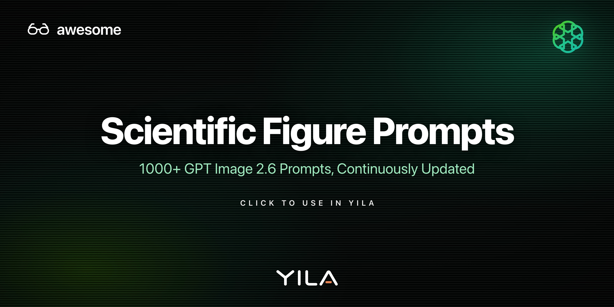
</a>

> 💡 🔬 Générez des figures scientifiques de qualité revue en 1 clic avec GPT Image 2.6 — parcourez 1000+ modèles 👉 [Galerie de Figures Scientifiques YILA](https://yila.ai/fr/scientific-figure-prompts?utm_source=github&utm_medium=readme_callout&utm_campaign=sci-figure-prompts)

# 🔬 Awesome Scientific Figure Prompts (Prompts de Figures Scientifiques)

[](https://github.com/sindresorhus/awesome)
[](https://github.com/Yila-AI/awesome-scientific-figure-prompts)

[](LICENSE)
[](https://github.com/Yila-AI/awesome-scientific-figure-prompts/actions)
[](CONTRIBUTING.md)

> 🎨 Bibliothèque sélectionnée de prompts scientifiques prêts pour publication avec GPT Image 2.6 : résumés graphiques, voies de signalisation, illustrations médicales, protocoles et 12 disciplines.

> ⚠️ **Avis sur les ébauches académiques**: Les figures générées par IA sont des ébauches. Vérifiez toujours l'exactitude scientifique, les flèches et l'orthographe avec notre [liste de vérification](docs/checklist.md). Une erreur ? [Signalez-la ici](https://github.com/Yila-AI/awesome-scientific-figure-prompts/issues/new?template=scientific-error.yml).

---

[](README.md) [](README_zh.md) [](README_zh-TW.md) [](README_ja-JP.md) [](README_ko-KR.md) [](README_th-TH.md) [](README_vi-VN.md) [](README_hi-IN.md) [](README_es-ES.md) [](README_es-419.md) [](README_de-DE.md) [](README_fr-FR.md) [](README_it-IT.md) [](README_pt-BR.md) [](README_pt-PT.md) [](README_tr-TR.md)

---

<a id="web-gallery"></a>

## 🌐 Voir dans la Galerie Web

<div align="center">

<a href="https://yila.ai/fr/scientific-figure-prompts?utm_source=github&utm_medium=readme_cover&utm_campaign=sci-figure-prompts">
  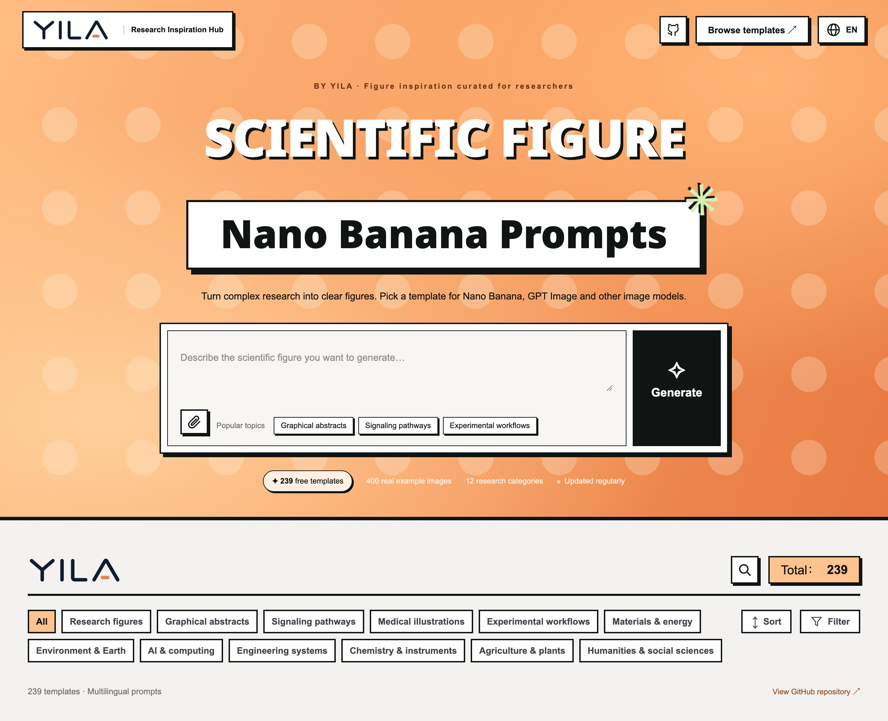
</a>

</div>

**[👉 Explorer la Galerie de Figures Scientifiques YILA](https://yila.ai/fr/scientific-figure-prompts?utm_source=github&utm_medium=readme_gallery&utm_campaign=sci-figure-prompts)**

Pourquoi utiliser la galerie web YILA ?

| Fonctionnalité | GitHub README | Galerie yila.ai |
|---------|--------------|---------------------|
| 🎨 Mise en page | Liste linéaire | Grille Masonry interactive |
| 🔍 Recherche & Filtres | Ctrl+F uniquement | Recherche plein texte & 12 disciplines |
| 🤖 Génération en 1 clic | Copier-coller manuel | Génération automatique depuis votre résumé |
| 📱 Mobile | Basique | Entièrement responsive |
| 🏷️ Catégories | 12 sections | Navigation instantanée par discipline et style |

### 🏷️ Parcourir par Discipline et Type de Figure

- 🗺️ **[Conception de recherche](https://yila.ai/fr/scientific-figure-prompts?theme=research-design&utm_source=github&utm_medium=readme_category&utm_campaign=sci-figure-prompts&utm_content=research-design)** (28 modèles)
- 🧭 **[Résumé graphique](https://yila.ai/fr/scientific-figure-prompts?theme=graphical-abstract&utm_source=github&utm_medium=readme_category&utm_campaign=sci-figure-prompts&utm_content=graphical-abstract)** (22 modèles)
- 🧬 **[Voies de signalisation](https://yila.ai/fr/scientific-figure-prompts?theme=signaling-pathway&utm_source=github&utm_medium=readme_category&utm_campaign=sci-figure-prompts&utm_content=signaling-pathway)** (22 modèles)
- 🫀 **[Illustration médicale](https://yila.ai/fr/scientific-figure-prompts?theme=medical-illustration&utm_source=github&utm_medium=readme_category&utm_campaign=sci-figure-prompts&utm_content=medical-illustration)** (20 modèles)
- 🧪 **[Protocole expérimental](https://yila.ai/fr/scientific-figure-prompts?theme=experimental-workflow&utm_source=github&utm_medium=readme_category&utm_campaign=sci-figure-prompts&utm_content=experimental-workflow)** (41 modèles)
- 🔋 **[Matériaux & Énergie](https://yila.ai/fr/scientific-figure-prompts?theme=materials-energy&utm_source=github&utm_medium=readme_category&utm_campaign=sci-figure-prompts&utm_content=materials-energy)** (16 modèles)
- 🌍 **[Terre & Environnement](https://yila.ai/fr/scientific-figure-prompts?theme=earth-environment&utm_source=github&utm_medium=readme_category&utm_campaign=sci-figure-prompts&utm_content=earth-environment)** (17 modèles)
- 🤖 **[IA & Informatique](https://yila.ai/fr/scientific-figure-prompts?theme=ai-computing&utm_source=github&utm_medium=readme_category&utm_campaign=sci-figure-prompts&utm_content=ai-computing)** (24 modèles)
- ⚙️ **[Systèmes d'ingénierie](https://yila.ai/fr/scientific-figure-prompts?theme=engineering-systems&utm_source=github&utm_medium=readme_category&utm_campaign=sci-figure-prompts&utm_content=engineering-systems)** (11 modèles)
- ⚗️ **[Chimie & Instruments](https://yila.ai/fr/scientific-figure-prompts?theme=chemistry-instruments&utm_source=github&utm_medium=readme_category&utm_campaign=sci-figure-prompts&utm_content=chemistry-instruments)** (9 modèles)
- 🌱 **[Plantes & Agriculture](https://yila.ai/fr/scientific-figure-prompts?theme=plant-agriculture&utm_source=github&utm_medium=readme_category&utm_campaign=sci-figure-prompts&utm_content=plant-agriculture)** (12 modèles)
- 📊 **[Sciences sociales](https://yila.ai/fr/scientific-figure-prompts?theme=social-science&utm_source=github&utm_medium=readme_category&utm_campaign=sci-figure-prompts&utm_content=social-science)** (17 modèles)

---

## 📖 Table des matières

- [🌐 Voir dans la Galerie Web](#web-gallery)
- [🤔 Qu'est-ce que GPT Image 2.6 pour les figures scientifiques ?](#what-is-gpt-image-26)
- [📊 Statistiques](#statistics)
- [🔥 Prompts en vedette](#featured-prompts)
- [📋 Tous les Prompts](#all-prompts)
- [🤝 Comment contribuer](#how-to-contribute)
- [📄 Licence](#license)
- [🙏 Remerciements](#acknowledgements)
- [⭐ Historique des Stars](#star-history)

---

<a id="what-is-gpt-image-26"></a>

## 🤔 Qu'est-ce que GPT Image 2.6 pour les figures scientifiques ?

**GPT Image 2.6** offre une clarté de niveau revue scientifique sans BioRender ni compétences en dessin :

- 🎯 **Clarté éditoriale** — Vecteurs plats épurés et palettes académiques sobres
- 🧬 **12 disciplines** — Biomédecine, voies, protocoles, matériaux, IA, chimie, etc.
- 🔤 **Étiquettes fiables** — Optimisé pour de courtes annotations anglaises sans fautes
- ⚡ **Ébauche en 5 minutes** — Remplacez votre sujet entre `【】` et itérez vite
- 📐 **Structure rigoureuse** — Relations numérotées pour éviter les flèches erronées
- 🤝 **Flux intégré YILA** — Collez votre résumé pour sélectionner et générer automatiquement

### 🛠️ Mode d'emploi

1. Choisissez le modèle le plus proche et copiez son prompt.
2. Remplacez le texte entre `【】` par votre sujet puis supprimez `【】`. Conservez le paragraphe de style.
3. Collez dans **GPT Image 2.6** (ou YILA). Les libellés courts en anglais limitent les erreurs.
4. Vérifiez flèches, structures et orthographe avec la [liste de vérification](docs/checklist.md).

> 💡 Pas envie de remplir le modèle à la main ? Collez votre résumé dans [YILA](https://yila.ai/fr/scientific-figure-prompts?utm_source=github&utm_medium=readme_howto&utm_campaign=sci-figure-prompts) pour générer l'ébauche automatiquement.

**Voir aussi :** [awesome-research-skills](https://github.com/Yila-AI/awesome-research-skills) — compétences d'agent pour la revue de littérature, la rédaction et l'analyse de données.

---

<a id="statistics"></a>

## 📊 Statistiques

<div align="center">

| Indicateur | Nombre |
|--------|-------|
| 📝 Total des prompts | **1000+** |
| 🖼️ Images d'exemple | **1000+** |
| ⭐ Sélection | **4** |
| 🔬 Disciplines | **12** |
| 🤖 Modèle | **GPT Image 2.6** |
| 🔄 Dernière mise à jour | **2026-11-22** |

</div>

---

<a id="featured-prompts"></a>

## 🔥 Prompts en vedette

> ⭐ Sélectionnés par l'équipe YILA pour leur clarté et leur rigueur scientifique

<a id="featured-no-30"></a>

### No. 30: CAR-T cells against a solid tumor

  

#### 📖 Description

Technique: **staged sequence + magnified inset** · Style: soft semi-realistic illustration · Format: `16:9`

#### 📝 Prompt

```text
Create a graphical abstract about 【CAR-T cell therapy against a solid tumor】, told from left to right in three stages.
Left: 【a patient's T cells engineered to carry a chimeric antigen receptor on their surface】.
Center: 【CAR-T cells leave a blood vessel and push into dense tumor tissue】.
Right: 【a CAR-T cell attacks a tumor cell, which breaks apart】. A circular magnified inset shows 【the receptor on the CAR-T cell binding an antigen on the tumor cell】.
Labels, each used once, no other text: 【CAR-T cell, Tumor antigen, Infiltration, Tumor killing】.

Style: journal graphical-abstract illustration. Soft semi-realistic medical illustration with gentle volume and subtle hand-painted texture, on a clean white background. Muted, harmonious palette with one accent color. Clear left-to-right narrative, generous white space. Sans-serif English labels only, each label appears exactly once, spelled exactly as given. No cartoon style, no glossy CGI, no dark background, no stock-photo look.
```

<details><summary>Prompt en chinois</summary>

```text
画一张关于【CAR-T 细胞治疗实体瘤】的图形摘要，从左到右分三段讲述。
左：【患者的 T 细胞经过改造，表面带上嵌合抗原受体】。
中：【CAR-T 细胞从血管中穿出，进入致密的肿瘤组织】。
右：【一个 CAR-T 细胞攻击肿瘤细胞，肿瘤细胞破裂】。用一个圆形放大框展示【CAR-T 细胞上的受体结合肿瘤细胞上的抗原】。
标签（每个只出现一次，不加其他文字）：【CAR-T cell, Tumor antigen, Infiltration, Tumor killing】。

风格：期刊图形摘要插画。柔和的半写实医学插画，带轻微体积感和细腻的手绘质感，白色干净背景。配色低饱和、协调，只用一个强调色。从左到右叙事清晰，留白充足。图中文字只用英文无衬线字体，每个标签只出现一次，拼写与给定完全一致。不要卡通风格、不要光滑的 CG 渲染、不要深色背景、不要图库照片感。
```

</details>

#### 🖼️ Image générée

<div align="center">
<a href="https://yila.ai/fr/scientific-figure-prompts/car-t-solid-tumor?utm_source=github&utm_medium=readme_featured&utm_campaign=sci-figure-prompts&utm_content=car-t-solid-tumor">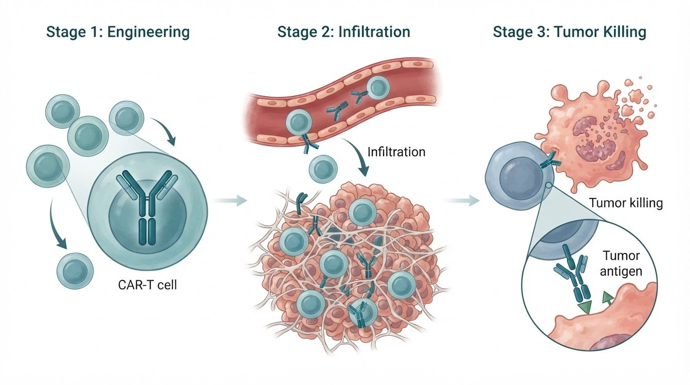</a>
</div>

#### 📌 Détails

- **Auteur:** [@Yila-AI](https://github.com/Yila-AI)
- **Modèle:** GPT Image 2.6
- **Format:** 16:9
- **Langues:** en, zh

**[👉 Essayer maintenant dans YILA →](https://yila.ai/fr/scientific-figure-prompts/car-t-solid-tumor?utm_source=github&utm_medium=readme_featured&utm_campaign=sci-figure-prompts&utm_content=car-t-solid-tumor)** · [↑ Retour en haut](#top)

---

<a id="featured-no-53"></a>

### No. 53: cGAS–STING innate immune pathway

  

#### 📖 Description

Technique: **numbered relationships + membrane–cytosol–nucleus layout** · Style: flat vector schematic · Format: `4:3`

#### 📝 Prompt

```text
Create a signaling pathway schematic of 【cGAS–STING DNA sensing】 inside one cell, read from top to bottom. Draw each relationship exactly as listed and nothing more:
1. 【Double-stranded DNA in the cytoplasm binds cGAS.】
2. 【cGAS produces cGAMP, a small molecule.】
3. 【cGAMP activates STING, which sits on an ER membrane.】
4. 【STING recruits TBK1.】
5. 【TBK1 phosphorylates IRF3 (small 'P' circle).】
6. 【IRF3 moves into the nucleus at the bottom and turns on Type I IFN genes.】
All arrows are solid activation arrows.
Labels, each used once, no other text: 【DNA, cGAS, cGAMP, STING, TBK1, IRF3, Type I IFN】.

Style: journal-style scientific schematic. Clean flat vector illustration on a white background, light pastel rounded panels to separate regions. Only 3-4 muted colors, each with one fixed meaning; red only for inhibition or emphasis. Thin, uniform line weight. Proteins as rounded colored capsules with their names inside; membranes as lipid bilayers; activation as solid arrows, inhibition as T-bar lines, indirect effects as dashed arrows. Sans-serif English labels only, each label appears exactly once, spelled exactly as given. No 3D rendering, no shadows, no glow, no decorative background, no photorealism.
```

<details><summary>Prompt en chinois</summary>

```text
画一张【cGAS–STING 识别 DNA】的信号通路示意图，在一个细胞内从上往下读。严格按下面列出的关系画，不多画：
1. 【细胞质中的双链 DNA 结合 cGAS。】
2. 【cGAS 生成小分子 cGAMP。】
3. 【cGAMP 激活位于内质网膜上的 STING。】
4. 【STING 招募 TBK1。】
5. 【TBK1 磷酸化 IRF3（带 P 的小圆点）。】
6. 【IRF3 进入底部的细胞核，开启 I 型干扰素基因。】
所有箭头都是实线激活箭头。
标签（每个只出现一次，不加其他文字）：【DNA, cGAS, cGAMP, STING, TBK1, IRF3, Type I IFN】。

风格：期刊式科研示意图。白色背景上的干净扁平矢量插画，用浅色圆角面板区分区域。只用 3–4 种低饱和度颜色，每种颜色含义固定，红色只用于抑制或强调。线条细且粗细一致。蛋白画成彩色圆角胶囊，名称写在胶囊里；细胞膜画成磷脂双分子层；激活用实线箭头，抑制用 T 形线，间接作用用虚线箭头。图中文字只用英文无衬线字体，每个标签只出现一次，拼写与给定完全一致。不要 3D 渲染、阴影、发光、装饰性背景或照片质感。
```

</details>

#### 🖼️ Image générée

<div align="center">
<a href="https://yila.ai/fr/scientific-figure-prompts/cgas-sting?utm_source=github&utm_medium=readme_featured&utm_campaign=sci-figure-prompts&utm_content=cgas-sting">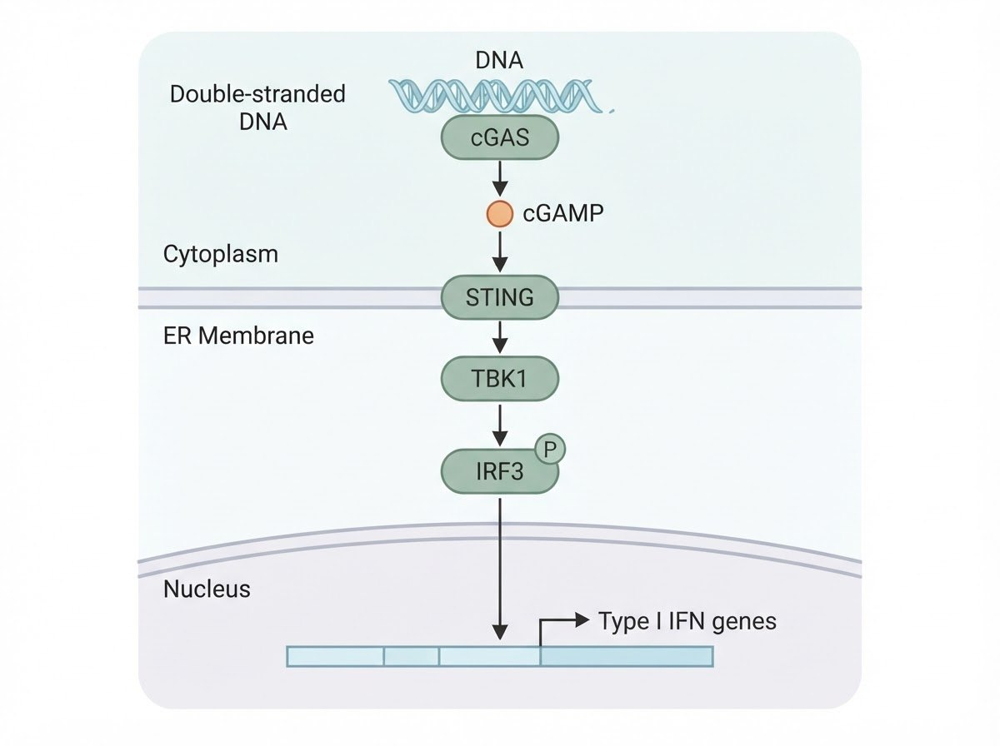</a>
</div>

#### 📌 Détails

- **Auteur:** [@Yila-AI](https://github.com/Yila-AI)
- **Modèle:** GPT Image 2.6
- **Format:** 4:3
- **Langues:** en, zh

**[👉 Essayer maintenant dans YILA →](https://yila.ai/fr/scientific-figure-prompts/cgas-sting?utm_source=github&utm_medium=readme_featured&utm_campaign=sci-figure-prompts&utm_content=cgas-sting)** · [↑ Retour en haut](#top)

---

<a id="featured-no-75"></a>

### No. 75: Healthy versus Alzheimer's brain

  

#### 📖 Description

Technique: **side-by-side panels + magnified inset** · Style: soft semi-realistic illustration · Format: `4:3`

#### 📝 Prompt

```text
Create a side-by-side medical illustration comparing 【a healthy brain and an Alzheimer's disease brain】, separated by a thin dashed vertical line.
Left: 【a full-sized healthy brain; a circular magnified inset shows healthy neurons with intact connections】.
Right: 【a shrunken brain with wider grooves; a circular magnified inset shows amyloid plaques between neurons and twisted tangles inside a neuron】.
Labels, each used once, no other text: 【Healthy brain, Alzheimer's brain, Amyloid plaque, Tau tangles】.

Style: journal graphical-abstract illustration. Soft semi-realistic medical illustration with gentle volume and subtle hand-painted texture, on a clean white background. Muted, harmonious palette with one accent color. Clear left-to-right narrative, generous white space. Sans-serif English labels only, each label appears exactly once, spelled exactly as given. No cartoon style, no glossy CGI, no dark background, no stock-photo look.
```

<details><summary>Prompt en chinois</summary>

```text
画一张左右并排的医学插图，比较【健康大脑和阿尔茨海默病大脑】，中间用一条细虚线分开。
左：【大小正常的健康大脑；一个圆形放大框展示连接完整的健康神经元】。
右：【萎缩、沟回变宽的大脑；一个圆形放大框展示神经元之间的淀粉样斑块和神经元内扭曲的缠结】。
标签（每个只出现一次，不加其他文字）：【Healthy brain, Alzheimer's brain, Amyloid plaque, Tau tangles】。

风格：期刊图形摘要插画。柔和的半写实医学插画，带轻微体积感和细腻的手绘质感，白色干净背景。配色低饱和、协调，只用一个强调色。从左到右叙事清晰，留白充足。图中文字只用英文无衬线字体，每个标签只出现一次，拼写与给定完全一致。不要卡通风格、不要光滑的 CG 渲染、不要深色背景、不要图库照片感。
```

</details>

#### 🖼️ Image générée

<div align="center">
<a href="https://yila.ai/fr/scientific-figure-prompts/alzheimers-brain?utm_source=github&utm_medium=readme_featured&utm_campaign=sci-figure-prompts&utm_content=alzheimers-brain">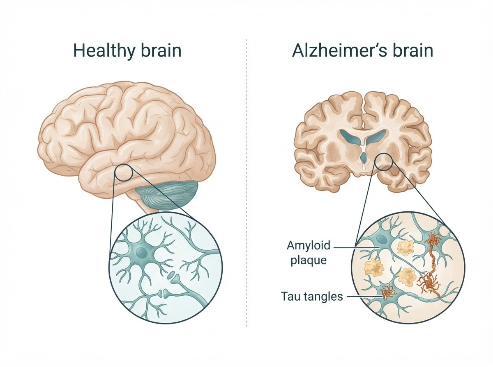</a>
</div>

#### 📌 Détails

- **Auteur:** [@Yila-AI](https://github.com/Yila-AI)
- **Modèle:** GPT Image 2.6
- **Format:** 4:3
- **Langues:** en, zh

**[👉 Essayer maintenant dans YILA →](https://yila.ai/fr/scientific-figure-prompts/alzheimers-brain?utm_source=github&utm_medium=readme_featured&utm_campaign=sci-figure-prompts&utm_content=alzheimers-brain)** · [↑ Retour en haut](#top)

---

<a id="featured-no-118"></a>

### No. 118: Mouse disease model: grouping, dosing and sampling

  

#### 📖 Description

Technique: **one pastel rounded panel per step + icon-style scene** · Style: flat workflow · Format: `16:9`

#### 📝 Prompt

```text
Create an experimental workflow figure for 【a mouse tumor treatment study】, in five steps from left to right. Each step is one light pastel rounded panel with its number and name at the top and one simple icon-style scene inside; thin arrows connect the panels.
Step 1: 【mice randomly split into a control group and a treatment group】.
Step 2: 【a tumor growing under the skin on the flank of a mouse】.
Step 3: 【a syringe giving an intraperitoneal injection】.
Step 4: 【a mouse on a small scale next to a caliper measuring the tumor】.
Step 5: 【collected tumor, blood tube and organ samples in labeled tubes】.
Labels, each used once, no other text: 【1 Grouping, 2 Model, 3 Dosing, 4 Monitoring, 5 Sampling】.

Style: journal-style experimental workflow figure. Clean flat vector icons on a white background, one light pastel rounded panel per step, thin gray arrows between panels. Only 3-4 muted colors. Each panel shows one simple scene with no text inside it; the only text in the whole figure is the step names given. Sans-serif English, each step name appears exactly once, spelled exactly as given. No legends, no captions, no extra labels, no 3D rendering, no shadows, no decorative background.
```

<details><summary>Prompt en chinois</summary>

```text
画一张【小鼠肿瘤治疗实验】的实验流程图，从左到右分五步。每一步是一个浅色圆角面板，顶部写编号和步骤名，面板里是一个简洁的图标化小场景，面板之间用细箭头连接。
第 1 步：【小鼠被随机分成对照组和治疗组】。
第 2 步：【小鼠侧腹皮下长出一个肿瘤】。
第 3 步：【注射器进行腹腔注射】。
第 4 步：【小鼠站在小秤上称重，旁边一把卡尺测量肿瘤】。
第 5 步：【收集到的肿瘤、血液管和器官样本，放在贴好标签的管子里】。
标签（每个只出现一次，不加其他文字）：【1 Grouping, 2 Model, 3 Dosing, 4 Monitoring, 5 Sampling】。

风格：期刊式实验流程图。白色背景上干净的扁平矢量图标，每一步一个浅色圆角面板，面板之间用细灰色箭头连接。只用 3–4 种低饱和度颜色。每个面板里只画一个简洁的小场景，面板内不写任何文字；整张图唯一的文字就是给定的步骤名。用英文无衬线字体，每个步骤名只出现一次，拼写与给定完全一致。不要图例、不要说明文字、不要额外标签、不要 3D 渲染、阴影或装饰性背景。
```

</details>

#### 🖼️ Image générée

<div align="center">
<a href="https://yila.ai/fr/scientific-figure-prompts/mouse-model-dosing?utm_source=github&utm_medium=readme_featured&utm_campaign=sci-figure-prompts&utm_content=mouse-model-dosing">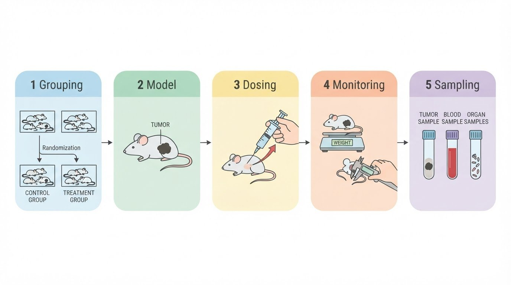</a>
</div>

#### 📌 Détails

- **Auteur:** [@Yila-AI](https://github.com/Yila-AI)
- **Modèle:** GPT Image 2.6
- **Format:** 16:9
- **Langues:** en, zh

**[👉 Essayer maintenant dans YILA →](https://yila.ai/fr/scientific-figure-prompts/mouse-model-dosing?utm_source=github&utm_medium=readme_featured&utm_campaign=sci-figure-prompts&utm_content=mouse-model-dosing)** · [↑ Retour en haut](#top)

---

<a id="all-prompts"></a>

## 📋 Tous les Prompts

<a id="research-design"></a>

### 🗺️ Conception de recherche

<a id="no-1"></a>

#### No. 1: Bench-to-bedside translational pathway

 

##### 📖 Description

Technique: **main line plus a dashed feedback loop** · Style: schematic diagram · Format: `16:9`

##### 📝 Prompt

```text
Create a translational research pathway for 【a new therapy】, read from left to right, each stage a rounded box with one icon. Draw each relationship exactly as listed and nothing more:
1. 【Basic research (a microscope) → preclinical studies (a mouse) → clinical trials (a patient) → approval (a stamp) → clinical practice (a hospital).】
2. 【A dashed arrow runs back from clinical practice to basic research.】
Do not write the numbered sentences in the figure.
Labels, each used once, no other text: 【Basic research, Preclinical studies, Clinical trials, Approval, Clinical practice】.

Style: journal-style schematic diagram. Clean flat vector graphics on a white background. Modules are rounded rectangles or simple icons with their short names inside; light pastel panels group related layers. Only 3-4 muted colors, each with one fixed meaning. Thin, uniform arrows show the flow of data, energy, material or influence; dashed arrows for indirect or feedback links. Sans-serif English labels only, each label appears exactly once, spelled exactly as given. No 3D rendering, no shadows, no glow, no cyberpunk or tech-background decoration, no photorealism.
```

<details><summary>Prompt en chinois</summary>

```text
画一张【新疗法】的转化研究路径图，从左往右读，每个阶段一个带图标的圆角框。严格按下面列出的关系画，不多画：
1. 【基础研究（显微镜）→ 临床前研究（小鼠）→ 临床试验（病人）→ 审批（印章）→ 临床应用（医院）。】
2. 【一条虚线箭头从临床应用回到基础研究。】
不要把编号句子写进图里。
标签（每个只出现一次，不加其他文字）：【Basic research, Preclinical studies, Clinical trials, Approval, Clinical practice】。

风格：期刊式示意框图。白色背景上干净的扁平矢量图形。模块画成圆角矩形或简洁图标，名称写在里面；用浅色面板把相关的层归在一起。只用 3–4 种低饱和度颜色，每种颜色含义固定。细而粗细一致的箭头表示数据、能量、物质或影响的流向，间接或反馈关系用虚线箭头。图中文字只用英文无衬线字体，每个标签只出现一次，拼写与给定完全一致。不要 3D 渲染、阴影、发光、赛博朋克或科技感背景装饰，不要照片质感。
```

</details>

##### 🖼️ Image générée

<div align="center">
<a href="https://yila.ai/fr/scientific-figure-prompts/bench-to-bedside?utm_source=github&utm_medium=readme&utm_campaign=sci-figure-prompts&utm_content=bench-to-bedside">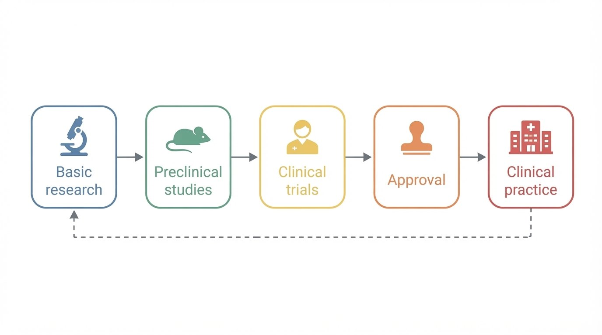</a>
</div>

##### 📌 Détails

- **Auteur:** [@Yila-AI](https://github.com/Yila-AI)
- **Modèle:** GPT Image 2.6
- **Format:** 16:9
- **Langues:** en, zh

**[👉 Essayer maintenant dans YILA →](https://yila.ai/fr/scientific-figure-prompts/bench-to-bedside?utm_source=github&utm_medium=readme&utm_campaign=sci-figure-prompts&utm_content=bench-to-bedside)** · [↑ Retour en haut](#top)

---

<a id="no-2"></a>

#### No. 2: Case-control study design

 

##### 📖 Description

Technique: **looking back from outcome to exposure** · Style: schematic diagram · Format: `16:9`

##### 📝 Prompt

```text
Create a study design diagram of 【a case-control study】: a time arrow along the bottom pointing from right to left, showing that the study looks back in time.
1. On the right, two groups: cases (people icons with a red disease mark) and controls (people icons without it).
2. From each group, a backward arrow leads to the left side, where each group splits into exposed (dark icons) and unexposed (light icons).
Write each label only once in the whole figure.
Labels, each used once, no other text: 【Cases, Controls, Exposed, Unexposed, Past, Present】.

Style: journal-style schematic diagram. Clean flat vector graphics on a white background. Modules are rounded rectangles or simple icons with their short names inside; light pastel panels group related layers. Only 3-4 muted colors, each with one fixed meaning. Thin, uniform arrows show the flow of data, energy, material or influence; dashed arrows for indirect or feedback links. Sans-serif English labels only, each label appears exactly once, spelled exactly as given. No 3D rendering, no shadows, no glow, no cyberpunk or tech-background decoration, no photorealism.
```

<details><summary>Prompt en chinois</summary>

```text
画一张【病例对照研究】的设计图：底部一条从右指向左的时间箭头，表示研究向过去回溯。
1. 右侧两组：病例组（带红色患病标记的人形图标）和对照组（不带标记的人形图标）。
2. 每组都有一条向左的回溯箭头，到左侧再分成暴露（深色图标）和未暴露（浅色图标）。
整张图里每个标签只写一次。
标签（每个只出现一次，不加其他文字）：【Cases, Controls, Exposed, Unexposed, Past, Present】。

风格：期刊式示意框图。白色背景上干净的扁平矢量图形。模块画成圆角矩形或简洁图标，名称写在里面；用浅色面板把相关的层归在一起。只用 3–4 种低饱和度颜色，每种颜色含义固定。细而粗细一致的箭头表示数据、能量、物质或影响的流向，间接或反馈关系用虚线箭头。图中文字只用英文无衬线字体，每个标签只出现一次，拼写与给定完全一致。不要 3D 渲染、阴影、发光、赛博朋克或科技感背景装饰，不要照片质感。
```

</details>

##### 🖼️ Image générée

<div align="center">
<a href="https://yila.ai/fr/scientific-figure-prompts/case-control-design?utm_source=github&utm_medium=readme&utm_campaign=sci-figure-prompts&utm_content=case-control-design">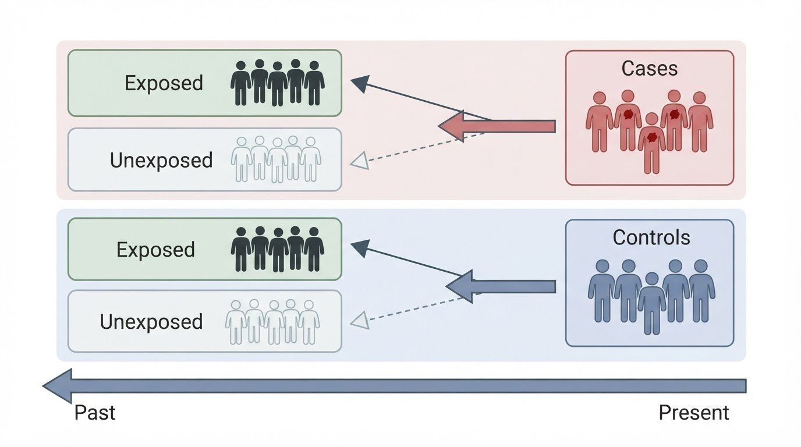</a>
</div>

##### 📌 Détails

- **Auteur:** [@Yila-AI](https://github.com/Yila-AI)
- **Modèle:** GPT Image 2.6
- **Format:** 16:9
- **Langues:** en, zh

**[👉 Essayer maintenant dans YILA →](https://yila.ai/fr/scientific-figure-prompts/case-control-design?utm_source=github&utm_medium=readme&utm_campaign=sci-figure-prompts&utm_content=case-control-design)** · [↑ Retour en haut](#top)

---

<a id="no-3"></a>

#### No. 3: Cell experiment groups and treatment timeline

 

##### 📖 Description

Technique: **a time axis with colored group rows** · Style: schematic diagram · Format: `16:9`

##### 📝 Prompt

```text
Create a timeline figure for 【a cell experiment】: one horizontal time axis across the top with three tick marks.
1. At the first tick, a culture dish icon for cell seeding.
2. At the second tick, three colored rows begin for the groups: 【control (gray), drug low dose (light blue), drug high dose (dark blue)】.
3. At the third tick, assay icons: 【a microscope and a plate reader】.
Write each label only once in the whole figure.
Labels, each used once, no other text: 【Day 0, Day 1, Day 3, Seeding, Control, Low dose, High dose, Assays】.

Style: journal-style schematic diagram. Clean flat vector graphics on a white background. Modules are rounded rectangles or simple icons with their short names inside; light pastel panels group related layers. Only 3-4 muted colors, each with one fixed meaning. Thin, uniform arrows show the flow of data, energy, material or influence; dashed arrows for indirect or feedback links. Sans-serif English labels only, each label appears exactly once, spelled exactly as given. No 3D rendering, no shadows, no glow, no cyberpunk or tech-background decoration, no photorealism.
```

<details><summary>Prompt en chinois</summary>

```text
画一张【细胞实验】的时间轴图：顶部一条横向时间轴，上面三个刻度。
1. 第一个刻度处一个培养皿图标，代表铺板。
2. 第二个刻度处开始三条彩色横条，代表分组：【对照（灰）、低剂量药物（浅蓝）、高剂量药物（深蓝）】。
3. 第三个刻度处是检测图标：【显微镜和酶标仪】。
整张图里每个标签只写一次。
标签（每个只出现一次，不加其他文字）：【Day 0, Day 1, Day 3, Seeding, Control, Low dose, High dose, Assays】。

风格：期刊式示意框图。白色背景上干净的扁平矢量图形。模块画成圆角矩形或简洁图标，名称写在里面；用浅色面板把相关的层归在一起。只用 3–4 种低饱和度颜色，每种颜色含义固定。细而粗细一致的箭头表示数据、能量、物质或影响的流向，间接或反馈关系用虚线箭头。图中文字只用英文无衬线字体，每个标签只出现一次，拼写与给定完全一致。不要 3D 渲染、阴影、发光、赛博朋克或科技感背景装饰，不要照片质感。
```

</details>

##### 🖼️ Image générée

<div align="center">
<a href="https://yila.ai/fr/scientific-figure-prompts/cell-treatment-timeline?utm_source=github&utm_medium=readme&utm_campaign=sci-figure-prompts&utm_content=cell-treatment-timeline">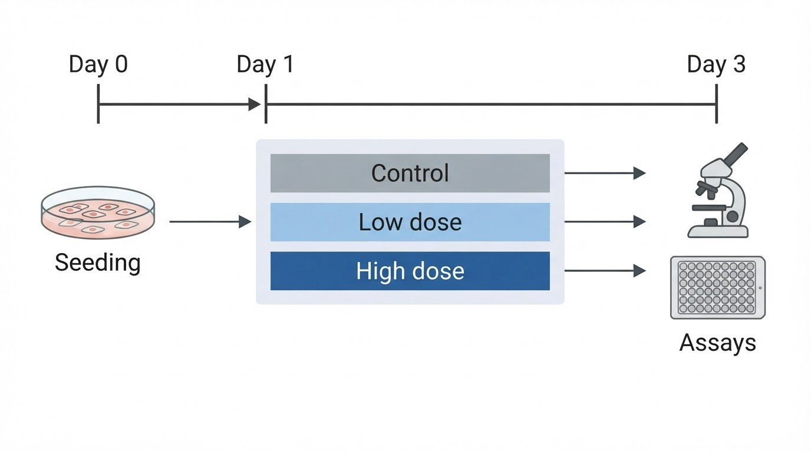</a>
</div>

##### 📌 Détails

- **Auteur:** [@Yila-AI](https://github.com/Yila-AI)
- **Modèle:** GPT Image 2.6
- **Format:** 16:9
- **Langues:** en, zh

**[👉 Essayer maintenant dans YILA →](https://yila.ai/fr/scientific-figure-prompts/cell-treatment-timeline?utm_source=github&utm_medium=readme&utm_campaign=sci-figure-prompts&utm_content=cell-treatment-timeline)** · [↑ Retour en haut](#top)

---

<a id="no-4"></a>

#### No. 4: Clinical prediction model workflow

 

##### 📖 Description

Technique: **one panel per step, step names only** · Style: flat workflow · Format: `16:9`

##### 📝 Prompt

```text
Create a workflow figure for 【building a clinical prediction model】, 6 steps from left to right:
1. 【Data source: a hospital and a database】
2. 【Predictor selection: a funnel over many small icons】
3. 【Model development: a small network】
4. 【Internal validation: a circular arrow over a data split】
5. 【External validation: a second hospital】
6. 【Clinical application: a doctor with a tablet】
Do not write the numbered sentences in the figure.
Step names, each used once, no other text: 【Data source, Predictor selection, Model development, Internal validation, External validation, Clinical application】.

Style: journal-style experimental workflow figure. Clean flat vector icons on a white background, one light pastel rounded panel per step, thin gray arrows between panels. Only 3-4 muted colors. Each panel shows one simple scene with no text inside it; the only text in the whole figure is the step names given. Sans-serif English, each step name appears exactly once, spelled exactly as given. No legends, no captions, no extra labels, no 3D rendering, no shadows, no decorative background.
```

<details><summary>Prompt en chinois</summary>

```text
画一张【临床预测模型构建】的流程图，从左往右六步：
1. 【数据来源：医院和数据库】
2. 【预测因子筛选：漏斗下方许多小图标】
3. 【模型构建：一个小网络】
4. 【内部验证：数据拆分上方一个循环箭头】
5. 【外部验证：另一家医院】
6. 【临床应用：拿平板的医生】
不要把编号句子写进图里。
步骤名（每个只出现一次，不加其他文字）：【Data source, Predictor selection, Model development, Internal validation, External validation, Clinical application】。

风格：期刊式实验流程图。白色背景上干净的扁平矢量图标，每一步一个浅色圆角面板，面板之间用细灰色箭头连接。只用 3–4 种低饱和度颜色。每个面板里只画一个简洁的小场景，面板内不写任何文字；整张图唯一的文字就是给定的步骤名。用英文无衬线字体，每个步骤名只出现一次，拼写与给定完全一致。不要图例、不要说明文字、不要额外标签、不要 3D 渲染、阴影或装饰性背景。
```

</details>

##### 🖼️ Image générée

<div align="center">
<a href="https://yila.ai/fr/scientific-figure-prompts/clinical-prediction-model?utm_source=github&utm_medium=readme&utm_campaign=sci-figure-prompts&utm_content=clinical-prediction-model">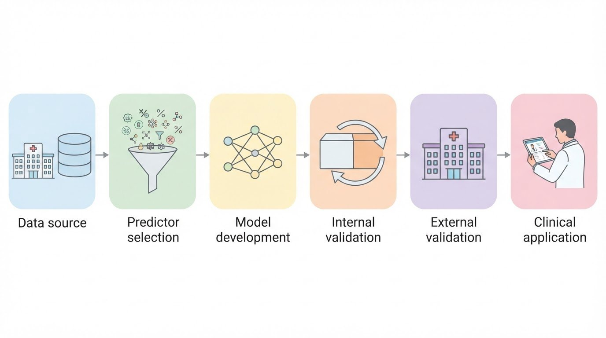</a>
</div>

##### 📌 Détails

- **Auteur:** [@Yila-AI](https://github.com/Yila-AI)
- **Modèle:** GPT Image 2.6
- **Format:** 16:9
- **Langues:** en, zh

**[👉 Essayer maintenant dans YILA →](https://yila.ai/fr/scientific-figure-prompts/clinical-prediction-model?utm_source=github&utm_medium=readme&utm_campaign=sci-figure-prompts&utm_content=clinical-prediction-model)** · [↑ Retour en haut](#top)

---

<a id="no-5"></a>

#### No. 5: Cross-scale view: organ, tissue, cell, molecule

 

##### 📖 Description

Technique: **successive circular zoom-ins** · Style: scientific illustration · Format: `16:9`

##### 📝 Prompt

```text
Create a cross-scale illustration of 【the kidney】, read from left to right as four levels joined by circular magnified insets:
1. 【A whole kidney】.
2. 【A glomerulus, the filtering ball of capillaries】.
3. 【A podocyte wrapping a capillary with its foot processes】.
4. 【A slit-diaphragm protein bridging two foot processes】.
Each inset connects to the previous level with two thin lines.
Write each label only once in the whole figure.
Labels, each used once, no other text: 【Organ, Tissue, Cell, Molecule】.

Style: journal-style scientific illustration. Clean semi-realistic vector illustration with gentle shading, using cross-sections or cutaways where they explain the structure, on a white background. Muted, harmonious palette with one accent color for the key process. Thin directional arrows for flows. Generous white space and a clear reading direction. Sans-serif English labels only, each label appears exactly once, spelled exactly as given. No cartoon style, no glossy CGI, no dark background, no stock-photo look, no decorative background.
```

<details><summary>Prompt en chinois</summary>

```text
画一张【肾脏】的跨尺度插画，从左往右四级，用圆形放大插图依次连接：
1. 【完整的肾脏】。
2. 【肾小球，一团毛细血管组成的过滤球】。
3. 【足细胞用足突包住一根毛细血管】。
4. 【裂孔隔膜蛋白连接两个足突】。
每个放大图用两条细线连到上一级。
整张图里每个标签只写一次。
标签（每个只出现一次，不加其他文字）：【Organ, Tissue, Cell, Molecule】。

风格：期刊式科学插画。干净的半写实矢量插画，带柔和的明暗；需要说明结构时使用剖面或剖切视图，白色背景。配色低饱和、协调，只用一个强调色突出关键过程。用细的方向箭头表示流动。留白充足，阅读方向清晰。图中文字只用英文无衬线字体，每个标签只出现一次，拼写与给定完全一致。不要卡通风格、不要光滑的 CG 渲染、不要深色背景、不要图库照片感、不要装饰性背景。
```

</details>

##### 🖼️ Image générée

<div align="center">
<a href="https://yila.ai/fr/scientific-figure-prompts/cross-scale-zoom?utm_source=github&utm_medium=readme&utm_campaign=sci-figure-prompts&utm_content=cross-scale-zoom">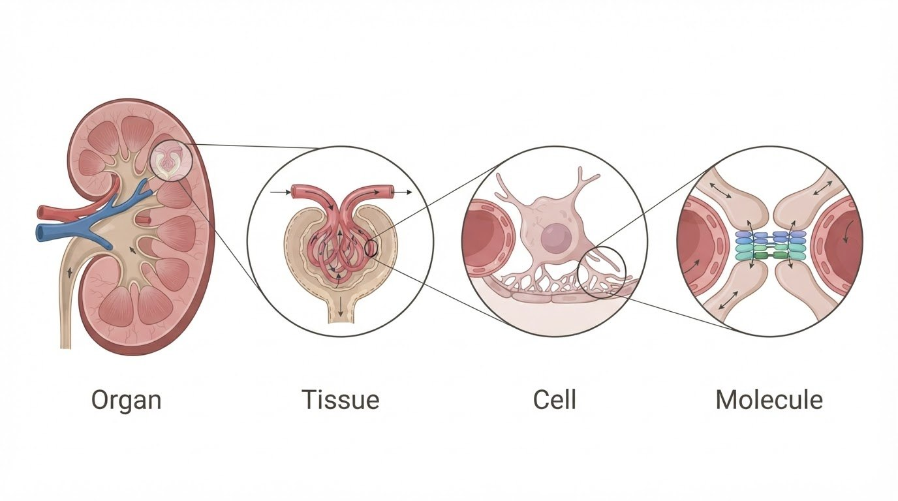</a>
</div>

##### 📌 Détails

- **Auteur:** [@Yila-AI](https://github.com/Yila-AI)
- **Modèle:** GPT Image 2.6
- **Format:** 16:9
- **Langues:** en, zh

**[👉 Essayer maintenant dans YILA →](https://yila.ai/fr/scientific-figure-prompts/cross-scale-zoom?utm_source=github&utm_medium=readme&utm_campaign=sci-figure-prompts&utm_content=cross-scale-zoom)** · [↑ Retour en haut](#top)

---

<a id="no-6"></a>

#### No. 6: Cross-sectional study design

 

##### 📖 Description

Technique: **a snapshot at one point in time** · Style: schematic diagram · Format: `16:9`

##### 📝 Prompt

```text
Create a study design diagram of 【a cross-sectional study】, read from left to right:
1. On the left, a large circle of many small people icons for the target population; an arrow leads to a smaller circle of people icons for the sample.
2. Along the bottom, a horizontal time arrow with one vertical line marking a single moment and a small camera icon on it, showing that everything is measured at the same time.
3. On the right, four groups of people icons in two rows and two columns: rows are exposed (dark icons) and unexposed (light icons); columns are with the outcome (a red mark) and without it.
Write each label only once in the whole figure.
If a component appears in more than one place or panel, write its label only at its first appearance; every other copy has no text. No label may appear twice anywhere in the figure. Spell every label exactly as given and add no titles.
Labels, each used once, no other text: 【Target population, Sample, Single time point, Exposed, Unexposed, With outcome, Without outcome】.

Style: journal-style schematic diagram. Clean flat vector graphics on a white background. Modules are rounded rectangles or simple icons with their short names inside; light pastel panels group related layers. Only 3-4 muted colors, each with one fixed meaning. Thin, uniform arrows show the flow of data, energy, material or influence; dashed arrows for indirect or feedback links. Sans-serif English labels only, each label appears exactly once, spelled exactly as given. No 3D rendering, no shadows, no glow, no cyberpunk or tech-background decoration, no photorealism.
```

<details><summary>Prompt en chinois</summary>

```text
画一张【横断面研究】的设计图，从左往右读：
1. 左侧一个大圆，里面是许多小人形图标，代表目标人群；一条箭头指向一个较小的圆，代表样本。
2. 底部一条横向时间箭头，上面一条竖线标出单一时间点，竖线上有一个小相机图标，表示所有指标在同一时间测量。
3. 右侧四组人形图标，排成两行两列：行是暴露（深色图标）和未暴露（浅色图标）；列是有结局（红色标记）和无结局。
整张图里每个标签只写一次。
如果同一组件在多处或多个面板出现，只在第一次出现时写标签，其余副本不写字。整张图里任何标签都不能出现两次。每个标签拼写与给定完全一致，不加标题。
标签（每个只出现一次，不加其他文字）：【Target population, Sample, Single time point, Exposed, Unexposed, With outcome, Without outcome】。

风格：期刊式示意框图。白色背景上干净的扁平矢量图形。模块画成圆角矩形或简洁图标，名称写在里面；用浅色面板把相关的层归在一起。只用 3–4 种低饱和度颜色，每种颜色含义固定。细而粗细一致的箭头表示数据、能量、物质或影响的流向，间接或反馈关系用虚线箭头。图中文字只用英文无衬线字体，每个标签只出现一次，拼写与给定完全一致。不要 3D 渲染、阴影、发光、赛博朋克或科技感背景装饰，不要照片质感。
```

</details>

##### 🖼️ Image générée

<div align="center">
<a href="https://yila.ai/fr/scientific-figure-prompts/cross-sectional-design?utm_source=github&utm_medium=readme&utm_campaign=sci-figure-prompts&utm_content=cross-sectional-design">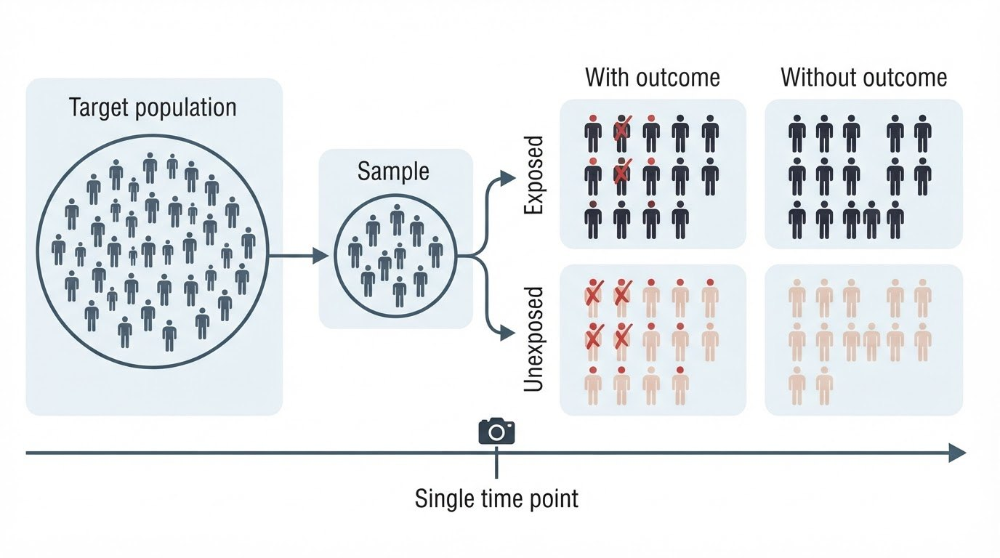</a>
</div>

##### 📌 Détails

- **Auteur:** [@Yila-AI](https://github.com/Yila-AI)
- **Modèle:** GPT Image 2.6
- **Format:** 16:9
- **Langues:** en, zh

**[👉 Essayer maintenant dans YILA →](https://yila.ai/fr/scientific-figure-prompts/cross-sectional-design?utm_source=github&utm_medium=readme&utm_campaign=sci-figure-prompts&utm_content=cross-sectional-design)** · [↑ Retour en haut](#top)

---

<a id="no-7"></a>

#### No. 7: Generic data processing pipeline

 

##### 📖 Description

Technique: **one panel per step, step names only** · Style: flat workflow · Format: `16:9`

##### 📝 Prompt

```text
Create a workflow figure for 【a data processing pipeline】, 7 steps from left to right:
1. 【Raw data: files, a sensor and a database flowing in】
2. 【Cleaning: a broom sweeping stray dots out of a table】
3. 【Integration: several small tables merging into one】
4. 【Normalization: uneven bars becoming the same height, drawn as icons only】
5. 【Feature extraction: a funnel pulling a few key columns from a table】
6. 【Analysis: a small model with gears】
7. 【Output: a document with a check mark】
Do not write the numbered sentences in the figure.
Step names, each used once, no other text: 【Raw data, Cleaning, Integration, Normalization, Feature extraction, Analysis, Output】.

Style: journal-style experimental workflow figure. Clean flat vector icons on a white background, one light pastel rounded panel per step, thin gray arrows between panels. Only 3-4 muted colors. Each panel shows one simple scene with no text inside it; the only text in the whole figure is the step names given. Sans-serif English, each step name appears exactly once, spelled exactly as given. No legends, no captions, no extra labels, no 3D rendering, no shadows, no decorative background.
```

<details><summary>Prompt en chinois</summary>

```text
画一张【数据处理】的流程图，从左往右七步：
1. 【原始数据：文件、传感器和数据库汇入】
2. 【清洗：扫帚把表格里的杂点扫掉】
3. 【整合：几张小表合并成一张】
4. 【标准化：高低不齐的条变成一样高（只画图标）】
5. 【特征提取：漏斗从表格中筛出几列关键数据】
6. 【分析：一个带齿轮的小模型】
7. 【输出：一份带对勾的文档】
不要把编号句子写进图里。
步骤名（每个只出现一次，不加其他文字）：【Raw data, Cleaning, Integration, Normalization, Feature extraction, Analysis, Output】。

风格：期刊式实验流程图。白色背景上干净的扁平矢量图标，每一步一个浅色圆角面板，面板之间用细灰色箭头连接。只用 3–4 种低饱和度颜色。每个面板里只画一个简洁的小场景，面板内不写任何文字；整张图唯一的文字就是给定的步骤名。用英文无衬线字体，每个步骤名只出现一次，拼写与给定完全一致。不要图例、不要说明文字、不要额外标签、不要 3D 渲染、阴影或装饰性背景。
```

</details>

##### 🖼️ Image générée

<div align="center">
<a href="https://yila.ai/fr/scientific-figure-prompts/data-processing-pipeline?utm_source=github&utm_medium=readme&utm_campaign=sci-figure-prompts&utm_content=data-processing-pipeline">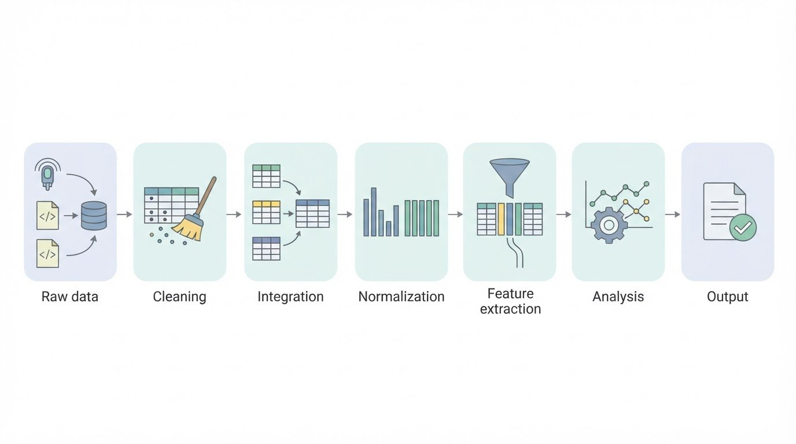</a>
</div>

##### 📌 Détails

- **Auteur:** [@Yila-AI](https://github.com/Yila-AI)
- **Modèle:** GPT Image 2.6
- **Format:** 16:9
- **Langues:** en, zh

**[👉 Essayer maintenant dans YILA →](https://yila.ai/fr/scientific-figure-prompts/data-processing-pipeline?utm_source=github&utm_medium=readme&utm_campaign=sci-figure-prompts&utm_content=data-processing-pipeline)** · [↑ Retour en haut](#top)

---

<a id="no-8"></a>

#### No. 8: Delphi method workflow

 

##### 📖 Description

Technique: **one panel per step, step names only** · Style: flat workflow · Format: `16:9`

##### 📝 Prompt

```text
Create a workflow figure for 【a Delphi consensus study】, 6 steps from left to right:
1. 【Expert panel: a circle of expert icons, each kept apart from the others】
2. 【First round: an open questionnaire on a clipboard】
3. 【Feedback: an anonymous summary sheet sent back to every expert】
4. 【Second round: experts rating items with star icons】
5. 【Third round: experts re-rating after seeing the group summary】
6. 【Consensus: many arrows converging on one check mark】
Do not write the numbered sentences in the figure.
Step names, each used once, no other text: 【Expert panel, First round, Feedback, Second round, Third round, Consensus】.

Style: journal-style experimental workflow figure. Clean flat vector icons on a white background, one light pastel rounded panel per step, thin gray arrows between panels. Only 3-4 muted colors. Each panel shows one simple scene with no text inside it; the only text in the whole figure is the step names given. Sans-serif English, each step name appears exactly once, spelled exactly as given. No legends, no captions, no extra labels, no 3D rendering, no shadows, no decorative background.
```

<details><summary>Prompt en chinois</summary>

```text
画一张【德尔菲专家共识研究】的流程图，从左往右六步：
1. 【专家小组：一圈彼此分开的专家图标】
2. 【第一轮：写字板上的开放式问卷】
3. 【反馈：一份匿名汇总表发回给每位专家】
4. 【第二轮：专家用星形图标给条目打分】
5. 【第三轮：专家看过汇总后重新打分】
6. 【达成共识：许多箭头汇向一个对勾】
不要把编号句子写进图里。
步骤名（每个只出现一次，不加其他文字）：【Expert panel, First round, Feedback, Second round, Third round, Consensus】。

风格：期刊式实验流程图。白色背景上干净的扁平矢量图标，每一步一个浅色圆角面板，面板之间用细灰色箭头连接。只用 3–4 种低饱和度颜色。每个面板里只画一个简洁的小场景，面板内不写任何文字；整张图唯一的文字就是给定的步骤名。用英文无衬线字体，每个步骤名只出现一次，拼写与给定完全一致。不要图例、不要说明文字、不要额外标签、不要 3D 渲染、阴影或装饰性背景。
```

</details>

##### 🖼️ Image générée

<div align="center">
<a href="https://yila.ai/fr/scientific-figure-prompts/delphi-method?utm_source=github&utm_medium=readme&utm_campaign=sci-figure-prompts&utm_content=delphi-method">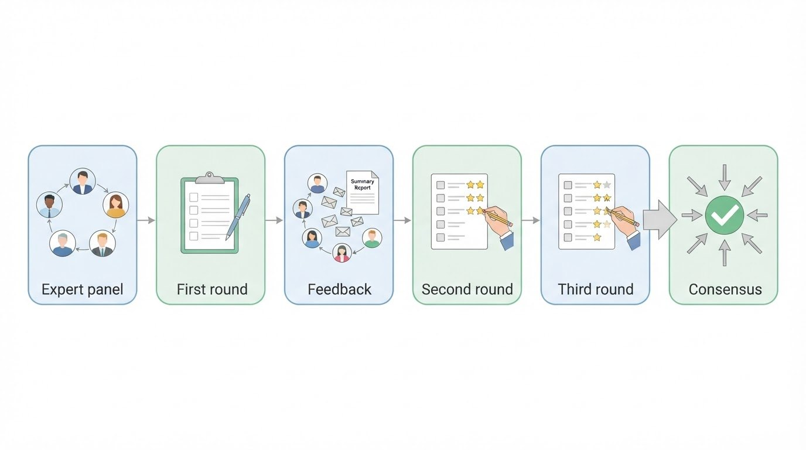</a>
</div>

##### 📌 Détails

- **Auteur:** [@Yila-AI](https://github.com/Yila-AI)
- **Modèle:** GPT Image 2.6
- **Format:** 16:9
- **Langues:** en, zh

**[👉 Essayer maintenant dans YILA →](https://yila.ai/fr/scientific-figure-prompts/delphi-method?utm_source=github&utm_medium=readme&utm_campaign=sci-figure-prompts&utm_content=delphi-method)** · [↑ Retour en haut](#top)

---

<a id="graphical-abstract"></a>

### 🧭 Résumé graphique

<a id="no-29"></a>

#### No. 29: Antibody–drug conjugate (ADC) mechanism

 

##### 📖 Description

Technique: **bind, internalize, release, kill** · Style: soft semi-realistic illustration · Format: `16:9`

##### 📝 Prompt

```text
Create a graphical abstract of 【how an antibody–drug conjugate kills a cancer cell】, read from left to right:
1. Left: 【a Y-shaped antibody carrying small star-shaped payloads on short linkers】.
2. 【The antibody binds a tumor antigen on the cancer cell surface and is taken in by endocytosis into an endosome.】
3. 【The endosome fuses with a lysosome, where the linker is cut and the payload stars are released.】
4. 【The released payload damages the cell, which shrinks and breaks apart (apoptosis); a few stars drift into a neighboring cancer cell (bystander effect).】
Label each component only where it first appears; repeated copies keep the same shape and color without text.
Write each label only once in the whole figure.
Labels, each used once, no other text: 【Antibody, Linker, Payload, Tumor antigen, Endosome, Lysosome, Apoptosis, Bystander effect】.

Style: journal graphical-abstract illustration. Soft semi-realistic medical illustration with gentle volume and subtle hand-painted texture, on a clean white background. Muted, harmonious palette with one accent color. Clear left-to-right narrative, generous white space. Sans-serif English labels only, each label appears exactly once, spelled exactly as given. No cartoon style, no glossy CGI, no dark background, no stock-photo look.
```

<details><summary>Prompt en chinois</summary>

```text
画一张【抗体偶联药物杀伤癌细胞】的图文摘要，从左往右读：
1. 左：【一个 Y 形抗体，通过短连接子带着几个星形小载荷】。
2. 【抗体结合癌细胞表面的肿瘤抗原，经内吞进入内体。】
3. 【内体与溶酶体融合，连接子在溶酶体内被切断，星形载荷被释放。】
4. 【释放出的载荷破坏细胞，细胞皱缩碎裂（凋亡）；几颗星飘进相邻的癌细胞（旁观者效应）。】
每个组件只在第一次出现的地方标注；重复出现的副本保持同样的形状和颜色，不加文字。
整张图里每个标签只写一次。
标签（每个只出现一次，不加其他文字）：【Antibody, Linker, Payload, Tumor antigen, Endosome, Lysosome, Apoptosis, Bystander effect】。

风格：期刊图形摘要插画。柔和的半写实医学插画，带轻微体积感和细腻的手绘质感，白色干净背景。配色低饱和、协调，只用一个强调色。从左到右叙事清晰，留白充足。图中文字只用英文无衬线字体，每个标签只出现一次，拼写与给定完全一致。不要卡通风格、不要光滑的 CG 渲染、不要深色背景、不要图库照片感。
```

</details>

##### 🖼️ Image générée

<div align="center">
<a href="https://yila.ai/fr/scientific-figure-prompts/antibody-drug-conjugate?utm_source=github&utm_medium=readme&utm_campaign=sci-figure-prompts&utm_content=antibody-drug-conjugate">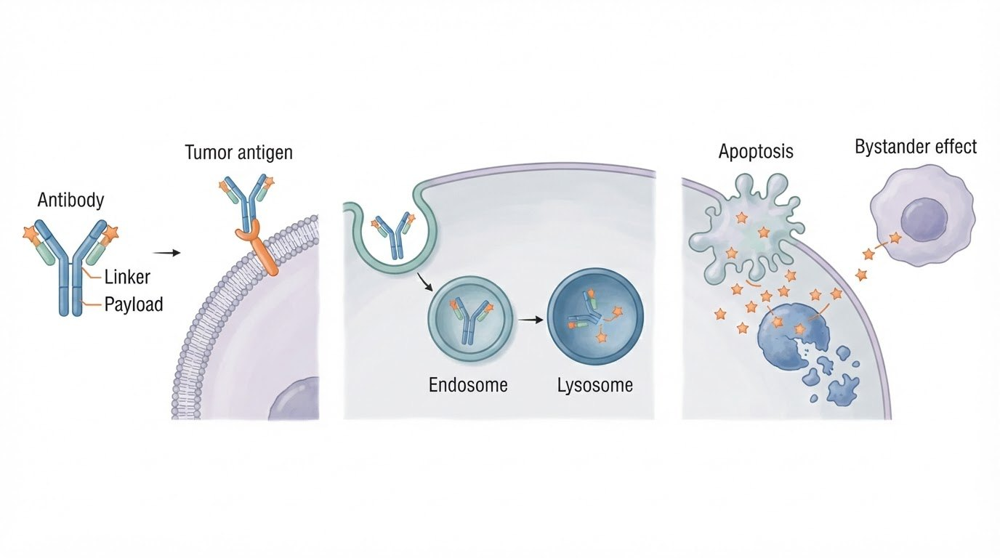</a>
</div>

##### 📌 Détails

- **Auteur:** [@Yila-AI](https://github.com/Yila-AI)
- **Modèle:** GPT Image 2.6
- **Format:** 16:9
- **Langues:** en, zh

**[👉 Essayer maintenant dans YILA →](https://yila.ai/fr/scientific-figure-prompts/antibody-drug-conjugate?utm_source=github&utm_medium=readme&utm_campaign=sci-figure-prompts&utm_content=antibody-drug-conjugate)** · [↑ Retour en haut](#top)

---

<a id="no-30"></a>

#### No. 30: CAR-T cells against a solid tumor

  

##### 📖 Description

Technique: **staged sequence + magnified inset** · Style: soft semi-realistic illustration · Format: `16:9`

##### 📝 Prompt

```text
Create a graphical abstract about 【CAR-T cell therapy against a solid tumor】, told from left to right in three stages.
Left: 【a patient's T cells engineered to carry a chimeric antigen receptor on their surface】.
Center: 【CAR-T cells leave a blood vessel and push into dense tumor tissue】.
Right: 【a CAR-T cell attacks a tumor cell, which breaks apart】. A circular magnified inset shows 【the receptor on the CAR-T cell binding an antigen on the tumor cell】.
Labels, each used once, no other text: 【CAR-T cell, Tumor antigen, Infiltration, Tumor killing】.

Style: journal graphical-abstract illustration. Soft semi-realistic medical illustration with gentle volume and subtle hand-painted texture, on a clean white background. Muted, harmonious palette with one accent color. Clear left-to-right narrative, generous white space. Sans-serif English labels only, each label appears exactly once, spelled exactly as given. No cartoon style, no glossy CGI, no dark background, no stock-photo look.
```

<details><summary>Prompt en chinois</summary>

```text
画一张关于【CAR-T 细胞治疗实体瘤】的图形摘要，从左到右分三段讲述。
左：【患者的 T 细胞经过改造，表面带上嵌合抗原受体】。
中：【CAR-T 细胞从血管中穿出，进入致密的肿瘤组织】。
右：【一个 CAR-T 细胞攻击肿瘤细胞，肿瘤细胞破裂】。用一个圆形放大框展示【CAR-T 细胞上的受体结合肿瘤细胞上的抗原】。
标签（每个只出现一次，不加其他文字）：【CAR-T cell, Tumor antigen, Infiltration, Tumor killing】。

风格：期刊图形摘要插画。柔和的半写实医学插画，带轻微体积感和细腻的手绘质感，白色干净背景。配色低饱和、协调，只用一个强调色。从左到右叙事清晰，留白充足。图中文字只用英文无衬线字体，每个标签只出现一次，拼写与给定完全一致。不要卡通风格、不要光滑的 CG 渲染、不要深色背景、不要图库照片感。
```

</details>

##### 🖼️ Image générée

<div align="center">
<a href="https://yila.ai/fr/scientific-figure-prompts/car-t-solid-tumor?utm_source=github&utm_medium=readme&utm_campaign=sci-figure-prompts&utm_content=car-t-solid-tumor"></a>
</div>

##### 📌 Détails

- **Auteur:** [@Yila-AI](https://github.com/Yila-AI)
- **Modèle:** GPT Image 2.6
- **Format:** 16:9
- **Langues:** en, zh

**[👉 Essayer maintenant dans YILA →](https://yila.ai/fr/scientific-figure-prompts/car-t-solid-tumor?utm_source=github&utm_medium=readme&utm_campaign=sci-figure-prompts&utm_content=car-t-solid-tumor)** · [↑ Retour en haut](#top)

---

<a id="no-31"></a>

#### No. 31: CRISPR-Cas9 gene editing

 

##### 📖 Description

Technique: **recognition and cutting, then two repair routes** · Style: scientific illustration · Format: `16:9`

##### 📝 Prompt

```text
Create a scientific illustration of 【CRISPR-Cas9 genome editing】, read from left to right:
1. 【Cas9 protein carrying a guide RNA binds the target DNA next to a short PAM sequence.】
2. 【Cas9 cuts both DNA strands.】
3. The broken DNA splits into two repair routes: 【top, NHEJ joins the ends with a small insertion or deletion; bottom, HDR copies a donor template for a precise edit】.
Write each label only once in the whole figure.
Labels, each used once, no other text: 【Cas9, sgRNA, Target DNA, PAM, Double-strand break, NHEJ, HDR, Donor template】.

Style: journal-style scientific illustration. Clean semi-realistic vector illustration with gentle shading, using cross-sections or cutaways where they explain the structure, on a white background. Muted, harmonious palette with one accent color for the key process. Thin directional arrows for flows. Generous white space and a clear reading direction. Sans-serif English labels only, each label appears exactly once, spelled exactly as given. No cartoon style, no glossy CGI, no dark background, no stock-photo look, no decorative background.
```

<details><summary>Prompt en chinois</summary>

```text
画一张【CRISPR-Cas9 基因编辑】的科学插画，从左往右读：
1. 【携带向导 RNA 的 Cas9 蛋白结合到短 PAM 序列旁边的靶 DNA 上。】
2. 【Cas9 切断 DNA 双链。】
3. 断开的 DNA 分成两条修复路径：【上方 NHEJ 连接断端，留下小的插入或缺失；下方 HDR 以供体模板为参照，实现精确编辑】。
整张图里每个标签只写一次。
标签（每个只出现一次，不加其他文字）：【Cas9, sgRNA, Target DNA, PAM, Double-strand break, NHEJ, HDR, Donor template】。

风格：期刊式科学插画。干净的半写实矢量插画，带柔和的明暗；需要说明结构时使用剖面或剖切视图，白色背景。配色低饱和、协调，只用一个强调色突出关键过程。用细的方向箭头表示流动。留白充足，阅读方向清晰。图中文字只用英文无衬线字体，每个标签只出现一次，拼写与给定完全一致。不要卡通风格、不要光滑的 CG 渲染、不要深色背景、不要图库照片感、不要装饰性背景。
```

</details>

##### 🖼️ Image générée

<div align="center">
<a href="https://yila.ai/fr/scientific-figure-prompts/crispr-cas9?utm_source=github&utm_medium=readme&utm_campaign=sci-figure-prompts&utm_content=crispr-cas9">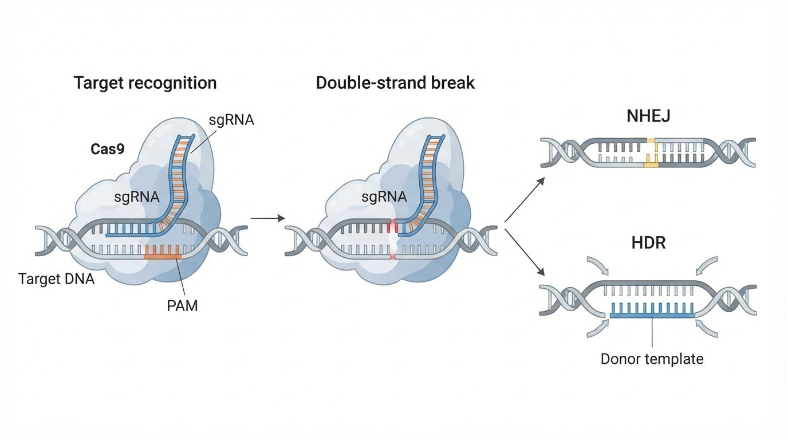</a>
</div>

##### 📌 Détails

- **Auteur:** [@Yila-AI](https://github.com/Yila-AI)
- **Modèle:** GPT Image 2.6
- **Format:** 16:9
- **Langues:** en, zh

**[👉 Essayer maintenant dans YILA →](https://yila.ai/fr/scientific-figure-prompts/crispr-cas9?utm_source=github&utm_medium=readme&utm_campaign=sci-figure-prompts&utm_content=crispr-cas9)** · [↑ Retour en haut](#top)

---

<a id="no-32"></a>

#### No. 32: Drug mechanism of action

 

##### 📖 Description

Technique: **binding, blocked signaling, cell outcome** · Style: soft semi-realistic illustration · Format: `16:9`

##### 📝 Prompt

```text
Create a graphical abstract of 【how a small-molecule kinase inhibitor works】, read from left to right:
1. Left: 【the drug molecule entering a tumor cell】.
2. Middle: 【a magnified inset showing the drug sitting in the binding pocket of the target kinase, blocking its substrate】.
3. Right: 【downstream signaling arrows fading out, and the tumor cell shrinking】.
Write each label only once in the whole figure.
Labels, each used once, no other text: 【Drug, Target kinase, Substrate, Downstream signaling, Tumor cell death】.

Style: journal graphical-abstract illustration. Soft semi-realistic medical illustration with gentle volume and subtle hand-painted texture, on a clean white background. Muted, harmonious palette with one accent color. Clear left-to-right narrative, generous white space. Sans-serif English labels only, each label appears exactly once, spelled exactly as given. No cartoon style, no glossy CGI, no dark background, no stock-photo look.
```

<details><summary>Prompt en chinois</summary>

```text
画一张关于【小分子激酶抑制剂如何起效】的图文摘要，从左往右读：
1. 左：【药物分子进入一个肿瘤细胞】。
2. 中：【一个圆形放大插图，药物嵌在靶点激酶的结合口袋里，挡住了底物】。
3. 右：【下游信号箭头逐渐变淡，肿瘤细胞萎缩】。
整张图里每个标签只写一次。
标签（每个只出现一次，不加其他文字）：【Drug, Target kinase, Substrate, Downstream signaling, Tumor cell death】。

风格：期刊图形摘要插画。柔和的半写实医学插画，带轻微体积感和细腻的手绘质感，白色干净背景。配色低饱和、协调，只用一个强调色。从左到右叙事清晰，留白充足。图中文字只用英文无衬线字体，每个标签只出现一次，拼写与给定完全一致。不要卡通风格、不要光滑的 CG 渲染、不要深色背景、不要图库照片感。
```

</details>

##### 🖼️ Image générée

<div align="center">
<a href="https://yila.ai/fr/scientific-figure-prompts/drug-mechanism?utm_source=github&utm_medium=readme&utm_campaign=sci-figure-prompts&utm_content=drug-mechanism">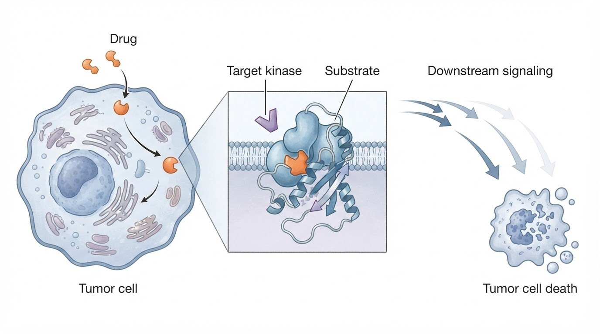</a>
</div>

##### 📌 Détails

- **Auteur:** [@Yila-AI](https://github.com/Yila-AI)
- **Modèle:** GPT Image 2.6
- **Format:** 16:9
- **Langues:** en, zh

**[👉 Essayer maintenant dans YILA →](https://yila.ai/fr/scientific-figure-prompts/drug-mechanism?utm_source=github&utm_medium=readme&utm_campaign=sci-figure-prompts&utm_content=drug-mechanism)** · [↑ Retour en haut](#top)

---

<a id="no-33"></a>

#### No. 33: Epithelial–mesenchymal transition (EMT)

 

##### 📖 Description

Technique: **cell shape changes gradually from left to right** · Style: soft semi-realistic illustration · Format: `16:9`

##### 📝 Prompt

```text
Create a graphical abstract of 【epithelial–mesenchymal transition】, read from left to right:
1. Left: 【tightly packed cube-shaped epithelial cells on a basement membrane, joined by E-cadherin】.
2. A 【TGF-β】 signal arrow above the middle.
3. Middle: 【cells loosening and starting to stretch】.
4. Right: 【spindle-shaped mesenchymal cells with vimentin fibers and N-cadherin, one cell crossing the basement membrane】.
Labels, each used once, no other text: 【Epithelial cells, TGF-β, Mesenchymal cells, E-cadherin, N-cadherin, Vimentin, Invasion】.

Style: journal graphical-abstract illustration. Soft semi-realistic medical illustration with gentle volume and subtle hand-painted texture, on a clean white background. Muted, harmonious palette with one accent color. Clear left-to-right narrative, generous white space. Sans-serif English labels only, each label appears exactly once, spelled exactly as given. No cartoon style, no glossy CGI, no dark background, no stock-photo look.
```

<details><summary>Prompt en chinois</summary>

```text
画一张【上皮间质转化】的图文摘要，从左往右读：
1. 左：【紧密排列在基底膜上的立方形上皮细胞，靠 E-cadherin 连接】。
2. 中间上方一个【TGF-β】信号箭头。
3. 中：【细胞变松散，开始拉长】。
4. 右：【梭形的间质细胞，带 vimentin 纤维和 N-cadherin，其中一个细胞穿过基底膜】。
标签（每个只出现一次，不加其他文字）：【Epithelial cells, TGF-β, Mesenchymal cells, E-cadherin, N-cadherin, Vimentin, Invasion】。

风格：期刊图形摘要插画。柔和的半写实医学插画，带轻微体积感和细腻的手绘质感，白色干净背景。配色低饱和、协调，只用一个强调色。从左到右叙事清晰，留白充足。图中文字只用英文无衬线字体，每个标签只出现一次，拼写与给定完全一致。不要卡通风格、不要光滑的 CG 渲染、不要深色背景、不要图库照片感。
```

</details>

##### 🖼️ Image générée

<div align="center">
<a href="https://yila.ai/fr/scientific-figure-prompts/emt?utm_source=github&utm_medium=readme&utm_campaign=sci-figure-prompts&utm_content=emt">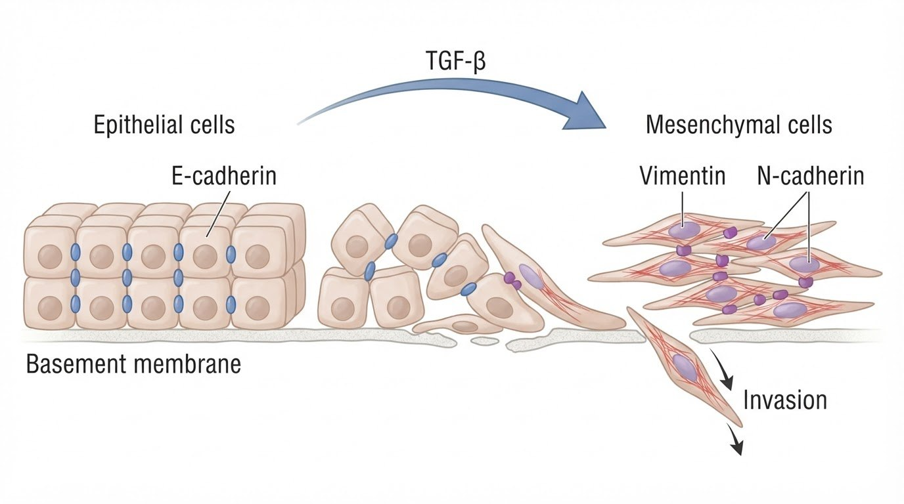</a>
</div>

##### 📌 Détails

- **Auteur:** [@Yila-AI](https://github.com/Yila-AI)
- **Modèle:** GPT Image 2.6
- **Format:** 16:9
- **Langues:** en, zh

**[👉 Essayer maintenant dans YILA →](https://yila.ai/fr/scientific-figure-prompts/emt?utm_source=github&utm_medium=readme&utm_campaign=sci-figure-prompts&utm_content=emt)** · [↑ Retour en haut](#top)

---

<a id="no-34"></a>

#### No. 34: Exercise improves muscle insulin resistance

 

##### 📖 Description

Technique: **multi-scale magnified insets** · Style: soft semi-realistic illustration · Format: `16:9`

##### 📝 Prompt

```text
Create a graphical abstract about 【how exercise improves insulin resistance in skeletal muscle】, told from left to right.
Left: 【a person running】.
Center: 【the thigh muscle】, with a circular magnified inset of 【one muscle cell: small vesicles carrying GLUT4 transporters move to the cell membrane and insert into it】.
Right: 【glucose molecules entering the muscle cell through GLUT4, and a lower blood glucose level】.
Labels, each used once, no other text: 【Exercise, Skeletal muscle, GLUT4, Glucose uptake】.

Style: journal graphical-abstract illustration. Soft semi-realistic medical illustration with gentle volume and subtle hand-painted texture, on a clean white background. Muted, harmonious palette with one accent color. Clear left-to-right narrative, generous white space. Sans-serif English labels only, each label appears exactly once, spelled exactly as given. No cartoon style, no glossy CGI, no dark background, no stock-photo look.
```

<details><summary>Prompt en chinois</summary>

```text
画一张关于【运动如何改善骨骼肌胰岛素抵抗】的图形摘要，从左到右讲述。
左：【一个正在跑步的人】。
中：【大腿肌肉】，用一个圆形放大框放大【一个肌细胞：携带 GLUT4 转运体的小囊泡移向细胞膜并嵌入膜中】。
右：【葡萄糖分子通过 GLUT4 进入肌细胞，血糖水平下降】。
标签（每个只出现一次，不加其他文字）：【Exercise, Skeletal muscle, GLUT4, Glucose uptake】。

风格：期刊图形摘要插画。柔和的半写实医学插画，带轻微体积感和细腻的手绘质感，白色干净背景。配色低饱和、协调，只用一个强调色。从左到右叙事清晰，留白充足。图中文字只用英文无衬线字体，每个标签只出现一次，拼写与给定完全一致。不要卡通风格、不要光滑的 CG 渲染、不要深色背景、不要图库照片感。
```

</details>

##### 🖼️ Image générée

<div align="center">
<a href="https://yila.ai/fr/scientific-figure-prompts/exercise-glut4?utm_source=github&utm_medium=readme&utm_campaign=sci-figure-prompts&utm_content=exercise-glut4">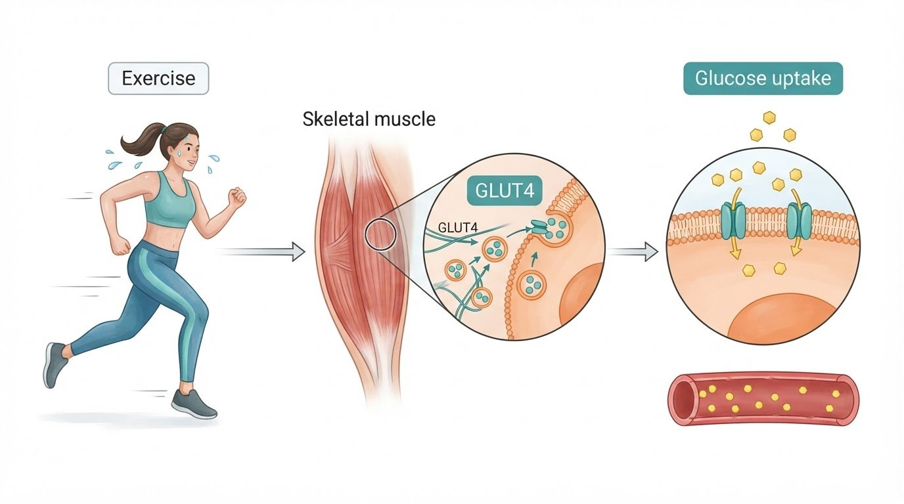</a>
</div>

##### 📌 Détails

- **Auteur:** [@Yila-AI](https://github.com/Yila-AI)
- **Modèle:** GPT Image 2.6
- **Format:** 16:9
- **Langues:** en, zh

**[👉 Essayer maintenant dans YILA →](https://yila.ai/fr/scientific-figure-prompts/exercise-glut4?utm_source=github&utm_medium=readme&utm_campaign=sci-figure-prompts&utm_content=exercise-glut4)** · [↑ Retour en haut](#top)

---

<a id="no-35"></a>

#### No. 35: Tumor exosomes prepare a pre-metastatic niche

 

##### 📖 Description

Technique: **multi-scale magnified insets** · Style: soft semi-realistic illustration · Format: `16:9`

##### 📝 Prompt

```text
Create a graphical abstract about 【tumor exosomes preparing the lung for metastasis】, told from left to right.
Left: 【a primary tumor releasing many tiny exosomes】.
Center: 【the exosomes travel through a blood vessel】.
Right: 【a lung where resident cells take up the exosomes and form a pre-metastatic niche that welcomes arriving tumor cells】. A circular magnified inset shows 【one exosome with surface proteins and RNA cargo inside】.
Labels, each used once, no other text: 【Primary tumor, Exosomes, Lung, Pre-metastatic niche】.

Style: journal graphical-abstract illustration. Soft semi-realistic medical illustration with gentle volume and subtle hand-painted texture, on a clean white background. Muted, harmonious palette with one accent color. Clear left-to-right narrative, generous white space. Sans-serif English labels only, each label appears exactly once, spelled exactly as given. No cartoon style, no glossy CGI, no dark background, no stock-photo look.
```

<details><summary>Prompt en chinois</summary>

```text
画一张关于【肿瘤外泌体为肺转移做准备】的图形摘要，从左到右讲述。
左：【原发肿瘤释放出大量微小的外泌体】。
中：【外泌体随血管运行】。
右：【肺部的驻留细胞摄取外泌体，形成前转移微环境，迎接随后到达的肿瘤细胞】。用一个圆形放大框展示【一个外泌体，表面有蛋白，内部装着 RNA】。
标签（每个只出现一次，不加其他文字）：【Primary tumor, Exosomes, Lung, Pre-metastatic niche】。

风格：期刊图形摘要插画。柔和的半写实医学插画，带轻微体积感和细腻的手绘质感，白色干净背景。配色低饱和、协调，只用一个强调色。从左到右叙事清晰，留白充足。图中文字只用英文无衬线字体，每个标签只出现一次，拼写与给定完全一致。不要卡通风格、不要光滑的 CG 渲染、不要深色背景、不要图库照片感。
```

</details>

##### 🖼️ Image générée

<div align="center">
<a href="https://yila.ai/fr/scientific-figure-prompts/exosome-premetastatic-niche?utm_source=github&utm_medium=readme&utm_campaign=sci-figure-prompts&utm_content=exosome-premetastatic-niche">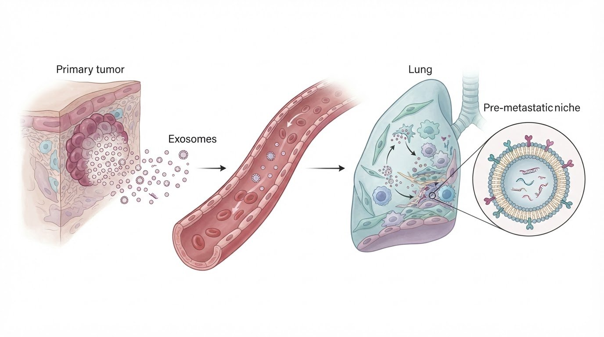</a>
</div>

##### 📌 Détails

- **Auteur:** [@Yila-AI](https://github.com/Yila-AI)
- **Modèle:** GPT Image 2.6
- **Format:** 16:9
- **Langues:** en, zh

**[👉 Essayer maintenant dans YILA →](https://yila.ai/fr/scientific-figure-prompts/exosome-premetastatic-niche?utm_source=github&utm_medium=readme&utm_campaign=sci-figure-prompts&utm_content=exosome-premetastatic-niche)** · [↑ Retour en haut](#top)

---

<a id="no-36"></a>

#### No. 36: Gut–brain axis in depression

 

##### 📖 Description

Technique: **two magnified insets** · Style: soft semi-realistic illustration · Format: `16:9`

##### 📝 Prompt

```text
Create a graphical abstract about 【the gut–brain axis in depression】.
Left: 【a human upper-body silhouette with the gut and the brain highlighted】.
Two circular magnified insets: one on 【the gut, showing imbalanced bacteria and a damaged intestinal lining】, one on 【the brain, showing activated microglia】.
Between the insets, 【three paths link gut and brain: a nerve fiber, a blood vessel carrying inflammatory molecules, and immune cells】.
Right: 【a person with a low mood】.
Labels, each used once, no other text: 【Dysbiosis, Vagus nerve, Inflammation, Microglia, Depression】.

Style: journal graphical-abstract illustration. Soft semi-realistic medical illustration with gentle volume and subtle hand-painted texture, on a clean white background. Muted, harmonious palette with one accent color. Clear left-to-right narrative, generous white space. Sans-serif English labels only, each label appears exactly once, spelled exactly as given. No cartoon style, no glossy CGI, no dark background, no stock-photo look.
```

<details><summary>Prompt en chinois</summary>

```text
画一张关于【肠–脑轴与抑郁】的图形摘要。
左：【人体上半身轮廓，突出显示肠道和大脑】。
两个圆形放大框：一个放大【肠道，显示失衡的菌群和受损的肠黏膜】，一个放大【大脑，显示被激活的小胶质细胞】。
两个放大框之间，【三条通路连接肠道和大脑：一条神经纤维、一条运送炎症分子的血管、一群免疫细胞】。
右：【一个情绪低落的人】。
标签（每个只出现一次，不加其他文字）：【Dysbiosis, Vagus nerve, Inflammation, Microglia, Depression】。

风格：期刊图形摘要插画。柔和的半写实医学插画，带轻微体积感和细腻的手绘质感，白色干净背景。配色低饱和、协调，只用一个强调色。从左到右叙事清晰，留白充足。图中文字只用英文无衬线字体，每个标签只出现一次，拼写与给定完全一致。不要卡通风格、不要光滑的 CG 渲染、不要深色背景、不要图库照片感。
```

</details>

##### 🖼️ Image générée

<div align="center">
<a href="https://yila.ai/fr/scientific-figure-prompts/gut-brain-axis?utm_source=github&utm_medium=readme&utm_campaign=sci-figure-prompts&utm_content=gut-brain-axis">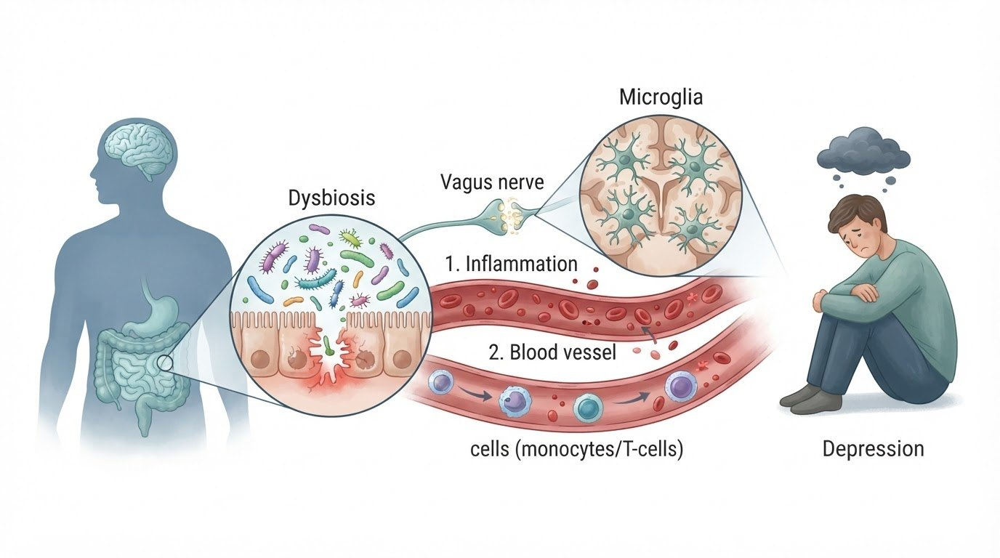</a>
</div>

##### 📌 Détails

- **Auteur:** [@Yila-AI](https://github.com/Yila-AI)
- **Modèle:** GPT Image 2.6
- **Format:** 16:9
- **Langues:** en, zh

**[👉 Essayer maintenant dans YILA →](https://yila.ai/fr/scientific-figure-prompts/gut-brain-axis?utm_source=github&utm_medium=readme&utm_campaign=sci-figure-prompts&utm_content=gut-brain-axis)** · [↑ Retour en haut](#top)

---

<a id="signaling-pathway"></a>

### 🧬 Voies de signalisation

<a id="no-51"></a>

#### No. 51: AMPK energy sensing

 

##### 📖 Description

Technique: **activated and inhibited targets in two columns** · Style: flat vector schematic · Format: `16:9`

##### 📝 Prompt

```text
Create a signaling schematic of 【AMPK energy sensing】 in one cell, read from left to right.
1. On the left, a low-battery icon for a rising AMP/ATP ratio, and LKB1 adding a small 'P' circle to AMPK; both point with arrows to AMPK in the middle.
2. On the right, two columns. The upper column, in a light green panel titled Activated, holds 【ULK1 and GLUT4】; a green arrow runs from AMPK to this panel.
3. The lower column, in a light red panel titled Inhibited, holds 【mTORC1 and ACC】; a single red arrow runs from AMPK to this panel.
Draw no other lines between the proteins.
Write each label only once in the whole figure.
Labels, each used once, no other text: 【AMP/ATP, LKB1, AMPK, Activated, Inhibited, ULK1, GLUT4, mTORC1, ACC】.

Style: journal-style scientific schematic. Clean flat vector illustration on a white background, light pastel rounded panels to separate regions. Only 3-4 muted colors, each with one fixed meaning; red only for inhibition or emphasis. Thin, uniform line weight. Proteins as rounded colored capsules with their names inside; membranes as lipid bilayers; activation as solid arrows, inhibition as T-bar lines, indirect effects as dashed arrows. Sans-serif English labels only, each label appears exactly once, spelled exactly as given. No 3D rendering, no shadows, no glow, no decorative background, no photorealism.
```

<details><summary>Prompt en chinois</summary>

```text
画一张【AMPK 能量感应】的信号示意图，在一个细胞内，从左往右读。
1. 左侧一个低电量图标代表 AMP/ATP 比值升高，LKB1 给 AMPK 加上一个带 P 的小圆点；两者都用箭头指向中央的 AMPK。
2. 右侧上下两栏。上栏是标题为 Activated 的浅绿色面板，里面放【ULK1 和 GLUT4】；一条绿色箭头从 AMPK 指向这个面板。
3. 下栏是标题为 Inhibited 的浅红色面板，里面放【mTORC1 和 ACC】；一条红色箭头从 AMPK 指向这个面板。
蛋白之间不画其他连线。
整张图里每个标签只写一次。
标签（每个只出现一次，不加其他文字）：【AMP/ATP, LKB1, AMPK, Activated, Inhibited, ULK1, GLUT4, mTORC1, ACC】。

风格：期刊式科研示意图。白色背景上的干净扁平矢量插画，用浅色圆角面板区分区域。只用 3–4 种低饱和度颜色，每种颜色含义固定，红色只用于抑制或强调。线条细且粗细一致。蛋白画成彩色圆角胶囊，名称写在胶囊里；细胞膜画成磷脂双分子层；激活用实线箭头，抑制用 T 形线，间接作用用虚线箭头。图中文字只用英文无衬线字体，每个标签只出现一次，拼写与给定完全一致。不要 3D 渲染、阴影、发光、装饰性背景或照片质感。
```

</details>

##### 🖼️ Image générée

<div align="center">
<a href="https://yila.ai/fr/scientific-figure-prompts/ampk-energy-sensing?utm_source=github&utm_medium=readme&utm_campaign=sci-figure-prompts&utm_content=ampk-energy-sensing">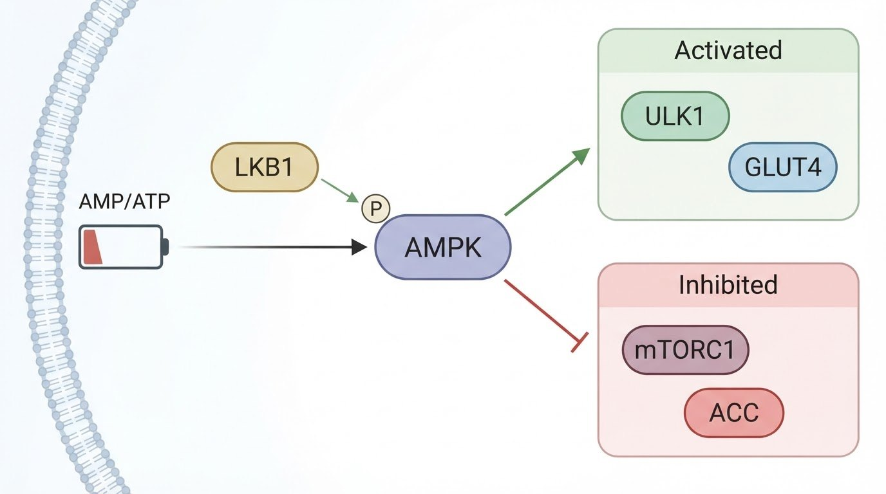</a>
</div>

##### 📌 Détails

- **Auteur:** [@Yila-AI](https://github.com/Yila-AI)
- **Modèle:** GPT Image 2.6
- **Format:** 16:9
- **Langues:** en, zh

**[👉 Essayer maintenant dans YILA →](https://yila.ai/fr/scientific-figure-prompts/ampk-energy-sensing?utm_source=github&utm_medium=readme&utm_campaign=sci-figure-prompts&utm_content=ampk-energy-sensing)** · [↑ Retour en haut](#top)

---

<a id="no-52"></a>

#### No. 52: Autophagy

 

##### 📖 Description

Technique: **regulation on top, vesicle stages below** · Style: flat vector schematic · Format: `16:9`

##### 📝 Prompt

```text
Create a schematic of 【autophagy】 in one cell. Top row: regulation. Bottom row: the vesicle stages from left to right. Draw each relationship exactly as listed and nothing more:
1. 【mTORC1 inhibits ULK1 (red T-bar).】
2. 【AMPK activates ULK1.】
3. 【ULK1 activates Beclin-1, which starts a cup-shaped membrane.】
4. 【The membrane, marked with LC3-II dots, closes around a damaged mitochondrion to form an autophagosome.】
5. 【The autophagosome fuses with a lysosome to form an autolysosome, where the contents are broken down.】
Labels, each used once, no other text: 【mTORC1, AMPK, ULK1, Beclin-1, LC3-II, Autophagosome, Lysosome, Autolysosome】.

Style: journal-style scientific schematic. Clean flat vector illustration on a white background, light pastel rounded panels to separate regions. Only 3-4 muted colors, each with one fixed meaning; red only for inhibition or emphasis. Thin, uniform line weight. Proteins as rounded colored capsules with their names inside; membranes as lipid bilayers; activation as solid arrows, inhibition as T-bar lines, indirect effects as dashed arrows. Sans-serif English labels only, each label appears exactly once, spelled exactly as given. No 3D rendering, no shadows, no glow, no decorative background, no photorealism.
```

<details><summary>Prompt en chinois</summary>

```text
画一张【自噬】示意图，在一个细胞内。上排是调控，下排从左往右是膜泡的演变。严格按下面列出的关系画，不多画：
1. 【mTORC1 抑制 ULK1（红色 T 形线）。】
2. 【AMPK 激活 ULK1。】
3. 【ULK1 激活 Beclin-1，启动一个杯状膜。】
4. 【带 LC3-II 小点的膜包住一个受损线粒体，闭合成自噬体。】
5. 【自噬体与溶酶体融合成自噬溶酶体，内容物被降解。】
标签（每个只出现一次，不加其他文字）：【mTORC1, AMPK, ULK1, Beclin-1, LC3-II, Autophagosome, Lysosome, Autolysosome】。

风格：期刊式科研示意图。白色背景上的干净扁平矢量插画，用浅色圆角面板区分区域。只用 3–4 种低饱和度颜色，每种颜色含义固定，红色只用于抑制或强调。线条细且粗细一致。蛋白画成彩色圆角胶囊，名称写在胶囊里；细胞膜画成磷脂双分子层；激活用实线箭头，抑制用 T 形线，间接作用用虚线箭头。图中文字只用英文无衬线字体，每个标签只出现一次，拼写与给定完全一致。不要 3D 渲染、阴影、发光、装饰性背景或照片质感。
```

</details>

##### 🖼️ Image générée

<div align="center">
<a href="https://yila.ai/fr/scientific-figure-prompts/autophagy?utm_source=github&utm_medium=readme&utm_campaign=sci-figure-prompts&utm_content=autophagy">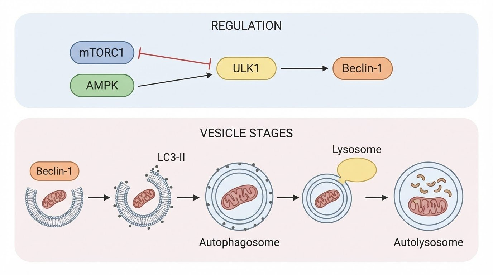</a>
</div>

##### 📌 Détails

- **Auteur:** [@Yila-AI](https://github.com/Yila-AI)
- **Modèle:** GPT Image 2.6
- **Format:** 16:9
- **Langues:** en, zh

**[👉 Essayer maintenant dans YILA →](https://yila.ai/fr/scientific-figure-prompts/autophagy?utm_source=github&utm_medium=readme&utm_campaign=sci-figure-prompts&utm_content=autophagy)** · [↑ Retour en haut](#top)

---

<a id="no-53"></a>

#### No. 53: cGAS–STING innate immune pathway

  

##### 📖 Description

Technique: **numbered relationships + membrane–cytosol–nucleus layout** · Style: flat vector schematic · Format: `4:3`

##### 📝 Prompt

```text
Create a signaling pathway schematic of 【cGAS–STING DNA sensing】 inside one cell, read from top to bottom. Draw each relationship exactly as listed and nothing more:
1. 【Double-stranded DNA in the cytoplasm binds cGAS.】
2. 【cGAS produces cGAMP, a small molecule.】
3. 【cGAMP activates STING, which sits on an ER membrane.】
4. 【STING recruits TBK1.】
5. 【TBK1 phosphorylates IRF3 (small 'P' circle).】
6. 【IRF3 moves into the nucleus at the bottom and turns on Type I IFN genes.】
All arrows are solid activation arrows.
Labels, each used once, no other text: 【DNA, cGAS, cGAMP, STING, TBK1, IRF3, Type I IFN】.

Style: journal-style scientific schematic. Clean flat vector illustration on a white background, light pastel rounded panels to separate regions. Only 3-4 muted colors, each with one fixed meaning; red only for inhibition or emphasis. Thin, uniform line weight. Proteins as rounded colored capsules with their names inside; membranes as lipid bilayers; activation as solid arrows, inhibition as T-bar lines, indirect effects as dashed arrows. Sans-serif English labels only, each label appears exactly once, spelled exactly as given. No 3D rendering, no shadows, no glow, no decorative background, no photorealism.
```

<details><summary>Prompt en chinois</summary>

```text
画一张【cGAS–STING 识别 DNA】的信号通路示意图，在一个细胞内从上往下读。严格按下面列出的关系画，不多画：
1. 【细胞质中的双链 DNA 结合 cGAS。】
2. 【cGAS 生成小分子 cGAMP。】
3. 【cGAMP 激活位于内质网膜上的 STING。】
4. 【STING 招募 TBK1。】
5. 【TBK1 磷酸化 IRF3（带 P 的小圆点）。】
6. 【IRF3 进入底部的细胞核，开启 I 型干扰素基因。】
所有箭头都是实线激活箭头。
标签（每个只出现一次，不加其他文字）：【DNA, cGAS, cGAMP, STING, TBK1, IRF3, Type I IFN】。

风格：期刊式科研示意图。白色背景上的干净扁平矢量插画，用浅色圆角面板区分区域。只用 3–4 种低饱和度颜色，每种颜色含义固定，红色只用于抑制或强调。线条细且粗细一致。蛋白画成彩色圆角胶囊，名称写在胶囊里；细胞膜画成磷脂双分子层；激活用实线箭头，抑制用 T 形线，间接作用用虚线箭头。图中文字只用英文无衬线字体，每个标签只出现一次，拼写与给定完全一致。不要 3D 渲染、阴影、发光、装饰性背景或照片质感。
```

</details>

##### 🖼️ Image générée

<div align="center">
<a href="https://yila.ai/fr/scientific-figure-prompts/cgas-sting?utm_source=github&utm_medium=readme&utm_campaign=sci-figure-prompts&utm_content=cgas-sting"></a>
</div>

##### 📌 Détails

- **Auteur:** [@Yila-AI](https://github.com/Yila-AI)
- **Modèle:** GPT Image 2.6
- **Format:** 4:3
- **Langues:** en, zh

**[👉 Essayer maintenant dans YILA →](https://yila.ai/fr/scientific-figure-prompts/cgas-sting?utm_source=github&utm_medium=readme&utm_campaign=sci-figure-prompts&utm_content=cgas-sting)** · [↑ Retour en haut](#top)

---

<a id="no-54"></a>

#### No. 54: Extrinsic (death receptor) apoptosis

 

##### 📖 Description

Technique: **death receptor to executioner caspase** · Style: flat vector schematic · Format: `4:3`

##### 📝 Prompt

```text
Create a signaling pathway schematic of 【extrinsic apoptosis】 inside one cell, death receptor in the membrane at the top, read from top to bottom. Draw each relationship exactly as listed and nothing more:
1. 【FasL binds the Fas receptor in the membrane.】
2. 【Fas recruits FADD.】
3. 【FADD recruits and activates caspase-8.】
4. 【Caspase-8 activates caspase-3.】
5. 【Caspase-3 leads to apoptosis (a shrinking cell with fragmented nucleus).】
6. 【Caspase-8 also cuts Bid into tBid, which points with a dashed arrow to a small mitochondrion at the side.】
Use red T-bars only where listed; every other arrow is a solid activation arrow. Do not write the numbered sentences in the figure.
Labels, each used once, no other text: 【FasL, Fas, FADD, Caspase-8, Caspase-3, tBid, Apoptosis】.

Style: journal-style scientific schematic. Clean flat vector illustration on a white background, light pastel rounded panels to separate regions. Only 3-4 muted colors, each with one fixed meaning; red only for inhibition or emphasis. Thin, uniform line weight. Proteins as rounded colored capsules with their names inside; membranes as lipid bilayers; activation as solid arrows, inhibition as T-bar lines, indirect effects as dashed arrows. Sans-serif English labels only, each label appears exactly once, spelled exactly as given. No 3D rendering, no shadows, no glow, no decorative background, no photorealism.
```

<details><summary>Prompt en chinois</summary>

```text
画一张【外源性凋亡】的信号通路示意图，在一个细胞内，死亡受体在顶部细胞膜上，从上往下读。严格按下面列出的关系画，不多画：
1. 【FasL 结合膜上的 Fas 受体。】
2. 【Fas 招募 FADD。】
3. 【FADD 招募并激活 caspase-8。】
4. 【caspase-8 激活 caspase-3。】
5. 【caspase-3 导致凋亡（细胞皱缩、细胞核碎裂）。】
6. 【caspase-8 还把 Bid 切成 tBid，tBid 用虚线箭头指向侧边一个小线粒体。】
只在列出的地方用红色 T 形线，其他箭头都是实线激活箭头。不要把编号句子写进图里。
标签（每个只出现一次，不加其他文字）：【FasL, Fas, FADD, Caspase-8, Caspase-3, tBid, Apoptosis】。

风格：期刊式科研示意图。白色背景上的干净扁平矢量插画，用浅色圆角面板区分区域。只用 3–4 种低饱和度颜色，每种颜色含义固定，红色只用于抑制或强调。线条细且粗细一致。蛋白画成彩色圆角胶囊，名称写在胶囊里；细胞膜画成磷脂双分子层；激活用实线箭头，抑制用 T 形线，间接作用用虚线箭头。图中文字只用英文无衬线字体，每个标签只出现一次，拼写与给定完全一致。不要 3D 渲染、阴影、发光、装饰性背景或照片质感。
```

</details>

##### 🖼️ Image générée

<div align="center">
<a href="https://yila.ai/fr/scientific-figure-prompts/extrinsic-apoptosis?utm_source=github&utm_medium=readme&utm_campaign=sci-figure-prompts&utm_content=extrinsic-apoptosis">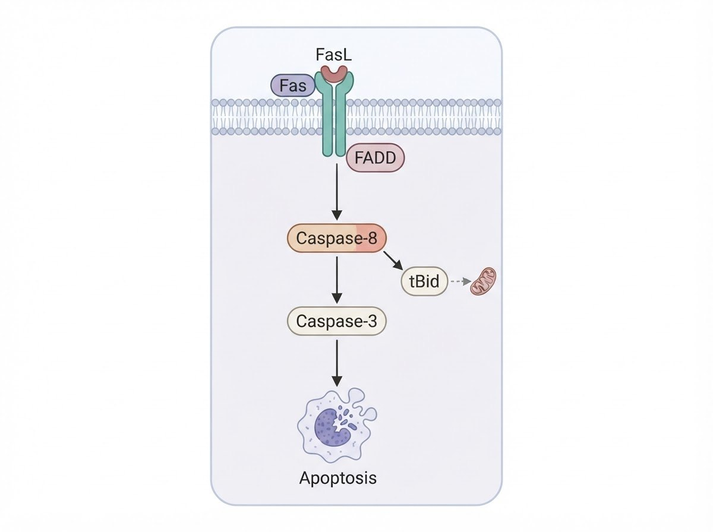</a>
</div>

##### 📌 Détails

- **Auteur:** [@Yila-AI](https://github.com/Yila-AI)
- **Modèle:** GPT Image 2.6
- **Format:** 4:3
- **Langues:** en, zh

**[👉 Essayer maintenant dans YILA →](https://yila.ai/fr/scientific-figure-prompts/extrinsic-apoptosis?utm_source=github&utm_medium=readme&utm_campaign=sci-figure-prompts&utm_content=extrinsic-apoptosis)** · [↑ Retour en haut](#top)

---

<a id="no-55"></a>

#### No. 55: Ferroptosis

 

##### 📖 Description

Technique: **membrane and cytosol, GPX4 axis versus iron axis** · Style: flat vector schematic · Format: `4:3`

##### 📝 Prompt

```text
Create a signaling pathway schematic of 【ferroptosis】 in one cell, plasma membrane across the top, read from top to bottom. Draw each relationship exactly as listed and nothing more:
1. 【Cystine enters the cell through System xc- in the membrane.】
2. 【Cystine is used to make GSH.】
3. 【GSH supports GPX4.】
4. 【GPX4 inhibits lipid peroxidation (red T-bar).】
5. 【Fe2+ drives lipid peroxidation (solid arrow).】
6. 【ACSL4 supplies membrane lipids for peroxidation (solid arrow).】
7. 【Lipid peroxidation leads to ferroptosis (a ruptured membrane).】
Labels, each used once, no other text: 【System xc-, Cystine, GSH, GPX4, Fe2+, ACSL4, Lipid peroxidation, Ferroptosis】.

Style: journal-style scientific schematic. Clean flat vector illustration on a white background, light pastel rounded panels to separate regions. Only 3-4 muted colors, each with one fixed meaning; red only for inhibition or emphasis. Thin, uniform line weight. Proteins as rounded colored capsules with their names inside; membranes as lipid bilayers; activation as solid arrows, inhibition as T-bar lines, indirect effects as dashed arrows. Sans-serif English labels only, each label appears exactly once, spelled exactly as given. No 3D rendering, no shadows, no glow, no decorative background, no photorealism.
```

<details><summary>Prompt en chinois</summary>

```text
画一张【铁死亡】的信号通路示意图，在一个细胞内，细胞膜横在顶部，从上往下读。严格按下面列出的关系画，不多画：
1. 【胱氨酸经膜上的 System xc- 进入细胞。】
2. 【胱氨酸用于合成 GSH。】
3. 【GSH 支持 GPX4。】
4. 【GPX4 抑制脂质过氧化（红色 T 形线）。】
5. 【Fe2+ 推动脂质过氧化（实线箭头）。】
6. 【ACSL4 为过氧化提供膜脂（实线箭头）。】
7. 【脂质过氧化导致铁死亡（细胞膜破裂）。】
标签（每个只出现一次，不加其他文字）：【System xc-, Cystine, GSH, GPX4, Fe2+, ACSL4, Lipid peroxidation, Ferroptosis】。

风格：期刊式科研示意图。白色背景上的干净扁平矢量插画，用浅色圆角面板区分区域。只用 3–4 种低饱和度颜色，每种颜色含义固定，红色只用于抑制或强调。线条细且粗细一致。蛋白画成彩色圆角胶囊，名称写在胶囊里；细胞膜画成磷脂双分子层；激活用实线箭头，抑制用 T 形线，间接作用用虚线箭头。图中文字只用英文无衬线字体，每个标签只出现一次，拼写与给定完全一致。不要 3D 渲染、阴影、发光、装饰性背景或照片质感。
```

</details>

##### 🖼️ Image générée

<div align="center">
<a href="https://yila.ai/fr/scientific-figure-prompts/ferroptosis?utm_source=github&utm_medium=readme&utm_campaign=sci-figure-prompts&utm_content=ferroptosis">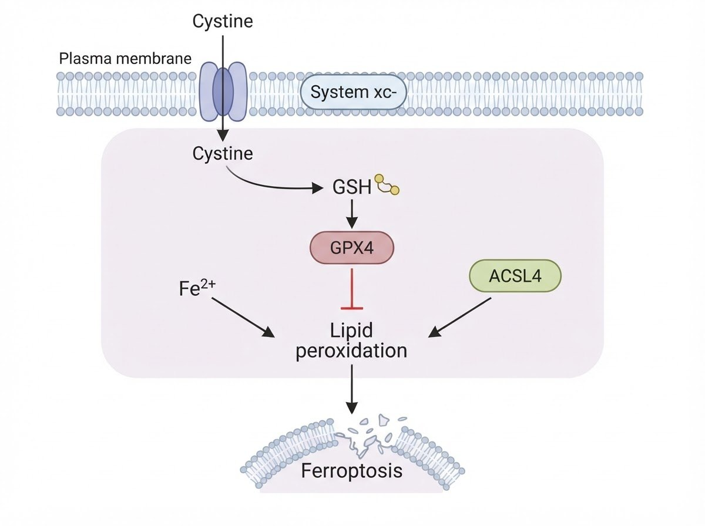</a>
</div>

##### 📌 Détails

- **Auteur:** [@Yila-AI](https://github.com/Yila-AI)
- **Modèle:** GPT Image 2.6
- **Format:** 4:3
- **Langues:** en, zh

**[👉 Essayer maintenant dans YILA →](https://yila.ai/fr/scientific-figure-prompts/ferroptosis?utm_source=github&utm_medium=readme&utm_campaign=sci-figure-prompts&utm_content=ferroptosis)** · [↑ Retour en haut](#top)

---

<a id="no-56"></a>

#### No. 56: HIF-1α response: normoxia versus hypoxia

 

##### 📖 Description

Technique: **two cells side by side** · Style: flat vector schematic · Format: `16:9`

##### 📝 Prompt

```text
Create a side-by-side schematic of 【HIF-1α regulation】: two cells, left panel normoxia and right panel hypoxia. Draw each relationship exactly as listed and nothing more:
1. 【Left cell: PHD adds hydroxyl groups (small 'OH' circles) to HIF-1α.】
2. 【Left cell: VHL binds HIF-1α and sends it to the proteasome.】
3. 【Right cell: PHD is inactive (grayed out), so HIF-1α builds up.】
4. 【Right cell: HIF-1α enters the nucleus, pairs with HIF-1β and turns on VEGF.】
There are no T-bars in this figure; all arrows are solid. In the left cell an arrow carries HIF-1α into the proteasome. Do not write the numbered sentences in the figure.
Labels, each used once, no other text: 【Normoxia, Hypoxia, PHD, HIF-1α, VHL, Proteasome, HIF-1β, VEGF】.

Style: journal-style scientific schematic. Clean flat vector illustration on a white background, light pastel rounded panels to separate regions. Only 3-4 muted colors, each with one fixed meaning; red only for inhibition or emphasis. Thin, uniform line weight. Proteins as rounded colored capsules with their names inside; membranes as lipid bilayers; activation as solid arrows, inhibition as T-bar lines, indirect effects as dashed arrows. Sans-serif English labels only, each label appears exactly once, spelled exactly as given. No 3D rendering, no shadows, no glow, no decorative background, no photorealism.
```

<details><summary>Prompt en chinois</summary>

```text
画一张【HIF-1α 调控】的左右对照示意图：两个细胞，左边常氧，右边缺氧。严格按下面列出的关系画，不多画：
1. 【左侧细胞：PHD 给 HIF-1α 加上羟基（带 OH 的小圆点）。】
2. 【左侧细胞：VHL 结合 HIF-1α，把它送到蛋白酶体。】
3. 【右侧细胞：PHD 失活（画成灰色），HIF-1α 积累。】
4. 【右侧细胞：HIF-1α 进入细胞核，与 HIF-1β 结合，开启 VEGF。】
图中没有 T 形线，所有箭头都是实线。左侧细胞里一条箭头把 HIF-1α 送进蛋白酶体。不要把编号句子写进图里。
标签（每个只出现一次，不加其他文字）：【Normoxia, Hypoxia, PHD, HIF-1α, VHL, Proteasome, HIF-1β, VEGF】。

风格：期刊式科研示意图。白色背景上的干净扁平矢量插画，用浅色圆角面板区分区域。只用 3–4 种低饱和度颜色，每种颜色含义固定，红色只用于抑制或强调。线条细且粗细一致。蛋白画成彩色圆角胶囊，名称写在胶囊里；细胞膜画成磷脂双分子层；激活用实线箭头，抑制用 T 形线，间接作用用虚线箭头。图中文字只用英文无衬线字体，每个标签只出现一次，拼写与给定完全一致。不要 3D 渲染、阴影、发光、装饰性背景或照片质感。
```

</details>

##### 🖼️ Image générée

<div align="center">
<a href="https://yila.ai/fr/scientific-figure-prompts/hif1a-hypoxia?utm_source=github&utm_medium=readme&utm_campaign=sci-figure-prompts&utm_content=hif1a-hypoxia">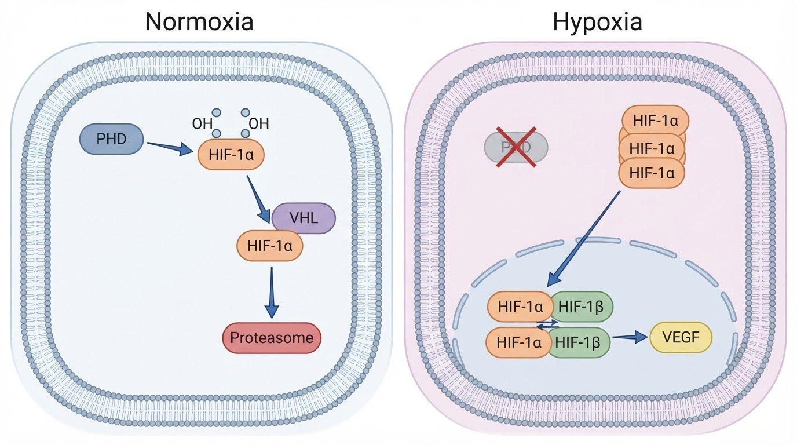</a>
</div>

##### 📌 Détails

- **Auteur:** [@Yila-AI](https://github.com/Yila-AI)
- **Modèle:** GPT Image 2.6
- **Format:** 16:9
- **Langues:** en, zh

**[👉 Essayer maintenant dans YILA →](https://yila.ai/fr/scientific-figure-prompts/hif1a-hypoxia?utm_source=github&utm_medium=readme&utm_campaign=sci-figure-prompts&utm_content=hif1a-hypoxia)** · [↑ Retour en haut](#top)

---

<a id="no-57"></a>

#### No. 57: Hippo/YAP signaling pathway

 

##### 📖 Description

Technique: **kinase cascade keeping YAP in the cytoplasm** · Style: flat vector schematic · Format: `4:3`

##### 📝 Prompt

```text
Create a signaling pathway schematic of 【Hippo/YAP signaling】 in one epithelial cell touching its neighbors on both sides, read from top to bottom. Draw each relationship exactly as listed and nothing more:
1. 【Cell–cell contact at the sides of the cell activates MST1/2.】
2. 【MST1/2 phosphorylates LATS1/2 (small 'P' circle).】
3. 【LATS1/2 inhibits YAP/TAZ by phosphorylating it (red T-bar, with a small 'P' circle on YAP/TAZ).】
4. 【14-3-3 binds phosphorylated YAP/TAZ and keeps it in the cytoplasm.】
5. 【When the pathway is off, YAP/TAZ enters the nucleus (dashed arrow) and binds TEAD.】
6. 【YAP/TAZ and TEAD together turn on growth genes.】
Draw YAP/TAZ only once, in the cytoplasm; the dashed arrow shows where it goes when the pathway is off.
Use red T-bars only where listed; each T-bar starts at the inhibitor and its flat end touches the inhibited target. Every other arrow is a solid activation arrow. Do not write the numbered sentences in the figure. Write each label only once in the whole figure.
Labels, each used once, no other text: 【Cell contact, MST1/2, LATS1/2, YAP/TAZ, 14-3-3, TEAD, Growth genes】.

Style: journal-style scientific schematic. Clean flat vector illustration on a white background, light pastel rounded panels to separate regions. Only 3-4 muted colors, each with one fixed meaning; red only for inhibition or emphasis. Thin, uniform line weight. Proteins as rounded colored capsules with their names inside; membranes as lipid bilayers; activation as solid arrows, inhibition as T-bar lines, indirect effects as dashed arrows. Sans-serif English labels only, each label appears exactly once, spelled exactly as given. No 3D rendering, no shadows, no glow, no decorative background, no photorealism.
```

<details><summary>Prompt en chinois</summary>

```text
画一张【Hippo/YAP 信号】的通路示意图，画一个上皮细胞，左右两侧紧贴相邻细胞，从上往下读。严格按下面列出的关系画，不多画：
1. 【细胞两侧的细胞间接触激活 MST1/2。】
2. 【MST1/2 磷酸化 LATS1/2（带 P 的小圆点）。】
3. 【LATS1/2 通过磷酸化抑制 YAP/TAZ（红色 T 形线，YAP/TAZ 上带一个 P 小圆点）。】
4. 【14-3-3 结合磷酸化的 YAP/TAZ，把它留在胞质。】
5. 【通路关闭时，YAP/TAZ 进入细胞核（虚线箭头），结合 TEAD。】
6. 【YAP/TAZ 与 TEAD 一起开启生长相关基因。】
YAP/TAZ 只画一次，画在胞质里；虚线箭头表示通路关闭时它的去向。
只在列出的地方用红色 T 形线：从抑制者出发，平头端碰到被抑制的对象。其他箭头都是实线激活箭头。不要把编号句子写进图里。整张图里每个标签只写一次。
标签（每个只出现一次，不加其他文字）：【Cell contact, MST1/2, LATS1/2, YAP/TAZ, 14-3-3, TEAD, Growth genes】。

风格：期刊式科研示意图。白色背景上的干净扁平矢量插画，用浅色圆角面板区分区域。只用 3–4 种低饱和度颜色，每种颜色含义固定，红色只用于抑制或强调。线条细且粗细一致。蛋白画成彩色圆角胶囊，名称写在胶囊里；细胞膜画成磷脂双分子层；激活用实线箭头，抑制用 T 形线，间接作用用虚线箭头。图中文字只用英文无衬线字体，每个标签只出现一次，拼写与给定完全一致。不要 3D 渲染、阴影、发光、装饰性背景或照片质感。
```

</details>

##### 🖼️ Image générée

<div align="center">
<a href="https://yila.ai/fr/scientific-figure-prompts/hippo-yap?utm_source=github&utm_medium=readme&utm_campaign=sci-figure-prompts&utm_content=hippo-yap">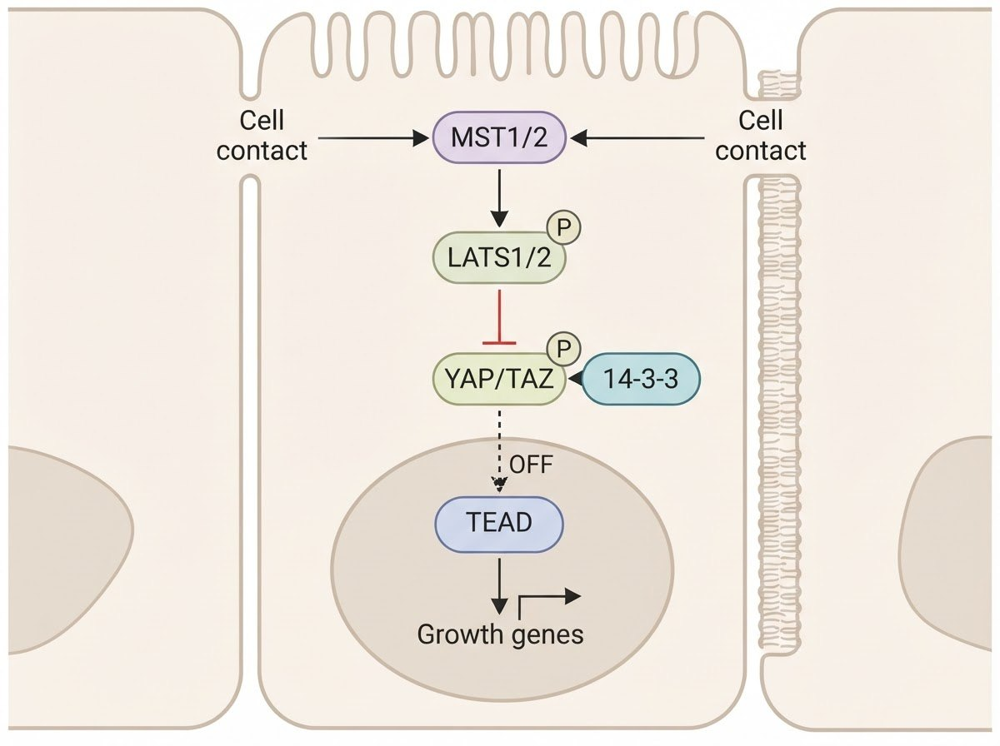</a>
</div>

##### 📌 Détails

- **Auteur:** [@Yila-AI](https://github.com/Yila-AI)
- **Modèle:** GPT Image 2.6
- **Format:** 4:3
- **Langues:** en, zh

**[👉 Essayer maintenant dans YILA →](https://yila.ai/fr/scientific-figure-prompts/hippo-yap?utm_source=github&utm_medium=readme&utm_campaign=sci-figure-prompts&utm_content=hippo-yap)** · [↑ Retour en haut](#top)

---

<a id="no-58"></a>

#### No. 58: Insulin signaling and GLUT4 translocation

 

##### 📖 Description

Technique: **receptor cascade plus vesicle translocation** · Style: flat vector schematic · Format: `4:3`

##### 📝 Prompt

```text
Create a signaling pathway schematic of 【insulin signaling in a muscle cell】, read from top to bottom. Draw each relationship exactly as listed and nothing more:
1. 【Insulin binds the insulin receptor in the membrane at the top.】
2. 【The receptor phosphorylates IRS-1 (small 'P' circle).】
3. 【IRS-1 activates PI3K.】
4. 【PI3K activates AKT.】
5. 【AKT sends vesicles carrying GLUT4 up to the membrane.】
6. 【GLUT4 in the membrane lets glucose into the cell.】
Draw only one plasma membrane, across the top. GLUT4 appears once, in a vesicle moving up to the membrane, and glucose appears once, entering through it. Use red T-bars only where listed; every other arrow is a solid activation arrow. Do not write the numbered sentences in the figure.
Labels, each used once, no other text: 【Insulin, Insulin receptor, IRS-1, PI3K, AKT, GLUT4, Glucose】.

Style: journal-style scientific schematic. Clean flat vector illustration on a white background, light pastel rounded panels to separate regions. Only 3-4 muted colors, each with one fixed meaning; red only for inhibition or emphasis. Thin, uniform line weight. Proteins as rounded colored capsules with their names inside; membranes as lipid bilayers; activation as solid arrows, inhibition as T-bar lines, indirect effects as dashed arrows. Sans-serif English labels only, each label appears exactly once, spelled exactly as given. No 3D rendering, no shadows, no glow, no decorative background, no photorealism.
```

<details><summary>Prompt en chinois</summary>

```text
画一张【肌细胞中的胰岛素信号】通路示意图，从上往下读。严格按下面列出的关系画，不多画：
1. 【胰岛素结合顶部细胞膜上的胰岛素受体。】
2. 【受体磷酸化 IRS-1（带 P 的小圆点）。】
3. 【IRS-1 激活 PI3K。】
4. 【PI3K 激活 AKT。】
5. 【AKT 让携带 GLUT4 的囊泡移向细胞膜。】
6. 【膜上的 GLUT4 让葡萄糖进入细胞。】
只画一层细胞膜，横在顶部。GLUT4 只出现一次，在移向细胞膜的囊泡里；葡萄糖只出现一次，经它进入细胞。只在列出的地方用红色 T 形线，其他箭头都是实线激活箭头。不要把编号句子写进图里。
标签（每个只出现一次，不加其他文字）：【Insulin, Insulin receptor, IRS-1, PI3K, AKT, GLUT4, Glucose】。

风格：期刊式科研示意图。白色背景上的干净扁平矢量插画，用浅色圆角面板区分区域。只用 3–4 种低饱和度颜色，每种颜色含义固定，红色只用于抑制或强调。线条细且粗细一致。蛋白画成彩色圆角胶囊，名称写在胶囊里；细胞膜画成磷脂双分子层；激活用实线箭头，抑制用 T 形线，间接作用用虚线箭头。图中文字只用英文无衬线字体，每个标签只出现一次，拼写与给定完全一致。不要 3D 渲染、阴影、发光、装饰性背景或照片质感。
```

</details>

##### 🖼️ Image générée

<div align="center">
<a href="https://yila.ai/fr/scientific-figure-prompts/insulin-signaling?utm_source=github&utm_medium=readme&utm_campaign=sci-figure-prompts&utm_content=insulin-signaling">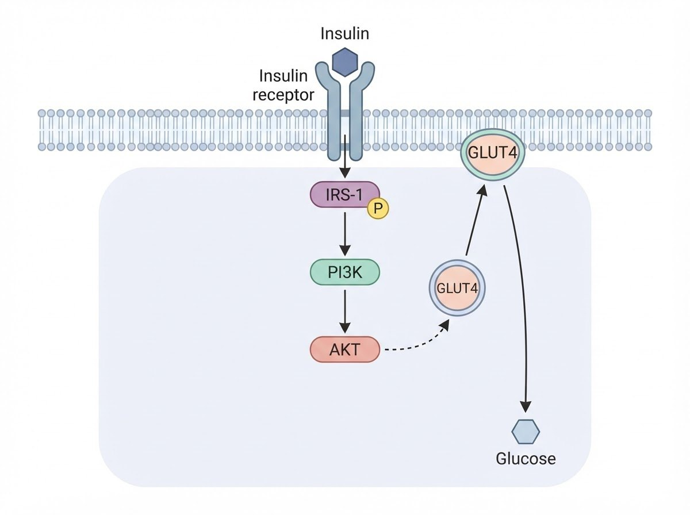</a>
</div>

##### 📌 Détails

- **Auteur:** [@Yila-AI](https://github.com/Yila-AI)
- **Modèle:** GPT Image 2.6
- **Format:** 4:3
- **Langues:** en, zh

**[👉 Essayer maintenant dans YILA →](https://yila.ai/fr/scientific-figure-prompts/insulin-signaling?utm_source=github&utm_medium=readme&utm_campaign=sci-figure-prompts&utm_content=insulin-signaling)** · [↑ Retour en haut](#top)

---

<a id="medical-illustration"></a>

### 🫀 Illustration médicale

<a id="no-73"></a>

#### No. 73: Acute kidney injury: tubular damage

 

##### 📖 Description

Technique: **one tubule segment, normal on the left, injured on the right** · Style: scientific illustration · Format: `16:9`

##### 📝 Prompt

```text
Create a longitudinal cross-section illustration of 【a proximal tubule in acute kidney injury】, read from left to right:
1. Above the tubule, two trigger icons: 【a blood vessel with a narrowing for ischemia, and a pill bottle for nephrotoxins】.
2. Left part of the tubule: 【tall, healthy epithelial cells with an intact brush border facing the lumen】.
3. Right part: 【swollen, flattened cells that have lost their brush border; some dead cells detach into the lumen (shed cells) and clump into a cast that blocks the tubule】.
4. Below the tubule: 【a peritubular capillary with immune cells leaving it and entering the tissue】.
Write each label only once in the whole figure.
Labels, each used once, no other text: 【Ischemia, Nephrotoxins, Brush border, Shed cells, Cast, Peritubular capillary, Immune cells】.

Style: journal-style scientific illustration. Clean semi-realistic vector illustration with gentle shading, using cross-sections or cutaways where they explain the structure, on a white background. Muted, harmonious palette with one accent color for the key process. Thin directional arrows for flows. Generous white space and a clear reading direction. Sans-serif English labels only, each label appears exactly once, spelled exactly as given. No cartoon style, no glossy CGI, no dark background, no stock-photo look, no decorative background.
```

<details><summary>Prompt en chinois</summary>

```text
画一张【急性肾损伤时近端肾小管】的纵切面插画，从左往右读：
1. 肾小管上方两个诱因图标：【一根变窄的血管代表缺血，一个药瓶代表肾毒性物质】。
2. 肾小管左段：【高柱状的健康上皮细胞，朝向管腔的刷状缘完整】。
3. 右段：【细胞肿胀变扁、刷状缘消失；部分死亡细胞脱落到管腔（脱落细胞），聚成管型堵住肾小管】。
4. 肾小管下方：【一根管周毛细血管，免疫细胞从中渗出，进入组织】。
整张图里每个标签只写一次。
标签（每个只出现一次，不加其他文字）：【Ischemia, Nephrotoxins, Brush border, Shed cells, Cast, Peritubular capillary, Immune cells】。

风格：期刊式科学插画。干净的半写实矢量插画，带柔和的明暗；需要说明结构时使用剖面或剖切视图，白色背景。配色低饱和、协调，只用一个强调色突出关键过程。用细的方向箭头表示流动。留白充足，阅读方向清晰。图中文字只用英文无衬线字体，每个标签只出现一次，拼写与给定完全一致。不要卡通风格、不要光滑的 CG 渲染、不要深色背景、不要图库照片感、不要装饰性背景。
```

</details>

##### 🖼️ Image générée

<div align="center">
<a href="https://yila.ai/fr/scientific-figure-prompts/acute-kidney-injury-tubule?utm_source=github&utm_medium=readme&utm_campaign=sci-figure-prompts&utm_content=acute-kidney-injury-tubule">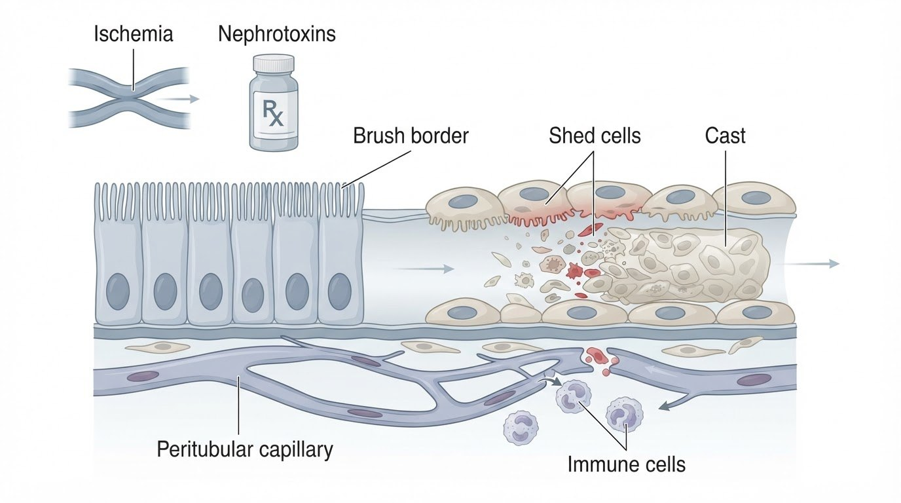</a>
</div>

##### 📌 Détails

- **Auteur:** [@Yila-AI](https://github.com/Yila-AI)
- **Modèle:** GPT Image 2.6
- **Format:** 16:9
- **Langues:** en, zh

**[👉 Essayer maintenant dans YILA →](https://yila.ai/fr/scientific-figure-prompts/acute-kidney-injury-tubule?utm_source=github&utm_medium=readme&utm_campaign=sci-figure-prompts&utm_content=acute-kidney-injury-tubule)** · [↑ Retour en haut](#top)

---

<a id="no-74"></a>

#### No. 74: Alveolar gas exchange

 

##### 📖 Description

Technique: **overview plus a circular inset** · Style: scientific illustration · Format: `16:9`

##### 📝 Prompt

```text
Create a scientific illustration of 【gas exchange in the lung】: on the left, a bronchiole ending in a cluster of alveoli wrapped in capillaries. On the right, a circular magnified inset of one alveolus and one capillary: O2 diffuses from the alveolus into the red blood cells, and CO2 diffuses from the blood into the alveolus. Thin type I cells line the wall; one rounded type II cell sits in a corner.
Write each label only once in the whole figure.
Labels, each used once, no other text: 【Bronchiole, Alveolus, Capillary, O2, CO2, Type I cell, Type II cell】.

Style: journal-style scientific illustration. Clean semi-realistic vector illustration with gentle shading, using cross-sections or cutaways where they explain the structure, on a white background. Muted, harmonious palette with one accent color for the key process. Thin directional arrows for flows. Generous white space and a clear reading direction. Sans-serif English labels only, each label appears exactly once, spelled exactly as given. No cartoon style, no glossy CGI, no dark background, no stock-photo look, no decorative background.
```

<details><summary>Prompt en chinois</summary>

```text
画一张【肺内气体交换】的科学插画：左侧一根细支气管末端连着一簇被毛细血管包绕的肺泡。右侧一个圆形放大插图，显示一个肺泡和一根毛细血管：O2 从肺泡扩散进红细胞，CO2 从血液扩散进肺泡。肺泡壁由扁平的 I 型细胞构成，角落里有一个圆形的 II 型细胞。
整张图里每个标签只写一次。
标签（每个只出现一次，不加其他文字）：【Bronchiole, Alveolus, Capillary, O2, CO2, Type I cell, Type II cell】。

风格：期刊式科学插画。干净的半写实矢量插画，带柔和的明暗；需要说明结构时使用剖面或剖切视图，白色背景。配色低饱和、协调，只用一个强调色突出关键过程。用细的方向箭头表示流动。留白充足，阅读方向清晰。图中文字只用英文无衬线字体，每个标签只出现一次，拼写与给定完全一致。不要卡通风格、不要光滑的 CG 渲染、不要深色背景、不要图库照片感、不要装饰性背景。
```

</details>

##### 🖼️ Image générée

<div align="center">
<a href="https://yila.ai/fr/scientific-figure-prompts/alveolar-gas-exchange?utm_source=github&utm_medium=readme&utm_campaign=sci-figure-prompts&utm_content=alveolar-gas-exchange">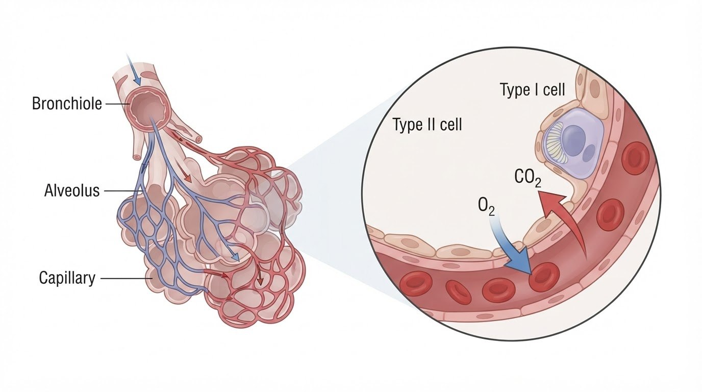</a>
</div>

##### 📌 Détails

- **Auteur:** [@Yila-AI](https://github.com/Yila-AI)
- **Modèle:** GPT Image 2.6
- **Format:** 16:9
- **Langues:** en, zh

**[👉 Essayer maintenant dans YILA →](https://yila.ai/fr/scientific-figure-prompts/alveolar-gas-exchange?utm_source=github&utm_medium=readme&utm_campaign=sci-figure-prompts&utm_content=alveolar-gas-exchange)** · [↑ Retour en haut](#top)

---

<a id="no-75"></a>

#### No. 75: Healthy versus Alzheimer's brain

  

##### 📖 Description

Technique: **side-by-side panels + magnified inset** · Style: soft semi-realistic illustration · Format: `4:3`

##### 📝 Prompt

```text
Create a side-by-side medical illustration comparing 【a healthy brain and an Alzheimer's disease brain】, separated by a thin dashed vertical line.
Left: 【a full-sized healthy brain; a circular magnified inset shows healthy neurons with intact connections】.
Right: 【a shrunken brain with wider grooves; a circular magnified inset shows amyloid plaques between neurons and twisted tangles inside a neuron】.
Labels, each used once, no other text: 【Healthy brain, Alzheimer's brain, Amyloid plaque, Tau tangles】.

Style: journal graphical-abstract illustration. Soft semi-realistic medical illustration with gentle volume and subtle hand-painted texture, on a clean white background. Muted, harmonious palette with one accent color. Clear left-to-right narrative, generous white space. Sans-serif English labels only, each label appears exactly once, spelled exactly as given. No cartoon style, no glossy CGI, no dark background, no stock-photo look.
```

<details><summary>Prompt en chinois</summary>

```text
画一张左右并排的医学插图，比较【健康大脑和阿尔茨海默病大脑】，中间用一条细虚线分开。
左：【大小正常的健康大脑；一个圆形放大框展示连接完整的健康神经元】。
右：【萎缩、沟回变宽的大脑；一个圆形放大框展示神经元之间的淀粉样斑块和神经元内扭曲的缠结】。
标签（每个只出现一次，不加其他文字）：【Healthy brain, Alzheimer's brain, Amyloid plaque, Tau tangles】。

风格：期刊图形摘要插画。柔和的半写实医学插画，带轻微体积感和细腻的手绘质感，白色干净背景。配色低饱和、协调，只用一个强调色。从左到右叙事清晰，留白充足。图中文字只用英文无衬线字体，每个标签只出现一次，拼写与给定完全一致。不要卡通风格、不要光滑的 CG 渲染、不要深色背景、不要图库照片感。
```

</details>

##### 🖼️ Image générée

<div align="center">
<a href="https://yila.ai/fr/scientific-figure-prompts/alzheimers-brain?utm_source=github&utm_medium=readme&utm_campaign=sci-figure-prompts&utm_content=alzheimers-brain"></a>
</div>

##### 📌 Détails

- **Auteur:** [@Yila-AI](https://github.com/Yila-AI)
- **Modèle:** GPT Image 2.6
- **Format:** 4:3
- **Langues:** en, zh

**[👉 Essayer maintenant dans YILA →](https://yila.ai/fr/scientific-figure-prompts/alzheimers-brain?utm_source=github&utm_medium=readme&utm_campaign=sci-figure-prompts&utm_content=alzheimers-brain)** · [↑ Retour en haut](#top)

---

<a id="no-76"></a>

#### No. 76: Atherosclerotic plaque formation

 

##### 📖 Description

Technique: **cross-section + staged sequence** · Style: soft semi-realistic illustration · Format: `16:9`

##### 📝 Prompt

```text
Create a medical illustration of 【one artery cut open lengthwise】, showing disease progression from left to right in three stages along the same vessel.
Stage 1 (left): 【a healthy wall with smooth endothelium】.
Stage 2 (center): 【LDL particles enter the vessel wall and monocytes turn into lipid-filled foam cells】.
Stage 3 (right): 【a mature plaque with a yellow lipid core under a fibrous cap, and a clearly narrowed lumen】.
One circular magnified inset shows 【a single foam cell full of lipid droplets】.
Labels, each used once, no other text: 【LDL, Foam cell, Lipid core, Fibrous cap, Narrowed lumen】.

Style: journal graphical-abstract illustration. Soft semi-realistic medical illustration with gentle volume and subtle hand-painted texture, on a clean white background. Muted, harmonious palette with one accent color. Clear left-to-right narrative, generous white space. Sans-serif English labels only, each label appears exactly once, spelled exactly as given. No cartoon style, no glossy CGI, no dark background, no stock-photo look.
```

<details><summary>Prompt en chinois</summary>

```text
画一张医学插图，主体是【一段被纵向剖开的动脉】，沿同一段结构从左到右分三个阶段展示病变进展。
阶段 1（左）：【健康的血管壁，内皮光滑】。
阶段 2（中）：【LDL 颗粒进入血管壁，单核细胞变成充满脂质的泡沫细胞】。
阶段 3（右）：【成熟斑块：黄色的脂质核心上覆盖纤维帽，管腔明显变窄】。
用一个圆形放大框展示【一个充满脂滴的泡沫细胞】。
标签（每个只出现一次，不加其他文字）：【LDL, Foam cell, Lipid core, Fibrous cap, Narrowed lumen】。

风格：期刊图形摘要插画。柔和的半写实医学插画，带轻微体积感和细腻的手绘质感，白色干净背景。配色低饱和、协调，只用一个强调色。从左到右叙事清晰，留白充足。图中文字只用英文无衬线字体，每个标签只出现一次，拼写与给定完全一致。不要卡通风格、不要光滑的 CG 渲染、不要深色背景、不要图库照片感。
```

</details>

##### 🖼️ Image générée

<div align="center">
<a href="https://yila.ai/fr/scientific-figure-prompts/atherosclerosis-plaque?utm_source=github&utm_medium=readme&utm_campaign=sci-figure-prompts&utm_content=atherosclerosis-plaque">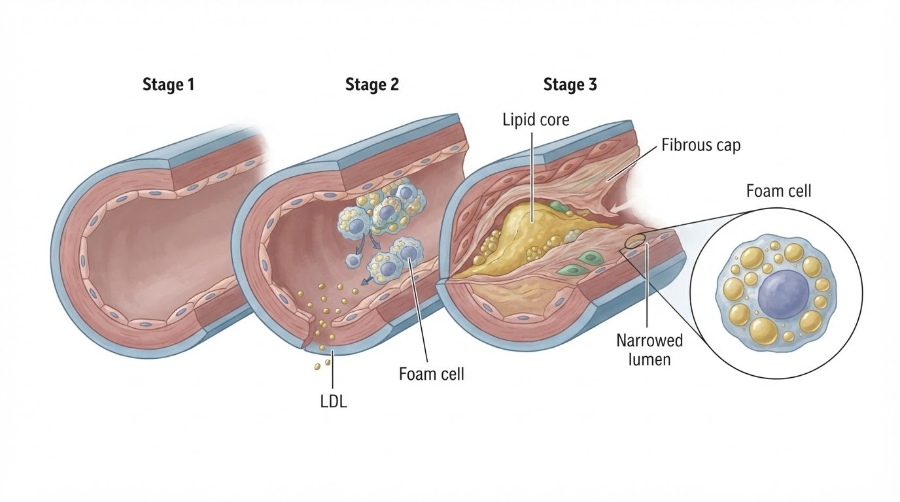</a>
</div>

##### 📌 Détails

- **Auteur:** [@Yila-AI](https://github.com/Yila-AI)
- **Modèle:** GPT Image 2.6
- **Format:** 16:9
- **Langues:** en, zh

**[👉 Essayer maintenant dans YILA →](https://yila.ai/fr/scientific-figure-prompts/atherosclerosis-plaque?utm_source=github&utm_medium=readme&utm_campaign=sci-figure-prompts&utm_content=atherosclerosis-plaque)** · [↑ Retour en haut](#top)

---

<a id="no-77"></a>

#### No. 77: Bone remodeling: formation and resorption

 

##### 📖 Description

Technique: **bone-surface cross-section with signaling molecules** · Style: scientific illustration · Format: `16:9`

##### 📝 Prompt

```text
Create a cross-section illustration of 【bone remodeling】 along a bone surface, read from left to right: 【a large multinucleated osteoclast digging a resorption pit; osteoblasts laying down new bone matrix; one osteocyte embedded in the bone below】. Above them, RANKL on an osteoblast binds RANK on an osteoclast precursor, and OPG blocks RANKL with a red T-bar whose flat end touches RANKL. The cell receiving RANKL is an osteoclast precursor.
Write each label only once in the whole figure.
Labels, each used once, no other text: 【Osteoclast, Osteoblast, Osteocyte, RANKL, RANK, OPG, Bone resorption, Bone formation】.

Style: journal-style scientific illustration. Clean semi-realistic vector illustration with gentle shading, using cross-sections or cutaways where they explain the structure, on a white background. Muted, harmonious palette with one accent color for the key process. Thin directional arrows for flows. Generous white space and a clear reading direction. Sans-serif English labels only, each label appears exactly once, spelled exactly as given. No cartoon style, no glossy CGI, no dark background, no stock-photo look, no decorative background.
```

<details><summary>Prompt en chinois</summary>

```text
画一张【骨重塑】的截面插画，沿着骨表面从左往右：【一个多核的大破骨细胞在挖吸收陷窝；成骨细胞在铺新的骨基质；下方骨质里嵌着一个骨细胞】。上方，成骨细胞上的 RANKL 结合破骨前体细胞上的 RANK，OPG 用红色 T 形线挡住 RANKL，平头端碰到 RANKL。接受 RANKL 的是破骨前体细胞。
整张图里每个标签只写一次。
标签（每个只出现一次，不加其他文字）：【Osteoclast, Osteoblast, Osteocyte, RANKL, RANK, OPG, Bone resorption, Bone formation】。

风格：期刊式科学插画。干净的半写实矢量插画，带柔和的明暗；需要说明结构时使用剖面或剖切视图，白色背景。配色低饱和、协调，只用一个强调色突出关键过程。用细的方向箭头表示流动。留白充足，阅读方向清晰。图中文字只用英文无衬线字体，每个标签只出现一次，拼写与给定完全一致。不要卡通风格、不要光滑的 CG 渲染、不要深色背景、不要图库照片感、不要装饰性背景。
```

</details>

##### 🖼️ Image générée

<div align="center">
<a href="https://yila.ai/fr/scientific-figure-prompts/bone-remodeling?utm_source=github&utm_medium=readme&utm_campaign=sci-figure-prompts&utm_content=bone-remodeling">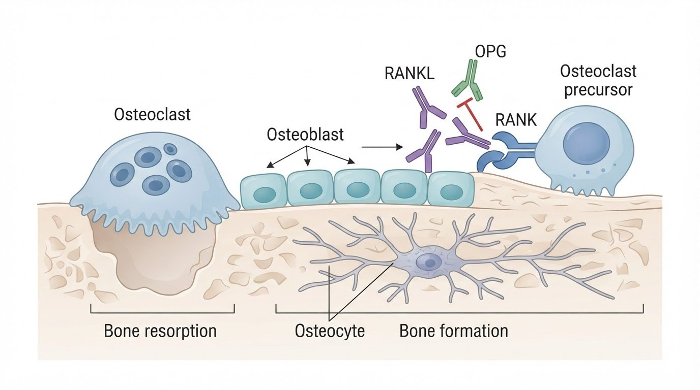</a>
</div>

##### 📌 Détails

- **Auteur:** [@Yila-AI](https://github.com/Yila-AI)
- **Modèle:** GPT Image 2.6
- **Format:** 16:9
- **Langues:** en, zh

**[👉 Essayer maintenant dans YILA →](https://yila.ai/fr/scientific-figure-prompts/bone-remodeling?utm_source=github&utm_medium=readme&utm_campaign=sci-figure-prompts&utm_content=bone-remodeling)** · [↑ Retour en haut](#top)

---

<a id="no-78"></a>

#### No. 78: Coronary artery stenosis

 

##### 📖 Description

Technique: **whole heart plus a vessel cross-section inset** · Style: scientific illustration · Format: `16:9`

##### 📝 Prompt

```text
Create a scientific illustration of 【coronary artery stenosis】: on the left, the front of the heart with the aorta at the top and the coronary arteries running over its surface. A plaque narrows the left anterior descending artery partway down, and the heart muscle below the narrowing is shaded pale purple as ischemic myocardium. On the right, a circular magnified inset shows a cross-section of the narrowed artery: a yellow plaque filling most of the wall, leaving a small narrowed lumen with a few red blood cells.
Write each label only once in the whole figure.
Labels, each used once, no other text: 【Aorta, Right coronary artery, Left anterior descending artery, Plaque, Narrowed lumen, Ischemic myocardium】.

Style: journal-style scientific illustration. Clean semi-realistic vector illustration with gentle shading, using cross-sections or cutaways where they explain the structure, on a white background. Muted, harmonious palette with one accent color for the key process. Thin directional arrows for flows. Generous white space and a clear reading direction. Sans-serif English labels only, each label appears exactly once, spelled exactly as given. No cartoon style, no glossy CGI, no dark background, no stock-photo look, no decorative background.
```

<details><summary>Prompt en chinois</summary>

```text
画一张【冠状动脉狭窄】的科学插画：左侧是心脏正面，主动脉在顶部，冠状动脉沿心脏表面走行。左前降支中段被斑块堵窄，狭窄处以下的心肌画成浅紫色，代表缺血心肌。右侧一个圆形放大插图，显示狭窄动脉的横截面：黄色斑块占据大部分管壁，只剩一个狭小的管腔，里面有几个红细胞。
整张图里每个标签只写一次。
标签（每个只出现一次，不加其他文字）：【Aorta, Right coronary artery, Left anterior descending artery, Plaque, Narrowed lumen, Ischemic myocardium】。

风格：期刊式科学插画。干净的半写实矢量插画，带柔和的明暗；需要说明结构时使用剖面或剖切视图，白色背景。配色低饱和、协调，只用一个强调色突出关键过程。用细的方向箭头表示流动。留白充足，阅读方向清晰。图中文字只用英文无衬线字体，每个标签只出现一次，拼写与给定完全一致。不要卡通风格、不要光滑的 CG 渲染、不要深色背景、不要图库照片感、不要装饰性背景。
```

</details>

##### 🖼️ Image générée

<div align="center">
<a href="https://yila.ai/fr/scientific-figure-prompts/coronary-stenosis?utm_source=github&utm_medium=readme&utm_campaign=sci-figure-prompts&utm_content=coronary-stenosis">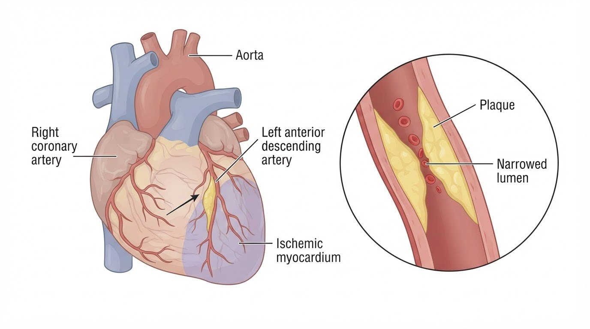</a>
</div>

##### 📌 Détails

- **Auteur:** [@Yila-AI](https://github.com/Yila-AI)
- **Modèle:** GPT Image 2.6
- **Format:** 16:9
- **Langues:** en, zh

**[👉 Essayer maintenant dans YILA →](https://yila.ai/fr/scientific-figure-prompts/coronary-stenosis?utm_source=github&utm_medium=readme&utm_campaign=sci-figure-prompts&utm_content=coronary-stenosis)** · [↑ Retour en haut](#top)

---

<a id="no-79"></a>

#### No. 79: Four stages of fracture healing

 

##### 📖 Description

Technique: **staged sequence** · Style: soft semi-realistic illustration · Format: `16:9`

##### 📝 Prompt

```text
Create a medical illustration of 【bone fracture healing】 in four stages from left to right, each showing the same long bone cut lengthwise at the break.
1: 【a blood clot fills the gap between the broken ends】.
2: 【soft cartilage bridges the gap】.
3: 【the cartilage turns into new, spongy bone】.
4: 【the bone is reshaped to its original form】.
Labels, each used once, no other text: 【Hematoma, Soft callus, Hard callus, Remodeling】.

Style: journal graphical-abstract illustration. Soft semi-realistic medical illustration with gentle volume and subtle hand-painted texture, on a clean white background. Muted, harmonious palette with one accent color. Clear left-to-right narrative, generous white space. Sans-serif English labels only, each label appears exactly once, spelled exactly as given. No cartoon style, no glossy CGI, no dark background, no stock-photo look.
```

<details><summary>Prompt en chinois</summary>

```text
画一张【骨折愈合】的医学插图，从左到右分四个阶段，每个阶段都是同一根长骨在骨折处的纵剖面。
1：【血凝块填满两个断端之间的空隙】。
2：【柔软的软骨连接起断端】。
3：【软骨转变为新的海绵状骨】。
4：【骨骼被重塑回原来的形状】。
标签（每个只出现一次，不加其他文字）：【Hematoma, Soft callus, Hard callus, Remodeling】。

风格：期刊图形摘要插画。柔和的半写实医学插画，带轻微体积感和细腻的手绘质感，白色干净背景。配色低饱和、协调，只用一个强调色。从左到右叙事清晰，留白充足。图中文字只用英文无衬线字体，每个标签只出现一次，拼写与给定完全一致。不要卡通风格、不要光滑的 CG 渲染、不要深色背景、不要图库照片感。
```

</details>

##### 🖼️ Image générée

<div align="center">
<a href="https://yila.ai/fr/scientific-figure-prompts/fracture-healing?utm_source=github&utm_medium=readme&utm_campaign=sci-figure-prompts&utm_content=fracture-healing">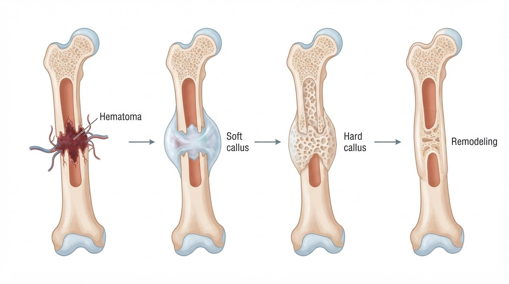</a>
</div>

##### 📌 Détails

- **Auteur:** [@Yila-AI](https://github.com/Yila-AI)
- **Modèle:** GPT Image 2.6
- **Format:** 16:9
- **Langues:** en, zh

**[👉 Essayer maintenant dans YILA →](https://yila.ai/fr/scientific-figure-prompts/fracture-healing?utm_source=github&utm_medium=readme&utm_campaign=sci-figure-prompts&utm_content=fracture-healing)** · [↑ Retour en haut](#top)

---

<a id="no-80"></a>

#### No. 80: Three layers of the glomerular filtration barrier

 

##### 📖 Description

Technique: **layered cross-section** · Style: soft semi-realistic illustration · Format: `4:3`

##### 📝 Prompt

```text
Create a cross-section medical illustration of 【the glomerular filtration barrier】, with three layers stacked from the blood side at the top to the urine side at the bottom:
【1. an endothelium with small round pores; 2. a thick basement membrane; 3. podocyte foot processes with narrow slits between them】.
Arrows show 【only water and small molecules passing down through all three layers】. 【Large albumin proteins sit above the endothelium with a red X; no arrow starts from albumin】.
Labels, each used once, no other text: 【Endothelium, Basement membrane, Podocyte, Albumin】.

Style: journal graphical-abstract illustration. Soft semi-realistic medical illustration with gentle volume and subtle hand-painted texture, on a clean white background. Muted, harmonious palette with one accent color. Clear left-to-right narrative, generous white space. Sans-serif English labels only, each label appears exactly once, spelled exactly as given. No cartoon style, no glossy CGI, no dark background, no stock-photo look.
```

<details><summary>Prompt en chinois</summary>

```text
画一张【肾小球滤过屏障】的剖面医学插图，三层从上方的血液侧叠到下方的尿液侧：
【1. 带小圆孔的内皮；2. 厚的基底膜；3. 足细胞的足突，足突之间是狭窄的裂隙】。
箭头只表示【水和小分子向下穿过三层】。【大的白蛋白停在内皮上方，旁边一个红色叉号；不要从白蛋白画出任何箭头】。
标签（每个只出现一次，不加其他文字）：【Endothelium, Basement membrane, Podocyte, Albumin】。

风格：期刊图形摘要插画。柔和的半写实医学插画，带轻微体积感和细腻的手绘质感，白色干净背景。配色低饱和、协调，只用一个强调色。从左到右叙事清晰，留白充足。图中文字只用英文无衬线字体，每个标签只出现一次，拼写与给定完全一致。不要卡通风格、不要光滑的 CG 渲染、不要深色背景、不要图库照片感。
```

</details>

##### 🖼️ Image générée

<div align="center">
<a href="https://yila.ai/fr/scientific-figure-prompts/glomerular-barrier?utm_source=github&utm_medium=readme&utm_campaign=sci-figure-prompts&utm_content=glomerular-barrier">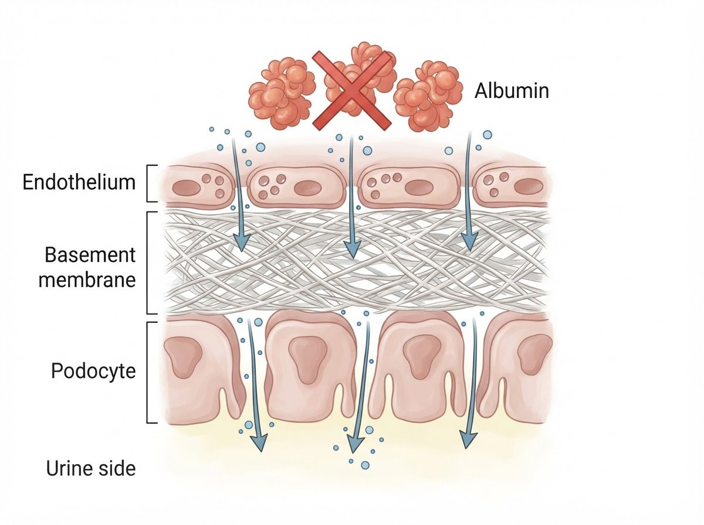</a>
</div>

##### 📌 Détails

- **Auteur:** [@Yila-AI](https://github.com/Yila-AI)
- **Modèle:** GPT Image 2.6
- **Format:** 4:3
- **Langues:** en, zh

**[👉 Essayer maintenant dans YILA →](https://yila.ai/fr/scientific-figure-prompts/glomerular-barrier?utm_source=github&utm_medium=readme&utm_campaign=sci-figure-prompts&utm_content=glomerular-barrier)** · [↑ Retour en haut](#top)

---

<a id="experimental-workflow"></a>

### 🧪 Protocole expérimental

<a id="no-93"></a>

#### No. 93: 16S rRNA microbiome sequencing workflow

 

##### 📖 Description

Technique: **one panel per step, step names only** · Style: flat workflow · Format: `16:9`

##### 📝 Prompt

```text
Create a workflow figure for 【16S rRNA microbiome sequencing】, 6 steps from left to right:
1. 【Sample collection: a stool sample tube】
2. 【DNA extraction: a DNA strand in a tube】
3. 【16S amplification: a highlighted gene segment being copied】
4. 【Sequencing: a sequencer machine】
5. 【ASV clustering: colored dots grouping together】
6. 【Diversity analysis: bacteria of different shapes in groups】
Step names, each used once, no other text: 【Sample collection, DNA extraction, 16S amplification, Sequencing, ASV clustering, Diversity analysis】.

Style: journal-style experimental workflow figure. Clean flat vector icons on a white background, one light pastel rounded panel per step, thin gray arrows between panels. Only 3-4 muted colors. Each panel shows one simple scene with no text inside it; the only text in the whole figure is the step names given. Sans-serif English, each step name appears exactly once, spelled exactly as given. No legends, no captions, no extra labels, no 3D rendering, no shadows, no decorative background.
```

<details><summary>Prompt en chinois</summary>

```text
画一张【16S rRNA 菌群测序】的流程图，从左往右六步：
1. 【样本采集：一管粪便样本】
2. 【DNA 提取：试管里一条 DNA 链】
3. 【16S 扩增：高亮的基因片段被复制】
4. 【测序：一台测序仪】
5. 【ASV 聚类：彩色小点聚成几团】
6. 【多样性分析：不同形状的细菌分组】
步骤名（每个只出现一次，不加其他文字）：【Sample collection, DNA extraction, 16S amplification, Sequencing, ASV clustering, Diversity analysis】。

风格：期刊式实验流程图。白色背景上干净的扁平矢量图标，每一步一个浅色圆角面板，面板之间用细灰色箭头连接。只用 3–4 种低饱和度颜色。每个面板里只画一个简洁的小场景，面板内不写任何文字；整张图唯一的文字就是给定的步骤名。用英文无衬线字体，每个步骤名只出现一次，拼写与给定完全一致。不要图例、不要说明文字、不要额外标签、不要 3D 渲染、阴影或装饰性背景。
```

</details>

##### 🖼️ Image générée

<div align="center">
<a href="https://yila.ai/fr/scientific-figure-prompts/16s-microbiome?utm_source=github&utm_medium=readme&utm_campaign=sci-figure-prompts&utm_content=16s-microbiome">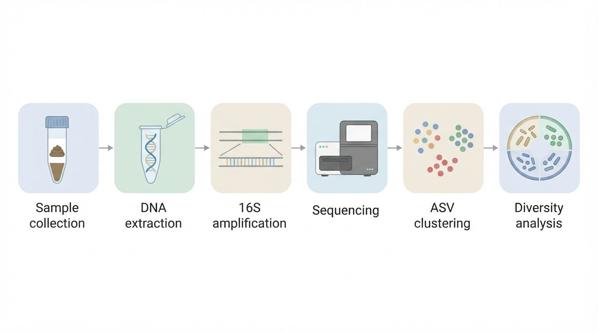</a>
</div>

##### 📌 Détails

- **Auteur:** [@Yila-AI](https://github.com/Yila-AI)
- **Modèle:** GPT Image 2.6
- **Format:** 16:9
- **Langues:** en, zh

**[👉 Essayer maintenant dans YILA →](https://yila.ai/fr/scientific-figure-prompts/16s-microbiome?utm_source=github&utm_medium=readme&utm_campaign=sci-figure-prompts&utm_content=16s-microbiome)** · [↑ Retour en haut](#top)

---

<a id="no-94"></a>

#### No. 94: ATAC-seq workflow

 

##### 📖 Description

Technique: **one panel per step, step names only** · Style: flat workflow · Format: `16:9`

##### 📝 Prompt

```text
Create a workflow figure for 【an ATAC-seq experiment】, 6 steps from left to right:
1. 【Nuclei isolation: nuclei released from cells】
2. 【Tagmentation: Tn5 cutting DNA between nucleosomes and adding adapters in open regions】
3. 【DNA purification: tagged fragments collected in a tube】
4. 【PCR amplification: fragments copied in a thermal cycler】
5. 【Sequencing: a sequencer】
6. 【Open chromatin: reads stacking up in the gaps between nucleosomes】
Do not write the numbered sentences in the figure.
Step names, each used once, no other text: 【Nuclei isolation, Tagmentation, DNA purification, PCR amplification, Sequencing, Open chromatin】.

Style: journal-style experimental workflow figure. Clean flat vector icons on a white background, one light pastel rounded panel per step, thin gray arrows between panels. Only 3-4 muted colors. Each panel shows one simple scene with no text inside it; the only text in the whole figure is the step names given. Sans-serif English, each step name appears exactly once, spelled exactly as given. No legends, no captions, no extra labels, no 3D rendering, no shadows, no decorative background.
```

<details><summary>Prompt en chinois</summary>

```text
画一张【ATAC-seq 实验】的流程图，从左往右六步：
1. 【细胞核分离：从细胞中释放细胞核】
2. 【片段化标记：Tn5 在开放区域的核小体之间切开 DNA 并加上接头】
3. 【DNA 纯化：把带标记的片段收集到试管里】
4. 【PCR 扩增：在 PCR 仪中扩增片段】
5. 【测序：一台测序仪】
6. 【开放染色质：读段堆叠在核小体之间的空隙处】
不要把编号句子写进图里。
步骤名（每个只出现一次，不加其他文字）：【Nuclei isolation, Tagmentation, DNA purification, PCR amplification, Sequencing, Open chromatin】。

风格：期刊式实验流程图。白色背景上干净的扁平矢量图标，每一步一个浅色圆角面板，面板之间用细灰色箭头连接。只用 3–4 种低饱和度颜色。每个面板里只画一个简洁的小场景，面板内不写任何文字；整张图唯一的文字就是给定的步骤名。用英文无衬线字体，每个步骤名只出现一次，拼写与给定完全一致。不要图例、不要说明文字、不要额外标签、不要 3D 渲染、阴影或装饰性背景。
```

</details>

##### 🖼️ Image générée

<div align="center">
<a href="https://yila.ai/fr/scientific-figure-prompts/atac-seq?utm_source=github&utm_medium=readme&utm_campaign=sci-figure-prompts&utm_content=atac-seq">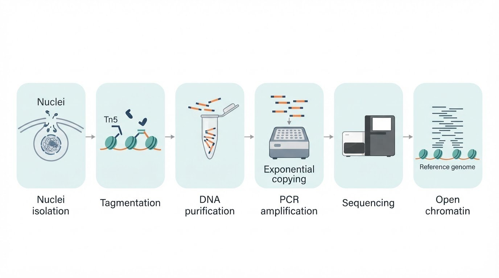</a>
</div>

##### 📌 Détails

- **Auteur:** [@Yila-AI](https://github.com/Yila-AI)
- **Modèle:** GPT Image 2.6
- **Format:** 16:9
- **Langues:** en, zh

**[👉 Essayer maintenant dans YILA →](https://yila.ai/fr/scientific-figure-prompts/atac-seq?utm_source=github&utm_medium=readme&utm_campaign=sci-figure-prompts&utm_content=atac-seq)** · [↑ Retour en haut](#top)

---

<a id="no-95"></a>

#### No. 95: Clinical biobank and multi-omics profiling workflow

 

##### 📖 Description

Technique: **one panel per step, step names only** · Style: flat workflow · Format: `16:9`

##### 📝 Prompt

```text
Create a workflow figure for 【a clinical biobank with multi-omics profiling】, 7 steps from left to right:
1. 【Recruitment: a patient signing a consent form】
2. 【Sample collection: blood, tissue and urine tubes】
3. 【Processing: tubes split into small barcoded aliquots】
4. 【Storage: an ultra-low freezer and a liquid nitrogen tank】
5. 【Multi-omics profiling: four icons for DNA, RNA, protein and metabolites】
6. 【Data integration: omics layers linked to a clinical record】
7. 【Discovery: a lightbulb over a small network】
Do not write the numbered sentences in the figure.
If a component appears in more than one place or panel, write its label only at its first appearance; every other copy has no text. No label may appear twice anywhere in the figure. Spell every label exactly as given and add no titles. Draw every molecule as a simple colored circle, with no chemical structures or letters.
Step names, each used once, no other text: 【Recruitment, Sample collection, Processing, Storage, Multi-omics profiling, Data integration, Discovery】.

Style: journal-style experimental workflow figure. Clean flat vector icons on a white background, one light pastel rounded panel per step, thin gray arrows between panels. Only 3-4 muted colors. Each panel shows one simple scene with no text inside it; the only text in the whole figure is the step names given. Sans-serif English, each step name appears exactly once, spelled exactly as given. No legends, no captions, no extra labels, no 3D rendering, no shadows, no decorative background.
```

<details><summary>Prompt en chinois</summary>

```text
画一张【临床生物样本库与多组学分析】的流程图，从左往右七步：
1. 【招募：病人签署知情同意书】
2. 【样本采集：血液、组织和尿液管】
3. 【处理：样本分装成带条码的小管】
4. 【储存：超低温冰箱和液氮罐】
5. 【多组学检测：DNA、RNA、蛋白质和代谢物四个图标】
6. 【数据整合：各组学层与临床病历相连】
7. 【发现：小网络上方一个灯泡】
不要把编号句子写进图里。
如果同一组件在多处或多个面板出现，只在第一次出现时写标签，其余副本不写字。整张图里任何标签都不能出现两次。每个标签拼写与给定完全一致，不加标题。所有分子都画成简单的彩色圆点，不画化学结构、不写字母。
步骤名（每个只出现一次，不加其他文字）：【Recruitment, Sample collection, Processing, Storage, Multi-omics profiling, Data integration, Discovery】。

风格：期刊式实验流程图。白色背景上干净的扁平矢量图标，每一步一个浅色圆角面板，面板之间用细灰色箭头连接。只用 3–4 种低饱和度颜色。每个面板里只画一个简洁的小场景，面板内不写任何文字；整张图唯一的文字就是给定的步骤名。用英文无衬线字体，每个步骤名只出现一次，拼写与给定完全一致。不要图例、不要说明文字、不要额外标签、不要 3D 渲染、阴影或装饰性背景。
```

</details>

##### 🖼️ Image générée

<div align="center">
<a href="https://yila.ai/fr/scientific-figure-prompts/biobank-multiomics?utm_source=github&utm_medium=readme&utm_campaign=sci-figure-prompts&utm_content=biobank-multiomics">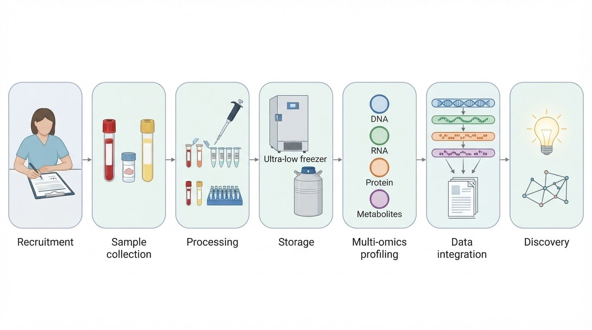</a>
</div>

##### 📌 Détails

- **Auteur:** [@Yila-AI](https://github.com/Yila-AI)
- **Modèle:** GPT Image 2.6
- **Format:** 16:9
- **Langues:** en, zh

**[👉 Essayer maintenant dans YILA →](https://yila.ai/fr/scientific-figure-prompts/biobank-multiomics?utm_source=github&utm_medium=readme&utm_campaign=sci-figure-prompts&utm_content=biobank-multiomics)** · [↑ Retour en haut](#top)

---

<a id="no-96"></a>

#### No. 96: Biomarker discovery and validation workflow

 

##### 📖 Description

Technique: **one panel per step, step names only** · Style: flat workflow · Format: `16:9`

##### 📝 Prompt

```text
Create a workflow figure for 【biomarker discovery and validation】, 6 steps from left to right:
1. 【Discovery cohort: a group of patient icons】
2. 【Candidate biomarkers: a few molecules with tags】
3. 【Model training: a small network】
4. 【Internal validation: a circular arrow】
5. 【External validation: a second hospital】
6. 【Clinical use: a doctor holding a test kit】
Do not write the numbered sentences in the figure.
Step names, each used once, no other text: 【Discovery cohort, Candidate biomarkers, Model training, Internal validation, External validation, Clinical use】.

Style: journal-style experimental workflow figure. Clean flat vector icons on a white background, one light pastel rounded panel per step, thin gray arrows between panels. Only 3-4 muted colors. Each panel shows one simple scene with no text inside it; the only text in the whole figure is the step names given. Sans-serif English, each step name appears exactly once, spelled exactly as given. No legends, no captions, no extra labels, no 3D rendering, no shadows, no decorative background.
```

<details><summary>Prompt en chinois</summary>

```text
画一张【生物标志物发现与验证】的流程图，从左往右六步：
1. 【发现队列：一组病人图标】
2. 【候选标志物：几个带标签的分子】
3. 【模型训练：一个小网络】
4. 【内部验证：一个循环箭头】
5. 【外部验证：另一家医院】
6. 【临床应用：手持检测试剂盒的医生】
不要把编号句子写进图里。
步骤名（每个只出现一次，不加其他文字）：【Discovery cohort, Candidate biomarkers, Model training, Internal validation, External validation, Clinical use】。

风格：期刊式实验流程图。白色背景上干净的扁平矢量图标，每一步一个浅色圆角面板，面板之间用细灰色箭头连接。只用 3–4 种低饱和度颜色。每个面板里只画一个简洁的小场景，面板内不写任何文字；整张图唯一的文字就是给定的步骤名。用英文无衬线字体，每个步骤名只出现一次，拼写与给定完全一致。不要图例、不要说明文字、不要额外标签、不要 3D 渲染、阴影或装饰性背景。
```

</details>

##### 🖼️ Image générée

<div align="center">
<a href="https://yila.ai/fr/scientific-figure-prompts/biomarker-validation?utm_source=github&utm_medium=readme&utm_campaign=sci-figure-prompts&utm_content=biomarker-validation">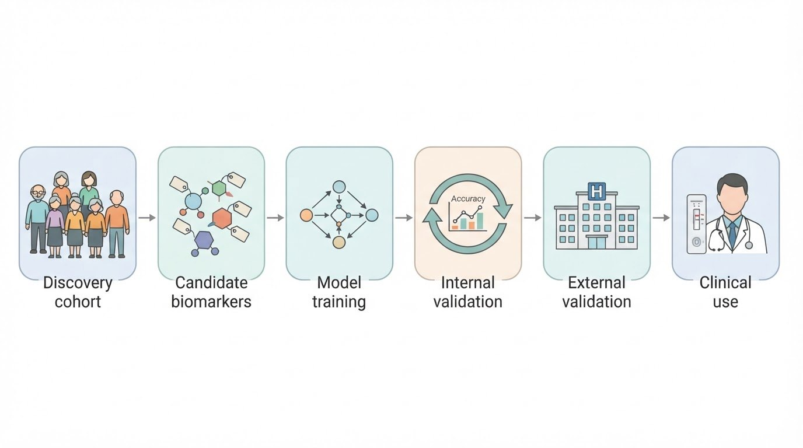</a>
</div>

##### 📌 Détails

- **Auteur:** [@Yila-AI](https://github.com/Yila-AI)
- **Modèle:** GPT Image 2.6
- **Format:** 16:9
- **Langues:** en, zh

**[👉 Essayer maintenant dans YILA →](https://yila.ai/fr/scientific-figure-prompts/biomarker-validation?utm_source=github&utm_medium=readme&utm_campaign=sci-figure-prompts&utm_content=biomarker-validation)** · [↑ Retour en haut](#top)

---

<a id="no-97"></a>

#### No. 97: Bulk RNA-seq workflow

 

##### 📖 Description

Technique: **one panel per step, step names only** · Style: flat workflow · Format: `16:9`

##### 📝 Prompt

```text
Create a workflow figure for 【bulk RNA sequencing】, 6 steps from left to right:
1. 【Sampling: a tissue piece in a tube】
2. 【RNA extraction: an RNA strand in a tube】
3. 【Library preparation: short fragments with adapter caps】
4. 【Sequencing: a sequencer machine】
5. 【Alignment: short reads lining up on a long genome line】
6. 【Differential expression: one gene icon up, one down】
Step names, each used once, no other text: 【Sampling, RNA extraction, Library preparation, Sequencing, Alignment, Differential expression】.

Style: journal-style experimental workflow figure. Clean flat vector icons on a white background, one light pastel rounded panel per step, thin gray arrows between panels. Only 3-4 muted colors. Each panel shows one simple scene with no text inside it; the only text in the whole figure is the step names given. Sans-serif English, each step name appears exactly once, spelled exactly as given. No legends, no captions, no extra labels, no 3D rendering, no shadows, no decorative background.
```

<details><summary>Prompt en chinois</summary>

```text
画一张【bulk RNA 测序】的流程图，从左往右六步：
1. 【取样：试管里的一块组织】
2. 【RNA 提取：试管里一条 RNA 链】
3. 【建库：两端带接头的短片段】
4. 【测序：一台测序仪】
5. 【比对：短读段排列到一条长基因组线上】
6. 【差异表达：一个基因上调、一个下调】
步骤名（每个只出现一次，不加其他文字）：【Sampling, RNA extraction, Library preparation, Sequencing, Alignment, Differential expression】。

风格：期刊式实验流程图。白色背景上干净的扁平矢量图标，每一步一个浅色圆角面板，面板之间用细灰色箭头连接。只用 3–4 种低饱和度颜色。每个面板里只画一个简洁的小场景，面板内不写任何文字；整张图唯一的文字就是给定的步骤名。用英文无衬线字体，每个步骤名只出现一次，拼写与给定完全一致。不要图例、不要说明文字、不要额外标签、不要 3D 渲染、阴影或装饰性背景。
```

</details>

##### 🖼️ Image générée

<div align="center">
<a href="https://yila.ai/fr/scientific-figure-prompts/bulk-rna-seq?utm_source=github&utm_medium=readme&utm_campaign=sci-figure-prompts&utm_content=bulk-rna-seq">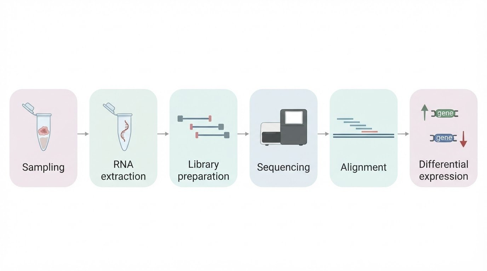</a>
</div>

##### 📌 Détails

- **Auteur:** [@Yila-AI](https://github.com/Yila-AI)
- **Modèle:** GPT Image 2.6
- **Format:** 16:9
- **Langues:** en, zh

**[👉 Essayer maintenant dans YILA →](https://yila.ai/fr/scientific-figure-prompts/bulk-rna-seq?utm_source=github&utm_medium=readme&utm_campaign=sci-figure-prompts&utm_content=bulk-rna-seq)** · [↑ Retour en haut](#top)

---

<a id="no-98"></a>

#### No. 98: CCK-8 cell viability assay workflow

 

##### 📖 Description

Technique: **one panel per step, step names only** · Style: flat workflow · Format: `16:9`

##### 📝 Prompt

```text
Create a workflow figure for 【a CCK-8 cell viability assay】, 6 steps from left to right:
1. 【Cell seeding: cells in a 96-well plate】
2. 【Drug treatment: a pipette adding drops to the wells】
3. 【Incubation: the plate in an incubator】
4. 【CCK-8 reagent: a dropper adding yellow reagent to the wells】
5. 【Color development: wells turning orange】
6. 【Absorbance reading: a plate reader】
Do not write the numbered sentences in the figure.
Step names, each used once, no other text: 【Cell seeding, Drug treatment, Incubation, CCK-8 reagent, Color development, Absorbance reading】.

Style: journal-style experimental workflow figure. Clean flat vector icons on a white background, one light pastel rounded panel per step, thin gray arrows between panels. Only 3-4 muted colors. Each panel shows one simple scene with no text inside it; the only text in the whole figure is the step names given. Sans-serif English, each step name appears exactly once, spelled exactly as given. No legends, no captions, no extra labels, no 3D rendering, no shadows, no decorative background.
```

<details><summary>Prompt en chinois</summary>

```text
画一张【CCK-8 细胞活力检测】的流程图，从左往右六步：
1. 【铺板：96 孔板里的细胞】
2. 【加药处理：移液枪往孔里加液滴】
3. 【孵育：孔板放进培养箱】
4. 【加 CCK-8：滴管往孔里加黄色试剂】
5. 【显色：孔变成橙色】
6. 【读吸光度：一台酶标仪】
不要把编号句子写进图里。
步骤名（每个只出现一次，不加其他文字）：【Cell seeding, Drug treatment, Incubation, CCK-8 reagent, Color development, Absorbance reading】。

风格：期刊式实验流程图。白色背景上干净的扁平矢量图标，每一步一个浅色圆角面板，面板之间用细灰色箭头连接。只用 3–4 种低饱和度颜色。每个面板里只画一个简洁的小场景，面板内不写任何文字；整张图唯一的文字就是给定的步骤名。用英文无衬线字体，每个步骤名只出现一次，拼写与给定完全一致。不要图例、不要说明文字、不要额外标签、不要 3D 渲染、阴影或装饰性背景。
```

</details>

##### 🖼️ Image générée

<div align="center">
<a href="https://yila.ai/fr/scientific-figure-prompts/cck8-viability-assay?utm_source=github&utm_medium=readme&utm_campaign=sci-figure-prompts&utm_content=cck8-viability-assay">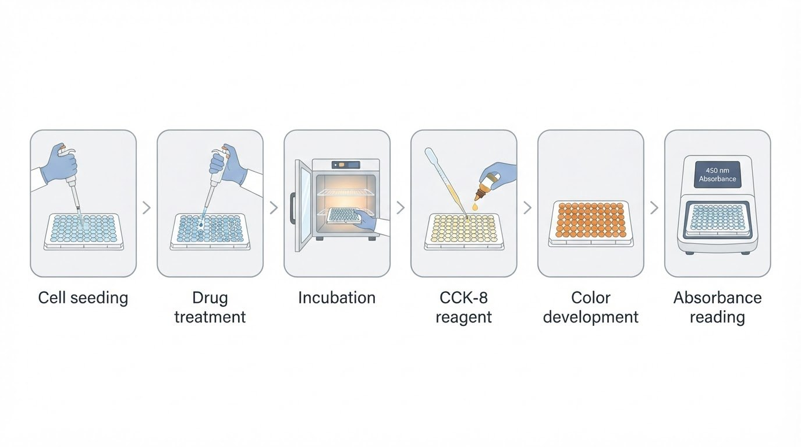</a>
</div>

##### 📌 Détails

- **Auteur:** [@Yila-AI](https://github.com/Yila-AI)
- **Modèle:** GPT Image 2.6
- **Format:** 16:9
- **Langues:** en, zh

**[👉 Essayer maintenant dans YILA →](https://yila.ai/fr/scientific-figure-prompts/cck8-viability-assay?utm_source=github&utm_medium=readme&utm_campaign=sci-figure-prompts&utm_content=cck8-viability-assay)** · [↑ Retour en haut](#top)

---

<a id="no-99"></a>

#### No. 99: Cell culture and transfection workflow

 

##### 📖 Description

Technique: **one panel per step, step names only** · Style: flat workflow · Format: `16:9`

##### 📝 Prompt

```text
Create a workflow figure for 【cell culture and transfection】, 6 steps from left to right:
1. 【Cell seeding: a culture dish with cells】
2. 【Complex formation: plasmid or siRNA mixed with transfection reagent in a tube】
3. 【Transfection: drops added to the dish】
4. 【Incubation: the dish in an incubator】
5. 【Verification: cells glowing green under a microscope】
6. 【Downstream assays: a well plate and a gel】
Do not write the numbered sentences in the figure.
Step names, each used once, no other text: 【Cell seeding, Complex formation, Transfection, Incubation, Verification, Downstream assays】.

Style: journal-style experimental workflow figure. Clean flat vector icons on a white background, one light pastel rounded panel per step, thin gray arrows between panels. Only 3-4 muted colors. Each panel shows one simple scene with no text inside it; the only text in the whole figure is the step names given. Sans-serif English, each step name appears exactly once, spelled exactly as given. No legends, no captions, no extra labels, no 3D rendering, no shadows, no decorative background.
```

<details><summary>Prompt en chinois</summary>

```text
画一张【细胞培养与转染】的流程图，从左往右六步：
1. 【铺板：培养皿里的细胞】
2. 【复合物形成：试管里质粒或 siRNA 与转染试剂混合】
3. 【转染：把液滴加到培养皿里】
4. 【孵育：培养皿放进培养箱】
5. 【效果验证：显微镜下细胞发绿光】
6. 【下游实验：孔板和凝胶】
不要把编号句子写进图里。
步骤名（每个只出现一次，不加其他文字）：【Cell seeding, Complex formation, Transfection, Incubation, Verification, Downstream assays】。

风格：期刊式实验流程图。白色背景上干净的扁平矢量图标，每一步一个浅色圆角面板，面板之间用细灰色箭头连接。只用 3–4 种低饱和度颜色。每个面板里只画一个简洁的小场景，面板内不写任何文字；整张图唯一的文字就是给定的步骤名。用英文无衬线字体，每个步骤名只出现一次，拼写与给定完全一致。不要图例、不要说明文字、不要额外标签、不要 3D 渲染、阴影或装饰性背景。
```

</details>

##### 🖼️ Image générée

<div align="center">
<a href="https://yila.ai/fr/scientific-figure-prompts/cell-transfection?utm_source=github&utm_medium=readme&utm_campaign=sci-figure-prompts&utm_content=cell-transfection">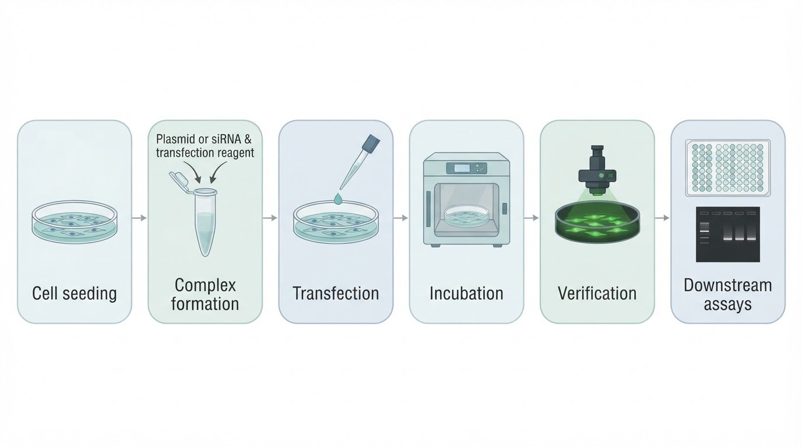</a>
</div>

##### 📌 Détails

- **Auteur:** [@Yila-AI](https://github.com/Yila-AI)
- **Modèle:** GPT Image 2.6
- **Format:** 16:9
- **Langues:** en, zh

**[👉 Essayer maintenant dans YILA →](https://yila.ai/fr/scientific-figure-prompts/cell-transfection?utm_source=github&utm_medium=readme&utm_campaign=sci-figure-prompts&utm_content=cell-transfection)** · [↑ Retour en haut](#top)

---

<a id="no-118"></a>

#### No. 118: Mouse disease model: grouping, dosing and sampling

  

##### 📖 Description

Technique: **one pastel rounded panel per step + icon-style scene** · Style: flat workflow · Format: `16:9`

##### 📝 Prompt

```text
Create an experimental workflow figure for 【a mouse tumor treatment study】, in five steps from left to right. Each step is one light pastel rounded panel with its number and name at the top and one simple icon-style scene inside; thin arrows connect the panels.
Step 1: 【mice randomly split into a control group and a treatment group】.
Step 2: 【a tumor growing under the skin on the flank of a mouse】.
Step 3: 【a syringe giving an intraperitoneal injection】.
Step 4: 【a mouse on a small scale next to a caliper measuring the tumor】.
Step 5: 【collected tumor, blood tube and organ samples in labeled tubes】.
Labels, each used once, no other text: 【1 Grouping, 2 Model, 3 Dosing, 4 Monitoring, 5 Sampling】.

Style: journal-style experimental workflow figure. Clean flat vector icons on a white background, one light pastel rounded panel per step, thin gray arrows between panels. Only 3-4 muted colors. Each panel shows one simple scene with no text inside it; the only text in the whole figure is the step names given. Sans-serif English, each step name appears exactly once, spelled exactly as given. No legends, no captions, no extra labels, no 3D rendering, no shadows, no decorative background.
```

<details><summary>Prompt en chinois</summary>

```text
画一张【小鼠肿瘤治疗实验】的实验流程图，从左到右分五步。每一步是一个浅色圆角面板，顶部写编号和步骤名，面板里是一个简洁的图标化小场景，面板之间用细箭头连接。
第 1 步：【小鼠被随机分成对照组和治疗组】。
第 2 步：【小鼠侧腹皮下长出一个肿瘤】。
第 3 步：【注射器进行腹腔注射】。
第 4 步：【小鼠站在小秤上称重，旁边一把卡尺测量肿瘤】。
第 5 步：【收集到的肿瘤、血液管和器官样本，放在贴好标签的管子里】。
标签（每个只出现一次，不加其他文字）：【1 Grouping, 2 Model, 3 Dosing, 4 Monitoring, 5 Sampling】。

风格：期刊式实验流程图。白色背景上干净的扁平矢量图标，每一步一个浅色圆角面板，面板之间用细灰色箭头连接。只用 3–4 种低饱和度颜色。每个面板里只画一个简洁的小场景，面板内不写任何文字；整张图唯一的文字就是给定的步骤名。用英文无衬线字体，每个步骤名只出现一次，拼写与给定完全一致。不要图例、不要说明文字、不要额外标签、不要 3D 渲染、阴影或装饰性背景。
```

</details>

##### 🖼️ Image générée

<div align="center">
<a href="https://yila.ai/fr/scientific-figure-prompts/mouse-model-dosing?utm_source=github&utm_medium=readme&utm_campaign=sci-figure-prompts&utm_content=mouse-model-dosing"></a>
</div>

##### 📌 Détails

- **Auteur:** [@Yila-AI](https://github.com/Yila-AI)
- **Modèle:** GPT Image 2.6
- **Format:** 16:9
- **Langues:** en, zh

**[👉 Essayer maintenant dans YILA →](https://yila.ai/fr/scientific-figure-prompts/mouse-model-dosing?utm_source=github&utm_medium=readme&utm_campaign=sci-figure-prompts&utm_content=mouse-model-dosing)** · [↑ Retour en haut](#top)

---

<a id="materials-energy"></a>

### 🔋 Matériaux & Énergie

<a id="no-134"></a>

#### No. 134: 3D-printed tissue engineering scaffold

 

##### 📖 Description

Technique: **printing, cell attachment, implantation** · Style: scientific illustration · Format: `16:9`

##### 📝 Prompt

```text
Create a scientific illustration of 【a 3D-printed scaffold for bone repair】, read from left to right in three panels:
1. 【A printing nozzle extruding a thin filament, building a lattice scaffold layer by layer, each layer of strands crossing the one below at a right angle.】
2. 【A circular magnified view of the scaffold: open pores between the strands, with cells attaching and spreading along the strands.】
3. 【The scaffold placed into a gap in a bone, with new tissue growing into the pores from both bone ends.】
Write each label only once in the whole figure.
If a component appears in more than one place or panel, write its label only at its first appearance; every other copy has no text. No label may appear twice anywhere in the figure. Spell every label exactly as given and add no titles.
Labels, each used once, no other text: 【Printing nozzle, Scaffold, Pores, Cells, Bone defect, New tissue】.

Style: journal-style scientific illustration. Clean semi-realistic vector illustration with gentle shading, using cross-sections or cutaways where they explain the structure, on a white background. Muted, harmonious palette with one accent color for the key process. Thin directional arrows for flows. Generous white space and a clear reading direction. Sans-serif English labels only, each label appears exactly once, spelled exactly as given. No cartoon style, no glossy CGI, no dark background, no stock-photo look, no decorative background.
```

<details><summary>Prompt en chinois</summary>

```text
画一张【用于骨修复的 3D 打印支架】科学插画，从左往右三个面板：
1. 【打印喷头挤出细丝，逐层堆出网格状支架，每层的丝都与下一层呈直角交叉。】
2. 【支架的圆形放大视图：丝与丝之间是开放的孔，细胞附着在丝上并沿丝铺展。】
3. 【支架放进骨头的缺损处，新组织从两端骨头长入孔中。】
整张图里每个标签只写一次。
如果同一组件在多处或多个面板出现，只在第一次出现时写标签，其余副本不写字。整张图里任何标签都不能出现两次。每个标签拼写与给定完全一致，不加标题。
标签（每个只出现一次，不加其他文字）：【Printing nozzle, Scaffold, Pores, Cells, Bone defect, New tissue】。

风格：期刊式科学插画。干净的半写实矢量插画，带柔和的明暗；需要说明结构时使用剖面或剖切视图，白色背景。配色低饱和、协调，只用一个强调色突出关键过程。用细的方向箭头表示流动。留白充足，阅读方向清晰。图中文字只用英文无衬线字体，每个标签只出现一次，拼写与给定完全一致。不要卡通风格、不要光滑的 CG 渲染、不要深色背景、不要图库照片感、不要装饰性背景。
```

</details>

##### 🖼️ Image générée

<div align="center">
<a href="https://yila.ai/fr/scientific-figure-prompts/3d-printed-scaffold?utm_source=github&utm_medium=readme&utm_campaign=sci-figure-prompts&utm_content=3d-printed-scaffold">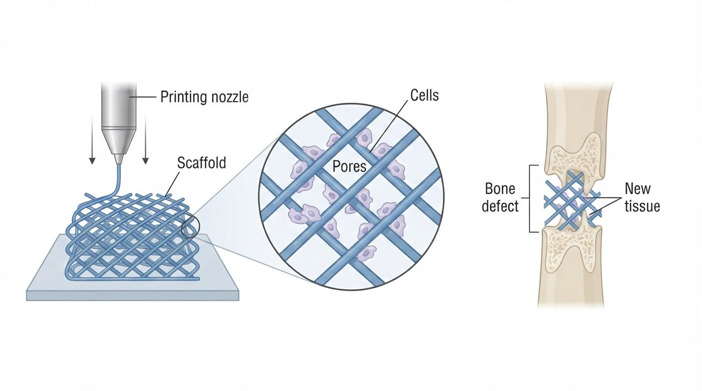</a>
</div>

##### 📌 Détails

- **Auteur:** [@Yila-AI](https://github.com/Yila-AI)
- **Modèle:** GPT Image 2.6
- **Format:** 16:9
- **Langues:** en, zh

**[👉 Essayer maintenant dans YILA →](https://yila.ai/fr/scientific-figure-prompts/3d-printed-scaffold?utm_source=github&utm_medium=readme&utm_campaign=sci-figure-prompts&utm_content=3d-printed-scaffold)** · [↑ Retour en haut](#top)

---

<a id="no-135"></a>

#### No. 135: Coin cell assembly workflow

 

##### 📖 Description

Technique: **one panel per step, step names only** · Style: flat workflow · Format: `16:9`

##### 📝 Prompt

```text
Create a workflow figure for 【assembling a coin cell】, 6 steps from left to right:
1. 【Slurry mixing: a beaker with a stirrer】
2. 【Electrode coating: a blade spreading slurry on foil】
3. 【Drying and punching: round discs cut from the foil】
4. 【Glovebox: hands in gloves inside a sealed box】
5. 【Stacking: discs stacked in a coin case】
6. 【Crimping: a press sealing the coin cell】
Do not write the numbered sentences in the figure.
Step names, each used once, no other text: 【Slurry mixing, Electrode coating, Drying and punching, Glovebox, Stacking, Crimping】.

Style: journal-style experimental workflow figure. Clean flat vector icons on a white background, one light pastel rounded panel per step, thin gray arrows between panels. Only 3-4 muted colors. Each panel shows one simple scene with no text inside it; the only text in the whole figure is the step names given. Sans-serif English, each step name appears exactly once, spelled exactly as given. No legends, no captions, no extra labels, no 3D rendering, no shadows, no decorative background.
```

<details><summary>Prompt en chinois</summary>

```text
画一张【组装扣式电池】的流程图，从左往右六步：
1. 【浆料混合：带搅拌器的烧杯】
2. 【极片涂布：刮刀把浆料刮在箔上】
3. 【干燥冲片：从箔上冲出圆片】
4. 【手套箱：密封箱里伸进一双手套】
5. 【叠片：圆片叠放进电池壳】
6. 【封口：压机把扣式电池压紧】
不要把编号句子写进图里。
步骤名（每个只出现一次，不加其他文字）：【Slurry mixing, Electrode coating, Drying and punching, Glovebox, Stacking, Crimping】。

风格：期刊式实验流程图。白色背景上干净的扁平矢量图标，每一步一个浅色圆角面板，面板之间用细灰色箭头连接。只用 3–4 种低饱和度颜色。每个面板里只画一个简洁的小场景，面板内不写任何文字；整张图唯一的文字就是给定的步骤名。用英文无衬线字体，每个步骤名只出现一次，拼写与给定完全一致。不要图例、不要说明文字、不要额外标签、不要 3D 渲染、阴影或装饰性背景。
```

</details>

##### 🖼️ Image générée

<div align="center">
<a href="https://yila.ai/fr/scientific-figure-prompts/coin-cell-assembly?utm_source=github&utm_medium=readme&utm_campaign=sci-figure-prompts&utm_content=coin-cell-assembly">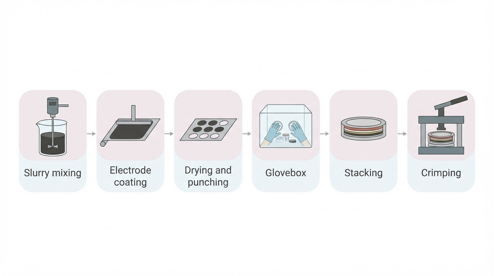</a>
</div>

##### 📌 Détails

- **Auteur:** [@Yila-AI](https://github.com/Yila-AI)
- **Modèle:** GPT Image 2.6
- **Format:** 16:9
- **Langues:** en, zh

**[👉 Essayer maintenant dans YILA →](https://yila.ai/fr/scientific-figure-prompts/coin-cell-assembly?utm_source=github&utm_medium=readme&utm_campaign=sci-figure-prompts&utm_content=coin-cell-assembly)** · [↑ Retour en haut](#top)

---

<a id="no-136"></a>

#### No. 136: Electrospinning nanofiber workflow

 

##### 📖 Description

Technique: **one panel per step, step names only** · Style: flat workflow · Format: `16:9`

##### 📝 Prompt

```text
Create a workflow figure for 【making nanofibers by electrospinning】, 6 steps from left to right:
1. 【Polymer solution: a beaker of solution】
2. 【Syringe loading: a syringe filled with solution】
3. 【High voltage: a lightning bolt at the needle tip】
4. 【Fiber jet: a thin stream stretching from the needle】
5. 【Collector: a rotating drum covered in fibers】
6. 【Nanofiber mat: a close-up of a mesh of fibers】
Do not write the numbered sentences in the figure.
Step names, each used once, no other text: 【Polymer solution, Syringe loading, High voltage, Fiber jet, Collector, Nanofiber mat】.

Style: journal-style experimental workflow figure. Clean flat vector icons on a white background, one light pastel rounded panel per step, thin gray arrows between panels. Only 3-4 muted colors. Each panel shows one simple scene with no text inside it; the only text in the whole figure is the step names given. Sans-serif English, each step name appears exactly once, spelled exactly as given. No legends, no captions, no extra labels, no 3D rendering, no shadows, no decorative background.
```

<details><summary>Prompt en chinois</summary>

```text
画一张【静电纺丝制备纳米纤维】的流程图，从左往右六步：
1. 【聚合物溶液：一烧杯溶液】
2. 【装针筒：装满溶液的注射器】
3. 【高压电场：针尖处一道闪电】
4. 【纤维射流：从针尖拉出的细流】
5. 【接收器：缠满纤维的旋转滚筒】
6. 【纳米纤维膜：纤维网的特写】
不要把编号句子写进图里。
步骤名（每个只出现一次，不加其他文字）：【Polymer solution, Syringe loading, High voltage, Fiber jet, Collector, Nanofiber mat】。

风格：期刊式实验流程图。白色背景上干净的扁平矢量图标，每一步一个浅色圆角面板，面板之间用细灰色箭头连接。只用 3–4 种低饱和度颜色。每个面板里只画一个简洁的小场景，面板内不写任何文字；整张图唯一的文字就是给定的步骤名。用英文无衬线字体，每个步骤名只出现一次，拼写与给定完全一致。不要图例、不要说明文字、不要额外标签、不要 3D 渲染、阴影或装饰性背景。
```

</details>

##### 🖼️ Image générée

<div align="center">
<a href="https://yila.ai/fr/scientific-figure-prompts/electrospinning-workflow?utm_source=github&utm_medium=readme&utm_campaign=sci-figure-prompts&utm_content=electrospinning-workflow">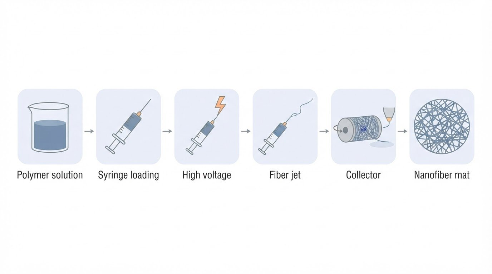</a>
</div>

##### 📌 Détails

- **Auteur:** [@Yila-AI](https://github.com/Yila-AI)
- **Modèle:** GPT Image 2.6
- **Format:** 16:9
- **Langues:** en, zh

**[👉 Essayer maintenant dans YILA →](https://yila.ai/fr/scientific-figure-prompts/electrospinning-workflow?utm_source=github&utm_medium=readme&utm_campaign=sci-figure-prompts&utm_content=electrospinning-workflow)** · [↑ Retour en haut](#top)

---

<a id="no-137"></a>

#### No. 137: Flexible wearable sensor

 

##### 📖 Description

Technique: **worn on the body plus an exploded layer view** · Style: scientific illustration · Format: `16:9`

##### 📝 Prompt

```text
Create a scientific illustration of 【a flexible wearable pulse sensor】:
1. Left: 【a thin, skin-like patch on a person's wrist, gently bending with the skin】.
2. Middle: 【an exploded view of the patch with four layers, from top to bottom: a clear encapsulation layer, a sensing layer made of a fine network of conductive nanowires, wavy serpentine electrodes, and a soft stretchable substrate】.
3. Right: 【a small wireless module on the edge of the patch sends signals (a wifi icon) to a smartphone whose screen shows only a heart icon】.
Write each label only once in the whole figure.
Labels, each used once, no other text: 【Encapsulation layer, Sensing layer, Serpentine electrodes, Stretchable substrate, Wireless module, Smartphone】.

Style: journal-style scientific illustration. Clean semi-realistic vector illustration with gentle shading, using cross-sections or cutaways where they explain the structure, on a white background. Muted, harmonious palette with one accent color for the key process. Thin directional arrows for flows. Generous white space and a clear reading direction. Sans-serif English labels only, each label appears exactly once, spelled exactly as given. No cartoon style, no glossy CGI, no dark background, no stock-photo look, no decorative background.
```

<details><summary>Prompt en chinois</summary>

```text
画一张【柔性可穿戴脉搏传感器】的科学插画：
1. 左：【一片像皮肤一样薄的贴片贴在手腕上，随皮肤轻轻弯曲】。
2. 中：【贴片的分层爆炸图，共四层，从上到下：透明封装层、由细密导电纳米线网络构成的传感层、波浪形蛇形电极、柔软可拉伸的衬底】。
3. 右：【贴片边缘的小无线模块发出信号（wifi 图标），传到一部智能手机，手机屏幕上只显示一个心形图标】。
整张图里每个标签只写一次。
标签（每个只出现一次，不加其他文字）：【Encapsulation layer, Sensing layer, Serpentine electrodes, Stretchable substrate, Wireless module, Smartphone】。

风格：期刊式科学插画。干净的半写实矢量插画，带柔和的明暗；需要说明结构时使用剖面或剖切视图，白色背景。配色低饱和、协调，只用一个强调色突出关键过程。用细的方向箭头表示流动。留白充足，阅读方向清晰。图中文字只用英文无衬线字体，每个标签只出现一次，拼写与给定完全一致。不要卡通风格、不要光滑的 CG 渲染、不要深色背景、不要图库照片感、不要装饰性背景。
```

</details>

##### 🖼️ Image générée

<div align="center">
<a href="https://yila.ai/fr/scientific-figure-prompts/flexible-wearable-sensor?utm_source=github&utm_medium=readme&utm_campaign=sci-figure-prompts&utm_content=flexible-wearable-sensor">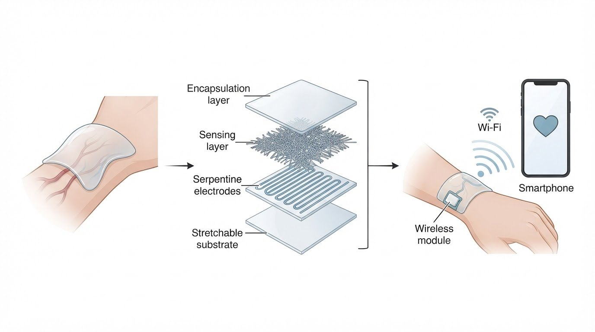</a>
</div>

##### 📌 Détails

- **Auteur:** [@Yila-AI](https://github.com/Yila-AI)
- **Modèle:** GPT Image 2.6
- **Format:** 16:9
- **Langues:** en, zh

**[👉 Essayer maintenant dans YILA →](https://yila.ai/fr/scientific-figure-prompts/flexible-wearable-sensor?utm_source=github&utm_medium=readme&utm_campaign=sci-figure-prompts&utm_content=flexible-wearable-sensor)** · [↑ Retour en haut](#top)

---

<a id="no-138"></a>

#### No. 138: Green hydrogen system: from renewable power to end use

 

##### 📖 Description

Technique: **a left-to-right system chain** · Style: schematic diagram · Format: `16:9`

##### 📝 Prompt

```text
Create a system diagram of 【a green hydrogen system】, read from left to right, each unit a rounded box with one icon. Draw each relationship exactly as listed and nothing more:
1. 【Renewable power (wind turbines and solar panels) sends electricity to the electrolyzer.】
2. 【Water flows into the electrolyzer from below; oxygen leaves it as a by-product through a small upward arrow.】
3. 【The electrolyzer sends hydrogen to hydrogen storage (a compressor and a tank).】
4. 【Hydrogen storage supplies three end uses stacked on the right: transport (a fuel cell truck), industry (a factory) and power generation (a turbine feeding back to the grid).】
There are no T-bars in this figure. Do not write the numbered sentences in the figure. Write each label only once in the whole figure.
If a component appears in more than one place or panel, write its label only at its first appearance; every other copy has no text. No label may appear twice anywhere in the figure. Spell every label exactly as given and add no titles.
Labels, each used once, no other text: 【Renewable power, Water, Electrolyzer, Oxygen, Hydrogen storage, Transport, Industry, Power generation】.

Style: journal-style schematic diagram. Clean flat vector graphics on a white background. Modules are rounded rectangles or simple icons with their short names inside; light pastel panels group related layers. Only 3-4 muted colors, each with one fixed meaning. Thin, uniform arrows show the flow of data, energy, material or influence; dashed arrows for indirect or feedback links. Sans-serif English labels only, each label appears exactly once, spelled exactly as given. No 3D rendering, no shadows, no glow, no cyberpunk or tech-background decoration, no photorealism.
```

<details><summary>Prompt en chinois</summary>

```text
画一张【绿氢系统】的系统图，从左往右读，每个单元是一个带图标的圆角框。严格按下面列出的关系画，不多画：
1. 【可再生电力（风机和光伏板）把电送到电解槽。】
2. 【水从下方流入电解槽；氧气作为副产物通过一个向上的小箭头离开。】
3. 【电解槽把氢气送到储氢单元（压缩机和储罐）。】
4. 【储氢单元供应右侧上下排列的三种终端用途：交通（燃料电池卡车）、工业（工厂）和发电（燃气轮机，电力回送电网）。】
图中没有 T 形线。不要把编号句子写进图里。整张图里每个标签只写一次。
如果同一组件在多处或多个面板出现，只在第一次出现时写标签，其余副本不写字。整张图里任何标签都不能出现两次。每个标签拼写与给定完全一致，不加标题。
标签（每个只出现一次，不加其他文字）：【Renewable power, Water, Electrolyzer, Oxygen, Hydrogen storage, Transport, Industry, Power generation】。

风格：期刊式示意框图。白色背景上干净的扁平矢量图形。模块画成圆角矩形或简洁图标，名称写在里面；用浅色面板把相关的层归在一起。只用 3–4 种低饱和度颜色，每种颜色含义固定。细而粗细一致的箭头表示数据、能量、物质或影响的流向，间接或反馈关系用虚线箭头。图中文字只用英文无衬线字体，每个标签只出现一次，拼写与给定完全一致。不要 3D 渲染、阴影、发光、赛博朋克或科技感背景装饰，不要照片质感。
```

</details>

##### 🖼️ Image générée

<div align="center">
<a href="https://yila.ai/fr/scientific-figure-prompts/green-hydrogen-system?utm_source=github&utm_medium=readme&utm_campaign=sci-figure-prompts&utm_content=green-hydrogen-system">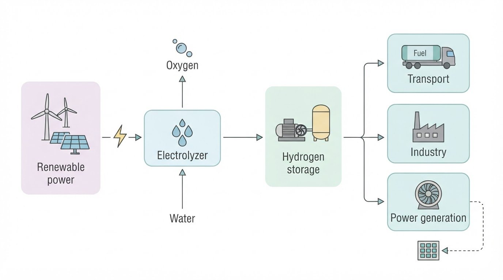</a>
</div>

##### 📌 Détails

- **Auteur:** [@Yila-AI](https://github.com/Yila-AI)
- **Modèle:** GPT Image 2.6
- **Format:** 16:9
- **Langues:** en, zh

**[👉 Essayer maintenant dans YILA →](https://yila.ai/fr/scientific-figure-prompts/green-hydrogen-system?utm_source=github&utm_medium=readme&utm_campaign=sci-figure-prompts&utm_content=green-hydrogen-system)** · [↑ Retour en haut](#top)

---

<a id="no-139"></a>

#### No. 139: Heterogeneous catalysis mechanism

 

##### 📖 Description

Technique: **three surface steps: adsorption, reaction, desorption** · Style: scientific illustration · Format: `16:9`

##### 📝 Prompt

```text
Create a scientific illustration of 【heterogeneous catalysis on a supported metal catalyst】: a cross-section of a support with metal nanoparticles on top, and above one nanoparticle three stages from left to right:
1. 【Separate blue A and orange B spheres approach and adsorb onto the nanoparticle surface.】
2. 【On the surface, A and B join together.】
3. 【Joined A–B product molecules leave the surface.】
Curved arrows link the stages. Write each label once.
Labels, each used once, no other text: 【Reactants, Adsorption, Surface reaction, Desorption, Products, Catalyst, Support】.

Style: journal-style scientific illustration. Clean semi-realistic vector illustration with gentle shading, using cross-sections or cutaways where they explain the structure, on a white background. Muted, harmonious palette with one accent color for the key process. Thin directional arrows for flows. Generous white space and a clear reading direction. Sans-serif English labels only, each label appears exactly once, spelled exactly as given. No cartoon style, no glossy CGI, no dark background, no stock-photo look, no decorative background.
```

<details><summary>Prompt en chinois</summary>

```text
画一张【负载型金属催化剂上的多相催化】科学插画：底部是载体的截面，上面分布着金属纳米颗粒，在其中一个纳米颗粒上方从左往右三个阶段：
1. 【分开的蓝色 A 球和橙色 B 球靠近并吸附到纳米颗粒表面。】
2. 【A 和 B 在表面结合在一起。】
3. 【结合成 A–B 的产物分子离开表面。】
各阶段之间用弧形箭头连接，每个标签只写一次。
标签（每个只出现一次，不加其他文字）：【Reactants, Adsorption, Surface reaction, Desorption, Products, Catalyst, Support】。

风格：期刊式科学插画。干净的半写实矢量插画，带柔和的明暗；需要说明结构时使用剖面或剖切视图，白色背景。配色低饱和、协调，只用一个强调色突出关键过程。用细的方向箭头表示流动。留白充足，阅读方向清晰。图中文字只用英文无衬线字体，每个标签只出现一次，拼写与给定完全一致。不要卡通风格、不要光滑的 CG 渲染、不要深色背景、不要图库照片感、不要装饰性背景。
```

</details>

##### 🖼️ Image générée

<div align="center">
<a href="https://yila.ai/fr/scientific-figure-prompts/heterogeneous-catalysis?utm_source=github&utm_medium=readme&utm_campaign=sci-figure-prompts&utm_content=heterogeneous-catalysis">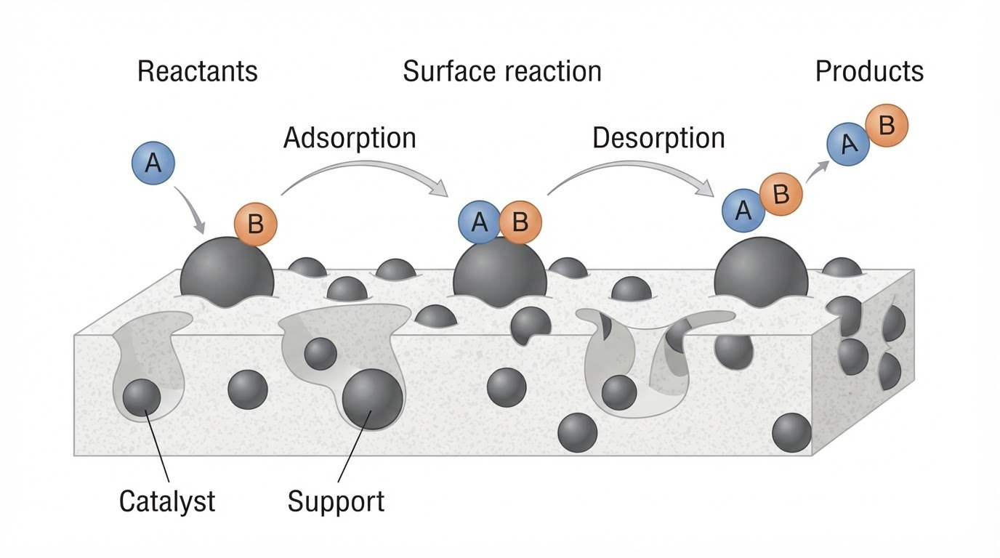</a>
</div>

##### 📌 Détails

- **Auteur:** [@Yila-AI](https://github.com/Yila-AI)
- **Modèle:** GPT Image 2.6
- **Format:** 16:9
- **Langues:** en, zh

**[👉 Essayer maintenant dans YILA →](https://yila.ai/fr/scientific-figure-prompts/heterogeneous-catalysis?utm_source=github&utm_medium=readme&utm_campaign=sci-figure-prompts&utm_content=heterogeneous-catalysis)** · [↑ Retour en haut](#top)

---

<a id="no-140"></a>

#### No. 140: Hydrothermal synthesis route

 

##### 📖 Description

Technique: **one panel per step, step names only** · Style: flat workflow · Format: `16:9`

##### 📝 Prompt

```text
Create a workflow figure for 【the hydrothermal synthesis of a nanomaterial】, six steps from left to right:
1. 【Precursor solution: a beaker with a clear solution】
2. 【Mixing: a magnetic stirrer】
3. 【Hydrothermal reaction: a sealed steel autoclave in an oven】
4. 【Washing: a centrifuge tube】
5. 【Calcination: a crucible in a furnace】
6. 【Product: a cluster of nanorods】
Step names, each used once, no other text: 【Precursor solution, Mixing, Hydrothermal reaction, Washing, Calcination, Product】.

Style: journal-style experimental workflow figure. Clean flat vector icons on a white background, one light pastel rounded panel per step, thin gray arrows between panels. Only 3-4 muted colors. Each panel shows one simple scene with no text inside it; the only text in the whole figure is the step names given. Sans-serif English, each step name appears exactly once, spelled exactly as given. No legends, no captions, no extra labels, no 3D rendering, no shadows, no decorative background.
```

<details><summary>Prompt en chinois</summary>

```text
画一张【水热法合成纳米材料】的流程图，从左往右六步：
1. 【前驱体溶液：一个装澄清溶液的烧杯】
2. 【混合：磁力搅拌器】
3. 【水热反应：烘箱里的密封不锈钢反应釜】
4. 【洗涤：离心管】
5. 【煅烧：马弗炉里的坩埚】
6. 【产物：一簇纳米棒】
步骤名（每个只出现一次，不加其他文字）：【Precursor solution, Mixing, Hydrothermal reaction, Washing, Calcination, Product】。

风格：期刊式实验流程图。白色背景上干净的扁平矢量图标，每一步一个浅色圆角面板，面板之间用细灰色箭头连接。只用 3–4 种低饱和度颜色。每个面板里只画一个简洁的小场景，面板内不写任何文字；整张图唯一的文字就是给定的步骤名。用英文无衬线字体，每个步骤名只出现一次，拼写与给定完全一致。不要图例、不要说明文字、不要额外标签、不要 3D 渲染、阴影或装饰性背景。
```

</details>

##### 🖼️ Image générée

<div align="center">
<a href="https://yila.ai/fr/scientific-figure-prompts/hydrothermal-synthesis?utm_source=github&utm_medium=readme&utm_campaign=sci-figure-prompts&utm_content=hydrothermal-synthesis">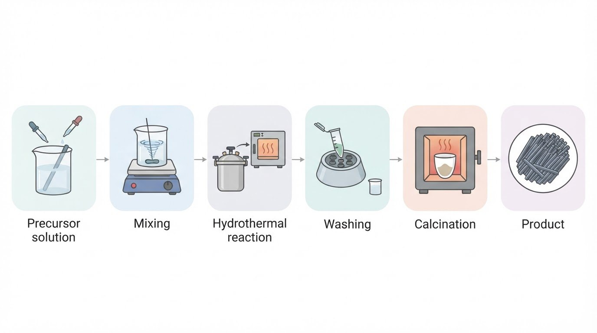</a>
</div>

##### 📌 Détails

- **Auteur:** [@Yila-AI](https://github.com/Yila-AI)
- **Modèle:** GPT Image 2.6
- **Format:** 16:9
- **Langues:** en, zh

**[👉 Essayer maintenant dans YILA →](https://yila.ai/fr/scientific-figure-prompts/hydrothermal-synthesis?utm_source=github&utm_medium=readme&utm_campaign=sci-figure-prompts&utm_content=hydrothermal-synthesis)** · [↑ Retour en haut](#top)

---

<a id="no-141"></a>

#### No. 141: Lithium-ion battery charge and discharge

 

##### 📖 Description

Technique: **cross-section + flow arrows** · Style: scientific illustration · Format: `16:9`

##### 📝 Prompt

```text
Create a horizontal cross-section illustration of 【a lithium-ion battery during discharge】: 【the graphite anode on the left, a porous separator in the middle, and a layered oxide cathode on the right, all soaked in electrolyte】. Arrows show 【lithium ions moving from the anode through the separator to the cathode, while electrons flow through an external wire to a small light bulb】. A circular magnified inset shows 【lithium ions sliding out from between the graphite layers】.
Labels, each used once, no other text: 【Anode, Separator, Cathode, Li+, e-】.

Style: journal-style scientific illustration. Clean semi-realistic vector illustration with gentle shading, using cross-sections or cutaways where they explain the structure, on a white background. Muted, harmonious palette with one accent color for the key process. Thin directional arrows for flows. Generous white space and a clear reading direction. Sans-serif English labels only, each label appears exactly once, spelled exactly as given. No cartoon style, no glossy CGI, no dark background, no stock-photo look, no decorative background.
```

<details><summary>Prompt en chinois</summary>

```text
画一张【放电过程中的锂离子电池】横向剖面插画：【左边是石墨负极，中间是多孔隔膜，右边是层状氧化物正极，全部浸在电解液里】。箭头表示【锂离子从负极穿过隔膜移向正极，电子则经外部导线流过一个小灯泡】。用一个圆形放大框展示【锂离子从石墨层之间滑出】。
标签（每个只出现一次，不加其他文字）：【Anode, Separator, Cathode, Li+, e-】。

风格：期刊式科学插画。干净的半写实矢量插画，带柔和的明暗；需要说明结构时使用剖面或剖切视图，白色背景。配色低饱和、协调，只用一个强调色突出关键过程。用细的方向箭头表示流动。留白充足，阅读方向清晰。图中文字只用英文无衬线字体，每个标签只出现一次，拼写与给定完全一致。不要卡通风格、不要光滑的 CG 渲染、不要深色背景、不要图库照片感、不要装饰性背景。
```

</details>

##### 🖼️ Image générée

<div align="center">
<a href="https://yila.ai/fr/scientific-figure-prompts/li-ion-battery?utm_source=github&utm_medium=readme&utm_campaign=sci-figure-prompts&utm_content=li-ion-battery">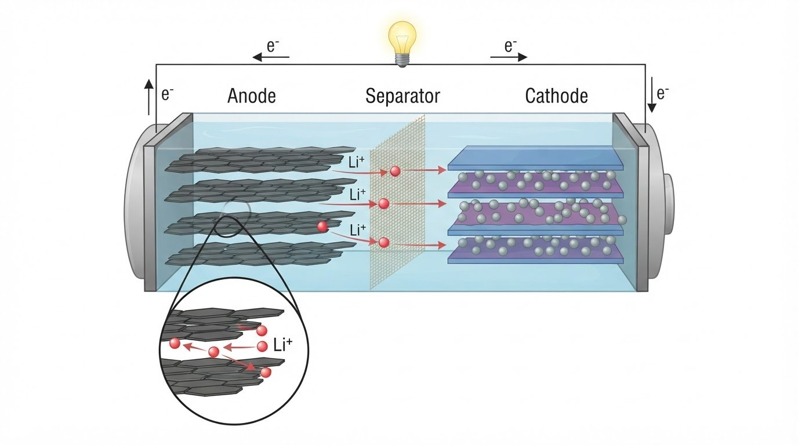</a>
</div>

##### 📌 Détails

- **Auteur:** [@Yila-AI](https://github.com/Yila-AI)
- **Modèle:** GPT Image 2.6
- **Format:** 16:9
- **Langues:** en, zh

**[👉 Essayer maintenant dans YILA →](https://yila.ai/fr/scientific-figure-prompts/li-ion-battery?utm_source=github&utm_medium=readme&utm_campaign=sci-figure-prompts&utm_content=li-ion-battery)** · [↑ Retour en haut](#top)

---

<a id="earth-environment"></a>

### 🌍 Terre & Environnement

<a id="no-150"></a>

#### No. 150: Air quality monitoring workflow

 

##### 📖 Description

Technique: **one panel per step, step names only** · Style: flat workflow · Format: `16:9`

##### 📝 Prompt

```text
Create a workflow figure for 【urban air quality monitoring】, 6 steps from left to right:
1. 【Monitoring stations: small station boxes across a city】
2. 【Sampling inlet: an air intake on a rooftop】
3. 【Sensors: a box with several sensor icons】
4. 【Data transmission: a signal arrow to a cloud】
5. 【Data processing: a server】
6. 【Public alert: a phone showing a colored air-quality badge】
Do not write the numbered sentences in the figure.
Step names, each used once, no other text: 【Monitoring stations, Sampling inlet, Sensors, Data transmission, Data processing, Public alert】.

Style: journal-style experimental workflow figure. Clean flat vector icons on a white background, one light pastel rounded panel per step, thin gray arrows between panels. Only 3-4 muted colors. Each panel shows one simple scene with no text inside it; the only text in the whole figure is the step names given. Sans-serif English, each step name appears exactly once, spelled exactly as given. No legends, no captions, no extra labels, no 3D rendering, no shadows, no decorative background.
```

<details><summary>Prompt en chinois</summary>

```text
画一张【城市空气质量监测】的流程图，从左往右六步：
1. 【监测站：分布在城市里的小站点】
2. 【采样口：屋顶上的进气口】
3. 【传感器：装有几个传感器图标的仪器箱】
4. 【数据传输：信号箭头传到云端】
5. 【数据处理：一台服务器】
6. 【公众发布：手机上显示彩色空气质量徽章】
不要把编号句子写进图里。
步骤名（每个只出现一次，不加其他文字）：【Monitoring stations, Sampling inlet, Sensors, Data transmission, Data processing, Public alert】。

风格：期刊式实验流程图。白色背景上干净的扁平矢量图标，每一步一个浅色圆角面板，面板之间用细灰色箭头连接。只用 3–4 种低饱和度颜色。每个面板里只画一个简洁的小场景，面板内不写任何文字；整张图唯一的文字就是给定的步骤名。用英文无衬线字体，每个步骤名只出现一次，拼写与给定完全一致。不要图例、不要说明文字、不要额外标签、不要 3D 渲染、阴影或装饰性背景。
```

</details>

##### 🖼️ Image générée

<div align="center">
<a href="https://yila.ai/fr/scientific-figure-prompts/air-quality-monitoring?utm_source=github&utm_medium=readme&utm_campaign=sci-figure-prompts&utm_content=air-quality-monitoring"></a>
</div>

##### 📌 Détails

- **Auteur:** [@Yila-AI](https://github.com/Yila-AI)
- **Modèle:** GPT Image 2.6
- **Format:** 16:9
- **Langues:** en, zh

**[👉 Essayer maintenant dans YILA →](https://yila.ai/fr/scientific-figure-prompts/air-quality-monitoring?utm_source=github&utm_medium=readme&utm_campaign=sci-figure-prompts&utm_content=air-quality-monitoring)** · [↑ Retour en haut](#top)

---

<a id="no-151"></a>

#### No. 151: Carbon capture and storage (CCS)

 

##### 📖 Description

Technique: **surface facilities over an underground rock cutaway** · Style: scientific illustration · Format: `16:9`

##### 📝 Prompt

```text
Create a scientific illustration of 【carbon capture and storage】: a landscape with a cutaway of the rock layers underground, read from left to right. Draw each relationship exactly as listed and nothing more:
1. 【A power plant and a cement plant on the left send their flue gas to a capture unit, which separates out CO2.】
2. 【Capture unit → compression station.】
3. 【Compression station → a pipeline running across the land to an injection well on the right (arrows pointing from left to right along the pipe).】
4. 【The injection well carries CO2 down through the rock layers into a deep porous sandstone layer filled with salty water (arrows pointing down): saline aquifer.】
5. 【A dense, impermeable rock layer directly above the storage layer keeps the CO2 trapped: caprock.】
6. 【A monitoring well beside the injection well reaches the storage layer to check for leaks.】
There are no T-bars in this figure. Do not write the numbered sentences in the figure. Write each label only once in the whole figure.
Labels, each used once, no other text: 【CO2 capture, Compression, Pipeline transport, Injection well, Caprock, Saline aquifer, Monitoring well】.

Style: journal-style scientific illustration. Clean semi-realistic vector illustration with gentle shading, using cross-sections or cutaways where they explain the structure, on a white background. Muted, harmonious palette with one accent color for the key process. Thin directional arrows for flows. Generous white space and a clear reading direction. Sans-serif English labels only, each label appears exactly once, spelled exactly as given. No cartoon style, no glossy CGI, no dark background, no stock-photo look, no decorative background.
```

<details><summary>Prompt en chinois</summary>

```text
画一张【碳捕集与封存】的科学插画：地表景观加地下岩层剖面，从左往右读。严格按下面列出的关系画，不多画：
1. 【左侧的发电厂和水泥厂把烟气送到捕集装置，分离出 CO2。】
2. 【捕集装置 → 压缩站。】
3. 【压缩站 → 一条横穿地面的管道，通到右侧的注入井（沿管道从左指向右的箭头）。】
4. 【注入井把 CO2 向下穿过岩层，送进深处充满咸水的多孔砂岩层（向下的箭头）：咸水层。】
5. 【封存层正上方一层致密、不透水的岩层把 CO2 封住：盖层。】
6. 【注入井旁一口监测井通到封存层，检查是否泄漏。】
图中没有 T 形线。不要把编号句子写进图里。整张图里每个标签只写一次。
标签（每个只出现一次，不加其他文字）：【CO2 capture, Compression, Pipeline transport, Injection well, Caprock, Saline aquifer, Monitoring well】。

风格：期刊式科学插画。干净的半写实矢量插画，带柔和的明暗；需要说明结构时使用剖面或剖切视图，白色背景。配色低饱和、协调，只用一个强调色突出关键过程。用细的方向箭头表示流动。留白充足，阅读方向清晰。图中文字只用英文无衬线字体，每个标签只出现一次，拼写与给定完全一致。不要卡通风格、不要光滑的 CG 渲染、不要深色背景、不要图库照片感、不要装饰性背景。
```

</details>

##### 🖼️ Image générée

<div align="center">
<a href="https://yila.ai/fr/scientific-figure-prompts/carbon-capture-storage?utm_source=github&utm_medium=readme&utm_campaign=sci-figure-prompts&utm_content=carbon-capture-storage"></a>
</div>

##### 📌 Détails

- **Auteur:** [@Yila-AI](https://github.com/Yila-AI)
- **Modèle:** GPT Image 2.6
- **Format:** 16:9
- **Langues:** en, zh

**[👉 Essayer maintenant dans YILA →](https://yila.ai/fr/scientific-figure-prompts/carbon-capture-storage?utm_source=github&utm_medium=readme&utm_campaign=sci-figure-prompts&utm_content=carbon-capture-storage)** · [↑ Retour en haut](#top)

---

<a id="no-152"></a>

#### No. 152: Global carbon cycle

 

##### 📖 Description

Technique: **system cycle + flow arrows** · Style: scientific illustration · Format: `4:3`

##### 📝 Prompt

```text
Create a landscape cross-section illustration of 【the global carbon cycle】: 【the atmosphere at the top; a forest and soil on the left; the ocean on the right; a power plant and buried fossil fuels at the bottom center】. Arrows show 【carbon dioxide taken up by trees (photosynthesis), released by plants and soil (respiration), absorbed by the ocean surface, and emitted by the power plant burning fossil fuels】. Use thicker arrows for larger flows.
Labels, each used once, no other text: 【Atmosphere, Photosynthesis, Respiration, Ocean uptake, Fossil emissions】.

Style: journal-style scientific illustration. Clean semi-realistic vector illustration with gentle shading, using cross-sections or cutaways where they explain the structure, on a white background. Muted, harmonious palette with one accent color for the key process. Thin directional arrows for flows. Generous white space and a clear reading direction. Sans-serif English labels only, each label appears exactly once, spelled exactly as given. No cartoon style, no glossy CGI, no dark background, no stock-photo look, no decorative background.
```

<details><summary>Prompt en chinois</summary>

```text
画一张【全球碳循环】的地景剖面插画：【顶部是大气；左边是森林和土壤；右边是海洋；底部中间是发电厂和埋藏的化石燃料】。箭头表示【树木吸收二氧化碳（光合作用），植物和土壤释放二氧化碳（呼吸作用），海洋表面吸收二氧化碳，发电厂燃烧化石燃料排放二氧化碳】。流量越大，箭头越粗。
标签（每个只出现一次，不加其他文字）：【Atmosphere, Photosynthesis, Respiration, Ocean uptake, Fossil emissions】。

风格：期刊式科学插画。干净的半写实矢量插画，带柔和的明暗；需要说明结构时使用剖面或剖切视图，白色背景。配色低饱和、协调，只用一个强调色突出关键过程。用细的方向箭头表示流动。留白充足，阅读方向清晰。图中文字只用英文无衬线字体，每个标签只出现一次，拼写与给定完全一致。不要卡通风格、不要光滑的 CG 渲染、不要深色背景、不要图库照片感、不要装饰性背景。
```

</details>

##### 🖼️ Image générée

<div align="center">
<a href="https://yila.ai/fr/scientific-figure-prompts/carbon-cycle?utm_source=github&utm_medium=readme&utm_campaign=sci-figure-prompts&utm_content=carbon-cycle"></a>
</div>

##### 📌 Détails

- **Auteur:** [@Yila-AI](https://github.com/Yila-AI)
- **Modèle:** GPT Image 2.6
- **Format:** 4:3
- **Langues:** en, zh

**[👉 Essayer maintenant dans YILA →](https://yila.ai/fr/scientific-figure-prompts/carbon-cycle?utm_source=github&utm_medium=readme&utm_campaign=sci-figure-prompts&utm_content=carbon-cycle)** · [↑ Retour en haut](#top)

---

<a id="no-153"></a>

#### No. 153: Contaminated soil and remediation options

 

##### 📖 Description

Technique: **polluted soil cross-section with four remediation panels** · Style: scientific illustration · Format: `16:9`

##### 📝 Prompt

```text
Create a scientific illustration of 【contaminated soil and its remediation options】. Left: 【a soil cross-section beneath an old factory site, with dark specks of heavy metals and oily brown patches of organic pollutants spreading through the soil】. Right: four small panels in two rows and two columns, each joined to the soil by one thin arrow pointing from the soil to the panel:
1. 【Soil washing: an excavator loading soil into a washing tank.】
2. 【Chemical stabilization: an amendment mixed into the soil, locking the dark specks inside soil grains.】
3. 【Bioremediation: microbes breaking down the oily patches.】
4. 【Phytoremediation: plants drawing metals up from their roots into their shoots.】
Draw icons only, with no tables or numbers.
Write each label only once in the whole figure.
Labels, each used once, no other text: 【Contaminated soil, Heavy metals, Organic pollutants, Soil washing, Chemical stabilization, Bioremediation, Phytoremediation】.

Style: journal-style scientific illustration. Clean semi-realistic vector illustration with gentle shading, using cross-sections or cutaways where they explain the structure, on a white background. Muted, harmonious palette with one accent color for the key process. Thin directional arrows for flows. Generous white space and a clear reading direction. Sans-serif English labels only, each label appears exactly once, spelled exactly as given. No cartoon style, no glossy CGI, no dark background, no stock-photo look, no decorative background.
```

<details><summary>Prompt en chinois</summary>

```text
画一张【污染土壤及其修复方式】的科学插画。左侧：【旧工厂场地下方的土壤截面，土壤里散布着代表重金属的深色颗粒和代表有机污染物的油状褐色斑块】。右侧：四个小面板排成两行两列，每个面板用一条从土壤指向面板的细箭头相连：
1. 【土壤淋洗：挖掘机把土装进清洗槽。】
2. 【化学稳定化：把改良剂拌进土壤，深色颗粒被锁在土粒里。】
3. 【生物修复：微生物分解油状斑块。】
4. 【植物修复：植物把金属从根部吸收到茎叶中。】
只画图标，不画表格，不写数字。
整张图里每个标签只写一次。
标签（每个只出现一次，不加其他文字）：【Contaminated soil, Heavy metals, Organic pollutants, Soil washing, Chemical stabilization, Bioremediation, Phytoremediation】。

风格：期刊式科学插画。干净的半写实矢量插画，带柔和的明暗；需要说明结构时使用剖面或剖切视图，白色背景。配色低饱和、协调，只用一个强调色突出关键过程。用细的方向箭头表示流动。留白充足，阅读方向清晰。图中文字只用英文无衬线字体，每个标签只出现一次，拼写与给定完全一致。不要卡通风格、不要光滑的 CG 渲染、不要深色背景、不要图库照片感、不要装饰性背景。
```

</details>

##### 🖼️ Image générée

<div align="center">
<a href="https://yila.ai/fr/scientific-figure-prompts/contaminated-soil-remediation?utm_source=github&utm_medium=readme&utm_campaign=sci-figure-prompts&utm_content=contaminated-soil-remediation"></a>
</div>

##### 📌 Détails

- **Auteur:** [@Yila-AI](https://github.com/Yila-AI)
- **Modèle:** GPT Image 2.6
- **Format:** 16:9
- **Langues:** en, zh

**[👉 Essayer maintenant dans YILA →](https://yila.ai/fr/scientific-figure-prompts/contaminated-soil-remediation?utm_source=github&utm_medium=readme&utm_campaign=sci-figure-prompts&utm_content=contaminated-soil-remediation)** · [↑ Retour en haut](#top)

---

<a id="no-154"></a>

#### No. 154: Ecosystem services framework

 

##### 📖 Description

Technique: **supporting services under three service types, leading to well-being** · Style: schematic diagram · Format: `16:9`

##### 📝 Prompt

```text
Create a framework diagram of 【ecosystem services】 following the Millennium Ecosystem Assessment, read from left to right, each box with one icon. Draw each relationship exactly as listed and nothing more:
1. 【Ecosystem (a forest, a river and a field) → supporting services (a tall vertical box with soil and nutrient-cycle icons).】
2. 【Supporting services → each of three boxes stacked from top to bottom: provisioning services (food, water and timber icons), regulating services (climate, flood-control and pollination icons) and cultural services (hiking and inspiration icons).】
3. 【Each of the three boxes → human well-being (a group of people icons) on the right.】
4. 【A dashed arrow runs along the bottom from human well-being back to the ecosystem, passing through a box for drivers of change (a factory and a bulldozer icon).】
There are no T-bars in this figure. Do not write the numbered sentences in the figure. Write each label only once in the whole figure.
Inside the service boxes use icons only, with no small words under the icons. Spell every label exactly as given.
Labels, each used once, no other text: 【Ecosystem, Supporting services, Provisioning services, Regulating services, Cultural services, Human well-being, Drivers of change】.

Style: journal-style schematic diagram. Clean flat vector graphics on a white background. Modules are rounded rectangles or simple icons with their short names inside; light pastel panels group related layers. Only 3-4 muted colors, each with one fixed meaning. Thin, uniform arrows show the flow of data, energy, material or influence; dashed arrows for indirect or feedback links. Sans-serif English labels only, each label appears exactly once, spelled exactly as given. No 3D rendering, no shadows, no glow, no cyberpunk or tech-background decoration, no photorealism.
```

<details><summary>Prompt en chinois</summary>

```text
画一张【生态系统服务】框架图，参照千年生态系统评估，从左往右读，每个框配一个图标。严格按下面列出的关系画，不多画：
1. 【生态系统（森林、河流和农田）→ 支持服务（一个竖长框，配土壤和养分循环图标）。】
2. 【支持服务 → 上下排列的三个框：供给服务（食物、水和木材图标）、调节服务（气候、防洪和授粉图标）、文化服务（徒步和灵感图标）。】
3. 【三个框分别 → 右侧的人类福祉（一组人形图标）。】
4. 【一条虚线箭头沿底部从人类福祉回到生态系统，途经一个变化驱动因素框（工厂和推土机图标）。】
图中没有 T 形线。不要把编号句子写进图里。整张图里每个标签只写一次。
服务框内只用图标，图标下不写小字。每个标签拼写与给定完全一致。
标签（每个只出现一次，不加其他文字）：【Ecosystem, Supporting services, Provisioning services, Regulating services, Cultural services, Human well-being, Drivers of change】。

风格：期刊式示意框图。白色背景上干净的扁平矢量图形。模块画成圆角矩形或简洁图标，名称写在里面；用浅色面板把相关的层归在一起。只用 3–4 种低饱和度颜色，每种颜色含义固定。细而粗细一致的箭头表示数据、能量、物质或影响的流向，间接或反馈关系用虚线箭头。图中文字只用英文无衬线字体，每个标签只出现一次，拼写与给定完全一致。不要 3D 渲染、阴影、发光、赛博朋克或科技感背景装饰，不要照片质感。
```

</details>

##### 🖼️ Image générée

<div align="center">
<a href="https://yila.ai/fr/scientific-figure-prompts/ecosystem-services-framework?utm_source=github&utm_medium=readme&utm_campaign=sci-figure-prompts&utm_content=ecosystem-services-framework"></a>
</div>

##### 📌 Détails

- **Auteur:** [@Yila-AI](https://github.com/Yila-AI)
- **Modèle:** GPT Image 2.6
- **Format:** 16:9
- **Langues:** en, zh

**[👉 Essayer maintenant dans YILA →](https://yila.ai/fr/scientific-figure-prompts/ecosystem-services-framework?utm_source=github&utm_medium=readme&utm_campaign=sci-figure-prompts&utm_content=ecosystem-services-framework)** · [↑ Retour en haut](#top)

---

<a id="no-155"></a>

#### No. 155: Field sampling design: transects and plots

 

##### 📖 Description

Technique: **aerial study area plus a nested-plot inset** · Style: scientific illustration · Format: `16:9`

##### 📝 Prompt

```text
Create an aerial-view illustration of 【a field sampling design for a vegetation survey】 across a study area that changes from forest on the left to grassland on the right.
1. 【Three parallel straight lines cross the area from left to right as transects, with a GPS pin at the start of each line.】
2. 【Small square plots (quadrats) sit at even spacing along each transect.】
3. A circular magnified inset on the right shows 【one large plot with nested smaller plots in one corner: a tree plot, a shrub subplot inside it and a herb subplot inside that, plus a soil corer icon】.
Write 'Transect' beside one line only, 'Quadrat' beside one square only and 'GPS point' beside one pin only.
Write each label only once in the whole figure.
Labels, each used once, no other text: 【Transect, Quadrat, GPS point, Tree plot, Shrub subplot, Herb subplot, Soil core】.

Style: journal-style scientific illustration. Clean semi-realistic vector illustration with gentle shading, using cross-sections or cutaways where they explain the structure, on a white background. Muted, harmonious palette with one accent color for the key process. Thin directional arrows for flows. Generous white space and a clear reading direction. Sans-serif English labels only, each label appears exactly once, spelled exactly as given. No cartoon style, no glossy CGI, no dark background, no stock-photo look, no decorative background.
```

<details><summary>Prompt en chinois</summary>

```text
画一张【植被调查野外采样设计】的俯视插画，样区从左边的森林过渡到右边的草地。
1. 【三条平行的直线从左到右穿过样区，作为样线，每条线起点有一个 GPS 定位针。】
2. 【每条样线上等间距排着几个小方形样方。】
3. 右侧一个圆形放大插图显示【一个大样方，一角嵌套着更小的样方：乔木样方里套灌木小样方，灌木小样方里再套草本小样方，旁边一个土钻图标】。
只在一条线旁写 Transect，只在一个方块旁写 Quadrat，只在一个定位针旁写 GPS point。
整张图里每个标签只写一次。
标签（每个只出现一次，不加其他文字）：【Transect, Quadrat, GPS point, Tree plot, Shrub subplot, Herb subplot, Soil core】。

风格：期刊式科学插画。干净的半写实矢量插画，带柔和的明暗；需要说明结构时使用剖面或剖切视图，白色背景。配色低饱和、协调，只用一个强调色突出关键过程。用细的方向箭头表示流动。留白充足，阅读方向清晰。图中文字只用英文无衬线字体，每个标签只出现一次，拼写与给定完全一致。不要卡通风格、不要光滑的 CG 渲染、不要深色背景、不要图库照片感、不要装饰性背景。
```

</details>

##### 🖼️ Image générée

<div align="center">
<a href="https://yila.ai/fr/scientific-figure-prompts/field-sampling-transects-plots?utm_source=github&utm_medium=readme&utm_campaign=sci-figure-prompts&utm_content=field-sampling-transects-plots"></a>
</div>

##### 📌 Détails

- **Auteur:** [@Yila-AI](https://github.com/Yila-AI)
- **Modèle:** GPT Image 2.6
- **Format:** 16:9
- **Langues:** en, zh

**[👉 Essayer maintenant dans YILA →](https://yila.ai/fr/scientific-figure-prompts/field-sampling-transects-plots?utm_source=github&utm_medium=readme&utm_campaign=sci-figure-prompts&utm_content=field-sampling-transects-plots)** · [↑ Retour en haut](#top)

---

<a id="no-156"></a>

#### No. 156: Groundwater contamination plume

 

##### 📖 Description

Technique: **subsurface cross-section spreading downgradient** · Style: scientific illustration · Format: `16:9`

##### 📝 Prompt

```text
Create a cross-section illustration of 【a groundwater contamination plume】: the land surface at the top, an unsaturated soil zone, the water table, a sandy aquifer below it and a clay layer at the bottom, read from left to right. Draw each relationship exactly as listed and nothing more:
1. 【A leaking underground tank on the left releases contaminant that seeps straight down through the unsaturated zone to the water table (downward arrows).】
2. 【Groundwater flows from left to right through the aquifer (one large blue arrow pointing right).】
3. 【The contaminant forms a plume that stretches and widens from left to right in the direction of flow, darkest at the source and fading downstream.】
4. 【Two monitoring wells between the source and the right side reach down into the plume.】
5. 【On the right, a pumping supply well draws water from the front edge of the plume.】
6. 【A clay aquitard beneath the aquifer stops the plume from sinking deeper.】
Write 'Monitoring well' beside one of the two wells only.
There are no T-bars in this figure. Do not write the numbered sentences in the figure. Write each label only once in the whole figure.
Labels, each used once, no other text: 【Contaminant source, Unsaturated zone, Water table, Groundwater flow, Plume, Monitoring well, Supply well, Aquitard】.

Style: journal-style scientific illustration. Clean semi-realistic vector illustration with gentle shading, using cross-sections or cutaways where they explain the structure, on a white background. Muted, harmonious palette with one accent color for the key process. Thin directional arrows for flows. Generous white space and a clear reading direction. Sans-serif English labels only, each label appears exactly once, spelled exactly as given. No cartoon style, no glossy CGI, no dark background, no stock-photo look, no decorative background.
```

<details><summary>Prompt en chinois</summary>

```text
画一张【地下水污染羽】的剖面插画：顶部是地面，往下依次是非饱和带、地下水位线、砂质含水层，最底部是黏土层，从左往右读。严格按下面列出的关系画，不多画：
1. 【左侧一个渗漏的地下储罐释放污染物，污染物垂直向下穿过非饱和带到达地下水位（向下的箭头）。】
2. 【地下水在含水层中从左往右流（一条指向右的蓝色大箭头）。】
3. 【污染物形成污染羽，顺着水流方向从左往右拉长、变宽，源头处颜色最深，向下游逐渐变淡。】
4. 【污染源与右侧之间的两口监测井向下伸进污染羽。】
5. 【右侧一口抽水的供水井从污染羽前缘取水。】
6. 【含水层下方的黏土隔水层阻止污染羽继续下沉。】
Monitoring well 只写在两口监测井中的一口旁边。
图中没有 T 形线。不要把编号句子写进图里。整张图里每个标签只写一次。
标签（每个只出现一次，不加其他文字）：【Contaminant source, Unsaturated zone, Water table, Groundwater flow, Plume, Monitoring well, Supply well, Aquitard】。

风格：期刊式科学插画。干净的半写实矢量插画，带柔和的明暗；需要说明结构时使用剖面或剖切视图，白色背景。配色低饱和、协调，只用一个强调色突出关键过程。用细的方向箭头表示流动。留白充足，阅读方向清晰。图中文字只用英文无衬线字体，每个标签只出现一次，拼写与给定完全一致。不要卡通风格、不要光滑的 CG 渲染、不要深色背景、不要图库照片感、不要装饰性背景。
```

</details>

##### 🖼️ Image générée

<div align="center">
<a href="https://yila.ai/fr/scientific-figure-prompts/groundwater-contamination-plume?utm_source=github&utm_medium=readme&utm_campaign=sci-figure-prompts&utm_content=groundwater-contamination-plume"></a>
</div>

##### 📌 Détails

- **Auteur:** [@Yila-AI](https://github.com/Yila-AI)
- **Modèle:** GPT Image 2.6
- **Format:** 16:9
- **Langues:** en, zh

**[👉 Essayer maintenant dans YILA →](https://yila.ai/fr/scientific-figure-prompts/groundwater-contamination-plume?utm_source=github&utm_medium=readme&utm_campaign=sci-figure-prompts&utm_content=groundwater-contamination-plume)** · [↑ Retour en haut](#top)

---

<a id="no-157"></a>

#### No. 157: Life cycle assessment (LCA) framework

 

##### 📖 Description

Technique: **three phases tied to interpretation** · Style: schematic diagram · Format: `16:9`

##### 📝 Prompt

```text
Create a framework diagram of 【life cycle assessment】: inside one large frame, three boxes stacked on the left (goal and scope, inventory analysis, impact assessment) joined by downward arrows, and one tall box on the right for interpretation, with two-way arrows linking it to each of the three boxes. Outside the frame on the right, one box for applications with an arrow from the frame.
Write each label only once in the whole figure.
Labels, each used once, no other text: 【Goal and scope, Inventory analysis, Impact assessment, Interpretation, Applications】.

Style: journal-style schematic diagram. Clean flat vector graphics on a white background. Modules are rounded rectangles or simple icons with their short names inside; light pastel panels group related layers. Only 3-4 muted colors, each with one fixed meaning. Thin, uniform arrows show the flow of data, energy, material or influence; dashed arrows for indirect or feedback links. Sans-serif English labels only, each label appears exactly once, spelled exactly as given. No 3D rendering, no shadows, no glow, no cyberpunk or tech-background decoration, no photorealism.
```

<details><summary>Prompt en chinois</summary>

```text
画一张【生命周期评价】框架图：一个大框内，左侧上下排列三个框（目标与范围、清单分析、影响评价），用向下箭头连接；右侧一个高框代表解释，用双向箭头分别连到左侧三个框。大框外右侧一个应用框，从大框引一条箭头过去。
整张图里每个标签只写一次。
标签（每个只出现一次，不加其他文字）：【Goal and scope, Inventory analysis, Impact assessment, Interpretation, Applications】。

风格：期刊式示意框图。白色背景上干净的扁平矢量图形。模块画成圆角矩形或简洁图标，名称写在里面；用浅色面板把相关的层归在一起。只用 3–4 种低饱和度颜色，每种颜色含义固定。细而粗细一致的箭头表示数据、能量、物质或影响的流向，间接或反馈关系用虚线箭头。图中文字只用英文无衬线字体，每个标签只出现一次，拼写与给定完全一致。不要 3D 渲染、阴影、发光、赛博朋克或科技感背景装饰，不要照片质感。
```

</details>

##### 🖼️ Image générée

<div align="center">
<a href="https://yila.ai/fr/scientific-figure-prompts/lca-framework?utm_source=github&utm_medium=readme&utm_campaign=sci-figure-prompts&utm_content=lca-framework"></a>
</div>

##### 📌 Détails

- **Auteur:** [@Yila-AI](https://github.com/Yila-AI)
- **Modèle:** GPT Image 2.6
- **Format:** 16:9
- **Langues:** en, zh

**[👉 Essayer maintenant dans YILA →](https://yila.ai/fr/scientific-figure-prompts/lca-framework?utm_source=github&utm_medium=readme&utm_campaign=sci-figure-prompts&utm_content=lca-framework)** · [↑ Retour en haut](#top)

---

<a id="ai-computing"></a>

### 🤖 IA & Informatique

<a id="no-167"></a>

#### No. 167: Cloud–edge–device computing

 

##### 📖 Description

Technique: **three stacked tiers with two-way flow** · Style: schematic diagram · Format: `3:4`

##### 📝 Prompt

```text
Create a three-tier architecture diagram of 【cloud–edge–device computing】, stacked from top to bottom:
1. Top tier: 【a cloud data center (a cloud over server racks), doing model training and storage】.
2. Middle tier: 【a few edge servers next to a cell tower, doing real-time processing】.
3. Bottom tier: 【end devices: a phone, a camera and a car】.
4. 【Upward arrows on the left side carry data from devices to the edge and from the edge to the cloud.】
5. 【Downward arrows on the right side carry models and commands from the cloud to the edge and from the edge to the devices.】
Write each arrow label once, beside one of its arrows.
Write each label only once in the whole figure.
Labels, each used once, no other text: 【Cloud, Edge, Devices, Training and storage, Real-time processing, Data upload, Models and commands】.

Style: journal-style schematic diagram. Clean flat vector graphics on a white background. Modules are rounded rectangles or simple icons with their short names inside; light pastel panels group related layers. Only 3-4 muted colors, each with one fixed meaning. Thin, uniform arrows show the flow of data, energy, material or influence; dashed arrows for indirect or feedback links. Sans-serif English labels only, each label appears exactly once, spelled exactly as given. No 3D rendering, no shadows, no glow, no cyberpunk or tech-background decoration, no photorealism.
```

<details><summary>Prompt en chinois</summary>

```text
画一张【云—边—端协同计算】的三层架构图，从上往下排列：
1. 顶层：【云数据中心（云朵下面一排服务器机柜），负责模型训练和存储】。
2. 中间层：【几台挨着通信基站的边缘服务器，负责实时处理】。
3. 底层：【终端设备：手机、摄像头和汽车】。
4. 【左侧向上的箭头把数据从终端送到边缘、再从边缘送到云。】
5. 【右侧向下的箭头把模型和指令从云送到边缘、再从边缘送到终端。】
每类箭头的标签只在其中一根旁边写一次。
整张图里每个标签只写一次。
标签（每个只出现一次，不加其他文字）：【Cloud, Edge, Devices, Training and storage, Real-time processing, Data upload, Models and commands】。

风格：期刊式示意框图。白色背景上干净的扁平矢量图形。模块画成圆角矩形或简洁图标，名称写在里面；用浅色面板把相关的层归在一起。只用 3–4 种低饱和度颜色，每种颜色含义固定。细而粗细一致的箭头表示数据、能量、物质或影响的流向，间接或反馈关系用虚线箭头。图中文字只用英文无衬线字体，每个标签只出现一次，拼写与给定完全一致。不要 3D 渲染、阴影、发光、赛博朋克或科技感背景装饰，不要照片质感。
```

</details>

##### 🖼️ Image générée

<div align="center">
<a href="https://yila.ai/fr/scientific-figure-prompts/cloud-edge-device?utm_source=github&utm_medium=readme&utm_campaign=sci-figure-prompts&utm_content=cloud-edge-device"></a>
</div>

##### 📌 Détails

- **Auteur:** [@Yila-AI](https://github.com/Yila-AI)
- **Modèle:** GPT Image 2.6
- **Format:** 3:4
- **Langues:** en, zh

**[👉 Essayer maintenant dans YILA →](https://yila.ai/fr/scientific-figure-prompts/cloud-edge-device?utm_source=github&utm_medium=readme&utm_campaign=sci-figure-prompts&utm_content=cloud-edge-device)** · [↑ Retour en haut](#top)

---

<a id="no-168"></a>

#### No. 168: Convolutional neural network (CNN) architecture

 

##### 📖 Description

Technique: **feature maps that shrink layer by layer** · Style: schematic diagram · Format: `16:9`

##### 📝 Prompt

```text
Create an architecture diagram of 【a convolutional neural network】, read from left to right: an input image (a small cat photo icon) → a stack of feature maps from a convolution layer → a smaller stack after pooling → a second, smaller convolution and pooling pair drawn without labels → a column of circles for the fully connected layer → three output boxes for classes.
Write each label only once in the whole figure.
Labels, each used once, no other text: 【Input, Convolution, Pooling, Fully connected, Output】.

Style: journal-style schematic diagram. Clean flat vector graphics on a white background. Modules are rounded rectangles or simple icons with their short names inside; light pastel panels group related layers. Only 3-4 muted colors, each with one fixed meaning. Thin, uniform arrows show the flow of data, energy, material or influence; dashed arrows for indirect or feedback links. Sans-serif English labels only, each label appears exactly once, spelled exactly as given. No 3D rendering, no shadows, no glow, no cyberpunk or tech-background decoration, no photorealism.
```

<details><summary>Prompt en chinois</summary>

```text
画一张【卷积神经网络】的结构图，从左往右读：输入图像（一张小猫照片图标）→ 卷积层输出的一叠特征图 → 池化后更小的一叠 → 第二组更小的卷积和池化（不标注）→ 一列圆圈代表全连接层 → 三个代表类别的输出框。
整张图里每个标签只写一次。
标签（每个只出现一次，不加其他文字）：【Input, Convolution, Pooling, Fully connected, Output】。

风格：期刊式示意框图。白色背景上干净的扁平矢量图形。模块画成圆角矩形或简洁图标，名称写在里面；用浅色面板把相关的层归在一起。只用 3–4 种低饱和度颜色，每种颜色含义固定。细而粗细一致的箭头表示数据、能量、物质或影响的流向，间接或反馈关系用虚线箭头。图中文字只用英文无衬线字体，每个标签只出现一次，拼写与给定完全一致。不要 3D 渲染、阴影、发光、赛博朋克或科技感背景装饰，不要照片质感。
```

</details>

##### 🖼️ Image générée

<div align="center">
<a href="https://yila.ai/fr/scientific-figure-prompts/cnn-architecture?utm_source=github&utm_medium=readme&utm_campaign=sci-figure-prompts&utm_content=cnn-architecture"></a>
</div>

##### 📌 Détails

- **Auteur:** [@Yila-AI](https://github.com/Yila-AI)
- **Modèle:** GPT Image 2.6
- **Format:** 16:9
- **Langues:** en, zh

**[👉 Essayer maintenant dans YILA →](https://yila.ai/fr/scientific-figure-prompts/cnn-architecture?utm_source=github&utm_medium=readme&utm_campaign=sci-figure-prompts&utm_content=cnn-architecture)** · [↑ Retour en haut](#top)

---

<a id="no-169"></a>

#### No. 169: Data annotation pipeline

 

##### 📖 Description

Technique: **one panel per step, step names only** · Style: flat workflow · Format: `16:9`

##### 📝 Prompt

```text
Create a workflow figure for 【building a labeled dataset】, 6 steps from left to right:
1. 【Raw data: a stack of images and documents】
2. 【Annotation guideline: a document with a check list】
3. 【Labeling: a person drawing a box on an image】
4. 【Quality check: two people comparing labels】
5. 【Dataset split: one block divided into three parts】
6. 【Labeled dataset: a database icon with a tag】
Do not write the numbered sentences in the figure.
Step names, each used once, no other text: 【Raw data, Annotation guideline, Labeling, Quality check, Dataset split, Labeled dataset】.

Style: journal-style experimental workflow figure. Clean flat vector icons on a white background, one light pastel rounded panel per step, thin gray arrows between panels. Only 3-4 muted colors. Each panel shows one simple scene with no text inside it; the only text in the whole figure is the step names given. Sans-serif English, each step name appears exactly once, spelled exactly as given. No legends, no captions, no extra labels, no 3D rendering, no shadows, no decorative background.
```

<details><summary>Prompt en chinois</summary>

```text
画一张【构建标注数据集】的流程图，从左往右六步：
1. 【原始数据：一叠图片和文档】
2. 【标注规范：带核对清单的文档】
3. 【标注：一个人在图片上画框】
4. 【质量检查：两人对比标注结果】
5. 【数据集划分：一块分成三份】
6. 【标注数据集：带标签的数据库图标】
不要把编号句子写进图里。
步骤名（每个只出现一次，不加其他文字）：【Raw data, Annotation guideline, Labeling, Quality check, Dataset split, Labeled dataset】。

风格：期刊式实验流程图。白色背景上干净的扁平矢量图标，每一步一个浅色圆角面板，面板之间用细灰色箭头连接。只用 3–4 种低饱和度颜色。每个面板里只画一个简洁的小场景，面板内不写任何文字；整张图唯一的文字就是给定的步骤名。用英文无衬线字体，每个步骤名只出现一次，拼写与给定完全一致。不要图例、不要说明文字、不要额外标签、不要 3D 渲染、阴影或装饰性背景。
```

</details>

##### 🖼️ Image générée

<div align="center">
<a href="https://yila.ai/fr/scientific-figure-prompts/data-annotation-pipeline?utm_source=github&utm_medium=readme&utm_campaign=sci-figure-prompts&utm_content=data-annotation-pipeline"></a>
</div>

##### 📌 Détails

- **Auteur:** [@Yila-AI](https://github.com/Yila-AI)
- **Modèle:** GPT Image 2.6
- **Format:** 16:9
- **Langues:** en, zh

**[👉 Essayer maintenant dans YILA →](https://yila.ai/fr/scientific-figure-prompts/data-annotation-pipeline?utm_source=github&utm_medium=readme&utm_campaign=sci-figure-prompts&utm_content=data-annotation-pipeline)** · [↑ Retour en haut](#top)

---

<a id="no-170"></a>

#### No. 170: Diffusion model: forward noising and reverse denoising

 

##### 📖 Description

Technique: **one row of images with opposite arrows above and below** · Style: schematic diagram · Format: `16:9`

##### 📝 Prompt

```text
Create a schematic of 【a diffusion model for image generation】: one horizontal row of five small images. The leftmost is a clear picture of 【a flower】; moving right, each image has more speckled noise, and the rightmost is pure gray static.
1. Above the row, one long arrow points from left to right: the forward process adds noise step by step.
2. Below the row, one long arrow points from right to left: the reverse process removes noise step by step.
3. The lower arrow passes through one small box for the denoising network, placed under the middle of the row.
Only the leftmost and rightmost images get labels.
Write each label only once in the whole figure.
Labels, each used once, no other text: 【Clean image, Pure noise, Forward process: add noise, Reverse process: denoise, Denoising network】.

Style: journal-style schematic diagram. Clean flat vector graphics on a white background. Modules are rounded rectangles or simple icons with their short names inside; light pastel panels group related layers. Only 3-4 muted colors, each with one fixed meaning. Thin, uniform arrows show the flow of data, energy, material or influence; dashed arrows for indirect or feedback links. Sans-serif English labels only, each label appears exactly once, spelled exactly as given. No 3D rendering, no shadows, no glow, no cyberpunk or tech-background decoration, no photorealism.
```

<details><summary>Prompt en chinois</summary>

```text
画一张【用于图像生成的扩散模型】示意图：一行五张小图。最左边是一张清晰的【花】的图片；越往右噪点越多，最右边是纯灰色的雪花噪声。
1. 这一行上方一条长箭头从左指向右：前向过程逐步加噪。
2. 这一行下方一条长箭头从右指向左：反向过程逐步去噪。
3. 下方箭头经过一个代表去噪网络的小框，小框放在这一行中间的正下方。
只有最左和最右两张图加标签。
整张图里每个标签只写一次。
标签（每个只出现一次，不加其他文字）：【Clean image, Pure noise, Forward process: add noise, Reverse process: denoise, Denoising network】。

风格：期刊式示意框图。白色背景上干净的扁平矢量图形。模块画成圆角矩形或简洁图标，名称写在里面；用浅色面板把相关的层归在一起。只用 3–4 种低饱和度颜色，每种颜色含义固定。细而粗细一致的箭头表示数据、能量、物质或影响的流向，间接或反馈关系用虚线箭头。图中文字只用英文无衬线字体，每个标签只出现一次，拼写与给定完全一致。不要 3D 渲染、阴影、发光、赛博朋克或科技感背景装饰，不要照片质感。
```

</details>

##### 🖼️ Image générée

<div align="center">
<a href="https://yila.ai/fr/scientific-figure-prompts/diffusion-model?utm_source=github&utm_medium=readme&utm_campaign=sci-figure-prompts&utm_content=diffusion-model"></a>
</div>

##### 📌 Détails

- **Auteur:** [@Yila-AI](https://github.com/Yila-AI)
- **Modèle:** GPT Image 2.6
- **Format:** 16:9
- **Langues:** en, zh

**[👉 Essayer maintenant dans YILA →](https://yila.ai/fr/scientific-figure-prompts/diffusion-model?utm_source=github&utm_medium=readme&utm_campaign=sci-figure-prompts&utm_content=diffusion-model)** · [↑ Retour en haut](#top)

---

<a id="no-171"></a>

#### No. 171: Digital twin

 

##### 📖 Description

Technique: **two-way link between a physical asset and its virtual model** · Style: schematic diagram · Format: `16:9`

##### 📝 Prompt

```text
Create a schematic of 【a digital twin of a factory machine】: the physical machine on the left and its digital twin, a blue wireframe 3D model of the same machine on a screen, on the right. Draw each relationship exactly as listed and nothing more:
1. 【Small sensors on the physical machine send real-time data to the digital twin along an arrow across the top.】
2. 【The digital twin runs simulation and analysis, shown as a small gear icon beside the screen, with no charts.】
3. 【The digital twin sends control commands back to the physical machine along an arrow across the bottom.】
There are no T-bars in this figure. Do not write the numbered sentences in the figure. Write each label only once in the whole figure.
Labels, each used once, no other text: 【Physical machine, Sensors, Real-time data, Digital twin, Simulation and analysis, Control commands】.

Style: journal-style schematic diagram. Clean flat vector graphics on a white background. Modules are rounded rectangles or simple icons with their short names inside; light pastel panels group related layers. Only 3-4 muted colors, each with one fixed meaning. Thin, uniform arrows show the flow of data, energy, material or influence; dashed arrows for indirect or feedback links. Sans-serif English labels only, each label appears exactly once, spelled exactly as given. No 3D rendering, no shadows, no glow, no cyberpunk or tech-background decoration, no photorealism.
```

<details><summary>Prompt en chinois</summary>

```text
画一张【工厂机器的数字孪生】示意图：左侧是实体机器，右侧是它的数字孪生，即屏幕上同一台机器的蓝色线框三维模型。严格按下面列出的关系画，不多画：
1. 【实体机器上的小传感器沿顶部一条箭头把实时数据发给数字孪生。】
2. 【数字孪生进行仿真与分析，用屏幕旁一个小齿轮图标表示，不画图表。】
3. 【数字孪生沿底部一条箭头把控制指令发回实体机器。】
图中没有 T 形线。不要把编号句子写进图里。整张图里每个标签只写一次。
标签（每个只出现一次，不加其他文字）：【Physical machine, Sensors, Real-time data, Digital twin, Simulation and analysis, Control commands】。

风格：期刊式示意框图。白色背景上干净的扁平矢量图形。模块画成圆角矩形或简洁图标，名称写在里面；用浅色面板把相关的层归在一起。只用 3–4 种低饱和度颜色，每种颜色含义固定。细而粗细一致的箭头表示数据、能量、物质或影响的流向，间接或反馈关系用虚线箭头。图中文字只用英文无衬线字体，每个标签只出现一次，拼写与给定完全一致。不要 3D 渲染、阴影、发光、赛博朋克或科技感背景装饰，不要照片质感。
```

</details>

##### 🖼️ Image générée

<div align="center">
<a href="https://yila.ai/fr/scientific-figure-prompts/digital-twin?utm_source=github&utm_medium=readme&utm_campaign=sci-figure-prompts&utm_content=digital-twin"></a>
</div>

##### 📌 Détails

- **Auteur:** [@Yila-AI](https://github.com/Yila-AI)
- **Modèle:** GPT Image 2.6
- **Format:** 16:9
- **Langues:** en, zh

**[👉 Essayer maintenant dans YILA →](https://yila.ai/fr/scientific-figure-prompts/digital-twin?utm_source=github&utm_medium=readme&utm_campaign=sci-figure-prompts&utm_content=digital-twin)** · [↑ Retour en haut](#top)

---

<a id="no-172"></a>

#### No. 172: Federated learning

 

##### 📖 Description

Technique: **central server with three clients** · Style: schematic diagram · Format: `16:9`

##### 📝 Prompt

```text
Create a schematic of 【federated learning across three hospitals】: one server at the top holding the global model, and three hospitals in a row below, each with its own local data (a database icon) and local model. Upward arrows carry model updates from each hospital to the server; downward arrows carry the global model back. The data icons never leave the hospitals.
Write each label only once in the whole figure.
Labels, each used once, no other text: 【Server, Global model, Hospital A, Hospital B, Hospital C, Local data, Model updates】.

Style: journal-style schematic diagram. Clean flat vector graphics on a white background. Modules are rounded rectangles or simple icons with their short names inside; light pastel panels group related layers. Only 3-4 muted colors, each with one fixed meaning. Thin, uniform arrows show the flow of data, energy, material or influence; dashed arrows for indirect or feedback links. Sans-serif English labels only, each label appears exactly once, spelled exactly as given. No 3D rendering, no shadows, no glow, no cyberpunk or tech-background decoration, no photorealism.
```

<details><summary>Prompt en chinois</summary>

```text
画一张【三家医院之间的联邦学习】示意图：顶部一个服务器，保存全局模型；下方一排三家医院，每家有自己的本地数据（数据库图标）和本地模型。向上的箭头把各医院的模型更新传给服务器，向下的箭头把全局模型传回。数据图标始终留在医院里。
整张图里每个标签只写一次。
标签（每个只出现一次，不加其他文字）：【Server, Global model, Hospital A, Hospital B, Hospital C, Local data, Model updates】。

风格：期刊式示意框图。白色背景上干净的扁平矢量图形。模块画成圆角矩形或简洁图标，名称写在里面；用浅色面板把相关的层归在一起。只用 3–4 种低饱和度颜色，每种颜色含义固定。细而粗细一致的箭头表示数据、能量、物质或影响的流向，间接或反馈关系用虚线箭头。图中文字只用英文无衬线字体，每个标签只出现一次，拼写与给定完全一致。不要 3D 渲染、阴影、发光、赛博朋克或科技感背景装饰，不要照片质感。
```

</details>

##### 🖼️ Image générée

<div align="center">
<a href="https://yila.ai/fr/scientific-figure-prompts/federated-learning?utm_source=github&utm_medium=readme&utm_campaign=sci-figure-prompts&utm_content=federated-learning"></a>
</div>

##### 📌 Détails

- **Auteur:** [@Yila-AI](https://github.com/Yila-AI)
- **Modèle:** GPT Image 2.6
- **Format:** 16:9
- **Langues:** en, zh

**[👉 Essayer maintenant dans YILA →](https://yila.ai/fr/scientific-figure-prompts/federated-learning?utm_source=github&utm_medium=readme&utm_campaign=sci-figure-prompts&utm_content=federated-learning)** · [↑ Retour en haut](#top)

---

<a id="no-173"></a>

#### No. 173: Generative adversarial network (GAN)

 

##### 📖 Description

Technique: **generator versus discriminator** · Style: schematic diagram · Format: `16:9`

##### 📝 Prompt

```text
Create an architecture diagram of 【a generative adversarial network】, read from left to right, each network a rounded box. Draw each relationship exactly as listed and nothing more:
1. 【Random noise (a small cloud of dots) → generator.】
2. 【The generator produces a fake image.】
3. 【Real images (a small stack of photos from a database icon) and the fake image both → discriminator.】
4. 【The discriminator outputs one box: real or fake.】
5. 【Two dashed arrows run back from that output box, one to the generator and one to the discriminator, showing both are updated.】
There are no T-bars in this figure. Do not write the numbered sentences in the figure. Write each label only once in the whole figure.
Labels, each used once, no other text: 【Random noise, Generator, Fake image, Real images, Discriminator, Real or fake】.

Style: journal-style schematic diagram. Clean flat vector graphics on a white background. Modules are rounded rectangles or simple icons with their short names inside; light pastel panels group related layers. Only 3-4 muted colors, each with one fixed meaning. Thin, uniform arrows show the flow of data, energy, material or influence; dashed arrows for indirect or feedback links. Sans-serif English labels only, each label appears exactly once, spelled exactly as given. No 3D rendering, no shadows, no glow, no cyberpunk or tech-background decoration, no photorealism.
```

<details><summary>Prompt en chinois</summary>

```text
画一张【生成对抗网络】的结构图，从左往右读，每个网络是一个圆角框。严格按下面列出的关系画，不多画：
1. 【随机噪声（一小团点）→ 生成器。】
2. 【生成器产出一张假图像。】
3. 【真实图像（数据库图标旁的一小叠照片）和假图像都 → 判别器。】
4. 【判别器输出一个框：真或假。】
5. 【从这个输出框引两条虚线箭头回去，一条到生成器，一条到判别器，表示两者都被更新。】
图中没有 T 形线。不要把编号句子写进图里。整张图里每个标签只写一次。
标签（每个只出现一次，不加其他文字）：【Random noise, Generator, Fake image, Real images, Discriminator, Real or fake】。

风格：期刊式示意框图。白色背景上干净的扁平矢量图形。模块画成圆角矩形或简洁图标，名称写在里面；用浅色面板把相关的层归在一起。只用 3–4 种低饱和度颜色，每种颜色含义固定。细而粗细一致的箭头表示数据、能量、物质或影响的流向，间接或反馈关系用虚线箭头。图中文字只用英文无衬线字体，每个标签只出现一次，拼写与给定完全一致。不要 3D 渲染、阴影、发光、赛博朋克或科技感背景装饰，不要照片质感。
```

</details>

##### 🖼️ Image générée

<div align="center">
<a href="https://yila.ai/fr/scientific-figure-prompts/gan-architecture?utm_source=github&utm_medium=readme&utm_campaign=sci-figure-prompts&utm_content=gan-architecture"></a>
</div>

##### 📌 Détails

- **Auteur:** [@Yila-AI](https://github.com/Yila-AI)
- **Modèle:** GPT Image 2.6
- **Format:** 16:9
- **Langues:** en, zh

**[👉 Essayer maintenant dans YILA →](https://yila.ai/fr/scientific-figure-prompts/gan-architecture?utm_source=github&utm_medium=readme&utm_campaign=sci-figure-prompts&utm_content=gan-architecture)** · [↑ Retour en haut](#top)

---

<a id="no-174"></a>

#### No. 174: Graph neural network: message passing

 

##### 📖 Description

Technique: **neighbors send, aggregate, update** · Style: schematic diagram · Format: `16:9`

##### 📝 Prompt

```text
Create a schematic of 【message passing in a graph neural network】, read from left to right in three panels:
1. Left: 【a small graph of six circular nodes joined by lines; one node is dark blue (the target node) and its three directly connected neighbors are light blue】.
2. Middle: 【the three neighbors each send a small envelope along their edge into one aggregate box (a summation sign) beside the target node】.
3. Right: 【an update box combines the aggregate with the target node's own state, and the target node comes out in a deeper color as a new node embedding】.
Label the target node only in the left panel.
Write each label only once in the whole figure.
If a component appears in more than one place or panel, write its label only at its first appearance; every other copy has no text. No label may appear twice anywhere in the figure. Spell every label exactly as given and add no titles. All message arrows point inward, from each neighbor node to the central target node.
Labels, each used once, no other text: 【Target node, Neighbors, Messages, Aggregate, Update, Node embedding】.

Style: journal-style schematic diagram. Clean flat vector graphics on a white background. Modules are rounded rectangles or simple icons with their short names inside; light pastel panels group related layers. Only 3-4 muted colors, each with one fixed meaning. Thin, uniform arrows show the flow of data, energy, material or influence; dashed arrows for indirect or feedback links. Sans-serif English labels only, each label appears exactly once, spelled exactly as given. No 3D rendering, no shadows, no glow, no cyberpunk or tech-background decoration, no photorealism.
```

<details><summary>Prompt en chinois</summary>

```text
画一张【图神经网络消息传递】示意图，从左往右三个面板：
1. 左：【一个由六个圆形节点和连线组成的小图；一个节点是深蓝色（目标节点），与它直接相连的三个邻居是浅蓝色】。
2. 中：【三个邻居各沿自己的边送出一个小信封，汇入目标节点旁边的一个聚合框（求和符号）】。
3. 右：【一个更新框把聚合结果和目标节点自身的状态合在一起，目标节点以更深的颜色输出，成为新的节点嵌入】。
目标节点只在左侧面板标注。
整张图里每个标签只写一次。
如果同一组件在多处或多个面板出现，只在第一次出现时写标签，其余副本不写字。整张图里任何标签都不能出现两次。每个标签拼写与给定完全一致，不加标题。所有消息箭头都向内，从每个邻居节点指向中央目标节点。
标签（每个只出现一次，不加其他文字）：【Target node, Neighbors, Messages, Aggregate, Update, Node embedding】。

风格：期刊式示意框图。白色背景上干净的扁平矢量图形。模块画成圆角矩形或简洁图标，名称写在里面；用浅色面板把相关的层归在一起。只用 3–4 种低饱和度颜色，每种颜色含义固定。细而粗细一致的箭头表示数据、能量、物质或影响的流向，间接或反馈关系用虚线箭头。图中文字只用英文无衬线字体，每个标签只出现一次，拼写与给定完全一致。不要 3D 渲染、阴影、发光、赛博朋克或科技感背景装饰，不要照片质感。
```

</details>

##### 🖼️ Image générée

<div align="center">
<a href="https://yila.ai/fr/scientific-figure-prompts/gnn-message-passing?utm_source=github&utm_medium=readme&utm_campaign=sci-figure-prompts&utm_content=gnn-message-passing"></a>
</div>

##### 📌 Détails

- **Auteur:** [@Yila-AI](https://github.com/Yila-AI)
- **Modèle:** GPT Image 2.6
- **Format:** 16:9
- **Langues:** en, zh

**[👉 Essayer maintenant dans YILA →](https://yila.ai/fr/scientific-figure-prompts/gnn-message-passing?utm_source=github&utm_medium=readme&utm_campaign=sci-figure-prompts&utm_content=gnn-message-passing)** · [↑ Retour en haut](#top)

---

<a id="engineering-systems"></a>

### ⚙️ Systèmes d'ingénierie

<a id="no-191"></a>

#### No. 191: Autonomous driving perception to control

 

##### 📖 Description

Technique: **three sensors feeding one pipeline** · Style: schematic diagram · Format: `16:9`

##### 📝 Prompt

```text
Create a system diagram of 【an autonomous driving software stack】, read from left to right. Draw each relationship exactly as listed and nothing more:
1. 【Three sensors stacked on the left (camera, LiDAR, radar) feed into sensor fusion.】
2. 【Sensor fusion → detection (a car with a bounding box) → planning (a curved path on a road) → control (a steering wheel).】
Do not write the numbered sentences in the figure.
Labels, each used once, no other text: 【Camera, LiDAR, Radar, Sensor fusion, Detection, Planning, Control】.

Style: journal-style schematic diagram. Clean flat vector graphics on a white background. Modules are rounded rectangles or simple icons with their short names inside; light pastel panels group related layers. Only 3-4 muted colors, each with one fixed meaning. Thin, uniform arrows show the flow of data, energy, material or influence; dashed arrows for indirect or feedback links. Sans-serif English labels only, each label appears exactly once, spelled exactly as given. No 3D rendering, no shadows, no glow, no cyberpunk or tech-background decoration, no photorealism.
```

<details><summary>Prompt en chinois</summary>

```text
画一张【自动驾驶软件栈】系统图，从左往右读。严格按下面列出的关系画，不多画：
1. 【左侧上下排列的三个传感器（摄像头、激光雷达、毫米波雷达）汇入传感器融合。】
2. 【传感器融合 → 目标检测（带框的汽车）→ 路径规划（路面上的弯曲路线）→ 控制（方向盘）。】
不要把编号句子写进图里。
标签（每个只出现一次，不加其他文字）：【Camera, LiDAR, Radar, Sensor fusion, Detection, Planning, Control】。

风格：期刊式示意框图。白色背景上干净的扁平矢量图形。模块画成圆角矩形或简洁图标，名称写在里面；用浅色面板把相关的层归在一起。只用 3–4 种低饱和度颜色，每种颜色含义固定。细而粗细一致的箭头表示数据、能量、物质或影响的流向，间接或反馈关系用虚线箭头。图中文字只用英文无衬线字体，每个标签只出现一次，拼写与给定完全一致。不要 3D 渲染、阴影、发光、赛博朋克或科技感背景装饰，不要照片质感。
```

</details>

##### 🖼️ Image générée

<div align="center">
<a href="https://yila.ai/fr/scientific-figure-prompts/autonomous-driving-stack?utm_source=github&utm_medium=readme&utm_campaign=sci-figure-prompts&utm_content=autonomous-driving-stack"></a>
</div>

##### 📌 Détails

- **Auteur:** [@Yila-AI](https://github.com/Yila-AI)
- **Modèle:** GPT Image 2.6
- **Format:** 16:9
- **Langues:** en, zh

**[👉 Essayer maintenant dans YILA →](https://yila.ai/fr/scientific-figure-prompts/autonomous-driving-stack?utm_source=github&utm_medium=readme&utm_campaign=sci-figure-prompts&utm_content=autonomous-driving-stack)** · [↑ Retour en haut](#top)

---

<a id="no-192"></a>

#### No. 192: Bridge structural health monitoring

 

##### 📖 Description

Technique: **sensors on the bridge, data to a monitoring center** · Style: scientific illustration · Format: `16:9`

##### 📝 Prompt

```text
Create a scientific illustration of 【structural health monitoring of a cable-stayed bridge】:
1. 【A cable-stayed bridge over a river, with small sensor icons placed along it: accelerometers on the deck, strain gauges on the girders, a GNSS antenna on top of the tower and an anemometer on the tower.】
2. 【Data travels from the sensors to a data acquisition box at the base of the tower.】
3. 【The box sends the data wirelessly to a cloud server, which sends it on to a monitoring center on the right: an engineer at a screen that shows only a 3D outline of the bridge, with no charts.】
Draw several sensors of each type but label one of each type only.
Write each label only once in the whole figure.
If a component appears in more than one place or panel, write its label only at its first appearance; every other copy has no text. No label may appear twice anywhere in the figure. Spell every label exactly as given and add no titles. Data arrows run only from the sensors to the data center, never toward the sensors.
Labels, each used once, no other text: 【Accelerometer, Strain gauge, GNSS, Anemometer, Data acquisition, Cloud server, Monitoring center】.

Style: journal-style scientific illustration. Clean semi-realistic vector illustration with gentle shading, using cross-sections or cutaways where they explain the structure, on a white background. Muted, harmonious palette with one accent color for the key process. Thin directional arrows for flows. Generous white space and a clear reading direction. Sans-serif English labels only, each label appears exactly once, spelled exactly as given. No cartoon style, no glossy CGI, no dark background, no stock-photo look, no decorative background.
```

<details><summary>Prompt en chinois</summary>

```text
画一张【斜拉桥结构健康监测】的科学插画：
1. 【一座横跨河流的斜拉桥，沿桥布置小传感器图标：桥面上的加速度计、主梁上的应变计、塔顶的 GNSS 天线和塔上的风速计。】
2. 【数据从传感器传到塔底的数据采集箱。】
3. 【采集箱把数据无线发送到云服务器，再传到右侧的监测中心：一位工程师坐在屏幕前，屏幕上只显示桥的三维轮廓，不画图表。】
每类传感器可以画多个，但每类只标注一个。
整张图里每个标签只写一次。
如果同一组件在多处或多个面板出现，只在第一次出现时写标签，其余副本不写字。整张图里任何标签都不能出现两次。每个标签拼写与给定完全一致，不加标题。数据箭头只从传感器指向数据中心，不指向传感器。
标签（每个只出现一次，不加其他文字）：【Accelerometer, Strain gauge, GNSS, Anemometer, Data acquisition, Cloud server, Monitoring center】。

风格：期刊式科学插画。干净的半写实矢量插画，带柔和的明暗；需要说明结构时使用剖面或剖切视图，白色背景。配色低饱和、协调，只用一个强调色突出关键过程。用细的方向箭头表示流动。留白充足，阅读方向清晰。图中文字只用英文无衬线字体，每个标签只出现一次，拼写与给定完全一致。不要卡通风格、不要光滑的 CG 渲染、不要深色背景、不要图库照片感、不要装饰性背景。
```

</details>

##### 🖼️ Image générée

<div align="center">
<a href="https://yila.ai/fr/scientific-figure-prompts/bridge-health-monitoring?utm_source=github&utm_medium=readme&utm_campaign=sci-figure-prompts&utm_content=bridge-health-monitoring"></a>
</div>

##### 📌 Détails

- **Auteur:** [@Yila-AI](https://github.com/Yila-AI)
- **Modèle:** GPT Image 2.6
- **Format:** 16:9
- **Langues:** en, zh

**[👉 Essayer maintenant dans YILA →](https://yila.ai/fr/scientific-figure-prompts/bridge-health-monitoring?utm_source=github&utm_medium=readme&utm_campaign=sci-figure-prompts&utm_content=bridge-health-monitoring)** · [↑ Retour en haut](#top)

---

<a id="no-193"></a>

#### No. 193: Electric vehicle powertrain

 

##### 📖 Description

Technique: **energy flow inside a top-view car outline** · Style: schematic diagram · Format: `16:9`

##### 📝 Prompt

```text
Create a system diagram of 【a battery electric vehicle powertrain】 drawn inside a light top-view outline of a car, read from left to right. Draw each relationship exactly as listed and nothing more:
1. 【Charging port → on-board charger (turns AC into DC) → battery pack.】
2. 【A battery management system box sits on the battery pack and monitors it (a short dashed line).】
3. 【Battery pack → inverter (turns DC into AC) → electric motor → reduction gear → wheels.】
4. 【During braking, a dashed arrow carries energy back from the motor through the inverter into the battery pack.】
There are no T-bars in this figure. Do not write the numbered sentences in the figure. Write each label only once in the whole figure.
If a component appears in more than one place or panel, write its label only at its first appearance; every other copy has no text. No label may appear twice anywhere in the figure. Spell every label exactly as given and add no titles.
Labels, each used once, no other text: 【Charging port, On-board charger, Battery pack, BMS, Inverter, Electric motor, Reduction gear, Wheels】.

Style: journal-style schematic diagram. Clean flat vector graphics on a white background. Modules are rounded rectangles or simple icons with their short names inside; light pastel panels group related layers. Only 3-4 muted colors, each with one fixed meaning. Thin, uniform arrows show the flow of data, energy, material or influence; dashed arrows for indirect or feedback links. Sans-serif English labels only, each label appears exactly once, spelled exactly as given. No 3D rendering, no shadows, no glow, no cyberpunk or tech-background decoration, no photorealism.
```

<details><summary>Prompt en chinois</summary>

```text
画一张【纯电动汽车动力系统】图，画在一个浅色的汽车俯视轮廓里，从左往右读。严格按下面列出的关系画，不多画：
1. 【充电口 → 车载充电机（把交流电转为直流电）→ 电池包。】
2. 【电池管理系统框位于电池包上，监控电池包（一条短虚线）。】
3. 【电池包 → 逆变器（把直流电转为交流电）→ 电机 → 减速器 → 车轮。】
4. 【制动时，一条虚线箭头把能量从电机经逆变器送回电池包。】
图中没有 T 形线。不要把编号句子写进图里。整张图里每个标签只写一次。
如果同一组件在多处或多个面板出现，只在第一次出现时写标签，其余副本不写字。整张图里任何标签都不能出现两次。每个标签拼写与给定完全一致，不加标题。
标签（每个只出现一次，不加其他文字）：【Charging port, On-board charger, Battery pack, BMS, Inverter, Electric motor, Reduction gear, Wheels】。

风格：期刊式示意框图。白色背景上干净的扁平矢量图形。模块画成圆角矩形或简洁图标，名称写在里面；用浅色面板把相关的层归在一起。只用 3–4 种低饱和度颜色，每种颜色含义固定。细而粗细一致的箭头表示数据、能量、物质或影响的流向，间接或反馈关系用虚线箭头。图中文字只用英文无衬线字体，每个标签只出现一次，拼写与给定完全一致。不要 3D 渲染、阴影、发光、赛博朋克或科技感背景装饰，不要照片质感。
```

</details>

##### 🖼️ Image générée

<div align="center">
<a href="https://yila.ai/fr/scientific-figure-prompts/ev-powertrain?utm_source=github&utm_medium=readme&utm_campaign=sci-figure-prompts&utm_content=ev-powertrain"></a>
</div>

##### 📌 Détails

- **Auteur:** [@Yila-AI](https://github.com/Yila-AI)
- **Modèle:** GPT Image 2.6
- **Format:** 16:9
- **Langues:** en, zh

**[👉 Essayer maintenant dans YILA →](https://yila.ai/fr/scientific-figure-prompts/ev-powertrain?utm_source=github&utm_medium=readme&utm_campaign=sci-figure-prompts&utm_content=ev-powertrain)** · [↑ Retour en haut](#top)

---

<a id="no-194"></a>

#### No. 194: Integrated energy system

 

##### 📖 Description

Technique: **source–conversion–storage–use layers** · Style: schematic diagram · Format: `16:9`

##### 📝 Prompt

```text
Create a schematic diagram of 【an integrated energy system】 in four columns from left to right: 【sources (solar panels, a wind turbine, the power grid) → conversion (an inverter and a heat pump) → storage (a battery bank and a hot-water tank) → loads (an office building and an electric vehicle)】. Orange arrows carry electricity and red arrows carry heat.
Labels, each used once, no other text: 【Solar, Wind, Battery storage, Heat pump, Building, EV】.

Style: journal-style schematic diagram. Clean flat vector graphics on a white background. Modules are rounded rectangles or simple icons with their short names inside; light pastel panels group related layers. Only 3-4 muted colors, each with one fixed meaning. Thin, uniform arrows show the flow of data, energy, material or influence; dashed arrows for indirect or feedback links. Sans-serif English labels only, each label appears exactly once, spelled exactly as given. No 3D rendering, no shadows, no glow, no cyberpunk or tech-background decoration, no photorealism.
```

<details><summary>Prompt en chinois</summary>

```text
画一张【综合能源系统】示意框图，从左到右分四列：【能源（太阳能板、风机、电网）→ 转换（逆变器、热泵）→ 储能（电池组、热水罐）→ 用户（办公楼、电动汽车）】。橙色箭头表示电力，红色箭头表示热量。
标签（每个只出现一次，不加其他文字）：【Solar, Wind, Battery storage, Heat pump, Building, EV】。

风格：期刊式示意框图。白色背景上干净的扁平矢量图形。模块画成圆角矩形或简洁图标，名称写在里面；用浅色面板把相关的层归在一起。只用 3–4 种低饱和度颜色，每种颜色含义固定。细而粗细一致的箭头表示数据、能量、物质或影响的流向，间接或反馈关系用虚线箭头。图中文字只用英文无衬线字体，每个标签只出现一次，拼写与给定完全一致。不要 3D 渲染、阴影、发光、赛博朋克或科技感背景装饰，不要照片质感。
```

</details>

##### 🖼️ Image générée

<div align="center">
<a href="https://yila.ai/fr/scientific-figure-prompts/integrated-energy-system?utm_source=github&utm_medium=readme&utm_campaign=sci-figure-prompts&utm_content=integrated-energy-system"></a>
</div>

##### 📌 Détails

- **Auteur:** [@Yila-AI](https://github.com/Yila-AI)
- **Modèle:** GPT Image 2.6
- **Format:** 16:9
- **Langues:** en, zh

**[👉 Essayer maintenant dans YILA →](https://yila.ai/fr/scientific-figure-prompts/integrated-energy-system?utm_source=github&utm_medium=readme&utm_campaign=sci-figure-prompts&utm_content=integrated-energy-system)** · [↑ Retour en haut](#top)

---

<a id="no-195"></a>

#### No. 195: IoT monitoring architecture

 

##### 📖 Description

Technique: **layered architecture + feedback loop** · Style: schematic diagram · Format: `16:9`

##### 📝 Prompt

```text
Create a layered architecture diagram of 【an IoT environmental monitoring system】, from left to right in five layers, each in its own light pastel panel: 【field sensors (temperature, humidity, water quality icons) → an edge gateway → a cloud server → an analytics model → a dashboard on a screen】. A dashed feedback arrow returns 【from the dashboard to a valve actuator next to the sensors】.
Labels, each used once, no other text: 【Sensors, Edge gateway, Cloud, Analytics, Dashboard】.

Style: journal-style schematic diagram. Clean flat vector graphics on a white background. Modules are rounded rectangles or simple icons with their short names inside; light pastel panels group related layers. Only 3-4 muted colors, each with one fixed meaning. Thin, uniform arrows show the flow of data, energy, material or influence; dashed arrows for indirect or feedback links. Sans-serif English labels only, each label appears exactly once, spelled exactly as given. No 3D rendering, no shadows, no glow, no cyberpunk or tech-background decoration, no photorealism.
```

<details><summary>Prompt en chinois</summary>

```text
画一张【物联网环境监测系统】的分层架构图，从左到右分五层，每层一个浅色面板：【现场传感器（温度、湿度、水质图标）→ 边缘网关 → 云服务器 → 分析模型 → 屏幕上的监控看板】。一条虚线反馈箭头【从看板回到传感器旁边的阀门执行器】。
标签（每个只出现一次，不加其他文字）：【Sensors, Edge gateway, Cloud, Analytics, Dashboard】。

风格：期刊式示意框图。白色背景上干净的扁平矢量图形。模块画成圆角矩形或简洁图标，名称写在里面；用浅色面板把相关的层归在一起。只用 3–4 种低饱和度颜色，每种颜色含义固定。细而粗细一致的箭头表示数据、能量、物质或影响的流向，间接或反馈关系用虚线箭头。图中文字只用英文无衬线字体，每个标签只出现一次，拼写与给定完全一致。不要 3D 渲染、阴影、发光、赛博朋克或科技感背景装饰，不要照片质感。
```

</details>

##### 🖼️ Image générée

<div align="center">
<a href="https://yila.ai/fr/scientific-figure-prompts/iot-monitoring?utm_source=github&utm_medium=readme&utm_campaign=sci-figure-prompts&utm_content=iot-monitoring"></a>
</div>

##### 📌 Détails

- **Auteur:** [@Yila-AI](https://github.com/Yila-AI)
- **Modèle:** GPT Image 2.6
- **Format:** 16:9
- **Langues:** en, zh

**[👉 Essayer maintenant dans YILA →](https://yila.ai/fr/scientific-figure-prompts/iot-monitoring?utm_source=github&utm_medium=readme&utm_campaign=sci-figure-prompts&utm_content=iot-monitoring)** · [↑ Retour en haut](#top)

---

<a id="no-196"></a>

#### No. 196: Microgrid

 

##### 📖 Description

Technique: **one bus linking sources, storage and loads** · Style: schematic diagram · Format: `16:9`

##### 📝 Prompt

```text
Create a system diagram of 【a microgrid】: one horizontal power bus in the middle. Above it, solar panels and a wind turbine feed in. Below it, a battery (two-way arrow) and a backup generator connect. On the right, houses draw power. A controller box is linked to every unit by dashed control lines. On the far left, a switch connects the bus to the main grid.
Write each label only once in the whole figure.
Labels, each used once, no other text: 【Solar PV, Wind turbine, Battery, Generator, Loads, Controller, Main grid】.

Style: journal-style schematic diagram. Clean flat vector graphics on a white background. Modules are rounded rectangles or simple icons with their short names inside; light pastel panels group related layers. Only 3-4 muted colors, each with one fixed meaning. Thin, uniform arrows show the flow of data, energy, material or influence; dashed arrows for indirect or feedback links. Sans-serif English labels only, each label appears exactly once, spelled exactly as given. No 3D rendering, no shadows, no glow, no cyberpunk or tech-background decoration, no photorealism.
```

<details><summary>Prompt en chinois</summary>

```text
画一张【微电网】系统图：中间一条横向的电力母线。上方接入光伏板和风力发电机。下方接入电池（双向箭头）和备用发电机。右侧房屋用电。一个控制器框用虚线控制线连到每个单元。最左侧一个开关把母线连到主电网。
整张图里每个标签只写一次。
标签（每个只出现一次，不加其他文字）：【Solar PV, Wind turbine, Battery, Generator, Loads, Controller, Main grid】。

风格：期刊式示意框图。白色背景上干净的扁平矢量图形。模块画成圆角矩形或简洁图标，名称写在里面；用浅色面板把相关的层归在一起。只用 3–4 种低饱和度颜色，每种颜色含义固定。细而粗细一致的箭头表示数据、能量、物质或影响的流向，间接或反馈关系用虚线箭头。图中文字只用英文无衬线字体，每个标签只出现一次，拼写与给定完全一致。不要 3D 渲染、阴影、发光、赛博朋克或科技感背景装饰，不要照片质感。
```

</details>

##### 🖼️ Image générée

<div align="center">
<a href="https://yila.ai/fr/scientific-figure-prompts/microgrid?utm_source=github&utm_medium=readme&utm_campaign=sci-figure-prompts&utm_content=microgrid"></a>
</div>

##### 📌 Détails

- **Auteur:** [@Yila-AI](https://github.com/Yila-AI)
- **Modèle:** GPT Image 2.6
- **Format:** 16:9
- **Langues:** en, zh

**[👉 Essayer maintenant dans YILA →](https://yila.ai/fr/scientific-figure-prompts/microgrid?utm_source=github&utm_medium=readme&utm_campaign=sci-figure-prompts&utm_content=microgrid)** · [↑ Retour en haut](#top)

---

<a id="no-197"></a>

#### No. 197: PID closed-loop control

 

##### 📖 Description

Technique: **forward path plus feedback loop** · Style: schematic diagram · Format: `16:9`

##### 📝 Prompt

```text
Create a block diagram of 【a PID closed-loop control system】, read from left to right. Draw each relationship exactly as listed and nothing more:
1. 【Setpoint enters a summing junction (a circle with + and −).】
2. 【The summing junction outputs the error to the controller.】
3. 【Inside the controller, three parallel blocks P, I and D, whose outputs are added.】
4. 【Controller → actuator → plant → output.】
5. 【The output is measured by a sensor, and a feedback arrow returns to the minus sign of the summing junction.】
Labels, each used once, no other text: 【Setpoint, Error, P, I, D, Actuator, Plant, Output, Sensor】.

Style: journal-style schematic diagram. Clean flat vector graphics on a white background. Modules are rounded rectangles or simple icons with their short names inside; light pastel panels group related layers. Only 3-4 muted colors, each with one fixed meaning. Thin, uniform arrows show the flow of data, energy, material or influence; dashed arrows for indirect or feedback links. Sans-serif English labels only, each label appears exactly once, spelled exactly as given. No 3D rendering, no shadows, no glow, no cyberpunk or tech-background decoration, no photorealism.
```

<details><summary>Prompt en chinois</summary>

```text
画一张【PID 闭环控制系统】的方框图，从左往右读。严格按下面列出的关系画，不多画：
1. 【设定值进入求和点（带 + 和 − 的圆圈）。】
2. 【求和点把误差输出给控制器。】
3. 【控制器里是 P、I、D 三个并联的方块，输出相加。】
4. 【控制器 → 执行器 → 被控对象 → 输出。】
5. 【输出经传感器测量，反馈箭头回到求和点的减号。】
标签（每个只出现一次，不加其他文字）：【Setpoint, Error, P, I, D, Actuator, Plant, Output, Sensor】。

风格：期刊式示意框图。白色背景上干净的扁平矢量图形。模块画成圆角矩形或简洁图标，名称写在里面；用浅色面板把相关的层归在一起。只用 3–4 种低饱和度颜色，每种颜色含义固定。细而粗细一致的箭头表示数据、能量、物质或影响的流向，间接或反馈关系用虚线箭头。图中文字只用英文无衬线字体，每个标签只出现一次，拼写与给定完全一致。不要 3D 渲染、阴影、发光、赛博朋克或科技感背景装饰，不要照片质感。
```

</details>

##### 🖼️ Image générée

<div align="center">
<a href="https://yila.ai/fr/scientific-figure-prompts/pid-control-loop?utm_source=github&utm_medium=readme&utm_campaign=sci-figure-prompts&utm_content=pid-control-loop"></a>
</div>

##### 📌 Détails

- **Auteur:** [@Yila-AI](https://github.com/Yila-AI)
- **Modèle:** GPT Image 2.6
- **Format:** 16:9
- **Langues:** en, zh

**[👉 Essayer maintenant dans YILA →](https://yila.ai/fr/scientific-figure-prompts/pid-control-loop?utm_source=github&utm_medium=readme&utm_campaign=sci-figure-prompts&utm_content=pid-control-loop)** · [↑ Retour en haut](#top)

---

<a id="no-198"></a>

#### No. 198: Robotic arm system

 

##### 📖 Description

Technique: **a closed loop of vision, controller and joints** · Style: scientific illustration · Format: `16:9`

##### 📝 Prompt

```text
Create an illustration of 【an industrial robotic arm system picking parts】:
1. 【A six-joint robotic arm mounted on a base, with a gripper as its end effector reaching toward parts on a table.】
2. 【A camera on a stand above the table looks down at the parts.】
3. 【A controller cabinet beside the arm.】
4. 【The camera sends images to the controller (arrow); the controller sends joint commands to the motors in the arm (arrow); encoders in the joints send their positions back to the controller as feedback (dashed arrow).】
Label only one joint.
Write each label only once in the whole figure.
If a component appears in more than one place or panel, write its label only at its first appearance; every other copy has no text. No label may appear twice anywhere in the figure. Spell every label exactly as given and add no titles. Feedback arrows run from the camera and the encoder to the controller, never toward the joints.
Labels, each used once, no other text: 【Base, Joint, End effector, Camera, Controller, Joint commands, Feedback】.

Style: journal-style scientific illustration. Clean semi-realistic vector illustration with gentle shading, using cross-sections or cutaways where they explain the structure, on a white background. Muted, harmonious palette with one accent color for the key process. Thin directional arrows for flows. Generous white space and a clear reading direction. Sans-serif English labels only, each label appears exactly once, spelled exactly as given. No cartoon style, no glossy CGI, no dark background, no stock-photo look, no decorative background.
```

<details><summary>Prompt en chinois</summary>

```text
画一张【拾取零件的工业机械臂系统】插图：
1. 【一台六关节机械臂装在底座上，末端执行器是一个夹爪，正伸向桌上的零件。】
2. 【桌子上方支架上的摄像头向下拍摄零件。】
3. 【机械臂旁边一个控制柜。】
4. 【摄像头把图像发给控制器（箭头）；控制器向机械臂中的电机发送关节指令（箭头）；关节里的编码器把位置反馈回控制器（虚线箭头）。】
只标注一个关节。
整张图里每个标签只写一次。
如果同一组件在多处或多个面板出现，只在第一次出现时写标签，其余副本不写字。整张图里任何标签都不能出现两次。每个标签拼写与给定完全一致，不加标题。反馈箭头从相机和编码器指向控制器，不指向关节。
标签（每个只出现一次，不加其他文字）：【Base, Joint, End effector, Camera, Controller, Joint commands, Feedback】。

风格：期刊式科学插画。干净的半写实矢量插画，带柔和的明暗；需要说明结构时使用剖面或剖切视图，白色背景。配色低饱和、协调，只用一个强调色突出关键过程。用细的方向箭头表示流动。留白充足，阅读方向清晰。图中文字只用英文无衬线字体，每个标签只出现一次，拼写与给定完全一致。不要卡通风格、不要光滑的 CG 渲染、不要深色背景、不要图库照片感、不要装饰性背景。
```

</details>

##### 🖼️ Image générée

<div align="center">
<a href="https://yila.ai/fr/scientific-figure-prompts/robotic-arm-system?utm_source=github&utm_medium=readme&utm_campaign=sci-figure-prompts&utm_content=robotic-arm-system"></a>
</div>

##### 📌 Détails

- **Auteur:** [@Yila-AI](https://github.com/Yila-AI)
- **Modèle:** GPT Image 2.6
- **Format:** 16:9
- **Langues:** en, zh

**[👉 Essayer maintenant dans YILA →](https://yila.ai/fr/scientific-figure-prompts/robotic-arm-system?utm_source=github&utm_medium=readme&utm_campaign=sci-figure-prompts&utm_content=robotic-arm-system)** · [↑ Retour en haut](#top)

---

<a id="chemistry-instruments"></a>

### ⚗️ Chimie & Instruments

<a id="no-202"></a>

#### No. 202: Continuous flow chemistry setup

 

##### 📖 Description

Technique: **pumps, mixer, coil reactor, in-line analysis** · Style: scientific illustration · Format: `16:9`

##### 📝 Prompt

```text
Create a scientific illustration of 【a continuous flow chemistry setup】, read from left to right, with liquid moving through thin tubing in that direction:
1. 【Two syringe pumps stacked on the left, one holding reagent A (blue) and one holding reagent B (yellow).】
2. 【The two streams meet at a small T-shaped mixer and become green.】
3. 【The mixed stream flows through a coiled tube reactor sitting in a heating block.】
4. 【It then passes a back-pressure regulator and an in-line analysis cell (a small detector box clipped onto the tube).】
5. 【The product drips into a collection flask on the right.】
Use one label for both pumps.
Write each label only once in the whole figure.
Labels, each used once, no other text: 【Syringe pumps, Reagent A, Reagent B, Mixer, Coil reactor, Back-pressure regulator, In-line analysis, Product】.

Style: journal-style scientific illustration. Clean semi-realistic vector illustration with gentle shading, using cross-sections or cutaways where they explain the structure, on a white background. Muted, harmonious palette with one accent color for the key process. Thin directional arrows for flows. Generous white space and a clear reading direction. Sans-serif English labels only, each label appears exactly once, spelled exactly as given. No cartoon style, no glossy CGI, no dark background, no stock-photo look, no decorative background.
```

<details><summary>Prompt en chinois</summary>

```text
画一张【连续流化学装置】的科学插画，从左往右读，液体沿细管朝这个方向流动：
1. 【左侧上下两台注射泵，一台装试剂 A（蓝色），一台装试剂 B（黄色）。】
2. 【两股液流在一个小 T 形混合器处汇合，变成绿色。】
3. 【混合液流过放在加热模块里的盘管反应器。】
4. 【随后经过背压阀和在线检测池（一个夹在管路上的小检测器盒）。】
5. 【产物滴入右侧的收集烧瓶。】
两台泵共用一个标签。
整张图里每个标签只写一次。
标签（每个只出现一次，不加其他文字）：【Syringe pumps, Reagent A, Reagent B, Mixer, Coil reactor, Back-pressure regulator, In-line analysis, Product】。

风格：期刊式科学插画。干净的半写实矢量插画，带柔和的明暗；需要说明结构时使用剖面或剖切视图，白色背景。配色低饱和、协调，只用一个强调色突出关键过程。用细的方向箭头表示流动。留白充足，阅读方向清晰。图中文字只用英文无衬线字体，每个标签只出现一次，拼写与给定完全一致。不要卡通风格、不要光滑的 CG 渲染、不要深色背景、不要图库照片感、不要装饰性背景。
```

</details>

##### 🖼️ Image générée

<div align="center">
<a href="https://yila.ai/fr/scientific-figure-prompts/continuous-flow-chemistry?utm_source=github&utm_medium=readme&utm_campaign=sci-figure-prompts&utm_content=continuous-flow-chemistry"></a>
</div>

##### 📌 Détails

- **Auteur:** [@Yila-AI](https://github.com/Yila-AI)
- **Modèle:** GPT Image 2.6
- **Format:** 16:9
- **Langues:** en, zh

**[👉 Essayer maintenant dans YILA →](https://yila.ai/fr/scientific-figure-prompts/continuous-flow-chemistry?utm_source=github&utm_medium=readme&utm_campaign=sci-figure-prompts&utm_content=continuous-flow-chemistry)** · [↑ Retour en haut](#top)

---

<a id="no-203"></a>

#### No. 203: Cross-coupling catalytic cycle (Suzuki)

 

##### 📖 Description

Technique: **three-step circular cycle** · Style: schematic diagram · Format: `1:1`

##### 📝 Prompt

```text
Create a catalytic cycle diagram of 【a palladium-catalyzed Suzuki cross-coupling】: Pd(0) at the top of a circle, with three steps placed clockwise around it. Draw molecules as short text formulas only, with no chemical structures. Draw each relationship exactly as listed and nothing more:
1. 【Oxidative addition: Ar–X enters the cycle and Pd(0) becomes Ar–Pd–X.】
2. 【Transmetalation: Ar'–B(OH)2 enters and the complex becomes Ar–Pd–Ar'.】
3. 【Reductive elimination: the product Ar–Ar' leaves and Pd(0) returns to the top.】
Do not write the numbered sentences in the figure.
Labels, each used once, no other text: 【Pd(0), Oxidative addition, Transmetalation, Reductive elimination, Ar–X, Ar'–B(OH)2, Ar–Ar'】.

Style: journal-style schematic diagram. Clean flat vector graphics on a white background. Modules are rounded rectangles or simple icons with their short names inside; light pastel panels group related layers. Only 3-4 muted colors, each with one fixed meaning. Thin, uniform arrows show the flow of data, energy, material or influence; dashed arrows for indirect or feedback links. Sans-serif English labels only, each label appears exactly once, spelled exactly as given. No 3D rendering, no shadows, no glow, no cyberpunk or tech-background decoration, no photorealism.
```

<details><summary>Prompt en chinois</summary>

```text
画一张【钯催化 Suzuki 交叉偶联】的催化循环图：Pd(0) 位于圆环顶部，三个步骤顺时针排在圆环上。分子只写简短的化学式，不画化学结构式。严格按下面列出的关系画，不多画：
1. 【氧化加成：Ar–X 进入循环，Pd(0) 变为 Ar–Pd–X。】
2. 【转金属化：Ar'–B(OH)2 进入，配合物变为 Ar–Pd–Ar'。】
3. 【还原消除：产物 Ar–Ar' 离开，Pd(0) 回到顶部。】
不要把编号句子写进图里。
标签（每个只出现一次，不加其他文字）：【Pd(0), Oxidative addition, Transmetalation, Reductive elimination, Ar–X, Ar'–B(OH)2, Ar–Ar'】。

风格：期刊式示意框图。白色背景上干净的扁平矢量图形。模块画成圆角矩形或简洁图标，名称写在里面；用浅色面板把相关的层归在一起。只用 3–4 种低饱和度颜色，每种颜色含义固定。细而粗细一致的箭头表示数据、能量、物质或影响的流向，间接或反馈关系用虚线箭头。图中文字只用英文无衬线字体，每个标签只出现一次，拼写与给定完全一致。不要 3D 渲染、阴影、发光、赛博朋克或科技感背景装饰，不要照片质感。
```

</details>

##### 🖼️ Image générée

<div align="center">
<a href="https://yila.ai/fr/scientific-figure-prompts/cross-coupling-cycle?utm_source=github&utm_medium=readme&utm_campaign=sci-figure-prompts&utm_content=cross-coupling-cycle"></a>
</div>

##### 📌 Détails

- **Auteur:** [@Yila-AI](https://github.com/Yila-AI)
- **Modèle:** GPT Image 2.6
- **Format:** 1:1
- **Langues:** en, zh

**[👉 Essayer maintenant dans YILA →](https://yila.ai/fr/scientific-figure-prompts/cross-coupling-cycle?utm_source=github&utm_medium=readme&utm_campaign=sci-figure-prompts&utm_content=cross-coupling-cycle)** · [↑ Retour en haut](#top)

---

<a id="no-204"></a>

#### No. 204: Enzyme catalysis and induced fit

 

##### 📖 Description

Technique: **three panels: binding, fitting, release** · Style: soft semi-realistic illustration · Format: `16:9`

##### 📝 Prompt

```text
Create an illustration of 【enzyme catalysis by induced fit】, read from left to right in three panels:
1. 【A large soft-shaped enzyme with an open cleft (the active site), and a small substrate shape approaching that does not yet match the cleft exactly.】
2. 【The substrate sits in the active site and the enzyme closes around it, changing shape to grip it tightly, forming the enzyme–substrate complex.】
3. 【The substrate has split into two product pieces that drift away, and the enzyme is open again.】
An arrow labeled induced fit joins panel 1 to panel 2. A thin curved arrow under the panels runs from the last enzyme back to the first, showing the enzyme is reused. Label the enzyme and active site only in the first panel.
Write each label only once in the whole figure.
Labels, each used once, no other text: 【Enzyme, Active site, Substrate, Induced fit, Enzyme–substrate complex, Products】.

Style: journal graphical-abstract illustration. Soft semi-realistic medical illustration with gentle volume and subtle hand-painted texture, on a clean white background. Muted, harmonious palette with one accent color. Clear left-to-right narrative, generous white space. Sans-serif English labels only, each label appears exactly once, spelled exactly as given. No cartoon style, no glossy CGI, no dark background, no stock-photo look.
```

<details><summary>Prompt en chinois</summary>

```text
画一张【诱导契合模式下的酶催化】插图，从左往右三个面板：
1. 【一个形状柔和的大酶分子，带一个张开的凹槽（活性位点），一个小的底物形状正在靠近，与凹槽还不完全吻合。】
2. 【底物进入活性位点，酶围绕它合拢、改变形状把它紧紧握住，形成酶-底物复合物。】
3. 【底物裂成两块产物漂走，酶重新张开。】
第一和第二面板之间用一条标有 induced fit 的箭头相连。面板下方一条细弧形箭头从最后一个酶回到第一个酶，表示酶可重复使用。酶和活性位点只在第一个面板标注。
整张图里每个标签只写一次。
标签（每个只出现一次，不加其他文字）：【Enzyme, Active site, Substrate, Induced fit, Enzyme–substrate complex, Products】。

风格：期刊图形摘要插画。柔和的半写实医学插画，带轻微体积感和细腻的手绘质感，白色干净背景。配色低饱和、协调，只用一个强调色。从左到右叙事清晰，留白充足。图中文字只用英文无衬线字体，每个标签只出现一次，拼写与给定完全一致。不要卡通风格、不要光滑的 CG 渲染、不要深色背景、不要图库照片感。
```

</details>

##### 🖼️ Image générée

<div align="center">
<a href="https://yila.ai/fr/scientific-figure-prompts/enzyme-induced-fit?utm_source=github&utm_medium=readme&utm_campaign=sci-figure-prompts&utm_content=enzyme-induced-fit"></a>
</div>

##### 📌 Détails

- **Auteur:** [@Yila-AI](https://github.com/Yila-AI)
- **Modèle:** GPT Image 2.6
- **Format:** 16:9
- **Langues:** en, zh

**[👉 Essayer maintenant dans YILA →](https://yila.ai/fr/scientific-figure-prompts/enzyme-induced-fit?utm_source=github&utm_medium=readme&utm_campaign=sci-figure-prompts&utm_content=enzyme-induced-fit)** · [↑ Retour en haut](#top)

---

<a id="no-205"></a>

#### No. 205: Fluorescent probe sensing mechanism

 

##### 📖 Description

Technique: **off, recognition, on in three stages** · Style: scientific illustration · Format: `16:9`

##### 📝 Prompt

```text
Create a scientific illustration of 【a turn-on fluorescent probe】, read from left to right. Draw molecules as simple geometric shapes, with no chemical structures:
1. 【The probe: a gray hexagon (the fluorophore) joined to a small triangle (the recognition group), with no glow.】
2. 【A small round analyte molecule reacts with the triangle, which breaks off.】
3. 【The free hexagon now glows bright green.】
4. 【A small cell glowing green under a microscope objective.】
Labels, each used once, no other text: 【Probe, Recognition group, Analyte, Fluorescence OFF, Fluorescence ON, Cell imaging】.

Style: journal-style scientific illustration. Clean semi-realistic vector illustration with gentle shading, using cross-sections or cutaways where they explain the structure, on a white background. Muted, harmonious palette with one accent color for the key process. Thin directional arrows for flows. Generous white space and a clear reading direction. Sans-serif English labels only, each label appears exactly once, spelled exactly as given. No cartoon style, no glossy CGI, no dark background, no stock-photo look, no decorative background.
```

<details><summary>Prompt en chinois</summary>

```text
画一张【开启型荧光探针】的科学插画，从左往右读。分子用简单的几何形状表示，不画化学结构式：
1. 【探针：一个灰色六边形（荧光团）连着一个小三角形（识别基团），不发光。】
2. 【一个圆形的小分析物分子与三角形反应，三角形脱落。】
3. 【游离的六边形发出明亮的绿光。】
4. 【显微镜物镜下一个发绿光的小细胞。】
标签（每个只出现一次，不加其他文字）：【Probe, Recognition group, Analyte, Fluorescence OFF, Fluorescence ON, Cell imaging】。

风格：期刊式科学插画。干净的半写实矢量插画，带柔和的明暗；需要说明结构时使用剖面或剖切视图，白色背景。配色低饱和、协调，只用一个强调色突出关键过程。用细的方向箭头表示流动。留白充足，阅读方向清晰。图中文字只用英文无衬线字体，每个标签只出现一次，拼写与给定完全一致。不要卡通风格、不要光滑的 CG 渲染、不要深色背景、不要图库照片感、不要装饰性背景。
```

</details>

##### 🖼️ Image générée

<div align="center">
<a href="https://yila.ai/fr/scientific-figure-prompts/fluorescent-probe?utm_source=github&utm_medium=readme&utm_campaign=sci-figure-prompts&utm_content=fluorescent-probe"></a>
</div>

##### 📌 Détails

- **Auteur:** [@Yila-AI](https://github.com/Yila-AI)
- **Modèle:** GPT Image 2.6
- **Format:** 16:9
- **Langues:** en, zh

**[👉 Essayer maintenant dans YILA →](https://yila.ai/fr/scientific-figure-prompts/fluorescent-probe?utm_source=github&utm_medium=readme&utm_campaign=sci-figure-prompts&utm_content=fluorescent-probe)** · [↑ Retour en haut](#top)

---

<a id="no-206"></a>

#### No. 206: HPLC system

 

##### 📖 Description

Technique: **flow path + magnified detail** · Style: scientific illustration · Format: `16:9`

##### 📝 Prompt

```text
Create an instrument illustration of 【a high-performance liquid chromatography (HPLC) system】, from left to right connected by thin tubing: 【solvent bottles, a pump, an autosampler injector, a column, a UV detector, and a computer showing a chromatogram with a few peaks】. A circular magnified inset on the column shows 【molecules of different colors separating as they pass through packed beads】.
Labels, each used once, no other text: 【Solvents, Pump, Injector, Column, Detector】.

Style: journal-style scientific illustration. Clean semi-realistic vector illustration with gentle shading, using cross-sections or cutaways where they explain the structure, on a white background. Muted, harmonious palette with one accent color for the key process. Thin directional arrows for flows. Generous white space and a clear reading direction. Sans-serif English labels only, each label appears exactly once, spelled exactly as given. No cartoon style, no glossy CGI, no dark background, no stock-photo look, no decorative background.
```

<details><summary>Prompt en chinois</summary>

```text
画一张【高效液相色谱（HPLC）系统】的仪器插画，从左到右用细管路连接：【溶剂瓶、泵、自动进样器、色谱柱、紫外检测器、一台显示几个色谱峰的电脑】。在色谱柱上加一个圆形放大框，展示【不同颜色的分子在穿过填料颗粒时逐渐分开】。
标签（每个只出现一次，不加其他文字）：【Solvents, Pump, Injector, Column, Detector】。

风格：期刊式科学插画。干净的半写实矢量插画，带柔和的明暗；需要说明结构时使用剖面或剖切视图，白色背景。配色低饱和、协调，只用一个强调色突出关键过程。用细的方向箭头表示流动。留白充足，阅读方向清晰。图中文字只用英文无衬线字体，每个标签只出现一次，拼写与给定完全一致。不要卡通风格、不要光滑的 CG 渲染、不要深色背景、不要图库照片感、不要装饰性背景。
```

</details>

##### 🖼️ Image générée

<div align="center">
<a href="https://yila.ai/fr/scientific-figure-prompts/hplc-system?utm_source=github&utm_medium=readme&utm_campaign=sci-figure-prompts&utm_content=hplc-system"></a>
</div>

##### 📌 Détails

- **Auteur:** [@Yila-AI](https://github.com/Yila-AI)
- **Modèle:** GPT Image 2.6
- **Format:** 16:9
- **Langues:** en, zh

**[👉 Essayer maintenant dans YILA →](https://yila.ai/fr/scientific-figure-prompts/hplc-system?utm_source=github&utm_medium=readme&utm_campaign=sci-figure-prompts&utm_content=hplc-system)** · [↑ Retour en haut](#top)

---

<a id="no-207"></a>

#### No. 207: Triple quadrupole mass spectrometer

 

##### 📖 Description

Technique: **technical cutaway + path arrows** · Style: scientific illustration · Format: `16:9`

##### 📝 Prompt

```text
Create a technical cutaway illustration of 【a triple quadrupole mass spectrometer】, from left to right: 【an electrospray ion source spraying a fine plume, a first quadrupole of four parallel rods, a collision cell where ions break into fragments, a second quadrupole, and a detector】. A thin colored line traces 【the ion path from the source to the detector】; shading shows 【vacuum increasing from left to right】.
Labels, each used once, no other text: 【Ion source, Q1, Collision cell, Q3, Detector】.

Style: journal-style scientific illustration. Clean semi-realistic vector illustration with gentle shading, using cross-sections or cutaways where they explain the structure, on a white background. Muted, harmonious palette with one accent color for the key process. Thin directional arrows for flows. Generous white space and a clear reading direction. Sans-serif English labels only, each label appears exactly once, spelled exactly as given. No cartoon style, no glossy CGI, no dark background, no stock-photo look, no decorative background.
```

<details><summary>Prompt en chinois</summary>

```text
画一张【三重四极杆质谱仪】的技术剖切插画，从左到右：【喷出细雾的电喷雾离子源、由四根平行杆组成的第一个四极杆、离子在其中碎裂的碰撞池、第二个四极杆、检测器】。一条细的彩色线描出【离子从离子源到检测器的路径】；用明暗表示【真空度从左到右逐渐升高】。
标签（每个只出现一次，不加其他文字）：【Ion source, Q1, Collision cell, Q3, Detector】。

风格：期刊式科学插画。干净的半写实矢量插画，带柔和的明暗；需要说明结构时使用剖面或剖切视图，白色背景。配色低饱和、协调，只用一个强调色突出关键过程。用细的方向箭头表示流动。留白充足，阅读方向清晰。图中文字只用英文无衬线字体，每个标签只出现一次，拼写与给定完全一致。不要卡通风格、不要光滑的 CG 渲染、不要深色背景、不要图库照片感、不要装饰性背景。
```

</details>

##### 🖼️ Image générée

<div align="center">
<a href="https://yila.ai/fr/scientific-figure-prompts/mass-spectrometer?utm_source=github&utm_medium=readme&utm_campaign=sci-figure-prompts&utm_content=mass-spectrometer"></a>
</div>

##### 📌 Détails

- **Auteur:** [@Yila-AI](https://github.com/Yila-AI)
- **Modèle:** GPT Image 2.6
- **Format:** 16:9
- **Langues:** en, zh

**[👉 Essayer maintenant dans YILA →](https://yila.ai/fr/scientific-figure-prompts/mass-spectrometer?utm_source=github&utm_medium=readme&utm_campaign=sci-figure-prompts&utm_content=mass-spectrometer)** · [↑ Retour en haut](#top)

---

<a id="no-208"></a>

#### No. 208: NMR principle

 

##### 📖 Description

Technique: **principle sketch plus an instrument cutaway** · Style: scientific illustration · Format: `16:9`

##### 📝 Prompt

```text
Create a scientific illustration of 【the principle of NMR spectroscopy】 in two parts, with no spectrum and no numbers:
1. Left: 【a strong external magnetic field B0 shown as a vertical arrow; one atomic nucleus drawn as a spinning sphere with a small magnetic-moment arrow, which tips away from B0 after a radio-frequency pulse (a wavy arrow) and then precesses around B0 along a cone-shaped path】.
2. Right: 【a cutaway of the instrument: a large cylindrical superconducting magnet, a narrow sample tube lowered into its center, and an RF coil wrapped around the tube; a wire leads from the coil to a receiver box, because the same coil picks up the signal from the precessing nuclei】.
Write each label only once in the whole figure.
If a component appears in more than one place or panel, write its label only at its first appearance; every other copy has no text. No label may appear twice anywhere in the figure. Spell every label exactly as given and add no titles.
Labels, each used once, no other text: 【B0, Nuclear spin, RF pulse, Precession, Superconducting magnet, Sample tube, RF coil, Receiver】.

Style: journal-style scientific illustration. Clean semi-realistic vector illustration with gentle shading, using cross-sections or cutaways where they explain the structure, on a white background. Muted, harmonious palette with one accent color for the key process. Thin directional arrows for flows. Generous white space and a clear reading direction. Sans-serif English labels only, each label appears exactly once, spelled exactly as given. No cartoon style, no glossy CGI, no dark background, no stock-photo look, no decorative background.
```

<details><summary>Prompt en chinois</summary>

```text
画一张【核磁共振波谱原理】的科学插画，分两部分，不画谱图，不写数字：
1. 左：【一个强外磁场 B0，用竖直箭头表示；一个原子核画成自旋的小球，带一个小磁矩箭头；射频脉冲（波浪箭头）作用后，磁矩偏离 B0，然后沿圆锥形路径绕 B0 进动】。
2. 右：【仪器剖面：一个大的圆柱形超导磁体，一根细样品管插入磁体中心，射频线圈绕在样品管外；一根导线从线圈连到接收器框，因为同一个线圈会接收进动核产生的信号】。
整张图里每个标签只写一次。
如果同一组件在多处或多个面板出现，只在第一次出现时写标签，其余副本不写字。整张图里任何标签都不能出现两次。每个标签拼写与给定完全一致，不加标题。
标签（每个只出现一次，不加其他文字）：【B0, Nuclear spin, RF pulse, Precession, Superconducting magnet, Sample tube, RF coil, Receiver】。

风格：期刊式科学插画。干净的半写实矢量插画，带柔和的明暗；需要说明结构时使用剖面或剖切视图，白色背景。配色低饱和、协调，只用一个强调色突出关键过程。用细的方向箭头表示流动。留白充足，阅读方向清晰。图中文字只用英文无衬线字体，每个标签只出现一次，拼写与给定完全一致。不要卡通风格、不要光滑的 CG 渲染、不要深色背景、不要图库照片感、不要装饰性背景。
```

</details>

##### 🖼️ Image générée

<div align="center">
<a href="https://yila.ai/fr/scientific-figure-prompts/nmr-principle?utm_source=github&utm_medium=readme&utm_campaign=sci-figure-prompts&utm_content=nmr-principle"></a>
</div>

##### 📌 Détails

- **Auteur:** [@Yila-AI](https://github.com/Yila-AI)
- **Modèle:** GPT Image 2.6
- **Format:** 16:9
- **Langues:** en, zh

**[👉 Essayer maintenant dans YILA →](https://yila.ai/fr/scientific-figure-prompts/nmr-principle?utm_source=github&utm_medium=readme&utm_campaign=sci-figure-prompts&utm_content=nmr-principle)** · [↑ Retour en haut](#top)

---

<a id="no-209"></a>

#### No. 209: Three-electrode electrochemical cell

 

##### 📖 Description

Technique: **setup cross-section with wiring** · Style: scientific illustration · Format: `4:3`

##### 📝 Prompt

```text
Create a scientific illustration of 【a three-electrode electrochemical cell】: a glass beaker of electrolyte with three electrodes dipping in: a flat working electrode in the middle, a reference electrode with a glass body on the left, and a coiled platinum wire counter electrode on the right. Three wires run up to a potentiostat box above.
Write each label only once in the whole figure.
Labels, each used once, no other text: 【Potentiostat, Working electrode, Reference electrode, Counter electrode, Electrolyte】.

Style: journal-style scientific illustration. Clean semi-realistic vector illustration with gentle shading, using cross-sections or cutaways where they explain the structure, on a white background. Muted, harmonious palette with one accent color for the key process. Thin directional arrows for flows. Generous white space and a clear reading direction. Sans-serif English labels only, each label appears exactly once, spelled exactly as given. No cartoon style, no glossy CGI, no dark background, no stock-photo look, no decorative background.
```

<details><summary>Prompt en chinois</summary>

```text
画一张【三电极电化学池】的科学插画：一个装电解液的玻璃烧杯，三根电极插在里面：中间是平板工作电极，左边是玻璃外壳的参比电极，右边是盘绕的铂丝对电极。三根导线向上连到上方的电化学工作站。
整张图里每个标签只写一次。
标签（每个只出现一次，不加其他文字）：【Potentiostat, Working electrode, Reference electrode, Counter electrode, Electrolyte】。

风格：期刊式科学插画。干净的半写实矢量插画，带柔和的明暗；需要说明结构时使用剖面或剖切视图，白色背景。配色低饱和、协调，只用一个强调色突出关键过程。用细的方向箭头表示流动。留白充足，阅读方向清晰。图中文字只用英文无衬线字体，每个标签只出现一次，拼写与给定完全一致。不要卡通风格、不要光滑的 CG 渲染、不要深色背景、不要图库照片感、不要装饰性背景。
```

</details>

##### 🖼️ Image générée

<div align="center">
<a href="https://yila.ai/fr/scientific-figure-prompts/three-electrode-cell?utm_source=github&utm_medium=readme&utm_campaign=sci-figure-prompts&utm_content=three-electrode-cell"></a>
</div>

##### 📌 Détails

- **Auteur:** [@Yila-AI](https://github.com/Yila-AI)
- **Modèle:** GPT Image 2.6
- **Format:** 4:3
- **Langues:** en, zh

**[👉 Essayer maintenant dans YILA →](https://yila.ai/fr/scientific-figure-prompts/three-electrode-cell?utm_source=github&utm_medium=readme&utm_campaign=sci-figure-prompts&utm_content=three-electrode-cell)** · [↑ Retour en haut](#top)

---

<a id="plant-agriculture"></a>

### 🌱 Plantes & Agriculture

<a id="no-211"></a>

#### No. 211: C3 versus C4 photosynthesis

 

##### 📖 Description

Technique: **two leaf cross-sections side by side** · Style: scientific illustration · Format: `16:9`

##### 📝 Prompt

```text
Create a side-by-side scientific illustration comparing 【C3 and C4 photosynthesis】 in leaf cross-sections. In both panels, draw Rubisco as the same small green enzyme shape and the Calvin cycle as a small circular arrow without text.
1. Left panel, C3 plant: 【loosely packed mesophyll cells; CO2 enters through a stoma and goes straight to Rubisco and the Calvin cycle in a mesophyll chloroplast; an O2 molecule also binds Rubisco, shown as a side arrow for photorespiration】.
2. Right panel, C4 plant: 【Kranz anatomy, a ring of mesophyll cells around a ring of bundle sheath cells around a vein. In a mesophyll cell, PEP carboxylase fixes CO2 into malate; malate → a bundle sheath cell, where it releases CO2 to Rubisco and the Calvin cycle; a return arrow goes back to the mesophyll cell】.
Write 'Rubisco' and 'Photorespiration' only in the left panel, and 'Mesophyll cell' and 'Bundle sheath cell' only in the right panel.
Write each label only once in the whole figure.
Labels, each used once, no other text: 【C3 plant, C4 plant, Rubisco, Photorespiration, PEP carboxylase, Malate, Mesophyll cell, Bundle sheath cell】.

Style: journal-style scientific illustration. Clean semi-realistic vector illustration with gentle shading, using cross-sections or cutaways where they explain the structure, on a white background. Muted, harmonious palette with one accent color for the key process. Thin directional arrows for flows. Generous white space and a clear reading direction. Sans-serif English labels only, each label appears exactly once, spelled exactly as given. No cartoon style, no glossy CGI, no dark background, no stock-photo look, no decorative background.
```

<details><summary>Prompt en chinois</summary>

```text
画一张左右对照的科学插画，用叶片截面比较【C3 与 C4 光合作用】。两个面板里，Rubisco 都画成同样的绿色小酶形状，卡尔文循环都画成一个不写字的小环形箭头。
1. 左面板，C3 植物：【叶肉细胞排列疏松；CO2 经气孔进入，直接到达叶肉细胞叶绿体中的 Rubisco 和卡尔文循环；一个 O2 分子也结合到 Rubisco 上，用一条侧向箭头表示光呼吸】。
2. 右面板，C4 植物：【花环结构，一圈叶肉细胞包着一圈维管束鞘细胞，中间是叶脉。叶肉细胞中，PEP 羧化酶把 CO2 固定成苹果酸；苹果酸 → 维管束鞘细胞，在那里释放 CO2 给 Rubisco 和卡尔文循环；一条回程箭头返回叶肉细胞】。
Rubisco 和 Photorespiration 只写在左面板，Mesophyll cell 和 Bundle sheath cell 只写在右面板。
整张图里每个标签只写一次。
标签（每个只出现一次，不加其他文字）：【C3 plant, C4 plant, Rubisco, Photorespiration, PEP carboxylase, Malate, Mesophyll cell, Bundle sheath cell】。

风格：期刊式科学插画。干净的半写实矢量插画，带柔和的明暗；需要说明结构时使用剖面或剖切视图，白色背景。配色低饱和、协调，只用一个强调色突出关键过程。用细的方向箭头表示流动。留白充足，阅读方向清晰。图中文字只用英文无衬线字体，每个标签只出现一次，拼写与给定完全一致。不要卡通风格、不要光滑的 CG 渲染、不要深色背景、不要图库照片感、不要装饰性背景。
```

</details>

##### 🖼️ Image générée

<div align="center">
<a href="https://yila.ai/fr/scientific-figure-prompts/c3-vs-c4-photosynthesis?utm_source=github&utm_medium=readme&utm_campaign=sci-figure-prompts&utm_content=c3-vs-c4-photosynthesis"></a>
</div>

##### 📌 Détails

- **Auteur:** [@Yila-AI](https://github.com/Yila-AI)
- **Modèle:** GPT Image 2.6
- **Format:** 16:9
- **Langues:** en, zh

**[👉 Essayer maintenant dans YILA →](https://yila.ai/fr/scientific-figure-prompts/c3-vs-c4-photosynthesis?utm_source=github&utm_medium=readme&utm_campaign=sci-figure-prompts&utm_content=c3-vs-c4-photosynthesis)** · [↑ Retour en haut](#top)

---

<a id="no-212"></a>

#### No. 212: CRISPR gene-edited crop breeding workflow

 

##### 📖 Description

Technique: **one panel per step, step names only** · Style: flat workflow · Format: `16:9`

##### 📝 Prompt

```text
Create a workflow figure for 【breeding a gene-edited crop with CRISPR】, 8 steps from left to right:
1. 【Target gene: a highlighted gene on a DNA strand next to a crop plant】
2. 【Guide RNA design: a short RNA strand lining up with the DNA】
3. 【Vector construction: a circular plasmid carrying Cas9 and the guide RNA】
4. 【Transformation: Agrobacterium delivering the plasmid into plant tissue in a dish】
5. 【Regeneration: small shoots growing from callus in a dish】
6. 【Genotyping: a DNA sequence with a small edited gap marked】
7. 【Transgene-free selection: several offspring seedlings with the Cas9-free one circled】
8. 【Field evaluation: rows of edited plants growing in a field】
Do not write the numbered sentences in the figure.
Step names, each used once, no other text: 【Target gene, Guide RNA design, Vector construction, Transformation, Regeneration, Genotyping, Transgene-free selection, Field evaluation】.

Style: journal-style experimental workflow figure. Clean flat vector icons on a white background, one light pastel rounded panel per step, thin gray arrows between panels. Only 3-4 muted colors. Each panel shows one simple scene with no text inside it; the only text in the whole figure is the step names given. Sans-serif English, each step name appears exactly once, spelled exactly as given. No legends, no captions, no extra labels, no 3D rendering, no shadows, no decorative background.
```

<details><summary>Prompt en chinois</summary>

```text
画一张【用 CRISPR 培育基因编辑作物】的流程图，从左往右八步：
1. 【目标基因：作物旁一条 DNA 链，其中一段基因被高亮】
2. 【向导 RNA 设计：一段短 RNA 与 DNA 对齐】
3. 【载体构建：携带 Cas9 和向导 RNA 的环状质粒】
4. 【遗传转化：农杆菌把质粒送入培养皿中的植物组织】
5. 【再生：培养皿中的愈伤组织长出小芽】
6. 【基因型鉴定：一段 DNA 序列，标出编辑造成的小缺口】
7. 【去除转基因：几株后代幼苗，圈出不含 Cas9 的那株】
8. 【田间评价：田里一行行编辑后的植株】
不要把编号句子写进图里。
步骤名（每个只出现一次，不加其他文字）：【Target gene, Guide RNA design, Vector construction, Transformation, Regeneration, Genotyping, Transgene-free selection, Field evaluation】。

风格：期刊式实验流程图。白色背景上干净的扁平矢量图标，每一步一个浅色圆角面板，面板之间用细灰色箭头连接。只用 3–4 种低饱和度颜色。每个面板里只画一个简洁的小场景，面板内不写任何文字；整张图唯一的文字就是给定的步骤名。用英文无衬线字体，每个步骤名只出现一次，拼写与给定完全一致。不要图例、不要说明文字、不要额外标签、不要 3D 渲染、阴影或装饰性背景。
```

</details>

##### 🖼️ Image générée

<div align="center">
<a href="https://yila.ai/fr/scientific-figure-prompts/crispr-crop-breeding?utm_source=github&utm_medium=readme&utm_campaign=sci-figure-prompts&utm_content=crispr-crop-breeding"></a>
</div>

##### 📌 Détails

- **Auteur:** [@Yila-AI](https://github.com/Yila-AI)
- **Modèle:** GPT Image 2.6
- **Format:** 16:9
- **Langues:** en, zh

**[👉 Essayer maintenant dans YILA →](https://yila.ai/fr/scientific-figure-prompts/crispr-crop-breeding?utm_source=github&utm_medium=readme&utm_campaign=sci-figure-prompts&utm_content=crispr-crop-breeding)** · [↑ Retour en haut](#top)

---

<a id="no-213"></a>

#### No. 213: Drought stress and ABA signaling

 

##### 📖 Description

Technique: **from roots to leaves to guard cells** · Style: flat vector schematic · Format: `16:9`

##### 📝 Prompt

```text
Create a schematic of 【ABA signaling under drought】: a small plant on the left and a magnified guard cell pair on the right. Draw each relationship exactly as listed and nothing more:
1. 【Drought at the roots raises ABA, which travels up to the leaves.】
2. 【ABA binds the PYR/PYL receptor.】
3. 【PYR/PYL inhibits PP2C (red T-bar).】
4. 【PP2C inhibits SnRK2 (red T-bar).】
5. 【SnRK2 acts on the guard cells, and the stomatal pore closes.】
Write Drought and ABA once each, and do not add titles. Use red T-bars only where listed; every other arrow is a solid activation arrow. Do not write the numbered sentences in the figure.
Labels, each used once, no other text: 【Drought, ABA, PYR/PYL, PP2C, SnRK2, Guard cell, Stomatal closure】.

Style: journal-style scientific schematic. Clean flat vector illustration on a white background, light pastel rounded panels to separate regions. Only 3-4 muted colors, each with one fixed meaning; red only for inhibition or emphasis. Thin, uniform line weight. Proteins as rounded colored capsules with their names inside; membranes as lipid bilayers; activation as solid arrows, inhibition as T-bar lines, indirect effects as dashed arrows. Sans-serif English labels only, each label appears exactly once, spelled exactly as given. No 3D rendering, no shadows, no glow, no decorative background, no photorealism.
```

<details><summary>Prompt en chinois</summary>

```text
画一张【干旱下的 ABA 信号】示意图：左侧一株小植物，右侧一对放大的保卫细胞。严格按下面列出的关系画，不多画：
1. 【根部干旱使 ABA 升高，ABA 向上运到叶片。】
2. 【ABA 结合 PYR/PYL 受体。】
3. 【PYR/PYL 抑制 PP2C（红色 T 形线）。】
4. 【PP2C 抑制 SnRK2（红色 T 形线）。】
5. 【SnRK2 作用于保卫细胞，气孔关闭。】
Drought 和 ABA 各只写一次，不加标题。只在列出的地方用红色 T 形线，其他箭头都是实线激活箭头。不要把编号句子写进图里。
标签（每个只出现一次，不加其他文字）：【Drought, ABA, PYR/PYL, PP2C, SnRK2, Guard cell, Stomatal closure】。

风格：期刊式科研示意图。白色背景上的干净扁平矢量插画，用浅色圆角面板区分区域。只用 3–4 种低饱和度颜色，每种颜色含义固定，红色只用于抑制或强调。线条细且粗细一致。蛋白画成彩色圆角胶囊，名称写在胶囊里；细胞膜画成磷脂双分子层；激活用实线箭头，抑制用 T 形线，间接作用用虚线箭头。图中文字只用英文无衬线字体，每个标签只出现一次，拼写与给定完全一致。不要 3D 渲染、阴影、发光、装饰性背景或照片质感。
```

</details>

##### 🖼️ Image générée

<div align="center">
<a href="https://yila.ai/fr/scientific-figure-prompts/drought-aba?utm_source=github&utm_medium=readme&utm_campaign=sci-figure-prompts&utm_content=drought-aba"></a>
</div>

##### 📌 Détails

- **Auteur:** [@Yila-AI](https://github.com/Yila-AI)
- **Modèle:** GPT Image 2.6
- **Format:** 16:9
- **Langues:** en, zh

**[👉 Essayer maintenant dans YILA →](https://yila.ai/fr/scientific-figure-prompts/drought-aba?utm_source=github&utm_medium=readme&utm_campaign=sci-figure-prompts&utm_content=drought-aba)** · [↑ Retour en haut](#top)

---

<a id="no-214"></a>

#### No. 214: Field trial layout: randomized complete block design

 

##### 📖 Description

Technique: **top-down grid, colors stand for treatments** · Style: schematic diagram · Format: `16:9`

##### 📝 Prompt

```text
Create a top-down layout of 【a field trial in a randomized complete block design】: a rectangular field divided into three horizontal blocks, each block split into four plots of crop rows. In each block, the four plots are filled with four different light colors in a different order. No two blocks use the same order of colors. A thin buffer strip surrounds the field. A small legend on the right maps the four colors to the treatments.
Labels, each used once, no other text: 【Block 1, Block 2, Block 3, T1, T2, T3, T4, Buffer zone】.

Style: journal-style schematic diagram. Clean flat vector graphics on a white background. Modules are rounded rectangles or simple icons with their short names inside; light pastel panels group related layers. Only 3-4 muted colors, each with one fixed meaning. Thin, uniform arrows show the flow of data, energy, material or influence; dashed arrows for indirect or feedback links. Sans-serif English labels only, each label appears exactly once, spelled exactly as given. No 3D rendering, no shadows, no glow, no cyberpunk or tech-background decoration, no photorealism.
```

<details><summary>Prompt en chinois</summary>

```text
画一张【随机完全区组设计田间试验】的俯视布局图：一块长方形田地分成上下三个区组，每个区组分成四个种着作物行的小区。每个区组里四个小区用四种浅色填充，顺序各不相同。任意两个区组的颜色顺序都不相同。田地四周有一圈窄的保护行。右侧一个小图例，把四种颜色对应到四个处理。
标签（每个只出现一次，不加其他文字）：【Block 1, Block 2, Block 3, T1, T2, T3, T4, Buffer zone】。

风格：期刊式示意框图。白色背景上干净的扁平矢量图形。模块画成圆角矩形或简洁图标，名称写在里面；用浅色面板把相关的层归在一起。只用 3–4 种低饱和度颜色，每种颜色含义固定。细而粗细一致的箭头表示数据、能量、物质或影响的流向，间接或反馈关系用虚线箭头。图中文字只用英文无衬线字体，每个标签只出现一次，拼写与给定完全一致。不要 3D 渲染、阴影、发光、赛博朋克或科技感背景装饰，不要照片质感。
```

</details>

##### 🖼️ Image générée

<div align="center">
<a href="https://yila.ai/fr/scientific-figure-prompts/field-trial-rcbd?utm_source=github&utm_medium=readme&utm_campaign=sci-figure-prompts&utm_content=field-trial-rcbd"></a>
</div>

##### 📌 Détails

- **Auteur:** [@Yila-AI](https://github.com/Yila-AI)
- **Modèle:** GPT Image 2.6
- **Format:** 16:9
- **Langues:** en, zh

**[👉 Essayer maintenant dans YILA →](https://yila.ai/fr/scientific-figure-prompts/field-trial-rcbd?utm_source=github&utm_medium=readme&utm_campaign=sci-figure-prompts&utm_content=field-trial-rcbd)** · [↑ Retour en haut](#top)

---

<a id="no-215"></a>

#### No. 215: Leaf structure and photosynthesis

 

##### 📖 Description

Technique: **multi-scale magnified insets** · Style: scientific illustration · Format: `4:3`

##### 📝 Prompt

```text
Create a scientific illustration of 【photosynthesis in a leaf】. Left: 【a green leaf on a stem in sunlight】. Center: a circular magnified inset shows 【a leaf cross-section with upper epidermis, palisade cells full of chloroplasts, spongy cells with air spaces, and an open stoma on the underside】. Right: a second inset zooms into 【one chloroplast with stacked thylakoids】. Arrows show 【carbon dioxide entering and oxygen leaving through the stoma, and sunlight reaching the chloroplasts】.
Labels, each used once, no other text: 【Light, Chloroplast, Stoma, CO2, O2】.

Style: journal-style scientific illustration. Clean semi-realistic vector illustration with gentle shading, using cross-sections or cutaways where they explain the structure, on a white background. Muted, harmonious palette with one accent color for the key process. Thin directional arrows for flows. Generous white space and a clear reading direction. Sans-serif English labels only, each label appears exactly once, spelled exactly as given. No cartoon style, no glossy CGI, no dark background, no stock-photo look, no decorative background.
```

<details><summary>Prompt en chinois</summary>

```text
画一张【叶片光合作用】的科学插画。左：【阳光下枝条上的一片绿叶】。中：一个圆形放大框展示【叶片横切面：上表皮、充满叶绿体的栅栏组织、有气腔的海绵组织，以及叶背面一个张开的气孔】。右：第二个放大框继续放大【一个叶绿体，里面是叠起来的类囊体】。箭头表示【二氧化碳从气孔进入、氧气从气孔离开，阳光照到叶绿体】。
标签（每个只出现一次，不加其他文字）：【Light, Chloroplast, Stoma, CO2, O2】。

风格：期刊式科学插画。干净的半写实矢量插画，带柔和的明暗；需要说明结构时使用剖面或剖切视图，白色背景。配色低饱和、协调，只用一个强调色突出关键过程。用细的方向箭头表示流动。留白充足，阅读方向清晰。图中文字只用英文无衬线字体，每个标签只出现一次，拼写与给定完全一致。不要卡通风格、不要光滑的 CG 渲染、不要深色背景、不要图库照片感、不要装饰性背景。
```

</details>

##### 🖼️ Image générée

<div align="center">
<a href="https://yila.ai/fr/scientific-figure-prompts/leaf-photosynthesis?utm_source=github&utm_medium=readme&utm_campaign=sci-figure-prompts&utm_content=leaf-photosynthesis"></a>
</div>

##### 📌 Détails

- **Auteur:** [@Yila-AI](https://github.com/Yila-AI)
- **Modèle:** GPT Image 2.6
- **Format:** 4:3
- **Langues:** en, zh

**[👉 Essayer maintenant dans YILA →](https://yila.ai/fr/scientific-figure-prompts/leaf-photosynthesis?utm_source=github&utm_medium=readme&utm_campaign=sci-figure-prompts&utm_content=leaf-photosynthesis)** · [↑ Retour en haut](#top)

---

<a id="no-216"></a>

#### No. 216: Plant hormone crosstalk: auxin, cytokinin, ABA and GA

 

##### 📖 Description

Technique: **two panels, five relationships** · Style: flat vector schematic · Format: `16:9`

##### 📝 Prompt

```text
Create a flat schematic of 【plant hormone crosstalk】 in two panels: on the left, a shoot with its tip and one lateral bud; on the right, a seed in soil. Draw each relationship exactly as listed and nothing more:
1. 【Auxin, made in the shoot tip, inhibits lateral bud outgrowth (red T-bar).】
2. 【Cytokinin, coming up from the roots, promotes lateral bud outgrowth.】
3. 【GA promotes seed germination.】
4. 【ABA inhibits seed germination (red T-bar).】
5. 【ABA inhibits GA (red T-bar).】
Use red T-bars only where listed; each T-bar starts at the inhibitor and its flat end touches the inhibited target. Every other arrow is a solid activation arrow. Do not write the numbered sentences in the figure. Write each label only once in the whole figure.
Labels, each used once, no other text: 【Auxin, Cytokinin, Lateral bud outgrowth, GA, ABA, Seed germination】.

Style: journal-style scientific schematic. Clean flat vector illustration on a white background, light pastel rounded panels to separate regions. Only 3-4 muted colors, each with one fixed meaning; red only for inhibition or emphasis. Thin, uniform line weight. Proteins as rounded colored capsules with their names inside; membranes as lipid bilayers; activation as solid arrows, inhibition as T-bar lines, indirect effects as dashed arrows. Sans-serif English labels only, each label appears exactly once, spelled exactly as given. No 3D rendering, no shadows, no glow, no decorative background, no photorealism.
```

<details><summary>Prompt en chinois</summary>

```text
画一张【植物激素互作】的平面示意图，分两个面板：左边是一段带顶芽和一个侧芽的枝条，右边是土里的一粒种子。严格按下面列出的关系画，不多画：
1. 【顶芽合成的生长素抑制侧芽生长（红色 T 形线）。】
2. 【从根部向上运来的细胞分裂素促进侧芽生长。】
3. 【GA 促进种子萌发。】
4. 【ABA 抑制种子萌发（红色 T 形线）。】
5. 【ABA 抑制 GA（红色 T 形线）。】
只在列出的地方用红色 T 形线：从抑制者出发，平头端碰到被抑制的对象。其他箭头都是实线激活箭头。不要把编号句子写进图里。整张图里每个标签只写一次。
标签（每个只出现一次，不加其他文字）：【Auxin, Cytokinin, Lateral bud outgrowth, GA, ABA, Seed germination】。

风格：期刊式科研示意图。白色背景上的干净扁平矢量插画，用浅色圆角面板区分区域。只用 3–4 种低饱和度颜色，每种颜色含义固定，红色只用于抑制或强调。线条细且粗细一致。蛋白画成彩色圆角胶囊，名称写在胶囊里；细胞膜画成磷脂双分子层；激活用实线箭头，抑制用 T 形线，间接作用用虚线箭头。图中文字只用英文无衬线字体，每个标签只出现一次，拼写与给定完全一致。不要 3D 渲染、阴影、发光、装饰性背景或照片质感。
```

</details>

##### 🖼️ Image générée

<div align="center">
<a href="https://yila.ai/fr/scientific-figure-prompts/plant-hormone-crosstalk?utm_source=github&utm_medium=readme&utm_campaign=sci-figure-prompts&utm_content=plant-hormone-crosstalk"></a>
</div>

##### 📌 Détails

- **Auteur:** [@Yila-AI](https://github.com/Yila-AI)
- **Modèle:** GPT Image 2.6
- **Format:** 16:9
- **Langues:** en, zh

**[👉 Essayer maintenant dans YILA →](https://yila.ai/fr/scientific-figure-prompts/plant-hormone-crosstalk?utm_source=github&utm_medium=readme&utm_campaign=sci-figure-prompts&utm_content=plant-hormone-crosstalk)** · [↑ Retour en haut](#top)

---

<a id="no-217"></a>

#### No. 217: Plant immunity: PTI and ETI

 

##### 📖 Description

Technique: **surface recognition and inner recognition** · Style: flat vector schematic · Format: `16:9`

##### 📝 Prompt

```text
Create a schematic of 【the two layers of plant immunity】 at one plant cell, with a bacterium on the left outside the cell wall. Draw each relationship exactly as listed and nothing more:
1. 【The bacterium's PAMP is recognized by the PRR receptor on the cell surface, triggering PTI.】
2. 【The bacterium injects effectors into the cell; effectors inhibit PTI (red T-bar).】
3. 【An NLR receptor inside the cell recognizes the effector, triggering ETI.】
4. 【ETI leads to a hypersensitive response (a small patch of dead cells).】
The effector's red T-bar has its flat end touching PTI. There is no arrow from PTI to NLR. Use red T-bars only where listed; every other arrow is a solid activation arrow. Do not write the numbered sentences in the figure.
Labels, each used once, no other text: 【PAMP, PRR, PTI, Effector, NLR, ETI, Hypersensitive response】.

Style: journal-style scientific schematic. Clean flat vector illustration on a white background, light pastel rounded panels to separate regions. Only 3-4 muted colors, each with one fixed meaning; red only for inhibition or emphasis. Thin, uniform line weight. Proteins as rounded colored capsules with their names inside; membranes as lipid bilayers; activation as solid arrows, inhibition as T-bar lines, indirect effects as dashed arrows. Sans-serif English labels only, each label appears exactly once, spelled exactly as given. No 3D rendering, no shadows, no glow, no decorative background, no photorealism.
```

<details><summary>Prompt en chinois</summary>

```text
画一张【植物免疫的两层防线】示意图，以一个植物细胞为中心，细胞壁外左侧有一个细菌。严格按下面列出的关系画，不多画：
1. 【细菌的 PAMP 被细胞表面的 PRR 受体识别，触发 PTI。】
2. 【细菌向细胞内注入效应子，效应子抑制 PTI（红色 T 形线）。】
3. 【细胞内的 NLR 受体识别效应子，触发 ETI。】
4. 【ETI 导致过敏性坏死反应（一小片死亡细胞）。】
效应子的红色 T 形线平头端碰到 PTI。PTI 与 NLR 之间没有箭头。只在列出的地方用红色 T 形线，其他箭头都是实线激活箭头。不要把编号句子写进图里。
标签（每个只出现一次，不加其他文字）：【PAMP, PRR, PTI, Effector, NLR, ETI, Hypersensitive response】。

风格：期刊式科研示意图。白色背景上的干净扁平矢量插画，用浅色圆角面板区分区域。只用 3–4 种低饱和度颜色，每种颜色含义固定，红色只用于抑制或强调。线条细且粗细一致。蛋白画成彩色圆角胶囊，名称写在胶囊里；细胞膜画成磷脂双分子层；激活用实线箭头，抑制用 T 形线，间接作用用虚线箭头。图中文字只用英文无衬线字体，每个标签只出现一次，拼写与给定完全一致。不要 3D 渲染、阴影、发光、装饰性背景或照片质感。
```

</details>

##### 🖼️ Image générée

<div align="center">
<a href="https://yila.ai/fr/scientific-figure-prompts/plant-immunity-pti-eti?utm_source=github&utm_medium=readme&utm_campaign=sci-figure-prompts&utm_content=plant-immunity-pti-eti"></a>
</div>

##### 📌 Détails

- **Auteur:** [@Yila-AI](https://github.com/Yila-AI)
- **Modèle:** GPT Image 2.6
- **Format:** 16:9
- **Langues:** en, zh

**[👉 Essayer maintenant dans YILA →](https://yila.ai/fr/scientific-figure-prompts/plant-immunity-pti-eti?utm_source=github&utm_medium=readme&utm_campaign=sci-figure-prompts&utm_content=plant-immunity-pti-eti)** · [↑ Retour en haut](#top)

---

<a id="no-218"></a>

#### No. 218: Plant tissue culture workflow

 

##### 📖 Description

Technique: **one panel per step, step names only** · Style: flat workflow · Format: `16:9`

##### 📝 Prompt

```text
Create a workflow figure for 【plant tissue culture】, 6 steps from left to right:
1. 【Explant: a small leaf piece cut from a plant】
2. 【Sterilization: the piece in a beaker of disinfectant】
3. 【Callus induction: a pale lump on medium in a jar】
4. 【Shoot regeneration: small shoots growing from the lump】
5. 【Rooting: a shoot with roots in a tube】
6. 【Acclimatization: a small plant in a pot】
Do not write the numbered sentences in the figure.
Step names, each used once, no other text: 【Explant, Sterilization, Callus induction, Shoot regeneration, Rooting, Acclimatization】.

Style: journal-style experimental workflow figure. Clean flat vector icons on a white background, one light pastel rounded panel per step, thin gray arrows between panels. Only 3-4 muted colors. Each panel shows one simple scene with no text inside it; the only text in the whole figure is the step names given. Sans-serif English, each step name appears exactly once, spelled exactly as given. No legends, no captions, no extra labels, no 3D rendering, no shadows, no decorative background.
```

<details><summary>Prompt en chinois</summary>

```text
画一张【植物组织培养】的流程图，从左往右六步：
1. 【外植体：从植株上切下的小叶片】
2. 【消毒：叶片放在消毒液烧杯里】
3. 【愈伤诱导：培养瓶中培养基上的浅色团块】
4. 【不定芽再生：团块上长出小芽】
5. 【生根：试管里带根的小苗】
6. 【炼苗移栽：花盆里的小植株】
不要把编号句子写进图里。
步骤名（每个只出现一次，不加其他文字）：【Explant, Sterilization, Callus induction, Shoot regeneration, Rooting, Acclimatization】。

风格：期刊式实验流程图。白色背景上干净的扁平矢量图标，每一步一个浅色圆角面板，面板之间用细灰色箭头连接。只用 3–4 种低饱和度颜色。每个面板里只画一个简洁的小场景，面板内不写任何文字；整张图唯一的文字就是给定的步骤名。用英文无衬线字体，每个步骤名只出现一次，拼写与给定完全一致。不要图例、不要说明文字、不要额外标签、不要 3D 渲染、阴影或装饰性背景。
```

</details>

##### 🖼️ Image générée

<div align="center">
<a href="https://yila.ai/fr/scientific-figure-prompts/plant-tissue-culture?utm_source=github&utm_medium=readme&utm_campaign=sci-figure-prompts&utm_content=plant-tissue-culture"></a>
</div>

##### 📌 Détails

- **Auteur:** [@Yila-AI](https://github.com/Yila-AI)
- **Modèle:** GPT Image 2.6
- **Format:** 16:9
- **Langues:** en, zh

**[👉 Essayer maintenant dans YILA →](https://yila.ai/fr/scientific-figure-prompts/plant-tissue-culture?utm_source=github&utm_medium=readme&utm_campaign=sci-figure-prompts&utm_content=plant-tissue-culture)** · [↑ Retour en haut](#top)

---

<a id="social-science"></a>

### 📊 Sciences sociales

<a id="no-223"></a>

#### No. 223: ADDIE instructional design model

 

##### 📖 Description

Technique: **four phases in a circle, evaluation in the center** · Style: schematic diagram · Format: `1:1`

##### 📝 Prompt

```text
Create a model diagram of 【the ADDIE instructional design model】 as a clean circle of boxes, each box with one icon. Draw each relationship exactly as listed and nothing more:
1. 【Four phase boxes sit clockwise on a circle: analysis at the top (a magnifier), design at the right (a pencil and a blueprint), development at the bottom (a laptop and a toolbox), implementation at the left (a classroom).】
2. 【Clockwise arrows: analysis → design → development → implementation → analysis.】
3. 【Evaluation (a checklist) sits in the center and is joined to each of the four phases by a two-way dashed arrow.】
There are no T-bars in this figure. Do not write the numbered sentences in the figure. Write each label only once in the whole figure.
Labels, each used once, no other text: 【Analysis, Design, Development, Implementation, Evaluation】.

Style: journal-style schematic diagram. Clean flat vector graphics on a white background. Modules are rounded rectangles or simple icons with their short names inside; light pastel panels group related layers. Only 3-4 muted colors, each with one fixed meaning. Thin, uniform arrows show the flow of data, energy, material or influence; dashed arrows for indirect or feedback links. Sans-serif English labels only, each label appears exactly once, spelled exactly as given. No 3D rendering, no shadows, no glow, no cyberpunk or tech-background decoration, no photorealism.
```

<details><summary>Prompt en chinois</summary>

```text
画一张【ADDIE 教学设计模型】图，用一圈干净的方框组成环，每个框配一个图标。严格按下面列出的关系画，不多画：
1. 【四个阶段框顺时针排在圆环上：顶部是分析（放大镜），右侧是设计（铅笔和蓝图），底部是开发（笔记本电脑和工具箱），左侧是实施（教室）。】
2. 【顺时针箭头：分析 → 设计 → 开发 → 实施 → 分析。】
3. 【评价（清单图标）位于中央，用双向虚线箭头分别连到四个阶段。】
图中没有 T 形线。不要把编号句子写进图里。整张图里每个标签只写一次。
标签（每个只出现一次，不加其他文字）：【Analysis, Design, Development, Implementation, Evaluation】。

风格：期刊式示意框图。白色背景上干净的扁平矢量图形。模块画成圆角矩形或简洁图标，名称写在里面；用浅色面板把相关的层归在一起。只用 3–4 种低饱和度颜色，每种颜色含义固定。细而粗细一致的箭头表示数据、能量、物质或影响的流向，间接或反馈关系用虚线箭头。图中文字只用英文无衬线字体，每个标签只出现一次，拼写与给定完全一致。不要 3D 渲染、阴影、发光、赛博朋克或科技感背景装饰，不要照片质感。
```

</details>

##### 🖼️ Image générée

<div align="center">
<a href="https://yila.ai/fr/scientific-figure-prompts/addie-model?utm_source=github&utm_medium=readme&utm_campaign=sci-figure-prompts&utm_content=addie-model"></a>
</div>

##### 📌 Détails

- **Auteur:** [@Yila-AI](https://github.com/Yila-AI)
- **Modèle:** GPT Image 2.6
- **Format:** 1:1
- **Langues:** en, zh

**[👉 Essayer maintenant dans YILA →](https://yila.ai/fr/scientific-figure-prompts/addie-model?utm_source=github&utm_medium=readme&utm_campaign=sci-figure-prompts&utm_content=addie-model)** · [↑ Retour en haut](#top)

---

<a id="no-224"></a>

#### No. 224: AI-enabled education framework

 

##### 📖 Description

Technique: **data, AI capability and user layers with ethics alongside** · Style: schematic diagram · Format: `16:9`

##### 📝 Prompt

```text
Create a layered framework diagram of 【AI-enabled education】, with icons and short labels only:
1. Bottom layer: 【learning data (a database fed by assignment, quiz and click icons)】.
2. Middle layer, four boxes side by side: 【learner modeling (a person with a gauge icon), adaptive recommendation (a path splitting toward a star), automated feedback (a comment bubble with a check mark), AI tutor (a chat bubble with a robot)】.
3. Top layer: 【students and teachers (two people icons)】.
4. A tall bar along the right side spanning all three layers: 【ethics and privacy (a shield with a lock)】.
Arrows: learning data → middle layer → students and teachers. A dashed arrow runs down the left side from students and teachers back to learning data, showing that new interactions become new data.
Write each label only once in the whole figure.
Labels, each used once, no other text: 【Learning data, Learner modeling, Adaptive recommendation, Automated feedback, AI tutor, Students and teachers, Ethics and privacy】.

Style: journal-style schematic diagram. Clean flat vector graphics on a white background. Modules are rounded rectangles or simple icons with their short names inside; light pastel panels group related layers. Only 3-4 muted colors, each with one fixed meaning. Thin, uniform arrows show the flow of data, energy, material or influence; dashed arrows for indirect or feedback links. Sans-serif English labels only, each label appears exactly once, spelled exactly as given. No 3D rendering, no shadows, no glow, no cyberpunk or tech-background decoration, no photorealism.
```

<details><summary>Prompt en chinois</summary>

```text
画一张【AI 赋能教育】的分层框架图，只用图标和简短标签：
1. 底层：【学习数据（一个数据库，作业、测验和点击图标汇入其中）】。
2. 中间层，四个并排的框：【学习者建模（人形加仪表盘图标）、自适应推荐（一条分岔通向星标的路径）、自动反馈（带对勾的评论气泡）、AI 导师（带机器人的对话气泡）】。
3. 顶层：【学生和教师（两个人形图标）】。
4. 右侧一条贯穿三层的竖长条：【伦理与隐私（带锁的盾牌）】。
箭头：学习数据 → 中间层 → 学生和教师。一条虚线箭头沿左侧从学生和教师回到学习数据，表示新的互动又变成新的数据。
整张图里每个标签只写一次。
标签（每个只出现一次，不加其他文字）：【Learning data, Learner modeling, Adaptive recommendation, Automated feedback, AI tutor, Students and teachers, Ethics and privacy】。

风格：期刊式示意框图。白色背景上干净的扁平矢量图形。模块画成圆角矩形或简洁图标，名称写在里面；用浅色面板把相关的层归在一起。只用 3–4 种低饱和度颜色，每种颜色含义固定。细而粗细一致的箭头表示数据、能量、物质或影响的流向，间接或反馈关系用虚线箭头。图中文字只用英文无衬线字体，每个标签只出现一次，拼写与给定完全一致。不要 3D 渲染、阴影、发光、赛博朋克或科技感背景装饰，不要照片质感。
```

</details>

##### 🖼️ Image générée

<div align="center">
<a href="https://yila.ai/fr/scientific-figure-prompts/ai-enabled-education-framework?utm_source=github&utm_medium=readme&utm_campaign=sci-figure-prompts&utm_content=ai-enabled-education-framework"></a>
</div>

##### 📌 Détails

- **Auteur:** [@Yila-AI](https://github.com/Yila-AI)
- **Modèle:** GPT Image 2.6
- **Format:** 16:9
- **Langues:** en, zh

**[👉 Essayer maintenant dans YILA →](https://yila.ai/fr/scientific-figure-prompts/ai-enabled-education-framework?utm_source=github&utm_medium=readme&utm_campaign=sci-figure-prompts&utm_content=ai-enabled-education-framework)** · [↑ Retour en haut](#top)

---

<a id="no-225"></a>

#### No. 225: Bronfenbrenner's ecological systems theory

 

##### 📖 Description

Technique: **concentric rings plus an outer time arrow** · Style: schematic diagram · Format: `1:1`

##### 📝 Prompt

```text
Create a diagram of 【Bronfenbrenner's ecological systems theory】 as four concentric rings around a child, each ring a different soft color, plus a time arrow outside them. Each system name is written once, inside its own ring.
1. Center: 【a child】.
2. Microsystem, the first ring: 【family, school, peers and neighborhood icons around the child】.
3. Mesosystem, the second ring: 【thin two-way lines linking the microsystem settings, such as home and school】.
4. Exosystem, the third ring: 【a parent's workplace, local services and mass media icons】.
5. Macrosystem, the outermost ring: 【culture, values and laws, shown as a flag, a book and a balance-scale icon】.
6. Chronosystem: 【one curved arrow running clockwise around the outside of all rings, showing change over time】.
Write each label only once in the whole figure.
Labels, each used once, no other text: 【Individual, Microsystem, Mesosystem, Exosystem, Macrosystem, Chronosystem】.

Style: journal-style schematic diagram. Clean flat vector graphics on a white background. Modules are rounded rectangles or simple icons with their short names inside; light pastel panels group related layers. Only 3-4 muted colors, each with one fixed meaning. Thin, uniform arrows show the flow of data, energy, material or influence; dashed arrows for indirect or feedback links. Sans-serif English labels only, each label appears exactly once, spelled exactly as given. No 3D rendering, no shadows, no glow, no cyberpunk or tech-background decoration, no photorealism.
```

<details><summary>Prompt en chinois</summary>

```text
画一张【布朗芬布伦纳生态系统理论】图：围绕一个儿童画四个同心圆环，每环一种柔和的颜色，最外面再加一条时间箭头。每个系统名只在它自己的环里写一次。
1. 中心：【一个儿童】。
2. 微观系统，第一环：【儿童周围的家庭、学校、同伴和邻里图标】。
3. 中间系统，第二环：【连接各微观系统场景（如家庭与学校）的细双向线】。
4. 外层系统，第三环：【父母的工作单位、社区服务和大众媒体图标】。
5. 宏观系统，最外环：【文化、价值观和法律，用旗帜、书本和天平图标表示】。
6. 时间系统：【一条沿所有圆环外侧顺时针绕行的弧形箭头，表示随时间的变化】。
整张图里每个标签只写一次。
标签（每个只出现一次，不加其他文字）：【Individual, Microsystem, Mesosystem, Exosystem, Macrosystem, Chronosystem】。

风格：期刊式示意框图。白色背景上干净的扁平矢量图形。模块画成圆角矩形或简洁图标，名称写在里面；用浅色面板把相关的层归在一起。只用 3–4 种低饱和度颜色，每种颜色含义固定。细而粗细一致的箭头表示数据、能量、物质或影响的流向，间接或反馈关系用虚线箭头。图中文字只用英文无衬线字体，每个标签只出现一次，拼写与给定完全一致。不要 3D 渲染、阴影、发光、赛博朋克或科技感背景装饰，不要照片质感。
```

</details>

##### 🖼️ Image générée

<div align="center">
<a href="https://yila.ai/fr/scientific-figure-prompts/bronfenbrenner-ecological-systems?utm_source=github&utm_medium=readme&utm_campaign=sci-figure-prompts&utm_content=bronfenbrenner-ecological-systems"></a>
</div>

##### 📌 Détails

- **Auteur:** [@Yila-AI](https://github.com/Yila-AI)
- **Modèle:** GPT Image 2.6
- **Format:** 1:1
- **Langues:** en, zh

**[👉 Essayer maintenant dans YILA →](https://yila.ai/fr/scientific-figure-prompts/bronfenbrenner-ecological-systems?utm_source=github&utm_medium=readme&utm_campaign=sci-figure-prompts&utm_content=bronfenbrenner-ecological-systems)** · [↑ Retour en haut](#top)

---

<a id="no-226"></a>

#### No. 226: Difference-in-differences policy evaluation design

 

##### 📖 Description

Technique: **two groups by before and after** · Style: schematic diagram · Format: `16:9`

##### 📝 Prompt

```text
Create a conceptual study design diagram of 【a difference-in-differences evaluation of a policy】, with no axes, no plotted lines, no values and no numbers.
1. A grid of two rows and two columns: rows for 【the treatment group (people icons in a region that adopts the policy) and the control group (people icons in a similar region that does not)】, columns for before and after.
2. A vertical dashed line between the two columns, with a small stamp icon on the treatment row only, marks when the policy starts.
3. In each row, one arrow points from the before cell to the after cell, showing that group's change over time.
4. On the right, both row arrows feed into one box with a minus sign: the treatment group's change minus the control group's change.
5. Below the grid, a small panel shows two parallel dashed arrows side by side, for the assumption that both groups would have changed alike without the policy.
Write each label only once in the whole figure.
Labels, each used once, no other text: 【Treatment group, Control group, Before, After, Policy, Difference-in-differences, Parallel trends assumption】.

Style: journal-style schematic diagram. Clean flat vector graphics on a white background. Modules are rounded rectangles or simple icons with their short names inside; light pastel panels group related layers. Only 3-4 muted colors, each with one fixed meaning. Thin, uniform arrows show the flow of data, energy, material or influence; dashed arrows for indirect or feedback links. Sans-serif English labels only, each label appears exactly once, spelled exactly as given. No 3D rendering, no shadows, no glow, no cyberpunk or tech-background decoration, no photorealism.
```

<details><summary>Prompt en chinois</summary>

```text
画一张【政策双重差分评估】的概念性研究设计图，不画坐标轴、不画数据折线、不写数值和数字。
1. 一个两行两列的网格：两行分别是【处理组（实施该政策地区的人形图标）和对照组（未实施政策的相似地区的人形图标）】，两列分别是政策前和政策后。
2. 两列之间一条竖直虚线，只在处理组那一行上放一个小印章图标，表示政策开始的时间。
3. 每一行都有一条从政策前格子指向政策后格子的箭头，表示该组随时间的变化。
4. 右侧，两行的箭头汇入一个带减号的框：处理组的变化减去对照组的变化。
5. 网格下方一个小面板，画两条并排的平行虚线箭头，表示没有政策时两组会同样变化的假设。
整张图里每个标签只写一次。
标签（每个只出现一次，不加其他文字）：【Treatment group, Control group, Before, After, Policy, Difference-in-differences, Parallel trends assumption】。

风格：期刊式示意框图。白色背景上干净的扁平矢量图形。模块画成圆角矩形或简洁图标，名称写在里面；用浅色面板把相关的层归在一起。只用 3–4 种低饱和度颜色，每种颜色含义固定。细而粗细一致的箭头表示数据、能量、物质或影响的流向，间接或反馈关系用虚线箭头。图中文字只用英文无衬线字体，每个标签只出现一次，拼写与给定完全一致。不要 3D 渲染、阴影、发光、赛博朋克或科技感背景装饰，不要照片质感。
```

</details>

##### 🖼️ Image générée

<div align="center">
<a href="https://yila.ai/fr/scientific-figure-prompts/difference-in-differences-design?utm_source=github&utm_medium=readme&utm_campaign=sci-figure-prompts&utm_content=difference-in-differences-design"></a>
</div>

##### 📌 Détails

- **Auteur:** [@Yila-AI](https://github.com/Yila-AI)
- **Modèle:** GPT Image 2.6
- **Format:** 16:9
- **Langues:** en, zh

**[👉 Essayer maintenant dans YILA →](https://yila.ai/fr/scientific-figure-prompts/difference-in-differences-design?utm_source=github&utm_medium=readme&utm_campaign=sci-figure-prompts&utm_content=difference-in-differences-design)** · [↑ Retour en haut](#top)

---

<a id="no-227"></a>

#### No. 227: FAIR research data lifecycle

 

##### 📖 Description

Technique: **lifecycle ring with four FAIR tiles in the center** · Style: schematic diagram · Format: `1:1`

##### 📝 Prompt

```text
Create a diagram of 【the research data lifecycle under the FAIR principles】: four stage boxes on a clean circle, read clockwise, and four FAIR tiles in the center.
1. Clockwise arrows around the circle: plan (a checklist) at the top → collect (a clipboard and a sensor) at the right → analyze (a magnifier over a table) at the bottom → preserve and share (a repository building) at the left → back to plan.
2. In the center, four tiles in a square, each with one icon: 【findable (a magnifier over an ID tag), accessible (an open door to a repository), interoperable (puzzle pieces fitting together), reusable (circular arrows over a license document)】.
3. One dashed arrow from the center tiles to preserve and share.
Write each label only once in the whole figure.
Labels, each used once, no other text: 【Plan, Collect, Analyze, Preserve and share, Findable, Accessible, Interoperable, Reusable】.

Style: journal-style schematic diagram. Clean flat vector graphics on a white background. Modules are rounded rectangles or simple icons with their short names inside; light pastel panels group related layers. Only 3-4 muted colors, each with one fixed meaning. Thin, uniform arrows show the flow of data, energy, material or influence; dashed arrows for indirect or feedback links. Sans-serif English labels only, each label appears exactly once, spelled exactly as given. No 3D rendering, no shadows, no glow, no cyberpunk or tech-background decoration, no photorealism.
```

<details><summary>Prompt en chinois</summary>

```text
画一张【FAIR 原则下的科研数据生命周期】图：外圈四个阶段框排成一个干净的圆环，顺时针读；中央四块 FAIR 方块。
1. 圆环上的顺时针箭头：顶部计划（清单）→ 右侧采集（写字板和传感器）→ 底部分析（放大镜对着表格）→ 左侧保存与共享（数据仓储建筑）→ 回到计划。
2. 中央四块方块拼成正方形，每块一个图标：【可发现（放大镜对着 ID 标签）、可访问（通向数据仓储的敞开的门）、可互操作（相互拼合的拼图块）、可重用（许可文件上方的循环箭头）】。
3. 一条虚线箭头从中央方块指向保存与共享。
整张图里每个标签只写一次。
标签（每个只出现一次，不加其他文字）：【Plan, Collect, Analyze, Preserve and share, Findable, Accessible, Interoperable, Reusable】。

风格：期刊式示意框图。白色背景上干净的扁平矢量图形。模块画成圆角矩形或简洁图标，名称写在里面；用浅色面板把相关的层归在一起。只用 3–4 种低饱和度颜色，每种颜色含义固定。细而粗细一致的箭头表示数据、能量、物质或影响的流向，间接或反馈关系用虚线箭头。图中文字只用英文无衬线字体，每个标签只出现一次，拼写与给定完全一致。不要 3D 渲染、阴影、发光、赛博朋克或科技感背景装饰，不要照片质感。
```

</details>

##### 🖼️ Image générée

<div align="center">
<a href="https://yila.ai/fr/scientific-figure-prompts/fair-data-lifecycle?utm_source=github&utm_medium=readme&utm_campaign=sci-figure-prompts&utm_content=fair-data-lifecycle"></a>
</div>

##### 📌 Détails

- **Auteur:** [@Yila-AI](https://github.com/Yila-AI)
- **Modèle:** GPT Image 2.6
- **Format:** 1:1
- **Langues:** en, zh

**[👉 Essayer maintenant dans YILA →](https://yila.ai/fr/scientific-figure-prompts/fair-data-lifecycle?utm_source=github&utm_medium=readme&utm_campaign=sci-figure-prompts&utm_content=fair-data-lifecycle)** · [↑ Retour en haut](#top)

---

<a id="no-228"></a>

#### No. 228: Flipped classroom model

 

##### 📖 Description

Technique: **before, during and after class in three panels** · Style: schematic diagram · Format: `16:9`

##### 📝 Prompt

```text
Create a model diagram of 【a flipped classroom】 as three large panels from left to right, each with simple icons:
1. Before class: 【a student at home watching a short video lecture on a laptop, then taking a short online quiz】.
2. In class: 【small groups of students solving problems together while the teacher moves between tables coaching】.
3. After class: 【a student writing a reflection and extending the work in a small project】.
Arrows: before class → in class → after class. One dashed arrow goes from the online quiz to the teacher in the middle panel, showing that quiz results shape the class activities.
Write each label only once in the whole figure.
Labels, each used once, no other text: 【Before class, In class, After class, Video lecture, Online quiz, Group work, Teacher coaching, Reflection】.

Style: journal-style schematic diagram. Clean flat vector graphics on a white background. Modules are rounded rectangles or simple icons with their short names inside; light pastel panels group related layers. Only 3-4 muted colors, each with one fixed meaning. Thin, uniform arrows show the flow of data, energy, material or influence; dashed arrows for indirect or feedback links. Sans-serif English labels only, each label appears exactly once, spelled exactly as given. No 3D rendering, no shadows, no glow, no cyberpunk or tech-background decoration, no photorealism.
```

<details><summary>Prompt en chinois</summary>

```text
画一张【翻转课堂】模型图，从左往右三个大面板，每个面板配简单图标：
1. 课前：【学生在家用笔记本电脑看简短的视频讲解，然后做一个简短的在线测验】。
2. 课中：【学生分成小组一起解决问题，教师在各桌之间走动指导】。
3. 课后：【学生写反思，并在一个小项目中延伸学习】。
箭头：课前 → 课中 → 课后。一条虚线箭头从在线测验指向中间面板里的教师，表示测验结果决定课堂活动。
整张图里每个标签只写一次。
标签（每个只出现一次，不加其他文字）：【Before class, In class, After class, Video lecture, Online quiz, Group work, Teacher coaching, Reflection】。

风格：期刊式示意框图。白色背景上干净的扁平矢量图形。模块画成圆角矩形或简洁图标，名称写在里面；用浅色面板把相关的层归在一起。只用 3–4 种低饱和度颜色，每种颜色含义固定。细而粗细一致的箭头表示数据、能量、物质或影响的流向，间接或反馈关系用虚线箭头。图中文字只用英文无衬线字体，每个标签只出现一次，拼写与给定完全一致。不要 3D 渲染、阴影、发光、赛博朋克或科技感背景装饰，不要照片质感。
```

</details>

##### 🖼️ Image générée

<div align="center">
<a href="https://yila.ai/fr/scientific-figure-prompts/flipped-classroom-model?utm_source=github&utm_medium=readme&utm_campaign=sci-figure-prompts&utm_content=flipped-classroom-model"></a>
</div>

##### 📌 Détails

- **Auteur:** [@Yila-AI](https://github.com/Yila-AI)
- **Modèle:** GPT Image 2.6
- **Format:** 16:9
- **Langues:** en, zh

**[👉 Essayer maintenant dans YILA →](https://yila.ai/fr/scientific-figure-prompts/flipped-classroom-model?utm_source=github&utm_medium=readme&utm_campaign=sci-figure-prompts&utm_content=flipped-classroom-model)** · [↑ Retour en haut](#top)

---

<a id="no-229"></a>

#### No. 229: Learning analytics workflow

 

##### 📖 Description

Technique: **one panel per step, step names only** · Style: flat workflow · Format: `16:9`

##### 📝 Prompt

```text
Create a workflow figure for 【learning analytics in a course】, 6 steps from left to right:
1. 【Data collection: a learning platform logging clicks, submissions and forum posts】
2. 【Data preparation: a broom sweeping a messy table into a tidy one】
3. 【Analysis: a small network model over student icons】
4. 【Dashboard: a screen with abstract colored bars and no numbers】
5. 【Intervention: a teacher sending a supportive message to one student】
6. 【Impact evaluation: a circular arrow back toward the student icons】
Do not write the numbered sentences in the figure.
Step names, each used once, no other text: 【Data collection, Data preparation, Analysis, Dashboard, Intervention, Impact evaluation】.

Style: journal-style experimental workflow figure. Clean flat vector icons on a white background, one light pastel rounded panel per step, thin gray arrows between panels. Only 3-4 muted colors. Each panel shows one simple scene with no text inside it; the only text in the whole figure is the step names given. Sans-serif English, each step name appears exactly once, spelled exactly as given. No legends, no captions, no extra labels, no 3D rendering, no shadows, no decorative background.
```

<details><summary>Prompt en chinois</summary>

```text
画一张【课程中的学习分析】的流程图，从左往右六步：
1. 【数据采集：学习平台记录点击、提交和论坛发帖】
2. 【数据准备：扫帚把杂乱的表格整理整齐】
3. 【分析建模：学生图标上方一个小网络模型】
4. 【仪表盘：屏幕上几根抽象的彩色条，不写数字】
5. 【干预：教师给一名学生发送鼓励消息】
6. 【效果评估：一个回到学生图标的循环箭头】
不要把编号句子写进图里。
步骤名（每个只出现一次，不加其他文字）：【Data collection, Data preparation, Analysis, Dashboard, Intervention, Impact evaluation】。

风格：期刊式实验流程图。白色背景上干净的扁平矢量图标，每一步一个浅色圆角面板，面板之间用细灰色箭头连接。只用 3–4 种低饱和度颜色。每个面板里只画一个简洁的小场景，面板内不写任何文字；整张图唯一的文字就是给定的步骤名。用英文无衬线字体，每个步骤名只出现一次，拼写与给定完全一致。不要图例、不要说明文字、不要额外标签、不要 3D 渲染、阴影或装饰性背景。
```

</details>

##### 🖼️ Image générée

<div align="center">
<a href="https://yila.ai/fr/scientific-figure-prompts/learning-analytics-workflow?utm_source=github&utm_medium=readme&utm_campaign=sci-figure-prompts&utm_content=learning-analytics-workflow"></a>
</div>

##### 📌 Détails

- **Auteur:** [@Yila-AI](https://github.com/Yila-AI)
- **Modèle:** GPT Image 2.6
- **Format:** 16:9
- **Langues:** en, zh

**[👉 Essayer maintenant dans YILA →](https://yila.ai/fr/scientific-figure-prompts/learning-analytics-workflow?utm_source=github&utm_medium=readme&utm_campaign=sci-figure-prompts&utm_content=learning-analytics-workflow)** · [↑ Retour en haut](#top)

---

<a id="no-230"></a>

#### No. 230: Logic model: inputs, activities, outputs, outcomes

 

##### 📖 Description

Technique: **left-to-right results chain with assumptions and external factors below** · Style: schematic diagram · Format: `16:9`

##### 📝 Prompt

```text
Create a logic model of 【a community health program】, read from left to right, each stage a rounded box with one icon. Draw each relationship exactly as listed and nothing more:
1. 【Inputs (staff, funding and partner icons) → activities (a workshop and a home-visit icon).】
2. 【Activities → outputs (handouts and a group of attendees).】
3. 【Outputs → short-term outcomes (a lightbulb for new knowledge) → medium-term outcomes (a person changing habits) → long-term impact (a healthy community).】
4. 【A long bar along the bottom, under the whole chain, holds two boxes: assumptions on the left and external factors on the right.】
There are no T-bars in this figure. Do not write the numbered sentences in the figure. Write each label only once in the whole figure.
Labels, each used once, no other text: 【Inputs, Activities, Outputs, Short-term outcomes, Medium-term outcomes, Long-term impact, Assumptions, External factors】.

Style: journal-style schematic diagram. Clean flat vector graphics on a white background. Modules are rounded rectangles or simple icons with their short names inside; light pastel panels group related layers. Only 3-4 muted colors, each with one fixed meaning. Thin, uniform arrows show the flow of data, energy, material or influence; dashed arrows for indirect or feedback links. Sans-serif English labels only, each label appears exactly once, spelled exactly as given. No 3D rendering, no shadows, no glow, no cyberpunk or tech-background decoration, no photorealism.
```

<details><summary>Prompt en chinois</summary>

```text
画一张【社区健康项目】的逻辑模型，从左往右读，每个阶段是一个带图标的圆角框。严格按下面列出的关系画，不多画：
1. 【投入（人员、资金和合作方图标）→ 活动（培训讲座和入户访视图标）。】
2. 【活动 → 产出（宣传资料和一群参与者）。】
3. 【产出 → 短期成果（代表新知识的灯泡）→ 中期成果（一个改变习惯的人）→ 长期影响（一个健康的社区）。】
4. 【整条链下方一条长横条，里面两个框：左边是假设，右边是外部因素。】
图中没有 T 形线。不要把编号句子写进图里。整张图里每个标签只写一次。
标签（每个只出现一次，不加其他文字）：【Inputs, Activities, Outputs, Short-term outcomes, Medium-term outcomes, Long-term impact, Assumptions, External factors】。

风格：期刊式示意框图。白色背景上干净的扁平矢量图形。模块画成圆角矩形或简洁图标，名称写在里面；用浅色面板把相关的层归在一起。只用 3–4 种低饱和度颜色，每种颜色含义固定。细而粗细一致的箭头表示数据、能量、物质或影响的流向，间接或反馈关系用虚线箭头。图中文字只用英文无衬线字体，每个标签只出现一次，拼写与给定完全一致。不要 3D 渲染、阴影、发光、赛博朋克或科技感背景装饰，不要照片质感。
```

</details>

##### 🖼️ Image générée

<div align="center">
<a href="https://yila.ai/fr/scientific-figure-prompts/logic-model?utm_source=github&utm_medium=readme&utm_campaign=sci-figure-prompts&utm_content=logic-model"></a>
</div>

##### 📌 Détails

- **Auteur:** [@Yila-AI](https://github.com/Yila-AI)
- **Modèle:** GPT Image 2.6
- **Format:** 16:9
- **Langues:** en, zh

**[👉 Essayer maintenant dans YILA →](https://yila.ai/fr/scientific-figure-prompts/logic-model?utm_source=github&utm_medium=readme&utm_campaign=sci-figure-prompts&utm_content=logic-model)** · [↑ Retour en haut](#top)

---

## 📚 Plus de Prompts Disponibles

<div align="center">

### 🎯 900+ autres prompts non affichés ici

En raison de la limite de taille de GitHub README, cette page présente la sélection et 96 modèles représentatifs des 12 disciplines.

**[👉 Voir les 1000+ prompts dans la Galerie Web YILA](https://yila.ai/fr/scientific-figure-prompts?utm_source=github&utm_medium=readme_more&utm_campaign=sci-figure-prompts)**

✨ Galerie Masonry avec aperçus haute résolution

🔍 Recherche plein texte et filtres sur 12 disciplines

🤖 Génération en 1 clic avec GPT Image 2.6 depuis votre résumé

🌍 Interface multilingue et optimisée mobile

</div>

---

<a id="how-to-contribute"></a>

## 🤝 Comment contribuer

Les contributions des chercheurs de toutes disciplines sont les bienvenues !

1. Ouvrez [**Soumettre un nouveau prompt**](https://github.com/Yila-AI/awesome-scientific-figure-prompts/issues/new?template=new-prompt.yml) ou [**Signaler une erreur scientifique**](https://github.com/Yila-AI/awesome-scientific-figure-prompts/issues/new?template=scientific-error.yml)
2. Renseignez le modèle, la discipline et l'image vérifiée générée avec GPT Image 2.6
3. Soumettez une Issue ou Pull Request — les contributions acceptées sont créditées

Consultez [CONTRIBUTING.md](CONTRIBUTING.md) pour les instructions détaillées.

---

<a id="license"></a>

## 📄 Licence

Prompts publiés sous licence [CC BY 4.0](https://creativecommons.org/licenses/by/4.0/).

---

<a id="acknowledgements"></a>

## 🙏 Remerciements

- **[YILA AI](https://yila.ai/fr/scientific-figure-prompts?utm_source=github&utm_medium=readme_footer&utm_campaign=sci-figure-prompts)** — Agent de recherche académique & galerie interactive de figures
- **[FigPad](https://figpad.ai/?utm_source=github&utm_medium=readme&utm_campaign=sci-figure-prompts)** — Éditeur post-ébauche d'étiquettes, flèches et mise en page
- **[awesome-research-skills](https://github.com/Yila-AI/awesome-research-skills)** — Compétences open-source pour agents de recherche

---

<a id="star-history"></a>

## ⭐ Historique des Stars

[](https://star-history.com/#Yila-AI/awesome-scientific-figure-prompts&Date)

---

<div align="center">

**[🌐 Voir dans la Galerie Web](https://yila.ai/fr/scientific-figure-prompts?utm_source=github&utm_medium=readme_bottom&utm_campaign=sci-figure-prompts)** •
**[📝 Soumettre un Prompt](https://github.com/Yila-AI/awesome-scientific-figure-prompts/issues/new?template=new-prompt.yml)** •
**[⭐ Mettre une Star](https://github.com/Yila-AI/awesome-scientific-figure-prompts)**

<sub>🤖 Ce README est généré automatiquement. Dernière mise à jour : 2026-11-22T04:09:04Z</sub>

</div>
