<!-- Generated by tools/build_gallery.py. Do not edit by hand. -->

<a id="top"></a>

<div align="center">

[English](README.md) | **简体中文**

# 🔬 Awesome Scientific Figure Prompts

**5 分钟做出期刊风格的科研图初稿——不用 BioRender，也不用会画画。**
可直接复制的提示词模板，覆盖研究设计与技术路线图、图形摘要、信号通路、医学插图和实验流程，以及材料能源、环境、AI、工程、化学、农学和社科。每条都用真实的 Nano Banana / Gemini 出图检验过。

🔄 **持续更新中**：定期新增常用科研绘图模板，目标 1,000 个。点 ⭐ Star 或 Watch 获取更新。

[](https://github.com/Yila-AI/awesome-scientific-figure-prompts)


[](LICENSE)
[](CONTRIBUTING.md)

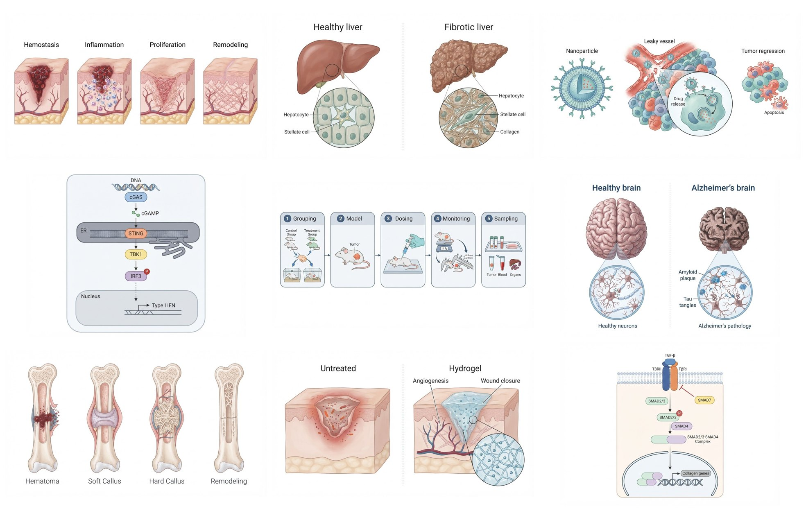

</div>

## ⭐ 精选 / Featured

<table>
<tr><td align="center"><a href="#no-20">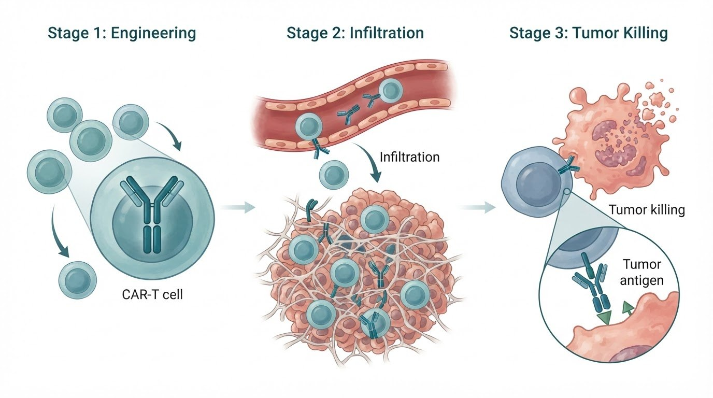</a><br><a href="#no-20">CAR-T 细胞攻克实体瘤</a></td><td align="center"><a href="#no-36">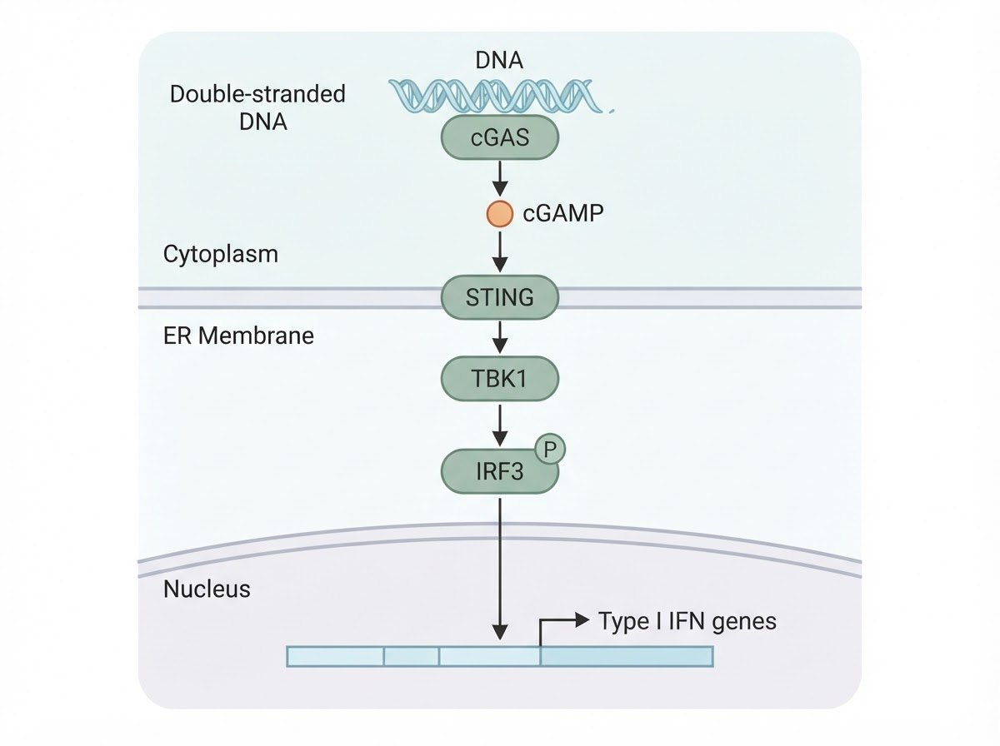</a><br><a href="#no-36">cGAS–STING 先天免疫通路</a></td></tr>
<tr><td align="center"><a href="#no-54">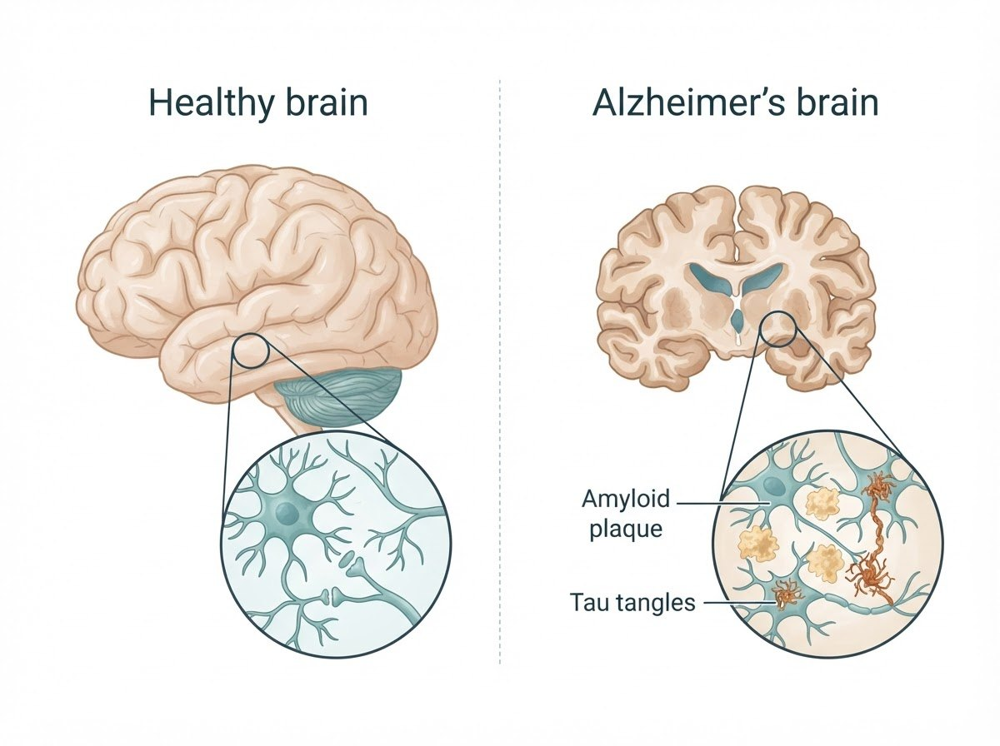</a><br><a href="#no-54">健康大脑与阿尔茨海默病大脑</a></td><td align="center"><a href="#no-78">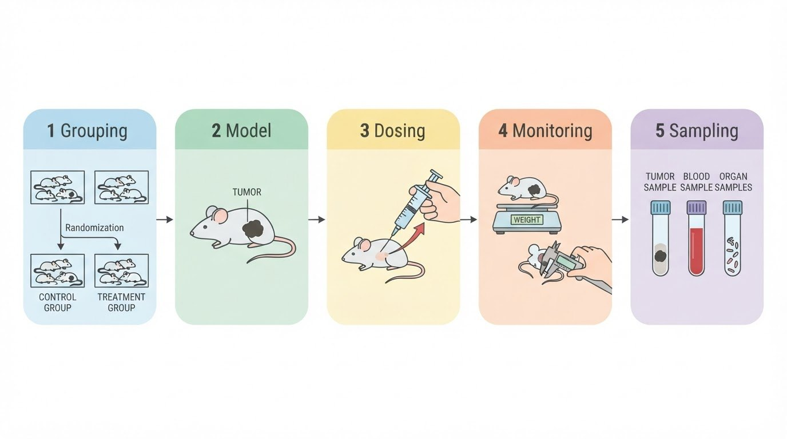</a><br><a href="#no-78">小鼠疾病模型：分组、给药与取材</a></td></tr>
</table>

## 按图类型浏览

| [🗺️ 通用科研图](#research-design) | [🧭 图形摘要](#graphical-abstract) | [🧬 信号通路](#signaling-pathway) | [🫀 医学插图](#medical-illustration) |
|:-:|:-:|:-:|:-:|
| <a href="#research-design">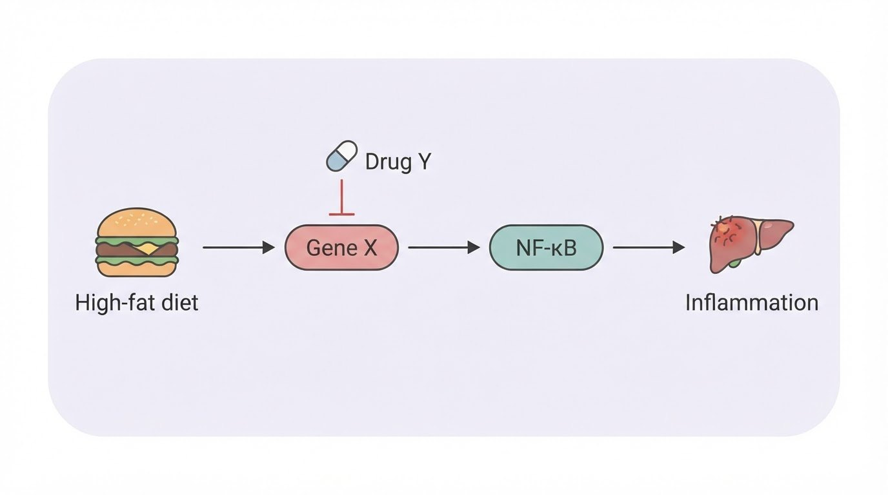</a> | <a href="#graphical-abstract">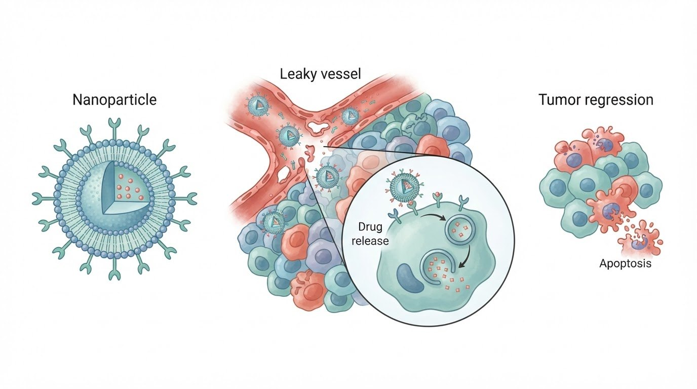</a> | <a href="#signaling-pathway"></a> | <a href="#medical-illustration"></a> |
| 19 个模板 | 15 个模板 | 18 个模板 | 12 个模板 |

| [🧪 实验流程](#experimental-workflow) | [🔋 材料与能源](#materials-energy) | [🌍 环境与地球](#earth-environment) | [🤖 AI 与计算机](#ai-computing) |
|:-:|:-:|:-:|:-:|
| <a href="#experimental-workflow"></a> | <a href="#materials-energy">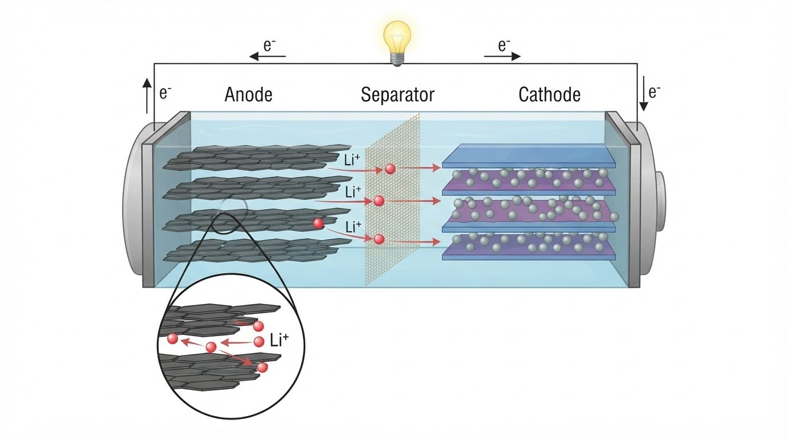</a> | <a href="#earth-environment">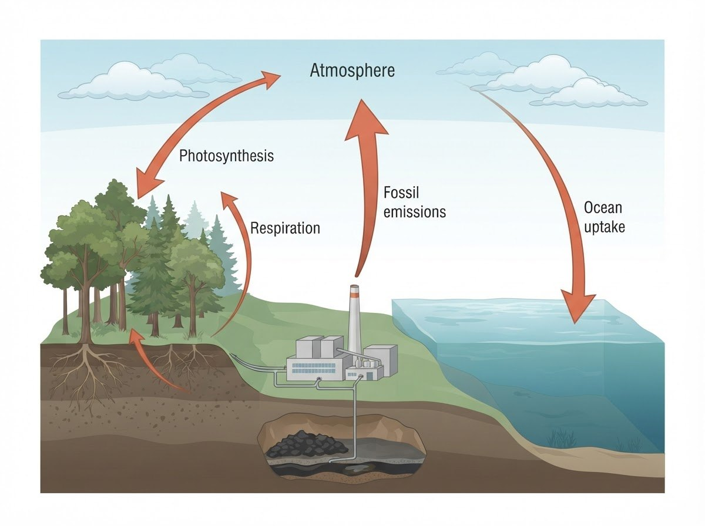</a> | <a href="#ai-computing">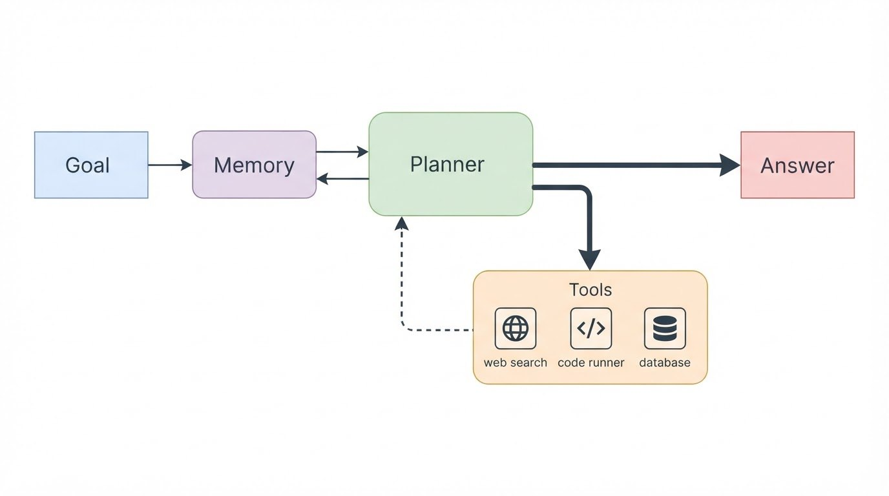</a> |
| 24 个模板 | 6 个模板 | 5 个模板 | 11 个模板 |

| [⚙️ 工程系统](#engineering-systems) | [⚗️ 化学与仪器](#chemistry-instruments) | [🌱 农学与植物](#plant-agriculture) | [📊 人文社科](#social-science) |
|:-:|:-:|:-:|:-:|
| <a href="#engineering-systems">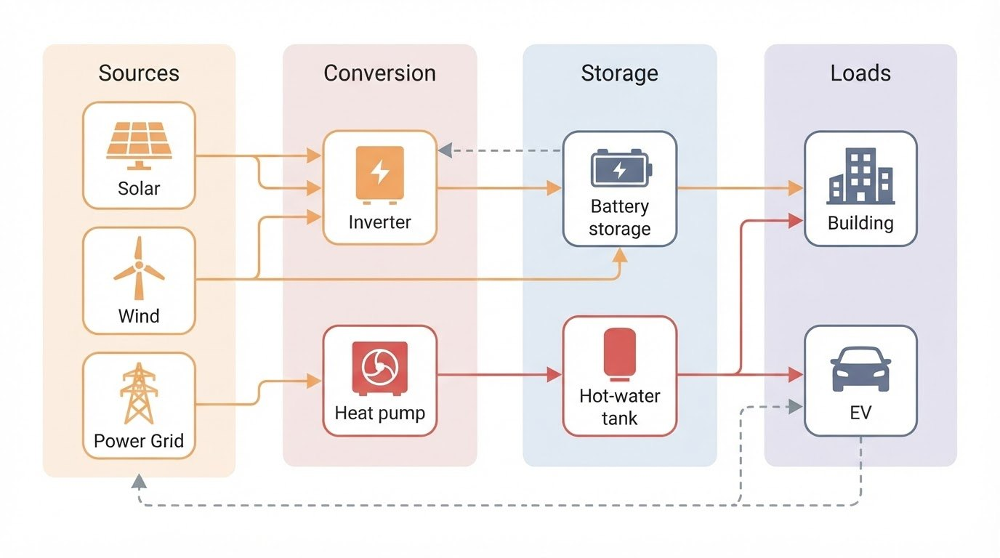</a> | <a href="#chemistry-instruments">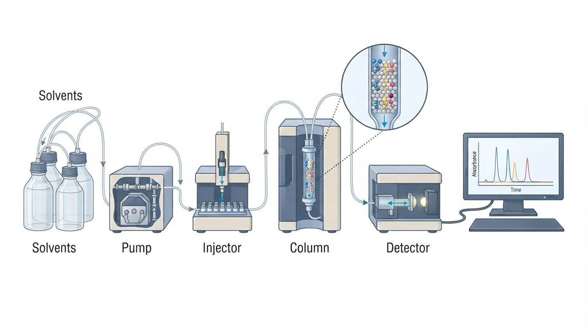</a> | <a href="#plant-agriculture">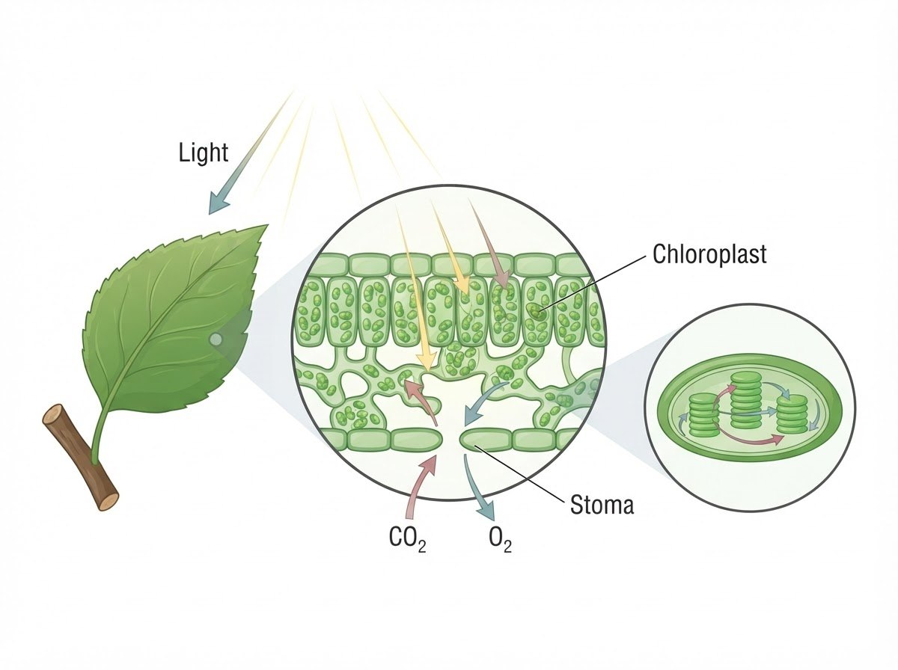</a> | <a href="#social-science">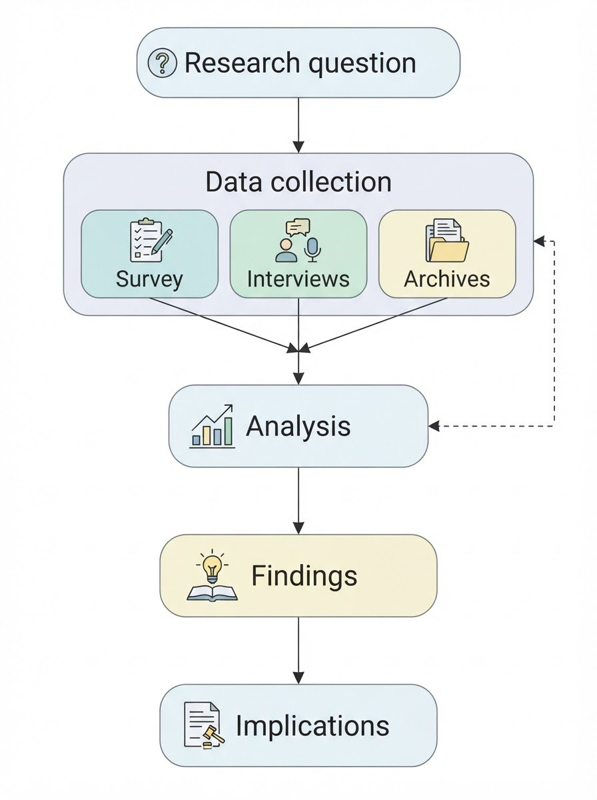</a> |
| 5 个模板 | 5 个模板 | 5 个模板 | 6 个模板 |

## 怎么用

1. 选最接近的模板，复制提示词。
2. 把【】里的内容换成你自己的课题，然后删掉【】。风格段落保持原样。
3. 粘贴到 Gemini、ChatGPT 或任何图像模型。图中文字用英文短标签，出错最少。
4. 核对箭头、结构位置和拼写。这些是初稿，还不能直接投稿。请先看[投稿前核对清单](docs/checklist.md)。

> 💡 不想自己填模板？把论文摘要贴进 [Yila](https://yila.ai/?utm_source=github&utm_medium=readme_howto&utm_campaign=sci-figure-prompts)。Yila 是一个科研助手，会选模板、写提示词，并画出初稿。

**相关：** [awesome-research-skills](https://github.com/Yila-AI/awesome-research-skills)：文献调研、写作和数据分析的 agent skills。

131 个模板 · 241 张示例图 · Nano Banana 2 Lite (gemini-3.1-flash-lite-image, 1K) · 更新于 2026-10-28

## 目录

- **通用科研图**：[No. 1 从实验室到临床的转化路径](#no-1)、[No. 2 病例对照研究设计](#no-2)、[No. 3 细胞实验分组与处理时间轴](#no-3)、[No. 4 临床预测模型构建流程](#no-4)、[No. 5 跨尺度示意：器官—组织—细胞—分子](#no-5)、[No. 6 新药研发管线](#no-6)、[No. 7 研究证据链：体外—体内—临床](#no-7)、[No. 8 基金申请研究内容关系图](#no-8)、[No. 9 基金申请逻辑闭环图](#no-9)、[No. 10 科学假说机制总图](#no-10)、[No. 11 方法对比：传统方法 vs 新方法](#no-11)、[No. 12 多组学整合分析框架](#no-12)、[No. 13 技术路线图：三条并行工作线汇合](#no-13)、[No. 14 质性研究流程：访谈与三级编码](#no-14)、[No. 15 问卷研究流程](#no-15)、[No. 16 随机对照试验设计](#no-16)、[No. 17 研究设计总览（论文 Figure 1）](#no-17)、[No. 18 系统综述与 meta 分析工作流](#no-18)、[No. 19 竖版图文摘要](#no-19)
- **图形摘要**：[No. 20 CAR-T 细胞攻克实体瘤](#no-20)、[No. 21 CRISPR-Cas9 基因编辑机制](#no-21)、[No. 22 药物作用机制](#no-22)、[No. 23 上皮间质转化（EMT）](#no-23)、[No. 24 运动改善骨骼肌胰岛素抵抗](#no-24)、[No. 25 肿瘤外泌体建立肺前转移微环境](#no-25)、[No. 26 肠–脑轴与抑郁](#no-26)、[No. 27 水凝胶促进创面愈合](#no-27)、[No. 28 巨噬细胞 M1/M2 极化](#no-28)、[No. 29 线粒体功能障碍](#no-29)、[No. 30 mRNA 疫苗诱导免疫应答](#no-30)、[No. 31 纳米颗粒靶向递送抗肿瘤药物](#no-31)、[No. 32 氧化应激与 ROS 损伤](#no-32)、[No. 33 细胞衰老与 SASP](#no-33)、[No. 34 肿瘤微环境](#no-34)
- **信号通路**：[No. 35 自噬](#no-35)、[No. 36 cGAS–STING 先天免疫通路](#no-36)、[No. 37 外源性凋亡（死亡受体途径）](#no-37)、[No. 38 铁死亡](#no-38)、[No. 39 HIF-1α 缺氧应答：常氧 vs 缺氧](#no-39)、[No. 40 胰岛素信号与 GLUT4 转位](#no-40)、[No. 41 内源性凋亡（线粒体途径）](#no-41)、[No. 42 JAK/STAT 通路](#no-42)、[No. 43 Keap1/Nrf2 抗氧化通路](#no-43)、[No. 44 MAPK/ERK 通路](#no-44)、[No. 45 经典 NF-κB 通路](#no-45)、[No. 46 NLRP3 炎症小体：双信号激活](#no-46)、[No. 47 p53 与 DNA 损伤应答](#no-47)、[No. 48 PD-1/PD-L1 免疫检查点与阻断](#no-48)、[No. 49 PI3K/AKT/mTOR 通路](#no-49)、[No. 50 细胞焦亡（GSDMD 成孔）](#no-50)、[No. 51 TGF-β/SMAD 促纤维化通路](#no-51)、[No. 52 Wnt/β-catenin 通路：关闭 vs 开启](#no-52)
- **医学插图**：[No. 53 肺泡气体交换](#no-53)、[No. 54 健康大脑与阿尔茨海默病大脑](#no-54)、[No. 55 动脉粥样硬化斑块形成](#no-55)、[No. 56 骨重塑：成骨与破骨](#no-56)、[No. 57 骨折愈合四阶段](#no-57)、[No. 58 肾小球滤过屏障三层结构](#no-58)、[No. 59 心脏结构与血流](#no-59)、[No. 60 肠道屏障：健康 vs 受损](#no-60)、[No. 61 健康肝脏与肝纤维化对比](#no-61)、[No. 62 肾单位结构与滤液流向](#no-62)、[No. 63 肿瘤血管生成](#no-63)、[No. 64 皮肤创面愈合四阶段](#no-64)
- **实验流程**：[No. 65 16S 菌群测序流程](#no-65)、[No. 66 生物标志物发现与验证流程](#no-66)、[No. 67 bulk RNA-seq 流程](#no-67)、[No. 68 细胞培养与转染流程](#no-68)、[No. 69 临床试验筛选、分组与随访](#no-69)、[No. 70 混合 CRISPR 筛选流程](#no-70)、[No. 71 分子对接与分子动力学流程](#no-71)、[No. 72 ELISA 流程（夹心法）](#no-72)、[No. 73 流式细胞术流程](#no-73)、[No. 74 免疫组化（IHC）流程](#no-74)、[No. 75 免疫荧光染色流程](#no-75)、[No. 76 孟德尔随机化研究设计](#no-76)、[No. 77 代谢组学流程](#no-77)、[No. 78 小鼠疾病模型：分组、给药与取材](#no-78)、[No. 79 网络药理学流程](#no-79)、[No. 80 类器官培养与药物筛选](#no-80)、[No. 81 LC-MS/MS 蛋白质组学流程](#no-81)、[No. 82 公共数据库挖掘流程（TCGA/GEO）](#no-82)、[No. 83 qPCR 流程](#no-83)、[No. 84 敲低/过表达与救援实验证据链](#no-84)、[No. 85 单细胞 RNA 测序流程](#no-85)、[No. 86 空间转录组流程](#no-86)、[No. 87 Transwell 迁移侵袭实验](#no-87)、[No. 88 Western blot 流程](#no-88)
- **材料与能源**：[No. 89 多相催化反应机理](#no-89)、[No. 90 水热法材料合成路线](#no-90)、[No. 91 锂离子电池充放电](#no-91)、[No. 92 MOF 结构与应用](#no-92)、[No. 93 钙钛矿-硅叠层太阳能电池](#no-93)、[No. 94 电解水：析氢与析氧](#no-94)
- **环境与地球**：[No. 95 全球碳循环](#no-95)、[No. 96 生命周期评价（LCA）框架](#no-96)、[No. 97 微塑料迁移路径](#no-97)、[No. 98 城市热岛与缓解措施](#no-98)、[No. 99 污水处理工艺流程](#no-99)
- **AI 与计算机**：[No. 100 卷积神经网络（CNN）结构](#no-100)、[No. 101 联邦学习](#no-101)、[No. 102 知识图谱构建流程](#no-102)、[No. 103 大模型智能体工作循环](#no-103)、[No. 104 医学影像 / 数字病理 AI 流程](#no-104)、[No. 105 机器学习建模流程](#no-105)、[No. 106 多智能体协作框架](#no-106)、[No. 107 多模态大模型结构](#no-107)、[No. 108 检索增强生成（RAG）流程](#no-108)、[No. 109 Transformer 结构](#no-109)、[No. 110 U-Net 结构](#no-110)
- **工程系统**：[No. 111 自动驾驶感知—决策—控制](#no-111)、[No. 112 综合能源系统](#no-112)、[No. 113 物联网监测系统架构](#no-113)、[No. 114 微电网](#no-114)、[No. 115 PID 闭环控制](#no-115)
- **化学与仪器**：[No. 116 交叉偶联催化循环（Suzuki）](#no-116)、[No. 117 荧光探针识别机理](#no-117)、[No. 118 高效液相色谱系统](#no-118)、[No. 119 三重四极杆质谱仪](#no-119)、[No. 120 三电极电化学池](#no-120)
- **农学与植物**：[No. 121 干旱胁迫与 ABA 信号](#no-121)、[No. 122 田间试验小区设计（随机区组）](#no-122)、[No. 123 叶片结构与光合作用](#no-123)、[No. 124 植物免疫：PTI 与 ETI](#no-124)、[No. 125 根系与根际微生物](#no-125)
- **人文社科**：[No. 126 混合研究设计（解释性顺序）](#no-126)、[No. 127 研究框架图（中介与调节）](#no-127)、[No. 128 技术接受模型（TAM）](#no-128)、[No. 129 课题技术路线图](#no-129)、[No. 130 计划行为理论（TPB）](#no-130)、[No. 131 整合型技术接受模型（UTAUT）](#no-131)

<a id="research-design"></a>

## 通用科研图

<a id="no-1"></a>

### No. 1：从实验室到临床的转化路径

by [@Yila-AI](https://github.com/Yila-AI)

写法技巧：**主线加反馈虚线**　·　风格：期刊式示意框图　·　比例：16:9

| 英文提示词出图 | 中文提示词出图 |
|---|---|
| 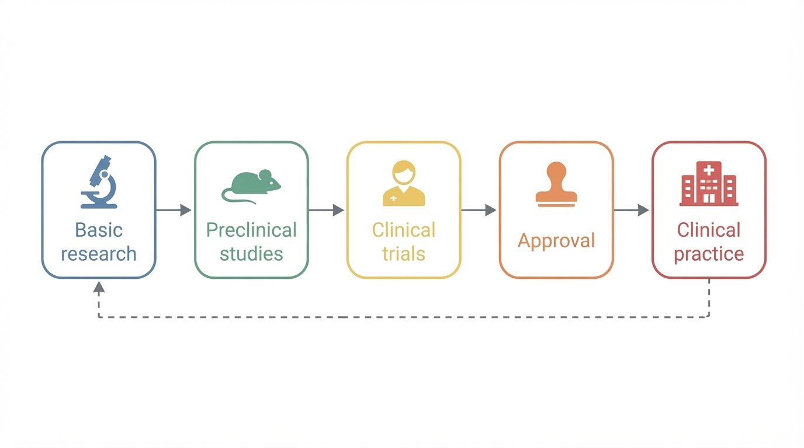 | 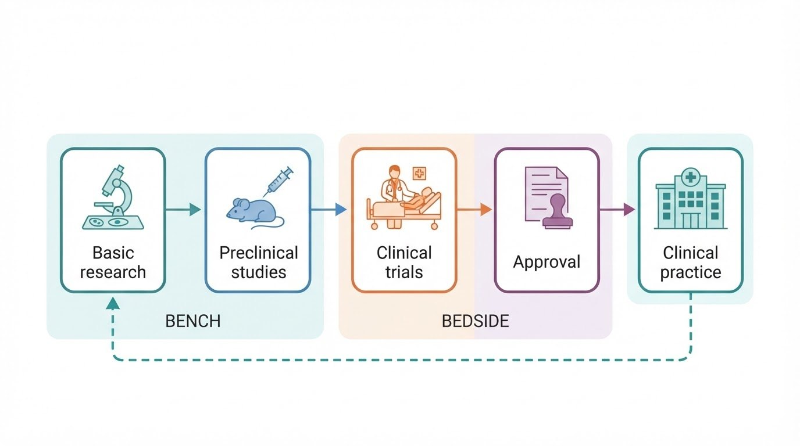 |

**中文提示词**

```text
画一张【新疗法】的转化研究路径图，从左往右读，每个阶段一个带图标的圆角框。严格按下面列出的关系画，不多画：
1. 【基础研究（显微镜）→ 临床前研究（小鼠）→ 临床试验（病人）→ 审批（印章）→ 临床应用（医院）。】
2. 【一条虚线箭头从临床应用回到基础研究。】
不要把编号句子写进图里。
标签（每个只出现一次，不加其他文字）：【Basic research, Preclinical studies, Clinical trials, Approval, Clinical practice】。

风格：期刊式示意框图。白色背景上干净的扁平矢量图形。模块画成圆角矩形或简洁图标，名称写在里面；用浅色面板把相关的层归在一起。只用 3–4 种低饱和度颜色，每种颜色含义固定。细而粗细一致的箭头表示数据、能量、物质或影响的流向，间接或反馈关系用虚线箭头。图中文字只用英文无衬线字体，每个标签只出现一次，拼写与给定完全一致。不要 3D 渲染、阴影、发光、赛博朋克或科技感背景装饰，不要照片质感。
```

<details><summary>English prompt</summary>

```text
Create a translational research pathway for 【a new therapy】, read from left to right, each stage a rounded box with one icon. Draw each relationship exactly as listed and nothing more:
1. 【Basic research (a microscope) → preclinical studies (a mouse) → clinical trials (a patient) → approval (a stamp) → clinical practice (a hospital).】
2. 【A dashed arrow runs back from clinical practice to basic research.】
Do not write the numbered sentences in the figure.
Labels, each used once, no other text: 【Basic research, Preclinical studies, Clinical trials, Approval, Clinical practice】.

Style: journal-style schematic diagram. Clean flat vector graphics on a white background. Modules are rounded rectangles or simple icons with their short names inside; light pastel panels group related layers. Only 3-4 muted colors, each with one fixed meaning. Thin, uniform arrows show the flow of data, energy, material or influence; dashed arrows for indirect or feedback links. Sans-serif English labels only, each label appears exactly once, spelled exactly as given. No 3D rendering, no shadows, no glow, no cyberpunk or tech-background decoration, no photorealism.
```

</details>

模型：Nano Banana 2 Lite (gemini-3.1-flash-lite-image, 1K)　·　这条提示词共生成 2 次，展示的是核对通过的结果

[↑ 回到顶部](#top)

<sub><a href="https://yila.ai/?utm_source=github&utm_medium=readme&utm_campaign=sci-figure-prompts&utm_content=bench-to-bedside">用 Yila 试试 →</a></sub>

---

<a id="no-2"></a>

### No. 2：病例对照研究设计

by [@Yila-AI](https://github.com/Yila-AI)

写法技巧：**从结局向前回溯暴露**　·　风格：期刊式示意框图　·　比例：16:9

| 英文提示词出图 |
|---|
| 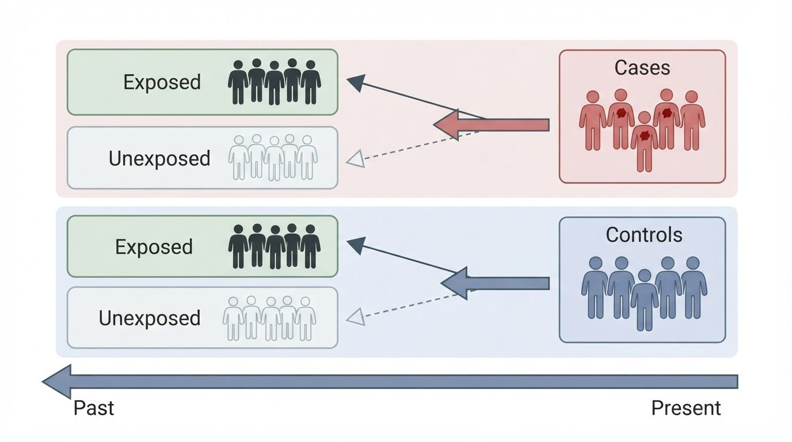 |

> 中文提示词出图未通过核对，因此这里不展示。

**中文提示词**

```text
画一张【病例对照研究】的设计图：底部一条从右指向左的时间箭头，表示研究向过去回溯。
1. 右侧两组：病例组（带红色患病标记的人形图标）和对照组（不带标记的人形图标）。
2. 每组都有一条向左的回溯箭头，到左侧再分成暴露（深色图标）和未暴露（浅色图标）。
整张图里每个标签只写一次。
标签（每个只出现一次，不加其他文字）：【Cases, Controls, Exposed, Unexposed, Past, Present】。

风格：期刊式示意框图。白色背景上干净的扁平矢量图形。模块画成圆角矩形或简洁图标，名称写在里面；用浅色面板把相关的层归在一起。只用 3–4 种低饱和度颜色，每种颜色含义固定。细而粗细一致的箭头表示数据、能量、物质或影响的流向，间接或反馈关系用虚线箭头。图中文字只用英文无衬线字体，每个标签只出现一次，拼写与给定完全一致。不要 3D 渲染、阴影、发光、赛博朋克或科技感背景装饰，不要照片质感。
```

<details><summary>English prompt</summary>

```text
Create a study design diagram of 【a case-control study】: a time arrow along the bottom pointing from right to left, showing that the study looks back in time.
1. On the right, two groups: cases (people icons with a red disease mark) and controls (people icons without it).
2. From each group, a backward arrow leads to the left side, where each group splits into exposed (dark icons) and unexposed (light icons).
Write each label only once in the whole figure.
Labels, each used once, no other text: 【Cases, Controls, Exposed, Unexposed, Past, Present】.

Style: journal-style schematic diagram. Clean flat vector graphics on a white background. Modules are rounded rectangles or simple icons with their short names inside; light pastel panels group related layers. Only 3-4 muted colors, each with one fixed meaning. Thin, uniform arrows show the flow of data, energy, material or influence; dashed arrows for indirect or feedback links. Sans-serif English labels only, each label appears exactly once, spelled exactly as given. No 3D rendering, no shadows, no glow, no cyberpunk or tech-background decoration, no photorealism.
```

</details>

模型：Nano Banana 2 Lite (gemini-3.1-flash-lite-image, 1K)　·　这条提示词共生成 4 次，展示的是核对通过的结果

[↑ 回到顶部](#top)

<sub><a href="https://yila.ai/?utm_source=github&utm_medium=readme&utm_campaign=sci-figure-prompts&utm_content=case-control-design">用 Yila 试试 →</a></sub>

---

<a id="no-3"></a>

### No. 3：细胞实验分组与处理时间轴

by [@Yila-AI](https://github.com/Yila-AI)

写法技巧：**时间轴加分组色块**　·　风格：期刊式示意框图　·　比例：16:9

| 英文提示词出图 | 中文提示词出图 |
|---|---|
| 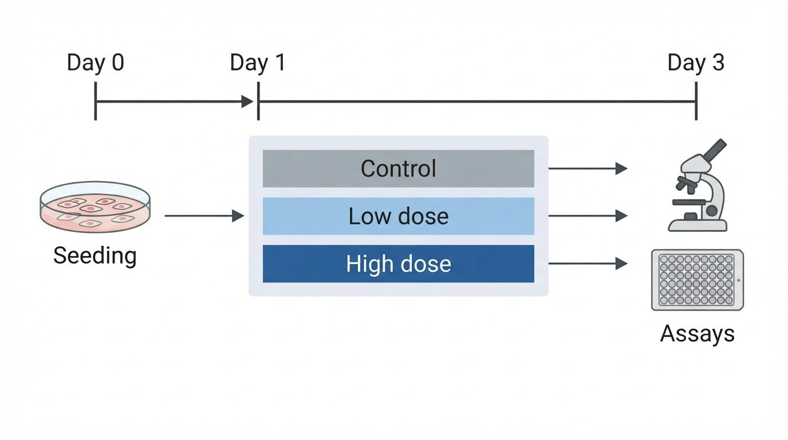 | 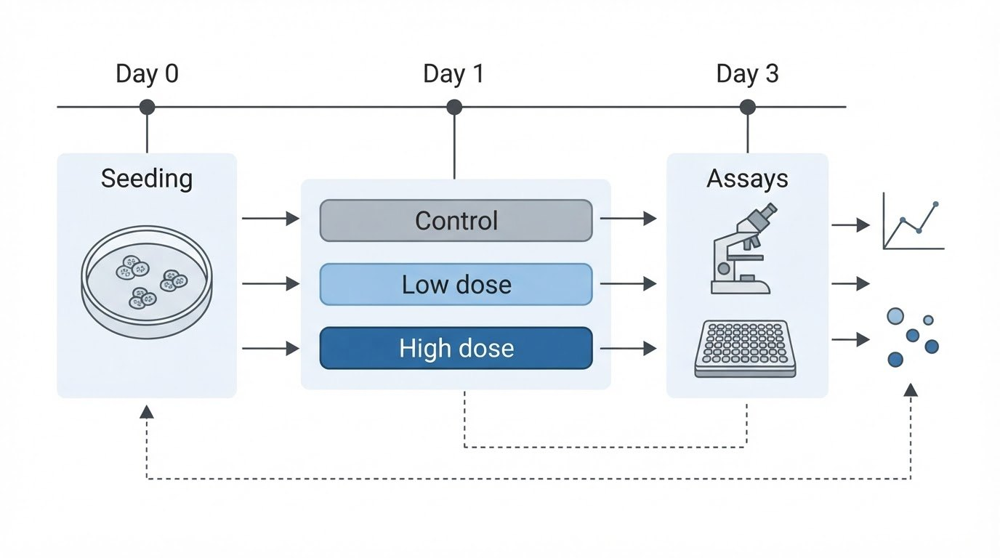 |

**中文提示词**

```text
画一张【细胞实验】的时间轴图：顶部一条横向时间轴，上面三个刻度。
1. 第一个刻度处一个培养皿图标，代表铺板。
2. 第二个刻度处开始三条彩色横条，代表分组：【对照（灰）、低剂量药物（浅蓝）、高剂量药物（深蓝）】。
3. 第三个刻度处是检测图标：【显微镜和酶标仪】。
整张图里每个标签只写一次。
标签（每个只出现一次，不加其他文字）：【Day 0, Day 1, Day 3, Seeding, Control, Low dose, High dose, Assays】。

风格：期刊式示意框图。白色背景上干净的扁平矢量图形。模块画成圆角矩形或简洁图标，名称写在里面；用浅色面板把相关的层归在一起。只用 3–4 种低饱和度颜色，每种颜色含义固定。细而粗细一致的箭头表示数据、能量、物质或影响的流向，间接或反馈关系用虚线箭头。图中文字只用英文无衬线字体，每个标签只出现一次，拼写与给定完全一致。不要 3D 渲染、阴影、发光、赛博朋克或科技感背景装饰，不要照片质感。
```

<details><summary>English prompt</summary>

```text
Create a timeline figure for 【a cell experiment】: one horizontal time axis across the top with three tick marks.
1. At the first tick, a culture dish icon for cell seeding.
2. At the second tick, three colored rows begin for the groups: 【control (gray), drug low dose (light blue), drug high dose (dark blue)】.
3. At the third tick, assay icons: 【a microscope and a plate reader】.
Write each label only once in the whole figure.
Labels, each used once, no other text: 【Day 0, Day 1, Day 3, Seeding, Control, Low dose, High dose, Assays】.

Style: journal-style schematic diagram. Clean flat vector graphics on a white background. Modules are rounded rectangles or simple icons with their short names inside; light pastel panels group related layers. Only 3-4 muted colors, each with one fixed meaning. Thin, uniform arrows show the flow of data, energy, material or influence; dashed arrows for indirect or feedback links. Sans-serif English labels only, each label appears exactly once, spelled exactly as given. No 3D rendering, no shadows, no glow, no cyberpunk or tech-background decoration, no photorealism.
```

</details>

模型：Nano Banana 2 Lite (gemini-3.1-flash-lite-image, 1K)　·　这条提示词共生成 4 次，展示的是核对通过的结果

[↑ 回到顶部](#top)

<sub><a href="https://yila.ai/?utm_source=github&utm_medium=readme&utm_campaign=sci-figure-prompts&utm_content=cell-treatment-timeline">用 Yila 试试 →</a></sub>

---

<a id="no-4"></a>

### No. 4：临床预测模型构建流程

by [@Yila-AI](https://github.com/Yila-AI)

写法技巧：**每步一个面板，只写步骤名**　·　风格：扁平流程图　·　比例：16:9

| 英文提示词出图 | 中文提示词出图 |
|---|---|
| 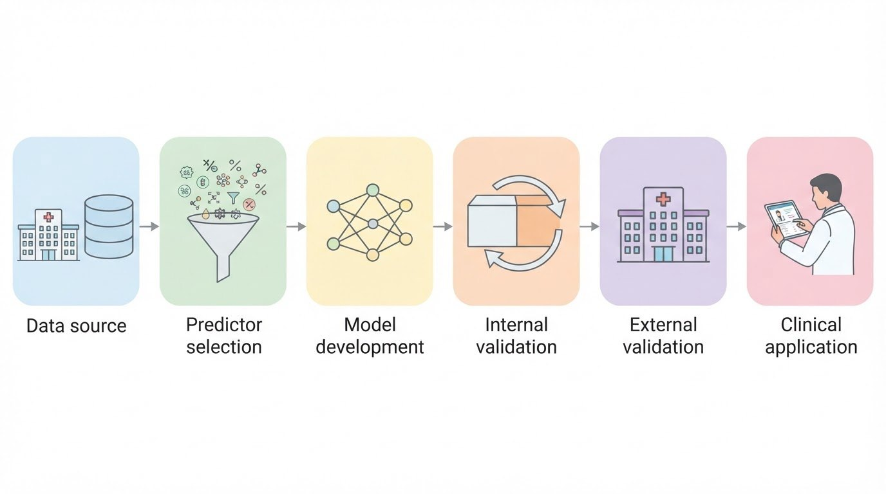 | 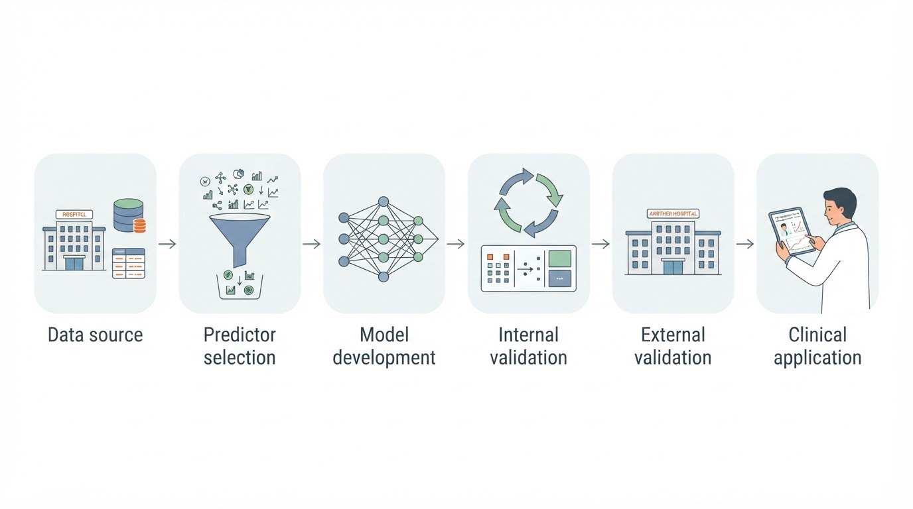 |

**中文提示词**

```text
画一张【临床预测模型构建】的流程图，从左往右六步：
1. 【数据来源：医院和数据库】
2. 【预测因子筛选：漏斗下方许多小图标】
3. 【模型构建：一个小网络】
4. 【内部验证：数据拆分上方一个循环箭头】
5. 【外部验证：另一家医院】
6. 【临床应用：拿平板的医生】
不要把编号句子写进图里。
步骤名（每个只出现一次，不加其他文字）：【Data source, Predictor selection, Model development, Internal validation, External validation, Clinical application】。

风格：期刊式实验流程图。白色背景上干净的扁平矢量图标，每一步一个浅色圆角面板，面板之间用细灰色箭头连接。只用 3–4 种低饱和度颜色。每个面板里只画一个简洁的小场景，面板内不写任何文字；整张图唯一的文字就是给定的步骤名。用英文无衬线字体，每个步骤名只出现一次，拼写与给定完全一致。不要图例、不要说明文字、不要额外标签、不要 3D 渲染、阴影或装饰性背景。
```

<details><summary>English prompt</summary>

```text
Create a workflow figure for 【building a clinical prediction model】, 6 steps from left to right:
1. 【Data source: a hospital and a database】
2. 【Predictor selection: a funnel over many small icons】
3. 【Model development: a small network】
4. 【Internal validation: a circular arrow over a data split】
5. 【External validation: a second hospital】
6. 【Clinical application: a doctor with a tablet】
Do not write the numbered sentences in the figure.
Step names, each used once, no other text: 【Data source, Predictor selection, Model development, Internal validation, External validation, Clinical application】.

Style: journal-style experimental workflow figure. Clean flat vector icons on a white background, one light pastel rounded panel per step, thin gray arrows between panels. Only 3-4 muted colors. Each panel shows one simple scene with no text inside it; the only text in the whole figure is the step names given. Sans-serif English, each step name appears exactly once, spelled exactly as given. No legends, no captions, no extra labels, no 3D rendering, no shadows, no decorative background.
```

</details>

模型：Nano Banana 2 Lite (gemini-3.1-flash-lite-image, 1K)　·　这条提示词共生成 2 次，展示的是核对通过的结果

[↑ 回到顶部](#top)

<sub><a href="https://yila.ai/?utm_source=github&utm_medium=readme&utm_campaign=sci-figure-prompts&utm_content=clinical-prediction-model">用 Yila 试试 →</a></sub>

---

<a id="no-5"></a>

### No. 5：跨尺度示意：器官—组织—细胞—分子

by [@Yila-AI](https://github.com/Yila-AI)

写法技巧：**逐级圆形放大**　·　风格：期刊式科学插画　·　比例：16:9

| 英文提示词出图 |
|---|
| 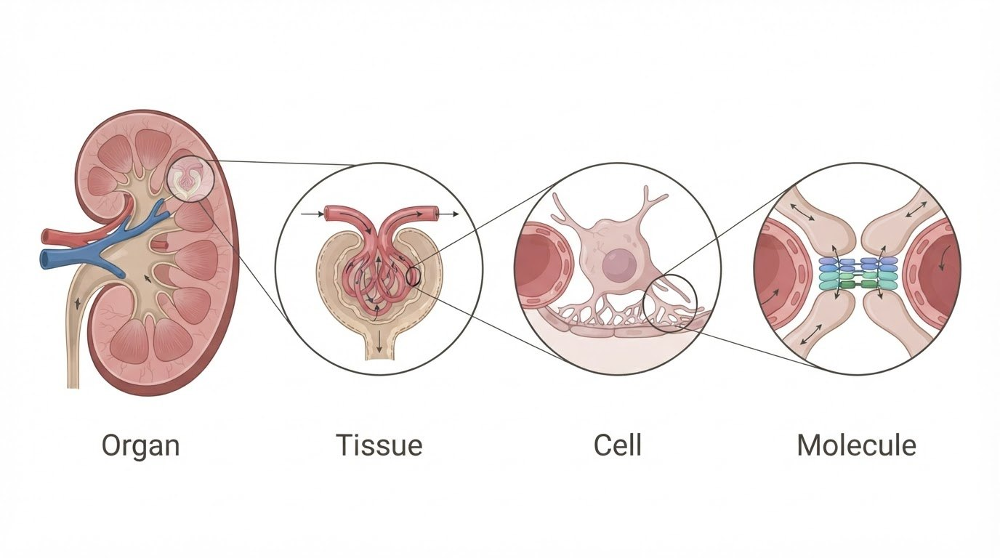 |

> 中文提示词出图未通过核对，因此这里不展示。

**中文提示词**

```text
画一张【肾脏】的跨尺度插画，从左往右四级，用圆形放大插图依次连接：
1. 【完整的肾脏】。
2. 【肾小球，一团毛细血管组成的过滤球】。
3. 【足细胞用足突包住一根毛细血管】。
4. 【裂孔隔膜蛋白连接两个足突】。
每个放大图用两条细线连到上一级。
整张图里每个标签只写一次。
标签（每个只出现一次，不加其他文字）：【Organ, Tissue, Cell, Molecule】。

风格：期刊式科学插画。干净的半写实矢量插画，带柔和的明暗；需要说明结构时使用剖面或剖切视图，白色背景。配色低饱和、协调，只用一个强调色突出关键过程。用细的方向箭头表示流动。留白充足，阅读方向清晰。图中文字只用英文无衬线字体，每个标签只出现一次，拼写与给定完全一致。不要卡通风格、不要光滑的 CG 渲染、不要深色背景、不要图库照片感、不要装饰性背景。
```

<details><summary>English prompt</summary>

```text
Create a cross-scale illustration of 【the kidney】, read from left to right as four levels joined by circular magnified insets:
1. 【A whole kidney】.
2. 【A glomerulus, the filtering ball of capillaries】.
3. 【A podocyte wrapping a capillary with its foot processes】.
4. 【A slit-diaphragm protein bridging two foot processes】.
Each inset connects to the previous level with two thin lines.
Write each label only once in the whole figure.
Labels, each used once, no other text: 【Organ, Tissue, Cell, Molecule】.

Style: journal-style scientific illustration. Clean semi-realistic vector illustration with gentle shading, using cross-sections or cutaways where they explain the structure, on a white background. Muted, harmonious palette with one accent color for the key process. Thin directional arrows for flows. Generous white space and a clear reading direction. Sans-serif English labels only, each label appears exactly once, spelled exactly as given. No cartoon style, no glossy CGI, no dark background, no stock-photo look, no decorative background.
```

</details>

模型：Nano Banana 2 Lite (gemini-3.1-flash-lite-image, 1K)　·　这条提示词共生成 4 次，展示的是核对通过的结果

[↑ 回到顶部](#top)

<sub><a href="https://yila.ai/?utm_source=github&utm_medium=readme&utm_campaign=sci-figure-prompts&utm_content=cross-scale-zoom">用 Yila 试试 →</a></sub>

---

<a id="no-6"></a>

### No. 6：新药研发管线

by [@Yila-AI](https://github.com/Yila-AI)

写法技巧：**逐级收窄的漏斗**　·　风格：期刊式示意框图　·　比例：16:9

| 英文提示词出图 | 中文提示词出图 |
|---|---|
| 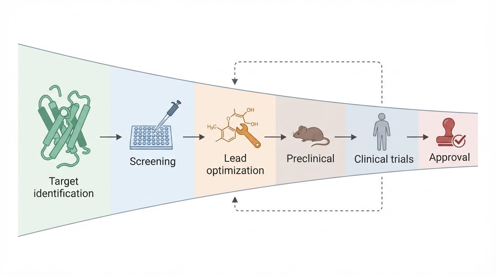 | 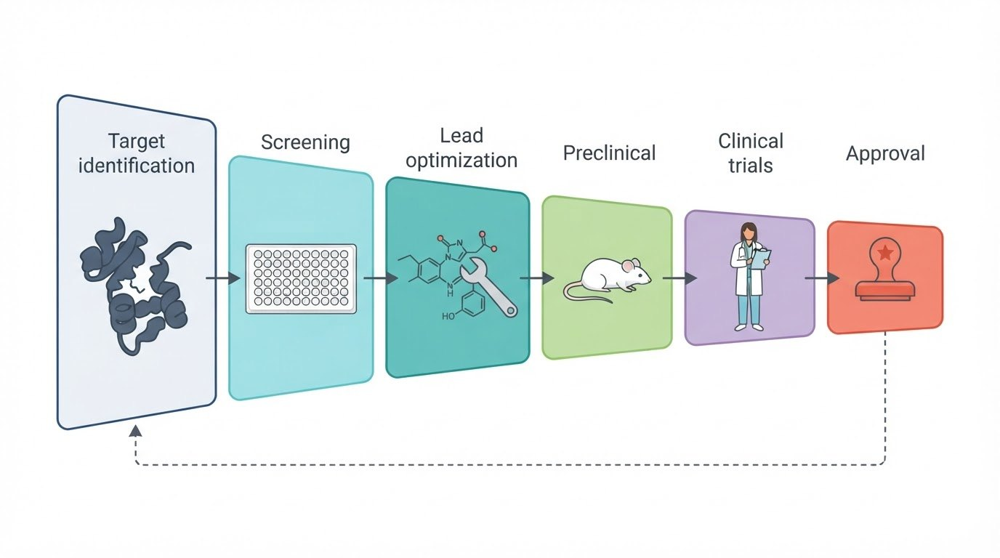 |

**中文提示词**

```text
画一张【小分子药物】的研发管线图：一个从左往右逐渐收窄的横向漏斗，分成六段，每段一个图标：
【靶点发现（蛋白质）、筛选（孔板）、先导优化（带扳手的分子）、临床前研究（小鼠）、临床试验（病人）、审批（印章）】。
整张图里每个标签只写一次。
标签（每个只出现一次，不加其他文字）：【Target identification, Screening, Lead optimization, Preclinical, Clinical trials, Approval】。

风格：期刊式示意框图。白色背景上干净的扁平矢量图形。模块画成圆角矩形或简洁图标，名称写在里面；用浅色面板把相关的层归在一起。只用 3–4 种低饱和度颜色，每种颜色含义固定。细而粗细一致的箭头表示数据、能量、物质或影响的流向，间接或反馈关系用虚线箭头。图中文字只用英文无衬线字体，每个标签只出现一次，拼写与给定完全一致。不要 3D 渲染、阴影、发光、赛博朋克或科技感背景装饰，不要照片质感。
```

<details><summary>English prompt</summary>

```text
Create a drug development pipeline for 【a small-molecule drug】: a horizontal funnel that narrows from left to right, divided into six stages, each with one icon:
【target identification (a protein), screening (a well plate), lead optimization (a molecule with a wrench), preclinical studies (a mouse), clinical trials (a patient), approval (a stamp)】.
Write each label only once in the whole figure.
Labels, each used once, no other text: 【Target identification, Screening, Lead optimization, Preclinical, Clinical trials, Approval】.

Style: journal-style schematic diagram. Clean flat vector graphics on a white background. Modules are rounded rectangles or simple icons with their short names inside; light pastel panels group related layers. Only 3-4 muted colors, each with one fixed meaning. Thin, uniform arrows show the flow of data, energy, material or influence; dashed arrows for indirect or feedback links. Sans-serif English labels only, each label appears exactly once, spelled exactly as given. No 3D rendering, no shadows, no glow, no cyberpunk or tech-background decoration, no photorealism.
```

</details>

模型：Nano Banana 2 Lite (gemini-3.1-flash-lite-image, 1K)　·　这条提示词共生成 4 次，展示的是核对通过的结果

[↑ 回到顶部](#top)

<sub><a href="https://yila.ai/?utm_source=github&utm_medium=readme&utm_campaign=sci-figure-prompts&utm_content=drug-development-pipeline">用 Yila 试试 →</a></sub>

---

<a id="no-7"></a>

### No. 7：研究证据链：体外—体内—临床

by [@Yila-AI](https://github.com/Yila-AI)

写法技巧：**三类证据汇向结论**　·　风格：期刊式示意框图　·　比例：16:9

| 英文提示词出图 | 中文提示词出图 |
|---|---|
| 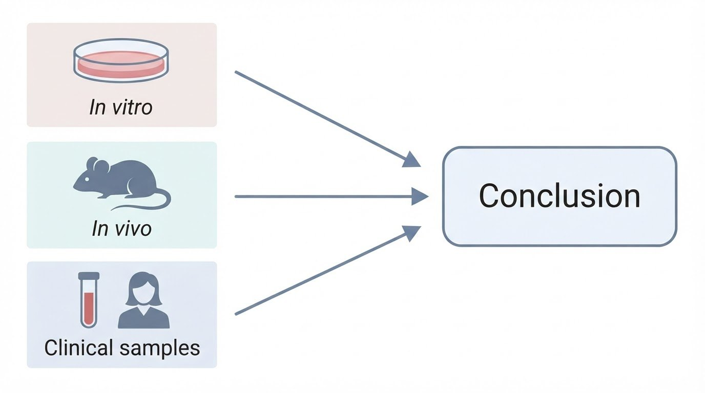 | 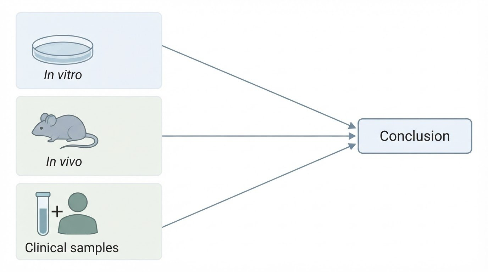 |

**中文提示词**

```text
画一张【机制研究】的证据链图，从左往右读。严格按下面列出的关系画，不多画：
1. 【左侧上下排列三个面板，各配一个图标：体外（培养皿）、体内（小鼠）、临床样本（试管加病人图标）。】
2. 【每个面板都用箭头指向右侧一个代表结论的框。】
不要把编号句子写进图里。
标签（每个只出现一次，不加其他文字）：【In vitro, In vivo, Clinical samples, Conclusion】。

风格：期刊式示意框图。白色背景上干净的扁平矢量图形。模块画成圆角矩形或简洁图标，名称写在里面；用浅色面板把相关的层归在一起。只用 3–4 种低饱和度颜色，每种颜色含义固定。细而粗细一致的箭头表示数据、能量、物质或影响的流向，间接或反馈关系用虚线箭头。图中文字只用英文无衬线字体，每个标签只出现一次，拼写与给定完全一致。不要 3D 渲染、阴影、发光、赛博朋克或科技感背景装饰，不要照片质感。
```

<details><summary>English prompt</summary>

```text
Create an evidence-chain figure for 【a mechanism study】, read from left to right. Draw each relationship exactly as listed and nothing more:
1. 【Three stacked panels on the left, each with one icon: in vitro (a culture dish), in vivo (a mouse), clinical samples (a test tube with a patient icon).】
2. 【Each panel points with an arrow to one box on the right for the conclusion.】
Do not write the numbered sentences in the figure.
Labels, each used once, no other text: 【In vitro, In vivo, Clinical samples, Conclusion】.

Style: journal-style schematic diagram. Clean flat vector graphics on a white background. Modules are rounded rectangles or simple icons with their short names inside; light pastel panels group related layers. Only 3-4 muted colors, each with one fixed meaning. Thin, uniform arrows show the flow of data, energy, material or influence; dashed arrows for indirect or feedback links. Sans-serif English labels only, each label appears exactly once, spelled exactly as given. No 3D rendering, no shadows, no glow, no cyberpunk or tech-background decoration, no photorealism.
```

</details>

模型：Nano Banana 2 Lite (gemini-3.1-flash-lite-image, 1K)　·　这条提示词共生成 2 次，展示的是核对通过的结果

[↑ 回到顶部](#top)

<sub><a href="https://yila.ai/?utm_source=github&utm_medium=readme&utm_campaign=sci-figure-prompts&utm_content=evidence-chain">用 Yila 试试 →</a></sub>

---

<a id="no-8"></a>

### No. 8：基金申请研究内容关系图

by [@Yila-AI](https://github.com/Yila-AI)

写法技巧：**科学问题统领三项内容**　·　风格：期刊式示意框图　·　比例：4:3

| 英文提示词出图 | 中文提示词出图 |
|---|---|
| 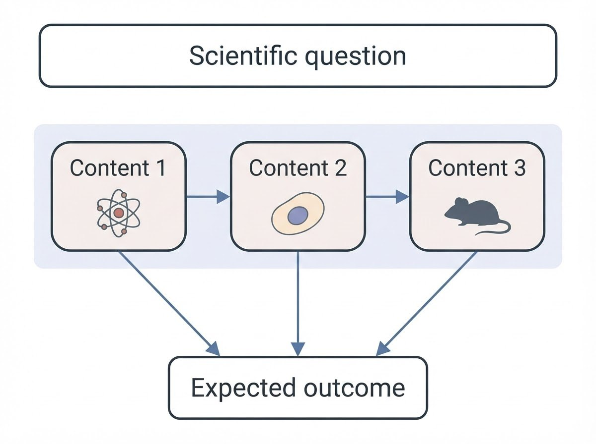 | 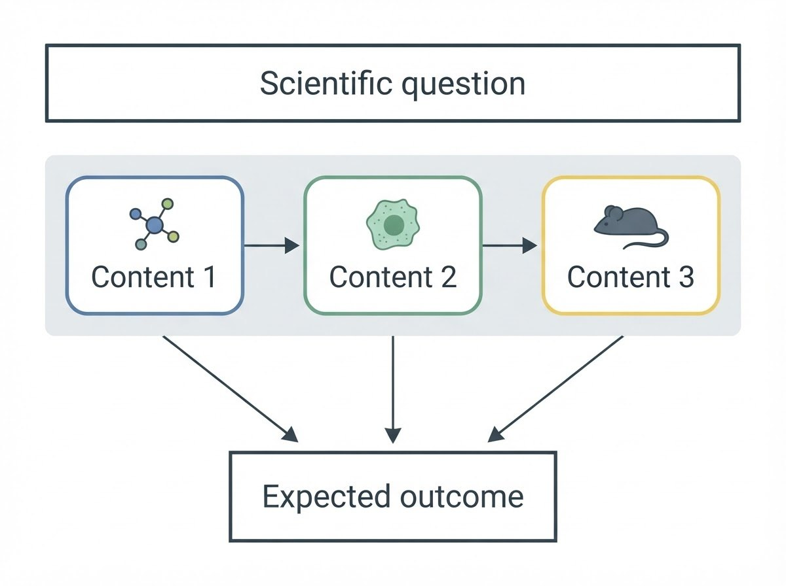 |

**中文提示词**

```text
画一张【基金申请书】的研究内容关系图，从上往下读：
1. 顶部一个宽的深色描边框，代表科学问题。
2. 下面三个并排的圆角框，代表三项研究内容，每个框里一个小图标：【分子图标、细胞图标、小鼠图标】。
3. 细箭头从内容 1 指向内容 2 再指向内容 3，表示层层递进。
4. 三个框都向下指向一个代表预期成果的框。
标签（每个只出现一次，不加其他文字）：【Scientific question, Content 1, Content 2, Content 3, Expected outcome】。

风格：期刊式示意框图。白色背景上干净的扁平矢量图形。模块画成圆角矩形或简洁图标，名称写在里面；用浅色面板把相关的层归在一起。只用 3–4 种低饱和度颜色，每种颜色含义固定。细而粗细一致的箭头表示数据、能量、物质或影响的流向，间接或反馈关系用虚线箭头。图中文字只用英文无衬线字体，每个标签只出现一次，拼写与给定完全一致。不要 3D 渲染、阴影、发光、赛博朋克或科技感背景装饰，不要照片质感。
```

<details><summary>English prompt</summary>

```text
Create a research content map for 【a grant proposal】, read from top to bottom:
1. At the top, one wide dark-outlined box for the scientific question.
2. Below it, three side-by-side rounded boxes for the three research contents, each with one small icon: 【a molecule icon, a cell icon, a mouse icon】.
3. Thin arrows run from Content 1 to Content 2 to Content 3, showing that each builds on the previous one.
4. All three boxes point down to one box for the expected outcome.
Labels, each used once, no other text: 【Scientific question, Content 1, Content 2, Content 3, Expected outcome】.

Style: journal-style schematic diagram. Clean flat vector graphics on a white background. Modules are rounded rectangles or simple icons with their short names inside; light pastel panels group related layers. Only 3-4 muted colors, each with one fixed meaning. Thin, uniform arrows show the flow of data, energy, material or influence; dashed arrows for indirect or feedback links. Sans-serif English labels only, each label appears exactly once, spelled exactly as given. No 3D rendering, no shadows, no glow, no cyberpunk or tech-background decoration, no photorealism.
```

</details>

模型：Nano Banana 2 Lite (gemini-3.1-flash-lite-image, 1K)　·　这条提示词共生成 2 次，展示的是核对通过的结果

[↑ 回到顶部](#top)

<sub><a href="https://yila.ai/?utm_source=github&utm_medium=readme&utm_campaign=sci-figure-prompts&utm_content=grant-content-map">用 Yila 试试 →</a></sub>

---

<a id="no-9"></a>

### No. 9：基金申请逻辑闭环图

by [@Yila-AI](https://github.com/Yila-AI)

写法技巧：**五个环节首尾相接**　·　风格：期刊式示意框图　·　比例：1:1

| 英文提示词出图 | 中文提示词出图 |
|---|---|
| 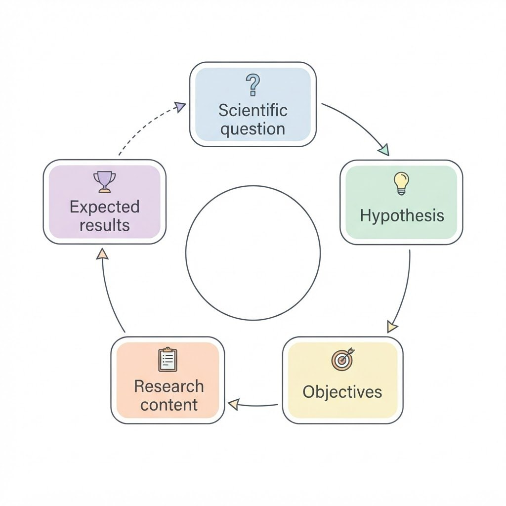 | 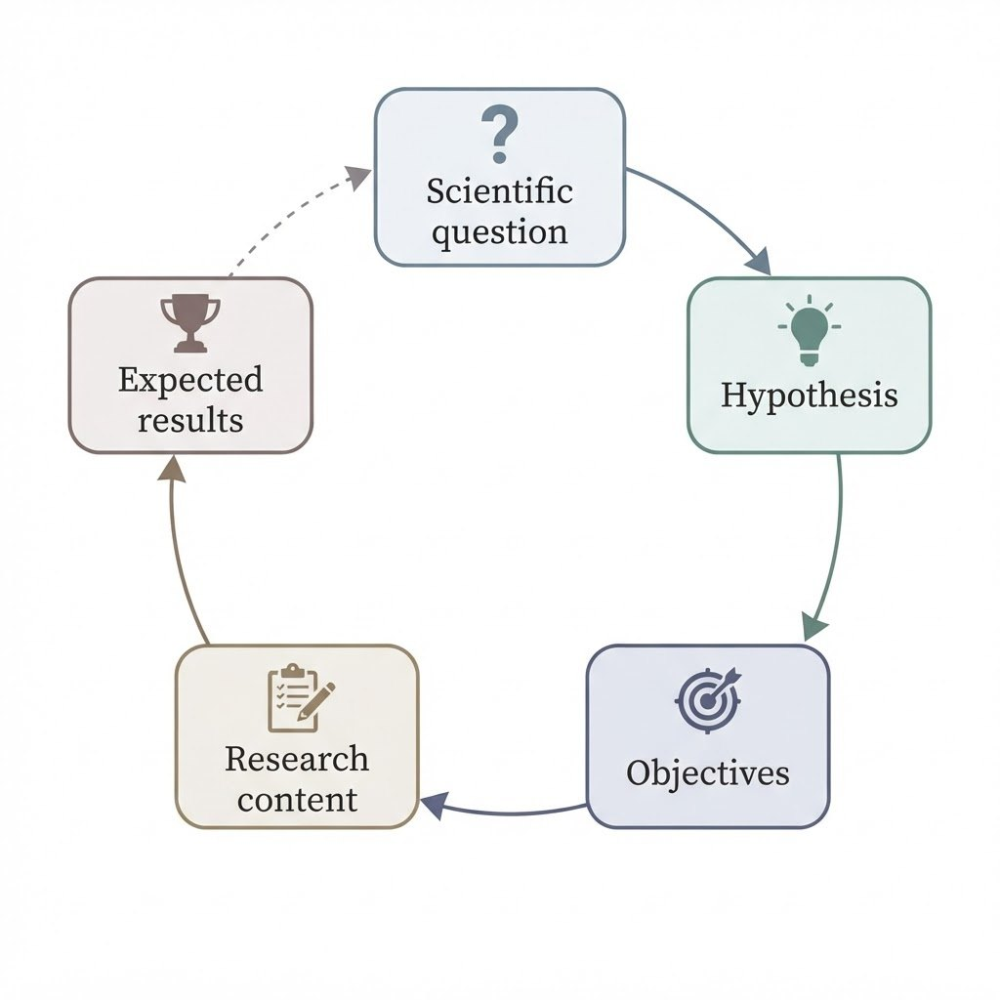 |

**中文提示词**

```text
画一张【基金申请书】的环形逻辑图：五个圆角框均匀分布在一个圆周上，用细弧形箭头顺时针连接，每个框一个小图标：
1. 【科学问题（问号）】
2. 【研究假说（灯泡）】
3. 【研究目标（靶心）】
4. 【研究内容（写字板）】
5. 【预期成果（奖杯）】
一条虚线箭头从最后一个框回到第一个框。圆心留空。
标签（每个只出现一次，不加其他文字）：【Scientific question, Hypothesis, Objectives, Research content, Expected results】。

风格：期刊式示意框图。白色背景上干净的扁平矢量图形。模块画成圆角矩形或简洁图标，名称写在里面；用浅色面板把相关的层归在一起。只用 3–4 种低饱和度颜色，每种颜色含义固定。细而粗细一致的箭头表示数据、能量、物质或影响的流向，间接或反馈关系用虚线箭头。图中文字只用英文无衬线字体，每个标签只出现一次，拼写与给定完全一致。不要 3D 渲染、阴影、发光、赛博朋克或科技感背景装饰，不要照片质感。
```

<details><summary>English prompt</summary>

```text
Create a circular logic diagram for 【a grant proposal】: five rounded boxes evenly spaced around a circle, connected clockwise by thin curved arrows, each box with one small icon:
1. 【Scientific question (a question mark)】
2. 【Hypothesis (a lightbulb)】
3. 【Objectives (a target)】
4. 【Research content (a clipboard)】
5. 【Expected results (a trophy)】
A dashed arrow runs from the last box back to the first. The center of the circle stays empty.
Labels, each used once, no other text: 【Scientific question, Hypothesis, Objectives, Research content, Expected results】.

Style: journal-style schematic diagram. Clean flat vector graphics on a white background. Modules are rounded rectangles or simple icons with their short names inside; light pastel panels group related layers. Only 3-4 muted colors, each with one fixed meaning. Thin, uniform arrows show the flow of data, energy, material or influence; dashed arrows for indirect or feedback links. Sans-serif English labels only, each label appears exactly once, spelled exactly as given. No 3D rendering, no shadows, no glow, no cyberpunk or tech-background decoration, no photorealism.
```

</details>

模型：Nano Banana 2 Lite (gemini-3.1-flash-lite-image, 1K)　·　这条提示词共生成 3 次，展示的是核对通过的结果

[↑ 回到顶部](#top)

<sub><a href="https://yila.ai/?utm_source=github&utm_medium=readme&utm_campaign=sci-figure-prompts&utm_content=grant-logic-loop">用 Yila 试试 →</a></sub>

---

<a id="no-10"></a>

### No. 10：科学假说机制总图

by [@Yila-AI](https://github.com/Yila-AI)

写法技巧：**刺激—靶点—通路—表型，加干预**　·　风格：期刊式扁平矢量　·　比例：16:9

| 英文提示词出图 | 中文提示词出图 |
|---|---|
|  | 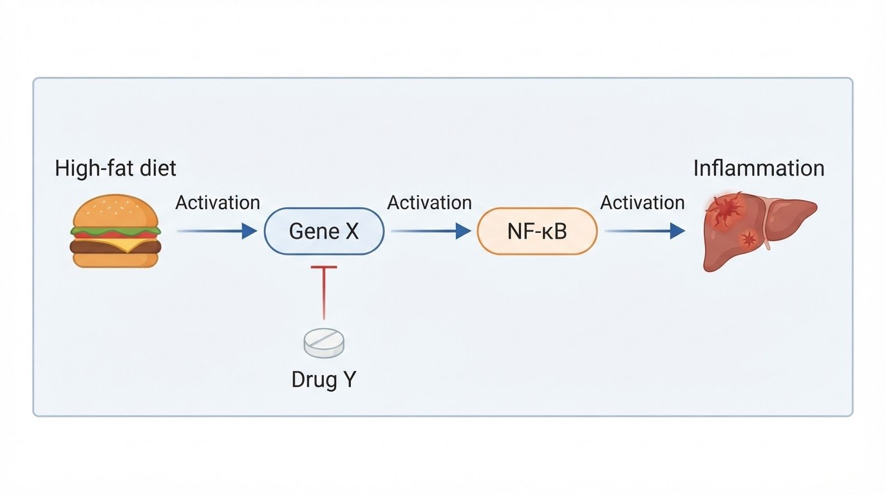 |

**中文提示词**

```text
画一张【高脂饮食如何导致肝脏炎症】的假说机制图，在一个大的浅色面板里从左往右读。严格按下面列出的关系画，不多画：
1. 【高脂饮食图标（汉堡）】激活【Gene X】（实线箭头）。
2. 【Gene X】激活【NF-κB】（实线箭头）。
3. 【NF-κB】导致【炎症】，画成一个发炎的小肝脏（实线箭头）。
4. 【Drug Y】画成一颗小药片，用红色 T 形线抑制【Gene X】。
不画细胞膜，胶囊上不加其他形状。
标签（每个只出现一次，不加其他文字）：【High-fat diet, Gene X, NF-κB, Inflammation, Drug Y】。

风格：期刊式科研示意图。白色背景上的干净扁平矢量插画，用浅色圆角面板区分区域。只用 3–4 种低饱和度颜色，每种颜色含义固定，红色只用于抑制或强调。线条细且粗细一致。蛋白画成彩色圆角胶囊，名称写在胶囊里；细胞膜画成磷脂双分子层；激活用实线箭头，抑制用 T 形线，间接作用用虚线箭头。图中文字只用英文无衬线字体，每个标签只出现一次，拼写与给定完全一致。不要 3D 渲染、阴影、发光、装饰性背景或照片质感。
```

<details><summary>English prompt</summary>

```text
Create a hypothesis mechanism figure for 【how a high-fat diet drives liver inflammation】, read from left to right inside one large light panel. Draw each relationship exactly as listed and nothing more:
1. 【A high-fat diet icon (a burger)】 activates 【Gene X】 (solid arrow).
2. 【Gene X】 activates 【NF-κB】 (solid arrow).
3. 【NF-κB】 leads to 【Inflammation】, shown as a small inflamed liver (solid arrow).
4. 【Drug Y】, a small pill, inhibits 【Gene X】 with a red T-bar line.
Draw no membranes or extra shapes on the capsules.
Labels, each used once, no other text: 【High-fat diet, Gene X, NF-κB, Inflammation, Drug Y】.

Style: journal-style scientific schematic. Clean flat vector illustration on a white background, light pastel rounded panels to separate regions. Only 3-4 muted colors, each with one fixed meaning; red only for inhibition or emphasis. Thin, uniform line weight. Proteins as rounded colored capsules with their names inside; membranes as lipid bilayers; activation as solid arrows, inhibition as T-bar lines, indirect effects as dashed arrows. Sans-serif English labels only, each label appears exactly once, spelled exactly as given. No 3D rendering, no shadows, no glow, no decorative background, no photorealism.
```

</details>

模型：Nano Banana 2 Lite (gemini-3.1-flash-lite-image, 1K)　·　这条提示词共生成 5 次，展示的是核对通过的结果

[↑ 回到顶部](#top)

<sub><a href="https://yila.ai/?utm_source=github&utm_medium=readme&utm_campaign=sci-figure-prompts&utm_content=hypothesis-mechanism">用 Yila 试试 →</a></sub>

---

<a id="no-11"></a>

### No. 11：方法对比：传统方法 vs 新方法

by [@Yila-AI](https://github.com/Yila-AI)

写法技巧：**上下两行对照**　·　风格：期刊式示意框图　·　比例：16:9

| 英文提示词出图 | 中文提示词出图 |
|---|---|
| 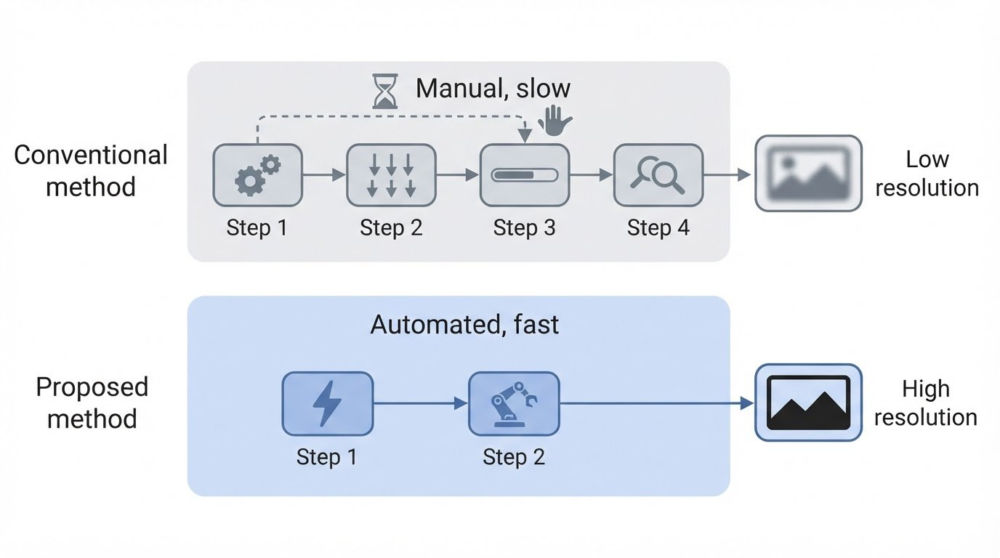 | 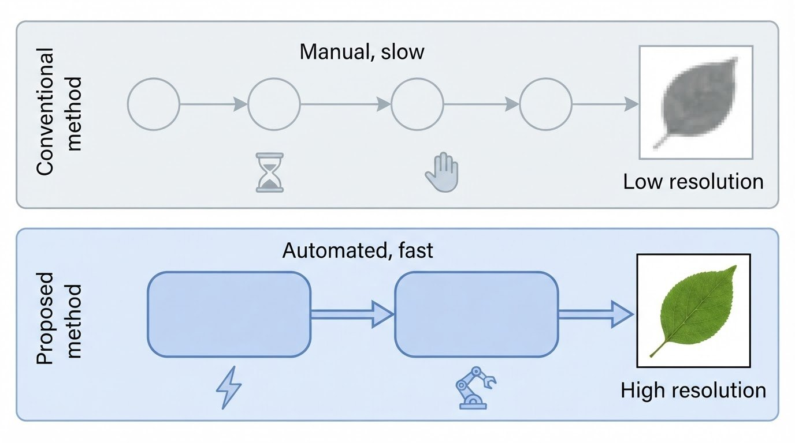 |

**中文提示词**

```text
画一张【传统方法与新方法】的对比图：上下两行，两种浅色。
1. 上排，灰色：【四个小步骤连成一条长链，配沙漏图标和手的图标，结尾是一个模糊的结果】。
2. 下排，蓝色：【两个步骤，配闪电图标和机械臂图标，结尾是一个清晰的结果】。
每行最左侧写行名，右侧结果处写一个短标签。
整张图里每个标签只写一次。
标签（每个只出现一次，不加其他文字）：【Conventional method, Proposed method, Manual, slow, Automated, fast, Low resolution, High resolution】。

风格：期刊式示意框图。白色背景上干净的扁平矢量图形。模块画成圆角矩形或简洁图标，名称写在里面；用浅色面板把相关的层归在一起。只用 3–4 种低饱和度颜色，每种颜色含义固定。细而粗细一致的箭头表示数据、能量、物质或影响的流向，间接或反馈关系用虚线箭头。图中文字只用英文无衬线字体，每个标签只出现一次，拼写与给定完全一致。不要 3D 渲染、阴影、发光、赛博朋克或科技感背景装饰，不要照片质感。
```

<details><summary>English prompt</summary>

```text
Create a comparison figure of 【a conventional method versus a proposed method】: two horizontal rows in two light colors.
1. Top row, gray: 【four small steps in a long chain with an hourglass icon and a hand icon, ending in a blurry result】.
2. Bottom row, blue: 【two steps with a lightning icon and a robot-arm icon, ending in a sharp result】.
Each row has its name on the far left and a short tag at its result on the right.
Write each label only once in the whole figure.
Labels, each used once, no other text: 【Conventional method, Proposed method, Manual, slow, Automated, fast, Low resolution, High resolution】.

Style: journal-style schematic diagram. Clean flat vector graphics on a white background. Modules are rounded rectangles or simple icons with their short names inside; light pastel panels group related layers. Only 3-4 muted colors, each with one fixed meaning. Thin, uniform arrows show the flow of data, energy, material or influence; dashed arrows for indirect or feedback links. Sans-serif English labels only, each label appears exactly once, spelled exactly as given. No 3D rendering, no shadows, no glow, no cyberpunk or tech-background decoration, no photorealism.
```

</details>

模型：Nano Banana 2 Lite (gemini-3.1-flash-lite-image, 1K)　·　这条提示词共生成 4 次，展示的是核对通过的结果

[↑ 回到顶部](#top)

<sub><a href="https://yila.ai/?utm_source=github&utm_medium=readme&utm_campaign=sci-figure-prompts&utm_content=method-comparison">用 Yila 试试 →</a></sub>

---

<a id="no-12"></a>

### No. 12：多组学整合分析框架

by [@Yila-AI](https://github.com/Yila-AI)

写法技巧：**四层组学汇入整合**　·　风格：期刊式示意框图　·　比例：16:9

| 英文提示词出图 | 中文提示词出图 |
|---|---|
| 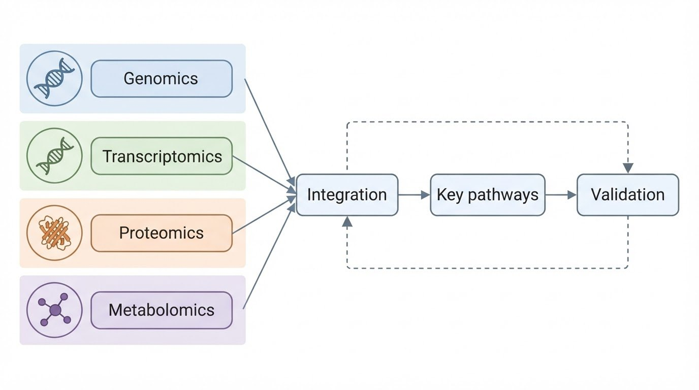 | 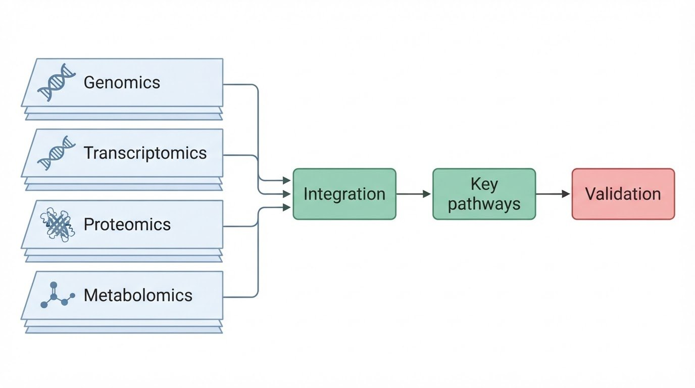 |

**中文提示词**

```text
画一张【疾病研究】的多组学整合分析框架图，从左往右读：
1. 左侧四条上下叠放的横向浅色色带，每条一个图标：【基因组（DNA 双螺旋）、转录组（RNA 链）、蛋白组（蛋白质）、代谢组（小分子）】。
2. 四条色带的细箭头汇合到中间一个代表整合的框。
3. 整合框指向代表关键通路的框，再指向最后代表验证的框。
标签（每个只出现一次，不加其他文字）：【Genomics, Transcriptomics, Proteomics, Metabolomics, Integration, Key pathways, Validation】。

风格：期刊式示意框图。白色背景上干净的扁平矢量图形。模块画成圆角矩形或简洁图标，名称写在里面；用浅色面板把相关的层归在一起。只用 3–4 种低饱和度颜色，每种颜色含义固定。细而粗细一致的箭头表示数据、能量、物质或影响的流向，间接或反馈关系用虚线箭头。图中文字只用英文无衬线字体，每个标签只出现一次，拼写与给定完全一致。不要 3D 渲染、阴影、发光、赛博朋克或科技感背景装饰，不要照片质感。
```

<details><summary>English prompt</summary>

```text
Create a multi-omics integration framework for 【a disease study】, read from left to right:
1. On the left, four stacked horizontal layers, each a light pastel band with one icon: 【Genomics (a DNA helix), Transcriptomics (an RNA strand), Proteomics (a protein), Metabolomics (a small molecule)】.
2. Thin arrows from all four layers converge into one central box for integration.
3. Integration points to a box for key pathways, which points to a final box for validation.
Labels, each used once, no other text: 【Genomics, Transcriptomics, Proteomics, Metabolomics, Integration, Key pathways, Validation】.

Style: journal-style schematic diagram. Clean flat vector graphics on a white background. Modules are rounded rectangles or simple icons with their short names inside; light pastel panels group related layers. Only 3-4 muted colors, each with one fixed meaning. Thin, uniform arrows show the flow of data, energy, material or influence; dashed arrows for indirect or feedback links. Sans-serif English labels only, each label appears exactly once, spelled exactly as given. No 3D rendering, no shadows, no glow, no cyberpunk or tech-background decoration, no photorealism.
```

</details>

模型：Nano Banana 2 Lite (gemini-3.1-flash-lite-image, 1K)　·　这条提示词共生成 2 次，展示的是核对通过的结果

[↑ 回到顶部](#top)

<sub><a href="https://yila.ai/?utm_source=github&utm_medium=readme&utm_campaign=sci-figure-prompts&utm_content=multi-omics-integration">用 Yila 试试 →</a></sub>

---

<a id="no-13"></a>

### No. 13：技术路线图：三条并行工作线汇合

by [@Yila-AI](https://github.com/Yila-AI)

写法技巧：**并行三线汇合**　·　风格：期刊式示意框图　·　比例：3:4

| 英文提示词出图 | 中文提示词出图 |
|---|---|
| 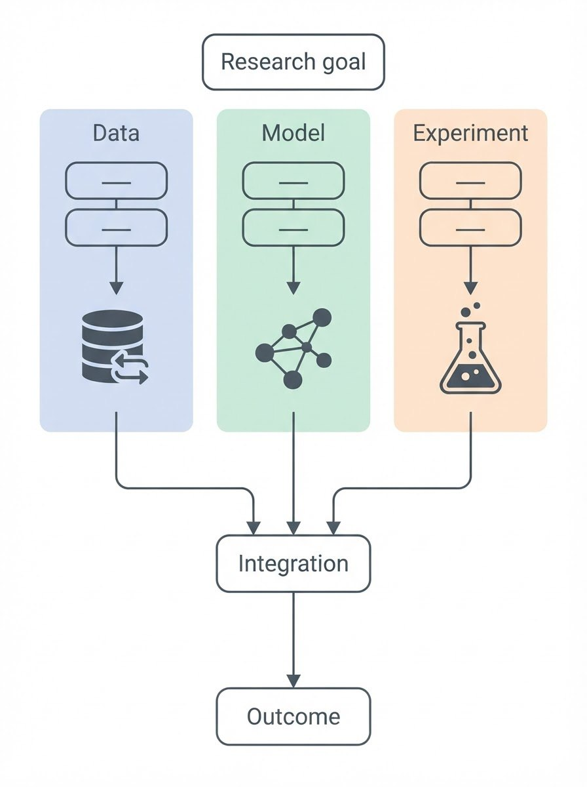 | 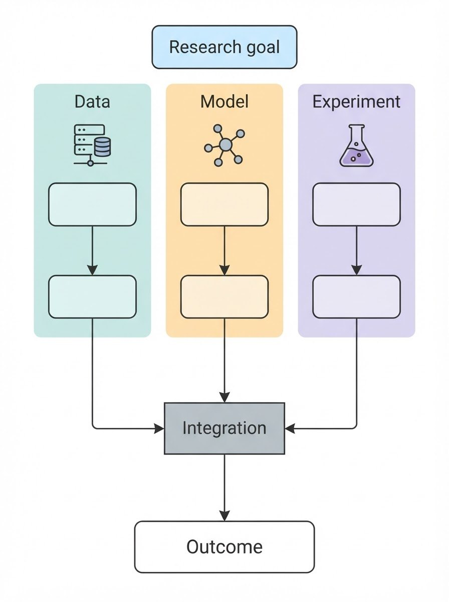 |

**中文提示词**

```text
画一张【课题研究】的竖向技术路线图，从上往下读：
1. 顶部一个框，代表研究目标。
2. 下面三条并行的竖向泳道，三种浅色，每条泳道有两个上下排列的小框和一个图标：【数据泳道配数据库图标，模型泳道配网络图标，实验泳道配烧瓶图标】。
3. 三条泳道用箭头汇合到一个代表整合的框。
4. 整合框向下指向最后一个代表成果的框。
标签（每个只出现一次，不加其他文字）：【Research goal, Data, Model, Experiment, Integration, Outcome】。

风格：期刊式示意框图。白色背景上干净的扁平矢量图形。模块画成圆角矩形或简洁图标，名称写在里面；用浅色面板把相关的层归在一起。只用 3–4 种低饱和度颜色，每种颜色含义固定。细而粗细一致的箭头表示数据、能量、物质或影响的流向，间接或反馈关系用虚线箭头。图中文字只用英文无衬线字体，每个标签只出现一次，拼写与给定完全一致。不要 3D 渲染、阴影、发光、赛博朋克或科技感背景装饰，不要照片质感。
```

<details><summary>English prompt</summary>

```text
Create a vertical technical roadmap for 【a research project】, read from top to bottom:
1. At the top, one box for the research goal.
2. Below it, three parallel vertical lanes in three light pastel colors, each lane with two small stacked boxes and one icon: 【data lane with a database icon, model lane with a network icon, experiment lane with a flask icon】.
3. The three lanes converge with arrows into one box for integration.
4. Integration points down to a final box for the outcome.
Labels, each used once, no other text: 【Research goal, Data, Model, Experiment, Integration, Outcome】.

Style: journal-style schematic diagram. Clean flat vector graphics on a white background. Modules are rounded rectangles or simple icons with their short names inside; light pastel panels group related layers. Only 3-4 muted colors, each with one fixed meaning. Thin, uniform arrows show the flow of data, energy, material or influence; dashed arrows for indirect or feedback links. Sans-serif English labels only, each label appears exactly once, spelled exactly as given. No 3D rendering, no shadows, no glow, no cyberpunk or tech-background decoration, no photorealism.
```

</details>

模型：Nano Banana 2 Lite (gemini-3.1-flash-lite-image, 1K)　·　这条提示词共生成 3 次，展示的是核对通过的结果

[↑ 回到顶部](#top)

<sub><a href="https://yila.ai/?utm_source=github&utm_medium=readme&utm_campaign=sci-figure-prompts&utm_content=parallel-roadmap">用 Yila 试试 →</a></sub>

---

<a id="no-14"></a>

### No. 14：质性研究流程：访谈与三级编码

by [@Yila-AI](https://github.com/Yila-AI)

写法技巧：**每步一个面板，只写步骤名**　·　风格：扁平流程图　·　比例：16:9

| 英文提示词出图 | 中文提示词出图 |
|---|---|
| 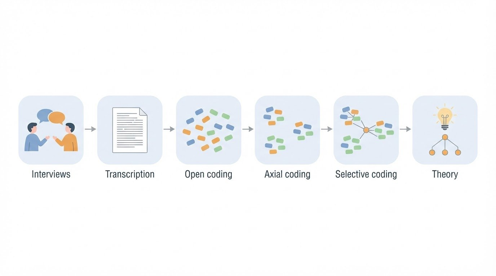 | 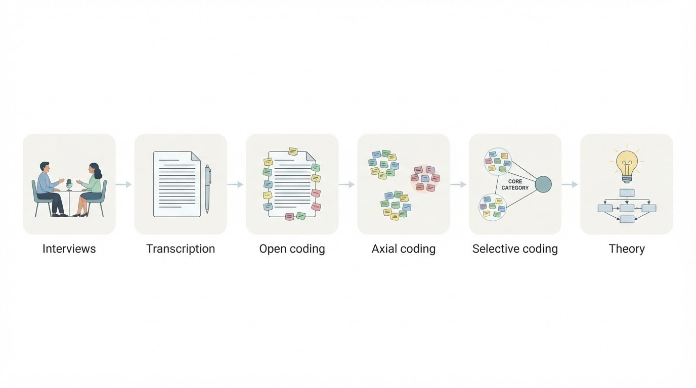 |

**中文提示词**

```text
画一张【质性访谈研究】的流程图，从左往右六步：
1. 【访谈：两个人在交谈】
2. 【转录：一份写满行的文档】
3. 【开放式编码：许多彩色小标签】
4. 【主轴编码：标签归成几簇】
5. 【选择式编码：几簇连到一个核心节点】
6. 【理论：灯泡和一个小模型】
不要把编号句子写进图里。
步骤名（每个只出现一次，不加其他文字）：【Interviews, Transcription, Open coding, Axial coding, Selective coding, Theory】。

风格：期刊式实验流程图。白色背景上干净的扁平矢量图标，每一步一个浅色圆角面板，面板之间用细灰色箭头连接。只用 3–4 种低饱和度颜色。每个面板里只画一个简洁的小场景，面板内不写任何文字；整张图唯一的文字就是给定的步骤名。用英文无衬线字体，每个步骤名只出现一次，拼写与给定完全一致。不要图例、不要说明文字、不要额外标签、不要 3D 渲染、阴影或装饰性背景。
```

<details><summary>English prompt</summary>

```text
Create a workflow figure for 【a qualitative interview study】, 6 steps from left to right:
1. 【Interviews: two people talking】
2. 【Transcription: a document with lines of text】
3. 【Open coding: many small colored tags】
4. 【Axial coding: tags grouped into a few clusters】
5. 【Selective coding: clusters linked to one core node】
6. 【Theory: a lightbulb over a small model】
Do not write the numbered sentences in the figure.
Step names, each used once, no other text: 【Interviews, Transcription, Open coding, Axial coding, Selective coding, Theory】.

Style: journal-style experimental workflow figure. Clean flat vector icons on a white background, one light pastel rounded panel per step, thin gray arrows between panels. Only 3-4 muted colors. Each panel shows one simple scene with no text inside it; the only text in the whole figure is the step names given. Sans-serif English, each step name appears exactly once, spelled exactly as given. No legends, no captions, no extra labels, no 3D rendering, no shadows, no decorative background.
```

</details>

模型：Nano Banana 2 Lite (gemini-3.1-flash-lite-image, 1K)　·　这条提示词共生成 2 次，展示的是核对通过的结果

[↑ 回到顶部](#top)

<sub><a href="https://yila.ai/?utm_source=github&utm_medium=readme&utm_campaign=sci-figure-prompts&utm_content=qualitative-coding">用 Yila 试试 →</a></sub>

---

<a id="no-15"></a>

### No. 15：问卷研究流程

by [@Yila-AI](https://github.com/Yila-AI)

写法技巧：**每步一个面板，只写步骤名**　·　风格：扁平流程图　·　比例：16:9

| 英文提示词出图 | 中文提示词出图 |
|---|---|
| 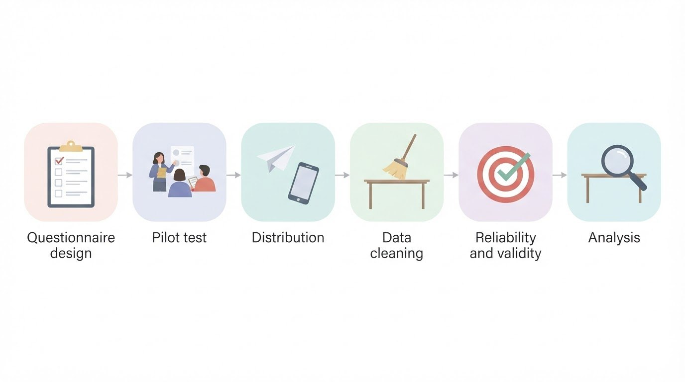 | 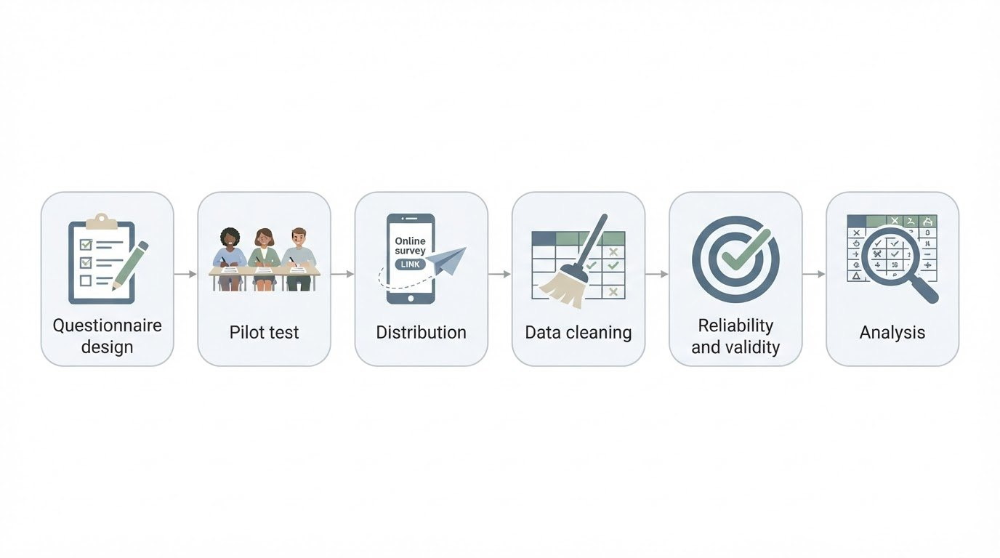 |

**中文提示词**

```text
画一张【问卷研究】的流程图，从左往右六步：
1. 【问卷设计：带复选框的写字板】
2. 【预调查：几个人在作答】
3. 【发放：纸飞机和手机】
4. 【数据清洗：扫帚扫过表格】
5. 【信效度检验：带对勾的靶心】
6. 【分析：放大镜对着表格】
不要把编号句子写进图里。
步骤名（每个只出现一次，不加其他文字）：【Questionnaire design, Pilot test, Distribution, Data cleaning, Reliability and validity, Analysis】。

风格：期刊式实验流程图。白色背景上干净的扁平矢量图标，每一步一个浅色圆角面板，面板之间用细灰色箭头连接。只用 3–4 种低饱和度颜色。每个面板里只画一个简洁的小场景，面板内不写任何文字；整张图唯一的文字就是给定的步骤名。用英文无衬线字体，每个步骤名只出现一次，拼写与给定完全一致。不要图例、不要说明文字、不要额外标签、不要 3D 渲染、阴影或装饰性背景。
```

<details><summary>English prompt</summary>

```text
Create a workflow figure for 【a questionnaire study】, 6 steps from left to right:
1. 【Questionnaire design: a clipboard with check boxes】
2. 【Pilot test: a few people answering】
3. 【Distribution: a paper plane and a phone】
4. 【Data cleaning: a broom over a table】
5. 【Reliability and validity: a target with a check mark】
6. 【Analysis: a magnifier over a table】
Do not write the numbered sentences in the figure.
Step names, each used once, no other text: 【Questionnaire design, Pilot test, Distribution, Data cleaning, Reliability and validity, Analysis】.

Style: journal-style experimental workflow figure. Clean flat vector icons on a white background, one light pastel rounded panel per step, thin gray arrows between panels. Only 3-4 muted colors. Each panel shows one simple scene with no text inside it; the only text in the whole figure is the step names given. Sans-serif English, each step name appears exactly once, spelled exactly as given. No legends, no captions, no extra labels, no 3D rendering, no shadows, no decorative background.
```

</details>

模型：Nano Banana 2 Lite (gemini-3.1-flash-lite-image, 1K)　·　这条提示词共生成 2 次，展示的是核对通过的结果

[↑ 回到顶部](#top)

<sub><a href="https://yila.ai/?utm_source=github&utm_medium=readme&utm_campaign=sci-figure-prompts&utm_content=questionnaire-workflow">用 Yila 试试 →</a></sub>

---

<a id="no-16"></a>

### No. 16：随机对照试验设计

by [@Yila-AI](https://github.com/Yila-AI)

写法技巧：**随机分两臂并行随访**　·　风格：期刊式示意框图　·　比例：16:9

| 英文提示词出图 | 中文提示词出图 |
|---|---|
| 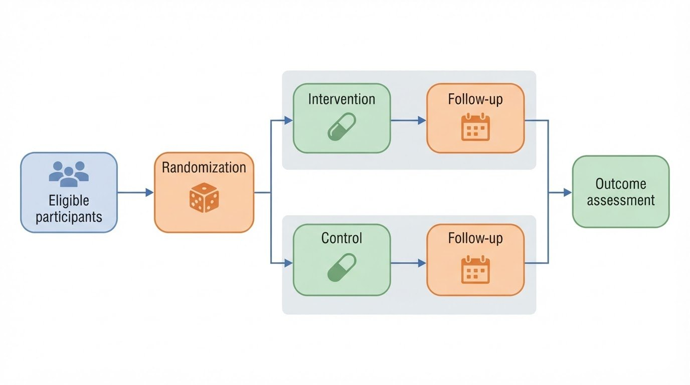 | 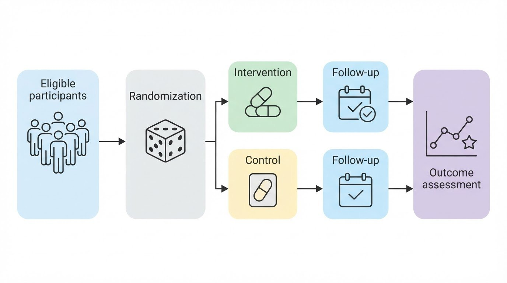 |

**中文提示词**

```text
画一张【双臂随机对照试验】的研究设计图，从左往右读。严格按下面列出的关系画，不多画：
1. 【符合条件的受试者（一组人形图标）→ 随机化（骰子图标）。】
2. 【随机化分成两条并行的臂：上面是干预组（药片图标），下面是对照组（安慰剂图标）。】
3. 【每条臂经过随访期（日历图标）。】
4. 【两条臂都汇入一个结局评估框。】
不要把编号句子写进图里。
标签（每个只出现一次，不加其他文字）：【Eligible participants, Randomization, Intervention, Control, Follow-up, Outcome assessment】。

风格：期刊式示意框图。白色背景上干净的扁平矢量图形。模块画成圆角矩形或简洁图标，名称写在里面；用浅色面板把相关的层归在一起。只用 3–4 种低饱和度颜色，每种颜色含义固定。细而粗细一致的箭头表示数据、能量、物质或影响的流向，间接或反馈关系用虚线箭头。图中文字只用英文无衬线字体，每个标签只出现一次，拼写与给定完全一致。不要 3D 渲染、阴影、发光、赛博朋克或科技感背景装饰，不要照片质感。
```

<details><summary>English prompt</summary>

```text
Create a study design diagram of 【a two-arm randomized controlled trial】, read from left to right. Draw each relationship exactly as listed and nothing more:
1. 【Eligible participants (a group of people icons) → randomization (a dice icon).】
2. 【Randomization splits into two parallel arms: intervention (a pill icon) on top, control (a placebo icon) below.】
3. 【Each arm runs through a follow-up period (a calendar icon).】
4. 【Both arms end in one box for outcome assessment.】
Do not write the numbered sentences in the figure.
Labels, each used once, no other text: 【Eligible participants, Randomization, Intervention, Control, Follow-up, Outcome assessment】.

Style: journal-style schematic diagram. Clean flat vector graphics on a white background. Modules are rounded rectangles or simple icons with their short names inside; light pastel panels group related layers. Only 3-4 muted colors, each with one fixed meaning. Thin, uniform arrows show the flow of data, energy, material or influence; dashed arrows for indirect or feedback links. Sans-serif English labels only, each label appears exactly once, spelled exactly as given. No 3D rendering, no shadows, no glow, no cyberpunk or tech-background decoration, no photorealism.
```

</details>

模型：Nano Banana 2 Lite (gemini-3.1-flash-lite-image, 1K)　·　这条提示词共生成 4 次，展示的是核对通过的结果

[↑ 回到顶部](#top)

<sub><a href="https://yila.ai/?utm_source=github&utm_medium=readme&utm_campaign=sci-figure-prompts&utm_content=rct-design">用 Yila 试试 →</a></sub>

---

<a id="no-17"></a>

### No. 17：研究设计总览（论文 Figure 1）

by [@Yila-AI](https://github.com/Yila-AI)

写法技巧：**三栏：对象—方法—发现**　·　风格：期刊式示意框图　·　比例：16:9

| 英文提示词出图 | 中文提示词出图 |
|---|---|
| 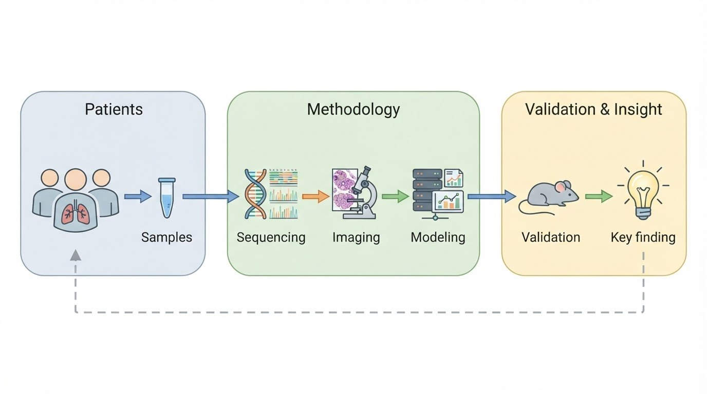 | 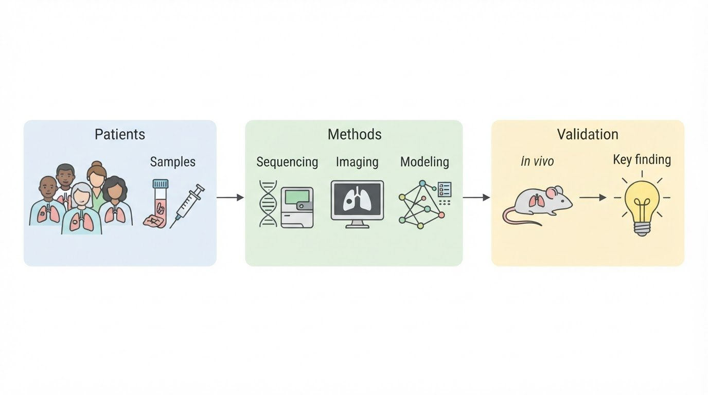 |

**中文提示词**

```text
画一张【肺癌免疫治疗应答研究】的研究设计总览图，三个浅色面板从左往右读，用细箭头连接：
1. 左面板：【一组病人图标和一支组织样本管】。
2. 中面板：【三个并排的方法图标：测序、影像、计算模型】。
3. 右面板：【一个验证图标（小鼠）通向代表关键发现的灯泡】。
标签（每个只出现一次，不加其他文字）：【Patients, Samples, Sequencing, Imaging, Modeling, Validation, Key finding】。

风格：期刊式示意框图。白色背景上干净的扁平矢量图形。模块画成圆角矩形或简洁图标，名称写在里面；用浅色面板把相关的层归在一起。只用 3–4 种低饱和度颜色，每种颜色含义固定。细而粗细一致的箭头表示数据、能量、物质或影响的流向，间接或反馈关系用虚线箭头。图中文字只用英文无衬线字体，每个标签只出现一次，拼写与给定完全一致。不要 3D 渲染、阴影、发光、赛博朋克或科技感背景装饰，不要照片质感。
```

<details><summary>English prompt</summary>

```text
Create a study design overview figure for 【a study on immunotherapy response in lung cancer】, three light pastel panels read from left to right, connected by thin arrows:
1. Left panel: 【a group of patient icons and a tissue sample tube】.
2. Middle panel: 【three method icons side by side: sequencing, imaging and a computer model】.
3. Right panel: 【a validation icon (a mouse) leading to a lightbulb for the key finding】.
Labels, each used once, no other text: 【Patients, Samples, Sequencing, Imaging, Modeling, Validation, Key finding】.

Style: journal-style schematic diagram. Clean flat vector graphics on a white background. Modules are rounded rectangles or simple icons with their short names inside; light pastel panels group related layers. Only 3-4 muted colors, each with one fixed meaning. Thin, uniform arrows show the flow of data, energy, material or influence; dashed arrows for indirect or feedback links. Sans-serif English labels only, each label appears exactly once, spelled exactly as given. No 3D rendering, no shadows, no glow, no cyberpunk or tech-background decoration, no photorealism.
```

</details>

模型：Nano Banana 2 Lite (gemini-3.1-flash-lite-image, 1K)　·　这条提示词共生成 3 次，展示的是核对通过的结果

[↑ 回到顶部](#top)

<sub><a href="https://yila.ai/?utm_source=github&utm_medium=readme&utm_campaign=sci-figure-prompts&utm_content=study-overview">用 Yila 试试 →</a></sub>

---

<a id="no-18"></a>

### No. 18：系统综述与 meta 分析工作流

by [@Yila-AI](https://github.com/Yila-AI)

写法技巧：**六步流程，不放篇数**　·　风格：扁平流程图　·　比例：16:9

| 英文提示词出图 | 中文提示词出图 |
|---|---|
| 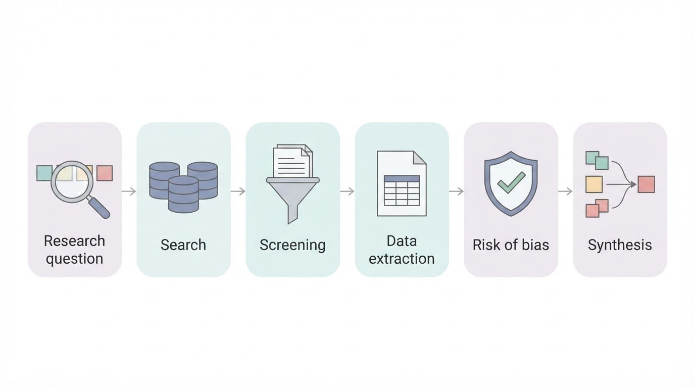 | 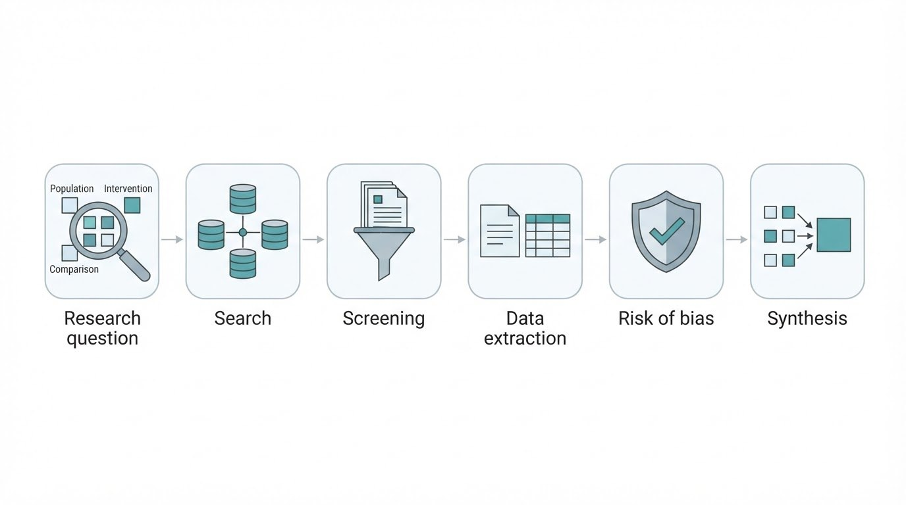 |

**中文提示词**

```text
画一张【系统综述与 meta 分析】的流程图，从左往右六步：
1. 【研究问题：放大镜下有四个小方块，代表人群、干预、对照、结局】
2. 【数据库检索：三个叠放的数据库图标】
3. 【筛选：一叠论文穿过漏斗】
4. 【数据提取：一篇论文配表格图标】
5. 【偏倚风险评估：带对勾的盾牌】
6. 【证据合成：几个小方块汇成一个】
步骤名（每个只出现一次，不加其他文字）：【Research question, Search, Screening, Data extraction, Risk of bias, Synthesis】。

风格：期刊式实验流程图。白色背景上干净的扁平矢量图标，每一步一个浅色圆角面板，面板之间用细灰色箭头连接。只用 3–4 种低饱和度颜色。每个面板里只画一个简洁的小场景，面板内不写任何文字；整张图唯一的文字就是给定的步骤名。用英文无衬线字体，每个步骤名只出现一次，拼写与给定完全一致。不要图例、不要说明文字、不要额外标签、不要 3D 渲染、阴影或装饰性背景。
```

<details><summary>English prompt</summary>

```text
Create a workflow figure for 【a systematic review and meta-analysis】, six steps from left to right:
1. 【Research question: a magnifier over four small boxes for population, intervention, comparison and outcome】
2. 【Database search: three stacked database icons】
3. 【Screening: a stack of papers passing through a funnel】
4. 【Data extraction: a paper with a table icon】
5. 【Risk of bias: a shield with a check mark】
6. 【Synthesis: several small blocks merging into one】
Step names, each used once, no other text: 【Research question, Search, Screening, Data extraction, Risk of bias, Synthesis】.

Style: journal-style experimental workflow figure. Clean flat vector icons on a white background, one light pastel rounded panel per step, thin gray arrows between panels. Only 3-4 muted colors. Each panel shows one simple scene with no text inside it; the only text in the whole figure is the step names given. Sans-serif English, each step name appears exactly once, spelled exactly as given. No legends, no captions, no extra labels, no 3D rendering, no shadows, no decorative background.
```

</details>

模型：Nano Banana 2 Lite (gemini-3.1-flash-lite-image, 1K)　·　这条提示词共生成 2 次，展示的是核对通过的结果

[↑ 回到顶部](#top)

<sub><a href="https://yila.ai/?utm_source=github&utm_medium=readme&utm_campaign=sci-figure-prompts&utm_content=systematic-review-workflow">用 Yila 试试 →</a></sub>

---

<a id="no-19"></a>

### No. 19：竖版图文摘要

by [@Yila-AI](https://github.com/Yila-AI)

写法技巧：**上中下三段：问题—干预—结果**　·　风格：柔和半写实插图　·　比例：3:4

| 英文提示词出图 | 中文提示词出图 |
|---|---|
| 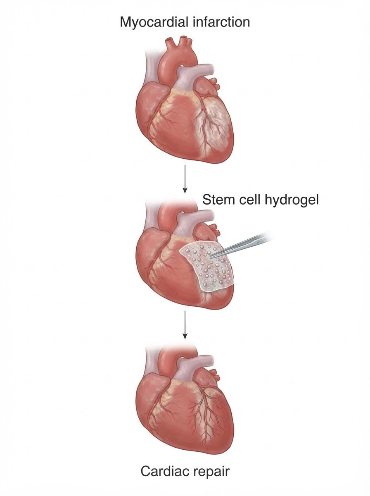 | 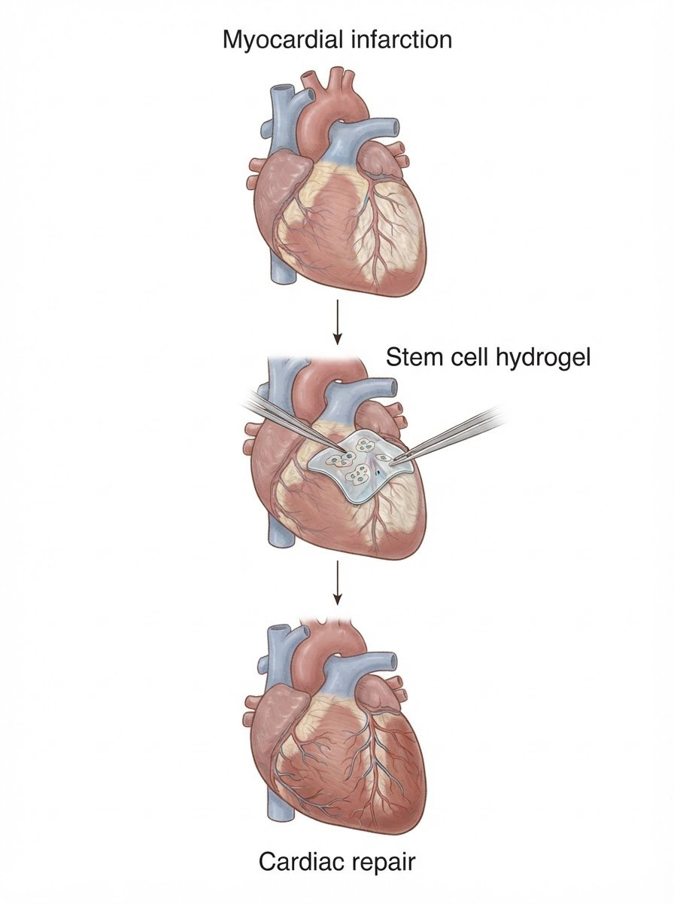 |

**中文提示词**

```text
画一张关于【心梗后用水凝胶递送干细胞修复心肌】的竖版图文摘要，从上往下分三段：
1. 上：【一颗心脏，部分心肌受损发白】。
2. 中：【一片载有干细胞的柔软水凝胶贴片贴到受损区域】。
3. 下：【同一颗心脏，受损区域恢复成健康的红色心肌，并长出新的小血管】。
各段之间用向下的细箭头连接。
标签（每个只出现一次，不加其他文字）：【Myocardial infarction, Stem cell hydrogel, Cardiac repair】。

风格：期刊图形摘要插画。柔和的半写实医学插画，带轻微体积感和细腻的手绘质感，白色干净背景。配色低饱和、协调，只用一个强调色。从左到右叙事清晰，留白充足。图中文字只用英文无衬线字体，每个标签只出现一次，拼写与给定完全一致。不要卡通风格、不要光滑的 CG 渲染、不要深色背景、不要图库照片感。
```

<details><summary>English prompt</summary>

```text
Create a vertical graphical abstract about 【a hydrogel that delivers stem cells to repair heart tissue after a heart attack】, told from top to bottom in three stages:
1. Top: 【a heart with a damaged, pale region of muscle】.
2. Middle: 【a soft hydrogel patch loaded with stem cells being placed on the damaged region】.
3. Bottom: 【the same heart with the region restored to healthy red muscle and new small blood vessels】.
Thin downward arrows connect the stages.
Labels, each used once, no other text: 【Myocardial infarction, Stem cell hydrogel, Cardiac repair】.

Style: journal graphical-abstract illustration. Soft semi-realistic medical illustration with gentle volume and subtle hand-painted texture, on a clean white background. Muted, harmonious palette with one accent color. Clear left-to-right narrative, generous white space. Sans-serif English labels only, each label appears exactly once, spelled exactly as given. No cartoon style, no glossy CGI, no dark background, no stock-photo look.
```

</details>

模型：Nano Banana 2 Lite (gemini-3.1-flash-lite-image, 1K)　·　这条提示词共生成 2 次，展示的是核对通过的结果

[↑ 回到顶部](#top)

<sub><a href="https://yila.ai/?utm_source=github&utm_medium=readme&utm_campaign=sci-figure-prompts&utm_content=vertical-graphical-abstract">用 Yila 试试 →</a></sub>

---

<a id="graphical-abstract"></a>

## 图形摘要

<a id="no-20"></a>

### No. 20：CAR-T 细胞攻克实体瘤

by [@Yila-AI](https://github.com/Yila-AI)

写法技巧：**阶段式进程 + 放大圆圈**　·　风格：柔和半写实插图　·　比例：16:9

| 英文提示词出图 | 中文提示词出图 |
|---|---|
|  | 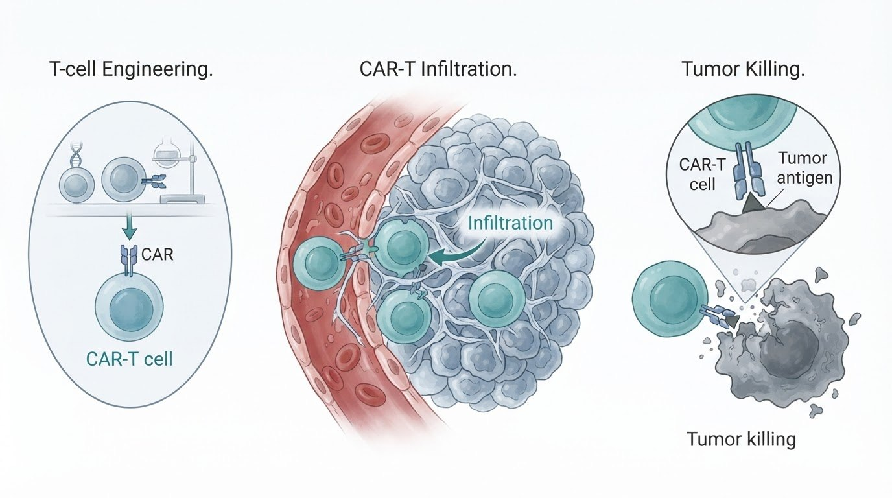 |

**中文提示词**

```text
画一张关于【CAR-T 细胞治疗实体瘤】的图形摘要，从左到右分三段讲述。
左：【患者的 T 细胞经过改造，表面带上嵌合抗原受体】。
中：【CAR-T 细胞从血管中穿出，进入致密的肿瘤组织】。
右：【一个 CAR-T 细胞攻击肿瘤细胞，肿瘤细胞破裂】。用一个圆形放大框展示【CAR-T 细胞上的受体结合肿瘤细胞上的抗原】。
标签（每个只出现一次，不加其他文字）：【CAR-T cell, Tumor antigen, Infiltration, Tumor killing】。

风格：期刊图形摘要插画。柔和的半写实医学插画，带轻微体积感和细腻的手绘质感，白色干净背景。配色低饱和、协调，只用一个强调色。从左到右叙事清晰，留白充足。图中文字只用英文无衬线字体，每个标签只出现一次，拼写与给定完全一致。不要卡通风格、不要光滑的 CG 渲染、不要深色背景、不要图库照片感。
```

<details><summary>English prompt</summary>

```text
Create a graphical abstract about 【CAR-T cell therapy against a solid tumor】, told from left to right in three stages.
Left: 【a patient's T cells engineered to carry a chimeric antigen receptor on their surface】.
Center: 【CAR-T cells leave a blood vessel and push into dense tumor tissue】.
Right: 【a CAR-T cell attacks a tumor cell, which breaks apart】. A circular magnified inset shows 【the receptor on the CAR-T cell binding an antigen on the tumor cell】.
Labels, each used once, no other text: 【CAR-T cell, Tumor antigen, Infiltration, Tumor killing】.

Style: journal graphical-abstract illustration. Soft semi-realistic medical illustration with gentle volume and subtle hand-painted texture, on a clean white background. Muted, harmonious palette with one accent color. Clear left-to-right narrative, generous white space. Sans-serif English labels only, each label appears exactly once, spelled exactly as given. No cartoon style, no glossy CGI, no dark background, no stock-photo look.
```

</details>

模型：Nano Banana 2 Lite (gemini-3.1-flash-lite-image, 1K)　·　这条提示词共生成 2 次，展示的是核对通过的结果

[↑ 回到顶部](#top)

<sub><a href="https://yila.ai/?utm_source=github&utm_medium=readme&utm_campaign=sci-figure-prompts&utm_content=car-t-solid-tumor">用 Yila 试试 →</a></sub>

---

<a id="no-21"></a>

### No. 21：CRISPR-Cas9 基因编辑机制

by [@Yila-AI](https://github.com/Yila-AI)

写法技巧：**识别切割后两条修复路径**　·　风格：期刊式科学插画　·　比例：16:9

| 英文提示词出图 | 中文提示词出图 |
|---|---|
|  |  |

**中文提示词**

```text
画一张【CRISPR-Cas9 基因编辑】的科学插画，从左往右读：
1. 【携带向导 RNA 的 Cas9 蛋白结合到短 PAM 序列旁边的靶 DNA 上。】
2. 【Cas9 切断 DNA 双链。】
3. 断开的 DNA 分成两条修复路径：【上方 NHEJ 连接断端，留下小的插入或缺失；下方 HDR 以供体模板为参照，实现精确编辑】。
整张图里每个标签只写一次。
标签（每个只出现一次，不加其他文字）：【Cas9, sgRNA, Target DNA, PAM, Double-strand break, NHEJ, HDR, Donor template】。

风格：期刊式科学插画。干净的半写实矢量插画，带柔和的明暗；需要说明结构时使用剖面或剖切视图，白色背景。配色低饱和、协调，只用一个强调色突出关键过程。用细的方向箭头表示流动。留白充足，阅读方向清晰。图中文字只用英文无衬线字体，每个标签只出现一次，拼写与给定完全一致。不要卡通风格、不要光滑的 CG 渲染、不要深色背景、不要图库照片感、不要装饰性背景。
```

<details><summary>English prompt</summary>

```text
Create a scientific illustration of 【CRISPR-Cas9 genome editing】, read from left to right:
1. 【Cas9 protein carrying a guide RNA binds the target DNA next to a short PAM sequence.】
2. 【Cas9 cuts both DNA strands.】
3. The broken DNA splits into two repair routes: 【top, NHEJ joins the ends with a small insertion or deletion; bottom, HDR copies a donor template for a precise edit】.
Write each label only once in the whole figure.
Labels, each used once, no other text: 【Cas9, sgRNA, Target DNA, PAM, Double-strand break, NHEJ, HDR, Donor template】.

Style: journal-style scientific illustration. Clean semi-realistic vector illustration with gentle shading, using cross-sections or cutaways where they explain the structure, on a white background. Muted, harmonious palette with one accent color for the key process. Thin directional arrows for flows. Generous white space and a clear reading direction. Sans-serif English labels only, each label appears exactly once, spelled exactly as given. No cartoon style, no glossy CGI, no dark background, no stock-photo look, no decorative background.
```

</details>

模型：Nano Banana 2 Lite (gemini-3.1-flash-lite-image, 1K)　·　这条提示词共生成 4 次，展示的是核对通过的结果

[↑ 回到顶部](#top)

<sub><a href="https://yila.ai/?utm_source=github&utm_medium=readme&utm_campaign=sci-figure-prompts&utm_content=crispr-cas9">用 Yila 试试 →</a></sub>

---

<a id="no-22"></a>

### No. 22：药物作用机制

by [@Yila-AI](https://github.com/Yila-AI)

写法技巧：**分子结合—信号阻断—细胞结局**　·　风格：柔和半写实插图　·　比例：16:9

| 英文提示词出图 | 中文提示词出图 |
|---|---|
|  |  |

**中文提示词**

```text
画一张关于【小分子激酶抑制剂如何起效】的图文摘要，从左往右读：
1. 左：【药物分子进入一个肿瘤细胞】。
2. 中：【一个圆形放大插图，药物嵌在靶点激酶的结合口袋里，挡住了底物】。
3. 右：【下游信号箭头逐渐变淡，肿瘤细胞萎缩】。
整张图里每个标签只写一次。
标签（每个只出现一次，不加其他文字）：【Drug, Target kinase, Substrate, Downstream signaling, Tumor cell death】。

风格：期刊图形摘要插画。柔和的半写实医学插画，带轻微体积感和细腻的手绘质感，白色干净背景。配色低饱和、协调，只用一个强调色。从左到右叙事清晰，留白充足。图中文字只用英文无衬线字体，每个标签只出现一次，拼写与给定完全一致。不要卡通风格、不要光滑的 CG 渲染、不要深色背景、不要图库照片感。
```

<details><summary>English prompt</summary>

```text
Create a graphical abstract of 【how a small-molecule kinase inhibitor works】, read from left to right:
1. Left: 【the drug molecule entering a tumor cell】.
2. Middle: 【a magnified inset showing the drug sitting in the binding pocket of the target kinase, blocking its substrate】.
3. Right: 【downstream signaling arrows fading out, and the tumor cell shrinking】.
Write each label only once in the whole figure.
Labels, each used once, no other text: 【Drug, Target kinase, Substrate, Downstream signaling, Tumor cell death】.

Style: journal graphical-abstract illustration. Soft semi-realistic medical illustration with gentle volume and subtle hand-painted texture, on a clean white background. Muted, harmonious palette with one accent color. Clear left-to-right narrative, generous white space. Sans-serif English labels only, each label appears exactly once, spelled exactly as given. No cartoon style, no glossy CGI, no dark background, no stock-photo look.
```

</details>

模型：Nano Banana 2 Lite (gemini-3.1-flash-lite-image, 1K)　·　这条提示词共生成 5 次，展示的是核对通过的结果

[↑ 回到顶部](#top)

<sub><a href="https://yila.ai/?utm_source=github&utm_medium=readme&utm_campaign=sci-figure-prompts&utm_content=drug-mechanism">用 Yila 试试 →</a></sub>

---

<a id="no-23"></a>

### No. 23：上皮间质转化（EMT）

by [@Yila-AI](https://github.com/Yila-AI)

写法技巧：**从左到右细胞形态渐变**　·　风格：柔和半写实插图　·　比例：16:9

| 英文提示词出图 | 中文提示词出图 |
|---|---|
|  |  |

**中文提示词**

```text
画一张【上皮间质转化】的图文摘要，从左往右读：
1. 左：【紧密排列在基底膜上的立方形上皮细胞，靠 E-cadherin 连接】。
2. 中间上方一个【TGF-β】信号箭头。
3. 中：【细胞变松散，开始拉长】。
4. 右：【梭形的间质细胞，带 vimentin 纤维和 N-cadherin，其中一个细胞穿过基底膜】。
标签（每个只出现一次，不加其他文字）：【Epithelial cells, TGF-β, Mesenchymal cells, E-cadherin, N-cadherin, Vimentin, Invasion】。

风格：期刊图形摘要插画。柔和的半写实医学插画，带轻微体积感和细腻的手绘质感，白色干净背景。配色低饱和、协调，只用一个强调色。从左到右叙事清晰，留白充足。图中文字只用英文无衬线字体，每个标签只出现一次，拼写与给定完全一致。不要卡通风格、不要光滑的 CG 渲染、不要深色背景、不要图库照片感。
```

<details><summary>English prompt</summary>

```text
Create a graphical abstract of 【epithelial–mesenchymal transition】, read from left to right:
1. Left: 【tightly packed cube-shaped epithelial cells on a basement membrane, joined by E-cadherin】.
2. A 【TGF-β】 signal arrow above the middle.
3. Middle: 【cells loosening and starting to stretch】.
4. Right: 【spindle-shaped mesenchymal cells with vimentin fibers and N-cadherin, one cell crossing the basement membrane】.
Labels, each used once, no other text: 【Epithelial cells, TGF-β, Mesenchymal cells, E-cadherin, N-cadherin, Vimentin, Invasion】.

Style: journal graphical-abstract illustration. Soft semi-realistic medical illustration with gentle volume and subtle hand-painted texture, on a clean white background. Muted, harmonious palette with one accent color. Clear left-to-right narrative, generous white space. Sans-serif English labels only, each label appears exactly once, spelled exactly as given. No cartoon style, no glossy CGI, no dark background, no stock-photo look.
```

</details>

模型：Nano Banana 2 Lite (gemini-3.1-flash-lite-image, 1K)　·　这条提示词共生成 2 次，展示的是核对通过的结果

[↑ 回到顶部](#top)

<sub><a href="https://yila.ai/?utm_source=github&utm_medium=readme&utm_campaign=sci-figure-prompts&utm_content=emt">用 Yila 试试 →</a></sub>

---

<a id="no-24"></a>

### No. 24：运动改善骨骼肌胰岛素抵抗

by [@Yila-AI](https://github.com/Yila-AI)

写法技巧：**多尺度放大圆圈**　·　风格：柔和半写实插图　·　比例：16:9

| 英文提示词出图 | 中文提示词出图 | 中文提示词出图 |
|---|---|---|
|  |  |  |

**中文提示词**

```text
画一张关于【运动如何改善骨骼肌胰岛素抵抗】的图形摘要，从左到右讲述。
左：【一个正在跑步的人】。
中：【大腿肌肉】，用一个圆形放大框放大【一个肌细胞：携带 GLUT4 转运体的小囊泡移向细胞膜并嵌入膜中】。
右：【葡萄糖分子通过 GLUT4 进入肌细胞，血糖水平下降】。
标签（每个只出现一次，不加其他文字）：【Exercise, Skeletal muscle, GLUT4, Glucose uptake】。

风格：期刊图形摘要插画。柔和的半写实医学插画，带轻微体积感和细腻的手绘质感，白色干净背景。配色低饱和、协调，只用一个强调色。从左到右叙事清晰，留白充足。图中文字只用英文无衬线字体，每个标签只出现一次，拼写与给定完全一致。不要卡通风格、不要光滑的 CG 渲染、不要深色背景、不要图库照片感。
```

<details><summary>English prompt</summary>

```text
Create a graphical abstract about 【how exercise improves insulin resistance in skeletal muscle】, told from left to right.
Left: 【a person running】.
Center: 【the thigh muscle】, with a circular magnified inset of 【one muscle cell: small vesicles carrying GLUT4 transporters move to the cell membrane and insert into it】.
Right: 【glucose molecules entering the muscle cell through GLUT4, and a lower blood glucose level】.
Labels, each used once, no other text: 【Exercise, Skeletal muscle, GLUT4, Glucose uptake】.

Style: journal graphical-abstract illustration. Soft semi-realistic medical illustration with gentle volume and subtle hand-painted texture, on a clean white background. Muted, harmonious palette with one accent color. Clear left-to-right narrative, generous white space. Sans-serif English labels only, each label appears exactly once, spelled exactly as given. No cartoon style, no glossy CGI, no dark background, no stock-photo look.
```

</details>

模型：Nano Banana 2 Lite (gemini-3.1-flash-lite-image, 1K)　·　这条提示词共生成 4 次，展示的是核对通过的结果

[↑ 回到顶部](#top)

<sub><a href="https://yila.ai/?utm_source=github&utm_medium=readme&utm_campaign=sci-figure-prompts&utm_content=exercise-glut4">用 Yila 试试 →</a></sub>

---

<a id="no-25"></a>

### No. 25：肿瘤外泌体建立肺前转移微环境

by [@Yila-AI](https://github.com/Yila-AI)

写法技巧：**多尺度放大圆圈**　·　风格：柔和半写实插图　·　比例：16:9

| 英文提示词出图 | 中文提示词出图 |
|---|---|
|  |  |

**中文提示词**

```text
画一张关于【肿瘤外泌体为肺转移做准备】的图形摘要，从左到右讲述。
左：【原发肿瘤释放出大量微小的外泌体】。
中：【外泌体随血管运行】。
右：【肺部的驻留细胞摄取外泌体，形成前转移微环境，迎接随后到达的肿瘤细胞】。用一个圆形放大框展示【一个外泌体，表面有蛋白，内部装着 RNA】。
标签（每个只出现一次，不加其他文字）：【Primary tumor, Exosomes, Lung, Pre-metastatic niche】。

风格：期刊图形摘要插画。柔和的半写实医学插画，带轻微体积感和细腻的手绘质感，白色干净背景。配色低饱和、协调，只用一个强调色。从左到右叙事清晰，留白充足。图中文字只用英文无衬线字体，每个标签只出现一次，拼写与给定完全一致。不要卡通风格、不要光滑的 CG 渲染、不要深色背景、不要图库照片感。
```

<details><summary>English prompt</summary>

```text
Create a graphical abstract about 【tumor exosomes preparing the lung for metastasis】, told from left to right.
Left: 【a primary tumor releasing many tiny exosomes】.
Center: 【the exosomes travel through a blood vessel】.
Right: 【a lung where resident cells take up the exosomes and form a pre-metastatic niche that welcomes arriving tumor cells】. A circular magnified inset shows 【one exosome with surface proteins and RNA cargo inside】.
Labels, each used once, no other text: 【Primary tumor, Exosomes, Lung, Pre-metastatic niche】.

Style: journal graphical-abstract illustration. Soft semi-realistic medical illustration with gentle volume and subtle hand-painted texture, on a clean white background. Muted, harmonious palette with one accent color. Clear left-to-right narrative, generous white space. Sans-serif English labels only, each label appears exactly once, spelled exactly as given. No cartoon style, no glossy CGI, no dark background, no stock-photo look.
```

</details>

模型：Nano Banana 2 Lite (gemini-3.1-flash-lite-image, 1K)　·　这条提示词共生成 4 次，展示的是核对通过的结果

[↑ 回到顶部](#top)

<sub><a href="https://yila.ai/?utm_source=github&utm_medium=readme&utm_campaign=sci-figure-prompts&utm_content=exosome-premetastatic-niche">用 Yila 试试 →</a></sub>

---

<a id="no-26"></a>

### No. 26：肠–脑轴与抑郁

by [@Yila-AI](https://github.com/Yila-AI)

写法技巧：**双放大圆圈**　·　风格：柔和半写实插图　·　比例：16:9

| 英文提示词出图 | 中文提示词出图 |
|---|---|
|  |  |

**中文提示词**

```text
画一张关于【肠–脑轴与抑郁】的图形摘要。
左：【人体上半身轮廓，突出显示肠道和大脑】。
两个圆形放大框：一个放大【肠道，显示失衡的菌群和受损的肠黏膜】，一个放大【大脑，显示被激活的小胶质细胞】。
两个放大框之间，【三条通路连接肠道和大脑：一条神经纤维、一条运送炎症分子的血管、一群免疫细胞】。
右：【一个情绪低落的人】。
标签（每个只出现一次，不加其他文字）：【Dysbiosis, Vagus nerve, Inflammation, Microglia, Depression】。

风格：期刊图形摘要插画。柔和的半写实医学插画，带轻微体积感和细腻的手绘质感，白色干净背景。配色低饱和、协调，只用一个强调色。从左到右叙事清晰，留白充足。图中文字只用英文无衬线字体，每个标签只出现一次，拼写与给定完全一致。不要卡通风格、不要光滑的 CG 渲染、不要深色背景、不要图库照片感。
```

<details><summary>English prompt</summary>

```text
Create a graphical abstract about 【the gut–brain axis in depression】.
Left: 【a human upper-body silhouette with the gut and the brain highlighted】.
Two circular magnified insets: one on 【the gut, showing imbalanced bacteria and a damaged intestinal lining】, one on 【the brain, showing activated microglia】.
Between the insets, 【three paths link gut and brain: a nerve fiber, a blood vessel carrying inflammatory molecules, and immune cells】.
Right: 【a person with a low mood】.
Labels, each used once, no other text: 【Dysbiosis, Vagus nerve, Inflammation, Microglia, Depression】.

Style: journal graphical-abstract illustration. Soft semi-realistic medical illustration with gentle volume and subtle hand-painted texture, on a clean white background. Muted, harmonious palette with one accent color. Clear left-to-right narrative, generous white space. Sans-serif English labels only, each label appears exactly once, spelled exactly as given. No cartoon style, no glossy CGI, no dark background, no stock-photo look.
```

</details>

模型：Nano Banana 2 Lite (gemini-3.1-flash-lite-image, 1K)　·　这条提示词共生成 4 次，展示的是核对通过的结果

[↑ 回到顶部](#top)

<sub><a href="https://yila.ai/?utm_source=github&utm_medium=readme&utm_campaign=sci-figure-prompts&utm_content=gut-brain-axis">用 Yila 试试 →</a></sub>

---

<a id="no-27"></a>

### No. 27：水凝胶促进创面愈合

by [@Yila-AI](https://github.com/Yila-AI)

写法技巧：**左右对比分屏 + 放大圆圈**　·　风格：柔和半写实插图　·　比例：16:9

| 英文提示词出图 | 中文提示词出图 |
|---|---|
|  |  |

**中文提示词**

```text
画一张左右对比的图形摘要，比较【未处理的皮肤创面和用可注射水凝胶处理的创面】，中间用一条细虚线分开。两侧都是【同一个带开放创面的皮肤剖面】。
左：【未处理：创面敞开，有细菌和红肿，愈合缓慢】。
右：【处理后：半透明水凝胶填满创面并释放小药物颗粒；新生血管和胶原长出，创面几乎闭合】。用一个圆形放大框展示【水凝胶的交联高分子网络包裹着药物颗粒】。
标签（每个只出现一次，不加其他文字）：【Untreated, Hydrogel, Angiogenesis, Wound closure】。

风格：期刊图形摘要插画。柔和的半写实医学插画，带轻微体积感和细腻的手绘质感，白色干净背景。配色低饱和、协调，只用一个强调色。从左到右叙事清晰，留白充足。图中文字只用英文无衬线字体，每个标签只出现一次，拼写与给定完全一致。不要卡通风格、不要光滑的 CG 渲染、不要深色背景、不要图库照片感。
```

<details><summary>English prompt</summary>

```text
Create a side-by-side graphical abstract comparing 【an untreated skin wound and a wound treated with an injectable hydrogel】, separated by a thin dashed vertical line. Both sides show 【the same cross-section of skin with an open wound】.
Left: 【untreated: an open wound with bacteria and redness, healing slowly】.
Right: 【treated: a translucent hydrogel fills the wound and releases small drug particles; new blood vessels and collagen grow and the wound is almost closed】. A circular magnified inset shows 【the hydrogel's cross-linked polymer network holding the drug particles】.
Labels, each used once, no other text: 【Untreated, Hydrogel, Angiogenesis, Wound closure】.

Style: journal graphical-abstract illustration. Soft semi-realistic medical illustration with gentle volume and subtle hand-painted texture, on a clean white background. Muted, harmonious palette with one accent color. Clear left-to-right narrative, generous white space. Sans-serif English labels only, each label appears exactly once, spelled exactly as given. No cartoon style, no glossy CGI, no dark background, no stock-photo look.
```

</details>

模型：Nano Banana 2 Lite (gemini-3.1-flash-lite-image, 1K)　·　这条提示词共生成 2 次，展示的是核对通过的结果

[↑ 回到顶部](#top)

<sub><a href="https://yila.ai/?utm_source=github&utm_medium=readme&utm_campaign=sci-figure-prompts&utm_content=hydrogel-wound">用 Yila 试试 →</a></sub>

---

<a id="no-28"></a>

### No. 28：巨噬细胞 M1/M2 极化

by [@Yila-AI](https://github.com/Yila-AI)

写法技巧：**中间未极化，左右分化**　·　风格：柔和半写实插图　·　比例：16:9

| 英文提示词出图 | 中文提示词出图 |
|---|---|
|  |  |

**中文提示词**

```text
画一张【巨噬细胞极化】的图文摘要：中央一个未极化的巨噬细胞，左右两侧是两种结局：
1. 向左的箭头：【LPS + IFN-γ】使它变成【释放炎症信号的 M1 巨噬细胞，用暖红色调】。
2. 向右的箭头：【IL-4 + IL-13】使它变成【帮助组织修复的 M2 巨噬细胞，用冷绿色调】。
标签（每个只出现一次，不加其他文字）：【M0, M1, M2, LPS + IFN-γ, IL-4 + IL-13, Pro-inflammatory, Tissue repair】。

风格：期刊图形摘要插画。柔和的半写实医学插画，带轻微体积感和细腻的手绘质感，白色干净背景。配色低饱和、协调，只用一个强调色。从左到右叙事清晰，留白充足。图中文字只用英文无衬线字体，每个标签只出现一次，拼写与给定完全一致。不要卡通风格、不要光滑的 CG 渲染、不要深色背景、不要图库照片感。
```

<details><summary>English prompt</summary>

```text
Create a graphical abstract of 【macrophage polarization】: one unpolarized macrophage in the center, with two outcomes on either side:
1. Left arrow: 【LPS + IFN-γ】 turns it into 【an M1 macrophage releasing inflammatory signals, shown in warm red tones】.
2. Right arrow: 【IL-4 + IL-13】 turns it into 【an M2 macrophage helping repair tissue, shown in cool green tones】.
Labels, each used once, no other text: 【M0, M1, M2, LPS + IFN-γ, IL-4 + IL-13, Pro-inflammatory, Tissue repair】.

Style: journal graphical-abstract illustration. Soft semi-realistic medical illustration with gentle volume and subtle hand-painted texture, on a clean white background. Muted, harmonious palette with one accent color. Clear left-to-right narrative, generous white space. Sans-serif English labels only, each label appears exactly once, spelled exactly as given. No cartoon style, no glossy CGI, no dark background, no stock-photo look.
```

</details>

模型：Nano Banana 2 Lite (gemini-3.1-flash-lite-image, 1K)　·　这条提示词共生成 2 次，展示的是核对通过的结果

[↑ 回到顶部](#top)

<sub><a href="https://yila.ai/?utm_source=github&utm_medium=readme&utm_campaign=sci-figure-prompts&utm_content=macrophage-polarization">用 Yila 试试 →</a></sub>

---

<a id="no-29"></a>

### No. 29：线粒体功能障碍

by [@Yila-AI](https://github.com/Yila-AI)

写法技巧：**健康与受损左右对照**　·　风格：柔和半写实插图　·　比例：16:9

| 英文提示词出图 | 中文提示词出图 |
|---|---|
|  |  |

**中文提示词**

```text
画一张【线粒体功能障碍】的图文摘要：左右两个线粒体对照。
1. 左，健康：【嵴折叠整齐，稳定产出 ATP，画成黄色小球】。
2. 右，功能障碍：【肿胀、嵴断裂，ATP 小球很少，红色 ROS 颗粒外漏，mtDNA 链逸出到胞质】。
中间一条细箭头从左指向右。
整张图里每个标签只写一次。
标签（每个只出现一次，不加其他文字）：【Healthy, Dysfunctional, ATP, ROS, mtDNA】。

风格：期刊图形摘要插画。柔和的半写实医学插画，带轻微体积感和细腻的手绘质感，白色干净背景。配色低饱和、协调，只用一个强调色。从左到右叙事清晰，留白充足。图中文字只用英文无衬线字体，每个标签只出现一次，拼写与给定完全一致。不要卡通风格、不要光滑的 CG 渲染、不要深色背景、不要图库照片感。
```

<details><summary>English prompt</summary>

```text
Create a graphical abstract of 【mitochondrial dysfunction】: two mitochondria side by side.
1. Left, healthy: 【neat folded cristae, steady ATP output shown as small yellow spheres】.
2. Right, dysfunctional: 【swollen with broken cristae, few ATP spheres, red ROS particles leaking out, and mtDNA strands escaping into the cytosol】.
A thin arrow points from left to right.
Write each label only once in the whole figure.
Labels, each used once, no other text: 【Healthy, Dysfunctional, ATP, ROS, mtDNA】.

Style: journal graphical-abstract illustration. Soft semi-realistic medical illustration with gentle volume and subtle hand-painted texture, on a clean white background. Muted, harmonious palette with one accent color. Clear left-to-right narrative, generous white space. Sans-serif English labels only, each label appears exactly once, spelled exactly as given. No cartoon style, no glossy CGI, no dark background, no stock-photo look.
```

</details>

模型：Nano Banana 2 Lite (gemini-3.1-flash-lite-image, 1K)　·　这条提示词共生成 2 次，展示的是核对通过的结果

[↑ 回到顶部](#top)

<sub><a href="https://yila.ai/?utm_source=github&utm_medium=readme&utm_campaign=sci-figure-prompts&utm_content=mitochondrial-dysfunction">用 Yila 试试 →</a></sub>

---

<a id="no-30"></a>

### No. 30：mRNA 疫苗诱导免疫应答

by [@Yila-AI](https://github.com/Yila-AI)

写法技巧：**多尺度放大圆圈**　·　风格：柔和半写实插图　·　比例：16:9

| 英文提示词出图 | 中文提示词出图 |
|---|---|
|  |  |

**中文提示词**

```text
画一张关于【mRNA 疫苗如何训练免疫系统】的图形摘要，从左到右分三段讲述。
左：【携带 mRNA 的脂质纳米颗粒，注射进上臂肌肉】。
中：【肌肉细胞摄取颗粒，制造病毒的刺突蛋白】。用一个圆形放大框放大【核糖体读取 mRNA，刺突蛋白出现在细胞表面】。
右：【B 细胞释放 Y 形抗体，一个 T 细胞攻击被感染的细胞】。
标签（每个只出现一次，不加其他文字）：【mRNA, Spike protein, Antibodies, T cell】。

风格：期刊图形摘要插画。柔和的半写实医学插画，带轻微体积感和细腻的手绘质感，白色干净背景。配色低饱和、协调，只用一个强调色。从左到右叙事清晰，留白充足。图中文字只用英文无衬线字体，每个标签只出现一次，拼写与给定完全一致。不要卡通风格、不要光滑的 CG 渲染、不要深色背景、不要图库照片感。
```

<details><summary>English prompt</summary>

```text
Create a graphical abstract about 【how an mRNA vaccine trains the immune system】, told from left to right in three stages.
Left: 【a lipid nanoparticle carrying mRNA, injected into the upper-arm muscle】.
Center: 【a muscle cell takes up the particle and makes the viral spike protein】. A circular magnified inset zooms in on 【ribosomes reading the mRNA and spike proteins appearing on the cell surface】.
Right: 【B cells releasing Y-shaped antibodies and a T cell attacking an infected cell】.
Labels, each used once, no other text: 【mRNA, Spike protein, Antibodies, T cell】.

Style: journal graphical-abstract illustration. Soft semi-realistic medical illustration with gentle volume and subtle hand-painted texture, on a clean white background. Muted, harmonious palette with one accent color. Clear left-to-right narrative, generous white space. Sans-serif English labels only, each label appears exactly once, spelled exactly as given. No cartoon style, no glossy CGI, no dark background, no stock-photo look.
```

</details>

模型：Nano Banana 2 Lite (gemini-3.1-flash-lite-image, 1K)　·　这条提示词共生成 2 次，展示的是核对通过的结果

[↑ 回到顶部](#top)

<sub><a href="https://yila.ai/?utm_source=github&utm_medium=readme&utm_campaign=sci-figure-prompts&utm_content=mrna-vaccine">用 Yila 试试 →</a></sub>

---

<a id="no-31"></a>

### No. 31：纳米颗粒靶向递送抗肿瘤药物

by [@Yila-AI](https://github.com/Yila-AI)

写法技巧：**多尺度放大圆圈**　·　风格：柔和半写实插图　·　比例：16:9

| 英文提示词出图 | 中文提示词出图 |
|---|---|
|  |  |

**中文提示词**

```text
画一张关于【肿瘤靶向纳米颗粒药物递送】的图形摘要，从左到右分三段讲述。
左：【一个表面带靶向配体的脂质纳米颗粒，切开四分之一，露出里面包裹的药物】。
中：【纳米颗粒从有渗漏的血管中穿出，进入肿瘤组织】。用一个圆形放大框放大【一个肿瘤细胞：纳米颗粒结合细胞表面受体，经内吞进入细胞，在细胞内释放药物】。
右：【体积缩小的肿瘤，肿瘤细胞正在死亡】。
标签（每个只出现一次，不加其他文字）：【Nanoparticle, Leaky vessel, Drug release, Tumor regression】。

风格：期刊图形摘要插画。柔和的半写实医学插画，带轻微体积感和细腻的手绘质感，白色干净背景。配色低饱和、协调，只用一个强调色。从左到右叙事清晰，留白充足。图中文字只用英文无衬线字体，每个标签只出现一次，拼写与给定完全一致。不要卡通风格、不要光滑的 CG 渲染、不要深色背景、不要图库照片感。
```

<details><summary>English prompt</summary>

```text
Create a graphical abstract about 【tumor-targeted nanoparticle drug delivery】, told from left to right in three stages.
Left: 【one lipid nanoparticle with targeting ligands on its surface, a quarter cut away to show the drug inside】.
Center: 【nanoparticles leave a leaky blood vessel and enter the tumor tissue】. A circular magnified inset zooms in on 【one tumor cell: the nanoparticle binds a surface receptor, is taken up by endocytosis and releases the drug inside the cell】.
Right: 【a smaller tumor with dying tumor cells】.
Labels, each used once, no other text: 【Nanoparticle, Leaky vessel, Drug release, Tumor regression】.

Style: journal graphical-abstract illustration. Soft semi-realistic medical illustration with gentle volume and subtle hand-painted texture, on a clean white background. Muted, harmonious palette with one accent color. Clear left-to-right narrative, generous white space. Sans-serif English labels only, each label appears exactly once, spelled exactly as given. No cartoon style, no glossy CGI, no dark background, no stock-photo look.
```

</details>

模型：Nano Banana 2 Lite (gemini-3.1-flash-lite-image, 1K)　·　这条提示词共生成 2 次，展示的是核对通过的结果

[↑ 回到顶部](#top)

<sub><a href="https://yila.ai/?utm_source=github&utm_medium=readme&utm_campaign=sci-figure-prompts&utm_content=nanoparticle-tumor-delivery">用 Yila 试试 →</a></sub>

---

<a id="no-32"></a>

### No. 32：氧化应激与 ROS 损伤

by [@Yila-AI](https://github.com/Yila-AI)

写法技巧：**来源—损伤—防御三段**　·　风格：柔和半写实插图　·　比例：16:9

| 英文提示词出图 | 中文提示词出图 |
|---|---|
|  |  |

**中文提示词**

```text
画一张【氧化应激】的图文摘要，从左往右读。严格按下面列出的关系画，不多画：
1. 【左侧一个线粒体释放红色的 ROS 小颗粒。】
2. 【三条实线箭头从 ROS 指向右侧三个受损目标：脂质膜、蛋白质、DNA 链。】
3. 【ROS 上方三种抗氧化物，画成名字写在里面的简单圆角胶囊，用红色 T 形线挡住 ROS。】
不画化学结构式。
标签（每个只出现一次，不加其他文字）：【Mitochondrion, ROS, Lipid damage, Protein damage, DNA damage, SOD, Catalase, GSH】。

风格：期刊图形摘要插画。柔和的半写实医学插画，带轻微体积感和细腻的手绘质感，白色干净背景。配色低饱和、协调，只用一个强调色。从左到右叙事清晰，留白充足。图中文字只用英文无衬线字体，每个标签只出现一次，拼写与给定完全一致。不要卡通风格、不要光滑的 CG 渲染、不要深色背景、不要图库照片感。
```

<details><summary>English prompt</summary>

```text
Create a graphical abstract of 【oxidative stress】, read from left to right. Draw each relationship exactly as listed and nothing more:
1. 【A mitochondrion on the left releases small red ROS particles.】
2. 【Three solid arrows lead from the ROS to three damaged targets on the right: a lipid membrane, a protein and a DNA strand.】
3. 【Above the ROS, three antioxidants drawn as simple rounded capsules with their names inside block the ROS with red T-bars.】
No chemical structures.
Labels, each used once, no other text: 【Mitochondrion, ROS, Lipid damage, Protein damage, DNA damage, SOD, Catalase, GSH】.

Style: journal graphical-abstract illustration. Soft semi-realistic medical illustration with gentle volume and subtle hand-painted texture, on a clean white background. Muted, harmonious palette with one accent color. Clear left-to-right narrative, generous white space. Sans-serif English labels only, each label appears exactly once, spelled exactly as given. No cartoon style, no glossy CGI, no dark background, no stock-photo look.
```

</details>

模型：Nano Banana 2 Lite (gemini-3.1-flash-lite-image, 1K)　·　这条提示词共生成 4 次，展示的是核对通过的结果

[↑ 回到顶部](#top)

<sub><a href="https://yila.ai/?utm_source=github&utm_medium=readme&utm_campaign=sci-figure-prompts&utm_content=oxidative-stress">用 Yila 试试 →</a></sub>

---

<a id="no-33"></a>

### No. 33：细胞衰老与 SASP

by [@Yila-AI](https://github.com/Yila-AI)

写法技巧：**诱因—衰老细胞—旁分泌影响**　·　风格：柔和半写实插图　·　比例：16:9

| 中文提示词出图 |
|---|
|  |

**中文提示词**

```text
画一张【细胞衰老】的图文摘要，从左往右读：
1. 左：【两个诱因小图标：断裂的 DNA 链和变短的染色体末端】。
2. 中：【一个变大变扁的衰老细胞，细胞核里标有 p16 和 p21】。
3. 右：【细胞向邻近细胞释放彩色小颗粒（SASP），邻近细胞出现炎症】。
整张图里每个标签只写一次。
标签（每个只出现一次，不加其他文字）：【DNA damage, Telomere shortening, Senescent cell, p16, p21, SASP, Inflammation】。

风格：期刊图形摘要插画。柔和的半写实医学插画，带轻微体积感和细腻的手绘质感，白色干净背景。配色低饱和、协调，只用一个强调色。从左到右叙事清晰，留白充足。图中文字只用英文无衬线字体，每个标签只出现一次，拼写与给定完全一致。不要卡通风格、不要光滑的 CG 渲染、不要深色背景、不要图库照片感。
```

<details><summary>English prompt</summary>

```text
Create a graphical abstract of 【cellular senescence】, read from left to right:
1. Left: 【two triggers as small icons: a broken DNA strand and shortened chromosome ends】.
2. Middle: 【an enlarged, flattened senescent cell with p16 and p21 marks in its nucleus】.
3. Right: 【the cell releasing small colored particles (the SASP) toward neighboring cells, which turn inflamed】.
Write each label only once in the whole figure.
Labels, each used once, no other text: 【DNA damage, Telomere shortening, Senescent cell, p16, p21, SASP, Inflammation】.

Style: journal graphical-abstract illustration. Soft semi-realistic medical illustration with gentle volume and subtle hand-painted texture, on a clean white background. Muted, harmonious palette with one accent color. Clear left-to-right narrative, generous white space. Sans-serif English labels only, each label appears exactly once, spelled exactly as given. No cartoon style, no glossy CGI, no dark background, no stock-photo look.
```

</details>

模型：Nano Banana 2 Lite (gemini-3.1-flash-lite-image, 1K)　·　这条提示词共生成 4 次，展示的是核对通过的结果

[↑ 回到顶部](#top)

<sub><a href="https://yila.ai/?utm_source=github&utm_medium=readme&utm_campaign=sci-figure-prompts&utm_content=senescence-sasp">用 Yila 试试 →</a></sub>

---

<a id="no-34"></a>

### No. 34：肿瘤微环境

by [@Yila-AI](https://github.com/Yila-AI)

写法技巧：**肿瘤居中，周围细胞环绕**　·　风格：期刊式科学插画　·　比例：4:3

| 英文提示词出图 | 中文提示词出图 |
|---|---|
|  |  |

**中文提示词**

```text
画一张【肿瘤微环境】的科学插画：中央是一团肿瘤细胞，周围下面每种只画一个、只标一次：【一个梭形的癌相关成纤维细胞、一个肿瘤相关巨噬细胞、一个调节性 T 细胞、一个被挡在边缘的 CD8+ T 细胞、一条血管、一片细胞外基质纤维网】。不画箭头。
标签（每个只出现一次，不加其他文字）：【Tumor cells, CAF, TAM, Treg, CD8+ T cell, Blood vessel, ECM】。

风格：期刊式科学插画。干净的半写实矢量插画，带柔和的明暗；需要说明结构时使用剖面或剖切视图，白色背景。配色低饱和、协调，只用一个强调色突出关键过程。用细的方向箭头表示流动。留白充足，阅读方向清晰。图中文字只用英文无衬线字体，每个标签只出现一次，拼写与给定完全一致。不要卡通风格、不要光滑的 CG 渲染、不要深色背景、不要图库照片感、不要装饰性背景。
```

<details><summary>English prompt</summary>

```text
Create a scientific illustration of 【the tumor microenvironment】: a cluster of tumor cells in the center, and around it exactly one of each of the following, each drawn once and labeled once: 【a spindle-shaped cancer-associated fibroblast, a tumor-associated macrophage, a regulatory T cell, a CD8+ T cell held back at the edge, a blood vessel, and a mesh of extracellular matrix fibers】. No arrows.
Labels, each used once, no other text: 【Tumor cells, CAF, TAM, Treg, CD8+ T cell, Blood vessel, ECM】.

Style: journal-style scientific illustration. Clean semi-realistic vector illustration with gentle shading, using cross-sections or cutaways where they explain the structure, on a white background. Muted, harmonious palette with one accent color for the key process. Thin directional arrows for flows. Generous white space and a clear reading direction. Sans-serif English labels only, each label appears exactly once, spelled exactly as given. No cartoon style, no glossy CGI, no dark background, no stock-photo look, no decorative background.
```

</details>

模型：Nano Banana 2 Lite (gemini-3.1-flash-lite-image, 1K)　·　这条提示词共生成 4 次，展示的是核对通过的结果

[↑ 回到顶部](#top)

<sub><a href="https://yila.ai/?utm_source=github&utm_medium=readme&utm_campaign=sci-figure-prompts&utm_content=tumor-microenvironment">用 Yila 试试 →</a></sub>

---

<a id="signaling-pathway"></a>

## 信号通路

<a id="no-35"></a>

### No. 35：自噬

by [@Yila-AI](https://github.com/Yila-AI)

写法技巧：**上方调控、下方膜泡演变**　·　风格：期刊式扁平矢量　·　比例：16:9

| 英文提示词出图 | 中文提示词出图 |
|---|---|
|  |  |

**中文提示词**

```text
画一张【自噬】示意图，在一个细胞内。上排是调控，下排从左往右是膜泡的演变。严格按下面列出的关系画，不多画：
1. 【mTORC1 抑制 ULK1（红色 T 形线）。】
2. 【AMPK 激活 ULK1。】
3. 【ULK1 激活 Beclin-1，启动一个杯状膜。】
4. 【带 LC3-II 小点的膜包住一个受损线粒体，闭合成自噬体。】
5. 【自噬体与溶酶体融合成自噬溶酶体，内容物被降解。】
标签（每个只出现一次，不加其他文字）：【mTORC1, AMPK, ULK1, Beclin-1, LC3-II, Autophagosome, Lysosome, Autolysosome】。

风格：期刊式科研示意图。白色背景上的干净扁平矢量插画，用浅色圆角面板区分区域。只用 3–4 种低饱和度颜色，每种颜色含义固定，红色只用于抑制或强调。线条细且粗细一致。蛋白画成彩色圆角胶囊，名称写在胶囊里；细胞膜画成磷脂双分子层；激活用实线箭头，抑制用 T 形线，间接作用用虚线箭头。图中文字只用英文无衬线字体，每个标签只出现一次，拼写与给定完全一致。不要 3D 渲染、阴影、发光、装饰性背景或照片质感。
```

<details><summary>English prompt</summary>

```text
Create a schematic of 【autophagy】 in one cell. Top row: regulation. Bottom row: the vesicle stages from left to right. Draw each relationship exactly as listed and nothing more:
1. 【mTORC1 inhibits ULK1 (red T-bar).】
2. 【AMPK activates ULK1.】
3. 【ULK1 activates Beclin-1, which starts a cup-shaped membrane.】
4. 【The membrane, marked with LC3-II dots, closes around a damaged mitochondrion to form an autophagosome.】
5. 【The autophagosome fuses with a lysosome to form an autolysosome, where the contents are broken down.】
Labels, each used once, no other text: 【mTORC1, AMPK, ULK1, Beclin-1, LC3-II, Autophagosome, Lysosome, Autolysosome】.

Style: journal-style scientific schematic. Clean flat vector illustration on a white background, light pastel rounded panels to separate regions. Only 3-4 muted colors, each with one fixed meaning; red only for inhibition or emphasis. Thin, uniform line weight. Proteins as rounded colored capsules with their names inside; membranes as lipid bilayers; activation as solid arrows, inhibition as T-bar lines, indirect effects as dashed arrows. Sans-serif English labels only, each label appears exactly once, spelled exactly as given. No 3D rendering, no shadows, no glow, no decorative background, no photorealism.
```

</details>

模型：Nano Banana 2 Lite (gemini-3.1-flash-lite-image, 1K)　·　这条提示词共生成 2 次，展示的是核对通过的结果

[↑ 回到顶部](#top)

<sub><a href="https://yila.ai/?utm_source=github&utm_medium=readme&utm_campaign=sci-figure-prompts&utm_content=autophagy">用 Yila 试试 →</a></sub>

---

<a id="no-36"></a>

### No. 36：cGAS–STING 先天免疫通路

by [@Yila-AI](https://github.com/Yila-AI)

写法技巧：**逐条关系 + 膜–胞质–核布局**　·　风格：期刊式扁平矢量　·　比例：4:3

| 英文提示词出图 | 中文提示词出图 |
|---|---|
|  |  |

**中文提示词**

```text
画一张【cGAS–STING 识别 DNA】的信号通路示意图，在一个细胞内从上往下读。严格按下面列出的关系画，不多画：
1. 【细胞质中的双链 DNA 结合 cGAS。】
2. 【cGAS 生成小分子 cGAMP。】
3. 【cGAMP 激活位于内质网膜上的 STING。】
4. 【STING 招募 TBK1。】
5. 【TBK1 磷酸化 IRF3（带 P 的小圆点）。】
6. 【IRF3 进入底部的细胞核，开启 I 型干扰素基因。】
所有箭头都是实线激活箭头。
标签（每个只出现一次，不加其他文字）：【DNA, cGAS, cGAMP, STING, TBK1, IRF3, Type I IFN】。

风格：期刊式科研示意图。白色背景上的干净扁平矢量插画，用浅色圆角面板区分区域。只用 3–4 种低饱和度颜色，每种颜色含义固定，红色只用于抑制或强调。线条细且粗细一致。蛋白画成彩色圆角胶囊，名称写在胶囊里；细胞膜画成磷脂双分子层；激活用实线箭头，抑制用 T 形线，间接作用用虚线箭头。图中文字只用英文无衬线字体，每个标签只出现一次，拼写与给定完全一致。不要 3D 渲染、阴影、发光、装饰性背景或照片质感。
```

<details><summary>English prompt</summary>

```text
Create a signaling pathway schematic of 【cGAS–STING DNA sensing】 inside one cell, read from top to bottom. Draw each relationship exactly as listed and nothing more:
1. 【Double-stranded DNA in the cytoplasm binds cGAS.】
2. 【cGAS produces cGAMP, a small molecule.】
3. 【cGAMP activates STING, which sits on an ER membrane.】
4. 【STING recruits TBK1.】
5. 【TBK1 phosphorylates IRF3 (small 'P' circle).】
6. 【IRF3 moves into the nucleus at the bottom and turns on Type I IFN genes.】
All arrows are solid activation arrows.
Labels, each used once, no other text: 【DNA, cGAS, cGAMP, STING, TBK1, IRF3, Type I IFN】.

Style: journal-style scientific schematic. Clean flat vector illustration on a white background, light pastel rounded panels to separate regions. Only 3-4 muted colors, each with one fixed meaning; red only for inhibition or emphasis. Thin, uniform line weight. Proteins as rounded colored capsules with their names inside; membranes as lipid bilayers; activation as solid arrows, inhibition as T-bar lines, indirect effects as dashed arrows. Sans-serif English labels only, each label appears exactly once, spelled exactly as given. No 3D rendering, no shadows, no glow, no decorative background, no photorealism.
```

</details>

模型：Nano Banana 2 Lite (gemini-3.1-flash-lite-image, 1K)　·　这条提示词共生成 2 次，展示的是核对通过的结果

[↑ 回到顶部](#top)

<sub><a href="https://yila.ai/?utm_source=github&utm_medium=readme&utm_campaign=sci-figure-prompts&utm_content=cgas-sting">用 Yila 试试 →</a></sub>

---

<a id="no-37"></a>

### No. 37：外源性凋亡（死亡受体途径）

by [@Yila-AI](https://github.com/Yila-AI)

写法技巧：**死亡受体到效应 caspase**　·　风格：期刊式扁平矢量　·　比例：4:3

| 英文提示词出图 | 中文提示词出图 |
|---|---|
|  |  |

**中文提示词**

```text
画一张【外源性凋亡】的信号通路示意图，在一个细胞内，死亡受体在顶部细胞膜上，从上往下读。严格按下面列出的关系画，不多画：
1. 【FasL 结合膜上的 Fas 受体。】
2. 【Fas 招募 FADD。】
3. 【FADD 招募并激活 caspase-8。】
4. 【caspase-8 激活 caspase-3。】
5. 【caspase-3 导致凋亡（细胞皱缩、细胞核碎裂）。】
6. 【caspase-8 还把 Bid 切成 tBid，tBid 用虚线箭头指向侧边一个小线粒体。】
只在列出的地方用红色 T 形线，其他箭头都是实线激活箭头。不要把编号句子写进图里。
标签（每个只出现一次，不加其他文字）：【FasL, Fas, FADD, Caspase-8, Caspase-3, tBid, Apoptosis】。

风格：期刊式科研示意图。白色背景上的干净扁平矢量插画，用浅色圆角面板区分区域。只用 3–4 种低饱和度颜色，每种颜色含义固定，红色只用于抑制或强调。线条细且粗细一致。蛋白画成彩色圆角胶囊，名称写在胶囊里；细胞膜画成磷脂双分子层；激活用实线箭头，抑制用 T 形线，间接作用用虚线箭头。图中文字只用英文无衬线字体，每个标签只出现一次，拼写与给定完全一致。不要 3D 渲染、阴影、发光、装饰性背景或照片质感。
```

<details><summary>English prompt</summary>

```text
Create a signaling pathway schematic of 【extrinsic apoptosis】 inside one cell, death receptor in the membrane at the top, read from top to bottom. Draw each relationship exactly as listed and nothing more:
1. 【FasL binds the Fas receptor in the membrane.】
2. 【Fas recruits FADD.】
3. 【FADD recruits and activates caspase-8.】
4. 【Caspase-8 activates caspase-3.】
5. 【Caspase-3 leads to apoptosis (a shrinking cell with fragmented nucleus).】
6. 【Caspase-8 also cuts Bid into tBid, which points with a dashed arrow to a small mitochondrion at the side.】
Use red T-bars only where listed; every other arrow is a solid activation arrow. Do not write the numbered sentences in the figure.
Labels, each used once, no other text: 【FasL, Fas, FADD, Caspase-8, Caspase-3, tBid, Apoptosis】.

Style: journal-style scientific schematic. Clean flat vector illustration on a white background, light pastel rounded panels to separate regions. Only 3-4 muted colors, each with one fixed meaning; red only for inhibition or emphasis. Thin, uniform line weight. Proteins as rounded colored capsules with their names inside; membranes as lipid bilayers; activation as solid arrows, inhibition as T-bar lines, indirect effects as dashed arrows. Sans-serif English labels only, each label appears exactly once, spelled exactly as given. No 3D rendering, no shadows, no glow, no decorative background, no photorealism.
```

</details>

模型：Nano Banana 2 Lite (gemini-3.1-flash-lite-image, 1K)　·　这条提示词共生成 4 次，展示的是核对通过的结果

[↑ 回到顶部](#top)

<sub><a href="https://yila.ai/?utm_source=github&utm_medium=readme&utm_campaign=sci-figure-prompts&utm_content=extrinsic-apoptosis">用 Yila 试试 →</a></sub>

---

<a id="no-38"></a>

### No. 38：铁死亡

by [@Yila-AI](https://github.com/Yila-AI)

写法技巧：**膜—胞质两层，GPX4 轴与铁轴**　·　风格：期刊式扁平矢量　·　比例：4:3

| 英文提示词出图 | 中文提示词出图 |
|---|---|
|  |  |

**中文提示词**

```text
画一张【铁死亡】的信号通路示意图，在一个细胞内，细胞膜横在顶部，从上往下读。严格按下面列出的关系画，不多画：
1. 【胱氨酸经膜上的 System xc- 进入细胞。】
2. 【胱氨酸用于合成 GSH。】
3. 【GSH 支持 GPX4。】
4. 【GPX4 抑制脂质过氧化（红色 T 形线）。】
5. 【Fe2+ 推动脂质过氧化（实线箭头）。】
6. 【ACSL4 为过氧化提供膜脂（实线箭头）。】
7. 【脂质过氧化导致铁死亡（细胞膜破裂）。】
标签（每个只出现一次，不加其他文字）：【System xc-, Cystine, GSH, GPX4, Fe2+, ACSL4, Lipid peroxidation, Ferroptosis】。

风格：期刊式科研示意图。白色背景上的干净扁平矢量插画，用浅色圆角面板区分区域。只用 3–4 种低饱和度颜色，每种颜色含义固定，红色只用于抑制或强调。线条细且粗细一致。蛋白画成彩色圆角胶囊，名称写在胶囊里；细胞膜画成磷脂双分子层；激活用实线箭头，抑制用 T 形线，间接作用用虚线箭头。图中文字只用英文无衬线字体，每个标签只出现一次，拼写与给定完全一致。不要 3D 渲染、阴影、发光、装饰性背景或照片质感。
```

<details><summary>English prompt</summary>

```text
Create a signaling pathway schematic of 【ferroptosis】 in one cell, plasma membrane across the top, read from top to bottom. Draw each relationship exactly as listed and nothing more:
1. 【Cystine enters the cell through System xc- in the membrane.】
2. 【Cystine is used to make GSH.】
3. 【GSH supports GPX4.】
4. 【GPX4 inhibits lipid peroxidation (red T-bar).】
5. 【Fe2+ drives lipid peroxidation (solid arrow).】
6. 【ACSL4 supplies membrane lipids for peroxidation (solid arrow).】
7. 【Lipid peroxidation leads to ferroptosis (a ruptured membrane).】
Labels, each used once, no other text: 【System xc-, Cystine, GSH, GPX4, Fe2+, ACSL4, Lipid peroxidation, Ferroptosis】.

Style: journal-style scientific schematic. Clean flat vector illustration on a white background, light pastel rounded panels to separate regions. Only 3-4 muted colors, each with one fixed meaning; red only for inhibition or emphasis. Thin, uniform line weight. Proteins as rounded colored capsules with their names inside; membranes as lipid bilayers; activation as solid arrows, inhibition as T-bar lines, indirect effects as dashed arrows. Sans-serif English labels only, each label appears exactly once, spelled exactly as given. No 3D rendering, no shadows, no glow, no decorative background, no photorealism.
```

</details>

模型：Nano Banana 2 Lite (gemini-3.1-flash-lite-image, 1K)　·　这条提示词共生成 3 次，展示的是核对通过的结果

[↑ 回到顶部](#top)

<sub><a href="https://yila.ai/?utm_source=github&utm_medium=readme&utm_campaign=sci-figure-prompts&utm_content=ferroptosis">用 Yila 试试 →</a></sub>

---

<a id="no-39"></a>

### No. 39：HIF-1α 缺氧应答：常氧 vs 缺氧

by [@Yila-AI](https://github.com/Yila-AI)

写法技巧：**左右两个细胞对照**　·　风格：期刊式扁平矢量　·　比例：16:9

| 英文提示词出图 | 中文提示词出图 |
|---|---|
|  |  |

**中文提示词**

```text
画一张【HIF-1α 调控】的左右对照示意图：两个细胞，左边常氧，右边缺氧。严格按下面列出的关系画，不多画：
1. 【左侧细胞：PHD 给 HIF-1α 加上羟基（带 OH 的小圆点）。】
2. 【左侧细胞：VHL 结合 HIF-1α，把它送到蛋白酶体。】
3. 【右侧细胞：PHD 失活（画成灰色），HIF-1α 积累。】
4. 【右侧细胞：HIF-1α 进入细胞核，与 HIF-1β 结合，开启 VEGF。】
图中没有 T 形线，所有箭头都是实线。左侧细胞里一条箭头把 HIF-1α 送进蛋白酶体。不要把编号句子写进图里。
标签（每个只出现一次，不加其他文字）：【Normoxia, Hypoxia, PHD, HIF-1α, VHL, Proteasome, HIF-1β, VEGF】。

风格：期刊式科研示意图。白色背景上的干净扁平矢量插画，用浅色圆角面板区分区域。只用 3–4 种低饱和度颜色，每种颜色含义固定，红色只用于抑制或强调。线条细且粗细一致。蛋白画成彩色圆角胶囊，名称写在胶囊里；细胞膜画成磷脂双分子层；激活用实线箭头，抑制用 T 形线，间接作用用虚线箭头。图中文字只用英文无衬线字体，每个标签只出现一次，拼写与给定完全一致。不要 3D 渲染、阴影、发光、装饰性背景或照片质感。
```

<details><summary>English prompt</summary>

```text
Create a side-by-side schematic of 【HIF-1α regulation】: two cells, left panel normoxia and right panel hypoxia. Draw each relationship exactly as listed and nothing more:
1. 【Left cell: PHD adds hydroxyl groups (small 'OH' circles) to HIF-1α.】
2. 【Left cell: VHL binds HIF-1α and sends it to the proteasome.】
3. 【Right cell: PHD is inactive (grayed out), so HIF-1α builds up.】
4. 【Right cell: HIF-1α enters the nucleus, pairs with HIF-1β and turns on VEGF.】
There are no T-bars in this figure; all arrows are solid. In the left cell an arrow carries HIF-1α into the proteasome. Do not write the numbered sentences in the figure.
Labels, each used once, no other text: 【Normoxia, Hypoxia, PHD, HIF-1α, VHL, Proteasome, HIF-1β, VEGF】.

Style: journal-style scientific schematic. Clean flat vector illustration on a white background, light pastel rounded panels to separate regions. Only 3-4 muted colors, each with one fixed meaning; red only for inhibition or emphasis. Thin, uniform line weight. Proteins as rounded colored capsules with their names inside; membranes as lipid bilayers; activation as solid arrows, inhibition as T-bar lines, indirect effects as dashed arrows. Sans-serif English labels only, each label appears exactly once, spelled exactly as given. No 3D rendering, no shadows, no glow, no decorative background, no photorealism.
```

</details>

模型：Nano Banana 2 Lite (gemini-3.1-flash-lite-image, 1K)　·　这条提示词共生成 6 次，展示的是核对通过的结果

[↑ 回到顶部](#top)

<sub><a href="https://yila.ai/?utm_source=github&utm_medium=readme&utm_campaign=sci-figure-prompts&utm_content=hif1a-hypoxia">用 Yila 试试 →</a></sub>

---

<a id="no-40"></a>

### No. 40：胰岛素信号与 GLUT4 转位

by [@Yila-AI](https://github.com/Yila-AI)

写法技巧：**受体级联加囊泡转位**　·　风格：期刊式扁平矢量　·　比例：4:3

| 英文提示词出图 |
|---|
|  |

> 中文提示词出图未通过核对，因此这里不展示。

**中文提示词**

```text
画一张【肌细胞中的胰岛素信号】通路示意图，从上往下读。严格按下面列出的关系画，不多画：
1. 【胰岛素结合顶部细胞膜上的胰岛素受体。】
2. 【受体磷酸化 IRS-1（带 P 的小圆点）。】
3. 【IRS-1 激活 PI3K。】
4. 【PI3K 激活 AKT。】
5. 【AKT 让携带 GLUT4 的囊泡移向细胞膜。】
6. 【膜上的 GLUT4 让葡萄糖进入细胞。】
只画一层细胞膜，横在顶部。GLUT4 只出现一次，在移向细胞膜的囊泡里；葡萄糖只出现一次，经它进入细胞。只在列出的地方用红色 T 形线，其他箭头都是实线激活箭头。不要把编号句子写进图里。
标签（每个只出现一次，不加其他文字）：【Insulin, Insulin receptor, IRS-1, PI3K, AKT, GLUT4, Glucose】。

风格：期刊式科研示意图。白色背景上的干净扁平矢量插画，用浅色圆角面板区分区域。只用 3–4 种低饱和度颜色，每种颜色含义固定，红色只用于抑制或强调。线条细且粗细一致。蛋白画成彩色圆角胶囊，名称写在胶囊里；细胞膜画成磷脂双分子层；激活用实线箭头，抑制用 T 形线，间接作用用虚线箭头。图中文字只用英文无衬线字体，每个标签只出现一次，拼写与给定完全一致。不要 3D 渲染、阴影、发光、装饰性背景或照片质感。
```

<details><summary>English prompt</summary>

```text
Create a signaling pathway schematic of 【insulin signaling in a muscle cell】, read from top to bottom. Draw each relationship exactly as listed and nothing more:
1. 【Insulin binds the insulin receptor in the membrane at the top.】
2. 【The receptor phosphorylates IRS-1 (small 'P' circle).】
3. 【IRS-1 activates PI3K.】
4. 【PI3K activates AKT.】
5. 【AKT sends vesicles carrying GLUT4 up to the membrane.】
6. 【GLUT4 in the membrane lets glucose into the cell.】
Draw only one plasma membrane, across the top. GLUT4 appears once, in a vesicle moving up to the membrane, and glucose appears once, entering through it. Use red T-bars only where listed; every other arrow is a solid activation arrow. Do not write the numbered sentences in the figure.
Labels, each used once, no other text: 【Insulin, Insulin receptor, IRS-1, PI3K, AKT, GLUT4, Glucose】.

Style: journal-style scientific schematic. Clean flat vector illustration on a white background, light pastel rounded panels to separate regions. Only 3-4 muted colors, each with one fixed meaning; red only for inhibition or emphasis. Thin, uniform line weight. Proteins as rounded colored capsules with their names inside; membranes as lipid bilayers; activation as solid arrows, inhibition as T-bar lines, indirect effects as dashed arrows. Sans-serif English labels only, each label appears exactly once, spelled exactly as given. No 3D rendering, no shadows, no glow, no decorative background, no photorealism.
```

</details>

模型：Nano Banana 2 Lite (gemini-3.1-flash-lite-image, 1K)　·　这条提示词共生成 6 次，展示的是核对通过的结果

[↑ 回到顶部](#top)

<sub><a href="https://yila.ai/?utm_source=github&utm_medium=readme&utm_campaign=sci-figure-prompts&utm_content=insulin-signaling">用 Yila 试试 →</a></sub>

---

<a id="no-41"></a>

### No. 41：内源性凋亡（线粒体途径）

by [@Yila-AI](https://github.com/Yila-AI)

写法技巧：**线粒体居中，逐条关系**　·　风格：期刊式扁平矢量　·　比例：4:3

| 英文提示词出图 |
|---|
|  |

> 中文提示词出图未通过核对，因此这里不展示。

**中文提示词**

```text
画一张【内源性凋亡】的信号通路示意图，在一个细胞内，中央画一个大线粒体，从上往下读。严格按下面列出的关系画，不多画：
1. 【细胞应激激活线粒体外膜上的 BAX/BAK。】
2. 【BCL-2 抑制 BAX/BAK（红色 T 形线）。】
3. 【BAX/BAK 使线粒体释放细胞色素 c。】
4. 【细胞色素 c 与 APAF1 结合，形成凋亡体。】
5. 【凋亡体激活 caspase-9。】
6. 【caspase-9 激活 caspase-3，导致凋亡（细胞皱缩、细胞核碎裂）。】
BAX/BAK 画在线粒体自身的外膜上，不要画在细胞膜上。
标签（每个只出现一次，不加其他文字）：【Cellular stress, BCL-2, BAX/BAK, Cytochrome c, APAF1, Caspase-9, Caspase-3, Apoptosis】。

风格：期刊式科研示意图。白色背景上的干净扁平矢量插画，用浅色圆角面板区分区域。只用 3–4 种低饱和度颜色，每种颜色含义固定，红色只用于抑制或强调。线条细且粗细一致。蛋白画成彩色圆角胶囊，名称写在胶囊里；细胞膜画成磷脂双分子层；激活用实线箭头，抑制用 T 形线，间接作用用虚线箭头。图中文字只用英文无衬线字体，每个标签只出现一次，拼写与给定完全一致。不要 3D 渲染、阴影、发光、装饰性背景或照片质感。
```

<details><summary>English prompt</summary>

```text
Create a signaling pathway schematic of 【intrinsic apoptosis】 inside one cell, with one large mitochondrion in the center, read from top to bottom. Draw each relationship exactly as listed and nothing more:
1. 【Cellular stress activates BAX/BAK on the outer mitochondrial membrane.】
2. 【BCL-2 inhibits BAX/BAK (red T-bar).】
3. 【BAX/BAK releases cytochrome c from the mitochondrion.】
4. 【Cytochrome c binds APAF1 to form the apoptosome.】
5. 【The apoptosome activates caspase-9.】
6. 【Caspase-9 activates caspase-3, which leads to apoptosis (a shrinking cell with fragmented nucleus).】
BAX/BAK sits on the outer membrane of the mitochondrion itself, never on the cell membrane.
Labels, each used once, no other text: 【Cellular stress, BCL-2, BAX/BAK, Cytochrome c, APAF1, Caspase-9, Caspase-3, Apoptosis】.

Style: journal-style scientific schematic. Clean flat vector illustration on a white background, light pastel rounded panels to separate regions. Only 3-4 muted colors, each with one fixed meaning; red only for inhibition or emphasis. Thin, uniform line weight. Proteins as rounded colored capsules with their names inside; membranes as lipid bilayers; activation as solid arrows, inhibition as T-bar lines, indirect effects as dashed arrows. Sans-serif English labels only, each label appears exactly once, spelled exactly as given. No 3D rendering, no shadows, no glow, no decorative background, no photorealism.
```

</details>

模型：Nano Banana 2 Lite (gemini-3.1-flash-lite-image, 1K)　·　这条提示词共生成 5 次，展示的是核对通过的结果

[↑ 回到顶部](#top)

<sub><a href="https://yila.ai/?utm_source=github&utm_medium=readme&utm_campaign=sci-figure-prompts&utm_content=intrinsic-apoptosis">用 Yila 试试 →</a></sub>

---

<a id="no-42"></a>

### No. 42：JAK/STAT 通路

by [@Yila-AI](https://github.com/Yila-AI)

写法技巧：**受体—二聚化—入核，附负反馈**　·　风格：期刊式扁平矢量　·　比例：4:3

| 英文提示词出图 |
|---|
|  |

> 中文提示词出图未通过核对，因此这里不展示。

**中文提示词**

```text
画一张【IL-6 JAK/STAT3 信号】的通路示意图，在一个细胞内，从上往下读。严格按下面列出的关系画，不多画：
1. 【IL-6 结合顶部细胞膜上的受体。】
2. 【受体激活结合在其胞内尾部的 JAK。】
3. 【JAK 磷酸化 STAT3（带 P 的小圆点）。】
4. 【两个磷酸化的 STAT3 结合成二聚体。】
5. 【二聚体进入细胞核，开启靶基因。】
6. 【SOCS3 抑制 JAK（红色 T 形线）。】
只在列出的地方用红色 T 形线，其他箭头都是实线激活箭头。不要把编号句子写进图里。
标签（每个只出现一次，不加其他文字）：【IL-6, Receptor, JAK, STAT3, STAT3 dimer, SOCS3, Target genes】。

风格：期刊式科研示意图。白色背景上的干净扁平矢量插画，用浅色圆角面板区分区域。只用 3–4 种低饱和度颜色，每种颜色含义固定，红色只用于抑制或强调。线条细且粗细一致。蛋白画成彩色圆角胶囊，名称写在胶囊里；细胞膜画成磷脂双分子层；激活用实线箭头，抑制用 T 形线，间接作用用虚线箭头。图中文字只用英文无衬线字体，每个标签只出现一次，拼写与给定完全一致。不要 3D 渲染、阴影、发光、装饰性背景或照片质感。
```

<details><summary>English prompt</summary>

```text
Create a signaling pathway schematic of 【IL-6 JAK/STAT3 signaling】 inside one cell, read from top to bottom. Draw each relationship exactly as listed and nothing more:
1. 【IL-6 binds its receptor in the membrane at the top.】
2. 【The receptor activates JAK, attached to its inner tail.】
3. 【JAK phosphorylates STAT3 (small 'P' circle).】
4. 【Two phosphorylated STAT3 join as a dimer.】
5. 【The dimer enters the nucleus and turns on target genes.】
6. 【SOCS3 inhibits JAK (red T-bar).】
Use red T-bars only where listed; every other arrow is a solid activation arrow. Do not write the numbered sentences in the figure.
Labels, each used once, no other text: 【IL-6, Receptor, JAK, STAT3, STAT3 dimer, SOCS3, Target genes】.

Style: journal-style scientific schematic. Clean flat vector illustration on a white background, light pastel rounded panels to separate regions. Only 3-4 muted colors, each with one fixed meaning; red only for inhibition or emphasis. Thin, uniform line weight. Proteins as rounded colored capsules with their names inside; membranes as lipid bilayers; activation as solid arrows, inhibition as T-bar lines, indirect effects as dashed arrows. Sans-serif English labels only, each label appears exactly once, spelled exactly as given. No 3D rendering, no shadows, no glow, no decorative background, no photorealism.
```

</details>

模型：Nano Banana 2 Lite (gemini-3.1-flash-lite-image, 1K)　·　这条提示词共生成 4 次，展示的是核对通过的结果

[↑ 回到顶部](#top)

<sub><a href="https://yila.ai/?utm_source=github&utm_medium=readme&utm_campaign=sci-figure-prompts&utm_content=jak-stat">用 Yila 试试 →</a></sub>

---

<a id="no-43"></a>

### No. 43：Keap1/Nrf2 抗氧化通路

by [@Yila-AI](https://github.com/Yila-AI)

写法技巧：**胞质释放、入核开启**　·　风格：期刊式扁平矢量　·　比例：4:3

| 英文提示词出图 | 中文提示词出图 |
|---|---|
|  |  |

**中文提示词**

```text
画一张【Keap1/Nrf2 抗氧化应答】的信号通路示意图，在一个细胞内，从上往下读。严格按下面列出的关系画，不多画：
1. 【无应激时，Keap1 抓住 Nrf2，把它送到蛋白酶体降解。】
2. 【ROS 修饰 Keap1，使其释放 Nrf2。】
3. 【Nrf2 进入细胞核，结合 ARE。】
4. 【Nrf2 开启抗氧化基因 HO-1 和 NQO1。】
图中没有 T 形线，所有箭头都是实线。一条箭头把 Keap1–Nrf2 送进蛋白酶体；只有 Nrf2（不带 Keap1）进入细胞核。不要把编号句子写进图里。
标签（每个只出现一次，不加其他文字）：【ROS, Keap1, Nrf2, Proteasome, ARE, HO-1, NQO1】。

风格：期刊式科研示意图。白色背景上的干净扁平矢量插画，用浅色圆角面板区分区域。只用 3–4 种低饱和度颜色，每种颜色含义固定，红色只用于抑制或强调。线条细且粗细一致。蛋白画成彩色圆角胶囊，名称写在胶囊里；细胞膜画成磷脂双分子层；激活用实线箭头，抑制用 T 形线，间接作用用虚线箭头。图中文字只用英文无衬线字体，每个标签只出现一次，拼写与给定完全一致。不要 3D 渲染、阴影、发光、装饰性背景或照片质感。
```

<details><summary>English prompt</summary>

```text
Create a signaling pathway schematic of 【the Keap1/Nrf2 antioxidant response】 in one cell, read from top to bottom. Draw each relationship exactly as listed and nothing more:
1. 【Without stress, Keap1 holds Nrf2 and sends it to the proteasome for degradation.】
2. 【ROS modify Keap1, which releases Nrf2.】
3. 【Nrf2 enters the nucleus and binds the ARE.】
4. 【Nrf2 turns on antioxidant genes HO-1 and NQO1.】
There are no T-bars in this figure; all arrows are solid. An arrow carries the Keap1–Nrf2 pair into the proteasome, and Nrf2 alone, without Keap1, enters the nucleus. Do not write the numbered sentences in the figure.
Labels, each used once, no other text: 【ROS, Keap1, Nrf2, Proteasome, ARE, HO-1, NQO1】.

Style: journal-style scientific schematic. Clean flat vector illustration on a white background, light pastel rounded panels to separate regions. Only 3-4 muted colors, each with one fixed meaning; red only for inhibition or emphasis. Thin, uniform line weight. Proteins as rounded colored capsules with their names inside; membranes as lipid bilayers; activation as solid arrows, inhibition as T-bar lines, indirect effects as dashed arrows. Sans-serif English labels only, each label appears exactly once, spelled exactly as given. No 3D rendering, no shadows, no glow, no decorative background, no photorealism.
```

</details>

模型：Nano Banana 2 Lite (gemini-3.1-flash-lite-image, 1K)　·　这条提示词共生成 6 次，展示的是核对通过的结果

[↑ 回到顶部](#top)

<sub><a href="https://yila.ai/?utm_source=github&utm_medium=readme&utm_campaign=sci-figure-prompts&utm_content=keap1-nrf2">用 Yila 试试 →</a></sub>

---

<a id="no-44"></a>

### No. 44：MAPK/ERK 通路

by [@Yila-AI](https://github.com/Yila-AI)

写法技巧：**受体到核的线性级联**　·　风格：期刊式扁平矢量　·　比例：4:3

| 英文提示词出图 |
|---|
|  |

> 中文提示词出图未通过核对，因此这里不展示。

**中文提示词**

```text
画一张【MAPK/ERK 信号】的通路示意图，在一个细胞内，受体在顶部细胞膜上，从上往下读。严格按下面列出的关系画，不多画：
1. 【EGF 结合膜上的 EGFR。】
2. 【EGFR 激活 Ras。】
3. 【Ras 激活 Raf。】
4. 【Raf 磷酸化 MEK（带 P 的小圆点）。】
5. 【MEK 磷酸化 ERK（带 P 的小圆点）。】
6. 【ERK 进入底部的细胞核，开启增殖基因。】
只在列出的地方用红色 T 形线，其他箭头都是实线激活箭头。不要把编号句子写进图里。
标签（每个只出现一次，不加其他文字）：【EGF, EGFR, Ras, Raf, MEK, ERK, Proliferation genes】。

风格：期刊式科研示意图。白色背景上的干净扁平矢量插画，用浅色圆角面板区分区域。只用 3–4 种低饱和度颜色，每种颜色含义固定，红色只用于抑制或强调。线条细且粗细一致。蛋白画成彩色圆角胶囊，名称写在胶囊里；细胞膜画成磷脂双分子层；激活用实线箭头，抑制用 T 形线，间接作用用虚线箭头。图中文字只用英文无衬线字体，每个标签只出现一次，拼写与给定完全一致。不要 3D 渲染、阴影、发光、装饰性背景或照片质感。
```

<details><summary>English prompt</summary>

```text
Create a signaling pathway schematic of 【MAPK/ERK signaling】 inside one cell, receptor in the membrane at the top, read from top to bottom. Draw each relationship exactly as listed and nothing more:
1. 【EGF binds EGFR in the membrane.】
2. 【EGFR activates Ras.】
3. 【Ras activates Raf.】
4. 【Raf phosphorylates MEK (small 'P' circle).】
5. 【MEK phosphorylates ERK (small 'P' circle).】
6. 【ERK moves into the nucleus at the bottom and turns on proliferation genes.】
Use red T-bars only where listed; every other arrow is a solid activation arrow. Do not write the numbered sentences in the figure.
Labels, each used once, no other text: 【EGF, EGFR, Ras, Raf, MEK, ERK, Proliferation genes】.

Style: journal-style scientific schematic. Clean flat vector illustration on a white background, light pastel rounded panels to separate regions. Only 3-4 muted colors, each with one fixed meaning; red only for inhibition or emphasis. Thin, uniform line weight. Proteins as rounded colored capsules with their names inside; membranes as lipid bilayers; activation as solid arrows, inhibition as T-bar lines, indirect effects as dashed arrows. Sans-serif English labels only, each label appears exactly once, spelled exactly as given. No 3D rendering, no shadows, no glow, no decorative background, no photorealism.
```

</details>

模型：Nano Banana 2 Lite (gemini-3.1-flash-lite-image, 1K)　·　这条提示词共生成 4 次，展示的是核对通过的结果

[↑ 回到顶部](#top)

<sub><a href="https://yila.ai/?utm_source=github&utm_medium=readme&utm_campaign=sci-figure-prompts&utm_content=mapk-erk">用 Yila 试试 →</a></sub>

---

<a id="no-45"></a>

### No. 45：经典 NF-κB 通路

by [@Yila-AI](https://github.com/Yila-AI)

写法技巧：**膜—胞质—核三层**　·　风格：期刊式扁平矢量　·　比例：4:3

| 英文提示词出图 | 中文提示词出图 |
|---|---|
|  |  |

**中文提示词**

```text
画一张【经典 NF-κB 信号】的通路示意图，在一个细胞内，从上往下读。严格按下面列出的关系画，不多画：
1. 【TNF-α 结合顶部细胞膜上的 TNFR1。】
2. 【TNFR1 激活 IKK 复合物（实线箭头）。】
3. 【IKK 磷酸化与 p65/p50 结合在一起的 IκBα（IκBα 上一个带 P 的小圆点）。】
4. 【IκBα 进入侧边的蛋白酶体，在那里画成几块碎片。】
5. 【被释放的 p65/p50 向下进入细胞核（实线箭头），开启炎症基因。】
p65/p50 不指向蛋白酶体。所有箭头都是实线激活箭头，图中没有 T 形线。
标签（每个只出现一次，不加其他文字）：【TNF-α, TNFR1, IKK, IκBα, Proteasome, p65/p50, Inflammatory genes】。

风格：期刊式科研示意图。白色背景上的干净扁平矢量插画，用浅色圆角面板区分区域。只用 3–4 种低饱和度颜色，每种颜色含义固定，红色只用于抑制或强调。线条细且粗细一致。蛋白画成彩色圆角胶囊，名称写在胶囊里；细胞膜画成磷脂双分子层；激活用实线箭头，抑制用 T 形线，间接作用用虚线箭头。图中文字只用英文无衬线字体，每个标签只出现一次，拼写与给定完全一致。不要 3D 渲染、阴影、发光、装饰性背景或照片质感。
```

<details><summary>English prompt</summary>

```text
Create a signaling pathway schematic of 【canonical NF-κB signaling】 inside one cell, read from top to bottom. Draw each relationship exactly as listed and nothing more:
1. 【TNF-α binds TNFR1 in the membrane at the top.】
2. 【TNFR1 activates the IKK complex (solid arrow).】
3. 【IKK phosphorylates IκBα, which is bound to p65/p50 (small 'P' circle on IκBα).】
4. 【IκBα enters the proteasome on the side and is shown as small broken fragments there.】
5. 【The freed p65/p50 moves down into the nucleus (solid arrow) and turns on inflammatory genes.】
No arrow points from p65/p50 to the proteasome. All arrows are solid activation arrows; there are no T-bars in this figure.
Labels, each used once, no other text: 【TNF-α, TNFR1, IKK, IκBα, Proteasome, p65/p50, Inflammatory genes】.

Style: journal-style scientific schematic. Clean flat vector illustration on a white background, light pastel rounded panels to separate regions. Only 3-4 muted colors, each with one fixed meaning; red only for inhibition or emphasis. Thin, uniform line weight. Proteins as rounded colored capsules with their names inside; membranes as lipid bilayers; activation as solid arrows, inhibition as T-bar lines, indirect effects as dashed arrows. Sans-serif English labels only, each label appears exactly once, spelled exactly as given. No 3D rendering, no shadows, no glow, no decorative background, no photorealism.
```

</details>

模型：Nano Banana 2 Lite (gemini-3.1-flash-lite-image, 1K)　·　这条提示词共生成 6 次，展示的是核对通过的结果

[↑ 回到顶部](#top)

<sub><a href="https://yila.ai/?utm_source=github&utm_medium=readme&utm_campaign=sci-figure-prompts&utm_content=nf-kb">用 Yila 试试 →</a></sub>

---

<a id="no-46"></a>

### No. 46：NLRP3 炎症小体：双信号激活

by [@Yila-AI](https://github.com/Yila-AI)

写法技巧：**信号 1 与信号 2 分两路**　·　风格：期刊式扁平矢量　·　比例：16:9

| 英文提示词出图 | 中文提示词出图 |
|---|---|
|  |  |

**中文提示词**

```text
画一张【巨噬细胞中 NLRP3 炎症小体激活】的信号通路示意图：一个细胞，细胞膜横在顶部，从左往右读。严格按下面列出的关系画，不多画：
1. 【左侧信号 1：LPS 结合膜上的 TLR4；TLR4 激活 NF-κB，上调 NLRP3 和 pro-IL-1β。】
2. 【中间信号 2：K+ 经细胞膜流出，激活 NLRP3。】
3. 【NLRP3、ASC 和 caspase-1 组装成一个环形的炎症小体。】
4. 【右侧：caspase-1 把 pro-IL-1β 切成 IL-1β，经细胞膜释放。】
pro-IL-1β 与 IL-1β 之间的箭头指向 IL-1β。所有箭头都是实线激活箭头，图中没有 T 形线。
标签（每个只出现一次，不加其他文字）：【LPS, TLR4, NF-κB, K+ efflux, NLRP3, ASC, Caspase-1, IL-1β】。

风格：期刊式科研示意图。白色背景上的干净扁平矢量插画，用浅色圆角面板区分区域。只用 3–4 种低饱和度颜色，每种颜色含义固定，红色只用于抑制或强调。线条细且粗细一致。蛋白画成彩色圆角胶囊，名称写在胶囊里；细胞膜画成磷脂双分子层；激活用实线箭头，抑制用 T 形线，间接作用用虚线箭头。图中文字只用英文无衬线字体，每个标签只出现一次，拼写与给定完全一致。不要 3D 渲染、阴影、发光、装饰性背景或照片质感。
```

<details><summary>English prompt</summary>

```text
Create a signaling pathway schematic of 【NLRP3 inflammasome activation in a macrophage】: one cell, plasma membrane across the top, read from left to right. Draw each relationship exactly as listed and nothing more:
1. 【Signal 1, on the left: LPS binds TLR4 in the membrane; TLR4 activates NF-κB, which raises NLRP3 and pro-IL-1β.】
2. 【Signal 2, in the middle: K+ leaves the cell through the membrane, and this activates NLRP3.】
3. 【NLRP3, ASC and caspase-1 assemble into one ring-shaped inflammasome.】
4. 【On the right, caspase-1 cuts pro-IL-1β into IL-1β, which is released through the membrane.】
The arrow between pro-IL-1β and IL-1β points toward IL-1β. All arrows are solid activation arrows; there are no T-bars in this figure.
Labels, each used once, no other text: 【LPS, TLR4, NF-κB, K+ efflux, NLRP3, ASC, Caspase-1, IL-1β】.

Style: journal-style scientific schematic. Clean flat vector illustration on a white background, light pastel rounded panels to separate regions. Only 3-4 muted colors, each with one fixed meaning; red only for inhibition or emphasis. Thin, uniform line weight. Proteins as rounded colored capsules with their names inside; membranes as lipid bilayers; activation as solid arrows, inhibition as T-bar lines, indirect effects as dashed arrows. Sans-serif English labels only, each label appears exactly once, spelled exactly as given. No 3D rendering, no shadows, no glow, no decorative background, no photorealism.
```

</details>

模型：Nano Banana 2 Lite (gemini-3.1-flash-lite-image, 1K)　·　这条提示词共生成 6 次，展示的是核对通过的结果

[↑ 回到顶部](#top)

<sub><a href="https://yila.ai/?utm_source=github&utm_medium=readme&utm_campaign=sci-figure-prompts&utm_content=nlrp3-inflammasome">用 Yila 试试 →</a></sub>

---

<a id="no-47"></a>

### No. 47：p53 与 DNA 损伤应答

by [@Yila-AI](https://github.com/Yila-AI)

写法技巧：**中心节点，三个结局**　·　风格：期刊式扁平矢量　·　比例：4:3

| 英文提示词出图 | 中文提示词出图 |
|---|---|
|  |  |

**中文提示词**

```text
画一张【p53 DNA 损伤应答】的信号通路示意图，在一个细胞内，从上往下读。严格按下面列出的关系画，不多画：
1. 【DNA 损伤（断裂的 DNA 链）激活 ATM。】
2. 【ATM 磷酸化 p53（带 P 的小圆点）。】
3. 【MDM2 抑制 p53（红色 T 形线）。】
4. 【p53 开启 p21，导致细胞周期停滞。】
5. 【p53 开启 BAX，导致凋亡。】
只在列出的地方用红色 T 形线，其他箭头都是实线激活箭头。不要把编号句子写进图里。
标签（每个只出现一次，不加其他文字）：【DNA damage, ATM, p53, MDM2, p21, BAX, Cell-cycle arrest, Apoptosis】。

风格：期刊式科研示意图。白色背景上的干净扁平矢量插画，用浅色圆角面板区分区域。只用 3–4 种低饱和度颜色，每种颜色含义固定，红色只用于抑制或强调。线条细且粗细一致。蛋白画成彩色圆角胶囊，名称写在胶囊里；细胞膜画成磷脂双分子层；激活用实线箭头，抑制用 T 形线，间接作用用虚线箭头。图中文字只用英文无衬线字体，每个标签只出现一次，拼写与给定完全一致。不要 3D 渲染、阴影、发光、装饰性背景或照片质感。
```

<details><summary>English prompt</summary>

```text
Create a signaling pathway schematic of 【the p53 DNA damage response】 in one cell, read from top to bottom. Draw each relationship exactly as listed and nothing more:
1. 【DNA damage (a broken DNA strand) activates ATM.】
2. 【ATM phosphorylates p53 (small 'P' circle).】
3. 【MDM2 inhibits p53 (red T-bar).】
4. 【p53 turns on p21, leading to cell-cycle arrest.】
5. 【p53 turns on BAX, leading to apoptosis.】
Use red T-bars only where listed; every other arrow is a solid activation arrow. Do not write the numbered sentences in the figure.
Labels, each used once, no other text: 【DNA damage, ATM, p53, MDM2, p21, BAX, Cell-cycle arrest, Apoptosis】.

Style: journal-style scientific schematic. Clean flat vector illustration on a white background, light pastel rounded panels to separate regions. Only 3-4 muted colors, each with one fixed meaning; red only for inhibition or emphasis. Thin, uniform line weight. Proteins as rounded colored capsules with their names inside; membranes as lipid bilayers; activation as solid arrows, inhibition as T-bar lines, indirect effects as dashed arrows. Sans-serif English labels only, each label appears exactly once, spelled exactly as given. No 3D rendering, no shadows, no glow, no decorative background, no photorealism.
```

</details>

模型：Nano Banana 2 Lite (gemini-3.1-flash-lite-image, 1K)　·　这条提示词共生成 4 次，展示的是核对通过的结果

[↑ 回到顶部](#top)

<sub><a href="https://yila.ai/?utm_source=github&utm_medium=readme&utm_campaign=sci-figure-prompts&utm_content=p53-dna-damage">用 Yila 试试 →</a></sub>

---

<a id="no-48"></a>

### No. 48：PD-1/PD-L1 免疫检查点与阻断

by [@Yila-AI](https://github.com/Yila-AI)

写法技巧：**逐条关系 + 左右对比分屏**　·　风格：期刊式扁平矢量　·　比例：16:9

| 英文提示词出图 |
|---|
|  |

> 中文提示词出图未通过核对，因此这里不展示。

**中文提示词**

```text
画一张左右两栏示意图，展示【抗体阻断前后的 PD-1/PD-L1 免疫检查点】，两栏之间用一条细虚线分开。两栏里都是【左边一个 T 细胞，右边一个肿瘤细胞】，只画两者接触的区域。严格按下面列出的关系画，不多画：
左栏：
1. 【T 细胞上的 TCR 接触肿瘤细胞上的 MHC-I。】
2. 【T 细胞上的 PD-1 与肿瘤细胞上的 PD-L1 直接相连。】
3. 【一条红色 T 形线从 PD-1 伸进 T 细胞：T 细胞被关闭。】
右栏：
1. 【T 细胞上的 TCR 接触肿瘤细胞上的 MHC-I。】
2. 【一个 Y 形抗体只结合在 PD-1 上；PD-1 与 PD-L1 之间留出明显的空隙。】
3. 【一条实线箭头从 T 细胞指向正在破裂的肿瘤细胞。】
标签（每个只出现一次，不加其他文字）：【T cell, Tumor cell, PD-1, PD-L1, Anti-PD-1, Tumor killing】。

风格：期刊式科研示意图。白色背景上的干净扁平矢量插画，用浅色圆角面板区分区域。只用 3–4 种低饱和度颜色，每种颜色含义固定，红色只用于抑制或强调。线条细且粗细一致。蛋白画成彩色圆角胶囊，名称写在胶囊里；细胞膜画成磷脂双分子层；激活用实线箭头，抑制用 T 形线，间接作用用虚线箭头。图中文字只用英文无衬线字体，每个标签只出现一次，拼写与给定完全一致。不要 3D 渲染、阴影、发光、装饰性背景或照片质感。
```

<details><summary>English prompt</summary>

```text
Create a two-panel schematic of 【the PD-1/PD-L1 immune checkpoint before and after antibody blockade】, separated by a thin dashed vertical line. In both panels 【a T cell is on the left and a tumor cell is on the right】, and only their contact zone is drawn. Draw each relationship exactly as listed and nothing more:
Left panel:
1. 【TCR on the T cell touches MHC-I on the tumor cell.】
2. 【PD-1 on the T cell is directly joined to PD-L1 on the tumor cell.】
3. 【A red T-bar goes from PD-1 into the T cell: the T cell is switched off.】
Right panel:
1. 【TCR on the T cell touches MHC-I on the tumor cell.】
2. 【A Y-shaped antibody is attached to PD-1 only; a clear gap separates PD-1 from PD-L1.】
3. 【A solid arrow goes from the T cell to the tumor cell, which is breaking apart.】
Labels, each used once, no other text: 【T cell, Tumor cell, PD-1, PD-L1, Anti-PD-1, Tumor killing】.

Style: journal-style scientific schematic. Clean flat vector illustration on a white background, light pastel rounded panels to separate regions. Only 3-4 muted colors, each with one fixed meaning; red only for inhibition or emphasis. Thin, uniform line weight. Proteins as rounded colored capsules with their names inside; membranes as lipid bilayers; activation as solid arrows, inhibition as T-bar lines, indirect effects as dashed arrows. Sans-serif English labels only, each label appears exactly once, spelled exactly as given. No 3D rendering, no shadows, no glow, no decorative background, no photorealism.
```

</details>

模型：Nano Banana 2 Lite (gemini-3.1-flash-lite-image, 1K)　·　这条提示词共生成 8 次，展示的是核对通过的结果

[↑ 回到顶部](#top)

<sub><a href="https://yila.ai/?utm_source=github&utm_medium=readme&utm_campaign=sci-figure-prompts&utm_content=pd1-pdl1-checkpoint">用 Yila 试试 →</a></sub>

---

<a id="no-49"></a>

### No. 49：PI3K/AKT/mTOR 通路

by [@Yila-AI](https://github.com/Yila-AI)

写法技巧：**逐条关系，抑制用红色 T 形线**　·　风格：期刊式扁平矢量　·　比例：4:3

| 英文提示词出图 | 中文提示词出图 |
|---|---|
|  |  |

**中文提示词**

```text
画一张【PI3K/AKT/mTOR 信号】的通路示意图，在一个细胞内，受体在顶部细胞膜上，从上往下读。严格按下面列出的关系画，不多画：
1. 【生长因子结合膜上的 RTK。】
2. 【RTK 激活 PI3K。】
3. 【PI3K 在膜上生成 PIP3。】
4. 【PTEN 抑制 PIP3（红色 T 形线）。】
5. 【PIP3 激活 AKT。】
6. 【AKT 抑制 TSC1/2（红色 T 形线）。】
7. 【TSC1/2 抑制 mTORC1（红色 T 形线）。】
8. 【mTORC1 促进细胞生长。】
标签（每个只出现一次，不加其他文字）：【Growth factor, RTK, PI3K, PIP3, PTEN, AKT, TSC1/2, mTORC1, Cell growth】。

风格：期刊式科研示意图。白色背景上的干净扁平矢量插画，用浅色圆角面板区分区域。只用 3–4 种低饱和度颜色，每种颜色含义固定，红色只用于抑制或强调。线条细且粗细一致。蛋白画成彩色圆角胶囊，名称写在胶囊里；细胞膜画成磷脂双分子层；激活用实线箭头，抑制用 T 形线，间接作用用虚线箭头。图中文字只用英文无衬线字体，每个标签只出现一次，拼写与给定完全一致。不要 3D 渲染、阴影、发光、装饰性背景或照片质感。
```

<details><summary>English prompt</summary>

```text
Create a signaling pathway schematic of 【PI3K/AKT/mTOR signaling】 inside one cell, receptor in the membrane at the top, read from top to bottom. Draw each relationship exactly as listed and nothing more:
1. 【A growth factor binds the RTK in the membrane.】
2. 【The RTK activates PI3K.】
3. 【PI3K produces PIP3 at the membrane.】
4. 【PTEN inhibits PIP3 (red T-bar).】
5. 【PIP3 activates AKT.】
6. 【AKT inhibits TSC1/2 (red T-bar).】
7. 【TSC1/2 inhibits mTORC1 (red T-bar).】
8. 【mTORC1 drives cell growth.】
Labels, each used once, no other text: 【Growth factor, RTK, PI3K, PIP3, PTEN, AKT, TSC1/2, mTORC1, Cell growth】.

Style: journal-style scientific schematic. Clean flat vector illustration on a white background, light pastel rounded panels to separate regions. Only 3-4 muted colors, each with one fixed meaning; red only for inhibition or emphasis. Thin, uniform line weight. Proteins as rounded colored capsules with their names inside; membranes as lipid bilayers; activation as solid arrows, inhibition as T-bar lines, indirect effects as dashed arrows. Sans-serif English labels only, each label appears exactly once, spelled exactly as given. No 3D rendering, no shadows, no glow, no decorative background, no photorealism.
```

</details>

模型：Nano Banana 2 Lite (gemini-3.1-flash-lite-image, 1K)　·　这条提示词共生成 3 次，展示的是核对通过的结果

[↑ 回到顶部](#top)

<sub><a href="https://yila.ai/?utm_source=github&utm_medium=readme&utm_campaign=sci-figure-prompts&utm_content=pi3k-akt-mtor">用 Yila 试试 →</a></sub>

---

<a id="no-50"></a>

### No. 50：细胞焦亡（GSDMD 成孔）

by [@Yila-AI](https://github.com/Yila-AI)

写法技巧：**成孔与因子释放同框**　·　风格：期刊式扁平矢量　·　比例：4:3

| 英文提示词出图 | 中文提示词出图 |
|---|---|
|  |  |

**中文提示词**

```text
画一张【经典细胞焦亡】的信号通路示意图，在一个细胞内，细胞膜在右侧，从左往右读。严格按下面列出的关系画，不多画：
1. 【炎症小体激活 caspase-1。】
2. 【caspase-1 剪切 GSDMD。】
3. 【GSDMD-N 片段插入细胞膜形成孔道。】
4. 【caspase-1 使 IL-1β 和 IL-18 成熟。】
5. 【IL-1β 和 IL-18 经孔道释放到细胞外。】
6. 【细胞肿胀破裂（焦亡）。】
所有箭头都是实线激活箭头，图中没有 T 形线。不要把编号句子写进图里。
标签（每个只出现一次，不加其他文字）：【Inflammasome, Caspase-1, GSDMD, GSDMD-N pore, IL-1β, IL-18, Pyroptosis】。

风格：期刊式科研示意图。白色背景上的干净扁平矢量插画，用浅色圆角面板区分区域。只用 3–4 种低饱和度颜色，每种颜色含义固定，红色只用于抑制或强调。线条细且粗细一致。蛋白画成彩色圆角胶囊，名称写在胶囊里；细胞膜画成磷脂双分子层；激活用实线箭头，抑制用 T 形线，间接作用用虚线箭头。图中文字只用英文无衬线字体，每个标签只出现一次，拼写与给定完全一致。不要 3D 渲染、阴影、发光、装饰性背景或照片质感。
```

<details><summary>English prompt</summary>

```text
Create a signaling pathway schematic of 【canonical pyroptosis】 in one cell, plasma membrane along the right side, read from left to right. Draw each relationship exactly as listed and nothing more:
1. 【The inflammasome activates caspase-1.】
2. 【Caspase-1 cleaves GSDMD.】
3. 【The GSDMD-N fragment inserts into the membrane and forms pores.】
4. 【Caspase-1 matures IL-1β and IL-18.】
5. 【IL-1β and IL-18 are released through the pores.】
6. 【The cell swells and bursts (pyroptosis).】
All arrows are solid activation arrows; there are no T-bars. Do not write the numbered sentences in the figure.
Labels, each used once, no other text: 【Inflammasome, Caspase-1, GSDMD, GSDMD-N pore, IL-1β, IL-18, Pyroptosis】.

Style: journal-style scientific schematic. Clean flat vector illustration on a white background, light pastel rounded panels to separate regions. Only 3-4 muted colors, each with one fixed meaning; red only for inhibition or emphasis. Thin, uniform line weight. Proteins as rounded colored capsules with their names inside; membranes as lipid bilayers; activation as solid arrows, inhibition as T-bar lines, indirect effects as dashed arrows. Sans-serif English labels only, each label appears exactly once, spelled exactly as given. No 3D rendering, no shadows, no glow, no decorative background, no photorealism.
```

</details>

模型：Nano Banana 2 Lite (gemini-3.1-flash-lite-image, 1K)　·　这条提示词共生成 5 次，展示的是核对通过的结果

[↑ 回到顶部](#top)

<sub><a href="https://yila.ai/?utm_source=github&utm_medium=readme&utm_campaign=sci-figure-prompts&utm_content=pyroptosis">用 Yila 试试 →</a></sub>

---

<a id="no-51"></a>

### No. 51：TGF-β/SMAD 促纤维化通路

by [@Yila-AI](https://github.com/Yila-AI)

写法技巧：**逐条关系 + 激活/抑制线型**　·　风格：期刊式扁平矢量　·　比例：4:3

| 英文提示词出图 | 中文提示词出图 |
|---|---|
|  |  |

**中文提示词**

```text
画一张【纤维化中的 TGF-β/SMAD 信号】通路示意图，在一个细胞内从上往下读。严格按下面列出的关系画，不多画：
1. 【TGF-β 结合顶部细胞膜上的一对受体：TβRII 和 TβRI。】
2. 【TβRI 磷酸化 SMAD2/3（带 P 的小圆点）。】
3. 【SMAD2/3 与 SMAD4 结合成复合物。】
4. 【复合物进入底部的细胞核，开启胶原基因。】
5. 【SMAD7 抑制 TβRI（红色 T 形线）。】
标签（每个只出现一次，不加其他文字）：【TGF-β, TβRII, TβRI, SMAD2/3, SMAD4, SMAD7, Collagen genes】。

风格：期刊式科研示意图。白色背景上的干净扁平矢量插画，用浅色圆角面板区分区域。只用 3–4 种低饱和度颜色，每种颜色含义固定，红色只用于抑制或强调。线条细且粗细一致。蛋白画成彩色圆角胶囊，名称写在胶囊里；细胞膜画成磷脂双分子层；激活用实线箭头，抑制用 T 形线，间接作用用虚线箭头。图中文字只用英文无衬线字体，每个标签只出现一次，拼写与给定完全一致。不要 3D 渲染、阴影、发光、装饰性背景或照片质感。
```

<details><summary>English prompt</summary>

```text
Create a signaling pathway schematic of 【TGF-β/SMAD signaling in fibrosis】 inside one cell, read from top to bottom. Draw each relationship exactly as listed and nothing more:
1. 【TGF-β binds a receptor pair in the cell membrane at the top: TβRII and TβRI.】
2. 【TβRI phosphorylates SMAD2/3 (small 'P' circle).】
3. 【SMAD2/3 joins SMAD4 to form a complex.】
4. 【The complex moves into the nucleus at the bottom and turns on collagen genes.】
5. 【SMAD7 inhibits TβRI (red T-bar).】
Labels, each used once, no other text: 【TGF-β, TβRII, TβRI, SMAD2/3, SMAD4, SMAD7, Collagen genes】.

Style: journal-style scientific schematic. Clean flat vector illustration on a white background, light pastel rounded panels to separate regions. Only 3-4 muted colors, each with one fixed meaning; red only for inhibition or emphasis. Thin, uniform line weight. Proteins as rounded colored capsules with their names inside; membranes as lipid bilayers; activation as solid arrows, inhibition as T-bar lines, indirect effects as dashed arrows. Sans-serif English labels only, each label appears exactly once, spelled exactly as given. No 3D rendering, no shadows, no glow, no decorative background, no photorealism.
```

</details>

模型：Nano Banana 2 Lite (gemini-3.1-flash-lite-image, 1K)　·　这条提示词共生成 2 次，展示的是核对通过的结果

[↑ 回到顶部](#top)

<sub><a href="https://yila.ai/?utm_source=github&utm_medium=readme&utm_campaign=sci-figure-prompts&utm_content=tgfb-smad">用 Yila 试试 →</a></sub>

---

<a id="no-52"></a>

### No. 52：Wnt/β-catenin 通路：关闭 vs 开启

by [@Yila-AI](https://github.com/Yila-AI)

写法技巧：**左右两个细胞对照**　·　风格：期刊式扁平矢量　·　比例：16:9

| 英文提示词出图 | 中文提示词出图 |
|---|---|
|  |  |

**中文提示词**

```text
画一张【Wnt/β-catenin 信号】的左右对照示意图：两个细胞，左边是关闭状态，右边是开启状态。严格按下面列出的关系画，不多画：
1. 【左侧细胞：降解复合物标记 β-catenin 使其降解，没有 β-catenin 进入细胞核。】
2. 【右侧细胞：Wnt 结合膜上的 Frizzled 和 LRP5/6。】
3. 【右侧细胞：受体激活 Dishevelled。】
4. 【右侧细胞：Dishevelled 抑制降解复合物（红色 T 形线）。】
5. 【右侧细胞：β-catenin 积累，进入细胞核，与 TCF/LEF 结合开启靶基因。】
关闭态细胞里靶基因保持关闭，基因处不画箭头。开启态细胞里，降解复合物不指向 β-catenin。
标签（每个只出现一次，不加其他文字）：【Wnt OFF, Wnt ON, Wnt, Frizzled, LRP5/6, Dishevelled, Destruction complex, β-catenin, TCF/LEF】。

风格：期刊式科研示意图。白色背景上的干净扁平矢量插画，用浅色圆角面板区分区域。只用 3–4 种低饱和度颜色，每种颜色含义固定，红色只用于抑制或强调。线条细且粗细一致。蛋白画成彩色圆角胶囊，名称写在胶囊里；细胞膜画成磷脂双分子层；激活用实线箭头，抑制用 T 形线，间接作用用虚线箭头。图中文字只用英文无衬线字体，每个标签只出现一次，拼写与给定完全一致。不要 3D 渲染、阴影、发光、装饰性背景或照片质感。
```

<details><summary>English prompt</summary>

```text
Create a side-by-side schematic of 【Wnt/β-catenin signaling】: two cells, left panel OFF and right panel ON. Draw each relationship exactly as listed and nothing more:
1. 【Left cell: the destruction complex marks β-catenin for degradation; no β-catenin reaches the nucleus.】
2. 【Right cell: Wnt binds Frizzled and LRP5/6 in the membrane.】
3. 【Right cell: the receptors activate Dishevelled.】
4. 【Right cell: Dishevelled inhibits the destruction complex (red T-bar).】
5. 【Right cell: β-catenin builds up, enters the nucleus and binds TCF/LEF to turn on target genes.】
In the Wnt OFF cell the target genes stay off, with no arrow at the genes. In the Wnt ON cell, no arrow points from the destruction complex to β-catenin.
Labels, each used once, no other text: 【Wnt OFF, Wnt ON, Wnt, Frizzled, LRP5/6, Dishevelled, Destruction complex, β-catenin, TCF/LEF】.

Style: journal-style scientific schematic. Clean flat vector illustration on a white background, light pastel rounded panels to separate regions. Only 3-4 muted colors, each with one fixed meaning; red only for inhibition or emphasis. Thin, uniform line weight. Proteins as rounded colored capsules with their names inside; membranes as lipid bilayers; activation as solid arrows, inhibition as T-bar lines, indirect effects as dashed arrows. Sans-serif English labels only, each label appears exactly once, spelled exactly as given. No 3D rendering, no shadows, no glow, no decorative background, no photorealism.
```

</details>

模型：Nano Banana 2 Lite (gemini-3.1-flash-lite-image, 1K)　·　这条提示词共生成 5 次，展示的是核对通过的结果

[↑ 回到顶部](#top)

<sub><a href="https://yila.ai/?utm_source=github&utm_medium=readme&utm_campaign=sci-figure-prompts&utm_content=wnt-beta-catenin">用 Yila 试试 →</a></sub>

---

<a id="medical-illustration"></a>

## 医学插图

<a id="no-53"></a>

### No. 53：肺泡气体交换

by [@Yila-AI](https://github.com/Yila-AI)

写法技巧：**整体加圆形放大**　·　风格：期刊式科学插画　·　比例：16:9

| 英文提示词出图 |
|---|
|  |

> 中文提示词出图未通过核对，因此这里不展示。

**中文提示词**

```text
画一张【肺内气体交换】的科学插画：左侧一根细支气管末端连着一簇被毛细血管包绕的肺泡。右侧一个圆形放大插图，显示一个肺泡和一根毛细血管：O2 从肺泡扩散进红细胞，CO2 从血液扩散进肺泡。肺泡壁由扁平的 I 型细胞构成，角落里有一个圆形的 II 型细胞。
整张图里每个标签只写一次。
标签（每个只出现一次，不加其他文字）：【Bronchiole, Alveolus, Capillary, O2, CO2, Type I cell, Type II cell】。

风格：期刊式科学插画。干净的半写实矢量插画，带柔和的明暗；需要说明结构时使用剖面或剖切视图，白色背景。配色低饱和、协调，只用一个强调色突出关键过程。用细的方向箭头表示流动。留白充足，阅读方向清晰。图中文字只用英文无衬线字体，每个标签只出现一次，拼写与给定完全一致。不要卡通风格、不要光滑的 CG 渲染、不要深色背景、不要图库照片感、不要装饰性背景。
```

<details><summary>English prompt</summary>

```text
Create a scientific illustration of 【gas exchange in the lung】: on the left, a bronchiole ending in a cluster of alveoli wrapped in capillaries. On the right, a circular magnified inset of one alveolus and one capillary: O2 diffuses from the alveolus into the red blood cells, and CO2 diffuses from the blood into the alveolus. Thin type I cells line the wall; one rounded type II cell sits in a corner.
Write each label only once in the whole figure.
Labels, each used once, no other text: 【Bronchiole, Alveolus, Capillary, O2, CO2, Type I cell, Type II cell】.

Style: journal-style scientific illustration. Clean semi-realistic vector illustration with gentle shading, using cross-sections or cutaways where they explain the structure, on a white background. Muted, harmonious palette with one accent color for the key process. Thin directional arrows for flows. Generous white space and a clear reading direction. Sans-serif English labels only, each label appears exactly once, spelled exactly as given. No cartoon style, no glossy CGI, no dark background, no stock-photo look, no decorative background.
```

</details>

模型：Nano Banana 2 Lite (gemini-3.1-flash-lite-image, 1K)　·　这条提示词共生成 4 次，展示的是核对通过的结果

[↑ 回到顶部](#top)

<sub><a href="https://yila.ai/?utm_source=github&utm_medium=readme&utm_campaign=sci-figure-prompts&utm_content=alveolar-gas-exchange">用 Yila 试试 →</a></sub>

---

<a id="no-54"></a>

### No. 54：健康大脑与阿尔茨海默病大脑

by [@Yila-AI](https://github.com/Yila-AI)

写法技巧：**左右对比分屏 + 放大圆圈**　·　风格：柔和半写实插图　·　比例：4:3

| 英文提示词出图 | 中文提示词出图 |
|---|---|
|  |  |

**中文提示词**

```text
画一张左右并排的医学插图，比较【健康大脑和阿尔茨海默病大脑】，中间用一条细虚线分开。
左：【大小正常的健康大脑；一个圆形放大框展示连接完整的健康神经元】。
右：【萎缩、沟回变宽的大脑；一个圆形放大框展示神经元之间的淀粉样斑块和神经元内扭曲的缠结】。
标签（每个只出现一次，不加其他文字）：【Healthy brain, Alzheimer's brain, Amyloid plaque, Tau tangles】。

风格：期刊图形摘要插画。柔和的半写实医学插画，带轻微体积感和细腻的手绘质感，白色干净背景。配色低饱和、协调，只用一个强调色。从左到右叙事清晰，留白充足。图中文字只用英文无衬线字体，每个标签只出现一次，拼写与给定完全一致。不要卡通风格、不要光滑的 CG 渲染、不要深色背景、不要图库照片感。
```

<details><summary>English prompt</summary>

```text
Create a side-by-side medical illustration comparing 【a healthy brain and an Alzheimer's disease brain】, separated by a thin dashed vertical line.
Left: 【a full-sized healthy brain; a circular magnified inset shows healthy neurons with intact connections】.
Right: 【a shrunken brain with wider grooves; a circular magnified inset shows amyloid plaques between neurons and twisted tangles inside a neuron】.
Labels, each used once, no other text: 【Healthy brain, Alzheimer's brain, Amyloid plaque, Tau tangles】.

Style: journal graphical-abstract illustration. Soft semi-realistic medical illustration with gentle volume and subtle hand-painted texture, on a clean white background. Muted, harmonious palette with one accent color. Clear left-to-right narrative, generous white space. Sans-serif English labels only, each label appears exactly once, spelled exactly as given. No cartoon style, no glossy CGI, no dark background, no stock-photo look.
```

</details>

模型：Nano Banana 2 Lite (gemini-3.1-flash-lite-image, 1K)　·　这条提示词共生成 2 次，展示的是核对通过的结果

[↑ 回到顶部](#top)

<sub><a href="https://yila.ai/?utm_source=github&utm_medium=readme&utm_campaign=sci-figure-prompts&utm_content=alzheimers-brain">用 Yila 试试 →</a></sub>

---

<a id="no-55"></a>

### No. 55：动脉粥样硬化斑块形成

by [@Yila-AI](https://github.com/Yila-AI)

写法技巧：**剖面 + 阶段式进程**　·　风格：柔和半写实插图　·　比例：16:9

| 英文提示词出图 |
|---|
|  |

> 中文提示词出图未通过核对，因此这里不展示。

**中文提示词**

```text
画一张医学插图，主体是【一段被纵向剖开的动脉】，沿同一段结构从左到右分三个阶段展示病变进展。
阶段 1（左）：【健康的血管壁，内皮光滑】。
阶段 2（中）：【LDL 颗粒进入血管壁，单核细胞变成充满脂质的泡沫细胞】。
阶段 3（右）：【成熟斑块：黄色的脂质核心上覆盖纤维帽，管腔明显变窄】。
用一个圆形放大框展示【一个充满脂滴的泡沫细胞】。
标签（每个只出现一次，不加其他文字）：【LDL, Foam cell, Lipid core, Fibrous cap, Narrowed lumen】。

风格：期刊图形摘要插画。柔和的半写实医学插画，带轻微体积感和细腻的手绘质感，白色干净背景。配色低饱和、协调，只用一个强调色。从左到右叙事清晰，留白充足。图中文字只用英文无衬线字体，每个标签只出现一次，拼写与给定完全一致。不要卡通风格、不要光滑的 CG 渲染、不要深色背景、不要图库照片感。
```

<details><summary>English prompt</summary>

```text
Create a medical illustration of 【one artery cut open lengthwise】, showing disease progression from left to right in three stages along the same vessel.
Stage 1 (left): 【a healthy wall with smooth endothelium】.
Stage 2 (center): 【LDL particles enter the vessel wall and monocytes turn into lipid-filled foam cells】.
Stage 3 (right): 【a mature plaque with a yellow lipid core under a fibrous cap, and a clearly narrowed lumen】.
One circular magnified inset shows 【a single foam cell full of lipid droplets】.
Labels, each used once, no other text: 【LDL, Foam cell, Lipid core, Fibrous cap, Narrowed lumen】.

Style: journal graphical-abstract illustration. Soft semi-realistic medical illustration with gentle volume and subtle hand-painted texture, on a clean white background. Muted, harmonious palette with one accent color. Clear left-to-right narrative, generous white space. Sans-serif English labels only, each label appears exactly once, spelled exactly as given. No cartoon style, no glossy CGI, no dark background, no stock-photo look.
```

</details>

模型：Nano Banana 2 Lite (gemini-3.1-flash-lite-image, 1K)　·　这条提示词共生成 6 次，展示的是核对通过的结果

[↑ 回到顶部](#top)

<sub><a href="https://yila.ai/?utm_source=github&utm_medium=readme&utm_campaign=sci-figure-prompts&utm_content=atherosclerosis-plaque">用 Yila 试试 →</a></sub>

---

<a id="no-56"></a>

### No. 56：骨重塑：成骨与破骨

by [@Yila-AI](https://github.com/Yila-AI)

写法技巧：**骨表面截面加信号分子**　·　风格：期刊式科学插画　·　比例：16:9

| 英文提示词出图 |
|---|
|  |

> 中文提示词出图未通过核对，因此这里不展示。

**中文提示词**

```text
画一张【骨重塑】的截面插画，沿着骨表面从左往右：【一个多核的大破骨细胞在挖吸收陷窝；成骨细胞在铺新的骨基质；下方骨质里嵌着一个骨细胞】。上方，成骨细胞上的 RANKL 结合破骨前体细胞上的 RANK，OPG 用红色 T 形线挡住 RANKL，平头端碰到 RANKL。接受 RANKL 的是破骨前体细胞。
整张图里每个标签只写一次。
标签（每个只出现一次，不加其他文字）：【Osteoclast, Osteoblast, Osteocyte, RANKL, RANK, OPG, Bone resorption, Bone formation】。

风格：期刊式科学插画。干净的半写实矢量插画，带柔和的明暗；需要说明结构时使用剖面或剖切视图，白色背景。配色低饱和、协调，只用一个强调色突出关键过程。用细的方向箭头表示流动。留白充足，阅读方向清晰。图中文字只用英文无衬线字体，每个标签只出现一次，拼写与给定完全一致。不要卡通风格、不要光滑的 CG 渲染、不要深色背景、不要图库照片感、不要装饰性背景。
```

<details><summary>English prompt</summary>

```text
Create a cross-section illustration of 【bone remodeling】 along a bone surface, read from left to right: 【a large multinucleated osteoclast digging a resorption pit; osteoblasts laying down new bone matrix; one osteocyte embedded in the bone below】. Above them, RANKL on an osteoblast binds RANK on an osteoclast precursor, and OPG blocks RANKL with a red T-bar whose flat end touches RANKL. The cell receiving RANKL is an osteoclast precursor.
Write each label only once in the whole figure.
Labels, each used once, no other text: 【Osteoclast, Osteoblast, Osteocyte, RANKL, RANK, OPG, Bone resorption, Bone formation】.

Style: journal-style scientific illustration. Clean semi-realistic vector illustration with gentle shading, using cross-sections or cutaways where they explain the structure, on a white background. Muted, harmonious palette with one accent color for the key process. Thin directional arrows for flows. Generous white space and a clear reading direction. Sans-serif English labels only, each label appears exactly once, spelled exactly as given. No cartoon style, no glossy CGI, no dark background, no stock-photo look, no decorative background.
```

</details>

模型：Nano Banana 2 Lite (gemini-3.1-flash-lite-image, 1K)　·　这条提示词共生成 6 次，展示的是核对通过的结果

[↑ 回到顶部](#top)

<sub><a href="https://yila.ai/?utm_source=github&utm_medium=readme&utm_campaign=sci-figure-prompts&utm_content=bone-remodeling">用 Yila 试试 →</a></sub>

---

<a id="no-57"></a>

### No. 57：骨折愈合四阶段

by [@Yila-AI](https://github.com/Yila-AI)

写法技巧：**阶段式进程**　·　风格：柔和半写实插图　·　比例：16:9

| 英文提示词出图 | 中文提示词出图 |
|---|---|
|  |  |

**中文提示词**

```text
画一张【骨折愈合】的医学插图，从左到右分四个阶段，每个阶段都是同一根长骨在骨折处的纵剖面。
1：【血凝块填满两个断端之间的空隙】。
2：【柔软的软骨连接起断端】。
3：【软骨转变为新的海绵状骨】。
4：【骨骼被重塑回原来的形状】。
标签（每个只出现一次，不加其他文字）：【Hematoma, Soft callus, Hard callus, Remodeling】。

风格：期刊图形摘要插画。柔和的半写实医学插画，带轻微体积感和细腻的手绘质感，白色干净背景。配色低饱和、协调，只用一个强调色。从左到右叙事清晰，留白充足。图中文字只用英文无衬线字体，每个标签只出现一次，拼写与给定完全一致。不要卡通风格、不要光滑的 CG 渲染、不要深色背景、不要图库照片感。
```

<details><summary>English prompt</summary>

```text
Create a medical illustration of 【bone fracture healing】 in four stages from left to right, each showing the same long bone cut lengthwise at the break.
1: 【a blood clot fills the gap between the broken ends】.
2: 【soft cartilage bridges the gap】.
3: 【the cartilage turns into new, spongy bone】.
4: 【the bone is reshaped to its original form】.
Labels, each used once, no other text: 【Hematoma, Soft callus, Hard callus, Remodeling】.

Style: journal graphical-abstract illustration. Soft semi-realistic medical illustration with gentle volume and subtle hand-painted texture, on a clean white background. Muted, harmonious palette with one accent color. Clear left-to-right narrative, generous white space. Sans-serif English labels only, each label appears exactly once, spelled exactly as given. No cartoon style, no glossy CGI, no dark background, no stock-photo look.
```

</details>

模型：Nano Banana 2 Lite (gemini-3.1-flash-lite-image, 1K)　·　这条提示词共生成 2 次，展示的是核对通过的结果

[↑ 回到顶部](#top)

<sub><a href="https://yila.ai/?utm_source=github&utm_medium=readme&utm_campaign=sci-figure-prompts&utm_content=fracture-healing">用 Yila 试试 →</a></sub>

---

<a id="no-58"></a>

### No. 58：肾小球滤过屏障三层结构

by [@Yila-AI](https://github.com/Yila-AI)

写法技巧：**剖面分层**　·　风格：柔和半写实插图　·　比例：4:3

| 英文提示词出图 | 中文提示词出图 |
|---|---|
|  |  |

**中文提示词**

```text
画一张【肾小球滤过屏障】的剖面医学插图，三层从上方的血液侧叠到下方的尿液侧：
【1. 带小圆孔的内皮；2. 厚的基底膜；3. 足细胞的足突，足突之间是狭窄的裂隙】。
箭头只表示【水和小分子向下穿过三层】。【大的白蛋白停在内皮上方，旁边一个红色叉号；不要从白蛋白画出任何箭头】。
标签（每个只出现一次，不加其他文字）：【Endothelium, Basement membrane, Podocyte, Albumin】。

风格：期刊图形摘要插画。柔和的半写实医学插画，带轻微体积感和细腻的手绘质感，白色干净背景。配色低饱和、协调，只用一个强调色。从左到右叙事清晰，留白充足。图中文字只用英文无衬线字体，每个标签只出现一次，拼写与给定完全一致。不要卡通风格、不要光滑的 CG 渲染、不要深色背景、不要图库照片感。
```

<details><summary>English prompt</summary>

```text
Create a cross-section medical illustration of 【the glomerular filtration barrier】, with three layers stacked from the blood side at the top to the urine side at the bottom:
【1. an endothelium with small round pores; 2. a thick basement membrane; 3. podocyte foot processes with narrow slits between them】.
Arrows show 【only water and small molecules passing down through all three layers】. 【Large albumin proteins sit above the endothelium with a red X; no arrow starts from albumin】.
Labels, each used once, no other text: 【Endothelium, Basement membrane, Podocyte, Albumin】.

Style: journal graphical-abstract illustration. Soft semi-realistic medical illustration with gentle volume and subtle hand-painted texture, on a clean white background. Muted, harmonious palette with one accent color. Clear left-to-right narrative, generous white space. Sans-serif English labels only, each label appears exactly once, spelled exactly as given. No cartoon style, no glossy CGI, no dark background, no stock-photo look.
```

</details>

模型：Nano Banana 2 Lite (gemini-3.1-flash-lite-image, 1K)　·　这条提示词共生成 5 次，展示的是核对通过的结果

[↑ 回到顶部](#top)

<sub><a href="https://yila.ai/?utm_source=github&utm_medium=readme&utm_campaign=sci-figure-prompts&utm_content=glomerular-barrier">用 Yila 试试 →</a></sub>

---

<a id="no-59"></a>

### No. 59：心脏结构与血流

by [@Yila-AI](https://github.com/Yila-AI)

写法技巧：**四腔截面加两色血流**　·　风格：期刊式科学插画　·　比例：4:3

| 英文提示词出图 | 中文提示词出图 |
|---|---|
|  |  |

**中文提示词**

```text
画一张【人体心脏】的截面插画，显示四个腔室。蓝色箭头表示缺氧血从腔静脉进入右心房，再进入右心室，经肺动脉流出。红色箭头表示富氧血从肺静脉进入左心房，再进入左心室，经主动脉流出。
整张图里每个标签只写一次。
标签（每个只出现一次，不加其他文字）：【Right atrium, Right ventricle, Left atrium, Left ventricle, Aorta, Pulmonary artery, Vena cava, Pulmonary veins】。

风格：期刊式科学插画。干净的半写实矢量插画，带柔和的明暗；需要说明结构时使用剖面或剖切视图，白色背景。配色低饱和、协调，只用一个强调色突出关键过程。用细的方向箭头表示流动。留白充足，阅读方向清晰。图中文字只用英文无衬线字体，每个标签只出现一次，拼写与给定完全一致。不要卡通风格、不要光滑的 CG 渲染、不要深色背景、不要图库照片感、不要装饰性背景。
```

<details><summary>English prompt</summary>

```text
Create a cross-section illustration of 【the human heart】 showing four chambers. Blue arrows show deoxygenated blood flowing from the vena cava into the right atrium, then the right ventricle, then out through the pulmonary artery. Red arrows show oxygenated blood flowing from the pulmonary veins into the left atrium, then the left ventricle, then out through the aorta.
Write each label only once in the whole figure.
Labels, each used once, no other text: 【Right atrium, Right ventricle, Left atrium, Left ventricle, Aorta, Pulmonary artery, Vena cava, Pulmonary veins】.

Style: journal-style scientific illustration. Clean semi-realistic vector illustration with gentle shading, using cross-sections or cutaways where they explain the structure, on a white background. Muted, harmonious palette with one accent color for the key process. Thin directional arrows for flows. Generous white space and a clear reading direction. Sans-serif English labels only, each label appears exactly once, spelled exactly as given. No cartoon style, no glossy CGI, no dark background, no stock-photo look, no decorative background.
```

</details>

模型：Nano Banana 2 Lite (gemini-3.1-flash-lite-image, 1K)　·　这条提示词共生成 4 次，展示的是核对通过的结果

[↑ 回到顶部](#top)

<sub><a href="https://yila.ai/?utm_source=github&utm_medium=readme&utm_campaign=sci-figure-prompts&utm_content=heart-blood-flow">用 Yila 试试 →</a></sub>

---

<a id="no-60"></a>

### No. 60：肠道屏障：健康 vs 受损

by [@Yila-AI](https://github.com/Yila-AI)

写法技巧：**左右对照的截面**　·　风格：期刊式科学插画　·　比例：16:9

| 英文提示词出图 | 中文提示词出图 |
|---|---|
|  |  |

**中文提示词**

```text
画一张【肠道黏膜】的左右对照截面图：
1. 左半边，健康：【厚的黏液层，一排上皮细胞由紧密连接封住，肠道细菌留在肠腔里】。
2. 右半边，受损：【黏液层变薄，上皮细胞之间出现缝隙，细菌和 LPS 穿过进入下方组织，免疫细胞在那里聚集】。
标签（每个只出现一次，不加其他文字）：【Healthy, Leaky gut, Mucus layer, Tight junction, Epithelium, Microbiota, LPS, Immune cells】。

风格：期刊式科学插画。干净的半写实矢量插画，带柔和的明暗；需要说明结构时使用剖面或剖切视图，白色背景。配色低饱和、协调，只用一个强调色突出关键过程。用细的方向箭头表示流动。留白充足，阅读方向清晰。图中文字只用英文无衬线字体，每个标签只出现一次，拼写与给定完全一致。不要卡通风格、不要光滑的 CG 渲染、不要深色背景、不要图库照片感、不要装饰性背景。
```

<details><summary>English prompt</summary>

```text
Create a side-by-side cross-section of 【the intestinal lining】:
1. Left half, healthy: 【a thick mucus layer, a single row of epithelial cells sealed by tight junctions, and gut bacteria staying in the lumen】.
2. Right half, leaky: 【a thin mucus layer, gaps between epithelial cells, bacteria and LPS crossing into the tissue below, where immune cells gather】.
Labels, each used once, no other text: 【Healthy, Leaky gut, Mucus layer, Tight junction, Epithelium, Microbiota, LPS, Immune cells】.

Style: journal-style scientific illustration. Clean semi-realistic vector illustration with gentle shading, using cross-sections or cutaways where they explain the structure, on a white background. Muted, harmonious palette with one accent color for the key process. Thin directional arrows for flows. Generous white space and a clear reading direction. Sans-serif English labels only, each label appears exactly once, spelled exactly as given. No cartoon style, no glossy CGI, no dark background, no stock-photo look, no decorative background.
```

</details>

模型：Nano Banana 2 Lite (gemini-3.1-flash-lite-image, 1K)　·　这条提示词共生成 2 次，展示的是核对通过的结果

[↑ 回到顶部](#top)

<sub><a href="https://yila.ai/?utm_source=github&utm_medium=readme&utm_campaign=sci-figure-prompts&utm_content=intestinal-barrier">用 Yila 试试 →</a></sub>

---

<a id="no-61"></a>

### No. 61：健康肝脏与肝纤维化对比

by [@Yila-AI](https://github.com/Yila-AI)

写法技巧：**左右对比分屏 + 多尺度放大圆圈**　·　风格：柔和半写实插图　·　比例：16:9

| 英文提示词出图 | 中文提示词出图 |
|---|---|
|  |  |

**中文提示词**

```text
画一张左右并排的医学插图，比较【健康肝脏和纤维化肝脏】，中间用一条细虚线分开。
左：【表面光滑、红褐色的健康肝脏；一个圆形放大框展示排列整齐的肝细胞，以及一个处于静止状态、储存小脂滴的星形肝星状细胞】。
右：【体积缩小、表面凹凸不平带瘢痕的肝脏；一个圆形放大框展示星状细胞变成拉长的激活细胞，受损肝细胞之间被粗大的胶原纤维包围】。
标签（每个只出现一次，不加其他文字）：【Healthy liver, Fibrotic liver, Hepatocyte, Stellate cell, Collagen】。

风格：期刊图形摘要插画。柔和的半写实医学插画，带轻微体积感和细腻的手绘质感，白色干净背景。配色低饱和、协调，只用一个强调色。从左到右叙事清晰，留白充足。图中文字只用英文无衬线字体，每个标签只出现一次，拼写与给定完全一致。不要卡通风格、不要光滑的 CG 渲染、不要深色背景、不要图库照片感。
```

<details><summary>English prompt</summary>

```text
Create a side-by-side medical illustration comparing 【a healthy liver and a fibrotic liver】, separated by a thin dashed vertical line.
Left: 【a smooth, reddish-brown healthy liver; a circular magnified inset shows orderly hepatocytes and a quiet, star-shaped stellate cell storing small lipid droplets】.
Right: 【a shrunken liver with a bumpy, scarred surface; a circular magnified inset shows the stellate cell turned into an elongated activated cell, surrounded by thick collagen fibers between damaged hepatocytes】.
Labels, each used once, no other text: 【Healthy liver, Fibrotic liver, Hepatocyte, Stellate cell, Collagen】.

Style: journal graphical-abstract illustration. Soft semi-realistic medical illustration with gentle volume and subtle hand-painted texture, on a clean white background. Muted, harmonious palette with one accent color. Clear left-to-right narrative, generous white space. Sans-serif English labels only, each label appears exactly once, spelled exactly as given. No cartoon style, no glossy CGI, no dark background, no stock-photo look.
```

</details>

模型：Nano Banana 2 Lite (gemini-3.1-flash-lite-image, 1K)　·　这条提示词共生成 4 次，展示的是核对通过的结果

[↑ 回到顶部](#top)

<sub><a href="https://yila.ai/?utm_source=github&utm_medium=readme&utm_campaign=sci-figure-prompts&utm_content=liver-fibrosis">用 Yila 试试 →</a></sub>

---

<a id="no-62"></a>

### No. 62：肾单位结构与滤液流向

by [@Yila-AI](https://github.com/Yila-AI)

写法技巧：**结构 + 流向箭头**　·　风格：柔和半写实插图　·　比例：3:4

| 英文提示词出图 | 中文提示词出图 |
|---|---|
|  |  |

**中文提示词**

```text
画一张竖版医学插图，主体是【肾脏的一个肾单位】，用箭头表示流向。
顶部：【肾小球，包在鲍曼囊里的一团毛细血管】。
往下是【近曲小管、先下行再上行的 U 形髓袢、远曲小管】，最底部接【集合管】。
箭头沿着【滤液从肾小球流到集合管】。角落里一个小轮廓图显示【肾单位在肾脏中的位置】。
标签（每个只出现一次，不加其他文字）：【Glomerulus, Proximal tubule, Loop of Henle, Distal tubule, Collecting duct】。

风格：期刊图形摘要插画。柔和的半写实医学插画，带轻微体积感和细腻的手绘质感，白色干净背景。配色低饱和、协调，只用一个强调色。从左到右叙事清晰，留白充足。图中文字只用英文无衬线字体，每个标签只出现一次，拼写与给定完全一致。不要卡通风格、不要光滑的 CG 渲染、不要深色背景、不要图库照片感。
```

<details><summary>English prompt</summary>

```text
Create a vertical medical illustration of 【one nephron of the kidney】 with the flow shown by arrows.
Top: 【the glomerulus, a ball of capillaries inside Bowman's capsule】.
Then 【the proximal tubule, the U-shaped loop of Henle going down and back up, and the distal tubule】, ending in 【the collecting duct】 at the bottom.
Arrows follow 【the filtrate from the glomerulus to the collecting duct】. A small outline in the corner shows 【where the nephron sits in the kidney】.
Labels, each used once, no other text: 【Glomerulus, Proximal tubule, Loop of Henle, Distal tubule, Collecting duct】.

Style: journal graphical-abstract illustration. Soft semi-realistic medical illustration with gentle volume and subtle hand-painted texture, on a clean white background. Muted, harmonious palette with one accent color. Clear left-to-right narrative, generous white space. Sans-serif English labels only, each label appears exactly once, spelled exactly as given. No cartoon style, no glossy CGI, no dark background, no stock-photo look.
```

</details>

模型：Nano Banana 2 Lite (gemini-3.1-flash-lite-image, 1K)　·　这条提示词共生成 2 次，展示的是核对通过的结果

[↑ 回到顶部](#top)

<sub><a href="https://yila.ai/?utm_source=github&utm_medium=readme&utm_campaign=sci-figure-prompts&utm_content=nephron">用 Yila 试试 →</a></sub>

---

<a id="no-63"></a>

### No. 63：肿瘤血管生成

by [@Yila-AI](https://github.com/Yila-AI)

写法技巧：**正常与异常对照 + 放大圆圈**　·　风格：柔和半写实插图　·　比例：4:3

| 英文提示词出图 | 中文提示词出图 |
|---|---|
|  |  |

**中文提示词**

```text
画一张【肿瘤血管生成】的医学插图。
左：【一个小肿瘤团块向旁边一条笔直的正常血管释放 VEGF 信号（小圆点）】。
右：【新血管从这条血管长出并伸进肿瘤；与正常血管相比，新血管扭曲、粗细不均、有渗漏】。
用一个圆形放大框展示【一个内皮尖端细胞引领新芽生长】。
标签（每个只出现一次，不加其他文字）：【Tumor, VEGF, Normal vessel, Abnormal vessels】。

风格：期刊图形摘要插画。柔和的半写实医学插画，带轻微体积感和细腻的手绘质感，白色干净背景。配色低饱和、协调，只用一个强调色。从左到右叙事清晰，留白充足。图中文字只用英文无衬线字体，每个标签只出现一次，拼写与给定完全一致。不要卡通风格、不要光滑的 CG 渲染、不要深色背景、不要图库照片感。
```

<details><summary>English prompt</summary>

```text
Create a medical illustration of 【tumor angiogenesis】.
Left: 【a small tumor mass releasing VEGF signals (small dots) toward a nearby straight, normal blood vessel】.
Right: 【new vessels sprout from that vessel and grow into the tumor; compared with the normal vessel they are twisted, uneven and leaky】.
A circular magnified inset shows 【an endothelial tip cell leading one new sprout】.
Labels, each used once, no other text: 【Tumor, VEGF, Normal vessel, Abnormal vessels】.

Style: journal graphical-abstract illustration. Soft semi-realistic medical illustration with gentle volume and subtle hand-painted texture, on a clean white background. Muted, harmonious palette with one accent color. Clear left-to-right narrative, generous white space. Sans-serif English labels only, each label appears exactly once, spelled exactly as given. No cartoon style, no glossy CGI, no dark background, no stock-photo look.
```

</details>

模型：Nano Banana 2 Lite (gemini-3.1-flash-lite-image, 1K)　·　这条提示词共生成 4 次，展示的是核对通过的结果

[↑ 回到顶部](#top)

<sub><a href="https://yila.ai/?utm_source=github&utm_medium=readme&utm_campaign=sci-figure-prompts&utm_content=tumor-angiogenesis">用 Yila 试试 →</a></sub>

---

<a id="no-64"></a>

### No. 64：皮肤创面愈合四阶段

by [@Yila-AI](https://github.com/Yila-AI)

写法技巧：**阶段式进程**　·　风格：柔和半写实插图　·　比例：16:9

| 英文提示词出图 | 中文提示词出图 |
|---|---|
|  |  |

**中文提示词**

```text
画一张【皮肤创面愈合】的医学插图，从左到右分四个阶段，每个阶段都是同一个皮肤剖面。
1：【血凝块堵住创口】。
2：【免疫细胞清除碎屑和细菌】。
3：【新组织、小血管和胶原填满创面】。
4：【表面闭合，留下浅浅的瘢痕】。
标签（每个只出现一次，不加其他文字）：【Hemostasis, Inflammation, Proliferation, Remodeling】。

风格：期刊图形摘要插画。柔和的半写实医学插画，带轻微体积感和细腻的手绘质感，白色干净背景。配色低饱和、协调，只用一个强调色。从左到右叙事清晰，留白充足。图中文字只用英文无衬线字体，每个标签只出现一次，拼写与给定完全一致。不要卡通风格、不要光滑的 CG 渲染、不要深色背景、不要图库照片感。
```

<details><summary>English prompt</summary>

```text
Create a medical illustration of 【skin wound healing】 in four stages from left to right, each shown as the same cross-section of skin.
1: 【a blood clot plugs the wound】.
2: 【immune cells clear debris and bacteria】.
3: 【new tissue, small blood vessels and collagen fill the wound】.
4: 【the surface is closed, with a faint scar】.
Labels, each used once, no other text: 【Hemostasis, Inflammation, Proliferation, Remodeling】.

Style: journal graphical-abstract illustration. Soft semi-realistic medical illustration with gentle volume and subtle hand-painted texture, on a clean white background. Muted, harmonious palette with one accent color. Clear left-to-right narrative, generous white space. Sans-serif English labels only, each label appears exactly once, spelled exactly as given. No cartoon style, no glossy CGI, no dark background, no stock-photo look.
```

</details>

模型：Nano Banana 2 Lite (gemini-3.1-flash-lite-image, 1K)　·　这条提示词共生成 2 次，展示的是核对通过的结果

[↑ 回到顶部](#top)

<sub><a href="https://yila.ai/?utm_source=github&utm_medium=readme&utm_campaign=sci-figure-prompts&utm_content=wound-healing-stages">用 Yila 试试 →</a></sub>

---

<a id="experimental-workflow"></a>

## 实验流程

<a id="no-65"></a>

### No. 65：16S 菌群测序流程

by [@Yila-AI](https://github.com/Yila-AI)

写法技巧：**每步一个面板，只写步骤名**　·　风格：扁平流程图　·　比例：16:9

| 英文提示词出图 | 中文提示词出图 |
|---|---|
|  |  |

**中文提示词**

```text
画一张【16S rRNA 菌群测序】的流程图，从左往右六步：
1. 【样本采集：一管粪便样本】
2. 【DNA 提取：试管里一条 DNA 链】
3. 【16S 扩增：高亮的基因片段被复制】
4. 【测序：一台测序仪】
5. 【ASV 聚类：彩色小点聚成几团】
6. 【多样性分析：不同形状的细菌分组】
步骤名（每个只出现一次，不加其他文字）：【Sample collection, DNA extraction, 16S amplification, Sequencing, ASV clustering, Diversity analysis】。

风格：期刊式实验流程图。白色背景上干净的扁平矢量图标，每一步一个浅色圆角面板，面板之间用细灰色箭头连接。只用 3–4 种低饱和度颜色。每个面板里只画一个简洁的小场景，面板内不写任何文字；整张图唯一的文字就是给定的步骤名。用英文无衬线字体，每个步骤名只出现一次，拼写与给定完全一致。不要图例、不要说明文字、不要额外标签、不要 3D 渲染、阴影或装饰性背景。
```

<details><summary>English prompt</summary>

```text
Create a workflow figure for 【16S rRNA microbiome sequencing】, 6 steps from left to right:
1. 【Sample collection: a stool sample tube】
2. 【DNA extraction: a DNA strand in a tube】
3. 【16S amplification: a highlighted gene segment being copied】
4. 【Sequencing: a sequencer machine】
5. 【ASV clustering: colored dots grouping together】
6. 【Diversity analysis: bacteria of different shapes in groups】
Step names, each used once, no other text: 【Sample collection, DNA extraction, 16S amplification, Sequencing, ASV clustering, Diversity analysis】.

Style: journal-style experimental workflow figure. Clean flat vector icons on a white background, one light pastel rounded panel per step, thin gray arrows between panels. Only 3-4 muted colors. Each panel shows one simple scene with no text inside it; the only text in the whole figure is the step names given. Sans-serif English, each step name appears exactly once, spelled exactly as given. No legends, no captions, no extra labels, no 3D rendering, no shadows, no decorative background.
```

</details>

模型：Nano Banana 2 Lite (gemini-3.1-flash-lite-image, 1K)　·　这条提示词共生成 2 次，展示的是核对通过的结果

[↑ 回到顶部](#top)

<sub><a href="https://yila.ai/?utm_source=github&utm_medium=readme&utm_campaign=sci-figure-prompts&utm_content=16s-microbiome">用 Yila 试试 →</a></sub>

---

<a id="no-66"></a>

### No. 66：生物标志物发现与验证流程

by [@Yila-AI](https://github.com/Yila-AI)

写法技巧：**每步一个面板，只写步骤名**　·　风格：扁平流程图　·　比例：16:9

| 英文提示词出图 | 中文提示词出图 |
|---|---|
|  |  |

**中文提示词**

```text
画一张【生物标志物发现与验证】的流程图，从左往右六步：
1. 【发现队列：一组病人图标】
2. 【候选标志物：几个带标签的分子】
3. 【模型训练：一个小网络】
4. 【内部验证：一个循环箭头】
5. 【外部验证：另一家医院】
6. 【临床应用：手持检测试剂盒的医生】
不要把编号句子写进图里。
步骤名（每个只出现一次，不加其他文字）：【Discovery cohort, Candidate biomarkers, Model training, Internal validation, External validation, Clinical use】。

风格：期刊式实验流程图。白色背景上干净的扁平矢量图标，每一步一个浅色圆角面板，面板之间用细灰色箭头连接。只用 3–4 种低饱和度颜色。每个面板里只画一个简洁的小场景，面板内不写任何文字；整张图唯一的文字就是给定的步骤名。用英文无衬线字体，每个步骤名只出现一次，拼写与给定完全一致。不要图例、不要说明文字、不要额外标签、不要 3D 渲染、阴影或装饰性背景。
```

<details><summary>English prompt</summary>

```text
Create a workflow figure for 【biomarker discovery and validation】, 6 steps from left to right:
1. 【Discovery cohort: a group of patient icons】
2. 【Candidate biomarkers: a few molecules with tags】
3. 【Model training: a small network】
4. 【Internal validation: a circular arrow】
5. 【External validation: a second hospital】
6. 【Clinical use: a doctor holding a test kit】
Do not write the numbered sentences in the figure.
Step names, each used once, no other text: 【Discovery cohort, Candidate biomarkers, Model training, Internal validation, External validation, Clinical use】.

Style: journal-style experimental workflow figure. Clean flat vector icons on a white background, one light pastel rounded panel per step, thin gray arrows between panels. Only 3-4 muted colors. Each panel shows one simple scene with no text inside it; the only text in the whole figure is the step names given. Sans-serif English, each step name appears exactly once, spelled exactly as given. No legends, no captions, no extra labels, no 3D rendering, no shadows, no decorative background.
```

</details>

模型：Nano Banana 2 Lite (gemini-3.1-flash-lite-image, 1K)　·　这条提示词共生成 2 次，展示的是核对通过的结果

[↑ 回到顶部](#top)

<sub><a href="https://yila.ai/?utm_source=github&utm_medium=readme&utm_campaign=sci-figure-prompts&utm_content=biomarker-validation">用 Yila 试试 →</a></sub>

---

<a id="no-67"></a>

### No. 67：bulk RNA-seq 流程

by [@Yila-AI](https://github.com/Yila-AI)

写法技巧：**每步一个面板，只写步骤名**　·　风格：扁平流程图　·　比例：16:9

| 英文提示词出图 | 中文提示词出图 |
|---|---|
|  |  |

**中文提示词**

```text
画一张【bulk RNA 测序】的流程图，从左往右六步：
1. 【取样：试管里的一块组织】
2. 【RNA 提取：试管里一条 RNA 链】
3. 【建库：两端带接头的短片段】
4. 【测序：一台测序仪】
5. 【比对：短读段排列到一条长基因组线上】
6. 【差异表达：一个基因上调、一个下调】
步骤名（每个只出现一次，不加其他文字）：【Sampling, RNA extraction, Library preparation, Sequencing, Alignment, Differential expression】。

风格：期刊式实验流程图。白色背景上干净的扁平矢量图标，每一步一个浅色圆角面板，面板之间用细灰色箭头连接。只用 3–4 种低饱和度颜色。每个面板里只画一个简洁的小场景，面板内不写任何文字；整张图唯一的文字就是给定的步骤名。用英文无衬线字体，每个步骤名只出现一次，拼写与给定完全一致。不要图例、不要说明文字、不要额外标签、不要 3D 渲染、阴影或装饰性背景。
```

<details><summary>English prompt</summary>

```text
Create a workflow figure for 【bulk RNA sequencing】, 6 steps from left to right:
1. 【Sampling: a tissue piece in a tube】
2. 【RNA extraction: an RNA strand in a tube】
3. 【Library preparation: short fragments with adapter caps】
4. 【Sequencing: a sequencer machine】
5. 【Alignment: short reads lining up on a long genome line】
6. 【Differential expression: one gene icon up, one down】
Step names, each used once, no other text: 【Sampling, RNA extraction, Library preparation, Sequencing, Alignment, Differential expression】.

Style: journal-style experimental workflow figure. Clean flat vector icons on a white background, one light pastel rounded panel per step, thin gray arrows between panels. Only 3-4 muted colors. Each panel shows one simple scene with no text inside it; the only text in the whole figure is the step names given. Sans-serif English, each step name appears exactly once, spelled exactly as given. No legends, no captions, no extra labels, no 3D rendering, no shadows, no decorative background.
```

</details>

模型：Nano Banana 2 Lite (gemini-3.1-flash-lite-image, 1K)　·　这条提示词共生成 2 次，展示的是核对通过的结果

[↑ 回到顶部](#top)

<sub><a href="https://yila.ai/?utm_source=github&utm_medium=readme&utm_campaign=sci-figure-prompts&utm_content=bulk-rna-seq">用 Yila 试试 →</a></sub>

---

<a id="no-68"></a>

### No. 68：细胞培养与转染流程

by [@Yila-AI](https://github.com/Yila-AI)

写法技巧：**每步一个面板，只写步骤名**　·　风格：扁平流程图　·　比例：16:9

| 英文提示词出图 | 中文提示词出图 |
|---|---|
|  |  |

**中文提示词**

```text
画一张【细胞培养与转染】的流程图，从左往右六步：
1. 【铺板：培养皿里的细胞】
2. 【复合物形成：试管里质粒或 siRNA 与转染试剂混合】
3. 【转染：把液滴加到培养皿里】
4. 【孵育：培养皿放进培养箱】
5. 【效果验证：显微镜下细胞发绿光】
6. 【下游实验：孔板和凝胶】
不要把编号句子写进图里。
步骤名（每个只出现一次，不加其他文字）：【Cell seeding, Complex formation, Transfection, Incubation, Verification, Downstream assays】。

风格：期刊式实验流程图。白色背景上干净的扁平矢量图标，每一步一个浅色圆角面板，面板之间用细灰色箭头连接。只用 3–4 种低饱和度颜色。每个面板里只画一个简洁的小场景，面板内不写任何文字；整张图唯一的文字就是给定的步骤名。用英文无衬线字体，每个步骤名只出现一次，拼写与给定完全一致。不要图例、不要说明文字、不要额外标签、不要 3D 渲染、阴影或装饰性背景。
```

<details><summary>English prompt</summary>

```text
Create a workflow figure for 【cell culture and transfection】, 6 steps from left to right:
1. 【Cell seeding: a culture dish with cells】
2. 【Complex formation: plasmid or siRNA mixed with transfection reagent in a tube】
3. 【Transfection: drops added to the dish】
4. 【Incubation: the dish in an incubator】
5. 【Verification: cells glowing green under a microscope】
6. 【Downstream assays: a well plate and a gel】
Do not write the numbered sentences in the figure.
Step names, each used once, no other text: 【Cell seeding, Complex formation, Transfection, Incubation, Verification, Downstream assays】.

Style: journal-style experimental workflow figure. Clean flat vector icons on a white background, one light pastel rounded panel per step, thin gray arrows between panels. Only 3-4 muted colors. Each panel shows one simple scene with no text inside it; the only text in the whole figure is the step names given. Sans-serif English, each step name appears exactly once, spelled exactly as given. No legends, no captions, no extra labels, no 3D rendering, no shadows, no decorative background.
```

</details>

模型：Nano Banana 2 Lite (gemini-3.1-flash-lite-image, 1K)　·　这条提示词共生成 4 次，展示的是核对通过的结果

[↑ 回到顶部](#top)

<sub><a href="https://yila.ai/?utm_source=github&utm_medium=readme&utm_campaign=sci-figure-prompts&utm_content=cell-transfection">用 Yila 试试 →</a></sub>

---

<a id="no-69"></a>

### No. 69：临床试验筛选、分组与随访

by [@Yila-AI](https://github.com/Yila-AI)

写法技巧：**竖向流程框图**　·　风格：期刊式扁平矢量　·　比例：3:4

| 英文提示词出图 | 中文提示词出图 |
|---|---|
|  |  |

**中文提示词**

```text
画一张干净的竖向流程图，展示【一项随机对照临床试验】，从上往下读。每个框是一个浅色圆角矩形，里面有一个小人群图标，框之间用细箭头连接。
【顶部是 Screened → 向右分出一个 Excluded 框 → Randomized → 分成并列的两组 Intervention 和 Control → 每组各自进入 Follow-up → 两组在底部汇合到 Analysis】。
标签（每个只出现一次，不加其他文字）：【Screened, Excluded, Randomized, Intervention, Control, Follow-up, Analysis】。

风格：期刊式科研示意图。白色背景上的干净扁平矢量插画，用浅色圆角面板区分区域。只用 3–4 种低饱和度颜色，每种颜色含义固定，红色只用于抑制或强调。线条细且粗细一致。蛋白画成彩色圆角胶囊，名称写在胶囊里；细胞膜画成磷脂双分子层；激活用实线箭头，抑制用 T 形线，间接作用用虚线箭头。图中文字只用英文无衬线字体，每个标签只出现一次，拼写与给定完全一致。不要 3D 渲染、阴影、发光、装饰性背景或照片质感。
```

<details><summary>English prompt</summary>

```text
Create a clean vertical flowchart of 【a randomized clinical trial】, read from top to bottom. Each box is a light pastel rounded rectangle with a small group-of-people icon; thin arrows connect the boxes.
【Screened at the top → an Excluded box branching to the right side → Randomized → splits into two parallel arms, Intervention and Control → each arm goes to Follow-up → both arms meet at Analysis at the bottom】.
Labels, each used once, no other text: 【Screened, Excluded, Randomized, Intervention, Control, Follow-up, Analysis】.

Style: journal-style scientific schematic. Clean flat vector illustration on a white background, light pastel rounded panels to separate regions. Only 3-4 muted colors, each with one fixed meaning; red only for inhibition or emphasis. Thin, uniform line weight. Proteins as rounded colored capsules with their names inside; membranes as lipid bilayers; activation as solid arrows, inhibition as T-bar lines, indirect effects as dashed arrows. Sans-serif English labels only, each label appears exactly once, spelled exactly as given. No 3D rendering, no shadows, no glow, no decorative background, no photorealism.
```

</details>

模型：Nano Banana 2 Lite (gemini-3.1-flash-lite-image, 1K)　·　这条提示词共生成 2 次，展示的是核对通过的结果

[↑ 回到顶部](#top)

<sub><a href="https://yila.ai/?utm_source=github&utm_medium=readme&utm_campaign=sci-figure-prompts&utm_content=clinical-cohort">用 Yila 试试 →</a></sub>

---

<a id="no-70"></a>

### No. 70：混合 CRISPR 筛选流程

by [@Yila-AI](https://github.com/Yila-AI)

写法技巧：**浅色圆角面板分步**　·　风格：扁平流程图　·　比例：16:9

| 英文提示词出图 | 中文提示词出图 |
|---|---|
|  |  |

**中文提示词**

```text
画一张【混合 CRISPR 敲除筛选】的实验流程图，从左到右分五步。每一步是一个浅色圆角面板，顶部写编号和步骤名，面板里是一个简洁的图标化小场景，面板之间用细箭头连接。
第 1 步：【一管携带多种不同向导 RNA 的病毒颗粒】。
第 2 步：【一皿细胞，每个细胞接收一种向导 RNA】。
第 3 步：【细胞经药物处理，一部分死亡，一部分存活】。
第 4 步：【测序仪读取存活细胞中的向导 RNA】。
第 5 步：【一个简短的基因排名列表，排在最前的几个被标亮】。
标签（每个只出现一次，不加其他文字）：【1 Library, 2 Transduction, 3 Selection, 4 Sequencing, 5 Hit genes】。

风格：期刊式实验流程图。白色背景上干净的扁平矢量图标，每一步一个浅色圆角面板，面板之间用细灰色箭头连接。只用 3–4 种低饱和度颜色。每个面板里只画一个简洁的小场景，面板内不写任何文字；整张图唯一的文字就是给定的步骤名。用英文无衬线字体，每个步骤名只出现一次，拼写与给定完全一致。不要图例、不要说明文字、不要额外标签、不要 3D 渲染、阴影或装饰性背景。
```

<details><summary>English prompt</summary>

```text
Create an experimental workflow figure for 【a pooled CRISPR knockout screen】, in five steps from left to right. Each step is one light pastel rounded panel with its number and name at the top and one simple icon-style scene inside; thin arrows connect the panels.
Step 1: 【a tube of virus particles carrying many different guide RNAs】.
Step 2: 【a dish of cells, each cell receiving one guide RNA】.
Step 3: 【the cells treated with a drug; some die and some survive】.
Step 4: 【a sequencing instrument reading the guide RNAs of surviving cells】.
Step 5: 【a short ranked list of genes with the top ones highlighted】.
Labels, each used once, no other text: 【1 Library, 2 Transduction, 3 Selection, 4 Sequencing, 5 Hit genes】.

Style: journal-style experimental workflow figure. Clean flat vector icons on a white background, one light pastel rounded panel per step, thin gray arrows between panels. Only 3-4 muted colors. Each panel shows one simple scene with no text inside it; the only text in the whole figure is the step names given. Sans-serif English, each step name appears exactly once, spelled exactly as given. No legends, no captions, no extra labels, no 3D rendering, no shadows, no decorative background.
```

</details>

模型：Nano Banana 2 Lite (gemini-3.1-flash-lite-image, 1K)　·　这条提示词共生成 6 次，展示的是核对通过的结果

[↑ 回到顶部](#top)

<sub><a href="https://yila.ai/?utm_source=github&utm_medium=readme&utm_campaign=sci-figure-prompts&utm_content=crispr-pooled-screen">用 Yila 试试 →</a></sub>

---

<a id="no-71"></a>

### No. 71：分子对接与分子动力学流程

by [@Yila-AI](https://github.com/Yila-AI)

写法技巧：**每步一个面板，只写步骤名**　·　风格：扁平流程图　·　比例：16:9

| 英文提示词出图 | 中文提示词出图 |
|---|---|
|  |  |

**中文提示词**

```text
画一张【分子对接与分子动力学研究】的流程图，从左往右六步：
1. 【蛋白准备：带状蛋白结构】
2. 【配体准备：一个小分子】
3. 【分子对接：小分子嵌入口袋】
4. 【结合构象：小分子在口袋里的特写】
5. 【分子动力学：复合物周围包着水分子】
6. 【结合稳定性：复合物上方一个对勾】
步骤名（每个只出现一次，不加其他文字）：【Protein preparation, Ligand preparation, Docking, Binding pose, Molecular dynamics, Binding stability】。

风格：期刊式实验流程图。白色背景上干净的扁平矢量图标，每一步一个浅色圆角面板，面板之间用细灰色箭头连接。只用 3–4 种低饱和度颜色。每个面板里只画一个简洁的小场景，面板内不写任何文字；整张图唯一的文字就是给定的步骤名。用英文无衬线字体，每个步骤名只出现一次，拼写与给定完全一致。不要图例、不要说明文字、不要额外标签、不要 3D 渲染、阴影或装饰性背景。
```

<details><summary>English prompt</summary>

```text
Create a workflow figure for 【a molecular docking and molecular dynamics study】, 6 steps from left to right:
1. 【Protein preparation: a ribbon protein structure】
2. 【Ligand preparation: a small molecule】
3. 【Docking: the molecule fitting into a pocket】
4. 【Binding pose: a close-up of the molecule in the pocket】
5. 【Molecular dynamics: the complex surrounded by water molecules】
6. 【Binding stability: a check mark over the complex】
Step names, each used once, no other text: 【Protein preparation, Ligand preparation, Docking, Binding pose, Molecular dynamics, Binding stability】.

Style: journal-style experimental workflow figure. Clean flat vector icons on a white background, one light pastel rounded panel per step, thin gray arrows between panels. Only 3-4 muted colors. Each panel shows one simple scene with no text inside it; the only text in the whole figure is the step names given. Sans-serif English, each step name appears exactly once, spelled exactly as given. No legends, no captions, no extra labels, no 3D rendering, no shadows, no decorative background.
```

</details>

模型：Nano Banana 2 Lite (gemini-3.1-flash-lite-image, 1K)　·　这条提示词共生成 2 次，展示的是核对通过的结果

[↑ 回到顶部](#top)

<sub><a href="https://yila.ai/?utm_source=github&utm_medium=readme&utm_campaign=sci-figure-prompts&utm_content=docking-md">用 Yila 试试 →</a></sub>

---

<a id="no-72"></a>

### No. 72：ELISA 流程（夹心法）

by [@Yila-AI](https://github.com/Yila-AI)

写法技巧：**每步一个面板，只写步骤名**　·　风格：扁平流程图　·　比例：16:9

| 英文提示词出图 | 中文提示词出图 |
|---|---|
|  |  |

**中文提示词**

```text
画一张【夹心 ELISA 实验】的流程图，从左往右六步：
1. 【捕获抗体：孔底的 Y 形抗体】
2. 【封闭：孔里装满缓冲液】
3. 【加样：靶蛋白结合到抗体上】
4. 【检测抗体：上方再结合一个带酶标的抗体】
5. 【底物显色：孔变成蓝色】
6. 【读板：一台酶标仪】
不要把编号句子写进图里。
步骤名（每个只出现一次，不加其他文字）：【Capture antibody, Blocking, Sample, Detection antibody, Substrate, Plate reading】。

风格：期刊式实验流程图。白色背景上干净的扁平矢量图标，每一步一个浅色圆角面板，面板之间用细灰色箭头连接。只用 3–4 种低饱和度颜色。每个面板里只画一个简洁的小场景，面板内不写任何文字；整张图唯一的文字就是给定的步骤名。用英文无衬线字体，每个步骤名只出现一次，拼写与给定完全一致。不要图例、不要说明文字、不要额外标签、不要 3D 渲染、阴影或装饰性背景。
```

<details><summary>English prompt</summary>

```text
Create a workflow figure for 【a sandwich ELISA】, 6 steps from left to right:
1. 【Capture antibody: Y-shaped antibodies on the bottom of a well】
2. 【Blocking: the well filled with buffer】
3. 【Sample: target proteins binding the antibodies】
4. 【Detection antibody: a second antibody with an enzyme tag on top】
5. 【Substrate: the well turning blue】
6. 【Plate reading: a plate reader】
Do not write the numbered sentences in the figure.
Step names, each used once, no other text: 【Capture antibody, Blocking, Sample, Detection antibody, Substrate, Plate reading】.

Style: journal-style experimental workflow figure. Clean flat vector icons on a white background, one light pastel rounded panel per step, thin gray arrows between panels. Only 3-4 muted colors. Each panel shows one simple scene with no text inside it; the only text in the whole figure is the step names given. Sans-serif English, each step name appears exactly once, spelled exactly as given. No legends, no captions, no extra labels, no 3D rendering, no shadows, no decorative background.
```

</details>

模型：Nano Banana 2 Lite (gemini-3.1-flash-lite-image, 1K)　·　这条提示词共生成 2 次，展示的是核对通过的结果

[↑ 回到顶部](#top)

<sub><a href="https://yila.ai/?utm_source=github&utm_medium=readme&utm_campaign=sci-figure-prompts&utm_content=elisa">用 Yila 试试 →</a></sub>

---

<a id="no-73"></a>

### No. 73：流式细胞术流程

by [@Yila-AI](https://github.com/Yila-AI)

写法技巧：**每步一个面板，只写步骤名**　·　风格：扁平流程图　·　比例：16:9

| 英文提示词出图 | 中文提示词出图 |
|---|---|
|  |  |

**中文提示词**

```text
画一张【流式细胞术实验】的流程图，从左往右五步：
1. 【单细胞悬液：一管分散的细胞】
2. 【抗体染色：细胞上结合了彩色抗体】
3. 【上机检测：细胞逐个通过激光】
4. 【设门：一个漏斗选出一群细胞】
5. 【亚群分析：细胞按颜色分成几群】
步骤名（每个只出现一次，不加其他文字）：【Single-cell suspension, Antibody staining, Acquisition, Gating, Population analysis】。

风格：期刊式实验流程图。白色背景上干净的扁平矢量图标，每一步一个浅色圆角面板，面板之间用细灰色箭头连接。只用 3–4 种低饱和度颜色。每个面板里只画一个简洁的小场景，面板内不写任何文字；整张图唯一的文字就是给定的步骤名。用英文无衬线字体，每个步骤名只出现一次，拼写与给定完全一致。不要图例、不要说明文字、不要额外标签、不要 3D 渲染、阴影或装饰性背景。
```

<details><summary>English prompt</summary>

```text
Create a workflow figure for 【flow cytometry】, 5 steps from left to right:
1. 【Single-cell suspension: a tube of separated cells】
2. 【Antibody staining: cells with colored antibodies attached】
3. 【Acquisition: cells passing a laser one by one】
4. 【Gating: a funnel selecting one group of cells】
5. 【Population analysis: cells sorted into colored groups】
Step names, each used once, no other text: 【Single-cell suspension, Antibody staining, Acquisition, Gating, Population analysis】.

Style: journal-style experimental workflow figure. Clean flat vector icons on a white background, one light pastel rounded panel per step, thin gray arrows between panels. Only 3-4 muted colors. Each panel shows one simple scene with no text inside it; the only text in the whole figure is the step names given. Sans-serif English, each step name appears exactly once, spelled exactly as given. No legends, no captions, no extra labels, no 3D rendering, no shadows, no decorative background.
```

</details>

模型：Nano Banana 2 Lite (gemini-3.1-flash-lite-image, 1K)　·　这条提示词共生成 2 次，展示的是核对通过的结果

[↑ 回到顶部](#top)

<sub><a href="https://yila.ai/?utm_source=github&utm_medium=readme&utm_campaign=sci-figure-prompts&utm_content=flow-cytometry">用 Yila 试试 →</a></sub>

---

<a id="no-74"></a>

### No. 74：免疫组化（IHC）流程

by [@Yila-AI](https://github.com/Yila-AI)

写法技巧：**每步一个面板，只写步骤名**　·　风格：扁平流程图　·　比例：16:9

| 英文提示词出图 | 中文提示词出图 |
|---|---|
|  |  |

**中文提示词**

```text
画一张【免疫组化实验】的流程图，从左往右六步：
1. 【固定：福尔马林瓶里的组织块】
2. 【切片：切片机切出薄片】
3. 【抗原修复：玻片泡在热的缓冲液里】
4. 【抗体染色：Y 形抗体结合在组织上】
5. 【DAB 显色：玻片上出现棕色染色】
6. 【镜检：显微镜对着玻片】
步骤名（每个只出现一次，不加其他文字）：【Fixation, Sectioning, Antigen retrieval, Antibody staining, DAB development, Microscopy】。

风格：期刊式实验流程图。白色背景上干净的扁平矢量图标，每一步一个浅色圆角面板，面板之间用细灰色箭头连接。只用 3–4 种低饱和度颜色。每个面板里只画一个简洁的小场景，面板内不写任何文字；整张图唯一的文字就是给定的步骤名。用英文无衬线字体，每个步骤名只出现一次，拼写与给定完全一致。不要图例、不要说明文字、不要额外标签、不要 3D 渲染、阴影或装饰性背景。
```

<details><summary>English prompt</summary>

```text
Create a workflow figure for 【immunohistochemistry】, 6 steps from left to right:
1. 【Fixation: a tissue piece in a formalin jar】
2. 【Sectioning: a microtome cutting thin slices】
3. 【Antigen retrieval: a slide in a hot buffer bath】
4. 【Antibody staining: Y-shaped antibodies on the tissue】
5. 【DAB development: brown staining appearing on the slide】
6. 【Microscopy: a microscope over the slide】
Step names, each used once, no other text: 【Fixation, Sectioning, Antigen retrieval, Antibody staining, DAB development, Microscopy】.

Style: journal-style experimental workflow figure. Clean flat vector icons on a white background, one light pastel rounded panel per step, thin gray arrows between panels. Only 3-4 muted colors. Each panel shows one simple scene with no text inside it; the only text in the whole figure is the step names given. Sans-serif English, each step name appears exactly once, spelled exactly as given. No legends, no captions, no extra labels, no 3D rendering, no shadows, no decorative background.
```

</details>

模型：Nano Banana 2 Lite (gemini-3.1-flash-lite-image, 1K)　·　这条提示词共生成 2 次，展示的是核对通过的结果

[↑ 回到顶部](#top)

<sub><a href="https://yila.ai/?utm_source=github&utm_medium=readme&utm_campaign=sci-figure-prompts&utm_content=ihc-staining">用 Yila 试试 →</a></sub>

---

<a id="no-75"></a>

### No. 75：免疫荧光染色流程

by [@Yila-AI](https://github.com/Yila-AI)

写法技巧：**每步一个面板，只写步骤名**　·　风格：扁平流程图　·　比例：16:9

| 英文提示词出图 | 中文提示词出图 |
|---|---|
|  |  |

**中文提示词**

```text
画一张【免疫荧光染色】的流程图，从左往右六步：
1. 【固定：盖玻片上的细胞滴上固定液】
2. 【通透：细胞膜上出现小孔】
3. 【封闭：盖玻片泡在缓冲液皿里】
4. 【一抗：Y 形抗体结合靶蛋白】
5. 【荧光二抗：发光的抗体结合一抗】
6. 【成像：一台共聚焦显微镜】
步骤名（每个只出现一次，不加其他文字）：【Fixation, Permeabilization, Blocking, Primary antibody, Secondary antibody, Imaging】。

风格：期刊式实验流程图。白色背景上干净的扁平矢量图标，每一步一个浅色圆角面板，面板之间用细灰色箭头连接。只用 3–4 种低饱和度颜色。每个面板里只画一个简洁的小场景，面板内不写任何文字；整张图唯一的文字就是给定的步骤名。用英文无衬线字体，每个步骤名只出现一次，拼写与给定完全一致。不要图例、不要说明文字、不要额外标签、不要 3D 渲染、阴影或装饰性背景。
```

<details><summary>English prompt</summary>

```text
Create a workflow figure for 【immunofluorescence staining】, 6 steps from left to right:
1. 【Fixation: cells on a coverslip with a fixative drop】
2. 【Permeabilization: small holes in the cell membrane】
3. 【Blocking: the coverslip in a buffer dish】
4. 【Primary antibody: Y-shaped antibodies binding a target】
5. 【Secondary antibody: glowing antibodies binding the first ones】
6. 【Imaging: a confocal microscope】
Step names, each used once, no other text: 【Fixation, Permeabilization, Blocking, Primary antibody, Secondary antibody, Imaging】.

Style: journal-style experimental workflow figure. Clean flat vector icons on a white background, one light pastel rounded panel per step, thin gray arrows between panels. Only 3-4 muted colors. Each panel shows one simple scene with no text inside it; the only text in the whole figure is the step names given. Sans-serif English, each step name appears exactly once, spelled exactly as given. No legends, no captions, no extra labels, no 3D rendering, no shadows, no decorative background.
```

</details>

模型：Nano Banana 2 Lite (gemini-3.1-flash-lite-image, 1K)　·　这条提示词共生成 2 次，展示的是核对通过的结果

[↑ 回到顶部](#top)

<sub><a href="https://yila.ai/?utm_source=github&utm_medium=readme&utm_campaign=sci-figure-prompts&utm_content=immunofluorescence">用 Yila 试试 →</a></sub>

---

<a id="no-76"></a>

### No. 76：孟德尔随机化研究设计

by [@Yila-AI](https://github.com/Yila-AI)

写法技巧：**三变量因果图加三条假设**　·　风格：期刊式示意框图　·　比例：16:9

| 英文提示词出图 | 中文提示词出图 |
|---|---|
|  |  |

**中文提示词**

```text
画一张【孟德尔随机化研究】的因果示意图，从左往右读。严格按下面列出的关系画，不多画：
1. 【遗传变异（DNA 图标）→ 暴露（实线箭头），标注 Relevance。】
2. 【暴露 → 结局（实线箭头）。】
3. 【混杂因素放在上方灰色框里，用虚线箭头分别指向暴露和结局；混杂因素到遗传变异之间画一条被划掉的虚线，标注 Independence。】
4. 【遗传变异直接指向结局的箭头被划掉，标注 Exclusion restriction。】
每个标签只写一次，框里不加图标或其他文字。
标签（每个只出现一次，不加其他文字）：【Genetic variants, Exposure, Outcome, Confounders, Relevance, Independence, Exclusion restriction】。

风格：期刊式示意框图。白色背景上干净的扁平矢量图形。模块画成圆角矩形或简洁图标，名称写在里面；用浅色面板把相关的层归在一起。只用 3–4 种低饱和度颜色，每种颜色含义固定。细而粗细一致的箭头表示数据、能量、物质或影响的流向，间接或反馈关系用虚线箭头。图中文字只用英文无衬线字体，每个标签只出现一次，拼写与给定完全一致。不要 3D 渲染、阴影、发光、赛博朋克或科技感背景装饰，不要照片质感。
```

<details><summary>English prompt</summary>

```text
Create a causal diagram for 【a Mendelian randomization study】, read from left to right. Draw each relationship exactly as listed and nothing more:
1. 【Genetic variants (a DNA icon) → Exposure (solid arrow), marked Relevance.】
2. 【Exposure → Outcome (solid arrow).】
3. 【Confounders, in a gray box above, point with dashed arrows to Exposure and to Outcome; a crossed-out dashed line from Confounders to Genetic variants is marked Independence.】
4. 【A crossed-out arrow from Genetic variants directly to Outcome is marked Exclusion restriction.】
Write each label only once; no icons or extra words inside the boxes.
Labels, each used once, no other text: 【Genetic variants, Exposure, Outcome, Confounders, Relevance, Independence, Exclusion restriction】.

Style: journal-style schematic diagram. Clean flat vector graphics on a white background. Modules are rounded rectangles or simple icons with their short names inside; light pastel panels group related layers. Only 3-4 muted colors, each with one fixed meaning. Thin, uniform arrows show the flow of data, energy, material or influence; dashed arrows for indirect or feedback links. Sans-serif English labels only, each label appears exactly once, spelled exactly as given. No 3D rendering, no shadows, no glow, no cyberpunk or tech-background decoration, no photorealism.
```

</details>

模型：Nano Banana 2 Lite (gemini-3.1-flash-lite-image, 1K)　·　这条提示词共生成 5 次，展示的是核对通过的结果

[↑ 回到顶部](#top)

<sub><a href="https://yila.ai/?utm_source=github&utm_medium=readme&utm_campaign=sci-figure-prompts&utm_content=mendelian-randomization">用 Yila 试试 →</a></sub>

---

<a id="no-77"></a>

### No. 77：代谢组学流程

by [@Yila-AI](https://github.com/Yila-AI)

写法技巧：**每步一个面板，只写步骤名**　·　风格：扁平流程图　·　比例：16:9

| 英文提示词出图 | 中文提示词出图 |
|---|---|
|  |  |

**中文提示词**

```text
画一张【非靶向代谢组学研究】的流程图，从左往右六步：
1. 【样本采集：血液管和组织块】
2. 【代谢物提取：装溶剂的试管】
3. 【LC-MS 分析：一台质谱仪】
4. 【峰检测：放大镜对着峰图标】
5. 【代谢物鉴定：带标签的分子】
6. 【通路分析：一个小代谢网络】
不要把编号句子写进图里。
步骤名（每个只出现一次，不加其他文字）：【Sample collection, Extraction, LC-MS analysis, Peak detection, Identification, Pathway analysis】。

风格：期刊式实验流程图。白色背景上干净的扁平矢量图标，每一步一个浅色圆角面板，面板之间用细灰色箭头连接。只用 3–4 种低饱和度颜色。每个面板里只画一个简洁的小场景，面板内不写任何文字；整张图唯一的文字就是给定的步骤名。用英文无衬线字体，每个步骤名只出现一次，拼写与给定完全一致。不要图例、不要说明文字、不要额外标签、不要 3D 渲染、阴影或装饰性背景。
```

<details><summary>English prompt</summary>

```text
Create a workflow figure for 【an untargeted metabolomics study】, 6 steps from left to right:
1. 【Sample collection: a blood tube and a tissue piece】
2. 【Metabolite extraction: a tube with solvent】
3. 【LC-MS analysis: a mass spectrometer】
4. 【Peak detection: a magnifier over a peak icon】
5. 【Metabolite identification: a molecule with a tag】
6. 【Pathway analysis: a small metabolic network】
Do not write the numbered sentences in the figure.
Step names, each used once, no other text: 【Sample collection, Extraction, LC-MS analysis, Peak detection, Identification, Pathway analysis】.

Style: journal-style experimental workflow figure. Clean flat vector icons on a white background, one light pastel rounded panel per step, thin gray arrows between panels. Only 3-4 muted colors. Each panel shows one simple scene with no text inside it; the only text in the whole figure is the step names given. Sans-serif English, each step name appears exactly once, spelled exactly as given. No legends, no captions, no extra labels, no 3D rendering, no shadows, no decorative background.
```

</details>

模型：Nano Banana 2 Lite (gemini-3.1-flash-lite-image, 1K)　·　这条提示词共生成 2 次，展示的是核对通过的结果

[↑ 回到顶部](#top)

<sub><a href="https://yila.ai/?utm_source=github&utm_medium=readme&utm_campaign=sci-figure-prompts&utm_content=metabolomics">用 Yila 试试 →</a></sub>

---

<a id="no-78"></a>

### No. 78：小鼠疾病模型：分组、给药与取材

by [@Yila-AI](https://github.com/Yila-AI)

写法技巧：**浅色圆角面板分步 + 图标化小场景**　·　风格：扁平流程图　·　比例：16:9

| 英文提示词出图 | 中文提示词出图 |
|---|---|
|  |  |

**中文提示词**

```text
画一张【小鼠肿瘤治疗实验】的实验流程图，从左到右分五步。每一步是一个浅色圆角面板，顶部写编号和步骤名，面板里是一个简洁的图标化小场景，面板之间用细箭头连接。
第 1 步：【小鼠被随机分成对照组和治疗组】。
第 2 步：【小鼠侧腹皮下长出一个肿瘤】。
第 3 步：【注射器进行腹腔注射】。
第 4 步：【小鼠站在小秤上称重，旁边一把卡尺测量肿瘤】。
第 5 步：【收集到的肿瘤、血液管和器官样本，放在贴好标签的管子里】。
标签（每个只出现一次，不加其他文字）：【1 Grouping, 2 Model, 3 Dosing, 4 Monitoring, 5 Sampling】。

风格：期刊式实验流程图。白色背景上干净的扁平矢量图标，每一步一个浅色圆角面板，面板之间用细灰色箭头连接。只用 3–4 种低饱和度颜色。每个面板里只画一个简洁的小场景，面板内不写任何文字；整张图唯一的文字就是给定的步骤名。用英文无衬线字体，每个步骤名只出现一次，拼写与给定完全一致。不要图例、不要说明文字、不要额外标签、不要 3D 渲染、阴影或装饰性背景。
```

<details><summary>English prompt</summary>

```text
Create an experimental workflow figure for 【a mouse tumor treatment study】, in five steps from left to right. Each step is one light pastel rounded panel with its number and name at the top and one simple icon-style scene inside; thin arrows connect the panels.
Step 1: 【mice randomly split into a control group and a treatment group】.
Step 2: 【a tumor growing under the skin on the flank of a mouse】.
Step 3: 【a syringe giving an intraperitoneal injection】.
Step 4: 【a mouse on a small scale next to a caliper measuring the tumor】.
Step 5: 【collected tumor, blood tube and organ samples in labeled tubes】.
Labels, each used once, no other text: 【1 Grouping, 2 Model, 3 Dosing, 4 Monitoring, 5 Sampling】.

Style: journal-style experimental workflow figure. Clean flat vector icons on a white background, one light pastel rounded panel per step, thin gray arrows between panels. Only 3-4 muted colors. Each panel shows one simple scene with no text inside it; the only text in the whole figure is the step names given. Sans-serif English, each step name appears exactly once, spelled exactly as given. No legends, no captions, no extra labels, no 3D rendering, no shadows, no decorative background.
```

</details>

模型：Nano Banana 2 Lite (gemini-3.1-flash-lite-image, 1K)　·　这条提示词共生成 2 次，展示的是核对通过的结果

[↑ 回到顶部](#top)

<sub><a href="https://yila.ai/?utm_source=github&utm_medium=readme&utm_campaign=sci-figure-prompts&utm_content=mouse-model-dosing">用 Yila 试试 →</a></sub>

---

<a id="no-79"></a>

### No. 79：网络药理学流程

by [@Yila-AI](https://github.com/Yila-AI)

写法技巧：**每步一个面板，只写步骤名**　·　风格：扁平流程图　·　比例：16:9

| 英文提示词出图 | 中文提示词出图 |
|---|---|
|  |  |

**中文提示词**

```text
画一张【网络药理学研究】的流程图，从左往右七步：
1. 【药物靶点：草药图标加数据库图标】
2. 【疾病靶点：疾病图标加数据库图标】
3. 【共同靶点：两个相交的圆】
4. 【PPI 网络：一个由连线圆点组成的小网络】
5. 【富集分析：几根短的横条】
6. 【分子对接：小分子嵌入蛋白质】
7. 【实验验证：烧瓶和小鼠】
步骤名（每个只出现一次，不加其他文字）：【Compound targets, Disease targets, Common targets, PPI network, Enrichment, Docking, Validation】。

风格：期刊式实验流程图。白色背景上干净的扁平矢量图标，每一步一个浅色圆角面板，面板之间用细灰色箭头连接。只用 3–4 种低饱和度颜色。每个面板里只画一个简洁的小场景，面板内不写任何文字；整张图唯一的文字就是给定的步骤名。用英文无衬线字体，每个步骤名只出现一次，拼写与给定完全一致。不要图例、不要说明文字、不要额外标签、不要 3D 渲染、阴影或装饰性背景。
```

<details><summary>English prompt</summary>

```text
Create a workflow figure for 【a network pharmacology study】, 7 steps from left to right:
1. 【Compound targets: a herb icon next to a database icon】
2. 【Disease targets: a disease icon next to a database icon】
3. 【Common targets: two overlapping circles】
4. 【PPI network: a small network of connected dots】
5. 【Enrichment: a few short horizontal bars】
6. 【Molecular docking: a small molecule fitting into a protein】
7. 【Validation: a flask and a mouse】
Step names, each used once, no other text: 【Compound targets, Disease targets, Common targets, PPI network, Enrichment, Docking, Validation】.

Style: journal-style experimental workflow figure. Clean flat vector icons on a white background, one light pastel rounded panel per step, thin gray arrows between panels. Only 3-4 muted colors. Each panel shows one simple scene with no text inside it; the only text in the whole figure is the step names given. Sans-serif English, each step name appears exactly once, spelled exactly as given. No legends, no captions, no extra labels, no 3D rendering, no shadows, no decorative background.
```

</details>

模型：Nano Banana 2 Lite (gemini-3.1-flash-lite-image, 1K)　·　这条提示词共生成 2 次，展示的是核对通过的结果

[↑ 回到顶部](#top)

<sub><a href="https://yila.ai/?utm_source=github&utm_medium=readme&utm_campaign=sci-figure-prompts&utm_content=network-pharmacology">用 Yila 试试 →</a></sub>

---

<a id="no-80"></a>

### No. 80：类器官培养与药物筛选

by [@Yila-AI](https://github.com/Yila-AI)

写法技巧：**浅色圆角面板分步**　·　风格：扁平流程图　·　比例：16:9

| 英文提示词出图 | 中文提示词出图 |
|---|---|
|  |  |

**中文提示词**

```text
画一张【患者来源类器官药物筛选】的实验流程图，从左到右分五步。每一步是一个浅色圆角面板，顶部写编号和步骤名，面板里是一个简洁的图标化小场景，面板之间用细箭头连接。
第 1 步：【从患者身上取一小块肿瘤活检】。
第 2 步：【圆形类器官在培养皿里的基质胶滴中生长】。
第 3 步：【类器官被分进多孔板，每个孔加入不同的药物】。
第 4 步：【酶标仪测量细胞活力】。
第 5 步：【几个被标亮的孔，代表效果最好的药物】。
标签（每个只出现一次，不加其他文字）：【1 Biopsy, 2 Culture, 3 Drug screen, 4 Readout, 5 Hits】。

风格：期刊式实验流程图。白色背景上干净的扁平矢量图标，每一步一个浅色圆角面板，面板之间用细灰色箭头连接。只用 3–4 种低饱和度颜色。每个面板里只画一个简洁的小场景，面板内不写任何文字；整张图唯一的文字就是给定的步骤名。用英文无衬线字体，每个步骤名只出现一次，拼写与给定完全一致。不要图例、不要说明文字、不要额外标签、不要 3D 渲染、阴影或装饰性背景。
```

<details><summary>English prompt</summary>

```text
Create an experimental workflow figure for 【patient-derived organoid drug screening】, in five steps from left to right. Each step is one light pastel rounded panel with its number and name at the top and one simple icon-style scene inside; thin arrows connect the panels.
Step 1: 【a small tumor biopsy taken from a patient】.
Step 2: 【round organoids growing in a gel dome in a dish】.
Step 3: 【organoids placed into a multi-well plate, each well receiving a different drug】.
Step 4: 【a plate reader measuring cell viability】.
Step 5: 【a few highlighted wells marking the most effective drugs】.
Labels, each used once, no other text: 【1 Biopsy, 2 Culture, 3 Drug screen, 4 Readout, 5 Hits】.

Style: journal-style experimental workflow figure. Clean flat vector icons on a white background, one light pastel rounded panel per step, thin gray arrows between panels. Only 3-4 muted colors. Each panel shows one simple scene with no text inside it; the only text in the whole figure is the step names given. Sans-serif English, each step name appears exactly once, spelled exactly as given. No legends, no captions, no extra labels, no 3D rendering, no shadows, no decorative background.
```

</details>

模型：Nano Banana 2 Lite (gemini-3.1-flash-lite-image, 1K)　·　这条提示词共生成 3 次，展示的是核对通过的结果

[↑ 回到顶部](#top)

<sub><a href="https://yila.ai/?utm_source=github&utm_medium=readme&utm_campaign=sci-figure-prompts&utm_content=organoid-drug-screen">用 Yila 试试 →</a></sub>

---

<a id="no-81"></a>

### No. 81：LC-MS/MS 蛋白质组学流程

by [@Yila-AI](https://github.com/Yila-AI)

写法技巧：**浅色圆角面板分步**　·　风格：扁平流程图　·　比例：16:9

| 英文提示词出图 | 中文提示词出图 |
|---|---|
|  |  |

**中文提示词**

```text
画一张【LC-MS/MS 蛋白质组学】的实验流程图，从左到右分五步。每一步是一个浅色圆角面板，顶部写编号和步骤名，面板里是一个简洁的图标化小场景，面板之间用细箭头连接。
第 1 步：【试管里的细胞被裂解，释放出蛋白】。
第 2 步：【剪刀把一条蛋白链剪成短肽段】。
第 3 步：【一根细长的液相色谱柱分离肽段】。
第 4 步：【一台质谱仪，旁边是一张简单的峰图】。
第 5 步：【一张简短的已鉴定蛋白表，用横条表示含量】。
标签（每个只出现一次，不加其他文字）：【1 Lysis, 2 Digestion, 3 LC, 4 MS/MS, 5 Quantification】。

风格：期刊式实验流程图。白色背景上干净的扁平矢量图标，每一步一个浅色圆角面板，面板之间用细灰色箭头连接。只用 3–4 种低饱和度颜色。每个面板里只画一个简洁的小场景，面板内不写任何文字；整张图唯一的文字就是给定的步骤名。用英文无衬线字体，每个步骤名只出现一次，拼写与给定完全一致。不要图例、不要说明文字、不要额外标签、不要 3D 渲染、阴影或装饰性背景。
```

<details><summary>English prompt</summary>

```text
Create an experimental workflow figure for 【LC-MS/MS proteomics】, in five steps from left to right. Each step is one light pastel rounded panel with its number and name at the top and one simple icon-style scene inside; thin arrows connect the panels.
Step 1: 【cells broken open in a tube, releasing proteins】.
Step 2: 【scissors cutting a protein chain into short peptides】.
Step 3: 【a thin liquid chromatography column separating peptides】.
Step 4: 【a mass spectrometer with a simple spectrum of peaks】.
Step 5: 【a short table of identified proteins with bars showing their amounts】.
Labels, each used once, no other text: 【1 Lysis, 2 Digestion, 3 LC, 4 MS/MS, 5 Quantification】.

Style: journal-style experimental workflow figure. Clean flat vector icons on a white background, one light pastel rounded panel per step, thin gray arrows between panels. Only 3-4 muted colors. Each panel shows one simple scene with no text inside it; the only text in the whole figure is the step names given. Sans-serif English, each step name appears exactly once, spelled exactly as given. No legends, no captions, no extra labels, no 3D rendering, no shadows, no decorative background.
```

</details>

模型：Nano Banana 2 Lite (gemini-3.1-flash-lite-image, 1K)　·　这条提示词共生成 4 次，展示的是核对通过的结果

[↑ 回到顶部](#top)

<sub><a href="https://yila.ai/?utm_source=github&utm_medium=readme&utm_campaign=sci-figure-prompts&utm_content=proteomics-lcms">用 Yila 试试 →</a></sub>

---

<a id="no-82"></a>

### No. 82：公共数据库挖掘流程（TCGA/GEO）

by [@Yila-AI](https://github.com/Yila-AI)

写法技巧：**每步一个面板，只写步骤名**　·　风格：扁平流程图　·　比例：16:9

| 英文提示词出图 | 中文提示词出图 |
|---|---|
|  |  |

**中文提示词**

```text
画一张【公共数据库生物信息学研究】的流程图，从左往右六步：
1. 【数据下载：云和数据库】
2. 【差异表达：一个基因上调、一个下调】
3. 【核心基因：一个网络里高亮一个节点】
4. 【富集分析：几根短横条】
5. 【免疫浸润：组织周围几个免疫细胞】
6. 【实验验证：烧瓶和组织切片】
不要把编号句子写进图里。
步骤名（每个只出现一次，不加其他文字）：【Data download, Differential expression, Hub genes, Enrichment, Immune infiltration, Validation】。

风格：期刊式实验流程图。白色背景上干净的扁平矢量图标，每一步一个浅色圆角面板，面板之间用细灰色箭头连接。只用 3–4 种低饱和度颜色。每个面板里只画一个简洁的小场景，面板内不写任何文字；整张图唯一的文字就是给定的步骤名。用英文无衬线字体，每个步骤名只出现一次，拼写与给定完全一致。不要图例、不要说明文字、不要额外标签、不要 3D 渲染、阴影或装饰性背景。
```

<details><summary>English prompt</summary>

```text
Create a workflow figure for 【a bioinformatics study using public databases】, 6 steps from left to right:
1. 【Data download: a cloud with a database】
2. 【Differential expression: one gene up, one gene down】
3. 【Hub genes: a network with one highlighted node】
4. 【Enrichment: a few short horizontal bars】
5. 【Immune infiltration: a few immune cells around a tissue】
6. 【Validation: a flask and a tissue slide】
Do not write the numbered sentences in the figure.
Step names, each used once, no other text: 【Data download, Differential expression, Hub genes, Enrichment, Immune infiltration, Validation】.

Style: journal-style experimental workflow figure. Clean flat vector icons on a white background, one light pastel rounded panel per step, thin gray arrows between panels. Only 3-4 muted colors. Each panel shows one simple scene with no text inside it; the only text in the whole figure is the step names given. Sans-serif English, each step name appears exactly once, spelled exactly as given. No legends, no captions, no extra labels, no 3D rendering, no shadows, no decorative background.
```

</details>

模型：Nano Banana 2 Lite (gemini-3.1-flash-lite-image, 1K)　·　这条提示词共生成 2 次，展示的是核对通过的结果

[↑ 回到顶部](#top)

<sub><a href="https://yila.ai/?utm_source=github&utm_medium=readme&utm_campaign=sci-figure-prompts&utm_content=public-database-mining">用 Yila 试试 →</a></sub>

---

<a id="no-83"></a>

### No. 83：qPCR 流程

by [@Yila-AI](https://github.com/Yila-AI)

写法技巧：**每步一个面板，只写步骤名**　·　风格：扁平流程图　·　比例：16:9

| 英文提示词出图 | 中文提示词出图 |
|---|---|
|  |  |

**中文提示词**

```text
画一张【RT-qPCR 实验】的流程图，从左往右五步：
1. 【RNA 提取：试管底部粉色的 RNA 沉淀】
2. 【cDNA 合成：一条 RNA 链变成 DNA 链】
3. 【反应体系配制：移液枪对着 96 孔板】
4. 【热循环：一台 qPCR 仪】
5. 【相对定量：基因图标配上下箭头】
步骤名（每个只出现一次，不加其他文字）：【RNA extraction, cDNA synthesis, Reaction setup, Thermal cycling, Relative quantification】。

风格：期刊式实验流程图。白色背景上干净的扁平矢量图标，每一步一个浅色圆角面板，面板之间用细灰色箭头连接。只用 3–4 种低饱和度颜色。每个面板里只画一个简洁的小场景，面板内不写任何文字；整张图唯一的文字就是给定的步骤名。用英文无衬线字体，每个步骤名只出现一次，拼写与给定完全一致。不要图例、不要说明文字、不要额外标签、不要 3D 渲染、阴影或装饰性背景。
```

<details><summary>English prompt</summary>

```text
Create a workflow figure for 【RT-qPCR】, 5 steps from left to right:
1. 【RNA extraction: a tube with a pink RNA pellet】
2. 【cDNA synthesis: an RNA strand turning into a DNA strand】
3. 【Reaction setup: a pipette over a 96-well plate】
4. 【Thermal cycling: a qPCR machine】
5. 【Relative quantification: a gene icon with up and down arrows】
Step names, each used once, no other text: 【RNA extraction, cDNA synthesis, Reaction setup, Thermal cycling, Relative quantification】.

Style: journal-style experimental workflow figure. Clean flat vector icons on a white background, one light pastel rounded panel per step, thin gray arrows between panels. Only 3-4 muted colors. Each panel shows one simple scene with no text inside it; the only text in the whole figure is the step names given. Sans-serif English, each step name appears exactly once, spelled exactly as given. No legends, no captions, no extra labels, no 3D rendering, no shadows, no decorative background.
```

</details>

模型：Nano Banana 2 Lite (gemini-3.1-flash-lite-image, 1K)　·　这条提示词共生成 2 次，展示的是核对通过的结果

[↑ 回到顶部](#top)

<sub><a href="https://yila.ai/?utm_source=github&utm_medium=readme&utm_campaign=sci-figure-prompts&utm_content=qpcr">用 Yila 试试 →</a></sub>

---

<a id="no-84"></a>

### No. 84：敲低/过表达与救援实验证据链

by [@Yila-AI](https://github.com/Yila-AI)

写法技巧：**四行对照，同一表型读数**　·　风格：期刊式示意框图　·　比例：16:9

| 英文提示词出图 |
|---|
|  |

> 中文提示词出图未通过核对，因此这里不展示。

**中文提示词**

```text
画一张【Gene X 功能缺失、功能获得与救援实验】的逻辑示意图：四行，每行最左侧写行名，中间一个细胞图标，右侧一条横向箭头，箭头长度表示迁移能力。箭头上方写一个列标题。
1. 【对照：正常细胞，中等长度箭头。】
2. 【敲低：Gene X 被划掉的细胞，短箭头。】
3. 【过表达：Gene X 增多的细胞，长箭头。】
4. 【救援：敲低后回补 Gene X 的细胞，中等长度箭头。】
每个行名只写一次。细胞里和箭头旁不写字。
标签（每个只出现一次，不加其他文字）：【Control, Knockdown, Overexpression, Rescue, Migration】。

风格：期刊式示意框图。白色背景上干净的扁平矢量图形。模块画成圆角矩形或简洁图标，名称写在里面；用浅色面板把相关的层归在一起。只用 3–4 种低饱和度颜色，每种颜色含义固定。细而粗细一致的箭头表示数据、能量、物质或影响的流向，间接或反馈关系用虚线箭头。图中文字只用英文无衬线字体，每个标签只出现一次，拼写与给定完全一致。不要 3D 渲染、阴影、发光、赛博朋克或科技感背景装饰，不要照片质感。
```

<details><summary>English prompt</summary>

```text
Create a schematic of 【the loss-of-function, gain-of-function and rescue logic for Gene X】: four rows, each with a row name on the far left, one cell icon in the middle and one horizontal arrow on the right whose length shows migration. One column title above the arrows.
1. 【Control: a normal cell, a medium arrow.】
2. 【Knockdown: a cell with Gene X crossed out, a short arrow.】
3. 【Overexpression: a cell with extra Gene X, a long arrow.】
4. 【Rescue: a knocked-down cell with Gene X added back, a medium arrow.】
Write each row name only once. No text inside the cells or next to the arrows.
Labels, each used once, no other text: 【Control, Knockdown, Overexpression, Rescue, Migration】.

Style: journal-style schematic diagram. Clean flat vector graphics on a white background. Modules are rounded rectangles or simple icons with their short names inside; light pastel panels group related layers. Only 3-4 muted colors, each with one fixed meaning. Thin, uniform arrows show the flow of data, energy, material or influence; dashed arrows for indirect or feedback links. Sans-serif English labels only, each label appears exactly once, spelled exactly as given. No 3D rendering, no shadows, no glow, no cyberpunk or tech-background decoration, no photorealism.
```

</details>

模型：Nano Banana 2 Lite (gemini-3.1-flash-lite-image, 1K)　·　这条提示词共生成 6 次，展示的是核对通过的结果

[↑ 回到顶部](#top)

<sub><a href="https://yila.ai/?utm_source=github&utm_medium=readme&utm_campaign=sci-figure-prompts&utm_content=rescue-experiment">用 Yila 试试 →</a></sub>

---

<a id="no-85"></a>

### No. 85：单细胞 RNA 测序流程

by [@Yila-AI](https://github.com/Yila-AI)

写法技巧：**浅色圆角面板分步**　·　风格：扁平流程图　·　比例：16:9

| 英文提示词出图 | 中文提示词出图 | 中文提示词出图 |
|---|---|---|
|  |  |  |

**中文提示词**

```text
画一张【单细胞 RNA 测序】的实验流程图，从左到右分五步。每一步是一个浅色圆角面板，顶部写编号和步骤名，面板里是一个简洁的图标化小场景，面板之间用细箭头连接。
第 1 步：【一块组织被分散成单个细胞】。
第 2 步：【微流控芯片把每个细胞和一颗微珠包进一个液滴】。
第 3 步：【mRNA 分子带上彩色条形码】。
第 4 步：【一台测序仪】。
第 5 步：【几团不同颜色的细胞簇散点】。
标签（每个只出现一次，不加其他文字）：【1 Dissociation, 2 Capture, 3 Barcoding, 4 Sequencing, 5 Clustering】。

风格：期刊式实验流程图。白色背景上干净的扁平矢量图标，每一步一个浅色圆角面板，面板之间用细灰色箭头连接。只用 3–4 种低饱和度颜色。每个面板里只画一个简洁的小场景，面板内不写任何文字；整张图唯一的文字就是给定的步骤名。用英文无衬线字体，每个步骤名只出现一次，拼写与给定完全一致。不要图例、不要说明文字、不要额外标签、不要 3D 渲染、阴影或装饰性背景。
```

<details><summary>English prompt</summary>

```text
Create an experimental workflow figure for 【single-cell RNA sequencing】, in five steps from left to right. Each step is one light pastel rounded panel with its number and name at the top and one simple icon-style scene inside; thin arrows connect the panels.
Step 1: 【a tissue piece breaking into single cells】.
Step 2: 【a microfluidic chip putting each cell into a droplet with a bead】.
Step 3: 【mRNA molecules tagged with colored barcodes】.
Step 4: 【a sequencing instrument】.
Step 5: 【a scatter of colored cell clusters】.
Labels, each used once, no other text: 【1 Dissociation, 2 Capture, 3 Barcoding, 4 Sequencing, 5 Clustering】.

Style: journal-style experimental workflow figure. Clean flat vector icons on a white background, one light pastel rounded panel per step, thin gray arrows between panels. Only 3-4 muted colors. Each panel shows one simple scene with no text inside it; the only text in the whole figure is the step names given. Sans-serif English, each step name appears exactly once, spelled exactly as given. No legends, no captions, no extra labels, no 3D rendering, no shadows, no decorative background.
```

</details>

模型：Nano Banana 2 Lite (gemini-3.1-flash-lite-image, 1K)　·　这条提示词共生成 7 次，展示的是核对通过的结果

[↑ 回到顶部](#top)

<sub><a href="https://yila.ai/?utm_source=github&utm_medium=readme&utm_campaign=sci-figure-prompts&utm_content=scrna-seq-workflow">用 Yila 试试 →</a></sub>

---

<a id="no-86"></a>

### No. 86：空间转录组流程

by [@Yila-AI](https://github.com/Yila-AI)

写法技巧：**浅色圆角面板分步**　·　风格：扁平流程图　·　比例：16:9

| 英文提示词出图 | 中文提示词出图 |
|---|---|
|  |  |

**中文提示词**

```text
画一张【空间转录组】的实验流程图，从左到右分五步。每一步是一个浅色圆角面板，顶部写编号和步骤名，面板里是一个简洁的图标化小场景，面板之间用细箭头连接。
第 1 步：【一片薄组织切片放在印有条形码点阵的玻片上】。
第 2 步：【组织中的 mRNA 向下移动，被下方的点捕获】。
第 3 步：【一台测序仪】。
第 4 步：【组织图像上叠加彩色点，显示基因活跃程度】。
第 5 步：【同一块组织被划分成几个不同颜色的区域】。
标签（每个只出现一次，不加其他文字）：【1 Sectioning, 2 Capture, 3 Sequencing, 4 Mapping, 5 Clustering】。

风格：期刊式实验流程图。白色背景上干净的扁平矢量图标，每一步一个浅色圆角面板，面板之间用细灰色箭头连接。只用 3–4 种低饱和度颜色。每个面板里只画一个简洁的小场景，面板内不写任何文字；整张图唯一的文字就是给定的步骤名。用英文无衬线字体，每个步骤名只出现一次，拼写与给定完全一致。不要图例、不要说明文字、不要额外标签、不要 3D 渲染、阴影或装饰性背景。
```

<details><summary>English prompt</summary>

```text
Create an experimental workflow figure for 【spatial transcriptomics】, in five steps from left to right. Each step is one light pastel rounded panel with its number and name at the top and one simple icon-style scene inside; thin arrows connect the panels.
Step 1: 【a thin tissue section placed on a glass slide printed with a grid of barcoded spots】.
Step 2: 【mRNA from the tissue moving down and sticking to the spots below】.
Step 3: 【a sequencing instrument】.
Step 4: 【the tissue image overlaid with colored spots showing gene activity】.
Step 5: 【the same tissue divided into a few colored regions】.
Labels, each used once, no other text: 【1 Sectioning, 2 Capture, 3 Sequencing, 4 Mapping, 5 Clustering】.

Style: journal-style experimental workflow figure. Clean flat vector icons on a white background, one light pastel rounded panel per step, thin gray arrows between panels. Only 3-4 muted colors. Each panel shows one simple scene with no text inside it; the only text in the whole figure is the step names given. Sans-serif English, each step name appears exactly once, spelled exactly as given. No legends, no captions, no extra labels, no 3D rendering, no shadows, no decorative background.
```

</details>

模型：Nano Banana 2 Lite (gemini-3.1-flash-lite-image, 1K)　·　这条提示词共生成 4 次，展示的是核对通过的结果

[↑ 回到顶部](#top)

<sub><a href="https://yila.ai/?utm_source=github&utm_medium=readme&utm_campaign=sci-figure-prompts&utm_content=spatial-transcriptomics">用 Yila 试试 →</a></sub>

---

<a id="no-87"></a>

### No. 87：Transwell 迁移侵袭实验

by [@Yila-AI](https://github.com/Yila-AI)

写法技巧：**每步一个面板，只写步骤名**　·　风格：扁平流程图　·　比例：16:9

| 英文提示词出图 | 中文提示词出图 |
|---|---|
|  |  |

**中文提示词**

```text
画一张【Transwell 迁移侵袭实验】的流程图，从左往右六步：
1. 【小室准备：带多孔膜的小室放在孔里】
2. 【铺细胞：细胞加在上室】
3. 【趋化因子：下室加含血清的培养基】
4. 【孵育：孔板放进培养箱】
5. 【染色：膜下表面被染成紫色的细胞】
6. 【计数：显微镜下看膜】
不要把编号句子写进图里。
步骤名（每个只出现一次，不加其他文字）：【Chamber setup, Cell seeding, Chemoattractant, Incubation, Staining, Counting】。

风格：期刊式实验流程图。白色背景上干净的扁平矢量图标，每一步一个浅色圆角面板，面板之间用细灰色箭头连接。只用 3–4 种低饱和度颜色。每个面板里只画一个简洁的小场景，面板内不写任何文字；整张图唯一的文字就是给定的步骤名。用英文无衬线字体，每个步骤名只出现一次，拼写与给定完全一致。不要图例、不要说明文字、不要额外标签、不要 3D 渲染、阴影或装饰性背景。
```

<details><summary>English prompt</summary>

```text
Create a workflow figure for 【a Transwell migration and invasion assay】, 6 steps from left to right:
1. 【Chamber setup: an insert with a porous membrane sitting in a well】
2. 【Cell seeding: cells in the upper chamber】
3. 【Chemoattractant: serum-rich medium in the lower well】
4. 【Incubation: the plate in an incubator】
5. 【Staining: purple-stained cells on the underside of the membrane】
6. 【Counting: a microscope view of the membrane】
Do not write the numbered sentences in the figure.
Step names, each used once, no other text: 【Chamber setup, Cell seeding, Chemoattractant, Incubation, Staining, Counting】.

Style: journal-style experimental workflow figure. Clean flat vector icons on a white background, one light pastel rounded panel per step, thin gray arrows between panels. Only 3-4 muted colors. Each panel shows one simple scene with no text inside it; the only text in the whole figure is the step names given. Sans-serif English, each step name appears exactly once, spelled exactly as given. No legends, no captions, no extra labels, no 3D rendering, no shadows, no decorative background.
```

</details>

模型：Nano Banana 2 Lite (gemini-3.1-flash-lite-image, 1K)　·　这条提示词共生成 2 次，展示的是核对通过的结果

[↑ 回到顶部](#top)

<sub><a href="https://yila.ai/?utm_source=github&utm_medium=readme&utm_campaign=sci-figure-prompts&utm_content=transwell-assay">用 Yila 试试 →</a></sub>

---

<a id="no-88"></a>

### No. 88：Western blot 流程

by [@Yila-AI](https://github.com/Yila-AI)

写法技巧：**每步一个面板，只写步骤名**　·　风格：扁平流程图　·　比例：16:9

| 英文提示词出图 | 中文提示词出图 |
|---|---|
|  |  |

**中文提示词**

```text
画一张【Western blot 实验】的流程图，从左往右六步：
1. 【蛋白提取：试管里的细胞加裂解液】
2. 【SDS-PAGE：一块带泳道的胶】
3. 【转膜：胶和膜叠成的三明治】
4. 【封闭：摇床上托盘里的膜】
5. 【抗体孵育：Y 形抗体结合在膜上】
6. 【显影：膜上发光的条带】
步骤名（每个只出现一次，不加其他文字）：【Protein extraction, SDS-PAGE, Transfer, Blocking, Antibody incubation, Detection】。

风格：期刊式实验流程图。白色背景上干净的扁平矢量图标，每一步一个浅色圆角面板，面板之间用细灰色箭头连接。只用 3–4 种低饱和度颜色。每个面板里只画一个简洁的小场景，面板内不写任何文字；整张图唯一的文字就是给定的步骤名。用英文无衬线字体，每个步骤名只出现一次，拼写与给定完全一致。不要图例、不要说明文字、不要额外标签、不要 3D 渲染、阴影或装饰性背景。
```

<details><summary>English prompt</summary>

```text
Create a workflow figure for 【Western blot】, 6 steps from left to right:
1. 【Protein extraction: cells in a tube with lysis buffer】
2. 【SDS-PAGE: a gel with lanes】
3. 【Transfer: a gel and membrane sandwich】
4. 【Blocking: a membrane in a tray on a shaker】
5. 【Antibody incubation: Y-shaped antibodies on the membrane】
6. 【Detection: glowing bands on the membrane】
Step names, each used once, no other text: 【Protein extraction, SDS-PAGE, Transfer, Blocking, Antibody incubation, Detection】.

Style: journal-style experimental workflow figure. Clean flat vector icons on a white background, one light pastel rounded panel per step, thin gray arrows between panels. Only 3-4 muted colors. Each panel shows one simple scene with no text inside it; the only text in the whole figure is the step names given. Sans-serif English, each step name appears exactly once, spelled exactly as given. No legends, no captions, no extra labels, no 3D rendering, no shadows, no decorative background.
```

</details>

模型：Nano Banana 2 Lite (gemini-3.1-flash-lite-image, 1K)　·　这条提示词共生成 2 次，展示的是核对通过的结果

[↑ 回到顶部](#top)

<sub><a href="https://yila.ai/?utm_source=github&utm_medium=readme&utm_campaign=sci-figure-prompts&utm_content=western-blot">用 Yila 试试 →</a></sub>

---

<a id="materials-energy"></a>

## 材料与能源

<a id="no-89"></a>

### No. 89：多相催化反应机理

by [@Yila-AI](https://github.com/Yila-AI)

写法技巧：**表面三步：吸附—反应—脱附**　·　风格：期刊式科学插画　·　比例：16:9

| 英文提示词出图 | 中文提示词出图 |
|---|---|
|  |  |

**中文提示词**

```text
画一张【负载型金属催化剂上的多相催化】科学插画：底部是载体的截面，上面分布着金属纳米颗粒，在其中一个纳米颗粒上方从左往右三个阶段：
1. 【分开的蓝色 A 球和橙色 B 球靠近并吸附到纳米颗粒表面。】
2. 【A 和 B 在表面结合在一起。】
3. 【结合成 A–B 的产物分子离开表面。】
各阶段之间用弧形箭头连接，每个标签只写一次。
标签（每个只出现一次，不加其他文字）：【Reactants, Adsorption, Surface reaction, Desorption, Products, Catalyst, Support】。

风格：期刊式科学插画。干净的半写实矢量插画，带柔和的明暗；需要说明结构时使用剖面或剖切视图，白色背景。配色低饱和、协调，只用一个强调色突出关键过程。用细的方向箭头表示流动。留白充足，阅读方向清晰。图中文字只用英文无衬线字体，每个标签只出现一次，拼写与给定完全一致。不要卡通风格、不要光滑的 CG 渲染、不要深色背景、不要图库照片感、不要装饰性背景。
```

<details><summary>English prompt</summary>

```text
Create a scientific illustration of 【heterogeneous catalysis on a supported metal catalyst】: a cross-section of a support with metal nanoparticles on top, and above one nanoparticle three stages from left to right:
1. 【Separate blue A and orange B spheres approach and adsorb onto the nanoparticle surface.】
2. 【On the surface, A and B join together.】
3. 【Joined A–B product molecules leave the surface.】
Curved arrows link the stages. Write each label once.
Labels, each used once, no other text: 【Reactants, Adsorption, Surface reaction, Desorption, Products, Catalyst, Support】.

Style: journal-style scientific illustration. Clean semi-realistic vector illustration with gentle shading, using cross-sections or cutaways where they explain the structure, on a white background. Muted, harmonious palette with one accent color for the key process. Thin directional arrows for flows. Generous white space and a clear reading direction. Sans-serif English labels only, each label appears exactly once, spelled exactly as given. No cartoon style, no glossy CGI, no dark background, no stock-photo look, no decorative background.
```

</details>

模型：Nano Banana 2 Lite (gemini-3.1-flash-lite-image, 1K)　·　这条提示词共生成 6 次，展示的是核对通过的结果

[↑ 回到顶部](#top)

<sub><a href="https://yila.ai/?utm_source=github&utm_medium=readme&utm_campaign=sci-figure-prompts&utm_content=heterogeneous-catalysis">用 Yila 试试 →</a></sub>

---

<a id="no-90"></a>

### No. 90：水热法材料合成路线

by [@Yila-AI](https://github.com/Yila-AI)

写法技巧：**每步一个面板，只写步骤名**　·　风格：扁平流程图　·　比例：16:9

| 英文提示词出图 | 中文提示词出图 |
|---|---|
|  |  |

**中文提示词**

```text
画一张【水热法合成纳米材料】的流程图，从左往右六步：
1. 【前驱体溶液：一个装澄清溶液的烧杯】
2. 【混合：磁力搅拌器】
3. 【水热反应：烘箱里的密封不锈钢反应釜】
4. 【洗涤：离心管】
5. 【煅烧：马弗炉里的坩埚】
6. 【产物：一簇纳米棒】
步骤名（每个只出现一次，不加其他文字）：【Precursor solution, Mixing, Hydrothermal reaction, Washing, Calcination, Product】。

风格：期刊式实验流程图。白色背景上干净的扁平矢量图标，每一步一个浅色圆角面板，面板之间用细灰色箭头连接。只用 3–4 种低饱和度颜色。每个面板里只画一个简洁的小场景，面板内不写任何文字；整张图唯一的文字就是给定的步骤名。用英文无衬线字体，每个步骤名只出现一次，拼写与给定完全一致。不要图例、不要说明文字、不要额外标签、不要 3D 渲染、阴影或装饰性背景。
```

<details><summary>English prompt</summary>

```text
Create a workflow figure for 【the hydrothermal synthesis of a nanomaterial】, six steps from left to right:
1. 【Precursor solution: a beaker with a clear solution】
2. 【Mixing: a magnetic stirrer】
3. 【Hydrothermal reaction: a sealed steel autoclave in an oven】
4. 【Washing: a centrifuge tube】
5. 【Calcination: a crucible in a furnace】
6. 【Product: a cluster of nanorods】
Step names, each used once, no other text: 【Precursor solution, Mixing, Hydrothermal reaction, Washing, Calcination, Product】.

Style: journal-style experimental workflow figure. Clean flat vector icons on a white background, one light pastel rounded panel per step, thin gray arrows between panels. Only 3-4 muted colors. Each panel shows one simple scene with no text inside it; the only text in the whole figure is the step names given. Sans-serif English, each step name appears exactly once, spelled exactly as given. No legends, no captions, no extra labels, no 3D rendering, no shadows, no decorative background.
```

</details>

模型：Nano Banana 2 Lite (gemini-3.1-flash-lite-image, 1K)　·　这条提示词共生成 2 次，展示的是核对通过的结果

[↑ 回到顶部](#top)

<sub><a href="https://yila.ai/?utm_source=github&utm_medium=readme&utm_campaign=sci-figure-prompts&utm_content=hydrothermal-synthesis">用 Yila 试试 →</a></sub>

---

<a id="no-91"></a>

### No. 91：锂离子电池充放电

by [@Yila-AI](https://github.com/Yila-AI)

写法技巧：**剖面 + 流向箭头**　·　风格：期刊式科学插画　·　比例：16:9

| 英文提示词出图 | 中文提示词出图 |
|---|---|
|  |  |

**中文提示词**

```text
画一张【放电过程中的锂离子电池】横向剖面插画：【左边是石墨负极，中间是多孔隔膜，右边是层状氧化物正极，全部浸在电解液里】。箭头表示【锂离子从负极穿过隔膜移向正极，电子则经外部导线流过一个小灯泡】。用一个圆形放大框展示【锂离子从石墨层之间滑出】。
标签（每个只出现一次，不加其他文字）：【Anode, Separator, Cathode, Li+, e-】。

风格：期刊式科学插画。干净的半写实矢量插画，带柔和的明暗；需要说明结构时使用剖面或剖切视图，白色背景。配色低饱和、协调，只用一个强调色突出关键过程。用细的方向箭头表示流动。留白充足，阅读方向清晰。图中文字只用英文无衬线字体，每个标签只出现一次，拼写与给定完全一致。不要卡通风格、不要光滑的 CG 渲染、不要深色背景、不要图库照片感、不要装饰性背景。
```

<details><summary>English prompt</summary>

```text
Create a horizontal cross-section illustration of 【a lithium-ion battery during discharge】: 【the graphite anode on the left, a porous separator in the middle, and a layered oxide cathode on the right, all soaked in electrolyte】. Arrows show 【lithium ions moving from the anode through the separator to the cathode, while electrons flow through an external wire to a small light bulb】. A circular magnified inset shows 【lithium ions sliding out from between the graphite layers】.
Labels, each used once, no other text: 【Anode, Separator, Cathode, Li+, e-】.

Style: journal-style scientific illustration. Clean semi-realistic vector illustration with gentle shading, using cross-sections or cutaways where they explain the structure, on a white background. Muted, harmonious palette with one accent color for the key process. Thin directional arrows for flows. Generous white space and a clear reading direction. Sans-serif English labels only, each label appears exactly once, spelled exactly as given. No cartoon style, no glossy CGI, no dark background, no stock-photo look, no decorative background.
```

</details>

模型：Nano Banana 2 Lite (gemini-3.1-flash-lite-image, 1K)　·　这条提示词共生成 2 次，展示的是核对通过的结果

[↑ 回到顶部](#top)

<sub><a href="https://yila.ai/?utm_source=github&utm_medium=readme&utm_campaign=sci-figure-prompts&utm_content=li-ion-battery">用 Yila 试试 →</a></sub>

---

<a id="no-92"></a>

### No. 92：MOF 结构与应用

by [@Yila-AI](https://github.com/Yila-AI)

写法技巧：**结构放大加应用图标**　·　风格：期刊式科学插画　·　比例：16:9

| 英文提示词出图 | 中文提示词出图 |
|---|---|
|  |  |

**中文提示词**

```text
画一张【金属有机框架】的科学插画：左侧是由金属节点（彩色小簇）和有机配体（灰色棒）连成的三维晶格，留有开放孔道，几个 CO2 分子停在孔里。右侧两个应用图标：代表储存的气瓶和代表催化的烧瓶。分子用简单形状表示，不画化学结构式。
整张图里每个标签只写一次。
标签（每个只出现一次，不加其他文字）：【Metal node, Organic linker, Pore, CO2, Gas storage, Catalysis】。

风格：期刊式科学插画。干净的半写实矢量插画，带柔和的明暗；需要说明结构时使用剖面或剖切视图，白色背景。配色低饱和、协调，只用一个强调色突出关键过程。用细的方向箭头表示流动。留白充足，阅读方向清晰。图中文字只用英文无衬线字体，每个标签只出现一次，拼写与给定完全一致。不要卡通风格、不要光滑的 CG 渲染、不要深色背景、不要图库照片感、不要装饰性背景。
```

<details><summary>English prompt</summary>

```text
Create a scientific illustration of 【a metal–organic framework】: on the left, a 3D lattice of metal nodes (small colored clusters) joined by organic linkers (gray rods), with open pores; a few CO2 molecules sit inside the pores. On the right, two application icons: a gas cylinder for storage and a flask for catalysis. Draw molecules as simple shapes, with no chemical structures.
Write each label only once in the whole figure.
Labels, each used once, no other text: 【Metal node, Organic linker, Pore, CO2, Gas storage, Catalysis】.

Style: journal-style scientific illustration. Clean semi-realistic vector illustration with gentle shading, using cross-sections or cutaways where they explain the structure, on a white background. Muted, harmonious palette with one accent color for the key process. Thin directional arrows for flows. Generous white space and a clear reading direction. Sans-serif English labels only, each label appears exactly once, spelled exactly as given. No cartoon style, no glossy CGI, no dark background, no stock-photo look, no decorative background.
```

</details>

模型：Nano Banana 2 Lite (gemini-3.1-flash-lite-image, 1K)　·　这条提示词共生成 4 次，展示的是核对通过的结果

[↑ 回到顶部](#top)

<sub><a href="https://yila.ai/?utm_source=github&utm_medium=readme&utm_campaign=sci-figure-prompts&utm_content=mof-structure">用 Yila 试试 →</a></sub>

---

<a id="no-93"></a>

### No. 93：钙钛矿-硅叠层太阳能电池

by [@Yila-AI](https://github.com/Yila-AI)

写法技巧：**分层剖面 + 放大圆圈**　·　风格：期刊式科学插画　·　比例：16:9

| 英文提示词出图 | 中文提示词出图 |
|---|---|
|  |  |

**中文提示词**

```text
画一张【钙钛矿-硅叠层太阳能电池】的剖面插画，各层从上到下叠放：【透明顶电极、钙钛矿吸收层、很薄的复合层、表面有绒面的硅底电池、金属背电极】。阳光从顶部射入；【短波长的光在钙钛矿层被吸收，长波长的光穿过去到达硅电池】。用一个圆形放大框展示【钙钛矿的晶格结构】。
标签（每个只出现一次，不加其他文字）：【Sunlight, Transparent electrode, Perovskite, Silicon cell, Back electrode】。

风格：期刊式科学插画。干净的半写实矢量插画，带柔和的明暗；需要说明结构时使用剖面或剖切视图，白色背景。配色低饱和、协调，只用一个强调色突出关键过程。用细的方向箭头表示流动。留白充足，阅读方向清晰。图中文字只用英文无衬线字体，每个标签只出现一次，拼写与给定完全一致。不要卡通风格、不要光滑的 CG 渲染、不要深色背景、不要图库照片感、不要装饰性背景。
```

<details><summary>English prompt</summary>

```text
Create a cross-section illustration of 【a perovskite–silicon tandem solar cell】, layers stacked from top to bottom: 【a transparent top electrode, a perovskite absorber layer, a thin recombination layer, a textured silicon bottom cell, and a metal back electrode】. Sunlight enters from the top; 【short-wavelength light is absorbed in the perovskite layer and long-wavelength light passes through to the silicon cell】. A circular magnified inset shows 【the perovskite crystal lattice】.
Labels, each used once, no other text: 【Sunlight, Transparent electrode, Perovskite, Silicon cell, Back electrode】.

Style: journal-style scientific illustration. Clean semi-realistic vector illustration with gentle shading, using cross-sections or cutaways where they explain the structure, on a white background. Muted, harmonious palette with one accent color for the key process. Thin directional arrows for flows. Generous white space and a clear reading direction. Sans-serif English labels only, each label appears exactly once, spelled exactly as given. No cartoon style, no glossy CGI, no dark background, no stock-photo look, no decorative background.
```

</details>

模型：Nano Banana 2 Lite (gemini-3.1-flash-lite-image, 1K)　·　这条提示词共生成 2 次，展示的是核对通过的结果

[↑ 回到顶部](#top)

<sub><a href="https://yila.ai/?utm_source=github&utm_medium=readme&utm_campaign=sci-figure-prompts&utm_content=perovskite-tandem-cell">用 Yila 试试 →</a></sub>

---

<a id="no-94"></a>

### No. 94：电解水：析氢与析氧

by [@Yila-AI](https://github.com/Yila-AI)

写法技巧：**电解池截面加催化剂放大**　·　风格：期刊式科学插画　·　比例：16:9

| 中文提示词出图 |
|---|
|  |

**中文提示词**

```text
画一张【电解水装置】的截面插画：左边是阴极，右边是阳极，中间用隔膜隔开，两极都连到上方的电源。画出：
1. 【阴极上冒出氢气泡（HER）。】
2. 【阳极上冒出氧气泡（OER）。】
3. 【阴极上一个圆形放大插图，显示水分子在催化剂表面分解。】
整张图里每个标签只写一次。
标签（每个只出现一次，不加其他文字）：【Cathode, Anode, Membrane, HER, OER, H2, O2, Catalyst】。

风格：期刊式科学插画。干净的半写实矢量插画，带柔和的明暗；需要说明结构时使用剖面或剖切视图，白色背景。配色低饱和、协调，只用一个强调色突出关键过程。用细的方向箭头表示流动。留白充足，阅读方向清晰。图中文字只用英文无衬线字体，每个标签只出现一次，拼写与给定完全一致。不要卡通风格、不要光滑的 CG 渲染、不要深色背景、不要图库照片感、不要装饰性背景。
```

<details><summary>English prompt</summary>

```text
Create a cross-section illustration of 【a water electrolyzer】: a cathode on the left and an anode on the right, separated by a membrane in the middle, both connected to a power supply above. Draw:
1. 【At the cathode, hydrogen bubbles form (HER).】
2. 【At the anode, oxygen bubbles form (OER).】
3. 【A circular magnified inset on the cathode shows water molecules splitting on the catalyst surface.】
Write each label only once in the whole figure.
Labels, each used once, no other text: 【Cathode, Anode, Membrane, HER, OER, H2, O2, Catalyst】.

Style: journal-style scientific illustration. Clean semi-realistic vector illustration with gentle shading, using cross-sections or cutaways where they explain the structure, on a white background. Muted, harmonious palette with one accent color for the key process. Thin directional arrows for flows. Generous white space and a clear reading direction. Sans-serif English labels only, each label appears exactly once, spelled exactly as given. No cartoon style, no glossy CGI, no dark background, no stock-photo look, no decorative background.
```

</details>

模型：Nano Banana 2 Lite (gemini-3.1-flash-lite-image, 1K)　·　这条提示词共生成 5 次，展示的是核对通过的结果

[↑ 回到顶部](#top)

<sub><a href="https://yila.ai/?utm_source=github&utm_medium=readme&utm_campaign=sci-figure-prompts&utm_content=water-electrolysis-her-oer">用 Yila 试试 →</a></sub>

---

<a id="earth-environment"></a>

## 环境与地球

<a id="no-95"></a>

### No. 95：全球碳循环

by [@Yila-AI](https://github.com/Yila-AI)

写法技巧：**系统循环 + 流向箭头**　·　风格：期刊式科学插画　·　比例：4:3

| 英文提示词出图 | 中文提示词出图 |
|---|---|
|  |  |

**中文提示词**

```text
画一张【全球碳循环】的地景剖面插画：【顶部是大气；左边是森林和土壤；右边是海洋；底部中间是发电厂和埋藏的化石燃料】。箭头表示【树木吸收二氧化碳（光合作用），植物和土壤释放二氧化碳（呼吸作用），海洋表面吸收二氧化碳，发电厂燃烧化石燃料排放二氧化碳】。流量越大，箭头越粗。
标签（每个只出现一次，不加其他文字）：【Atmosphere, Photosynthesis, Respiration, Ocean uptake, Fossil emissions】。

风格：期刊式科学插画。干净的半写实矢量插画，带柔和的明暗；需要说明结构时使用剖面或剖切视图，白色背景。配色低饱和、协调，只用一个强调色突出关键过程。用细的方向箭头表示流动。留白充足，阅读方向清晰。图中文字只用英文无衬线字体，每个标签只出现一次，拼写与给定完全一致。不要卡通风格、不要光滑的 CG 渲染、不要深色背景、不要图库照片感、不要装饰性背景。
```

<details><summary>English prompt</summary>

```text
Create a landscape cross-section illustration of 【the global carbon cycle】: 【the atmosphere at the top; a forest and soil on the left; the ocean on the right; a power plant and buried fossil fuels at the bottom center】. Arrows show 【carbon dioxide taken up by trees (photosynthesis), released by plants and soil (respiration), absorbed by the ocean surface, and emitted by the power plant burning fossil fuels】. Use thicker arrows for larger flows.
Labels, each used once, no other text: 【Atmosphere, Photosynthesis, Respiration, Ocean uptake, Fossil emissions】.

Style: journal-style scientific illustration. Clean semi-realistic vector illustration with gentle shading, using cross-sections or cutaways where they explain the structure, on a white background. Muted, harmonious palette with one accent color for the key process. Thin directional arrows for flows. Generous white space and a clear reading direction. Sans-serif English labels only, each label appears exactly once, spelled exactly as given. No cartoon style, no glossy CGI, no dark background, no stock-photo look, no decorative background.
```

</details>

模型：Nano Banana 2 Lite (gemini-3.1-flash-lite-image, 1K)　·　这条提示词共生成 2 次，展示的是核对通过的结果

[↑ 回到顶部](#top)

<sub><a href="https://yila.ai/?utm_source=github&utm_medium=readme&utm_campaign=sci-figure-prompts&utm_content=carbon-cycle">用 Yila 试试 →</a></sub>

---

<a id="no-96"></a>

### No. 96：生命周期评价（LCA）框架

by [@Yila-AI](https://github.com/Yila-AI)

写法技巧：**三阶段与解释贯穿**　·　风格：期刊式示意框图　·　比例：16:9

| 英文提示词出图 | 中文提示词出图 |
|---|---|
|  |  |

**中文提示词**

```text
画一张【生命周期评价】框架图：一个大框内，左侧上下排列三个框（目标与范围、清单分析、影响评价），用向下箭头连接；右侧一个高框代表解释，用双向箭头分别连到左侧三个框。大框外右侧一个应用框，从大框引一条箭头过去。
整张图里每个标签只写一次。
标签（每个只出现一次，不加其他文字）：【Goal and scope, Inventory analysis, Impact assessment, Interpretation, Applications】。

风格：期刊式示意框图。白色背景上干净的扁平矢量图形。模块画成圆角矩形或简洁图标，名称写在里面；用浅色面板把相关的层归在一起。只用 3–4 种低饱和度颜色，每种颜色含义固定。细而粗细一致的箭头表示数据、能量、物质或影响的流向，间接或反馈关系用虚线箭头。图中文字只用英文无衬线字体，每个标签只出现一次，拼写与给定完全一致。不要 3D 渲染、阴影、发光、赛博朋克或科技感背景装饰，不要照片质感。
```

<details><summary>English prompt</summary>

```text
Create a framework diagram of 【life cycle assessment】: inside one large frame, three boxes stacked on the left (goal and scope, inventory analysis, impact assessment) joined by downward arrows, and one tall box on the right for interpretation, with two-way arrows linking it to each of the three boxes. Outside the frame on the right, one box for applications with an arrow from the frame.
Write each label only once in the whole figure.
Labels, each used once, no other text: 【Goal and scope, Inventory analysis, Impact assessment, Interpretation, Applications】.

Style: journal-style schematic diagram. Clean flat vector graphics on a white background. Modules are rounded rectangles or simple icons with their short names inside; light pastel panels group related layers. Only 3-4 muted colors, each with one fixed meaning. Thin, uniform arrows show the flow of data, energy, material or influence; dashed arrows for indirect or feedback links. Sans-serif English labels only, each label appears exactly once, spelled exactly as given. No 3D rendering, no shadows, no glow, no cyberpunk or tech-background decoration, no photorealism.
```

</details>

模型：Nano Banana 2 Lite (gemini-3.1-flash-lite-image, 1K)　·　这条提示词共生成 2 次，展示的是核对通过的结果

[↑ 回到顶部](#top)

<sub><a href="https://yila.ai/?utm_source=github&utm_medium=readme&utm_campaign=sci-figure-prompts&utm_content=lca-framework">用 Yila 试试 →</a></sub>

---

<a id="no-97"></a>

### No. 97：微塑料迁移路径

by [@Yila-AI](https://github.com/Yila-AI)

写法技巧：**从陆地到餐桌的路径**　·　风格：期刊式科学插画　·　比例：16:9

| 英文提示词出图 | 中文提示词出图 |
|---|---|
|  |  |

**中文提示词**

```text
画一张【微塑料在环境中的迁移】科学插画，从左往右是一幅从城镇到海洋的景观。严格按下面列出的关系画，不多画：
1. 【城镇的塑料垃圾碎裂成小碎片。】
2. 【河流把碎片带到海洋。】
3. 【海洋中浮游生物吞下微小颗粒。】
4. 【鱼吃浮游生物。】
5. 【人吃鱼。】
不要把编号句子写进图里。
标签（每个只出现一次，不加其他文字）：【Plastic waste, River, Ocean, Microplastics, Plankton, Fish, Humans】。

风格：期刊式科学插画。干净的半写实矢量插画，带柔和的明暗；需要说明结构时使用剖面或剖切视图，白色背景。配色低饱和、协调，只用一个强调色突出关键过程。用细的方向箭头表示流动。留白充足，阅读方向清晰。图中文字只用英文无衬线字体，每个标签只出现一次，拼写与给定完全一致。不要卡通风格、不要光滑的 CG 渲染、不要深色背景、不要图库照片感、不要装饰性背景。
```

<details><summary>English prompt</summary>

```text
Create a scientific illustration of 【how microplastics move through the environment】, read from left to right across a landscape from a town to the sea. Draw each relationship exactly as listed and nothing more:
1. 【Plastic waste from the town breaks into small fragments.】
2. 【A river carries the fragments to the ocean.】
3. 【In the ocean, plankton swallow tiny particles.】
4. 【Fish eat the plankton.】
5. 【People eat the fish.】
Do not write the numbered sentences in the figure.
Labels, each used once, no other text: 【Plastic waste, River, Ocean, Microplastics, Plankton, Fish, Humans】.

Style: journal-style scientific illustration. Clean semi-realistic vector illustration with gentle shading, using cross-sections or cutaways where they explain the structure, on a white background. Muted, harmonious palette with one accent color for the key process. Thin directional arrows for flows. Generous white space and a clear reading direction. Sans-serif English labels only, each label appears exactly once, spelled exactly as given. No cartoon style, no glossy CGI, no dark background, no stock-photo look, no decorative background.
```

</details>

模型：Nano Banana 2 Lite (gemini-3.1-flash-lite-image, 1K)　·　这条提示词共生成 4 次，展示的是核对通过的结果

[↑ 回到顶部](#top)

<sub><a href="https://yila.ai/?utm_source=github&utm_medium=readme&utm_campaign=sci-figure-prompts&utm_content=microplastics-pathway">用 Yila 试试 →</a></sub>

---

<a id="no-98"></a>

### No. 98：城市热岛与缓解措施

by [@Yila-AI](https://github.com/Yila-AI)

写法技巧：**左右对比 + 剖面**　·　风格：期刊式科学插画　·　比例：16:9

| 英文提示词出图 | 中文提示词出图 |
|---|---|
|  |  |

**中文提示词**

```text
画一张左右对比的剖面插画，比较【炎热密集的城市街区和降温后的城市街区】，中间用一条细虚线分开。
左：【高楼林立、深色沥青路面、几乎没有树；橙红色的热量从屋顶和路面升起】。
右：【同一个街区加上了屋顶绿化、行道树、一小片水体和浅色路面；蓝色箭头表示更凉的空气和树荫】。
标签（每个只出现一次，不加其他文字）：【Heat island, Green roof, Street trees, Water body, Cooling】。

风格：期刊式科学插画。干净的半写实矢量插画，带柔和的明暗；需要说明结构时使用剖面或剖切视图，白色背景。配色低饱和、协调，只用一个强调色突出关键过程。用细的方向箭头表示流动。留白充足，阅读方向清晰。图中文字只用英文无衬线字体，每个标签只出现一次，拼写与给定完全一致。不要卡通风格、不要光滑的 CG 渲染、不要深色背景、不要图库照片感、不要装饰性背景。
```

<details><summary>English prompt</summary>

```text
Create a side-by-side cross-section illustration comparing 【a hot dense city block and a cooled city block】, separated by a thin dashed vertical line.
Left: 【tall buildings, dark asphalt and few trees; orange-red heat rising from roofs and roads】.
Right: 【the same block with green roofs, street trees, a small water body and light-colored pavement; blue arrows show cooler air and shade】.
Labels, each used once, no other text: 【Heat island, Green roof, Street trees, Water body, Cooling】.

Style: journal-style scientific illustration. Clean semi-realistic vector illustration with gentle shading, using cross-sections or cutaways where they explain the structure, on a white background. Muted, harmonious palette with one accent color for the key process. Thin directional arrows for flows. Generous white space and a clear reading direction. Sans-serif English labels only, each label appears exactly once, spelled exactly as given. No cartoon style, no glossy CGI, no dark background, no stock-photo look, no decorative background.
```

</details>

模型：Nano Banana 2 Lite (gemini-3.1-flash-lite-image, 1K)　·　这条提示词共生成 3 次，展示的是核对通过的结果

[↑ 回到顶部](#top)

<sub><a href="https://yila.ai/?utm_source=github&utm_medium=readme&utm_campaign=sci-figure-prompts&utm_content=urban-heat-island">用 Yila 试试 →</a></sub>

---

<a id="no-99"></a>

### No. 99：污水处理工艺流程

by [@Yila-AI](https://github.com/Yila-AI)

写法技巧：**主流程加污泥回流虚线**　·　风格：期刊式示意框图　·　比例：16:9

| 英文提示词出图 | 中文提示词出图 |
|---|---|
|  |  |

**中文提示词**

```text
画一张【城市污水处理厂】的工艺流程图，从左往右读，每个单元画成一个简单的池体图标。严格按下面列出的关系画，不多画：
1. 【进水 → 格栅 → 初沉池 → 曝气池（带气泡）→ 二沉池 → 消毒 → 出水。】
2. 【一条虚线箭头把污泥从二沉池回流到曝气池。】
标签（每个只出现一次，不加其他文字）：【Influent, Screening, Primary clarifier, Aeration tank, Secondary clarifier, Disinfection, Effluent, Return sludge】。

风格：期刊式示意框图。白色背景上干净的扁平矢量图形。模块画成圆角矩形或简洁图标，名称写在里面；用浅色面板把相关的层归在一起。只用 3–4 种低饱和度颜色，每种颜色含义固定。细而粗细一致的箭头表示数据、能量、物质或影响的流向，间接或反馈关系用虚线箭头。图中文字只用英文无衬线字体，每个标签只出现一次，拼写与给定完全一致。不要 3D 渲染、阴影、发光、赛博朋克或科技感背景装饰，不要照片质感。
```

<details><summary>English prompt</summary>

```text
Create a process diagram of 【a municipal wastewater treatment plant】, read from left to right. Each unit is a simple tank icon. Draw each relationship exactly as listed and nothing more:
1. 【Influent → screening → primary clarifier → aeration tank (with air bubbles) → secondary clarifier → disinfection → effluent.】
2. 【A dashed arrow returns sludge from the secondary clarifier to the aeration tank.】
Labels, each used once, no other text: 【Influent, Screening, Primary clarifier, Aeration tank, Secondary clarifier, Disinfection, Effluent, Return sludge】.

Style: journal-style schematic diagram. Clean flat vector graphics on a white background. Modules are rounded rectangles or simple icons with their short names inside; light pastel panels group related layers. Only 3-4 muted colors, each with one fixed meaning. Thin, uniform arrows show the flow of data, energy, material or influence; dashed arrows for indirect or feedback links. Sans-serif English labels only, each label appears exactly once, spelled exactly as given. No 3D rendering, no shadows, no glow, no cyberpunk or tech-background decoration, no photorealism.
```

</details>

模型：Nano Banana 2 Lite (gemini-3.1-flash-lite-image, 1K)　·　这条提示词共生成 2 次，展示的是核对通过的结果

[↑ 回到顶部](#top)

<sub><a href="https://yila.ai/?utm_source=github&utm_medium=readme&utm_campaign=sci-figure-prompts&utm_content=wastewater-treatment">用 Yila 试试 →</a></sub>

---

<a id="ai-computing"></a>

## AI 与计算机

<a id="no-100"></a>

### No. 100：卷积神经网络（CNN）结构

by [@Yila-AI](https://github.com/Yila-AI)

写法技巧：**逐层缩小的特征图**　·　风格：期刊式示意框图　·　比例：16:9

| 英文提示词出图 | 中文提示词出图 |
|---|---|
|  |  |

**中文提示词**

```text
画一张【卷积神经网络】的结构图，从左往右读：输入图像（一张小猫照片图标）→ 卷积层输出的一叠特征图 → 池化后更小的一叠 → 第二组更小的卷积和池化（不标注）→ 一列圆圈代表全连接层 → 三个代表类别的输出框。
整张图里每个标签只写一次。
标签（每个只出现一次，不加其他文字）：【Input, Convolution, Pooling, Fully connected, Output】。

风格：期刊式示意框图。白色背景上干净的扁平矢量图形。模块画成圆角矩形或简洁图标，名称写在里面；用浅色面板把相关的层归在一起。只用 3–4 种低饱和度颜色，每种颜色含义固定。细而粗细一致的箭头表示数据、能量、物质或影响的流向，间接或反馈关系用虚线箭头。图中文字只用英文无衬线字体，每个标签只出现一次，拼写与给定完全一致。不要 3D 渲染、阴影、发光、赛博朋克或科技感背景装饰，不要照片质感。
```

<details><summary>English prompt</summary>

```text
Create an architecture diagram of 【a convolutional neural network】, read from left to right: an input image (a small cat photo icon) → a stack of feature maps from a convolution layer → a smaller stack after pooling → a second, smaller convolution and pooling pair drawn without labels → a column of circles for the fully connected layer → three output boxes for classes.
Write each label only once in the whole figure.
Labels, each used once, no other text: 【Input, Convolution, Pooling, Fully connected, Output】.

Style: journal-style schematic diagram. Clean flat vector graphics on a white background. Modules are rounded rectangles or simple icons with their short names inside; light pastel panels group related layers. Only 3-4 muted colors, each with one fixed meaning. Thin, uniform arrows show the flow of data, energy, material or influence; dashed arrows for indirect or feedback links. Sans-serif English labels only, each label appears exactly once, spelled exactly as given. No 3D rendering, no shadows, no glow, no cyberpunk or tech-background decoration, no photorealism.
```

</details>

模型：Nano Banana 2 Lite (gemini-3.1-flash-lite-image, 1K)　·　这条提示词共生成 4 次，展示的是核对通过的结果

[↑ 回到顶部](#top)

<sub><a href="https://yila.ai/?utm_source=github&utm_medium=readme&utm_campaign=sci-figure-prompts&utm_content=cnn-architecture">用 Yila 试试 →</a></sub>

---

<a id="no-101"></a>

### No. 101：联邦学习

by [@Yila-AI](https://github.com/Yila-AI)

写法技巧：**中心服务器与三个客户端**　·　风格：期刊式示意框图　·　比例：16:9

| 英文提示词出图 | 中文提示词出图 |
|---|---|
|  |  |

**中文提示词**

```text
画一张【三家医院之间的联邦学习】示意图：顶部一个服务器，保存全局模型；下方一排三家医院，每家有自己的本地数据（数据库图标）和本地模型。向上的箭头把各医院的模型更新传给服务器，向下的箭头把全局模型传回。数据图标始终留在医院里。
整张图里每个标签只写一次。
标签（每个只出现一次，不加其他文字）：【Server, Global model, Hospital A, Hospital B, Hospital C, Local data, Model updates】。

风格：期刊式示意框图。白色背景上干净的扁平矢量图形。模块画成圆角矩形或简洁图标，名称写在里面；用浅色面板把相关的层归在一起。只用 3–4 种低饱和度颜色，每种颜色含义固定。细而粗细一致的箭头表示数据、能量、物质或影响的流向，间接或反馈关系用虚线箭头。图中文字只用英文无衬线字体，每个标签只出现一次，拼写与给定完全一致。不要 3D 渲染、阴影、发光、赛博朋克或科技感背景装饰，不要照片质感。
```

<details><summary>English prompt</summary>

```text
Create a schematic of 【federated learning across three hospitals】: one server at the top holding the global model, and three hospitals in a row below, each with its own local data (a database icon) and local model. Upward arrows carry model updates from each hospital to the server; downward arrows carry the global model back. The data icons never leave the hospitals.
Write each label only once in the whole figure.
Labels, each used once, no other text: 【Server, Global model, Hospital A, Hospital B, Hospital C, Local data, Model updates】.

Style: journal-style schematic diagram. Clean flat vector graphics on a white background. Modules are rounded rectangles or simple icons with their short names inside; light pastel panels group related layers. Only 3-4 muted colors, each with one fixed meaning. Thin, uniform arrows show the flow of data, energy, material or influence; dashed arrows for indirect or feedback links. Sans-serif English labels only, each label appears exactly once, spelled exactly as given. No 3D rendering, no shadows, no glow, no cyberpunk or tech-background decoration, no photorealism.
```

</details>

模型：Nano Banana 2 Lite (gemini-3.1-flash-lite-image, 1K)　·　这条提示词共生成 2 次，展示的是核对通过的结果

[↑ 回到顶部](#top)

<sub><a href="https://yila.ai/?utm_source=github&utm_medium=readme&utm_campaign=sci-figure-prompts&utm_content=federated-learning">用 Yila 试试 →</a></sub>

---

<a id="no-102"></a>

### No. 102：知识图谱构建流程

by [@Yila-AI](https://github.com/Yila-AI)

写法技巧：**每步一个面板，只写步骤名**　·　风格：扁平流程图　·　比例：16:9

| 英文提示词出图 | 中文提示词出图 |
|---|---|
|  |  |

**中文提示词**

```text
画一张【知识图谱构建】的流程图，从左往右六步：
1. 【原始数据：文档和表格】
2. 【实体抽取：被彩色高亮的词】
3. 【关系抽取：两个高亮词用箭头相连】
4. 【知识融合：重复节点合并】
5. 【知识图谱：一张节点网络（节点里不写字）】
6. 【应用：搜索框和对话气泡】
不要把编号句子写进图里。
步骤名（每个只出现一次，不加其他文字）：【Raw data, Entity extraction, Relation extraction, Knowledge fusion, Knowledge graph, Applications】。

风格：期刊式实验流程图。白色背景上干净的扁平矢量图标，每一步一个浅色圆角面板，面板之间用细灰色箭头连接。只用 3–4 种低饱和度颜色。每个面板里只画一个简洁的小场景，面板内不写任何文字；整张图唯一的文字就是给定的步骤名。用英文无衬线字体，每个步骤名只出现一次，拼写与给定完全一致。不要图例、不要说明文字、不要额外标签、不要 3D 渲染、阴影或装饰性背景。
```

<details><summary>English prompt</summary>

```text
Create a workflow figure for 【building a knowledge graph】, 6 steps from left to right:
1. 【Raw data: documents and tables】
2. 【Entity extraction: words highlighted in color】
3. 【Relation extraction: two highlighted words joined by an arrow】
4. 【Knowledge fusion: duplicate nodes merging】
5. 【Knowledge graph: a network of labeled-looking nodes without text】
6. 【Applications: a search box and a chat bubble】
Do not write the numbered sentences in the figure.
Step names, each used once, no other text: 【Raw data, Entity extraction, Relation extraction, Knowledge fusion, Knowledge graph, Applications】.

Style: journal-style experimental workflow figure. Clean flat vector icons on a white background, one light pastel rounded panel per step, thin gray arrows between panels. Only 3-4 muted colors. Each panel shows one simple scene with no text inside it; the only text in the whole figure is the step names given. Sans-serif English, each step name appears exactly once, spelled exactly as given. No legends, no captions, no extra labels, no 3D rendering, no shadows, no decorative background.
```

</details>

模型：Nano Banana 2 Lite (gemini-3.1-flash-lite-image, 1K)　·　这条提示词共生成 4 次，展示的是核对通过的结果

[↑ 回到顶部](#top)

<sub><a href="https://yila.ai/?utm_source=github&utm_medium=readme&utm_campaign=sci-figure-prompts&utm_content=knowledge-graph-construction">用 Yila 试试 →</a></sub>

---

<a id="no-103"></a>

### No. 103：大模型智能体工作循环

by [@Yila-AI](https://github.com/Yila-AI)

写法技巧：**循环结构 + 图标**　·　风格：期刊式示意框图　·　比例：16:9

| 英文提示词出图 | 中文提示词出图 |
|---|---|
|  |  |

**中文提示词**

```text
画一张【大模型智能体工作循环】的示意框图。左边【用户目标】进入【中间的规划器方框】。从规划器出发，箭头分别指向【一个工具面板，里面有三个小图标：网页搜索、代码运行、数据库】和【一个记忆方框】。一条虚线箭头把【工具返回的观察结果送回规划器】，形成一个循环。任务完成后，一条箭头从规划器指向【右边的最终回答】。
标签（每个只出现一次，不加其他文字）：【Goal, Planner, Tools, Memory, Answer】。

风格：期刊式示意框图。白色背景上干净的扁平矢量图形。模块画成圆角矩形或简洁图标，名称写在里面；用浅色面板把相关的层归在一起。只用 3–4 种低饱和度颜色，每种颜色含义固定。细而粗细一致的箭头表示数据、能量、物质或影响的流向，间接或反馈关系用虚线箭头。图中文字只用英文无衬线字体，每个标签只出现一次，拼写与给定完全一致。不要 3D 渲染、阴影、发光、赛博朋克或科技感背景装饰，不要照片质感。
```

<details><summary>English prompt</summary>

```text
Create a schematic diagram of 【an LLM agent loop】. On the left, 【a user goal】 enters 【a planner box at the center】. From the planner, arrows go to 【a tools panel with three small icons: web search, code runner and database】 and to 【a memory box】. A dashed arrow returns 【the observation from the tools back to the planner】, forming a loop. When done, an arrow leads from the planner to 【the final answer on the right】.
Labels, each used once, no other text: 【Goal, Planner, Tools, Memory, Answer】.

Style: journal-style schematic diagram. Clean flat vector graphics on a white background. Modules are rounded rectangles or simple icons with their short names inside; light pastel panels group related layers. Only 3-4 muted colors, each with one fixed meaning. Thin, uniform arrows show the flow of data, energy, material or influence; dashed arrows for indirect or feedback links. Sans-serif English labels only, each label appears exactly once, spelled exactly as given. No 3D rendering, no shadows, no glow, no cyberpunk or tech-background decoration, no photorealism.
```

</details>

模型：Nano Banana 2 Lite (gemini-3.1-flash-lite-image, 1K)　·　这条提示词共生成 2 次，展示的是核对通过的结果

[↑ 回到顶部](#top)

<sub><a href="https://yila.ai/?utm_source=github&utm_medium=readme&utm_campaign=sci-figure-prompts&utm_content=llm-agent-loop">用 Yila 试试 →</a></sub>

---

<a id="no-104"></a>

### No. 104：医学影像 / 数字病理 AI 流程

by [@Yila-AI](https://github.com/Yila-AI)

写法技巧：**每步一个面板，只写步骤名**　·　风格：扁平流程图　·　比例：16:9

| 英文提示词出图 | 中文提示词出图 |
|---|---|
|  |  |

**中文提示词**

```text
画一张【医学影像 AI 研究】的流程图，从左往右六步：
1. 【图像采集：CT 机和切片扫描仪】
2. 【标注：医生在屏幕上圈画区域】
3. 【预处理：切成网格的小图块】
4. 【模型训练：一个小神经网络】
5. 【验证：两家医院上方一个对勾】
6. 【部署：医院阅片室里的一块屏幕】
不要把编号句子写进图里。
步骤名（每个只出现一次，不加其他文字）：【Image acquisition, Annotation, Preprocessing, Model training, Validation, Deployment】。

风格：期刊式实验流程图。白色背景上干净的扁平矢量图标，每一步一个浅色圆角面板，面板之间用细灰色箭头连接。只用 3–4 种低饱和度颜色。每个面板里只画一个简洁的小场景，面板内不写任何文字；整张图唯一的文字就是给定的步骤名。用英文无衬线字体，每个步骤名只出现一次，拼写与给定完全一致。不要图例、不要说明文字、不要额外标签、不要 3D 渲染、阴影或装饰性背景。
```

<details><summary>English prompt</summary>

```text
Create a workflow figure for 【a medical imaging AI study】, 6 steps from left to right:
1. 【Image acquisition: a CT scanner and a slide scanner】
2. 【Annotation: a doctor outlining a region on a screen】
3. 【Preprocessing: image tiles in a grid】
4. 【Model training: a small neural network】
5. 【Validation: a check mark over two hospitals】
6. 【Deployment: a screen in a hospital reading room】
Do not write the numbered sentences in the figure.
Step names, each used once, no other text: 【Image acquisition, Annotation, Preprocessing, Model training, Validation, Deployment】.

Style: journal-style experimental workflow figure. Clean flat vector icons on a white background, one light pastel rounded panel per step, thin gray arrows between panels. Only 3-4 muted colors. Each panel shows one simple scene with no text inside it; the only text in the whole figure is the step names given. Sans-serif English, each step name appears exactly once, spelled exactly as given. No legends, no captions, no extra labels, no 3D rendering, no shadows, no decorative background.
```

</details>

模型：Nano Banana 2 Lite (gemini-3.1-flash-lite-image, 1K)　·　这条提示词共生成 2 次，展示的是核对通过的结果

[↑ 回到顶部](#top)

<sub><a href="https://yila.ai/?utm_source=github&utm_medium=readme&utm_campaign=sci-figure-prompts&utm_content=medical-imaging-ai">用 Yila 试试 →</a></sub>

---

<a id="no-105"></a>

### No. 105：机器学习建模流程

by [@Yila-AI](https://github.com/Yila-AI)

写法技巧：**六步流程加反馈虚线**　·　风格：扁平流程图　·　比例：16:9

| 英文提示词出图 | 中文提示词出图 |
|---|---|
|  |  |

**中文提示词**

```text
画一张【机器学习项目】的流程图，从左往右六步，最后一步用一条虚线箭头回到第一步：
1. 【数据收集：数据库图标】
2. 【数据预处理：扫帚清理表格】
3. 【特征工程：拼图块】
4. 【模型训练：一个小神经网络】
5. 【模型评估：带对勾的靶心】
6. 【部署：带箭头的云】
步骤名（每个只出现一次，不加其他文字）：【Data collection, Preprocessing, Feature engineering, Model training, Evaluation, Deployment】。

风格：期刊式实验流程图。白色背景上干净的扁平矢量图标，每一步一个浅色圆角面板，面板之间用细灰色箭头连接。只用 3–4 种低饱和度颜色。每个面板里只画一个简洁的小场景，面板内不写任何文字；整张图唯一的文字就是给定的步骤名。用英文无衬线字体，每个步骤名只出现一次，拼写与给定完全一致。不要图例、不要说明文字、不要额外标签、不要 3D 渲染、阴影或装饰性背景。
```

<details><summary>English prompt</summary>

```text
Create a workflow figure for 【a machine learning project】, six steps from left to right, with one dashed arrow from the last step back to the first:
1. 【Data collection: a database icon】
2. 【Preprocessing: a broom cleaning a table】
3. 【Feature engineering: puzzle pieces】
4. 【Model training: a small neural network】
5. 【Evaluation: a target with a check mark】
6. 【Deployment: a cloud with an arrow】
Step names, each used once, no other text: 【Data collection, Preprocessing, Feature engineering, Model training, Evaluation, Deployment】.

Style: journal-style experimental workflow figure. Clean flat vector icons on a white background, one light pastel rounded panel per step, thin gray arrows between panels. Only 3-4 muted colors. Each panel shows one simple scene with no text inside it; the only text in the whole figure is the step names given. Sans-serif English, each step name appears exactly once, spelled exactly as given. No legends, no captions, no extra labels, no 3D rendering, no shadows, no decorative background.
```

</details>

模型：Nano Banana 2 Lite (gemini-3.1-flash-lite-image, 1K)　·　这条提示词共生成 2 次，展示的是核对通过的结果

[↑ 回到顶部](#top)

<sub><a href="https://yila.ai/?utm_source=github&utm_medium=readme&utm_campaign=sci-figure-prompts&utm_content=ml-pipeline">用 Yila 试试 →</a></sub>

---

<a id="no-106"></a>

### No. 106：多智能体协作框架

by [@Yila-AI](https://github.com/Yila-AI)

写法技巧：**规划—分工—审核**　·　风格：期刊式示意框图　·　比例：16:9

| 英文提示词出图 | 中文提示词出图 |
|---|---|
|  |  |

**中文提示词**

```text
画一张【完成科研任务的多智能体系统】示意图，从左往右读，每个智能体是一个带小机器人图标的圆角框。严格按下面列出的关系画，不多画：
1. 【任务 → 规划智能体。】
2. 【规划智能体把工作分给上下排列的三个执行智能体：检索、编程、写作。】
3. 【三个执行智能体都与下方一个共享记忆框双向读写（虚线箭头）。】
4. 【三个执行智能体把结果交给审核智能体。】
5. 【审核智能体给出最终输出。】
不要把编号句子写进图里。
标签（每个只出现一次，不加其他文字）：【Task, Planner, Searcher, Coder, Writer, Shared memory, Reviewer, Output】。

风格：期刊式示意框图。白色背景上干净的扁平矢量图形。模块画成圆角矩形或简洁图标，名称写在里面；用浅色面板把相关的层归在一起。只用 3–4 种低饱和度颜色，每种颜色含义固定。细而粗细一致的箭头表示数据、能量、物质或影响的流向，间接或反馈关系用虚线箭头。图中文字只用英文无衬线字体，每个标签只出现一次，拼写与给定完全一致。不要 3D 渲染、阴影、发光、赛博朋克或科技感背景装饰，不要照片质感。
```

<details><summary>English prompt</summary>

```text
Create a schematic of 【a multi-agent system that completes a research task】, read from left to right, each agent a rounded box with a small robot icon. Draw each relationship exactly as listed and nothing more:
1. 【A task → a planner agent.】
2. 【The planner splits the work among three worker agents stacked vertically: searcher, coder and writer.】
3. 【All three workers read from and write to one shared memory box below them (dashed arrows).】
4. 【The three workers send their results to a reviewer agent.】
5. 【The reviewer produces the final output.】
Do not write the numbered sentences in the figure.
Labels, each used once, no other text: 【Task, Planner, Searcher, Coder, Writer, Shared memory, Reviewer, Output】.

Style: journal-style schematic diagram. Clean flat vector graphics on a white background. Modules are rounded rectangles or simple icons with their short names inside; light pastel panels group related layers. Only 3-4 muted colors, each with one fixed meaning. Thin, uniform arrows show the flow of data, energy, material or influence; dashed arrows for indirect or feedback links. Sans-serif English labels only, each label appears exactly once, spelled exactly as given. No 3D rendering, no shadows, no glow, no cyberpunk or tech-background decoration, no photorealism.
```

</details>

模型：Nano Banana 2 Lite (gemini-3.1-flash-lite-image, 1K)　·　这条提示词共生成 4 次，展示的是核对通过的结果

[↑ 回到顶部](#top)

<sub><a href="https://yila.ai/?utm_source=github&utm_medium=readme&utm_campaign=sci-figure-prompts&utm_content=multi-agent-collaboration">用 Yila 试试 →</a></sub>

---

<a id="no-107"></a>

### No. 107：多模态大模型结构

by [@Yila-AI](https://github.com/Yila-AI)

写法技巧：**两路输入汇入一个模型**　·　风格：期刊式示意框图　·　比例：16:9

| 英文提示词出图 | 中文提示词出图 |
|---|---|
|  |  |

**中文提示词**

```text
画一张【多模态大模型】的结构图，从左往右读。严格按下面列出的关系画，不多画：
1. 【上路：图片图标 → 视觉编码器 → 投影层。】
2. 【下路：文本图标 → 分词器。】
3. 【两路汇入一个大的 LLM 模块。】
4. 【LLM 生成回答，画成一个对话气泡。】
标签（每个只出现一次，不加其他文字）：【Image, Vision encoder, Projector, Text, Tokenizer, LLM, Response】。

风格：期刊式示意框图。白色背景上干净的扁平矢量图形。模块画成圆角矩形或简洁图标，名称写在里面；用浅色面板把相关的层归在一起。只用 3–4 种低饱和度颜色，每种颜色含义固定。细而粗细一致的箭头表示数据、能量、物质或影响的流向，间接或反馈关系用虚线箭头。图中文字只用英文无衬线字体，每个标签只出现一次，拼写与给定完全一致。不要 3D 渲染、阴影、发光、赛博朋克或科技感背景装饰，不要照片质感。
```

<details><summary>English prompt</summary>

```text
Create an architecture diagram of 【a multimodal large language model】, read from left to right. Draw each relationship exactly as listed and nothing more:
1. 【Top branch: an image icon → vision encoder → projector.】
2. 【Bottom branch: a text icon → tokenizer.】
3. 【Both branches join into one large LLM block.】
4. 【The LLM produces a response, shown as a speech bubble.】
Labels, each used once, no other text: 【Image, Vision encoder, Projector, Text, Tokenizer, LLM, Response】.

Style: journal-style schematic diagram. Clean flat vector graphics on a white background. Modules are rounded rectangles or simple icons with their short names inside; light pastel panels group related layers. Only 3-4 muted colors, each with one fixed meaning. Thin, uniform arrows show the flow of data, energy, material or influence; dashed arrows for indirect or feedback links. Sans-serif English labels only, each label appears exactly once, spelled exactly as given. No 3D rendering, no shadows, no glow, no cyberpunk or tech-background decoration, no photorealism.
```

</details>

模型：Nano Banana 2 Lite (gemini-3.1-flash-lite-image, 1K)　·　这条提示词共生成 2 次，展示的是核对通过的结果

[↑ 回到顶部](#top)

<sub><a href="https://yila.ai/?utm_source=github&utm_medium=readme&utm_campaign=sci-figure-prompts&utm_content=multimodal-llm">用 Yila 试试 →</a></sub>

---

<a id="no-108"></a>

### No. 108：检索增强生成（RAG）流程

by [@Yila-AI](https://github.com/Yila-AI)

写法技巧：**逐条关系 + 模块框图**　·　风格：期刊式示意框图　·　比例：16:9

| 英文提示词出图 |
|---|
|  |

> 中文提示词出图未通过核对，因此这里不展示。

**中文提示词**

```text
画一张【检索增强生成（RAG）流程】的示意框图，从左往右读。严格按下面列出的关系画，不多画：
1. 【用户的问题经嵌入模型变成向量。】
2. 【用这个向量在存放文档片段的向量数据库里检索。】
3. 【返回最匹配的几个片段，作为检索到的文档。】
4. 【问题和检索到的文档一起输入大语言模型。】
5. 【大语言模型写出回答。】
主流程上方用一个浅色面板展示【文档被切成片段并存入向量数据库】。
标签（每个只出现一次，不加其他文字）：【Query, Embedding, Vector DB, Retrieved docs, LLM, Answer】。

风格：期刊式示意框图。白色背景上干净的扁平矢量图形。模块画成圆角矩形或简洁图标，名称写在里面；用浅色面板把相关的层归在一起。只用 3–4 种低饱和度颜色，每种颜色含义固定。细而粗细一致的箭头表示数据、能量、物质或影响的流向，间接或反馈关系用虚线箭头。图中文字只用英文无衬线字体，每个标签只出现一次，拼写与给定完全一致。不要 3D 渲染、阴影、发光、赛博朋克或科技感背景装饰，不要照片质感。
```

<details><summary>English prompt</summary>

```text
Create a schematic diagram of 【a retrieval-augmented generation (RAG) pipeline】, read from left to right. Draw each relationship exactly as listed and nothing more:
1. 【A user query is turned into a vector by an embedding model.】
2. 【The vector searches a vector database of document chunks.】
3. 【The top matching chunks are returned as retrieved documents.】
4. 【The query and the retrieved documents go into a large language model.】
5. 【The language model writes the answer.】
Above the main flow, a lighter panel shows 【documents being split into chunks and stored in the vector database】.
Labels, each used once, no other text: 【Query, Embedding, Vector DB, Retrieved docs, LLM, Answer】.

Style: journal-style schematic diagram. Clean flat vector graphics on a white background. Modules are rounded rectangles or simple icons with their short names inside; light pastel panels group related layers. Only 3-4 muted colors, each with one fixed meaning. Thin, uniform arrows show the flow of data, energy, material or influence; dashed arrows for indirect or feedback links. Sans-serif English labels only, each label appears exactly once, spelled exactly as given. No 3D rendering, no shadows, no glow, no cyberpunk or tech-background decoration, no photorealism.
```

</details>

模型：Nano Banana 2 Lite (gemini-3.1-flash-lite-image, 1K)　·　这条提示词共生成 3 次，展示的是核对通过的结果

[↑ 回到顶部](#top)

<sub><a href="https://yila.ai/?utm_source=github&utm_medium=readme&utm_campaign=sci-figure-prompts&utm_content=rag-pipeline">用 Yila 试试 →</a></sub>

---

<a id="no-109"></a>

### No. 109：Transformer 结构

by [@Yila-AI](https://github.com/Yila-AI)

写法技巧：**编码器与解码器并排**　·　风格：期刊式示意框图　·　比例：4:3

| 英文提示词出图 | 中文提示词出图 |
|---|---|
|  |  |

**中文提示词**

```text
画一张【Transformer】的结构图，从下往上读。严格按下面列出的关系画，不多画：
1. 【输入词元在左下角经过输入嵌入加位置编码。】
2. 【进入编码器：一个浅色面板，叠放多头注意力和前馈层，标注 ×N。】
3. 【解码器在右侧第二个面板里，叠放掩码注意力、交叉注意力和前馈层，标注 ×N。】
4. 【一条箭头把编码器输出送进解码器的交叉注意力。】
5. 【解码器输出进入右上角的 softmax 框，得到输出概率。】
标签（每个只出现一次，不加其他文字）：【Input embedding, Positional encoding, Encoder, Decoder, Multi-head attention, Masked attention, Cross-attention, Feed-forward, Softmax】。

风格：期刊式示意框图。白色背景上干净的扁平矢量图形。模块画成圆角矩形或简洁图标，名称写在里面；用浅色面板把相关的层归在一起。只用 3–4 种低饱和度颜色，每种颜色含义固定。细而粗细一致的箭头表示数据、能量、物质或影响的流向，间接或反馈关系用虚线箭头。图中文字只用英文无衬线字体，每个标签只出现一次，拼写与给定完全一致。不要 3D 渲染、阴影、发光、赛博朋克或科技感背景装饰，不要照片质感。
```

<details><summary>English prompt</summary>

```text
Create an architecture diagram of 【the Transformer】, read from bottom to top. Draw each relationship exactly as listed and nothing more:
1. 【Input tokens pass through input embedding plus positional encoding at the bottom left.】
2. 【They enter the encoder: one light panel stacking multi-head attention and a feed-forward layer, marked ×N.】
3. 【The decoder sits in a second panel on the right, stacking masked attention, cross-attention and a feed-forward layer, marked ×N.】
4. 【An arrow carries the encoder output into the decoder's cross-attention.】
5. 【The decoder output goes to a softmax box at the top right, giving output probabilities.】
Labels, each used once, no other text: 【Input embedding, Positional encoding, Encoder, Decoder, Multi-head attention, Masked attention, Cross-attention, Feed-forward, Softmax】.

Style: journal-style schematic diagram. Clean flat vector graphics on a white background. Modules are rounded rectangles or simple icons with their short names inside; light pastel panels group related layers. Only 3-4 muted colors, each with one fixed meaning. Thin, uniform arrows show the flow of data, energy, material or influence; dashed arrows for indirect or feedback links. Sans-serif English labels only, each label appears exactly once, spelled exactly as given. No 3D rendering, no shadows, no glow, no cyberpunk or tech-background decoration, no photorealism.
```

</details>

模型：Nano Banana 2 Lite (gemini-3.1-flash-lite-image, 1K)　·　这条提示词共生成 2 次，展示的是核对通过的结果

[↑ 回到顶部](#top)

<sub><a href="https://yila.ai/?utm_source=github&utm_medium=readme&utm_campaign=sci-figure-prompts&utm_content=transformer-architecture">用 Yila 试试 →</a></sub>

---

<a id="no-110"></a>

### No. 110：U-Net 结构

by [@Yila-AI](https://github.com/Yila-AI)

写法技巧：**U 形编码—解码加跳跃连接**　·　风格：期刊式示意框图　·　比例：16:9

| 英文提示词出图 |
|---|
|  |

> 中文提示词出图未通过核对，因此这里不展示。

**中文提示词**

```text
画一张【U-Net】结构图，整体呈 U 形：左侧编码器路径的方块向下逐渐变小；底部一个瓶颈方块；右侧解码器路径的方块向上逐渐变大。横向的灰色箭头（跳跃连接）把编码器每一层连到同高度的解码器层。输入图像从左上进入，分割图从右上输出。
整张图里每个标签只写一次。
标签（每个只出现一次，不加其他文字）：【Input image, Encoder, Bottleneck, Decoder, Skip connections, Segmentation map】。

风格：期刊式示意框图。白色背景上干净的扁平矢量图形。模块画成圆角矩形或简洁图标，名称写在里面；用浅色面板把相关的层归在一起。只用 3–4 种低饱和度颜色，每种颜色含义固定。细而粗细一致的箭头表示数据、能量、物质或影响的流向，间接或反馈关系用虚线箭头。图中文字只用英文无衬线字体，每个标签只出现一次，拼写与给定完全一致。不要 3D 渲染、阴影、发光、赛博朋克或科技感背景装饰，不要照片质感。
```

<details><summary>English prompt</summary>

```text
Create an architecture diagram of 【U-Net】 shaped like a U: on the left, an encoder path of blocks getting smaller going down; at the bottom, a bottleneck block; on the right, a decoder path of blocks getting larger going up. Horizontal gray arrows (skip connections) link each encoder level to the decoder level at the same height. An input image enters at top left and a segmentation map exits at top right.
Write each label only once in the whole figure.
Labels, each used once, no other text: 【Input image, Encoder, Bottleneck, Decoder, Skip connections, Segmentation map】.

Style: journal-style schematic diagram. Clean flat vector graphics on a white background. Modules are rounded rectangles or simple icons with their short names inside; light pastel panels group related layers. Only 3-4 muted colors, each with one fixed meaning. Thin, uniform arrows show the flow of data, energy, material or influence; dashed arrows for indirect or feedback links. Sans-serif English labels only, each label appears exactly once, spelled exactly as given. No 3D rendering, no shadows, no glow, no cyberpunk or tech-background decoration, no photorealism.
```

</details>

模型：Nano Banana 2 Lite (gemini-3.1-flash-lite-image, 1K)　·　这条提示词共生成 4 次，展示的是核对通过的结果

[↑ 回到顶部](#top)

<sub><a href="https://yila.ai/?utm_source=github&utm_medium=readme&utm_campaign=sci-figure-prompts&utm_content=unet-architecture">用 Yila 试试 →</a></sub>

---

<a id="engineering-systems"></a>

## 工程系统

<a id="no-111"></a>

### No. 111：自动驾驶感知—决策—控制

by [@Yila-AI](https://github.com/Yila-AI)

写法技巧：**三类传感器汇入流水线**　·　风格：期刊式示意框图　·　比例：16:9

| 英文提示词出图 | 中文提示词出图 |
|---|---|
|  |  |

**中文提示词**

```text
画一张【自动驾驶软件栈】系统图，从左往右读。严格按下面列出的关系画，不多画：
1. 【左侧上下排列的三个传感器（摄像头、激光雷达、毫米波雷达）汇入传感器融合。】
2. 【传感器融合 → 目标检测（带框的汽车）→ 路径规划（路面上的弯曲路线）→ 控制（方向盘）。】
不要把编号句子写进图里。
标签（每个只出现一次，不加其他文字）：【Camera, LiDAR, Radar, Sensor fusion, Detection, Planning, Control】。

风格：期刊式示意框图。白色背景上干净的扁平矢量图形。模块画成圆角矩形或简洁图标，名称写在里面；用浅色面板把相关的层归在一起。只用 3–4 种低饱和度颜色，每种颜色含义固定。细而粗细一致的箭头表示数据、能量、物质或影响的流向，间接或反馈关系用虚线箭头。图中文字只用英文无衬线字体，每个标签只出现一次，拼写与给定完全一致。不要 3D 渲染、阴影、发光、赛博朋克或科技感背景装饰，不要照片质感。
```

<details><summary>English prompt</summary>

```text
Create a system diagram of 【an autonomous driving software stack】, read from left to right. Draw each relationship exactly as listed and nothing more:
1. 【Three sensors stacked on the left (camera, LiDAR, radar) feed into sensor fusion.】
2. 【Sensor fusion → detection (a car with a bounding box) → planning (a curved path on a road) → control (a steering wheel).】
Do not write the numbered sentences in the figure.
Labels, each used once, no other text: 【Camera, LiDAR, Radar, Sensor fusion, Detection, Planning, Control】.

Style: journal-style schematic diagram. Clean flat vector graphics on a white background. Modules are rounded rectangles or simple icons with their short names inside; light pastel panels group related layers. Only 3-4 muted colors, each with one fixed meaning. Thin, uniform arrows show the flow of data, energy, material or influence; dashed arrows for indirect or feedback links. Sans-serif English labels only, each label appears exactly once, spelled exactly as given. No 3D rendering, no shadows, no glow, no cyberpunk or tech-background decoration, no photorealism.
```

</details>

模型：Nano Banana 2 Lite (gemini-3.1-flash-lite-image, 1K)　·　这条提示词共生成 2 次，展示的是核对通过的结果

[↑ 回到顶部](#top)

<sub><a href="https://yila.ai/?utm_source=github&utm_medium=readme&utm_campaign=sci-figure-prompts&utm_content=autonomous-driving-stack">用 Yila 试试 →</a></sub>

---

<a id="no-112"></a>

### No. 112：综合能源系统

by [@Yila-AI](https://github.com/Yila-AI)

写法技巧：**源–转换–储–用分层**　·　风格：期刊式示意框图　·　比例：16:9

| 英文提示词出图 | 中文提示词出图 |
|---|---|
|  |  |

**中文提示词**

```text
画一张【综合能源系统】示意框图，从左到右分四列：【能源（太阳能板、风机、电网）→ 转换（逆变器、热泵）→ 储能（电池组、热水罐）→ 用户（办公楼、电动汽车）】。橙色箭头表示电力，红色箭头表示热量。
标签（每个只出现一次，不加其他文字）：【Solar, Wind, Battery storage, Heat pump, Building, EV】。

风格：期刊式示意框图。白色背景上干净的扁平矢量图形。模块画成圆角矩形或简洁图标，名称写在里面；用浅色面板把相关的层归在一起。只用 3–4 种低饱和度颜色，每种颜色含义固定。细而粗细一致的箭头表示数据、能量、物质或影响的流向，间接或反馈关系用虚线箭头。图中文字只用英文无衬线字体，每个标签只出现一次，拼写与给定完全一致。不要 3D 渲染、阴影、发光、赛博朋克或科技感背景装饰，不要照片质感。
```

<details><summary>English prompt</summary>

```text
Create a schematic diagram of 【an integrated energy system】 in four columns from left to right: 【sources (solar panels, a wind turbine, the power grid) → conversion (an inverter and a heat pump) → storage (a battery bank and a hot-water tank) → loads (an office building and an electric vehicle)】. Orange arrows carry electricity and red arrows carry heat.
Labels, each used once, no other text: 【Solar, Wind, Battery storage, Heat pump, Building, EV】.

Style: journal-style schematic diagram. Clean flat vector graphics on a white background. Modules are rounded rectangles or simple icons with their short names inside; light pastel panels group related layers. Only 3-4 muted colors, each with one fixed meaning. Thin, uniform arrows show the flow of data, energy, material or influence; dashed arrows for indirect or feedback links. Sans-serif English labels only, each label appears exactly once, spelled exactly as given. No 3D rendering, no shadows, no glow, no cyberpunk or tech-background decoration, no photorealism.
```

</details>

模型：Nano Banana 2 Lite (gemini-3.1-flash-lite-image, 1K)　·　这条提示词共生成 2 次，展示的是核对通过的结果

[↑ 回到顶部](#top)

<sub><a href="https://yila.ai/?utm_source=github&utm_medium=readme&utm_campaign=sci-figure-prompts&utm_content=integrated-energy-system">用 Yila 试试 →</a></sub>

---

<a id="no-113"></a>

### No. 113：物联网监测系统架构

by [@Yila-AI](https://github.com/Yila-AI)

写法技巧：**分层架构 + 反馈回路**　·　风格：期刊式示意框图　·　比例：16:9

| 英文提示词出图 | 中文提示词出图 |
|---|---|
|  |  |

**中文提示词**

```text
画一张【物联网环境监测系统】的分层架构图，从左到右分五层，每层一个浅色面板：【现场传感器（温度、湿度、水质图标）→ 边缘网关 → 云服务器 → 分析模型 → 屏幕上的监控看板】。一条虚线反馈箭头【从看板回到传感器旁边的阀门执行器】。
标签（每个只出现一次，不加其他文字）：【Sensors, Edge gateway, Cloud, Analytics, Dashboard】。

风格：期刊式示意框图。白色背景上干净的扁平矢量图形。模块画成圆角矩形或简洁图标，名称写在里面；用浅色面板把相关的层归在一起。只用 3–4 种低饱和度颜色，每种颜色含义固定。细而粗细一致的箭头表示数据、能量、物质或影响的流向，间接或反馈关系用虚线箭头。图中文字只用英文无衬线字体，每个标签只出现一次，拼写与给定完全一致。不要 3D 渲染、阴影、发光、赛博朋克或科技感背景装饰，不要照片质感。
```

<details><summary>English prompt</summary>

```text
Create a layered architecture diagram of 【an IoT environmental monitoring system】, from left to right in five layers, each in its own light pastel panel: 【field sensors (temperature, humidity, water quality icons) → an edge gateway → a cloud server → an analytics model → a dashboard on a screen】. A dashed feedback arrow returns 【from the dashboard to a valve actuator next to the sensors】.
Labels, each used once, no other text: 【Sensors, Edge gateway, Cloud, Analytics, Dashboard】.

Style: journal-style schematic diagram. Clean flat vector graphics on a white background. Modules are rounded rectangles or simple icons with their short names inside; light pastel panels group related layers. Only 3-4 muted colors, each with one fixed meaning. Thin, uniform arrows show the flow of data, energy, material or influence; dashed arrows for indirect or feedback links. Sans-serif English labels only, each label appears exactly once, spelled exactly as given. No 3D rendering, no shadows, no glow, no cyberpunk or tech-background decoration, no photorealism.
```

</details>

模型：Nano Banana 2 Lite (gemini-3.1-flash-lite-image, 1K)　·　这条提示词共生成 2 次，展示的是核对通过的结果

[↑ 回到顶部](#top)

<sub><a href="https://yila.ai/?utm_source=github&utm_medium=readme&utm_campaign=sci-figure-prompts&utm_content=iot-monitoring">用 Yila 试试 →</a></sub>

---

<a id="no-114"></a>

### No. 114：微电网

by [@Yila-AI](https://github.com/Yila-AI)

写法技巧：**公共母线连接源、储、荷**　·　风格：期刊式示意框图　·　比例：16:9

| 英文提示词出图 | 中文提示词出图 |
|---|---|
|  |  |

**中文提示词**

```text
画一张【微电网】系统图：中间一条横向的电力母线。上方接入光伏板和风力发电机。下方接入电池（双向箭头）和备用发电机。右侧房屋用电。一个控制器框用虚线控制线连到每个单元。最左侧一个开关把母线连到主电网。
整张图里每个标签只写一次。
标签（每个只出现一次，不加其他文字）：【Solar PV, Wind turbine, Battery, Generator, Loads, Controller, Main grid】。

风格：期刊式示意框图。白色背景上干净的扁平矢量图形。模块画成圆角矩形或简洁图标，名称写在里面；用浅色面板把相关的层归在一起。只用 3–4 种低饱和度颜色，每种颜色含义固定。细而粗细一致的箭头表示数据、能量、物质或影响的流向，间接或反馈关系用虚线箭头。图中文字只用英文无衬线字体，每个标签只出现一次，拼写与给定完全一致。不要 3D 渲染、阴影、发光、赛博朋克或科技感背景装饰，不要照片质感。
```

<details><summary>English prompt</summary>

```text
Create a system diagram of 【a microgrid】: one horizontal power bus in the middle. Above it, solar panels and a wind turbine feed in. Below it, a battery (two-way arrow) and a backup generator connect. On the right, houses draw power. A controller box is linked to every unit by dashed control lines. On the far left, a switch connects the bus to the main grid.
Write each label only once in the whole figure.
Labels, each used once, no other text: 【Solar PV, Wind turbine, Battery, Generator, Loads, Controller, Main grid】.

Style: journal-style schematic diagram. Clean flat vector graphics on a white background. Modules are rounded rectangles or simple icons with their short names inside; light pastel panels group related layers. Only 3-4 muted colors, each with one fixed meaning. Thin, uniform arrows show the flow of data, energy, material or influence; dashed arrows for indirect or feedback links. Sans-serif English labels only, each label appears exactly once, spelled exactly as given. No 3D rendering, no shadows, no glow, no cyberpunk or tech-background decoration, no photorealism.
```

</details>

模型：Nano Banana 2 Lite (gemini-3.1-flash-lite-image, 1K)　·　这条提示词共生成 2 次，展示的是核对通过的结果

[↑ 回到顶部](#top)

<sub><a href="https://yila.ai/?utm_source=github&utm_medium=readme&utm_campaign=sci-figure-prompts&utm_content=microgrid">用 Yila 试试 →</a></sub>

---

<a id="no-115"></a>

### No. 115：PID 闭环控制

by [@Yila-AI](https://github.com/Yila-AI)

写法技巧：**前向通道加反馈回路**　·　风格：期刊式示意框图　·　比例：16:9

| 英文提示词出图 | 中文提示词出图 |
|---|---|
|  |  |

**中文提示词**

```text
画一张【PID 闭环控制系统】的方框图，从左往右读。严格按下面列出的关系画，不多画：
1. 【设定值进入求和点（带 + 和 − 的圆圈）。】
2. 【求和点把误差输出给控制器。】
3. 【控制器里是 P、I、D 三个并联的方块，输出相加。】
4. 【控制器 → 执行器 → 被控对象 → 输出。】
5. 【输出经传感器测量，反馈箭头回到求和点的减号。】
标签（每个只出现一次，不加其他文字）：【Setpoint, Error, P, I, D, Actuator, Plant, Output, Sensor】。

风格：期刊式示意框图。白色背景上干净的扁平矢量图形。模块画成圆角矩形或简洁图标，名称写在里面；用浅色面板把相关的层归在一起。只用 3–4 种低饱和度颜色，每种颜色含义固定。细而粗细一致的箭头表示数据、能量、物质或影响的流向，间接或反馈关系用虚线箭头。图中文字只用英文无衬线字体，每个标签只出现一次，拼写与给定完全一致。不要 3D 渲染、阴影、发光、赛博朋克或科技感背景装饰，不要照片质感。
```

<details><summary>English prompt</summary>

```text
Create a block diagram of 【a PID closed-loop control system】, read from left to right. Draw each relationship exactly as listed and nothing more:
1. 【Setpoint enters a summing junction (a circle with + and −).】
2. 【The summing junction outputs the error to the controller.】
3. 【Inside the controller, three parallel blocks P, I and D, whose outputs are added.】
4. 【Controller → actuator → plant → output.】
5. 【The output is measured by a sensor, and a feedback arrow returns to the minus sign of the summing junction.】
Labels, each used once, no other text: 【Setpoint, Error, P, I, D, Actuator, Plant, Output, Sensor】.

Style: journal-style schematic diagram. Clean flat vector graphics on a white background. Modules are rounded rectangles or simple icons with their short names inside; light pastel panels group related layers. Only 3-4 muted colors, each with one fixed meaning. Thin, uniform arrows show the flow of data, energy, material or influence; dashed arrows for indirect or feedback links. Sans-serif English labels only, each label appears exactly once, spelled exactly as given. No 3D rendering, no shadows, no glow, no cyberpunk or tech-background decoration, no photorealism.
```

</details>

模型：Nano Banana 2 Lite (gemini-3.1-flash-lite-image, 1K)　·　这条提示词共生成 3 次，展示的是核对通过的结果

[↑ 回到顶部](#top)

<sub><a href="https://yila.ai/?utm_source=github&utm_medium=readme&utm_campaign=sci-figure-prompts&utm_content=pid-control-loop">用 Yila 试试 →</a></sub>

---

<a id="chemistry-instruments"></a>

## 化学与仪器

<a id="no-116"></a>

### No. 116：交叉偶联催化循环（Suzuki）

by [@Yila-AI](https://github.com/Yila-AI)

写法技巧：**环形三步循环**　·　风格：期刊式示意框图　·　比例：1:1

| 英文提示词出图 |
|---|
|  |

> 中文提示词出图未通过核对，因此这里不展示。

**中文提示词**

```text
画一张【钯催化 Suzuki 交叉偶联】的催化循环图：Pd(0) 位于圆环顶部，三个步骤顺时针排在圆环上。分子只写简短的化学式，不画化学结构式。严格按下面列出的关系画，不多画：
1. 【氧化加成：Ar–X 进入循环，Pd(0) 变为 Ar–Pd–X。】
2. 【转金属化：Ar'–B(OH)2 进入，配合物变为 Ar–Pd–Ar'。】
3. 【还原消除：产物 Ar–Ar' 离开，Pd(0) 回到顶部。】
不要把编号句子写进图里。
标签（每个只出现一次，不加其他文字）：【Pd(0), Oxidative addition, Transmetalation, Reductive elimination, Ar–X, Ar'–B(OH)2, Ar–Ar'】。

风格：期刊式示意框图。白色背景上干净的扁平矢量图形。模块画成圆角矩形或简洁图标，名称写在里面；用浅色面板把相关的层归在一起。只用 3–4 种低饱和度颜色，每种颜色含义固定。细而粗细一致的箭头表示数据、能量、物质或影响的流向，间接或反馈关系用虚线箭头。图中文字只用英文无衬线字体，每个标签只出现一次，拼写与给定完全一致。不要 3D 渲染、阴影、发光、赛博朋克或科技感背景装饰，不要照片质感。
```

<details><summary>English prompt</summary>

```text
Create a catalytic cycle diagram of 【a palladium-catalyzed Suzuki cross-coupling】: Pd(0) at the top of a circle, with three steps placed clockwise around it. Draw molecules as short text formulas only, with no chemical structures. Draw each relationship exactly as listed and nothing more:
1. 【Oxidative addition: Ar–X enters the cycle and Pd(0) becomes Ar–Pd–X.】
2. 【Transmetalation: Ar'–B(OH)2 enters and the complex becomes Ar–Pd–Ar'.】
3. 【Reductive elimination: the product Ar–Ar' leaves and Pd(0) returns to the top.】
Do not write the numbered sentences in the figure.
Labels, each used once, no other text: 【Pd(0), Oxidative addition, Transmetalation, Reductive elimination, Ar–X, Ar'–B(OH)2, Ar–Ar'】.

Style: journal-style schematic diagram. Clean flat vector graphics on a white background. Modules are rounded rectangles or simple icons with their short names inside; light pastel panels group related layers. Only 3-4 muted colors, each with one fixed meaning. Thin, uniform arrows show the flow of data, energy, material or influence; dashed arrows for indirect or feedback links. Sans-serif English labels only, each label appears exactly once, spelled exactly as given. No 3D rendering, no shadows, no glow, no cyberpunk or tech-background decoration, no photorealism.
```

</details>

模型：Nano Banana 2 Lite (gemini-3.1-flash-lite-image, 1K)　·　这条提示词共生成 4 次，展示的是核对通过的结果

[↑ 回到顶部](#top)

<sub><a href="https://yila.ai/?utm_source=github&utm_medium=readme&utm_campaign=sci-figure-prompts&utm_content=cross-coupling-cycle">用 Yila 试试 →</a></sub>

---

<a id="no-117"></a>

### No. 117：荧光探针识别机理

by [@Yila-AI](https://github.com/Yila-AI)

写法技巧：**关—识别—开三段**　·　风格：期刊式科学插画　·　比例：16:9

| 英文提示词出图 | 中文提示词出图 |
|---|---|
|  |  |

**中文提示词**

```text
画一张【开启型荧光探针】的科学插画，从左往右读。分子用简单的几何形状表示，不画化学结构式：
1. 【探针：一个灰色六边形（荧光团）连着一个小三角形（识别基团），不发光。】
2. 【一个圆形的小分析物分子与三角形反应，三角形脱落。】
3. 【游离的六边形发出明亮的绿光。】
4. 【显微镜物镜下一个发绿光的小细胞。】
标签（每个只出现一次，不加其他文字）：【Probe, Recognition group, Analyte, Fluorescence OFF, Fluorescence ON, Cell imaging】。

风格：期刊式科学插画。干净的半写实矢量插画，带柔和的明暗；需要说明结构时使用剖面或剖切视图，白色背景。配色低饱和、协调，只用一个强调色突出关键过程。用细的方向箭头表示流动。留白充足，阅读方向清晰。图中文字只用英文无衬线字体，每个标签只出现一次，拼写与给定完全一致。不要卡通风格、不要光滑的 CG 渲染、不要深色背景、不要图库照片感、不要装饰性背景。
```

<details><summary>English prompt</summary>

```text
Create a scientific illustration of 【a turn-on fluorescent probe】, read from left to right. Draw molecules as simple geometric shapes, with no chemical structures:
1. 【The probe: a gray hexagon (the fluorophore) joined to a small triangle (the recognition group), with no glow.】
2. 【A small round analyte molecule reacts with the triangle, which breaks off.】
3. 【The free hexagon now glows bright green.】
4. 【A small cell glowing green under a microscope objective.】
Labels, each used once, no other text: 【Probe, Recognition group, Analyte, Fluorescence OFF, Fluorescence ON, Cell imaging】.

Style: journal-style scientific illustration. Clean semi-realistic vector illustration with gentle shading, using cross-sections or cutaways where they explain the structure, on a white background. Muted, harmonious palette with one accent color for the key process. Thin directional arrows for flows. Generous white space and a clear reading direction. Sans-serif English labels only, each label appears exactly once, spelled exactly as given. No cartoon style, no glossy CGI, no dark background, no stock-photo look, no decorative background.
```

</details>

模型：Nano Banana 2 Lite (gemini-3.1-flash-lite-image, 1K)　·　这条提示词共生成 4 次，展示的是核对通过的结果

[↑ 回到顶部](#top)

<sub><a href="https://yila.ai/?utm_source=github&utm_medium=readme&utm_campaign=sci-figure-prompts&utm_content=fluorescent-probe">用 Yila 试试 →</a></sub>

---

<a id="no-118"></a>

### No. 118：高效液相色谱系统

by [@Yila-AI](https://github.com/Yila-AI)

写法技巧：**流路 + 局部放大**　·　风格：期刊式科学插画　·　比例：16:9

| 英文提示词出图 | 中文提示词出图 |
|---|---|
|  |  |

**中文提示词**

```text
画一张【高效液相色谱（HPLC）系统】的仪器插画，从左到右用细管路连接：【溶剂瓶、泵、自动进样器、色谱柱、紫外检测器、一台显示几个色谱峰的电脑】。在色谱柱上加一个圆形放大框，展示【不同颜色的分子在穿过填料颗粒时逐渐分开】。
标签（每个只出现一次，不加其他文字）：【Solvents, Pump, Injector, Column, Detector】。

风格：期刊式科学插画。干净的半写实矢量插画，带柔和的明暗；需要说明结构时使用剖面或剖切视图，白色背景。配色低饱和、协调，只用一个强调色突出关键过程。用细的方向箭头表示流动。留白充足，阅读方向清晰。图中文字只用英文无衬线字体，每个标签只出现一次，拼写与给定完全一致。不要卡通风格、不要光滑的 CG 渲染、不要深色背景、不要图库照片感、不要装饰性背景。
```

<details><summary>English prompt</summary>

```text
Create an instrument illustration of 【a high-performance liquid chromatography (HPLC) system】, from left to right connected by thin tubing: 【solvent bottles, a pump, an autosampler injector, a column, a UV detector, and a computer showing a chromatogram with a few peaks】. A circular magnified inset on the column shows 【molecules of different colors separating as they pass through packed beads】.
Labels, each used once, no other text: 【Solvents, Pump, Injector, Column, Detector】.

Style: journal-style scientific illustration. Clean semi-realistic vector illustration with gentle shading, using cross-sections or cutaways where they explain the structure, on a white background. Muted, harmonious palette with one accent color for the key process. Thin directional arrows for flows. Generous white space and a clear reading direction. Sans-serif English labels only, each label appears exactly once, spelled exactly as given. No cartoon style, no glossy CGI, no dark background, no stock-photo look, no decorative background.
```

</details>

模型：Nano Banana 2 Lite (gemini-3.1-flash-lite-image, 1K)　·　这条提示词共生成 3 次，展示的是核对通过的结果

[↑ 回到顶部](#top)

<sub><a href="https://yila.ai/?utm_source=github&utm_medium=readme&utm_campaign=sci-figure-prompts&utm_content=hplc-system">用 Yila 试试 →</a></sub>

---

<a id="no-119"></a>

### No. 119：三重四极杆质谱仪

by [@Yila-AI](https://github.com/Yila-AI)

写法技巧：**技术剖切 + 路径箭头**　·　风格：期刊式科学插画　·　比例：16:9

| 中文提示词出图 |
|---|
|  |

**中文提示词**

```text
画一张【三重四极杆质谱仪】的技术剖切插画，从左到右：【喷出细雾的电喷雾离子源、由四根平行杆组成的第一个四极杆、离子在其中碎裂的碰撞池、第二个四极杆、检测器】。一条细的彩色线描出【离子从离子源到检测器的路径】；用明暗表示【真空度从左到右逐渐升高】。
标签（每个只出现一次，不加其他文字）：【Ion source, Q1, Collision cell, Q3, Detector】。

风格：期刊式科学插画。干净的半写实矢量插画，带柔和的明暗；需要说明结构时使用剖面或剖切视图，白色背景。配色低饱和、协调，只用一个强调色突出关键过程。用细的方向箭头表示流动。留白充足，阅读方向清晰。图中文字只用英文无衬线字体，每个标签只出现一次，拼写与给定完全一致。不要卡通风格、不要光滑的 CG 渲染、不要深色背景、不要图库照片感、不要装饰性背景。
```

<details><summary>English prompt</summary>

```text
Create a technical cutaway illustration of 【a triple quadrupole mass spectrometer】, from left to right: 【an electrospray ion source spraying a fine plume, a first quadrupole of four parallel rods, a collision cell where ions break into fragments, a second quadrupole, and a detector】. A thin colored line traces 【the ion path from the source to the detector】; shading shows 【vacuum increasing from left to right】.
Labels, each used once, no other text: 【Ion source, Q1, Collision cell, Q3, Detector】.

Style: journal-style scientific illustration. Clean semi-realistic vector illustration with gentle shading, using cross-sections or cutaways where they explain the structure, on a white background. Muted, harmonious palette with one accent color for the key process. Thin directional arrows for flows. Generous white space and a clear reading direction. Sans-serif English labels only, each label appears exactly once, spelled exactly as given. No cartoon style, no glossy CGI, no dark background, no stock-photo look, no decorative background.
```

</details>

模型：Nano Banana 2 Lite (gemini-3.1-flash-lite-image, 1K)　·　这条提示词共生成 3 次，展示的是核对通过的结果

[↑ 回到顶部](#top)

<sub><a href="https://yila.ai/?utm_source=github&utm_medium=readme&utm_campaign=sci-figure-prompts&utm_content=mass-spectrometer">用 Yila 试试 →</a></sub>

---

<a id="no-120"></a>

### No. 120：三电极电化学池

by [@Yila-AI](https://github.com/Yila-AI)

写法技巧：**装置截面加连线**　·　风格：期刊式科学插画　·　比例：4:3

| 英文提示词出图 |
|---|
|  |

> 中文提示词出图未通过核对，因此这里不展示。

**中文提示词**

```text
画一张【三电极电化学池】的科学插画：一个装电解液的玻璃烧杯，三根电极插在里面：中间是平板工作电极，左边是玻璃外壳的参比电极，右边是盘绕的铂丝对电极。三根导线向上连到上方的电化学工作站。
整张图里每个标签只写一次。
标签（每个只出现一次，不加其他文字）：【Potentiostat, Working electrode, Reference electrode, Counter electrode, Electrolyte】。

风格：期刊式科学插画。干净的半写实矢量插画，带柔和的明暗；需要说明结构时使用剖面或剖切视图，白色背景。配色低饱和、协调，只用一个强调色突出关键过程。用细的方向箭头表示流动。留白充足，阅读方向清晰。图中文字只用英文无衬线字体，每个标签只出现一次，拼写与给定完全一致。不要卡通风格、不要光滑的 CG 渲染、不要深色背景、不要图库照片感、不要装饰性背景。
```

<details><summary>English prompt</summary>

```text
Create a scientific illustration of 【a three-electrode electrochemical cell】: a glass beaker of electrolyte with three electrodes dipping in: a flat working electrode in the middle, a reference electrode with a glass body on the left, and a coiled platinum wire counter electrode on the right. Three wires run up to a potentiostat box above.
Write each label only once in the whole figure.
Labels, each used once, no other text: 【Potentiostat, Working electrode, Reference electrode, Counter electrode, Electrolyte】.

Style: journal-style scientific illustration. Clean semi-realistic vector illustration with gentle shading, using cross-sections or cutaways where they explain the structure, on a white background. Muted, harmonious palette with one accent color for the key process. Thin directional arrows for flows. Generous white space and a clear reading direction. Sans-serif English labels only, each label appears exactly once, spelled exactly as given. No cartoon style, no glossy CGI, no dark background, no stock-photo look, no decorative background.
```

</details>

模型：Nano Banana 2 Lite (gemini-3.1-flash-lite-image, 1K)　·　这条提示词共生成 4 次，展示的是核对通过的结果

[↑ 回到顶部](#top)

<sub><a href="https://yila.ai/?utm_source=github&utm_medium=readme&utm_campaign=sci-figure-prompts&utm_content=three-electrode-cell">用 Yila 试试 →</a></sub>

---

<a id="plant-agriculture"></a>

## 农学与植物

<a id="no-121"></a>

### No. 121：干旱胁迫与 ABA 信号

by [@Yila-AI](https://github.com/Yila-AI)

写法技巧：**根到叶，再到保卫细胞**　·　风格：期刊式扁平矢量　·　比例：16:9

| 中文提示词出图 |
|---|
|  |

**中文提示词**

```text
画一张【干旱下的 ABA 信号】示意图：左侧一株小植物，右侧一对放大的保卫细胞。严格按下面列出的关系画，不多画：
1. 【根部干旱使 ABA 升高，ABA 向上运到叶片。】
2. 【ABA 结合 PYR/PYL 受体。】
3. 【PYR/PYL 抑制 PP2C（红色 T 形线）。】
4. 【PP2C 抑制 SnRK2（红色 T 形线）。】
5. 【SnRK2 作用于保卫细胞，气孔关闭。】
Drought 和 ABA 各只写一次，不加标题。只在列出的地方用红色 T 形线，其他箭头都是实线激活箭头。不要把编号句子写进图里。
标签（每个只出现一次，不加其他文字）：【Drought, ABA, PYR/PYL, PP2C, SnRK2, Guard cell, Stomatal closure】。

风格：期刊式科研示意图。白色背景上的干净扁平矢量插画，用浅色圆角面板区分区域。只用 3–4 种低饱和度颜色，每种颜色含义固定，红色只用于抑制或强调。线条细且粗细一致。蛋白画成彩色圆角胶囊，名称写在胶囊里；细胞膜画成磷脂双分子层；激活用实线箭头，抑制用 T 形线，间接作用用虚线箭头。图中文字只用英文无衬线字体，每个标签只出现一次，拼写与给定完全一致。不要 3D 渲染、阴影、发光、装饰性背景或照片质感。
```

<details><summary>English prompt</summary>

```text
Create a schematic of 【ABA signaling under drought】: a small plant on the left and a magnified guard cell pair on the right. Draw each relationship exactly as listed and nothing more:
1. 【Drought at the roots raises ABA, which travels up to the leaves.】
2. 【ABA binds the PYR/PYL receptor.】
3. 【PYR/PYL inhibits PP2C (red T-bar).】
4. 【PP2C inhibits SnRK2 (red T-bar).】
5. 【SnRK2 acts on the guard cells, and the stomatal pore closes.】
Write Drought and ABA once each, and do not add titles. Use red T-bars only where listed; every other arrow is a solid activation arrow. Do not write the numbered sentences in the figure.
Labels, each used once, no other text: 【Drought, ABA, PYR/PYL, PP2C, SnRK2, Guard cell, Stomatal closure】.

Style: journal-style scientific schematic. Clean flat vector illustration on a white background, light pastel rounded panels to separate regions. Only 3-4 muted colors, each with one fixed meaning; red only for inhibition or emphasis. Thin, uniform line weight. Proteins as rounded colored capsules with their names inside; membranes as lipid bilayers; activation as solid arrows, inhibition as T-bar lines, indirect effects as dashed arrows. Sans-serif English labels only, each label appears exactly once, spelled exactly as given. No 3D rendering, no shadows, no glow, no decorative background, no photorealism.
```

</details>

模型：Nano Banana 2 Lite (gemini-3.1-flash-lite-image, 1K)　·　这条提示词共生成 6 次，展示的是核对通过的结果

[↑ 回到顶部](#top)

<sub><a href="https://yila.ai/?utm_source=github&utm_medium=readme&utm_campaign=sci-figure-prompts&utm_content=drought-aba">用 Yila 试试 →</a></sub>

---

<a id="no-122"></a>

### No. 122：田间试验小区设计（随机区组）

by [@Yila-AI](https://github.com/Yila-AI)

写法技巧：**俯视网格，颜色代表处理**　·　风格：期刊式示意框图　·　比例：16:9

| 英文提示词出图 | 中文提示词出图 |
|---|---|
|  |  |

**中文提示词**

```text
画一张【随机完全区组设计田间试验】的俯视布局图：一块长方形田地分成上下三个区组，每个区组分成四个种着作物行的小区。每个区组里四个小区用四种浅色填充，顺序各不相同。任意两个区组的颜色顺序都不相同。田地四周有一圈窄的保护行。右侧一个小图例，把四种颜色对应到四个处理。
标签（每个只出现一次，不加其他文字）：【Block 1, Block 2, Block 3, T1, T2, T3, T4, Buffer zone】。

风格：期刊式示意框图。白色背景上干净的扁平矢量图形。模块画成圆角矩形或简洁图标，名称写在里面；用浅色面板把相关的层归在一起。只用 3–4 种低饱和度颜色，每种颜色含义固定。细而粗细一致的箭头表示数据、能量、物质或影响的流向，间接或反馈关系用虚线箭头。图中文字只用英文无衬线字体，每个标签只出现一次，拼写与给定完全一致。不要 3D 渲染、阴影、发光、赛博朋克或科技感背景装饰，不要照片质感。
```

<details><summary>English prompt</summary>

```text
Create a top-down layout of 【a field trial in a randomized complete block design】: a rectangular field divided into three horizontal blocks, each block split into four plots of crop rows. In each block, the four plots are filled with four different light colors in a different order. No two blocks use the same order of colors. A thin buffer strip surrounds the field. A small legend on the right maps the four colors to the treatments.
Labels, each used once, no other text: 【Block 1, Block 2, Block 3, T1, T2, T3, T4, Buffer zone】.

Style: journal-style schematic diagram. Clean flat vector graphics on a white background. Modules are rounded rectangles or simple icons with their short names inside; light pastel panels group related layers. Only 3-4 muted colors, each with one fixed meaning. Thin, uniform arrows show the flow of data, energy, material or influence; dashed arrows for indirect or feedback links. Sans-serif English labels only, each label appears exactly once, spelled exactly as given. No 3D rendering, no shadows, no glow, no cyberpunk or tech-background decoration, no photorealism.
```

</details>

模型：Nano Banana 2 Lite (gemini-3.1-flash-lite-image, 1K)　·　这条提示词共生成 5 次，展示的是核对通过的结果

[↑ 回到顶部](#top)

<sub><a href="https://yila.ai/?utm_source=github&utm_medium=readme&utm_campaign=sci-figure-prompts&utm_content=field-trial-rcbd">用 Yila 试试 →</a></sub>

---

<a id="no-123"></a>

### No. 123：叶片结构与光合作用

by [@Yila-AI](https://github.com/Yila-AI)

写法技巧：**多尺度放大圆圈**　·　风格：期刊式科学插画　·　比例：4:3

| 英文提示词出图 |
|---|
|  |

> 中文提示词出图未通过核对，因此这里不展示。

**中文提示词**

```text
画一张【叶片光合作用】的科学插画。左：【阳光下枝条上的一片绿叶】。中：一个圆形放大框展示【叶片横切面：上表皮、充满叶绿体的栅栏组织、有气腔的海绵组织，以及叶背面一个张开的气孔】。右：第二个放大框继续放大【一个叶绿体，里面是叠起来的类囊体】。箭头表示【二氧化碳从气孔进入、氧气从气孔离开，阳光照到叶绿体】。
标签（每个只出现一次，不加其他文字）：【Light, Chloroplast, Stoma, CO2, O2】。

风格：期刊式科学插画。干净的半写实矢量插画，带柔和的明暗；需要说明结构时使用剖面或剖切视图，白色背景。配色低饱和、协调，只用一个强调色突出关键过程。用细的方向箭头表示流动。留白充足，阅读方向清晰。图中文字只用英文无衬线字体，每个标签只出现一次，拼写与给定完全一致。不要卡通风格、不要光滑的 CG 渲染、不要深色背景、不要图库照片感、不要装饰性背景。
```

<details><summary>English prompt</summary>

```text
Create a scientific illustration of 【photosynthesis in a leaf】. Left: 【a green leaf on a stem in sunlight】. Center: a circular magnified inset shows 【a leaf cross-section with upper epidermis, palisade cells full of chloroplasts, spongy cells with air spaces, and an open stoma on the underside】. Right: a second inset zooms into 【one chloroplast with stacked thylakoids】. Arrows show 【carbon dioxide entering and oxygen leaving through the stoma, and sunlight reaching the chloroplasts】.
Labels, each used once, no other text: 【Light, Chloroplast, Stoma, CO2, O2】.

Style: journal-style scientific illustration. Clean semi-realistic vector illustration with gentle shading, using cross-sections or cutaways where they explain the structure, on a white background. Muted, harmonious palette with one accent color for the key process. Thin directional arrows for flows. Generous white space and a clear reading direction. Sans-serif English labels only, each label appears exactly once, spelled exactly as given. No cartoon style, no glossy CGI, no dark background, no stock-photo look, no decorative background.
```

</details>

模型：Nano Banana 2 Lite (gemini-3.1-flash-lite-image, 1K)　·　这条提示词共生成 3 次，展示的是核对通过的结果

[↑ 回到顶部](#top)

<sub><a href="https://yila.ai/?utm_source=github&utm_medium=readme&utm_campaign=sci-figure-prompts&utm_content=leaf-photosynthesis">用 Yila 试试 →</a></sub>

---

<a id="no-124"></a>

### No. 124：植物免疫：PTI 与 ETI

by [@Yila-AI](https://github.com/Yila-AI)

写法技巧：**胞外识别与胞内识别两层**　·　风格：期刊式扁平矢量　·　比例：16:9

| 英文提示词出图 |
|---|
|  |

> 中文提示词出图未通过核对，因此这里不展示。

**中文提示词**

```text
画一张【植物免疫的两层防线】示意图，以一个植物细胞为中心，细胞壁外左侧有一个细菌。严格按下面列出的关系画，不多画：
1. 【细菌的 PAMP 被细胞表面的 PRR 受体识别，触发 PTI。】
2. 【细菌向细胞内注入效应子，效应子抑制 PTI（红色 T 形线）。】
3. 【细胞内的 NLR 受体识别效应子，触发 ETI。】
4. 【ETI 导致过敏性坏死反应（一小片死亡细胞）。】
效应子的红色 T 形线平头端碰到 PTI。PTI 与 NLR 之间没有箭头。只在列出的地方用红色 T 形线，其他箭头都是实线激活箭头。不要把编号句子写进图里。
标签（每个只出现一次，不加其他文字）：【PAMP, PRR, PTI, Effector, NLR, ETI, Hypersensitive response】。

风格：期刊式科研示意图。白色背景上的干净扁平矢量插画，用浅色圆角面板区分区域。只用 3–4 种低饱和度颜色，每种颜色含义固定，红色只用于抑制或强调。线条细且粗细一致。蛋白画成彩色圆角胶囊，名称写在胶囊里；细胞膜画成磷脂双分子层；激活用实线箭头，抑制用 T 形线，间接作用用虚线箭头。图中文字只用英文无衬线字体，每个标签只出现一次，拼写与给定完全一致。不要 3D 渲染、阴影、发光、装饰性背景或照片质感。
```

<details><summary>English prompt</summary>

```text
Create a schematic of 【the two layers of plant immunity】 at one plant cell, with a bacterium on the left outside the cell wall. Draw each relationship exactly as listed and nothing more:
1. 【The bacterium's PAMP is recognized by the PRR receptor on the cell surface, triggering PTI.】
2. 【The bacterium injects effectors into the cell; effectors inhibit PTI (red T-bar).】
3. 【An NLR receptor inside the cell recognizes the effector, triggering ETI.】
4. 【ETI leads to a hypersensitive response (a small patch of dead cells).】
The effector's red T-bar has its flat end touching PTI. There is no arrow from PTI to NLR. Use red T-bars only where listed; every other arrow is a solid activation arrow. Do not write the numbered sentences in the figure.
Labels, each used once, no other text: 【PAMP, PRR, PTI, Effector, NLR, ETI, Hypersensitive response】.

Style: journal-style scientific schematic. Clean flat vector illustration on a white background, light pastel rounded panels to separate regions. Only 3-4 muted colors, each with one fixed meaning; red only for inhibition or emphasis. Thin, uniform line weight. Proteins as rounded colored capsules with their names inside; membranes as lipid bilayers; activation as solid arrows, inhibition as T-bar lines, indirect effects as dashed arrows. Sans-serif English labels only, each label appears exactly once, spelled exactly as given. No 3D rendering, no shadows, no glow, no decorative background, no photorealism.
```

</details>

模型：Nano Banana 2 Lite (gemini-3.1-flash-lite-image, 1K)　·　这条提示词共生成 6 次，展示的是核对通过的结果

[↑ 回到顶部](#top)

<sub><a href="https://yila.ai/?utm_source=github&utm_medium=readme&utm_campaign=sci-figure-prompts&utm_content=plant-immunity-pti-eti">用 Yila 试试 →</a></sub>

---

<a id="no-125"></a>

### No. 125：根系与根际微生物

by [@Yila-AI](https://github.com/Yila-AI)

写法技巧：**剖面 + 放大圆圈**　·　风格：期刊式科学插画　·　比例：16:9

| 英文提示词出图 |
|---|
|  |

> 中文提示词出图未通过核对，因此这里不展示。

**中文提示词**

```text
画一张【作物根系与根际】的土壤剖面插画：【地面上是植株，下方棕色土壤里是分叉的根系】。用一个圆形放大框放大【一个根尖：细细的根毛、缠绕在根上的真菌菌丝，旁边有一些小细菌】。箭头表示【水和养分从土壤进入根，糖分从根流向真菌和细菌】。
标签（每个只出现一次，不加其他文字）：【Root hair, Mycorrhiza, Bacteria, Nutrients】。

风格：期刊式科学插画。干净的半写实矢量插画，带柔和的明暗；需要说明结构时使用剖面或剖切视图，白色背景。配色低饱和、协调，只用一个强调色突出关键过程。用细的方向箭头表示流动。留白充足，阅读方向清晰。图中文字只用英文无衬线字体，每个标签只出现一次，拼写与给定完全一致。不要卡通风格、不要光滑的 CG 渲染、不要深色背景、不要图库照片感、不要装饰性背景。
```

<details><summary>English prompt</summary>

```text
Create a soil cross-section illustration of 【a crop plant's roots and rhizosphere】: 【the plant above ground and its branching roots in brown soil below】. A circular magnified inset zooms into 【one root tip with fine root hairs, fungal threads wrapping around it, and small bacteria nearby】. Arrows show 【water and nutrients moving from the soil into the root, and sugars moving from the root to the fungi and bacteria】.
Labels, each used once, no other text: 【Root hair, Mycorrhiza, Bacteria, Nutrients】.

Style: journal-style scientific illustration. Clean semi-realistic vector illustration with gentle shading, using cross-sections or cutaways where they explain the structure, on a white background. Muted, harmonious palette with one accent color for the key process. Thin directional arrows for flows. Generous white space and a clear reading direction. Sans-serif English labels only, each label appears exactly once, spelled exactly as given. No cartoon style, no glossy CGI, no dark background, no stock-photo look, no decorative background.
```

</details>

模型：Nano Banana 2 Lite (gemini-3.1-flash-lite-image, 1K)　·　这条提示词共生成 4 次，展示的是核对通过的结果

[↑ 回到顶部](#top)

<sub><a href="https://yila.ai/?utm_source=github&utm_medium=readme&utm_campaign=sci-figure-prompts&utm_content=root-rhizosphere">用 Yila 试试 →</a></sub>

---

<a id="social-science"></a>

## 人文社科

<a id="no-126"></a>

### No. 126：混合研究设计（解释性顺序）

by [@Yila-AI](https://github.com/Yila-AI)

写法技巧：**先量后质，中间衔接**　·　风格：期刊式示意框图　·　比例：16:9

| 英文提示词出图 | 中文提示词出图 |
|---|---|
|  |  |

**中文提示词**

```text
画一张【解释性顺序混合研究】的研究设计图，从左往右读。严格按下面列出的关系画，不多画：
1. 【定量数据收集（问卷图标）→ 定量分析（图表图标），放在蓝色面板里。】
2. 【箭头指向衔接步骤：挑选参与者做后续访谈。】
3. 【定性数据收集（访谈图标）→ 定性分析（对话气泡图标），放在绿色面板里。】
4. 【两个面板都指向最后一个代表整合与解释的框。】
标签（每个只出现一次，不加其他文字）：【QUAN data, QUAN analysis, Participant selection, QUAL data, QUAL analysis, Integration】。

风格：期刊式示意框图。白色背景上干净的扁平矢量图形。模块画成圆角矩形或简洁图标，名称写在里面；用浅色面板把相关的层归在一起。只用 3–4 种低饱和度颜色，每种颜色含义固定。细而粗细一致的箭头表示数据、能量、物质或影响的流向，间接或反馈关系用虚线箭头。图中文字只用英文无衬线字体，每个标签只出现一次，拼写与给定完全一致。不要 3D 渲染、阴影、发光、赛博朋克或科技感背景装饰，不要照片质感。
```

<details><summary>English prompt</summary>

```text
Create a research design diagram of 【an explanatory sequential mixed-methods study】, read from left to right. Draw each relationship exactly as listed and nothing more:
1. 【Quantitative data collection (a survey icon) → quantitative analysis (a chart icon), in a blue panel.】
2. 【An arrow to a connecting step: selecting participants for follow-up.】
3. 【Qualitative data collection (an interview icon) → qualitative analysis (a speech-bubble icon), in a green panel.】
4. 【Both panels point into a final box for integration and interpretation.】
Labels, each used once, no other text: 【QUAN data, QUAN analysis, Participant selection, QUAL data, QUAL analysis, Integration】.

Style: journal-style schematic diagram. Clean flat vector graphics on a white background. Modules are rounded rectangles or simple icons with their short names inside; light pastel panels group related layers. Only 3-4 muted colors, each with one fixed meaning. Thin, uniform arrows show the flow of data, energy, material or influence; dashed arrows for indirect or feedback links. Sans-serif English labels only, each label appears exactly once, spelled exactly as given. No 3D rendering, no shadows, no glow, no cyberpunk or tech-background decoration, no photorealism.
```

</details>

模型：Nano Banana 2 Lite (gemini-3.1-flash-lite-image, 1K)　·　这条提示词共生成 2 次，展示的是核对通过的结果

[↑ 回到顶部](#top)

<sub><a href="https://yila.ai/?utm_source=github&utm_medium=readme&utm_campaign=sci-figure-prompts&utm_content=mixed-methods-explanatory">用 Yila 试试 →</a></sub>

---

<a id="no-127"></a>

### No. 127：研究框架图（中介与调节）

by [@Yila-AI](https://github.com/Yila-AI)

写法技巧：**逐条关系 + 框图**　·　风格：期刊式示意框图　·　比例：16:9

| 英文提示词出图 |
|---|
|  |

> 中文提示词出图未通过核对，因此这里不展示。

**中文提示词**

```text
画一张概念研究框架图，从左往右读。严格按下面列出的关系画，不多画：
1. 【社交媒体使用 → 社会比较（实线箭头）。】
2. 【社会比较 → 幸福感（实线箭头）。】
3. 【社交媒体使用 → 幸福感（在前两条下方，一条直接的实线箭头）。】
4. 【自尊用一条虚线箭头指向第 2 条箭头的中间。】
5. 【底部一个灰色方框列出控制变量。】
每个变量画成一个圆角矩形。
标签（每个只出现一次，不加其他文字）：【Social media use, Social comparison, Well-being, Self-esteem, Control variables】。

风格：期刊式示意框图。白色背景上干净的扁平矢量图形。模块画成圆角矩形或简洁图标，名称写在里面；用浅色面板把相关的层归在一起。只用 3–4 种低饱和度颜色，每种颜色含义固定。细而粗细一致的箭头表示数据、能量、物质或影响的流向，间接或反馈关系用虚线箭头。图中文字只用英文无衬线字体，每个标签只出现一次，拼写与给定完全一致。不要 3D 渲染、阴影、发光、赛博朋克或科技感背景装饰，不要照片质感。
```

<details><summary>English prompt</summary>

```text
Create a conceptual research framework diagram, read from left to right. Draw each relationship exactly as listed and nothing more:
1. 【Social media use → Social comparison (solid arrow).】
2. 【Social comparison → Well-being (solid arrow).】
3. 【Social media use → Well-being (a direct solid arrow below the other two).】
4. 【Self-esteem points with a dashed arrow onto the middle of arrow 2.】
5. 【A gray box at the bottom lists control variables.】
Each variable is a rounded rectangle.
Labels, each used once, no other text: 【Social media use, Social comparison, Well-being, Self-esteem, Control variables】.

Style: journal-style schematic diagram. Clean flat vector graphics on a white background. Modules are rounded rectangles or simple icons with their short names inside; light pastel panels group related layers. Only 3-4 muted colors, each with one fixed meaning. Thin, uniform arrows show the flow of data, energy, material or influence; dashed arrows for indirect or feedback links. Sans-serif English labels only, each label appears exactly once, spelled exactly as given. No 3D rendering, no shadows, no glow, no cyberpunk or tech-background decoration, no photorealism.
```

</details>

模型：Nano Banana 2 Lite (gemini-3.1-flash-lite-image, 1K)　·　这条提示词共生成 3 次，展示的是核对通过的结果

[↑ 回到顶部](#top)

<sub><a href="https://yila.ai/?utm_source=github&utm_medium=readme&utm_campaign=sci-figure-prompts&utm_content=research-framework">用 Yila 试试 →</a></sub>

---

<a id="no-128"></a>

### No. 128：技术接受模型（TAM）

by [@Yila-AI](https://github.com/Yila-AI)

写法技巧：**变量框加实线路径**　·　风格：期刊式示意框图　·　比例：16:9

| 英文提示词出图 | 中文提示词出图 |
|---|---|
|  |  |

**中文提示词**

```text
画一张【技术接受模型】概念图，从左往右读，每个变量画成一个圆角矩形。严格按下面列出的关系画，不多画：
1. 【外部变量 → 感知有用性，并 → 感知易用性。】
2. 【感知易用性 → 感知有用性。】
3. 【两个感知 → 态度 → 行为意向 → 实际使用。】
4. 【感知有用性 → 行为意向。】
不要把编号句子写进图里。
标签（每个只出现一次，不加其他文字）：【External variables, Perceived usefulness, Perceived ease of use, Attitude, Behavioral intention, Actual use】。

风格：期刊式示意框图。白色背景上干净的扁平矢量图形。模块画成圆角矩形或简洁图标，名称写在里面；用浅色面板把相关的层归在一起。只用 3–4 种低饱和度颜色，每种颜色含义固定。细而粗细一致的箭头表示数据、能量、物质或影响的流向，间接或反馈关系用虚线箭头。图中文字只用英文无衬线字体，每个标签只出现一次，拼写与给定完全一致。不要 3D 渲染、阴影、发光、赛博朋克或科技感背景装饰，不要照片质感。
```

<details><summary>English prompt</summary>

```text
Create a conceptual model diagram of 【the technology acceptance model】, read from left to right, each variable a rounded rectangle. Draw each relationship exactly as listed and nothing more:
1. 【External variables → perceived usefulness and → perceived ease of use.】
2. 【Perceived ease of use → perceived usefulness.】
3. 【Both perceptions → attitude → behavioral intention → actual use.】
4. 【Perceived usefulness → behavioral intention.】
Do not write the numbered sentences in the figure.
Labels, each used once, no other text: 【External variables, Perceived usefulness, Perceived ease of use, Attitude, Behavioral intention, Actual use】.

Style: journal-style schematic diagram. Clean flat vector graphics on a white background. Modules are rounded rectangles or simple icons with their short names inside; light pastel panels group related layers. Only 3-4 muted colors, each with one fixed meaning. Thin, uniform arrows show the flow of data, energy, material or influence; dashed arrows for indirect or feedback links. Sans-serif English labels only, each label appears exactly once, spelled exactly as given. No 3D rendering, no shadows, no glow, no cyberpunk or tech-background decoration, no photorealism.
```

</details>

模型：Nano Banana 2 Lite (gemini-3.1-flash-lite-image, 1K)　·　这条提示词共生成 2 次，展示的是核对通过的结果

[↑ 回到顶部](#top)

<sub><a href="https://yila.ai/?utm_source=github&utm_medium=readme&utm_campaign=sci-figure-prompts&utm_content=tam-model">用 Yila 试试 →</a></sub>

---

<a id="no-129"></a>

### No. 129：课题技术路线图

by [@Yila-AI](https://github.com/Yila-AI)

写法技巧：**竖向技术路线**　·　风格：期刊式示意框图　·　比例：3:4

| 英文提示词出图 | 中文提示词出图 |
|---|---|
|  |  |

**中文提示词**

```text
画一张【课题研究】的竖向技术路线图，从上往下读，每个阶段是一个带小图标的浅色圆角面板，用细箭头连接：【研究问题（问号图标）→ 数据收集，分成并排的三个小框：问卷、访谈、档案 → 分析（图表图标）→ 研究发现（灯泡图标）→ 政策启示（文件图标）】。
标签（每个只出现一次，不加其他文字）：【Research question, Data collection, Analysis, Findings, Implications】。

风格：期刊式示意框图。白色背景上干净的扁平矢量图形。模块画成圆角矩形或简洁图标，名称写在里面；用浅色面板把相关的层归在一起。只用 3–4 种低饱和度颜色，每种颜色含义固定。细而粗细一致的箭头表示数据、能量、物质或影响的流向，间接或反馈关系用虚线箭头。图中文字只用英文无衬线字体，每个标签只出现一次，拼写与给定完全一致。不要 3D 渲染、阴影、发光、赛博朋克或科技感背景装饰，不要照片质感。
```

<details><summary>English prompt</summary>

```text
Create a vertical technical roadmap for 【a research project】, read from top to bottom, each stage a light pastel rounded panel with a small icon, connected by thin arrows: 【Research question (a question-mark icon) → Data collection, split into three side-by-side boxes for survey, interviews and archives → Analysis (a chart icon) → Findings (a lightbulb icon) → Policy implications (a document icon)】.
Labels, each used once, no other text: 【Research question, Data collection, Analysis, Findings, Implications】.

Style: journal-style schematic diagram. Clean flat vector graphics on a white background. Modules are rounded rectangles or simple icons with their short names inside; light pastel panels group related layers. Only 3-4 muted colors, each with one fixed meaning. Thin, uniform arrows show the flow of data, energy, material or influence; dashed arrows for indirect or feedback links. Sans-serif English labels only, each label appears exactly once, spelled exactly as given. No 3D rendering, no shadows, no glow, no cyberpunk or tech-background decoration, no photorealism.
```

</details>

模型：Nano Banana 2 Lite (gemini-3.1-flash-lite-image, 1K)　·　这条提示词共生成 3 次，展示的是核对通过的结果

[↑ 回到顶部](#top)

<sub><a href="https://yila.ai/?utm_source=github&utm_medium=readme&utm_campaign=sci-figure-prompts&utm_content=technical-roadmap">用 Yila 试试 →</a></sub>

---

<a id="no-130"></a>

### No. 130：计划行为理论（TPB）

by [@Yila-AI](https://github.com/Yila-AI)

写法技巧：**三个前因汇入意向**　·　风格：期刊式示意框图　·　比例：16:9

| 英文提示词出图 | 中文提示词出图 |
|---|---|
|  |  |

**中文提示词**

```text
画一张【计划行为理论】概念图，从左往右读，每个变量画成一个圆角矩形。严格按下面列出的关系画，不多画：
1. 【左侧上下排列的态度、主观规范和知觉行为控制，分别 → 行为意向。】
2. 【行为意向 → 行为。】
3. 【知觉行为控制 → 行为（沿底部的一条弧形实线箭头）。】
不要把编号句子写进图里。
标签（每个只出现一次，不加其他文字）：【Attitude, Subjective norm, Perceived behavioral control, Intention, Behavior】。

风格：期刊式示意框图。白色背景上干净的扁平矢量图形。模块画成圆角矩形或简洁图标，名称写在里面；用浅色面板把相关的层归在一起。只用 3–4 种低饱和度颜色，每种颜色含义固定。细而粗细一致的箭头表示数据、能量、物质或影响的流向，间接或反馈关系用虚线箭头。图中文字只用英文无衬线字体，每个标签只出现一次，拼写与给定完全一致。不要 3D 渲染、阴影、发光、赛博朋克或科技感背景装饰，不要照片质感。
```

<details><summary>English prompt</summary>

```text
Create a conceptual model diagram of 【the theory of planned behavior】, read from left to right, each variable a rounded rectangle. Draw each relationship exactly as listed and nothing more:
1. 【Attitude, subjective norm and perceived behavioral control, stacked on the left, each → intention.】
2. 【Intention → behavior.】
3. 【Perceived behavioral control → behavior (a curved solid arrow along the bottom).】
Do not write the numbered sentences in the figure.
Labels, each used once, no other text: 【Attitude, Subjective norm, Perceived behavioral control, Intention, Behavior】.

Style: journal-style schematic diagram. Clean flat vector graphics on a white background. Modules are rounded rectangles or simple icons with their short names inside; light pastel panels group related layers. Only 3-4 muted colors, each with one fixed meaning. Thin, uniform arrows show the flow of data, energy, material or influence; dashed arrows for indirect or feedback links. Sans-serif English labels only, each label appears exactly once, spelled exactly as given. No 3D rendering, no shadows, no glow, no cyberpunk or tech-background decoration, no photorealism.
```

</details>

模型：Nano Banana 2 Lite (gemini-3.1-flash-lite-image, 1K)　·　这条提示词共生成 2 次，展示的是核对通过的结果

[↑ 回到顶部](#top)

<sub><a href="https://yila.ai/?utm_source=github&utm_medium=readme&utm_campaign=sci-figure-prompts&utm_content=theory-of-planned-behavior">用 Yila 试试 →</a></sub>

---

<a id="no-131"></a>

### No. 131：整合型技术接受模型（UTAUT）

by [@Yila-AI](https://github.com/Yila-AI)

写法技巧：**四个前因加调节变量**　·　风格：期刊式示意框图　·　比例：16:9

| 英文提示词出图 | 中文提示词出图 |
|---|---|
|  |  |

**中文提示词**

```text
画一张【UTAUT】概念图，从左往右读，每个变量画成一个圆角矩形。严格按下面列出的关系画，不多画：
1. 【绩效期望、努力期望和社会影响分别 → 行为意向。】
2. 【行为意向 → 使用行为。】
3. 【便利条件 → 使用行为。】
4. 【底部一排四个灰色小调节变量框（性别、年龄、经验、自愿性），用虚线箭头指向路径中间。】
不要把编号句子写进图里。
标签（每个只出现一次，不加其他文字）：【Performance expectancy, Effort expectancy, Social influence, Facilitating conditions, Behavioral intention, Use behavior, Gender, Age, Experience, Voluntariness】。

风格：期刊式示意框图。白色背景上干净的扁平矢量图形。模块画成圆角矩形或简洁图标，名称写在里面；用浅色面板把相关的层归在一起。只用 3–4 种低饱和度颜色，每种颜色含义固定。细而粗细一致的箭头表示数据、能量、物质或影响的流向，间接或反馈关系用虚线箭头。图中文字只用英文无衬线字体，每个标签只出现一次，拼写与给定完全一致。不要 3D 渲染、阴影、发光、赛博朋克或科技感背景装饰，不要照片质感。
```

<details><summary>English prompt</summary>

```text
Create a conceptual model diagram of 【UTAUT】, read from left to right, each variable a rounded rectangle. Draw each relationship exactly as listed and nothing more:
1. 【Performance expectancy, effort expectancy and social influence each → behavioral intention.】
2. 【Behavioral intention → use behavior.】
3. 【Facilitating conditions → use behavior.】
4. 【A row of four small gray moderator boxes along the bottom (gender, age, experience, voluntariness) points with dashed arrows to the middle of the paths.】
Do not write the numbered sentences in the figure.
Labels, each used once, no other text: 【Performance expectancy, Effort expectancy, Social influence, Facilitating conditions, Behavioral intention, Use behavior, Gender, Age, Experience, Voluntariness】.

Style: journal-style schematic diagram. Clean flat vector graphics on a white background. Modules are rounded rectangles or simple icons with their short names inside; light pastel panels group related layers. Only 3-4 muted colors, each with one fixed meaning. Thin, uniform arrows show the flow of data, energy, material or influence; dashed arrows for indirect or feedback links. Sans-serif English labels only, each label appears exactly once, spelled exactly as given. No 3D rendering, no shadows, no glow, no cyberpunk or tech-background decoration, no photorealism.
```

</details>

模型：Nano Banana 2 Lite (gemini-3.1-flash-lite-image, 1K)　·　这条提示词共生成 2 次，展示的是核对通过的结果

[↑ 回到顶部](#top)

<sub><a href="https://yila.ai/?utm_source=github&utm_medium=readme&utm_campaign=sci-figure-prompts&utm_content=utaut-model">用 Yila 试试 →</a></sub>

---

## 投稿

欢迎通过 Pull Request 或 Issue 提交提示词和出图，收录后会署名。步骤见 [CONTRIBUTING.md](CONTRIBUTING.md)。也可以直接开 [新提示词](https://github.com/Yila-AI/awesome-scientific-figure-prompts/issues/new?template=new-prompt.yml) 或 [科学错误](https://github.com/Yila-AI/awesome-scientific-figure-prompts/issues/new?template=scientific-error.yml)。

## 许可

提示词以 [CC BY 4.0](https://creativecommons.org/licenses/by/4.0/) 发布。示例图由 AI 生成，带有模型自带的 SynthID 水印。

---

由 [Yila-AI](https://yila.ai/?utm_source=github&utm_medium=readme_footer&utm_campaign=sci-figure-prompts) 制作。

初稿如果还要调整标签、箭头或版式，可以用 [FigPad](https://figpad.ai/?utm_source=github&utm_medium=readme&utm_campaign=sci-figure-prompts) 做后期编辑。
